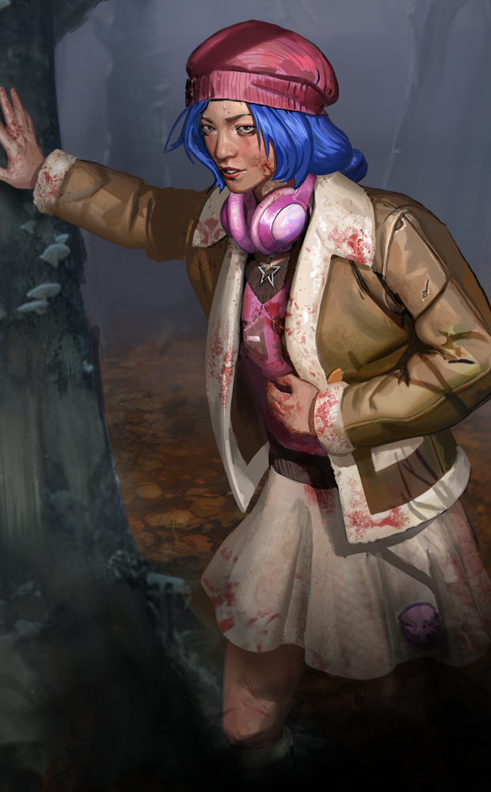
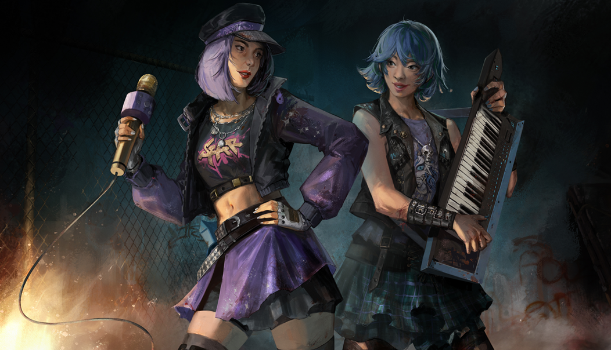

# Latest live content · 8.2.0_2054297live

Built 2024-10-03 14:48 UTC · [what changed in this version](../versions/8.2.0_2054297live/CHANGES.md) · [← back](../README.md)

This folder always holds the newest version. Its commit history shows every change from one version to the next.

[Core (3)](#core) · [Images (7)](#images)

## Core

- [`GameConfigs.json`](GameConfigs.json) — client game configuration
- [`GameConfigsDS.json`](GameConfigsDS.json) — dedicated server configuration
- [`dynamicContent/DynamicContent.json`](dynamicContent/DynamicContent.json) — the manifest of every file below

## Images

