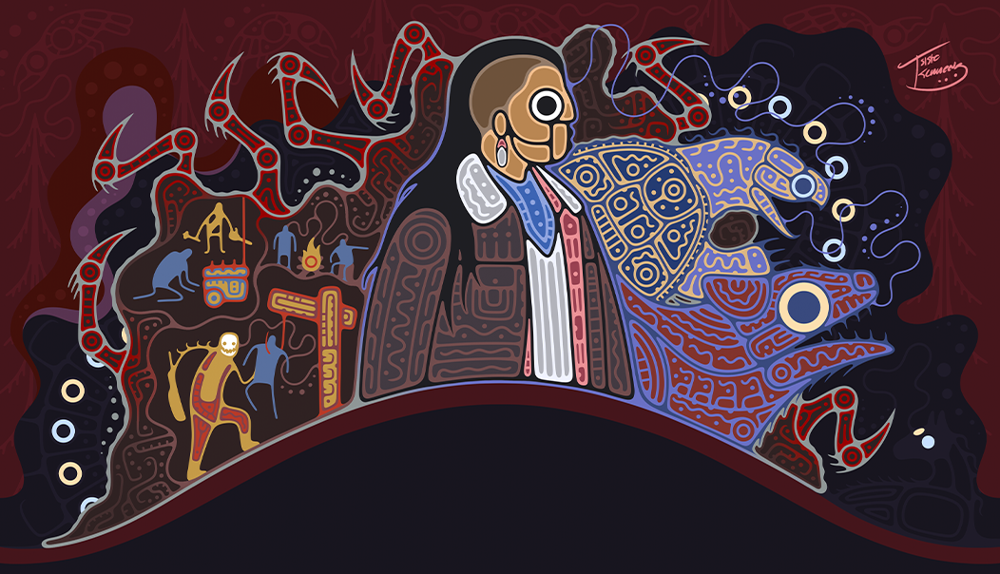
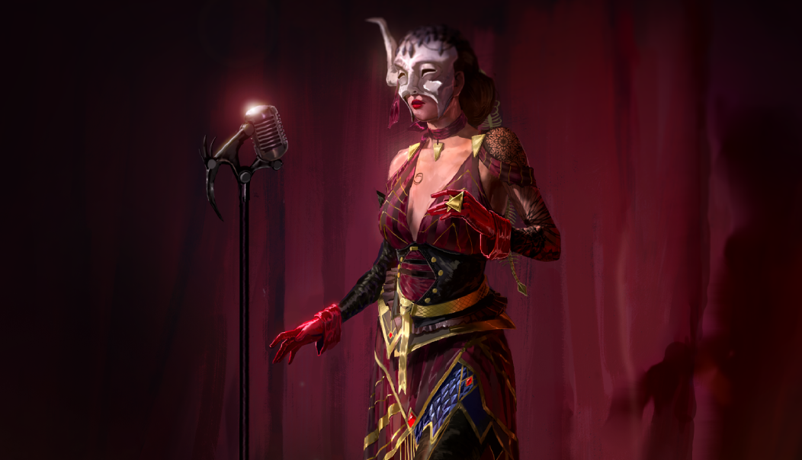
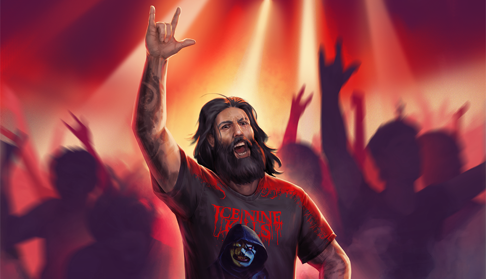

# live · 10.0.0_3420915live

| | |
|---|---|
| Build date | 2026-06-10 13:05 UTC |
| CDN version | `10.0.0_3420915live-1781096707` |
| Key | `10.0.0_live` |
| Compared with | [9.6.2_3418245live](../9.6.2_3418245live/CHANGES.md) (2026-06-09 14:39 UTC) |

## Summary

**10** added · **45** modified · **2** removed · 163 unchanged

## New or updated images

<a href="images/T_UI_ChapterBundle_Jason.png"></a>
<a href="images/T_UI_ChapterBundle_TheLifeRoad.png"></a>
<a href="images/T_UI_CollectionBanner_Black_Banquet.png"></a>
<a href="images/T_UI_CollectionBanner_Ice_Nine_Kills.png"></a>
<a href="images/T_UI_CollectionBanner_Jason.png"></a>
<a href="images/T_UI_SpecialPack_Black_Banquet.png"></a>
<a href="images/T_UI_SpecialPack_Ice_Nine_Kills.png"></a>
<a href="images/T_UI_SpecialPack_Jason.png"></a>
<a href="images/T_UI_icon_Event_LaFogata.png"></a>

## Added files

- [`narrativeCollections.json`](narrativeCollections.json)

## Removed files

- `images/T_UI_CollectionBanner_DarkOvergrowth.png`
- `images/T_UI_SpecialPack_DarkOvergrowth.png`

## Modified files

### [`GameConfigs.json`](GameConfigs.json)

[Full line-by-line diff](diffs/GameConfigs.json.diff)

```diff
+ $.enableBetaHub: true
+ $.enableUmgMatchmakingRefactor: false
```

### [`bloodwebGenerationRules.json`](bloodwebGenerationRules.json)

[Full line-by-line diff](diffs/bloodwebGenerationRules.json.diff)

```diff
+ $.BulkCost[18]
+ $.EventChestProbability[15]
```

### [`catalog.json`](catalog.json)

[Full line-by-line diff](diffs/catalog.json.diff)

```diff
- $[id=RAM_012]
- $[id=RAM_013]
+ $[id=K43]
+ $[id=S53]
+ $[id=BE_W032]
+ $[id=CM_Head036]
+ $[id=CM_Legs036]
+ $[id=CM_Torso031_01]
+ $[id=CM_Torso036]
+ $[id=DF_Head040]
+ $[id=DF_Legs040]
+ $[id=DF_Torso030_04]
+ $[id=DF_Torso037_01]
+ $[id=DF_Torso040]
+ $[id=DO_Body028]
+ $[id=DO_Head028]
+ $[id=DO_W028]
+ $[id=GS_Head040]
+ $[id=GS_Legs040]
+ $[id=GS_Torso028_05]
+ $[id=GS_Torso036_01]
+ $[id=GS_Torso040]
+ $[id=JP_Torso029_01]
+ $[id=K22_W016]
+ $[id=K28_W023]
+ $[id=K43_BDG_P100]
+ $[id=K43_BDG_P25]
+ $[id=K43_BDG_P50]
+ $[id=K43_BDG_P75]
+ $[id=K43_Body006]
+ $[id=K43_Body007]
+ $[id=K43_Body01]
+ $[id=K43_Body01_P01]
+ $[id=K43_Body02]
+ $[id=K43_Body02_01]
+ $[id=K43_Head006]
+ $[id=K43_Head007]
+ $[id=K43_Head01]
+ $[id=K43_Head01_P01]
+ $[id=K43_Head02]
+ $[id=K43_Head02_01]
+ $[id=K43_PCharm001]
+ $[id=K43_PCharm002]
+ $[id=K43_PCharm003]
+ $[id=K43_W006]
+ $[id=K43_W007]
+ $[id=K43_W01]
+ $[id=K43_W01_P01]
+ $[id=K43_W02]
+ $[id=K43_W02_01]
+ $[id=KK_Body041]
+ $[id=KK_Mask040]
+ $[id=KK_Mask041]
+ $[id=KK_W041]
+ $[id=KS_Torso021_05]
+ $[id=KS_Torso025_01]
+ $[id=MT_Torso028_04]
+ $[id=MT_Torso035_01]
+ $[id=NK_Head038]
+ $[id=RAM_BDG_08]
+ $[id=RAM_BDG_09]
+ $[id=RAM_BDG_14]
+ $[id=RAM_BNR_03]
+ $[id=RAM_BNR_04]
+ $[id=S22_Head014]
+ $[id=S22_Legs014]
+ $[id=S22_Torso014]
+ $[id=S25_Torso022_05]
+ $[id=S49_Torso008_02]
+ $[id=S52_Head009]
+ $[id=S53_BDG_P100]
+ $[id=S53_BDG_P25]
+ $[id=S53_BDG_P50]
+ $[id=S53_BDG_P75]
+ $[id=S53_Head006]
+ $[id=S53_Head006_01]
+ $[id=S53_Head01]
+ $[id=S53_Head01_01]
+ $[id=S53_Head01_02]
+ $[id=S53_Head01_03]
+ $[id=S53_Head01_P01]
+ $[id=S53_Head02]
+ $[id=S53_Head02_01]
+ $[id=S53_Legs006]
+ $[id=S53_Legs006_01]
+ $[id=S53_Legs01]
+ $[id=S53_Legs01_01]
+ $[id=S53_Legs01_02]
+ $[id=S53_Legs01_03]
+ $[id=S53_Legs01_CV01]
+ $[id=S53_Legs01_CV02]
+ $[id=S53_Legs01_CV03]
+ $[id=S53_Legs01_CV04]
+ $[id=S53_Legs01_P01]
+ $[id=S53_Legs02]
+ $[id=S53_Legs02_01]
+ $[id=S53_PCharm001]
+ $[id=S53_PCharm002]
+ $[id=S53_PCharm003]
+ $[id=S53_Torso006]
+ $[id=S53_Torso006_01]
+ $[id=S53_Torso01]
+ $[id=S53_Torso01_01]
+ $[id=S53_Torso01_02]
+ $[id=S53_Torso01_03]
+ $[id=S53_Torso01_04]
+ $[id=S53_Torso01_05]
+ $[id=S53_Torso01_CV01]
+ $[id=S53_Torso01_CV02]
+ $[id=S53_Torso01_CV03]
+ $[id=S53_Torso01_CV04]
+ $[id=S53_Torso01_P01]
+ $[id=S53_Torso02]
+ $[id=S53_Torso02_01]
+ $[id=SK_Body025]
+ $[id=SK_Mask025]
+ $[id=SK_W025]
+ $[id=SS_Head033]
+ $[id=SUS_001]
+ $[id=SUS_002]
+ $[id=SUS_003]
+ $[id=SUS_004]
+ $[id=SUS_016]
+ $[id=SUS_017]
+ $[id=SUS_BDG_01]
+ $[id=SUS_BDG_02]
+ $[id=SUS_BDG_03]
+ $[id=SUS_BDG_04]
+ $[id=SUS_BDG_05]
+ $[id=SUS_BDG_06]
+ $[id=SUS_BDG_07]
+ $[id=SUS_BDG_08]
+ $[id=SUS_BDG_09]
+ $[id=SUS_BDG_10]
+ $[id=SUS_BDG_11]
+ $[id=SUS_BNR_01]
+ $[id=SUS_BNR_02]
+ $[id=SUS_BNR_03]
+ $[id=SUS_BNR_04]
+ $[id=SUS_BNR_05]
+ $[id=SUS_BNR_06]
+ $[id=SUS_BNR_07]
+ $[id=SUS_BNR_11]
+ $[id=SUS_BNR_12]
+ $[id=SUS_BNR_13]
+ $[id=SUS_BNR_14]
+ $[id=TR_Body030]
+ $[id=TR_Mask030]
+ $[id=TR_W030]
+ $[id=CM_outfit_036]
+ $[id=DF_outfit_040]
+ $[id=DO_outfit_028]
+ $[id=GS_outfit_040]
+ $[id=K43_outfit_006]
+ $[id=K43_outfit_007]
+ $[id=K43_outfit_01]
+ $[id=K43_outfit_01_P01]
+ $[id=K43_outfit_02]
+ $[id=K43_outfit_02_01]
+ $[id=KK_outfit_041]
+ $[id=S22_outfit_014]
+ $[id=S53_outfit_006]
+ $[id=S53_outfit_006_01]
+ $[id=S53_outfit_01]
+ $[id=S53_outfit_01_01]
+ $[id=S53_outfit_01_02]
+ $[id=S53_outfit_01_03]
+ $[id=S53_outfit_01_CV01]
+ $[id=S53_outfit_01_CV02]
+ $[id=S53_outfit_01_CV03]
+ $[id=S53_outfit_01_CV04]
+ $[id=S53_outfit_01_P01]
+ $[id=S53_outfit_02]
+ $[id=S53_outfit_02_01]
+ $[id=SK_outfit_025]
+ $[id=TR_outfit_030]
+ $[id=10.0.0_Anniversary_2025_Bundle]
+ $[id=10.0.0_Black_Banquet_Bundle]
+ $[id=10.0.0_INK_Bundle]
+ $[id=Sushi_CHPTR40_Bundle]
+ $[id=10.0.0_IceNineKills_collection_item]
+ $[id=Creator_Twitch_Shirts_collection_item]
+ $[id=10.0.0_Jason_collection_item]
+ $[id=10.0.0_TwistedMasquerade_collection_item]
+ $[id=10.0.0_BlackBanquet_collection_item]
+ $[id=10.0.0_SilentHill_collection_item]
- $[id=BE_W029].defaultCost[0].currencyId: "AnniversaryEventCurrency"
+ $[id=BE_W029].defaultCost[0].currencyId: "Cells"
- $[id=BE_W029].defaultCost[0].price: 150
+ $[id=BE_W029].defaultCost[0].price: 400
- $[id=BE_W029].purchasable: true
+ $[id=BE_W029].purchasable: false
- $[id=CM_Head032].defaultCost[0].currencyId: "AnniversaryEventCurrency"
+ $[id=CM_Head032].defaultCost[0].currencyId: "Cells"
- $[id=CM_Head032].defaultCost[0].price: 150
+ $[id=CM_Head032].defaultCost[0].price: 400
- $[id=CM_Head032].purchasable: true
+ $[id=CM_Head032].purchasable: false
- $[id=DO_W027].defaultCost[0].currencyId: "AnniversaryEventCurrency"
+ $[id=DO_W027].defaultCost[0].currencyId: "Cells"
… 96 more change(s) — see the commit diff for everything
```

### [`challengeLocs/challengeText_de.json`](challengeLocs/challengeText_de.json)

[Full line-by-line diff](diffs/challengeLocs/challengeText_de.json.diff)

```diff
+ $.locText[600]
+ $.locText[601]
+ $.locText[602]
+ $.locText[603]
+ $.locText[604]
+ $.locText[605]
+ $.locText[606]
+ $.locText[607]
+ $.locText[608]
+ $.locText[609]
+ $.locText[610]
+ $.locText[611]
+ $.locText[612]
+ $.locText[613]
+ $.locText[614]
+ $.locText[615]
+ $.locText[616]
+ $.locText[617]
+ $.locText[618]
+ $.locText[619]
+ $.locText[620]
+ $.locText[621]
+ $.locText[622]
+ $.locText[623]
+ $.locText[624]
+ $.locText[625]
+ $.locText[626]
+ $.locText[627]
+ $.locText[628]
+ $.locText[629]
+ $.locText[630]
+ $.locText[631]
+ $.locText[632]
+ $.locText[633]
+ $.locText[634]
+ $.locText[635]
+ $.locText[636]
+ $.locText[637]
+ $.locText[638]
+ $.locText[639]
```

### [`challengeLocs/challengeText_en.json`](challengeLocs/challengeText_en.json)

[Full line-by-line diff](diffs/challengeLocs/challengeText_en.json.diff)

```diff
+ $.locText[600]
+ $.locText[601]
+ $.locText[602]
+ $.locText[603]
+ $.locText[604]
+ $.locText[605]
+ $.locText[606]
+ $.locText[607]
+ $.locText[608]
+ $.locText[609]
+ $.locText[610]
+ $.locText[611]
+ $.locText[612]
+ $.locText[613]
+ $.locText[614]
+ $.locText[615]
+ $.locText[616]
+ $.locText[617]
+ $.locText[618]
+ $.locText[619]
+ $.locText[620]
+ $.locText[621]
+ $.locText[622]
+ $.locText[623]
+ $.locText[624]
+ $.locText[625]
+ $.locText[626]
+ $.locText[627]
+ $.locText[628]
+ $.locText[629]
+ $.locText[630]
+ $.locText[631]
+ $.locText[632]
+ $.locText[633]
+ $.locText[634]
+ $.locText[635]
+ $.locText[636]
+ $.locText[637]
+ $.locText[638]
+ $.locText[639]
```

### [`challengeLocs/challengeText_es-MX.json`](challengeLocs/challengeText_es-MX.json)

[Full line-by-line diff](diffs/challengeLocs/challengeText_es-MX.json.diff)

```diff
+ $.locText[600]
+ $.locText[601]
+ $.locText[602]
+ $.locText[603]
+ $.locText[604]
+ $.locText[605]
+ $.locText[606]
+ $.locText[607]
+ $.locText[608]
+ $.locText[609]
+ $.locText[610]
+ $.locText[611]
+ $.locText[612]
+ $.locText[613]
+ $.locText[614]
+ $.locText[615]
+ $.locText[616]
+ $.locText[617]
+ $.locText[618]
+ $.locText[619]
+ $.locText[620]
+ $.locText[621]
+ $.locText[622]
+ $.locText[623]
+ $.locText[624]
+ $.locText[625]
+ $.locText[626]
+ $.locText[627]
+ $.locText[628]
+ $.locText[629]
+ $.locText[630]
+ $.locText[631]
+ $.locText[632]
+ $.locText[633]
+ $.locText[634]
+ $.locText[635]
+ $.locText[636]
+ $.locText[637]
+ $.locText[638]
+ $.locText[639]
```

### [`challengeLocs/challengeText_es.json`](challengeLocs/challengeText_es.json)

[Full line-by-line diff](diffs/challengeLocs/challengeText_es.json.diff)

```diff
+ $.locText[600]
+ $.locText[601]
+ $.locText[602]
+ $.locText[603]
+ $.locText[604]
+ $.locText[605]
+ $.locText[606]
+ $.locText[607]
+ $.locText[608]
+ $.locText[609]
+ $.locText[610]
+ $.locText[611]
+ $.locText[612]
+ $.locText[613]
+ $.locText[614]
+ $.locText[615]
+ $.locText[616]
+ $.locText[617]
+ $.locText[618]
+ $.locText[619]
+ $.locText[620]
+ $.locText[621]
+ $.locText[622]
+ $.locText[623]
+ $.locText[624]
+ $.locText[625]
+ $.locText[626]
+ $.locText[627]
+ $.locText[628]
+ $.locText[629]
+ $.locText[630]
+ $.locText[631]
+ $.locText[632]
+ $.locText[633]
+ $.locText[634]
+ $.locText[635]
+ $.locText[636]
+ $.locText[637]
+ $.locText[638]
+ $.locText[639]
```

### [`challengeLocs/challengeText_fr.json`](challengeLocs/challengeText_fr.json)

[Full line-by-line diff](diffs/challengeLocs/challengeText_fr.json.diff)

```diff
+ $.locText[600]
+ $.locText[601]
+ $.locText[602]
+ $.locText[603]
+ $.locText[604]
+ $.locText[605]
+ $.locText[606]
+ $.locText[607]
+ $.locText[608]
+ $.locText[609]
+ $.locText[610]
+ $.locText[611]
+ $.locText[612]
+ $.locText[613]
+ $.locText[614]
+ $.locText[615]
+ $.locText[616]
+ $.locText[617]
+ $.locText[618]
+ $.locText[619]
+ $.locText[620]
+ $.locText[621]
+ $.locText[622]
+ $.locText[623]
+ $.locText[624]
+ $.locText[625]
+ $.locText[626]
+ $.locText[627]
+ $.locText[628]
+ $.locText[629]
+ $.locText[630]
+ $.locText[631]
+ $.locText[632]
+ $.locText[633]
+ $.locText[634]
+ $.locText[635]
+ $.locText[636]
+ $.locText[637]
+ $.locText[638]
+ $.locText[639]
```

### [`challengeLocs/challengeText_it.json`](challengeLocs/challengeText_it.json)

[Full line-by-line diff](diffs/challengeLocs/challengeText_it.json.diff)

```diff
+ $.locText[600]
+ $.locText[601]
+ $.locText[602]
+ $.locText[603]
+ $.locText[604]
+ $.locText[605]
+ $.locText[606]
+ $.locText[607]
+ $.locText[608]
+ $.locText[609]
+ $.locText[610]
+ $.locText[611]
+ $.locText[612]
+ $.locText[613]
+ $.locText[614]
+ $.locText[615]
+ $.locText[616]
+ $.locText[617]
+ $.locText[618]
+ $.locText[619]
+ $.locText[620]
+ $.locText[621]
+ $.locText[622]
+ $.locText[623]
+ $.locText[624]
+ $.locText[625]
+ $.locText[626]
+ $.locText[627]
+ $.locText[628]
+ $.locText[629]
+ $.locText[630]
+ $.locText[631]
+ $.locText[632]
+ $.locText[633]
+ $.locText[634]
+ $.locText[635]
+ $.locText[636]
+ $.locText[637]
+ $.locText[638]
+ $.locText[639]
```

### [`challengeLocs/challengeText_ja.json`](challengeLocs/challengeText_ja.json)

[Full line-by-line diff](diffs/challengeLocs/challengeText_ja.json.diff)

```diff
+ $.locText[600]
+ $.locText[601]
+ $.locText[602]
+ $.locText[603]
+ $.locText[604]
+ $.locText[605]
+ $.locText[606]
+ $.locText[607]
+ $.locText[608]
+ $.locText[609]
+ $.locText[610]
+ $.locText[611]
+ $.locText[612]
+ $.locText[613]
+ $.locText[614]
+ $.locText[615]
+ $.locText[616]
+ $.locText[617]
+ $.locText[618]
+ $.locText[619]
+ $.locText[620]
+ $.locText[621]
+ $.locText[622]
+ $.locText[623]
+ $.locText[624]
+ $.locText[625]
+ $.locText[626]
+ $.locText[627]
+ $.locText[628]
+ $.locText[629]
+ $.locText[630]
+ $.locText[631]
+ $.locText[632]
+ $.locText[633]
+ $.locText[634]
+ $.locText[635]
+ $.locText[636]
+ $.locText[637]
+ $.locText[638]
+ $.locText[639]
```

### [`challengeLocs/challengeText_ko.json`](challengeLocs/challengeText_ko.json)

[Full line-by-line diff](diffs/challengeLocs/challengeText_ko.json.diff)

```diff
+ $.locText[600]
+ $.locText[601]
+ $.locText[602]
+ $.locText[603]
+ $.locText[604]
+ $.locText[605]
+ $.locText[606]
+ $.locText[607]
+ $.locText[608]
+ $.locText[609]
+ $.locText[610]
+ $.locText[611]
+ $.locText[612]
+ $.locText[613]
+ $.locText[614]
+ $.locText[615]
+ $.locText[616]
+ $.locText[617]
+ $.locText[618]
+ $.locText[619]
+ $.locText[620]
+ $.locText[621]
+ $.locText[622]
+ $.locText[623]
+ $.locText[624]
+ $.locText[625]
+ $.locText[626]
+ $.locText[627]
+ $.locText[628]
+ $.locText[629]
+ $.locText[630]
+ $.locText[631]
+ $.locText[632]
+ $.locText[633]
+ $.locText[634]
+ $.locText[635]
+ $.locText[636]
+ $.locText[637]
+ $.locText[638]
+ $.locText[639]
```

### [`challengeLocs/challengeText_pl.json`](challengeLocs/challengeText_pl.json)

[Full line-by-line diff](diffs/challengeLocs/challengeText_pl.json.diff)

```diff
+ $.locText[600]
+ $.locText[601]
+ $.locText[602]
+ $.locText[603]
+ $.locText[604]
+ $.locText[605]
+ $.locText[606]
+ $.locText[607]
+ $.locText[608]
+ $.locText[609]
+ $.locText[610]
+ $.locText[611]
+ $.locText[612]
+ $.locText[613]
+ $.locText[614]
+ $.locText[615]
+ $.locText[616]
+ $.locText[617]
+ $.locText[618]
+ $.locText[619]
+ $.locText[620]
+ $.locText[621]
+ $.locText[622]
+ $.locText[623]
+ $.locText[624]
+ $.locText[625]
+ $.locText[626]
+ $.locText[627]
+ $.locText[628]
+ $.locText[629]
+ $.locText[630]
+ $.locText[631]
+ $.locText[632]
+ $.locText[633]
+ $.locText[634]
+ $.locText[635]
+ $.locText[636]
+ $.locText[637]
+ $.locText[638]
+ $.locText[639]
```

### [`challengeLocs/challengeText_pt-BR.json`](challengeLocs/challengeText_pt-BR.json)

[Full line-by-line diff](diffs/challengeLocs/challengeText_pt-BR.json.diff)

```diff
+ $.locText[600]
+ $.locText[601]
+ $.locText[602]
+ $.locText[603]
+ $.locText[604]
+ $.locText[605]
+ $.locText[606]
+ $.locText[607]
+ $.locText[608]
+ $.locText[609]
+ $.locText[610]
+ $.locText[611]
+ $.locText[612]
+ $.locText[613]
+ $.locText[614]
+ $.locText[615]
+ $.locText[616]
+ $.locText[617]
+ $.locText[618]
+ $.locText[619]
+ $.locText[620]
+ $.locText[621]
+ $.locText[622]
+ $.locText[623]
+ $.locText[624]
+ $.locText[625]
+ $.locText[626]
+ $.locText[627]
+ $.locText[628]
+ $.locText[629]
+ $.locText[630]
+ $.locText[631]
+ $.locText[632]
+ $.locText[633]
+ $.locText[634]
+ $.locText[635]
+ $.locText[636]
+ $.locText[637]
+ $.locText[638]
+ $.locText[639]
```

### [`challengeLocs/challengeText_ru.json`](challengeLocs/challengeText_ru.json)

[Full line-by-line diff](diffs/challengeLocs/challengeText_ru.json.diff)

```diff
+ $.locText[600]
+ $.locText[601]
+ $.locText[602]
+ $.locText[603]
+ $.locText[604]
+ $.locText[605]
+ $.locText[606]
+ $.locText[607]
+ $.locText[608]
+ $.locText[609]
+ $.locText[610]
+ $.locText[611]
+ $.locText[612]
+ $.locText[613]
+ $.locText[614]
+ $.locText[615]
+ $.locText[616]
+ $.locText[617]
+ $.locText[618]
+ $.locText[619]
+ $.locText[620]
+ $.locText[621]
+ $.locText[622]
+ $.locText[623]
+ $.locText[624]
+ $.locText[625]
+ $.locText[626]
+ $.locText[627]
+ $.locText[628]
+ $.locText[629]
+ $.locText[630]
+ $.locText[631]
+ $.locText[632]
+ $.locText[633]
+ $.locText[634]
+ $.locText[635]
+ $.locText[636]
+ $.locText[637]
+ $.locText[638]
+ $.locText[639]
```

### [`challengeLocs/challengeText_th.json`](challengeLocs/challengeText_th.json)

[Full line-by-line diff](diffs/challengeLocs/challengeText_th.json.diff)

```diff
+ $.locText[600]
+ $.locText[601]
+ $.locText[602]
+ $.locText[603]
+ $.locText[604]
+ $.locText[605]
+ $.locText[606]
+ $.locText[607]
+ $.locText[608]
+ $.locText[609]
+ $.locText[610]
+ $.locText[611]
+ $.locText[612]
+ $.locText[613]
+ $.locText[614]
+ $.locText[615]
+ $.locText[616]
+ $.locText[617]
+ $.locText[618]
+ $.locText[619]
+ $.locText[620]
+ $.locText[621]
+ $.locText[622]
+ $.locText[623]
+ $.locText[624]
+ $.locText[625]
+ $.locText[626]
+ $.locText[627]
+ $.locText[628]
+ $.locText[629]
+ $.locText[630]
+ $.locText[631]
+ $.locText[632]
+ $.locText[633]
+ $.locText[634]
+ $.locText[635]
+ $.locText[636]
+ $.locText[637]
+ $.locText[638]
+ $.locText[639]
```

### [`challengeLocs/challengeText_tr.json`](challengeLocs/challengeText_tr.json)

[Full line-by-line diff](diffs/challengeLocs/challengeText_tr.json.diff)

```diff
+ $.locText[600]
+ $.locText[601]
+ $.locText[602]
+ $.locText[603]
+ $.locText[604]
+ $.locText[605]
+ $.locText[606]
+ $.locText[607]
+ $.locText[608]
+ $.locText[609]
+ $.locText[610]
+ $.locText[611]
+ $.locText[612]
+ $.locText[613]
+ $.locText[614]
+ $.locText[615]
+ $.locText[616]
+ $.locText[617]
+ $.locText[618]
+ $.locText[619]
+ $.locText[620]
+ $.locText[621]
+ $.locText[622]
+ $.locText[623]
+ $.locText[624]
+ $.locText[625]
+ $.locText[626]
+ $.locText[627]
+ $.locText[628]
+ $.locText[629]
+ $.locText[630]
+ $.locText[631]
+ $.locText[632]
+ $.locText[633]
+ $.locText[634]
+ $.locText[635]
+ $.locText[636]
+ $.locText[637]
+ $.locText[638]
+ $.locText[639]
```

### [`challengeLocs/challengeText_zh-Hans.json`](challengeLocs/challengeText_zh-Hans.json)

[Full line-by-line diff](diffs/challengeLocs/challengeText_zh-Hans.json.diff)

```diff
+ $.locText[600]
+ $.locText[601]
+ $.locText[602]
+ $.locText[603]
+ $.locText[604]
+ $.locText[605]
+ $.locText[606]
+ $.locText[607]
+ $.locText[608]
+ $.locText[609]
+ $.locText[610]
+ $.locText[611]
+ $.locText[612]
+ $.locText[613]
+ $.locText[614]
+ $.locText[615]
+ $.locText[616]
+ $.locText[617]
+ $.locText[618]
+ $.locText[619]
+ $.locText[620]
+ $.locText[621]
+ $.locText[622]
+ $.locText[623]
+ $.locText[624]
+ $.locText[625]
+ $.locText[626]
+ $.locText[627]
+ $.locText[628]
+ $.locText[629]
+ $.locText[630]
+ $.locText[631]
+ $.locText[632]
+ $.locText[633]
+ $.locText[634]
+ $.locText[635]
+ $.locText[636]
+ $.locText[637]
+ $.locText[638]
+ $.locText[639]
```

### [`challengeLocs/challengeText_zh-Hant.json`](challengeLocs/challengeText_zh-Hant.json)

[Full line-by-line diff](diffs/challengeLocs/challengeText_zh-Hant.json.diff)

```diff
+ $.locText[600]
+ $.locText[601]
+ $.locText[602]
+ $.locText[603]
+ $.locText[604]
+ $.locText[605]
+ $.locText[606]
+ $.locText[607]
+ $.locText[608]
+ $.locText[609]
+ $.locText[610]
+ $.locText[611]
+ $.locText[612]
+ $.locText[613]
+ $.locText[614]
+ $.locText[615]
+ $.locText[616]
+ $.locText[617]
+ $.locText[618]
+ $.locText[619]
+ $.locText[620]
+ $.locText[621]
+ $.locText[622]
+ $.locText[623]
+ $.locText[624]
+ $.locText[625]
+ $.locText[626]
+ $.locText[627]
+ $.locText[628]
+ $.locText[629]
+ $.locText[630]
+ $.locText[631]
+ $.locText[632]
+ $.locText[633]
+ $.locText[634]
+ $.locText[635]
+ $.locText[636]
+ $.locText[637]
+ $.locText[638]
+ $.locText[639]
```

### [`challengeSets.json`](challengeSets.json)

[Full line-by-line diff](diffs/challengeSets.json.diff)

```diff
+ $.Anniversary2026
+ $.LaFogata2026
```

### [`collections.json`](collections.json)

[Full line-by-line diff](diffs/collections.json.diff)

```diff
+ $.collections[63].additionalImages[0]
- $.collections[63].collectionId: "GreekLegends"
+ $.collections[63].collectionId: "10.0.0_IceNineKills"
- $.collections[63].collectionTitle.de: "Griechische Legenden"
+ $.collections[63].collectionTitle.de: "Ice Nine Kills"
- $.collections[63].collectionTitle.en: "Greek Legends"
+ $.collections[63].collectionTitle.en: "Ice Nine Kills"
- $.collections[63].collectionTitle.es: "Leyendas griegas"
+ $.collections[63].collectionTitle.es: "Ice Nine Kills"
- $.collections[63].collectionTitle["es-MX"]: "Leyendas griegas"
+ $.collections[63].collectionTitle["es-MX"]: "Ice Nine Kills"
- $.collections[63].collectionTitle.fr: "Légendes grecques"
+ $.collections[63].collectionTitle.fr: "Ice Nine Kills"
- $.collections[63].collectionTitle.it: "Leggende greche"
+ $.collections[63].collectionTitle.it: "Nove uccisioni"
- $.collections[63].collectionTitle.ja: "ギリシャの伝説"
+ $.collections[63].collectionTitle.ja: "アイス・ナイン・キルズ"
- $.collections[63].collectionTitle.ko: "그리스 전설"
+ $.collections[63].collectionTitle.ko: "아이스 나인 킬즈"
- $.collections[63].collectionTitle.pl: "Greckie legendy"
+ $.collections[63].collectionTitle.pl: "Ice Nine Kills"
- $.collections[63].collectionTitle["pt-BR"]: "Lendas Gregas"
+ $.collections[63].collectionTitle["pt-BR"]: "Ice Nine Kills"
- $.collections[63].collectionTitle.ru: "Легенды Греции"
+ $.collections[63].collectionTitle.ru: "Ice Nine Kills"
- $.collections[63].collectionTitle.th: "ตำนานกรีก"
+ $.collections[63].collectionTitle.th: "Ice Nine Kills"
- $.collections[63].collectionTitle.tr: "Yunan Efsaneleri"
+ $.collections[63].collectionTitle.tr: "Ice Nine Kills"
- $.collections[63].collectionTitle["zh-Hans"]: "希腊传说"
+ $.collections[63].collectionTitle["zh-Hans"]: "Ice Nine Kills"
- $.collections[63].collectionTitle["zh-Hant"]: "希臘傳奇"
+ $.collections[63].collectionTitle["zh-Hant"]: "冰九殺"
- $.collections[63].heroImage.path: "/Game/UI/UMGAssets/Icons/Banners/CollectionBanners/T_UI_CollectionBanner_GreekLegends.T_UI_CollectionBanner_GreekLegends"
+ $.collections[63].heroImage.path: "/Game/UI/UMGAssets/Icons/Banners/CollectionBanners/Sushi/T_UI_CollectionBanner_Ice_Nine_Kills.T_UI_CollectionBanner_Ice_Nine_Kills"
- $.collections[63].inclusionVersion: "7.7.0 PTB"
+ $.collections[63].inclusionVersion: "10.0.0"
- $.collections[63].items[]: "AV_outfit_014"
- $.collections[63].items[]: "DK_outfit_012"
- $.collections[63].items[]: "FM_outfit_012"
- $.collections[63].items[]: "GK_outfit_011"
- $.collections[63].items[]: "GS_outfit_016"
- $.collections[63].items[]: "HK_outfit_011"
- $.collections[63].items[]: "HS_outfit_010"
- $.collections[63].items[]: "K21_outfit_008"
- $.collections[63].items[]: "K26_outfit_009"
- $.collections[63].items[]: "K28_outfit_010"
- $.collections[63].items[]: "KS_outfit_012"
- $.collections[63].items[]: "MK_outfit_013"
- $.collections[63].items[]: "MS_outfit_013"
- $.collections[63].items[]: "NK_outfit_022"
- $.collections[63].items[]: "S24_outfit_009"
- $.collections[63].items[]: "S28_outfit_014"
- $.collections[63].items[]: "S35_outfit_009"
- $.collections[63].items[]: "S36_outfit_009"
- $.collections[63].items[]: "SwedenKiller_outfit_009"
- $.collections[63].items[]: "SwedenSurvivor_outfit_011"
- $.collections[63].items[]: "TN_outfit_013"
- $.collections[63].items[]: "US_outfit_009"
+ $.collections[63].items[]: "DF_Torso030_04"
+ $.collections[63].items[]: "GS_Torso028_05"
+ $.collections[63].items[]: "KK_Mask040"
+ $.collections[63].items[]: "KS_Torso021_05"
+ $.collections[63].items[]: "MT_Torso028_04"
+ $.collections[63].items[]: "S25_Torso022_05"
+ $.collections[63].items[]: "S49_Torso008_02"
- $.collections[63].sortOrder: "-25"
+ $.collections[63].sortOrder: "-235"
- $.collections[63].updatedDate: "2024-03-18T16:00:01Z"
+ $.collections[63].updatedDate: "2026-03-26T13:30:27.895Z"
+ $.collections[64].limitedAvailabilityEndDate: "2024-01-01T15:00:00Z"
+ $.collections[64].visibleAfterEndDate: false
- $.collections[64].collectionId: "MeanStreets"
+ $.collections[64].collectionId: "Creator_Twitch_Shirts"
- $.collections[64].collectionTitle.de: "Gefährliche Straßen"
+ $.collections[64].collectionTitle.de: "@#UMG_STORE_COLLECTION_TWITCH_SHIRTS"
- $.collections[64].collectionTitle.en: "Mean Streets"
+ $.collections[64].collectionTitle.en: "@#UMG_STORE_COLLECTION_TWITCH_SHIRTS"
- $.collections[64].collectionTitle.es: "Calles peligrosas"
+ $.collections[64].collectionTitle.es: "@#UMG_STORE_COLLECTION_TWITCH_SHIRTS"
- $.collections[64].collectionTitle["es-MX"]: "Calles peligrosas"
+ $.collections[64].collectionTitle["es-MX"]: "@#UMG_STORE_COLLECTION_TWITCH_SHIRTS"
- $.collections[64].collectionTitle.fr: "Rues dangereuses"
+ $.collections[64].collectionTitle.fr: "@#UMG_STORE_COLLECTION_TWITCH_SHIRTS"
- $.collections[64].collectionTitle.it: "Bassifondi"
+ $.collections[64].collectionTitle.it: "@#UMG_STORE_COLLECTION_TWITCH_SHIRTS"
- $.collections[64].collectionTitle.ja: "意地悪なストリート"
+ $.collections[64].collectionTitle.ja: "@#UMG_STORE_COLLECTION_TWITCH_SHIRTS"
- $.collections[64].collectionTitle.ko: "비열한 거리"
+ $.collections[64].collectionTitle.ko: "@#UMG_STORE_COLLECTION_TWITCH_SHIRTS"
- $.collections[64].collectionTitle.pl: "Podła dzielnica"
+ $.collections[64].collectionTitle.pl: "@#UMG_STORE_COLLECTION_TWITCH_SHIRTS"
- $.collections[64].collectionTitle["pt-BR"]: "Ruas Cruéis"
+ $.collections[64].collectionTitle["pt-BR"]: "@#UMG_STORE_COLLECTION_TWITCH_SHIRTS"
- $.collections[64].collectionTitle.ru: "Трущобы"
+ $.collections[64].collectionTitle.ru: "@#UMG_STORE_COLLECTION_TWITCH_SHIRTS"
- $.collections[64].collectionTitle.th: "ถนนซอมซ่อ"
+ $.collections[64].collectionTitle.th: "@#UMG_STORE_COLLECTION_TWITCH_SHIRTS"
- $.collections[64].collectionTitle.tr: "Amansız Sokaklar"
+ $.collections[64].collectionTitle.tr: "@#UMG_STORE_COLLECTION_TWITCH_SHIRTS"
- $.collections[64].collectionTitle["zh-Hans"]: "穷街陋巷"
+ $.collections[64].collectionTitle["zh-Hans"]: "@#UMG_STORE_COLLECTION_TWITCH_SHIRTS"
- $.collections[64].collectionTitle["zh-Hant"]: "窮街陋巷"
+ $.collections[64].collectionTitle["zh-Hant"]: "@#UMG_STORE_COLLECTION_TWITCH_SHIRTS"
- $.collections[64].heroImage.path: "/Game/UI/UMGAssets/Icons/Banners/CollectionBanners/T_UI_CollectionBanner_MeanStreets.T_UI_CollectionBanner_MeanStreets"
+ $.collections[64].heroImage.path: "/Game/UI/UMGAssets/Icons/Customization/DF_Torso04_TwitchKraken.DF_Torso04_TwitchKraken"
- $.collections[64].inclusionVersion: "7.7.0 PTB"
+ $.collections[64].inclusionVersion: "10.0.0"
- $.collections[64].items[]: "AV_outfit_010"
- $.collections[64].items[]: "Claudette_outfit_009_01"
- $.collections[64].items[]: "DK_outfit_011"
- $.collections[64].items[]: "HS_outfit_009"
- $.collections[64].items[]: "MT_outfit_012"
- $.collections[64].items[]: "Nea_outfit_008_01"
- $.collections[64].items[]: "US_outfit_008"
+ $.collections[64].items[]: "AV_Torso002_03"
+ $.collections[64].items[]: "CM_Torso04_01"
+ $.collections[64].items[]: "DF_Torso04_TwitchKraken"
+ $.collections[64].items[]: "DK_Torso001_04"
+ $.collections[64].items[]: "FM_Torso01_05"
+ $.collections[64].items[]: "GS_Torso01_05"
+ $.collections[64].items[]: "HS_Torso013"
+ $.collections[64].items[]: "HU_042"
+ $.collections[64].items[]: "JP_Torso04_02"
+ $.collections[64].items[]: "KS_Torso02_03"
+ $.collections[64].items[]: "MS_Torso02_02"
+ $.collections[64].items[]: "MT_Torso04_TwitchKraken"
+ $.collections[64].items[]: "NK_Torso01_05"
+ $.collections[64].items[]: "S23_Torso013"
+ $.collections[64].items[]: "S24_Torso01_05"
+ $.collections[64].items[]: "S25_Torso008"
+ $.collections[64].items[]: "S28_Torso008"
+ $.collections[64].items[]: "S29_Torso02_02"
+ $.collections[64].items[]: "S31_Torso01_05"
+ $.collections[64].items[]: "S34_Torso007"
+ $.collections[64].items[]: "S35_Torso01_05"
+ $.collections[64].items[]: "S36_Torso01_05"
+ $.collections[64].items[]: "S37_Torso008"
+ $.collections[64].items[]: "S41_Torso007"
+ $.collections[64].items[]: "S45_Torso007"
+ $.collections[64].items[]: "S46_Torso008"
+ $.collections[64].items[]: "S49_Torso01_05"
+ $.collections[64].items[]: "S52_Torso01_05"
+ $.collections[64].items[]: "SwedenSurvivor_Torso02_03"
+ $.collections[64].items[]: "US_Torso011_01"
- $.collections[64].sortOrder: "-3"
+ $.collections[64].sortOrder: "-235"
- $.collections[64].updatedDate: "2024-02-20T20:35:22Z"
+ $.collections[64].updatedDate: "2026-04-28T18:58:51.326Z"
+ $.collections[65].additionalImages[0]
- $.collections[65].collectionId: "CursedCats"
+ $.collections[65].collectionId: "10.0.0_Jason"
- $.collections[65].collectionTitle.de: "Verfluchte Katzen"
+ $.collections[65].collectionTitle.de: "Jason"
- $.collections[65].collectionTitle.en: "Cursed Cats"
+ $.collections[65].collectionTitle.en: "Jason"
- $.collections[65].collectionTitle.es: "Gatos malditos"
+ $.collections[65].collectionTitle.es: "Jason"
- $.collections[65].collectionTitle["es-MX"]: "Gatos malditos"
+ $.collections[65].collectionTitle["es-MX"]: "Jason"
- $.collections[65].collectionTitle.fr: "Chats maudits"
+ $.collections[65].collectionTitle.fr: "Jason"
- $.collections[65].collectionTitle.it: "Gatti maledetti"
+ $.collections[65].collectionTitle.it: "Jason"
- $.collections[65].collectionTitle.ja: "呪われた猫"
+ $.collections[65].collectionTitle.ja: "Jason"
- $.collections[65].collectionTitle.ko: "저주받은 고양이"
+ $.collections[65].collectionTitle.ko: "제이슨"
- $.collections[65].collectionTitle.pl: "Przeklęte koty"
+ $.collections[65].collectionTitle.pl: "Jason"
- $.collections[65].collectionTitle["pt-BR"]: "Gatos Amaldiçoados"
+ $.collections[65].collectionTitle["pt-BR"]: "Jason"
- $.collections[65].collectionTitle.ru: "Проклятые коты"
+ $.collections[65].collectionTitle.ru: "Джейсон"
- $.collections[65].collectionTitle.th: "แมวต้องสาป"
+ $.collections[65].collectionTitle.th: "เจสัน"
- $.collections[65].collectionTitle.tr: "Lanetli Kediler"
+ $.collections[65].collectionTitle.tr: "Jason"
- $.collections[65].collectionTitle["zh-Hans"]: "诅咒之猫"
+ $.collections[65].collectionTitle["zh-Hans"]: "杰森"
- $.collections[65].collectionTitle["zh-Hant"]: "詛咒之貓"
+ $.collections[65].collectionTitle["zh-Hant"]: "傑森"
- $.collections[65].heroImage.path: "/Game/UI/UMGAssets/Icons/Banners/CollectionBanners/T_UI_CollectionBanner_CursedCats.T_UI_CollectionBanner_CursedCats"
+ $.collections[65].heroImage.path: "/Game/UI/UMGAssets/Icons/Banners/CollectionBanners/Sushi/T_UI_CollectionBanner_Jason.T_UI_CollectionBanner_Jason"
- $.collections[65].inclusionVersion: "7.7.0 PTB"
+ $.collections[65].inclusionVersion: "10.0.0 PTB"
- $.collections[65].items[]: "GK_outfit_016"
- $.collections[65].items[]: "K21_outfit_015"
- $.collections[65].items[]: "K23_outfit_017"
- $.collections[65].items[]: "MK_outfit_014"
- $.collections[65].items[]: "TC_outfit_016"
- $.collections[65].items[]: "TW_outfit_017"
+ $.collections[65].items[]: "K43_outfit_006"
+ $.collections[65].items[]: "K43_outfit_007"
+ $.collections[65].items[]: "K43_outfit_02"
+ $.collections[65].items[]: "K43_outfit_02_01"
- $.collections[65].sortOrder: "-32"
+ $.collections[65].sortOrder: "-236"
- $.collections[65].updatedDate: "0001-01-01T00:00:00Z"
+ $.collections[65].updatedDate: "2026-03-26T13:26:18.147Z"
… 1908 more change(s) — see the commit diff for everything
```

### [`contentSchedule.json`](contentSchedule.json)

[Full line-by-line diff](diffs/contentSchedule.json.diff)

```diff
- $.schedule[2].MapsWeight.Hti_Manor02: "600"
- $.schedule[2].MapsWeight.Kny_Cottage02: "400"
- $.schedule[2].MapsWeight.Kny_Cottage03: "400"
+ $.schedule[2].MapsWeight.Hti_Shrine: "200"
- $.schedule[2].MapsWeight.Apl_Level_01: "1200"
+ $.schedule[2].MapsWeight.Apl_Level_01: "0"
- $.schedule[2].MapsWeight.Hos_Treatment: "1200"
+ $.schedule[2].MapsWeight.Hos_Treatment: "200"
- $.schedule[2].MapsWeight.Hti_Manor: "600"
+ $.schedule[2].MapsWeight.Hti_Manor: "200"
- $.schedule[2].MapsWeight.Kny_Cottage: "400"
+ $.schedule[2].MapsWeight.Kny_Cottage: "200"
- $.schedule[2].MapsWeight.Qtm_Level_01: "1200"
+ $.schedule[2].MapsWeight.Qtm_Level_01: "200"
- $.schedule[2].MapsWeight.Ukr_Saloon: "1200"
+ $.schedule[2].MapsWeight.Ukr_Saloon: "200"
- $.schedule[4].GameModes[]: "SeasonalEvent_FuelGenerator"
+ $.schedule[4].GameModes[]: "SeasonalEvent"
- $.schedule[4].MapsWeight.Brl_Temple: "45"
- $.schedule[4].MapsWeight.Ecl_level_01: "0"
- $.schedule[4].MapsWeight.Ecl_level_WestSide: "45"
- $.schedule[4].MapsWeight.End_Street_01: "0"
- $.schedule[4].MapsWeight.Fin_Hideout: "0"
- $.schedule[4].MapsWeight.Ukr_Saloon: "45"
+ $.schedule[4].MapsWeight.Asy_Chapel: "0"
+ $.schedule[4].MapsWeight.Brl_MaHouse: "50"
+ $.schedule[4].MapsWeight.Ecl_Level_01: "50"
+ $.schedule[4].MapsWeight.Ecl_Level_WestSide: "50"
+ $.schedule[4].MapsWeight.Uba_Level_01: "0"
- $.schedule[4].MapsWeight.Apl_Level_01: "35"
+ $.schedule[4].MapsWeight.Apl_Level_01: "0"
- $.schedule[4].MapsWeight.Apl_Shack: "35"
+ $.schedule[4].MapsWeight.Apl_Shack: "50"
```

### [`crossPromoCampaigns.json`](crossPromoCampaigns.json)

[Full line-by-line diff](diffs/crossPromoCampaigns.json.diff)

```diff
+ $.Campaigns.DBD_Discord_Server
```

### [`dlcList.json`](dlcList.json)

[Full line-by-line diff](diffs/dlcList.json.diff)

```diff
+ $.dlcList.SUSHI_CHPTR40
+ $.dlcList.Sushi
```

### [`dynamicContent/DynamicContent.json`](dynamicContent/DynamicContent.json)

[Full line-by-line diff](diffs/dynamicContent/DynamicContent.json.diff)

```diff
- $.entries[0].contentVersion: "cb039fd08d57d244f155c3c1c478d8f0094e3c84"
+ $.entries[0].contentVersion: "491d730fa3e6382e368680fcd716f0478ea742ee"
- $.entries[0].packagedPath: "/Game/UI/UMGAssets/Icons/Banners/BundleBanners/SpecialPack/Ramen/T_UI_SpecialPack_DarkOvergrowth.T_UI_SpecialPack_DarkOvergrowth"
+ $.entries[0].packagedPath: "/Game/UI/UMGAssets/Icons/Banners/BundleBanners/SpecialPack/Sushi/T_UI_SpecialPack_Black_Banquet.T_UI_SpecialPack_Black_Banquet"
- $.entries[0].uri: "images/T_UI_SpecialPack_DarkOvergrowth.png"
+ $.entries[0].uri: "images/T_UI_SpecialPack_Black_Banquet.png"
- $.entries[1].contentVersion: "818fa719bd25778e79e2aca536527bfbf3c27fa5"
+ $.entries[1].contentVersion: "db5309baacf020722b4fb45023708df4d48fc820"
- $.entries[1].packagedPath: "/Game/UI/UMGAssets/Icons/Banners/CollectionBanners/Ramen/T_UI_CollectionBanner_DarkOvergrowth.T_UI_CollectionBanner_DarkOvergrowth"
+ $.entries[1].packagedPath: "/Game/UI/UMGAssets/Icons/Banners/BundleBanners/SpecialPack/Sushi/T_UI_SpecialPack_Ice_Nine_Kills.T_UI_SpecialPack_Ice_Nine_Kills"
- $.entries[1].uri: "images/T_UI_CollectionBanner_DarkOvergrowth.png"
+ $.entries[1].uri: "images/T_UI_SpecialPack_Ice_Nine_Kills.png"
- $.entries[2].contentVersion: "cb039fd08d57d244f155c3c1c478d8f0094e3c84"
+ $.entries[2].contentVersion: "e44e4a7791219404be660d1cc9f395396f41fa54"
- $.entries[2].packagedPath: "/Game/UI/UMGAssets/Icons/Banners/BundleBanners/SpecialPack/Ramen/T_UI_SpecialPack_DarkOvergrowth.T_UI_SpecialPack_DarkOvergrowth"
+ $.entries[2].packagedPath: "/Game/UI/UMGAssets/Icons/Banners/BundleBanners/ChapterBundles/T_UI_ChapterBundle_TheLifeRoad.T_UI_ChapterBundle_TheLifeRoad"
- $.entries[2].uri: "images/T_UI_SpecialPack_DarkOvergrowth.png"
+ $.entries[2].uri: "images/T_UI_ChapterBundle_TheLifeRoad.png"
- $.entries[3].contentVersion: "f7c93776f522193fdbac58c1416ed2bb8ee190ec"
+ $.entries[3].contentVersion: "201d2c22c95e6cfa6cfa270728145726e7973c63"
- $.entries[3].packagedPath: "/DBDUICore/Assets/HUD/Tutorial/T_UI_Tutorial_ImageBG_GenQuest1.T_UI_Tutorial_ImageBG_GenQuest1"
+ $.entries[3].packagedPath: "/Game/UI/UMGAssets/Icons/Banners/CollectionBanners/Sushi/T_UI_CollectionBanner_Black_Banquet.T_UI_CollectionBanner_Black_Banquet"
- $.entries[3].uri: "images/T_UI_Tutorial_ImageBG_GenQuest1.png"
+ $.entries[3].uri: "images/T_UI_CollectionBanner_Black_Banquet.png"
- $.entries[4].contentVersion: "4ae305ae1f966db3228ce77826da57e2ece140b4"
+ $.entries[4].contentVersion: "491d730fa3e6382e368680fcd716f0478ea742ee"
- $.entries[4].downloadStrategy: "preferPackaged"
+ $.entries[4].downloadStrategy: "preferRemote"
- $.entries[4].packagedPath: "/DBDUICore/Assets/HUD/Tutorial/T_UI_Tutorial_ImageBG_cosmetic.T_UI_Tutorial_ImageBG_cosmetic"
+ $.entries[4].packagedPath: "/Game/UI/UMGAssets/Icons/Banners/BundleBanners/SpecialPack/Sushi/T_UI_SpecialPack_Black_Banquet.T_UI_SpecialPack_Black_Banquet"
- $.entries[4].uri: "images/T_UI_Tutorial_ImageBG_cosmetic.png"
+ $.entries[4].uri: "images/T_UI_SpecialPack_Black_Banquet.png"
- $.entries[5].contentVersion: "f8c74b123d0ba3a66d82d9ba6e26486b88797b88"
+ $.entries[5].contentVersion: "e24e946eb73c45120942d89c2de73814cc1a2e99"
- $.entries[5].packagedPath: "/DBDUICore/Assets/HUD/Tutorial/T_UI_Tutorial_ImageBG_gift.T_UI_Tutorial_ImageBG_gift"
+ $.entries[5].packagedPath: "/Game/UI/UMGAssets/Icons/Banners/CollectionBanners/Sushi/T_UI_CollectionBanner_Ice_Nine_Kills.T_UI_CollectionBanner_Ice_Nine_Kills"
- $.entries[5].uri: "images/T_UI_Tutorial_ImageBG_gift.png"
+ $.entries[5].uri: "images/T_UI_CollectionBanner_Ice_Nine_Kills.png"
- $.entries[6].contentVersion: "818fa719bd25778e79e2aca536527bfbf3c27fa5"
+ $.entries[6].contentVersion: "db5309baacf020722b4fb45023708df4d48fc820"
- $.entries[6].packagedPath: "/Game/UI/UMGAssets/Icons/Banners/CollectionBanners/Ramen/T_UI_CollectionBanner_DarkOvergrowth.T_UI_CollectionBanner_DarkOvergrowth"
+ $.entries[6].packagedPath: "/Game/UI/UMGAssets/Icons/Banners/BundleBanners/SpecialPack/Sushi/T_UI_SpecialPack_Ice_Nine_Kills.T_UI_SpecialPack_Ice_Nine_Kills"
- $.entries[6].uri: "images/T_UI_CollectionBanner_DarkOvergrowth.png"
+ $.entries[6].uri: "images/T_UI_SpecialPack_Ice_Nine_Kills.png"
- $.entries[7].contentVersion: "cb039fd08d57d244f155c3c1c478d8f0094e3c84"
+ $.entries[7].contentVersion: "47c2ee482573517676b096d0f2c295d2e7751af7"
- $.entries[7].packagedPath: "/Game/UI/UMGAssets/Icons/Banners/BundleBanners/SpecialPack/Ramen/T_UI_SpecialPack_DarkOvergrowth.T_UI_SpecialPack_DarkOvergrowth"
+ $.entries[7].packagedPath: "/Game/UI/UMGAssets/Icons/Banners/CollectionBanners/Sushi/T_UI_CollectionBanner_Jason.T_UI_CollectionBanner_Jason"
- $.entries[7].uri: "images/T_UI_SpecialPack_DarkOvergrowth.png"
+ $.entries[7].uri: "images/T_UI_CollectionBanner_Jason.png"
- $.entries[8].contentVersion: "333a40bf91a303176bd8309bf76a36a551d2a652"
+ $.entries[8].contentVersion: "89cd6761baa172e7467e358fd33d57a45f38c845"
- $.entries[8].downloadStrategy: "preferRemote"
+ $.entries[8].downloadStrategy: "preferPackaged"
- $.entries[8].enableChecksum: true
+ $.entries[8].enableChecksum: false
- $.entries[8].packagedPath: ""
+ $.entries[8].packagedPath: "/Game/UI/UMGAssets/Icons/Banners/BundleBanners/SpecialPack/Sushi/T_UI_SpecialPack_Jason.T_UI_SpecialPack_Jason"
- $.entries[8].schema: "s3ver://"
+ $.entries[8].schema: "s3verbin://"
- $.entries[8].uri: "catalog.json"
+ $.entries[8].uri: "images/T_UI_SpecialPack_Jason.png"
- $.entries[9].contentVersion: "28d5b6816067593069e9b1da56ad37c9a87e0353"
+ $.entries[9].contentVersion: "f7c93776f522193fdbac58c1416ed2bb8ee190ec"
- $.entries[9].downloadStrategy: "preferRemote"
+ $.entries[9].downloadStrategy: "preferPackaged"
- $.entries[9].enableChecksum: true
+ $.entries[9].enableChecksum: false
- $.entries[9].packagedPath: ""
+ $.entries[9].packagedPath: "/DBDUICore/Assets/HUD/Tutorial/T_UI_Tutorial_ImageBG_GenQuest1.T_UI_Tutorial_ImageBG_GenQuest1"
- $.entries[9].schema: "s3ver://"
+ $.entries[9].schema: "s3verbin://"
- $.entries[9].uri: "bonusPointEventsContent.json"
+ $.entries[9].uri: "images/T_UI_Tutorial_ImageBG_GenQuest1.png"
- $.entries[10].contentVersion: "03fbbf8ddccd5f5f540d0a8236ff073f0e14f576"
+ $.entries[10].contentVersion: "4ae305ae1f966db3228ce77826da57e2ece140b4"
- $.entries[10].downloadStrategy: "preferRemote"
+ $.entries[10].downloadStrategy: "preferPackaged"
- $.entries[10].enableChecksum: true
+ $.entries[10].enableChecksum: false
- $.entries[10].packagedPath: ""
+ $.entries[10].packagedPath: "/DBDUICore/Assets/HUD/Tutorial/T_UI_Tutorial_ImageBG_cosmetic.T_UI_Tutorial_ImageBG_cosmetic"
- $.entries[10].schema: "s3ver://"
+ $.entries[10].schema: "s3verbin://"
- $.entries[10].uri: "freetoplay/NA/event.json"
+ $.entries[10].uri: "images/T_UI_Tutorial_ImageBG_cosmetic.png"
- $.entries[11].contentVersion: "03fbbf8ddccd5f5f540d0a8236ff073f0e14f576"
+ $.entries[11].contentVersion: "f8c74b123d0ba3a66d82d9ba6e26486b88797b88"
- $.entries[11].downloadStrategy: "preferRemote"
+ $.entries[11].downloadStrategy: "preferPackaged"
- $.entries[11].enableChecksum: true
+ $.entries[11].enableChecksum: false
- $.entries[11].packagedPath: ""
+ $.entries[11].packagedPath: "/DBDUICore/Assets/HUD/Tutorial/T_UI_Tutorial_ImageBG_gift.T_UI_Tutorial_ImageBG_gift"
- $.entries[11].schema: "s3ver://"
+ $.entries[11].schema: "s3verbin://"
- $.entries[11].uri: "freetoplay/EU/event.json"
+ $.entries[11].uri: "images/T_UI_Tutorial_ImageBG_gift.png"
- $.entries[12].contentVersion: "9bfa952c7e35480b5f02d56ca65452226c92a75c"
+ $.entries[12].contentVersion: "1a73827d53e583dd03efaac5b38ab8fb04610088"
- $.entries[12].enableChecksum: true
+ $.entries[12].enableChecksum: false
- $.entries[12].packagedPath: ""
+ $.entries[12].packagedPath: "/DBDUICore/Assets/Common/Event/Community/T_UI_icon_Event_LaFogata.T_UI_icon_Event_LaFogata"
- $.entries[12].schema: "s3ver://"
+ $.entries[12].schema: "s3verbin://"
- $.entries[12].uri: "archiveQuests/Anniversary2022.json"
+ $.entries[12].uri: "images/T_UI_icon_Event_LaFogata.png"
- $.entries[13].contentVersion: "8e0abea9372881ce1b473ae2efaf002dd613756a"
+ $.entries[13].contentVersion: "54d5075735b1b4725094ae412868732d720ee188"
- $.entries[13].downloadStrategy: "preferRemote"
+ $.entries[13].downloadStrategy: "preferPackaged"
- $.entries[13].enableChecksum: true
+ $.entries[13].enableChecksum: false
- $.entries[13].packagedPath: ""
+ $.entries[13].packagedPath: "/Game/UI/UMGAssets/Icons/Banners/BundleBanners/ChapterBundles/T_UI_ChapterBundle_Jason.T_UI_ChapterBundle_Jason"
- $.entries[13].schema: "s3ver://"
+ $.entries[13].schema: "s3verbin://"
- $.entries[13].uri: "archiveQuests/Anniversary2023.json"
+ $.entries[13].uri: "images/T_UI_ChapterBundle_Jason.png"
- $.entries[14].contentVersion: "8fa0e6d83517f24909f0d62b845eeee013677551"
+ $.entries[14].contentVersion: "201d2c22c95e6cfa6cfa270728145726e7973c63"
- $.entries[14].downloadStrategy: "preferRemote"
+ $.entries[14].downloadStrategy: "preferPackaged"
- $.entries[14].enableChecksum: true
+ $.entries[14].enableChecksum: false
- $.entries[14].packagedPath: ""
+ $.entries[14].packagedPath: "/Game/UI/UMGAssets/Icons/Banners/CollectionBanners/Sushi/T_UI_CollectionBanner_Black_Banquet.T_UI_CollectionBanner_Black_Banquet"
- $.entries[14].schema: "s3ver://"
+ $.entries[14].schema: "s3verbin://"
- $.entries[14].uri: "archiveQuests/Anniversary2024.json"
+ $.entries[14].uri: "images/T_UI_CollectionBanner_Black_Banquet.png"
- $.entries[15].contentVersion: "1e99de218cf2b0ad3d68d5df9a4abb9acb16cc52"
+ $.entries[15].contentVersion: "491d730fa3e6382e368680fcd716f0478ea742ee"
- $.entries[15].enableChecksum: true
+ $.entries[15].enableChecksum: false
- $.entries[15].packagedPath: ""
+ $.entries[15].packagedPath: "/Game/UI/UMGAssets/Icons/Banners/BundleBanners/SpecialPack/Sushi/T_UI_SpecialPack_Black_Banquet.T_UI_SpecialPack_Black_Banquet"
- $.entries[15].schema: "s3ver://"
+ $.entries[15].schema: "s3verbin://"
- $.entries[15].uri: "archiveQuests/CalamariV1.json"
+ $.entries[15].uri: "images/T_UI_SpecialPack_Black_Banquet.png"
- $.entries[16].contentVersion: "6d1f04a835dc9171228fdcf0bd8f61042857376b"
+ $.entries[16].contentVersion: "e24e946eb73c45120942d89c2de73814cc1a2e99"
- $.entries[16].downloadStrategy: "preferRemote"
+ $.entries[16].downloadStrategy: "preferPackaged"
- $.entries[16].enableChecksum: true
+ $.entries[16].enableChecksum: false
- $.entries[16].packagedPath: ""
+ $.entries[16].packagedPath: "/Game/UI/UMGAssets/Icons/Banners/CollectionBanners/Sushi/T_UI_CollectionBanner_Ice_Nine_Kills.T_UI_CollectionBanner_Ice_Nine_Kills"
- $.entries[16].schema: "s3ver://"
+ $.entries[16].schema: "s3verbin://"
- $.entries[16].uri: "archiveQuests/CalamariV2.json"
+ $.entries[16].uri: "images/T_UI_CollectionBanner_Ice_Nine_Kills.png"
- $.entries[17].contentVersion: "7ad60900cd1527e4024e6060f1bf87a8a8292caf"
+ $.entries[17].contentVersion: "db5309baacf020722b4fb45023708df4d48fc820"
- $.entries[17].downloadStrategy: "preferRemote"
+ $.entries[17].downloadStrategy: "preferPackaged"
- $.entries[17].enableChecksum: true
+ $.entries[17].enableChecksum: false
- $.entries[17].packagedPath: ""
+ $.entries[17].packagedPath: "/Game/UI/UMGAssets/Icons/Banners/BundleBanners/SpecialPack/Sushi/T_UI_SpecialPack_Ice_Nine_Kills.T_UI_SpecialPack_Ice_Nine_Kills"
- $.entries[17].schema: "s3ver://"
+ $.entries[17].schema: "s3verbin://"
- $.entries[17].uri: "archiveQuests/CalamariV3.json"
+ $.entries[17].uri: "images/T_UI_SpecialPack_Ice_Nine_Kills.png"
- $.entries[18].contentVersion: "e548300e17a59d65f9867ce23cb970dd6efae0be"
+ $.entries[18].contentVersion: "47c2ee482573517676b096d0f2c295d2e7751af7"
- $.entries[18].downloadStrategy: "preferRemote"
+ $.entries[18].downloadStrategy: "preferPackaged"
- $.entries[18].enableChecksum: true
+ $.entries[18].enableChecksum: false
- $.entries[18].packagedPath: ""
+ $.entries[18].packagedPath: "/Game/UI/UMGAssets/Icons/Banners/CollectionBanners/Sushi/T_UI_CollectionBanner_Jason.T_UI_CollectionBanner_Jason"
- $.entries[18].schema: "s3ver://"
+ $.entries[18].schema: "s3verbin://"
- $.entries[18].uri: "archiveQuests/ChocolateBoxGelato.json"
+ $.entries[18].uri: "images/T_UI_CollectionBanner_Jason.png"
- $.entries[19].contentVersion: "8b7e53a96fc485ed88b6f13645ede1d111ec4e66"
+ $.entries[19].contentVersion: "89cd6761baa172e7467e358fd33d57a45f38c845"
- $.entries[19].downloadStrategy: "preferRemote"
+ $.entries[19].downloadStrategy: "preferPackaged"
- $.entries[19].enableChecksum: true
+ $.entries[19].enableChecksum: false
- $.entries[19].packagedPath: ""
+ $.entries[19].packagedPath: "/Game/UI/UMGAssets/Icons/Banners/BundleBanners/SpecialPack/Sushi/T_UI_SpecialPack_Jason.T_UI_SpecialPack_Jason"
- $.entries[19].schema: "s3ver://"
+ $.entries[19].schema: "s3verbin://"
- $.entries[19].uri: "archiveQuests/ChocolateBoxV1.json"
+ $.entries[19].uri: "images/T_UI_SpecialPack_Jason.png"
- $.entries[20].contentVersion: "fde60b375bdef2ae79fb40dce1e5a9b096b8ecff"
+ $.entries[20].contentVersion: "f25c962cd06847c8dc268128826c842559de2423"
- $.entries[20].uri: "archiveQuests/DreadByDaylightZodiac.json"
+ $.entries[20].uri: "catalog.json"
- $.entries[21].contentVersion: "107c508668bf42a4517d9455e6fce91027ff4dc3"
+ $.entries[21].contentVersion: "f4764fcbb566cc79367acf41554b54d9c6965ba0"
- $.entries[21].uri: "archiveQuests/FireflyV1.json"
+ $.entries[21].uri: "bonusPointEventsContent.json"
- $.entries[22].contentVersion: "77f0f7db676a0ea8784dd94f7b2ed5f6282abc87"
+ $.entries[22].contentVersion: "8ac430f2eb0c2d4eb4ffa6e2a41f03bb5b5f0cad"
… 853 more change(s) — see the commit diff for everything
```

### [`freetoplay/EU/event.json`](freetoplay/EU/event.json)

[Full line-by-line diff](diffs/freetoplay/EU/event.json.diff)

```diff
- $.event.end: "2026-02-02T18:00:00"
+ $.event.end: "2026-06-22T17:00:00"
- $.event.start: "2026-01-29T18:00:00"
+ $.event.start: "2026-06-16T17:00:00"
```

### [`freetoplay/NA/event.json`](freetoplay/NA/event.json)

[Full line-by-line diff](diffs/freetoplay/NA/event.json.diff)

```diff
- $.event.end: "2026-02-02T18:00:00"
+ $.event.end: "2026-06-22T17:00:00"
- $.event.start: "2026-01-29T18:00:00"
+ $.event.start: "2026-06-16T17:00:00"
```

### [`gameplayTunables.json`](gameplayTunables.json)

[Full line-by-line diff](diffs/gameplayTunables.json.diff)

```diff
- $.data["f:/Game/Data/MMRScore/MMRScoreTunableDB.MMRScoreTunableDB:benevolent_healchargesdone_pointspervalue"]: 32.0
- $.data["f:/Game/Data/MMRScore/MMRScoreTunableDB.MMRScoreTunableDB:benevolent_protectionhit_pointspervalue"]: 10.0
- $.data["f:/Game/Data/MMRScore/MMRScoreTunableDB.MMRScoreTunableDB:benevolent_protectionhitendgame_pointspervalue"]: 10.0
- $.data["f:/Game/Data/MMRScore/MMRScoreTunableDB.MMRScoreTunableDB:benevolent_savefromkiller_pointspervalue"]: 25.0
- $.data["f:/Game/Data/MMRScore/MMRScoreTunableDB.MMRScoreTunableDB:benevolent_unhooksafe_pointspervalue"]: 15.0
- $.data["f:/Game/Data/MMRScore/MMRScoreTunableDB.MMRScoreTunableDB:benevolent_unhooksafeendgame_pointspervalue"]: 10.0
- $.data["f:/Game/Data/MMRScore/MMRScoreTunableDB.MMRScoreTunableDB:chaser_chasekilleraverage_pointspervalue"]: 3.0
- $.data["f:/Game/Data/MMRScore/MMRScoreTunableDB.MMRScoreTunableDB:chaser_chasekillerlong_pointspervalue"]: 2.0
- $.data["f:/Game/Data/MMRScore/MMRScoreTunableDB.MMRScoreTunableDB:chaser_chasekillershort_pointspervalue"]: 4.0
- $.data["f:/Game/Data/MMRScore/MMRScoreTunableDB.MMRScoreTunableDB:chaser_chasesurvivorescape_pointspervalue"]: -1.0
- $.data["f:/Game/Data/MMRScore/MMRScoreTunableDB.MMRScoreTunableDB:evader_chasesurvivordowned_pointspervalue"]: 2.0
- $.data["f:/Game/Data/MMRScore/MMRScoreTunableDB.MMRScoreTunableDB:evader_chasetimesurvivor_pointspervalue"]: 0.25
- $.data["f:/Game/Data/MMRScore/MMRScoreTunableDB.MMRScoreTunableDB:evader_killerstun_pointspervalue"]: 15.0
- $.data["f:/Game/Data/MMRScore/MMRScoreTunableDB.MMRScoreTunableDB:evader_timestealthed_pointspervalue"]: 0.2
- $.data["f:/Game/Data/MMRScore/MMRScoreTunableDB.MMRScoreTunableDB:gatekeeper_gensremainingendgame_pointspervalue"]: 20.0
- $.data["f:/Game/Data/MMRScore/MMRScoreTunableDB.MMRScoreTunableDB:gatekeeper_kicksdone_pointspervalue"]: 5.0
- $.data["f:/Game/Data/MMRScore/MMRScoreTunableDB.MMRScoreTunableDB:gatekeeper_timebetweenchasesaverage_pointspervalue"]: 3.0
- $.data["f:/Game/Data/MMRScore/MMRScoreTunableDB.MMRScoreTunableDB:gatekeeper_timebetweenchasesquick_pointspervalue"]: 4.0
- $.data["f:/Game/Data/MMRScore/MMRScoreTunableDB.MMRScoreTunableDB:gatekeeper_timebetweenchasesslow_pointspervalue"]: 2.0
- $.data["f:/Game/Data/MMRScore/MMRScoreTunableDB.MMRScoreTunableDB:lightbringer_dullcleansed_maxpoints"]: 10.0
- $.data["f:/Game/Data/MMRScore/MMRScoreTunableDB.MMRScoreTunableDB:lightbringer_dullcleansed_pointspervalue"]: 5.0
- $.data["f:/Game/Data/MMRScore/MMRScoreTunableDB.MMRScoreTunableDB:lightbringer_gateopen_pointspervalue"]: 20.0
- $.data["f:/Game/Data/MMRScore/MMRScoreTunableDB.MMRScoreTunableDB:lightbringer_genchargesdone_pointspervalue"]: 0.6
- $.data["f:/Game/Data/MMRScore/MMRScoreTunableDB.MMRScoreTunableDB:lightbringer_hexcleansed_maxpoints"]: 30.0
- $.data["f:/Game/Data/MMRScore/MMRScoreTunableDB.MMRScoreTunableDB:lightbringer_hexcleansed_pointspervalue"]: 10.0
- $.data["f:/Game/Data/MMRScore/MMRScoreTunableDB.MMRScoreTunableDB:malicious_firsttimehook_pointspervalue"]: 5.0
- $.data["f:/Game/Data/MMRScore/MMRScoreTunableDB.MMRScoreTunableDB:malicious_survivorhealthlost_pointspervalue"]: 4.0
- $.data["f:/Game/Data/MMRScore/MMRScoreTunableDB.MMRScoreTunableDB:unbroken_survivorescape_pointspervalue"]: 125.0
```

### [`loadingText/specialEventsLoadingText_de.json`](loadingText/specialEventsLoadingText_de.json)

[Full line-by-line diff](diffs/loadingText/specialEventsLoadingText_de.json.diff)

```diff
- $.loadingText[id=Anniversary2025_001]
- $.loadingText[id=Anniversary2025_002]
- $.loadingText[id=Anniversary2025_003]
- $.loadingText[id=Anniversary2025_004]
- $.loadingText[id=Anniversary2025_005]
- $.loadingText[id=Anniversary2025_006]
- $.loadingText[id=Anniversary2025_007]
- $.loadingText[id=Anniversary2025_008]
- $.loadingText[id=Anniversary2025_009]
- $.loadingText[id=Anniversary2025_010]
- $.loadingText[id=Anniversary2025_011]
- $.loadingText[id=Anniversary2025_012]
- $.loadingText[id=Anniversary2025_013]
- $.loadingText[id=Anniversary2025_014]
- $.loadingText[id=Anniversary2025_015]
- $.loadingText[id=Anniversary2025_016]
- $.loadingText[id=Anniversary2025_017]
- $.loadingText[id=Anniversary2025_018]
- $.loadingText[id=Anniversary2025_019]
- $.loadingText[id=Anniversary2025_020]
- $.loadingText[id=Anniversary2025_021]
- $.loadingText[id=Anniversary2025_022]
- $.loadingText[id=Anniversary2025_023]
- $.loadingText[id=Anniversary2025_024]
- $.loadingText[id=Anniversary2025_025]
- $.loadingText[id=Anniversary2025_026]
- $.loadingText[id=Anniversary2025_027]
- $.loadingText[id=Anniversary2025_028]
- $.loadingText[id=Anniversary2025_029]
- $.loadingText[id=Anniversary2025_030]
- $.loadingText[id=Anniversary2025_031]
- $.loadingText[id=Anniversary2025_032]
- $.loadingText[id=Anniversary2025_033]
- $.loadingText[id=Anniversary2025_034]
- $.loadingText[id=Anniversary2025_035]
- $.loadingText[id=Anniversary2025_036]
- $.loadingText[id=Anniversary2025_037]
- $.loadingText[id=Anniversary2025_038]
- $.loadingText[id=Anniversary2025_039]
- $.loadingText[id=Anniversary2025_040]
- $.loadingText[id=Anniversary2025_041]
- $.loadingText[id=Anniversary2025_042]
- $.loadingText[id=Anniversary2025_043]
- $.loadingText[id=Anniversary2025_044]
- $.loadingText[id=Anniversary2025_045]
- $.loadingText[id=Anniversary2025_046]
- $.loadingText[id=Anniversary2025_047]
- $.loadingText[id=Anniversary2025_048]
- $.loadingText[id=Anniversary2025_049]
- $.loadingText[id=Anniversary2025_050]
- $.loadingText[id=Anniversary2025_051]
- $.loadingText[id=Anniversary2025_052]
- $.loadingText[id=Anniversary2025_053]
- $.loadingText[id=Anniversary2025_054]
- $.loadingText[id=Anniversary2025_055]
- $.loadingText[id=Anniversary2025_056]
- $.loadingText[id=Anniversary2025_057]
- $.loadingText[id=Anniversary2025_058]
- $.loadingText[id=Anniversary2025_059]
- $.loadingText[id=Anniversary2025_060]
- $.loadingText[id=Anniversary2025_061]
- $.loadingText[id=Anniversary2025_062]
- $.loadingText[id=Anniversary2025_063]
- $.loadingText[id=Anniversary2025_064]
- $.loadingText[id=Anniversary2025_065]
- $.loadingText[id=Anniversary2025_066]
- $.loadingText[id=Anniversary2025_067]
- $.loadingText[id=Anniversary2025_068]
- $.loadingText[id=Anniversary2025_069]
- $.loadingText[id=Anniversary2025_070]
- $.loadingText[id=Anniversary2025_071]
- $.loadingText[id=Anniversary2025_072]
- $.loadingText[id=Anniversary2025_073]
- $.loadingText[id=Anniversary2025_074]
- $.loadingText[id=Anniversary2025_075]
- $.loadingText[id=Anniversary2025_076]
- $.loadingText[id=Anniversary2025_077]
- $.loadingText[id=Anniversary2025_078]
- $.loadingText[id=Anniversary2025_079]
- $.loadingText[id=Anniversary2025_080]
- $.loadingText[id=Anniversary2025_081]
- $.loadingText[id=Anniversary2025_082]
- $.loadingText[id=Anniversary2025_083]
- $.loadingText[id=Anniversary2025_084]
- $.loadingText[id=Anniversary2025_085]
- $.loadingText[id=Anniversary2025_086]
- $.loadingText[id=Anniversary2025_087]
- $.loadingText[id=Anniversary2025_088]
- $.loadingText[id=Anniversary2025_089]
- $.loadingText[id=Anniversary2025_090]
- $.loadingText[id=Anniversary2025_091]
- $.loadingText[id=Anniversary2025_092]
- $.loadingText[id=Anniversary2025_093]
- $.loadingText[id=Anniversary2025_094]
- $.loadingText[id=Anniversary2025_095]
- $.loadingText[id=Anniversary2025_096]
- $.loadingText[id=Anniversary2025_097]
- $.loadingText[id=Anniversary2025_098]
- $.loadingText[id=Anniversary2025_099]
- $.loadingText[id=Anniversary2025_100]
- $.loadingText[id=Anniversary2025_102]
- $.loadingText[id=Anniversary2025_103]
- $.loadingText[id=Anniversary2025_104]
- $.loadingText[id=Anniversary2025_105]
- $.loadingText[id=Anniversary2025_106]
- $.loadingText[id=Anniversary2025_107]
- $.loadingText[id=Anniversary2025_108]
- $.loadingText[id=Anniversary2025_109]
- $.loadingText[id=Anniversary2025_110]
- $.loadingText[id=Anniversary2025_111]
- $.loadingText[id=Anniversary2025_112]
- $.loadingText[id=Anniversary2025_113]
- $.loadingText[id=Anniversary2025_114]
- $.loadingText[id=Anniversary2025_115]
- $.loadingText[id=Anniversary2025_116]
- $.loadingText[id=Anniversary2025_117]
- $.loadingText[id=Anniversary2025_118]
- $.loadingText[id=Anniversary2025_119]
- $.loadingText[id=Anniversary2025_120]
- $.loadingText[id=Anniversary2025_121]
- $.loadingText[id=Anniversary2025_122]
- $.loadingText[id=Anniversary2025_123]
- $.loadingText[id=Anniversary2025_124]
- $.loadingText[id=Anniversary2025_125]
- $.loadingText[id=Anniversary2025_126]
- $.loadingText[id=Anniversary2025_127]
- $.loadingText[id=Anniversary2025_128]
- $.loadingText[id=Anniversary2025_129]
- $.loadingText[id=Anniversary2025_130]
- $.loadingText[id=Anniversary2025_131]
- $.loadingText[id=Anniversary2025_132]
- $.loadingText[id=Anniversary2025_133]
- $.loadingText[id=Anniversary2025_134]
- $.loadingText[id=Anniversary2025_135]
- $.loadingText[id=Anniversary2025_136]
- $.loadingText[id=Anniversary2025_137]
- $.loadingText[id=Anniversary2025_138]
- $.loadingText[id=Anniversary2025_139]
- $.loadingText[id=Anniversary2025_140]
- $.loadingText[id=Anniversary2025_141]
- $.loadingText[id=Anniversary2025_142]
- $.loadingText[id=Anniversary2025_143]
- $.loadingText[id=Anniversary2025_144]
- $.loadingText[id=Anniversary2025_145]
- $.loadingText[id=Anniversary2025_146]
- $.loadingText[id=Anniversary2025_147]
- $.loadingText[id=Anniversary2025_148]
- $.loadingText[id=Anniversary2025_149]
- $.loadingText[id=Anniversary2025_150]
- $.loadingText[id=Anniversary2025_151]
- $.loadingText[id=Anniversary2025_152]
- $.loadingText[id=Anniversary2025_153]
- $.loadingText[id=Anniversary2025_154]
- $.loadingText[id=Anniversary2025_155]
- $.loadingText[id=Anniversary2025_156]
- $.loadingText[id=Anniversary2025_157]
- $.loadingText[id=Anniversary2025_158]
- $.loadingText[id=Anniversary2025_159]
- $.loadingText[id=Anniversary2025_160]
- $.loadingText[id=Anniversary2025_161]
- $.loadingText[id=Anniversary2025_162]
- $.loadingText[id=Anniversary2025_163]
- $.loadingText[id=Anniversary2025_164]
- $.loadingText[id=Anniversary2025_165]
+ $.loadingText[id=Anniversary2026_001]
+ $.loadingText[id=Anniversary2026_002]
+ $.loadingText[id=Anniversary2026_003]
+ $.loadingText[id=Anniversary2026_004]
+ $.loadingText[id=Anniversary2026_005]
+ $.loadingText[id=Anniversary2026_006]
+ $.loadingText[id=Anniversary2026_007]
+ $.loadingText[id=Anniversary2026_008]
+ $.loadingText[id=Anniversary2026_009]
+ $.loadingText[id=Anniversary2026_010]
+ $.loadingText[id=Anniversary2026_011]
+ $.loadingText[id=Anniversary2026_012]
+ $.loadingText[id=Anniversary2026_013]
+ $.loadingText[id=Anniversary2026_014]
+ $.loadingText[id=Anniversary2026_015]
+ $.loadingText[id=Anniversary2026_016]
+ $.loadingText[id=Anniversary2026_017]
+ $.loadingText[id=Anniversary2026_018]
+ $.loadingText[id=Anniversary2026_019]
+ $.loadingText[id=Anniversary2026_020]
+ $.loadingText[id=Anniversary2026_021]
+ $.loadingText[id=Anniversary2026_022]
+ $.loadingText[id=Anniversary2026_023]
+ $.loadingText[id=Anniversary2026_024]
+ $.loadingText[id=Anniversary2026_025]
+ $.loadingText[id=Anniversary2026_026]
+ $.loadingText[id=Anniversary2026_027]
+ $.loadingText[id=Anniversary2026_028]
+ $.loadingText[id=Anniversary2026_029]
+ $.loadingText[id=Anniversary2026_030]
+ $.loadingText[id=Anniversary2026_031]
+ $.loadingText[id=Anniversary2026_032]
+ $.loadingText[id=Anniversary2026_034]
+ $.loadingText[id=Anniversary2026_036]
+ $.loadingText[id=Anniversary2026_037]
+ $.loadingText[id=Anniversary2026_038]
… 92 more change(s) — see the commit diff for everything
```

### [`loadingText/specialEventsLoadingText_en.json`](loadingText/specialEventsLoadingText_en.json)

[Full line-by-line diff](diffs/loadingText/specialEventsLoadingText_en.json.diff)

```diff
- $.loadingText[id=Anniversary2025_001]
- $.loadingText[id=Anniversary2025_002]
- $.loadingText[id=Anniversary2025_003]
- $.loadingText[id=Anniversary2025_004]
- $.loadingText[id=Anniversary2025_005]
- $.loadingText[id=Anniversary2025_006]
- $.loadingText[id=Anniversary2025_007]
- $.loadingText[id=Anniversary2025_008]
- $.loadingText[id=Anniversary2025_009]
- $.loadingText[id=Anniversary2025_010]
- $.loadingText[id=Anniversary2025_011]
- $.loadingText[id=Anniversary2025_012]
- $.loadingText[id=Anniversary2025_013]
- $.loadingText[id=Anniversary2025_014]
- $.loadingText[id=Anniversary2025_015]
- $.loadingText[id=Anniversary2025_016]
- $.loadingText[id=Anniversary2025_017]
- $.loadingText[id=Anniversary2025_018]
- $.loadingText[id=Anniversary2025_019]
- $.loadingText[id=Anniversary2025_020]
- $.loadingText[id=Anniversary2025_021]
- $.loadingText[id=Anniversary2025_022]
- $.loadingText[id=Anniversary2025_023]
- $.loadingText[id=Anniversary2025_024]
- $.loadingText[id=Anniversary2025_025]
- $.loadingText[id=Anniversary2025_026]
- $.loadingText[id=Anniversary2025_027]
- $.loadingText[id=Anniversary2025_028]
- $.loadingText[id=Anniversary2025_029]
- $.loadingText[id=Anniversary2025_030]
- $.loadingText[id=Anniversary2025_031]
- $.loadingText[id=Anniversary2025_032]
- $.loadingText[id=Anniversary2025_033]
- $.loadingText[id=Anniversary2025_034]
- $.loadingText[id=Anniversary2025_035]
- $.loadingText[id=Anniversary2025_036]
- $.loadingText[id=Anniversary2025_037]
- $.loadingText[id=Anniversary2025_038]
- $.loadingText[id=Anniversary2025_039]
- $.loadingText[id=Anniversary2025_040]
- $.loadingText[id=Anniversary2025_041]
- $.loadingText[id=Anniversary2025_042]
- $.loadingText[id=Anniversary2025_043]
- $.loadingText[id=Anniversary2025_044]
- $.loadingText[id=Anniversary2025_045]
- $.loadingText[id=Anniversary2025_046]
- $.loadingText[id=Anniversary2025_047]
- $.loadingText[id=Anniversary2025_048]
- $.loadingText[id=Anniversary2025_049]
- $.loadingText[id=Anniversary2025_050]
- $.loadingText[id=Anniversary2025_051]
- $.loadingText[id=Anniversary2025_052]
- $.loadingText[id=Anniversary2025_053]
- $.loadingText[id=Anniversary2025_054]
- $.loadingText[id=Anniversary2025_055]
- $.loadingText[id=Anniversary2025_056]
- $.loadingText[id=Anniversary2025_057]
- $.loadingText[id=Anniversary2025_058]
- $.loadingText[id=Anniversary2025_059]
- $.loadingText[id=Anniversary2025_060]
- $.loadingText[id=Anniversary2025_061]
- $.loadingText[id=Anniversary2025_062]
- $.loadingText[id=Anniversary2025_063]
- $.loadingText[id=Anniversary2025_064]
- $.loadingText[id=Anniversary2025_065]
- $.loadingText[id=Anniversary2025_066]
- $.loadingText[id=Anniversary2025_067]
- $.loadingText[id=Anniversary2025_068]
- $.loadingText[id=Anniversary2025_069]
- $.loadingText[id=Anniversary2025_070]
- $.loadingText[id=Anniversary2025_071]
- $.loadingText[id=Anniversary2025_072]
- $.loadingText[id=Anniversary2025_073]
- $.loadingText[id=Anniversary2025_074]
- $.loadingText[id=Anniversary2025_075]
- $.loadingText[id=Anniversary2025_076]
- $.loadingText[id=Anniversary2025_077]
- $.loadingText[id=Anniversary2025_078]
- $.loadingText[id=Anniversary2025_079]
- $.loadingText[id=Anniversary2025_080]
- $.loadingText[id=Anniversary2025_081]
- $.loadingText[id=Anniversary2025_082]
- $.loadingText[id=Anniversary2025_083]
- $.loadingText[id=Anniversary2025_084]
- $.loadingText[id=Anniversary2025_085]
- $.loadingText[id=Anniversary2025_086]
- $.loadingText[id=Anniversary2025_087]
- $.loadingText[id=Anniversary2025_088]
- $.loadingText[id=Anniversary2025_089]
- $.loadingText[id=Anniversary2025_090]
- $.loadingText[id=Anniversary2025_091]
- $.loadingText[id=Anniversary2025_092]
- $.loadingText[id=Anniversary2025_093]
- $.loadingText[id=Anniversary2025_094]
- $.loadingText[id=Anniversary2025_095]
- $.loadingText[id=Anniversary2025_096]
- $.loadingText[id=Anniversary2025_097]
- $.loadingText[id=Anniversary2025_098]
- $.loadingText[id=Anniversary2025_099]
- $.loadingText[id=Anniversary2025_100]
- $.loadingText[id=Anniversary2025_102]
- $.loadingText[id=Anniversary2025_103]
- $.loadingText[id=Anniversary2025_104]
- $.loadingText[id=Anniversary2025_105]
- $.loadingText[id=Anniversary2025_106]
- $.loadingText[id=Anniversary2025_107]
- $.loadingText[id=Anniversary2025_108]
- $.loadingText[id=Anniversary2025_109]
- $.loadingText[id=Anniversary2025_110]
- $.loadingText[id=Anniversary2025_111]
- $.loadingText[id=Anniversary2025_112]
- $.loadingText[id=Anniversary2025_113]
- $.loadingText[id=Anniversary2025_114]
- $.loadingText[id=Anniversary2025_115]
- $.loadingText[id=Anniversary2025_116]
- $.loadingText[id=Anniversary2025_117]
- $.loadingText[id=Anniversary2025_118]
- $.loadingText[id=Anniversary2025_119]
- $.loadingText[id=Anniversary2025_120]
- $.loadingText[id=Anniversary2025_121]
- $.loadingText[id=Anniversary2025_122]
- $.loadingText[id=Anniversary2025_123]
- $.loadingText[id=Anniversary2025_124]
- $.loadingText[id=Anniversary2025_125]
- $.loadingText[id=Anniversary2025_126]
- $.loadingText[id=Anniversary2025_127]
- $.loadingText[id=Anniversary2025_128]
- $.loadingText[id=Anniversary2025_129]
- $.loadingText[id=Anniversary2025_130]
- $.loadingText[id=Anniversary2025_131]
- $.loadingText[id=Anniversary2025_132]
- $.loadingText[id=Anniversary2025_133]
- $.loadingText[id=Anniversary2025_134]
- $.loadingText[id=Anniversary2025_135]
- $.loadingText[id=Anniversary2025_136]
- $.loadingText[id=Anniversary2025_137]
- $.loadingText[id=Anniversary2025_138]
- $.loadingText[id=Anniversary2025_139]
- $.loadingText[id=Anniversary2025_140]
- $.loadingText[id=Anniversary2025_141]
- $.loadingText[id=Anniversary2025_142]
- $.loadingText[id=Anniversary2025_143]
- $.loadingText[id=Anniversary2025_144]
- $.loadingText[id=Anniversary2025_145]
- $.loadingText[id=Anniversary2025_146]
- $.loadingText[id=Anniversary2025_147]
- $.loadingText[id=Anniversary2025_148]
- $.loadingText[id=Anniversary2025_149]
- $.loadingText[id=Anniversary2025_150]
- $.loadingText[id=Anniversary2025_151]
- $.loadingText[id=Anniversary2025_152]
- $.loadingText[id=Anniversary2025_153]
- $.loadingText[id=Anniversary2025_154]
- $.loadingText[id=Anniversary2025_155]
- $.loadingText[id=Anniversary2025_156]
- $.loadingText[id=Anniversary2025_157]
- $.loadingText[id=Anniversary2025_158]
- $.loadingText[id=Anniversary2025_159]
- $.loadingText[id=Anniversary2025_160]
- $.loadingText[id=Anniversary2025_161]
- $.loadingText[id=Anniversary2025_162]
- $.loadingText[id=Anniversary2025_163]
- $.loadingText[id=Anniversary2025_164]
- $.loadingText[id=Anniversary2025_165]
+ $.loadingText[id=Anniversary2026_001]
+ $.loadingText[id=Anniversary2026_002]
+ $.loadingText[id=Anniversary2026_003]
+ $.loadingText[id=Anniversary2026_004]
+ $.loadingText[id=Anniversary2026_005]
+ $.loadingText[id=Anniversary2026_006]
+ $.loadingText[id=Anniversary2026_007]
+ $.loadingText[id=Anniversary2026_008]
+ $.loadingText[id=Anniversary2026_009]
+ $.loadingText[id=Anniversary2026_010]
+ $.loadingText[id=Anniversary2026_011]
+ $.loadingText[id=Anniversary2026_012]
+ $.loadingText[id=Anniversary2026_013]
+ $.loadingText[id=Anniversary2026_014]
+ $.loadingText[id=Anniversary2026_015]
+ $.loadingText[id=Anniversary2026_016]
+ $.loadingText[id=Anniversary2026_017]
+ $.loadingText[id=Anniversary2026_018]
+ $.loadingText[id=Anniversary2026_019]
+ $.loadingText[id=Anniversary2026_020]
+ $.loadingText[id=Anniversary2026_021]
+ $.loadingText[id=Anniversary2026_022]
+ $.loadingText[id=Anniversary2026_023]
+ $.loadingText[id=Anniversary2026_024]
+ $.loadingText[id=Anniversary2026_025]
+ $.loadingText[id=Anniversary2026_026]
+ $.loadingText[id=Anniversary2026_027]
+ $.loadingText[id=Anniversary2026_028]
+ $.loadingText[id=Anniversary2026_029]
+ $.loadingText[id=Anniversary2026_030]
+ $.loadingText[id=Anniversary2026_031]
+ $.loadingText[id=Anniversary2026_032]
+ $.loadingText[id=Anniversary2026_034]
+ $.loadingText[id=Anniversary2026_036]
+ $.loadingText[id=Anniversary2026_037]
+ $.loadingText[id=Anniversary2026_038]
… 92 more change(s) — see the commit diff for everything
```

### [`loadingText/specialEventsLoadingText_es-MX.json`](loadingText/specialEventsLoadingText_es-MX.json)

[Full line-by-line diff](diffs/loadingText/specialEventsLoadingText_es-MX.json.diff)

```diff
- $.loadingText[id=Anniversary2025_001]
- $.loadingText[id=Anniversary2025_002]
- $.loadingText[id=Anniversary2025_003]
- $.loadingText[id=Anniversary2025_004]
- $.loadingText[id=Anniversary2025_005]
- $.loadingText[id=Anniversary2025_006]
- $.loadingText[id=Anniversary2025_007]
- $.loadingText[id=Anniversary2025_008]
- $.loadingText[id=Anniversary2025_009]
- $.loadingText[id=Anniversary2025_010]
- $.loadingText[id=Anniversary2025_011]
- $.loadingText[id=Anniversary2025_012]
- $.loadingText[id=Anniversary2025_013]
- $.loadingText[id=Anniversary2025_014]
- $.loadingText[id=Anniversary2025_015]
- $.loadingText[id=Anniversary2025_016]
- $.loadingText[id=Anniversary2025_017]
- $.loadingText[id=Anniversary2025_018]
- $.loadingText[id=Anniversary2025_019]
- $.loadingText[id=Anniversary2025_020]
- $.loadingText[id=Anniversary2025_021]
- $.loadingText[id=Anniversary2025_022]
- $.loadingText[id=Anniversary2025_023]
- $.loadingText[id=Anniversary2025_024]
- $.loadingText[id=Anniversary2025_025]
- $.loadingText[id=Anniversary2025_026]
- $.loadingText[id=Anniversary2025_027]
- $.loadingText[id=Anniversary2025_028]
- $.loadingText[id=Anniversary2025_029]
- $.loadingText[id=Anniversary2025_030]
- $.loadingText[id=Anniversary2025_031]
- $.loadingText[id=Anniversary2025_032]
- $.loadingText[id=Anniversary2025_033]
- $.loadingText[id=Anniversary2025_034]
- $.loadingText[id=Anniversary2025_035]
- $.loadingText[id=Anniversary2025_036]
- $.loadingText[id=Anniversary2025_037]
- $.loadingText[id=Anniversary2025_038]
- $.loadingText[id=Anniversary2025_039]
- $.loadingText[id=Anniversary2025_040]
- $.loadingText[id=Anniversary2025_041]
- $.loadingText[id=Anniversary2025_042]
- $.loadingText[id=Anniversary2025_043]
- $.loadingText[id=Anniversary2025_044]
- $.loadingText[id=Anniversary2025_045]
- $.loadingText[id=Anniversary2025_046]
- $.loadingText[id=Anniversary2025_047]
- $.loadingText[id=Anniversary2025_048]
- $.loadingText[id=Anniversary2025_049]
- $.loadingText[id=Anniversary2025_050]
- $.loadingText[id=Anniversary2025_051]
- $.loadingText[id=Anniversary2025_052]
- $.loadingText[id=Anniversary2025_053]
- $.loadingText[id=Anniversary2025_054]
- $.loadingText[id=Anniversary2025_055]
- $.loadingText[id=Anniversary2025_056]
- $.loadingText[id=Anniversary2025_057]
- $.loadingText[id=Anniversary2025_058]
- $.loadingText[id=Anniversary2025_059]
- $.loadingText[id=Anniversary2025_060]
- $.loadingText[id=Anniversary2025_061]
- $.loadingText[id=Anniversary2025_062]
- $.loadingText[id=Anniversary2025_063]
- $.loadingText[id=Anniversary2025_064]
- $.loadingText[id=Anniversary2025_065]
- $.loadingText[id=Anniversary2025_066]
- $.loadingText[id=Anniversary2025_067]
- $.loadingText[id=Anniversary2025_068]
- $.loadingText[id=Anniversary2025_069]
- $.loadingText[id=Anniversary2025_070]
- $.loadingText[id=Anniversary2025_071]
- $.loadingText[id=Anniversary2025_072]
- $.loadingText[id=Anniversary2025_073]
- $.loadingText[id=Anniversary2025_074]
- $.loadingText[id=Anniversary2025_075]
- $.loadingText[id=Anniversary2025_076]
- $.loadingText[id=Anniversary2025_077]
- $.loadingText[id=Anniversary2025_078]
- $.loadingText[id=Anniversary2025_079]
- $.loadingText[id=Anniversary2025_080]
- $.loadingText[id=Anniversary2025_081]
- $.loadingText[id=Anniversary2025_082]
- $.loadingText[id=Anniversary2025_083]
- $.loadingText[id=Anniversary2025_084]
- $.loadingText[id=Anniversary2025_085]
- $.loadingText[id=Anniversary2025_086]
- $.loadingText[id=Anniversary2025_087]
- $.loadingText[id=Anniversary2025_088]
- $.loadingText[id=Anniversary2025_089]
- $.loadingText[id=Anniversary2025_090]
- $.loadingText[id=Anniversary2025_091]
- $.loadingText[id=Anniversary2025_092]
- $.loadingText[id=Anniversary2025_093]
- $.loadingText[id=Anniversary2025_094]
- $.loadingText[id=Anniversary2025_095]
- $.loadingText[id=Anniversary2025_096]
- $.loadingText[id=Anniversary2025_097]
- $.loadingText[id=Anniversary2025_098]
- $.loadingText[id=Anniversary2025_099]
- $.loadingText[id=Anniversary2025_100]
- $.loadingText[id=Anniversary2025_102]
- $.loadingText[id=Anniversary2025_103]
- $.loadingText[id=Anniversary2025_104]
- $.loadingText[id=Anniversary2025_105]
- $.loadingText[id=Anniversary2025_106]
- $.loadingText[id=Anniversary2025_107]
- $.loadingText[id=Anniversary2025_108]
- $.loadingText[id=Anniversary2025_109]
- $.loadingText[id=Anniversary2025_110]
- $.loadingText[id=Anniversary2025_111]
- $.loadingText[id=Anniversary2025_112]
- $.loadingText[id=Anniversary2025_113]
- $.loadingText[id=Anniversary2025_114]
- $.loadingText[id=Anniversary2025_115]
- $.loadingText[id=Anniversary2025_116]
- $.loadingText[id=Anniversary2025_117]
- $.loadingText[id=Anniversary2025_118]
- $.loadingText[id=Anniversary2025_119]
- $.loadingText[id=Anniversary2025_120]
- $.loadingText[id=Anniversary2025_121]
- $.loadingText[id=Anniversary2025_122]
- $.loadingText[id=Anniversary2025_123]
- $.loadingText[id=Anniversary2025_124]
- $.loadingText[id=Anniversary2025_125]
- $.loadingText[id=Anniversary2025_126]
- $.loadingText[id=Anniversary2025_127]
- $.loadingText[id=Anniversary2025_128]
- $.loadingText[id=Anniversary2025_129]
- $.loadingText[id=Anniversary2025_130]
- $.loadingText[id=Anniversary2025_131]
- $.loadingText[id=Anniversary2025_132]
- $.loadingText[id=Anniversary2025_133]
- $.loadingText[id=Anniversary2025_134]
- $.loadingText[id=Anniversary2025_135]
- $.loadingText[id=Anniversary2025_136]
- $.loadingText[id=Anniversary2025_137]
- $.loadingText[id=Anniversary2025_138]
- $.loadingText[id=Anniversary2025_139]
- $.loadingText[id=Anniversary2025_140]
- $.loadingText[id=Anniversary2025_141]
- $.loadingText[id=Anniversary2025_142]
- $.loadingText[id=Anniversary2025_143]
- $.loadingText[id=Anniversary2025_144]
- $.loadingText[id=Anniversary2025_145]
- $.loadingText[id=Anniversary2025_146]
- $.loadingText[id=Anniversary2025_147]
- $.loadingText[id=Anniversary2025_148]
- $.loadingText[id=Anniversary2025_149]
- $.loadingText[id=Anniversary2025_150]
- $.loadingText[id=Anniversary2025_151]
- $.loadingText[id=Anniversary2025_152]
- $.loadingText[id=Anniversary2025_153]
- $.loadingText[id=Anniversary2025_154]
- $.loadingText[id=Anniversary2025_155]
- $.loadingText[id=Anniversary2025_156]
- $.loadingText[id=Anniversary2025_157]
- $.loadingText[id=Anniversary2025_158]
- $.loadingText[id=Anniversary2025_159]
- $.loadingText[id=Anniversary2025_160]
- $.loadingText[id=Anniversary2025_161]
- $.loadingText[id=Anniversary2025_162]
- $.loadingText[id=Anniversary2025_163]
- $.loadingText[id=Anniversary2025_164]
- $.loadingText[id=Anniversary2025_165]
+ $.loadingText[id=Anniversary2026_001]
+ $.loadingText[id=Anniversary2026_002]
+ $.loadingText[id=Anniversary2026_003]
+ $.loadingText[id=Anniversary2026_004]
+ $.loadingText[id=Anniversary2026_005]
+ $.loadingText[id=Anniversary2026_006]
+ $.loadingText[id=Anniversary2026_007]
+ $.loadingText[id=Anniversary2026_008]
+ $.loadingText[id=Anniversary2026_009]
+ $.loadingText[id=Anniversary2026_010]
+ $.loadingText[id=Anniversary2026_011]
+ $.loadingText[id=Anniversary2026_012]
+ $.loadingText[id=Anniversary2026_013]
+ $.loadingText[id=Anniversary2026_014]
+ $.loadingText[id=Anniversary2026_015]
+ $.loadingText[id=Anniversary2026_016]
+ $.loadingText[id=Anniversary2026_017]
+ $.loadingText[id=Anniversary2026_018]
+ $.loadingText[id=Anniversary2026_019]
+ $.loadingText[id=Anniversary2026_020]
+ $.loadingText[id=Anniversary2026_021]
+ $.loadingText[id=Anniversary2026_022]
+ $.loadingText[id=Anniversary2026_023]
+ $.loadingText[id=Anniversary2026_024]
+ $.loadingText[id=Anniversary2026_025]
+ $.loadingText[id=Anniversary2026_026]
+ $.loadingText[id=Anniversary2026_027]
+ $.loadingText[id=Anniversary2026_028]
+ $.loadingText[id=Anniversary2026_029]
+ $.loadingText[id=Anniversary2026_030]
+ $.loadingText[id=Anniversary2026_031]
+ $.loadingText[id=Anniversary2026_032]
+ $.loadingText[id=Anniversary2026_034]
+ $.loadingText[id=Anniversary2026_036]
+ $.loadingText[id=Anniversary2026_037]
+ $.loadingText[id=Anniversary2026_038]
… 92 more change(s) — see the commit diff for everything
```

### [`loadingText/specialEventsLoadingText_es.json`](loadingText/specialEventsLoadingText_es.json)

[Full line-by-line diff](diffs/loadingText/specialEventsLoadingText_es.json.diff)

```diff
- $.loadingText[id=Anniversary2025_001]
- $.loadingText[id=Anniversary2025_002]
- $.loadingText[id=Anniversary2025_003]
- $.loadingText[id=Anniversary2025_004]
- $.loadingText[id=Anniversary2025_005]
- $.loadingText[id=Anniversary2025_006]
- $.loadingText[id=Anniversary2025_007]
- $.loadingText[id=Anniversary2025_008]
- $.loadingText[id=Anniversary2025_009]
- $.loadingText[id=Anniversary2025_010]
- $.loadingText[id=Anniversary2025_011]
- $.loadingText[id=Anniversary2025_012]
- $.loadingText[id=Anniversary2025_013]
- $.loadingText[id=Anniversary2025_014]
- $.loadingText[id=Anniversary2025_015]
- $.loadingText[id=Anniversary2025_016]
- $.loadingText[id=Anniversary2025_017]
- $.loadingText[id=Anniversary2025_018]
- $.loadingText[id=Anniversary2025_019]
- $.loadingText[id=Anniversary2025_020]
- $.loadingText[id=Anniversary2025_021]
- $.loadingText[id=Anniversary2025_022]
- $.loadingText[id=Anniversary2025_023]
- $.loadingText[id=Anniversary2025_024]
- $.loadingText[id=Anniversary2025_025]
- $.loadingText[id=Anniversary2025_026]
- $.loadingText[id=Anniversary2025_027]
- $.loadingText[id=Anniversary2025_028]
- $.loadingText[id=Anniversary2025_029]
- $.loadingText[id=Anniversary2025_030]
- $.loadingText[id=Anniversary2025_031]
- $.loadingText[id=Anniversary2025_032]
- $.loadingText[id=Anniversary2025_033]
- $.loadingText[id=Anniversary2025_034]
- $.loadingText[id=Anniversary2025_035]
- $.loadingText[id=Anniversary2025_036]
- $.loadingText[id=Anniversary2025_037]
- $.loadingText[id=Anniversary2025_038]
- $.loadingText[id=Anniversary2025_039]
- $.loadingText[id=Anniversary2025_040]
- $.loadingText[id=Anniversary2025_041]
- $.loadingText[id=Anniversary2025_042]
- $.loadingText[id=Anniversary2025_043]
- $.loadingText[id=Anniversary2025_044]
- $.loadingText[id=Anniversary2025_045]
- $.loadingText[id=Anniversary2025_046]
- $.loadingText[id=Anniversary2025_047]
- $.loadingText[id=Anniversary2025_048]
- $.loadingText[id=Anniversary2025_049]
- $.loadingText[id=Anniversary2025_050]
- $.loadingText[id=Anniversary2025_051]
- $.loadingText[id=Anniversary2025_052]
- $.loadingText[id=Anniversary2025_053]
- $.loadingText[id=Anniversary2025_054]
- $.loadingText[id=Anniversary2025_055]
- $.loadingText[id=Anniversary2025_056]
- $.loadingText[id=Anniversary2025_057]
- $.loadingText[id=Anniversary2025_058]
- $.loadingText[id=Anniversary2025_059]
- $.loadingText[id=Anniversary2025_060]
- $.loadingText[id=Anniversary2025_061]
- $.loadingText[id=Anniversary2025_062]
- $.loadingText[id=Anniversary2025_063]
- $.loadingText[id=Anniversary2025_064]
- $.loadingText[id=Anniversary2025_065]
- $.loadingText[id=Anniversary2025_066]
- $.loadingText[id=Anniversary2025_067]
- $.loadingText[id=Anniversary2025_068]
- $.loadingText[id=Anniversary2025_069]
- $.loadingText[id=Anniversary2025_070]
- $.loadingText[id=Anniversary2025_071]
- $.loadingText[id=Anniversary2025_072]
- $.loadingText[id=Anniversary2025_073]
- $.loadingText[id=Anniversary2025_074]
- $.loadingText[id=Anniversary2025_075]
- $.loadingText[id=Anniversary2025_076]
- $.loadingText[id=Anniversary2025_077]
- $.loadingText[id=Anniversary2025_078]
- $.loadingText[id=Anniversary2025_079]
- $.loadingText[id=Anniversary2025_080]
- $.loadingText[id=Anniversary2025_081]
- $.loadingText[id=Anniversary2025_082]
- $.loadingText[id=Anniversary2025_083]
- $.loadingText[id=Anniversary2025_084]
- $.loadingText[id=Anniversary2025_085]
- $.loadingText[id=Anniversary2025_086]
- $.loadingText[id=Anniversary2025_087]
- $.loadingText[id=Anniversary2025_088]
- $.loadingText[id=Anniversary2025_089]
- $.loadingText[id=Anniversary2025_090]
- $.loadingText[id=Anniversary2025_091]
- $.loadingText[id=Anniversary2025_092]
- $.loadingText[id=Anniversary2025_093]
- $.loadingText[id=Anniversary2025_094]
- $.loadingText[id=Anniversary2025_095]
- $.loadingText[id=Anniversary2025_096]
- $.loadingText[id=Anniversary2025_097]
- $.loadingText[id=Anniversary2025_098]
- $.loadingText[id=Anniversary2025_099]
- $.loadingText[id=Anniversary2025_100]
- $.loadingText[id=Anniversary2025_102]
- $.loadingText[id=Anniversary2025_103]
- $.loadingText[id=Anniversary2025_104]
- $.loadingText[id=Anniversary2025_105]
- $.loadingText[id=Anniversary2025_106]
- $.loadingText[id=Anniversary2025_107]
- $.loadingText[id=Anniversary2025_108]
- $.loadingText[id=Anniversary2025_109]
- $.loadingText[id=Anniversary2025_110]
- $.loadingText[id=Anniversary2025_111]
- $.loadingText[id=Anniversary2025_112]
- $.loadingText[id=Anniversary2025_113]
- $.loadingText[id=Anniversary2025_114]
- $.loadingText[id=Anniversary2025_115]
- $.loadingText[id=Anniversary2025_116]
- $.loadingText[id=Anniversary2025_117]
- $.loadingText[id=Anniversary2025_118]
- $.loadingText[id=Anniversary2025_119]
- $.loadingText[id=Anniversary2025_120]
- $.loadingText[id=Anniversary2025_121]
- $.loadingText[id=Anniversary2025_122]
- $.loadingText[id=Anniversary2025_123]
- $.loadingText[id=Anniversary2025_124]
- $.loadingText[id=Anniversary2025_125]
- $.loadingText[id=Anniversary2025_126]
- $.loadingText[id=Anniversary2025_127]
- $.loadingText[id=Anniversary2025_128]
- $.loadingText[id=Anniversary2025_129]
- $.loadingText[id=Anniversary2025_130]
- $.loadingText[id=Anniversary2025_131]
- $.loadingText[id=Anniversary2025_132]
- $.loadingText[id=Anniversary2025_133]
- $.loadingText[id=Anniversary2025_134]
- $.loadingText[id=Anniversary2025_135]
- $.loadingText[id=Anniversary2025_136]
- $.loadingText[id=Anniversary2025_137]
- $.loadingText[id=Anniversary2025_138]
- $.loadingText[id=Anniversary2025_139]
- $.loadingText[id=Anniversary2025_140]
- $.loadingText[id=Anniversary2025_141]
- $.loadingText[id=Anniversary2025_142]
- $.loadingText[id=Anniversary2025_143]
- $.loadingText[id=Anniversary2025_144]
- $.loadingText[id=Anniversary2025_145]
- $.loadingText[id=Anniversary2025_146]
- $.loadingText[id=Anniversary2025_147]
- $.loadingText[id=Anniversary2025_148]
- $.loadingText[id=Anniversary2025_149]
- $.loadingText[id=Anniversary2025_150]
- $.loadingText[id=Anniversary2025_151]
- $.loadingText[id=Anniversary2025_152]
- $.loadingText[id=Anniversary2025_153]
- $.loadingText[id=Anniversary2025_154]
- $.loadingText[id=Anniversary2025_155]
- $.loadingText[id=Anniversary2025_156]
- $.loadingText[id=Anniversary2025_157]
- $.loadingText[id=Anniversary2025_158]
- $.loadingText[id=Anniversary2025_159]
- $.loadingText[id=Anniversary2025_160]
- $.loadingText[id=Anniversary2025_161]
- $.loadingText[id=Anniversary2025_162]
- $.loadingText[id=Anniversary2025_163]
- $.loadingText[id=Anniversary2025_164]
- $.loadingText[id=Anniversary2025_165]
+ $.loadingText[id=Anniversary2026_001]
+ $.loadingText[id=Anniversary2026_002]
+ $.loadingText[id=Anniversary2026_003]
+ $.loadingText[id=Anniversary2026_004]
+ $.loadingText[id=Anniversary2026_005]
+ $.loadingText[id=Anniversary2026_006]
+ $.loadingText[id=Anniversary2026_007]
+ $.loadingText[id=Anniversary2026_008]
+ $.loadingText[id=Anniversary2026_009]
+ $.loadingText[id=Anniversary2026_010]
+ $.loadingText[id=Anniversary2026_011]
+ $.loadingText[id=Anniversary2026_012]
+ $.loadingText[id=Anniversary2026_013]
+ $.loadingText[id=Anniversary2026_014]
+ $.loadingText[id=Anniversary2026_015]
+ $.loadingText[id=Anniversary2026_016]
+ $.loadingText[id=Anniversary2026_017]
+ $.loadingText[id=Anniversary2026_018]
+ $.loadingText[id=Anniversary2026_019]
+ $.loadingText[id=Anniversary2026_020]
+ $.loadingText[id=Anniversary2026_021]
+ $.loadingText[id=Anniversary2026_022]
+ $.loadingText[id=Anniversary2026_023]
+ $.loadingText[id=Anniversary2026_024]
+ $.loadingText[id=Anniversary2026_025]
+ $.loadingText[id=Anniversary2026_026]
+ $.loadingText[id=Anniversary2026_027]
+ $.loadingText[id=Anniversary2026_028]
+ $.loadingText[id=Anniversary2026_029]
+ $.loadingText[id=Anniversary2026_030]
+ $.loadingText[id=Anniversary2026_031]
+ $.loadingText[id=Anniversary2026_032]
+ $.loadingText[id=Anniversary2026_034]
+ $.loadingText[id=Anniversary2026_036]
+ $.loadingText[id=Anniversary2026_037]
+ $.loadingText[id=Anniversary2026_038]
… 92 more change(s) — see the commit diff for everything
```

### [`loadingText/specialEventsLoadingText_fr.json`](loadingText/specialEventsLoadingText_fr.json)

[Full line-by-line diff](diffs/loadingText/specialEventsLoadingText_fr.json.diff)

```diff
- $.loadingText[id=Anniversary2025_001]
- $.loadingText[id=Anniversary2025_002]
- $.loadingText[id=Anniversary2025_003]
- $.loadingText[id=Anniversary2025_004]
- $.loadingText[id=Anniversary2025_005]
- $.loadingText[id=Anniversary2025_006]
- $.loadingText[id=Anniversary2025_007]
- $.loadingText[id=Anniversary2025_008]
- $.loadingText[id=Anniversary2025_009]
- $.loadingText[id=Anniversary2025_010]
- $.loadingText[id=Anniversary2025_011]
- $.loadingText[id=Anniversary2025_012]
- $.loadingText[id=Anniversary2025_013]
- $.loadingText[id=Anniversary2025_014]
- $.loadingText[id=Anniversary2025_015]
- $.loadingText[id=Anniversary2025_016]
- $.loadingText[id=Anniversary2025_017]
- $.loadingText[id=Anniversary2025_018]
- $.loadingText[id=Anniversary2025_019]
- $.loadingText[id=Anniversary2025_020]
- $.loadingText[id=Anniversary2025_021]
- $.loadingText[id=Anniversary2025_022]
- $.loadingText[id=Anniversary2025_023]
- $.loadingText[id=Anniversary2025_024]
- $.loadingText[id=Anniversary2025_025]
- $.loadingText[id=Anniversary2025_026]
- $.loadingText[id=Anniversary2025_027]
- $.loadingText[id=Anniversary2025_028]
- $.loadingText[id=Anniversary2025_029]
- $.loadingText[id=Anniversary2025_030]
- $.loadingText[id=Anniversary2025_031]
- $.loadingText[id=Anniversary2025_032]
- $.loadingText[id=Anniversary2025_033]
- $.loadingText[id=Anniversary2025_034]
- $.loadingText[id=Anniversary2025_035]
- $.loadingText[id=Anniversary2025_036]
- $.loadingText[id=Anniversary2025_037]
- $.loadingText[id=Anniversary2025_038]
- $.loadingText[id=Anniversary2025_039]
- $.loadingText[id=Anniversary2025_040]
- $.loadingText[id=Anniversary2025_041]
- $.loadingText[id=Anniversary2025_042]
- $.loadingText[id=Anniversary2025_043]
- $.loadingText[id=Anniversary2025_044]
- $.loadingText[id=Anniversary2025_045]
- $.loadingText[id=Anniversary2025_046]
- $.loadingText[id=Anniversary2025_047]
- $.loadingText[id=Anniversary2025_048]
- $.loadingText[id=Anniversary2025_049]
- $.loadingText[id=Anniversary2025_050]
- $.loadingText[id=Anniversary2025_051]
- $.loadingText[id=Anniversary2025_052]
- $.loadingText[id=Anniversary2025_053]
- $.loadingText[id=Anniversary2025_054]
- $.loadingText[id=Anniversary2025_055]
- $.loadingText[id=Anniversary2025_056]
- $.loadingText[id=Anniversary2025_057]
- $.loadingText[id=Anniversary2025_058]
- $.loadingText[id=Anniversary2025_059]
- $.loadingText[id=Anniversary2025_060]
- $.loadingText[id=Anniversary2025_061]
- $.loadingText[id=Anniversary2025_062]
- $.loadingText[id=Anniversary2025_063]
- $.loadingText[id=Anniversary2025_064]
- $.loadingText[id=Anniversary2025_065]
- $.loadingText[id=Anniversary2025_066]
- $.loadingText[id=Anniversary2025_067]
- $.loadingText[id=Anniversary2025_068]
- $.loadingText[id=Anniversary2025_069]
- $.loadingText[id=Anniversary2025_070]
- $.loadingText[id=Anniversary2025_071]
- $.loadingText[id=Anniversary2025_072]
- $.loadingText[id=Anniversary2025_073]
- $.loadingText[id=Anniversary2025_074]
- $.loadingText[id=Anniversary2025_075]
- $.loadingText[id=Anniversary2025_076]
- $.loadingText[id=Anniversary2025_077]
- $.loadingText[id=Anniversary2025_078]
- $.loadingText[id=Anniversary2025_079]
- $.loadingText[id=Anniversary2025_080]
- $.loadingText[id=Anniversary2025_081]
- $.loadingText[id=Anniversary2025_082]
- $.loadingText[id=Anniversary2025_083]
- $.loadingText[id=Anniversary2025_084]
- $.loadingText[id=Anniversary2025_085]
- $.loadingText[id=Anniversary2025_086]
- $.loadingText[id=Anniversary2025_087]
- $.loadingText[id=Anniversary2025_088]
- $.loadingText[id=Anniversary2025_089]
- $.loadingText[id=Anniversary2025_090]
- $.loadingText[id=Anniversary2025_091]
- $.loadingText[id=Anniversary2025_092]
- $.loadingText[id=Anniversary2025_093]
- $.loadingText[id=Anniversary2025_094]
- $.loadingText[id=Anniversary2025_095]
- $.loadingText[id=Anniversary2025_096]
- $.loadingText[id=Anniversary2025_097]
- $.loadingText[id=Anniversary2025_098]
- $.loadingText[id=Anniversary2025_099]
- $.loadingText[id=Anniversary2025_100]
- $.loadingText[id=Anniversary2025_102]
- $.loadingText[id=Anniversary2025_103]
- $.loadingText[id=Anniversary2025_104]
- $.loadingText[id=Anniversary2025_105]
- $.loadingText[id=Anniversary2025_106]
- $.loadingText[id=Anniversary2025_107]
- $.loadingText[id=Anniversary2025_108]
- $.loadingText[id=Anniversary2025_109]
- $.loadingText[id=Anniversary2025_110]
- $.loadingText[id=Anniversary2025_111]
- $.loadingText[id=Anniversary2025_112]
- $.loadingText[id=Anniversary2025_113]
- $.loadingText[id=Anniversary2025_114]
- $.loadingText[id=Anniversary2025_115]
- $.loadingText[id=Anniversary2025_116]
- $.loadingText[id=Anniversary2025_117]
- $.loadingText[id=Anniversary2025_118]
- $.loadingText[id=Anniversary2025_119]
- $.loadingText[id=Anniversary2025_120]
- $.loadingText[id=Anniversary2025_121]
- $.loadingText[id=Anniversary2025_122]
- $.loadingText[id=Anniversary2025_123]
- $.loadingText[id=Anniversary2025_124]
- $.loadingText[id=Anniversary2025_125]
- $.loadingText[id=Anniversary2025_126]
- $.loadingText[id=Anniversary2025_127]
- $.loadingText[id=Anniversary2025_128]
- $.loadingText[id=Anniversary2025_129]
- $.loadingText[id=Anniversary2025_130]
- $.loadingText[id=Anniversary2025_131]
- $.loadingText[id=Anniversary2025_132]
- $.loadingText[id=Anniversary2025_133]
- $.loadingText[id=Anniversary2025_134]
- $.loadingText[id=Anniversary2025_135]
- $.loadingText[id=Anniversary2025_136]
- $.loadingText[id=Anniversary2025_137]
- $.loadingText[id=Anniversary2025_138]
- $.loadingText[id=Anniversary2025_139]
- $.loadingText[id=Anniversary2025_140]
- $.loadingText[id=Anniversary2025_141]
- $.loadingText[id=Anniversary2025_142]
- $.loadingText[id=Anniversary2025_143]
- $.loadingText[id=Anniversary2025_144]
- $.loadingText[id=Anniversary2025_145]
- $.loadingText[id=Anniversary2025_146]
- $.loadingText[id=Anniversary2025_147]
- $.loadingText[id=Anniversary2025_148]
- $.loadingText[id=Anniversary2025_149]
- $.loadingText[id=Anniversary2025_150]
- $.loadingText[id=Anniversary2025_151]
- $.loadingText[id=Anniversary2025_152]
- $.loadingText[id=Anniversary2025_153]
- $.loadingText[id=Anniversary2025_154]
- $.loadingText[id=Anniversary2025_155]
- $.loadingText[id=Anniversary2025_156]
- $.loadingText[id=Anniversary2025_157]
- $.loadingText[id=Anniversary2025_158]
- $.loadingText[id=Anniversary2025_159]
- $.loadingText[id=Anniversary2025_160]
- $.loadingText[id=Anniversary2025_161]
- $.loadingText[id=Anniversary2025_162]
- $.loadingText[id=Anniversary2025_163]
- $.loadingText[id=Anniversary2025_164]
- $.loadingText[id=Anniversary2025_165]
+ $.loadingText[id=Anniversary2026_001]
+ $.loadingText[id=Anniversary2026_002]
+ $.loadingText[id=Anniversary2026_003]
+ $.loadingText[id=Anniversary2026_004]
+ $.loadingText[id=Anniversary2026_005]
+ $.loadingText[id=Anniversary2026_006]
+ $.loadingText[id=Anniversary2026_007]
+ $.loadingText[id=Anniversary2026_008]
+ $.loadingText[id=Anniversary2026_009]
+ $.loadingText[id=Anniversary2026_010]
+ $.loadingText[id=Anniversary2026_011]
+ $.loadingText[id=Anniversary2026_012]
+ $.loadingText[id=Anniversary2026_013]
+ $.loadingText[id=Anniversary2026_014]
+ $.loadingText[id=Anniversary2026_015]
+ $.loadingText[id=Anniversary2026_016]
+ $.loadingText[id=Anniversary2026_017]
+ $.loadingText[id=Anniversary2026_018]
+ $.loadingText[id=Anniversary2026_019]
+ $.loadingText[id=Anniversary2026_020]
+ $.loadingText[id=Anniversary2026_021]
+ $.loadingText[id=Anniversary2026_022]
+ $.loadingText[id=Anniversary2026_023]
+ $.loadingText[id=Anniversary2026_024]
+ $.loadingText[id=Anniversary2026_025]
+ $.loadingText[id=Anniversary2026_026]
+ $.loadingText[id=Anniversary2026_027]
+ $.loadingText[id=Anniversary2026_028]
+ $.loadingText[id=Anniversary2026_029]
+ $.loadingText[id=Anniversary2026_030]
+ $.loadingText[id=Anniversary2026_031]
+ $.loadingText[id=Anniversary2026_032]
+ $.loadingText[id=Anniversary2026_034]
+ $.loadingText[id=Anniversary2026_036]
+ $.loadingText[id=Anniversary2026_037]
+ $.loadingText[id=Anniversary2026_038]
… 92 more change(s) — see the commit diff for everything
```

### [`loadingText/specialEventsLoadingText_it.json`](loadingText/specialEventsLoadingText_it.json)

[Full line-by-line diff](diffs/loadingText/specialEventsLoadingText_it.json.diff)

```diff
- $.loadingText[id=Anniversary2025_001]
- $.loadingText[id=Anniversary2025_002]
- $.loadingText[id=Anniversary2025_003]
- $.loadingText[id=Anniversary2025_004]
- $.loadingText[id=Anniversary2025_005]
- $.loadingText[id=Anniversary2025_006]
- $.loadingText[id=Anniversary2025_007]
- $.loadingText[id=Anniversary2025_008]
- $.loadingText[id=Anniversary2025_009]
- $.loadingText[id=Anniversary2025_010]
- $.loadingText[id=Anniversary2025_011]
- $.loadingText[id=Anniversary2025_012]
- $.loadingText[id=Anniversary2025_013]
- $.loadingText[id=Anniversary2025_014]
- $.loadingText[id=Anniversary2025_015]
- $.loadingText[id=Anniversary2025_016]
- $.loadingText[id=Anniversary2025_017]
- $.loadingText[id=Anniversary2025_018]
- $.loadingText[id=Anniversary2025_019]
- $.loadingText[id=Anniversary2025_020]
- $.loadingText[id=Anniversary2025_021]
- $.loadingText[id=Anniversary2025_022]
- $.loadingText[id=Anniversary2025_023]
- $.loadingText[id=Anniversary2025_024]
- $.loadingText[id=Anniversary2025_025]
- $.loadingText[id=Anniversary2025_026]
- $.loadingText[id=Anniversary2025_027]
- $.loadingText[id=Anniversary2025_028]
- $.loadingText[id=Anniversary2025_029]
- $.loadingText[id=Anniversary2025_030]
- $.loadingText[id=Anniversary2025_031]
- $.loadingText[id=Anniversary2025_032]
- $.loadingText[id=Anniversary2025_033]
- $.loadingText[id=Anniversary2025_034]
- $.loadingText[id=Anniversary2025_035]
- $.loadingText[id=Anniversary2025_036]
- $.loadingText[id=Anniversary2025_037]
- $.loadingText[id=Anniversary2025_038]
- $.loadingText[id=Anniversary2025_039]
- $.loadingText[id=Anniversary2025_040]
- $.loadingText[id=Anniversary2025_041]
- $.loadingText[id=Anniversary2025_042]
- $.loadingText[id=Anniversary2025_043]
- $.loadingText[id=Anniversary2025_044]
- $.loadingText[id=Anniversary2025_045]
- $.loadingText[id=Anniversary2025_046]
- $.loadingText[id=Anniversary2025_047]
- $.loadingText[id=Anniversary2025_048]
- $.loadingText[id=Anniversary2025_049]
- $.loadingText[id=Anniversary2025_050]
- $.loadingText[id=Anniversary2025_051]
- $.loadingText[id=Anniversary2025_052]
- $.loadingText[id=Anniversary2025_053]
- $.loadingText[id=Anniversary2025_054]
- $.loadingText[id=Anniversary2025_055]
- $.loadingText[id=Anniversary2025_056]
- $.loadingText[id=Anniversary2025_057]
- $.loadingText[id=Anniversary2025_058]
- $.loadingText[id=Anniversary2025_059]
- $.loadingText[id=Anniversary2025_060]
- $.loadingText[id=Anniversary2025_061]
- $.loadingText[id=Anniversary2025_062]
- $.loadingText[id=Anniversary2025_063]
- $.loadingText[id=Anniversary2025_064]
- $.loadingText[id=Anniversary2025_065]
- $.loadingText[id=Anniversary2025_066]
- $.loadingText[id=Anniversary2025_067]
- $.loadingText[id=Anniversary2025_068]
- $.loadingText[id=Anniversary2025_069]
- $.loadingText[id=Anniversary2025_070]
- $.loadingText[id=Anniversary2025_071]
- $.loadingText[id=Anniversary2025_072]
- $.loadingText[id=Anniversary2025_073]
- $.loadingText[id=Anniversary2025_074]
- $.loadingText[id=Anniversary2025_075]
- $.loadingText[id=Anniversary2025_076]
- $.loadingText[id=Anniversary2025_077]
- $.loadingText[id=Anniversary2025_078]
- $.loadingText[id=Anniversary2025_079]
- $.loadingText[id=Anniversary2025_080]
- $.loadingText[id=Anniversary2025_081]
- $.loadingText[id=Anniversary2025_082]
- $.loadingText[id=Anniversary2025_083]
- $.loadingText[id=Anniversary2025_084]
- $.loadingText[id=Anniversary2025_085]
- $.loadingText[id=Anniversary2025_086]
- $.loadingText[id=Anniversary2025_087]
- $.loadingText[id=Anniversary2025_088]
- $.loadingText[id=Anniversary2025_089]
- $.loadingText[id=Anniversary2025_090]
- $.loadingText[id=Anniversary2025_091]
- $.loadingText[id=Anniversary2025_092]
- $.loadingText[id=Anniversary2025_093]
- $.loadingText[id=Anniversary2025_094]
- $.loadingText[id=Anniversary2025_095]
- $.loadingText[id=Anniversary2025_096]
- $.loadingText[id=Anniversary2025_097]
- $.loadingText[id=Anniversary2025_098]
- $.loadingText[id=Anniversary2025_099]
- $.loadingText[id=Anniversary2025_100]
- $.loadingText[id=Anniversary2025_102]
- $.loadingText[id=Anniversary2025_103]
- $.loadingText[id=Anniversary2025_104]
- $.loadingText[id=Anniversary2025_105]
- $.loadingText[id=Anniversary2025_106]
- $.loadingText[id=Anniversary2025_107]
- $.loadingText[id=Anniversary2025_108]
- $.loadingText[id=Anniversary2025_109]
- $.loadingText[id=Anniversary2025_110]
- $.loadingText[id=Anniversary2025_111]
- $.loadingText[id=Anniversary2025_112]
- $.loadingText[id=Anniversary2025_113]
- $.loadingText[id=Anniversary2025_114]
- $.loadingText[id=Anniversary2025_115]
- $.loadingText[id=Anniversary2025_116]
- $.loadingText[id=Anniversary2025_117]
- $.loadingText[id=Anniversary2025_118]
- $.loadingText[id=Anniversary2025_119]
- $.loadingText[id=Anniversary2025_120]
- $.loadingText[id=Anniversary2025_121]
- $.loadingText[id=Anniversary2025_122]
- $.loadingText[id=Anniversary2025_123]
- $.loadingText[id=Anniversary2025_124]
- $.loadingText[id=Anniversary2025_125]
- $.loadingText[id=Anniversary2025_126]
- $.loadingText[id=Anniversary2025_127]
- $.loadingText[id=Anniversary2025_128]
- $.loadingText[id=Anniversary2025_129]
- $.loadingText[id=Anniversary2025_130]
- $.loadingText[id=Anniversary2025_131]
- $.loadingText[id=Anniversary2025_132]
- $.loadingText[id=Anniversary2025_133]
- $.loadingText[id=Anniversary2025_134]
- $.loadingText[id=Anniversary2025_135]
- $.loadingText[id=Anniversary2025_136]
- $.loadingText[id=Anniversary2025_137]
- $.loadingText[id=Anniversary2025_138]
- $.loadingText[id=Anniversary2025_139]
- $.loadingText[id=Anniversary2025_140]
- $.loadingText[id=Anniversary2025_141]
- $.loadingText[id=Anniversary2025_142]
- $.loadingText[id=Anniversary2025_143]
- $.loadingText[id=Anniversary2025_144]
- $.loadingText[id=Anniversary2025_145]
- $.loadingText[id=Anniversary2025_146]
- $.loadingText[id=Anniversary2025_147]
- $.loadingText[id=Anniversary2025_148]
- $.loadingText[id=Anniversary2025_149]
- $.loadingText[id=Anniversary2025_150]
- $.loadingText[id=Anniversary2025_151]
- $.loadingText[id=Anniversary2025_152]
- $.loadingText[id=Anniversary2025_153]
- $.loadingText[id=Anniversary2025_154]
- $.loadingText[id=Anniversary2025_155]
- $.loadingText[id=Anniversary2025_156]
- $.loadingText[id=Anniversary2025_157]
- $.loadingText[id=Anniversary2025_158]
- $.loadingText[id=Anniversary2025_159]
- $.loadingText[id=Anniversary2025_160]
- $.loadingText[id=Anniversary2025_161]
- $.loadingText[id=Anniversary2025_162]
- $.loadingText[id=Anniversary2025_163]
- $.loadingText[id=Anniversary2025_164]
- $.loadingText[id=Anniversary2025_165]
+ $.loadingText[id=Anniversary2026_001]
+ $.loadingText[id=Anniversary2026_002]
+ $.loadingText[id=Anniversary2026_003]
+ $.loadingText[id=Anniversary2026_004]
+ $.loadingText[id=Anniversary2026_005]
+ $.loadingText[id=Anniversary2026_006]
+ $.loadingText[id=Anniversary2026_007]
+ $.loadingText[id=Anniversary2026_008]
+ $.loadingText[id=Anniversary2026_009]
+ $.loadingText[id=Anniversary2026_010]
+ $.loadingText[id=Anniversary2026_011]
+ $.loadingText[id=Anniversary2026_012]
+ $.loadingText[id=Anniversary2026_013]
+ $.loadingText[id=Anniversary2026_014]
+ $.loadingText[id=Anniversary2026_015]
+ $.loadingText[id=Anniversary2026_016]
+ $.loadingText[id=Anniversary2026_017]
+ $.loadingText[id=Anniversary2026_018]
+ $.loadingText[id=Anniversary2026_019]
+ $.loadingText[id=Anniversary2026_020]
+ $.loadingText[id=Anniversary2026_021]
+ $.loadingText[id=Anniversary2026_022]
+ $.loadingText[id=Anniversary2026_023]
+ $.loadingText[id=Anniversary2026_024]
+ $.loadingText[id=Anniversary2026_025]
+ $.loadingText[id=Anniversary2026_026]
+ $.loadingText[id=Anniversary2026_027]
+ $.loadingText[id=Anniversary2026_028]
+ $.loadingText[id=Anniversary2026_029]
+ $.loadingText[id=Anniversary2026_030]
+ $.loadingText[id=Anniversary2026_031]
+ $.loadingText[id=Anniversary2026_032]
+ $.loadingText[id=Anniversary2026_034]
+ $.loadingText[id=Anniversary2026_036]
+ $.loadingText[id=Anniversary2026_037]
+ $.loadingText[id=Anniversary2026_038]
… 92 more change(s) — see the commit diff for everything
```

### [`loadingText/specialEventsLoadingText_ja.json`](loadingText/specialEventsLoadingText_ja.json)

[Full line-by-line diff](diffs/loadingText/specialEventsLoadingText_ja.json.diff)

```diff
- $.loadingText[id=Anniversary2025_001]
- $.loadingText[id=Anniversary2025_002]
- $.loadingText[id=Anniversary2025_003]
- $.loadingText[id=Anniversary2025_004]
- $.loadingText[id=Anniversary2025_005]
- $.loadingText[id=Anniversary2025_006]
- $.loadingText[id=Anniversary2025_007]
- $.loadingText[id=Anniversary2025_008]
- $.loadingText[id=Anniversary2025_009]
- $.loadingText[id=Anniversary2025_010]
- $.loadingText[id=Anniversary2025_011]
- $.loadingText[id=Anniversary2025_012]
- $.loadingText[id=Anniversary2025_013]
- $.loadingText[id=Anniversary2025_014]
- $.loadingText[id=Anniversary2025_015]
- $.loadingText[id=Anniversary2025_016]
- $.loadingText[id=Anniversary2025_017]
- $.loadingText[id=Anniversary2025_018]
- $.loadingText[id=Anniversary2025_019]
- $.loadingText[id=Anniversary2025_020]
- $.loadingText[id=Anniversary2025_021]
- $.loadingText[id=Anniversary2025_022]
- $.loadingText[id=Anniversary2025_023]
- $.loadingText[id=Anniversary2025_024]
- $.loadingText[id=Anniversary2025_025]
- $.loadingText[id=Anniversary2025_026]
- $.loadingText[id=Anniversary2025_027]
- $.loadingText[id=Anniversary2025_028]
- $.loadingText[id=Anniversary2025_029]
- $.loadingText[id=Anniversary2025_030]
- $.loadingText[id=Anniversary2025_031]
- $.loadingText[id=Anniversary2025_032]
- $.loadingText[id=Anniversary2025_033]
- $.loadingText[id=Anniversary2025_034]
- $.loadingText[id=Anniversary2025_035]
- $.loadingText[id=Anniversary2025_036]
- $.loadingText[id=Anniversary2025_037]
- $.loadingText[id=Anniversary2025_038]
- $.loadingText[id=Anniversary2025_039]
- $.loadingText[id=Anniversary2025_040]
- $.loadingText[id=Anniversary2025_041]
- $.loadingText[id=Anniversary2025_042]
- $.loadingText[id=Anniversary2025_043]
- $.loadingText[id=Anniversary2025_044]
- $.loadingText[id=Anniversary2025_045]
- $.loadingText[id=Anniversary2025_046]
- $.loadingText[id=Anniversary2025_047]
- $.loadingText[id=Anniversary2025_048]
- $.loadingText[id=Anniversary2025_049]
- $.loadingText[id=Anniversary2025_050]
- $.loadingText[id=Anniversary2025_051]
- $.loadingText[id=Anniversary2025_052]
- $.loadingText[id=Anniversary2025_053]
- $.loadingText[id=Anniversary2025_054]
- $.loadingText[id=Anniversary2025_055]
- $.loadingText[id=Anniversary2025_056]
- $.loadingText[id=Anniversary2025_057]
- $.loadingText[id=Anniversary2025_058]
- $.loadingText[id=Anniversary2025_059]
- $.loadingText[id=Anniversary2025_060]
- $.loadingText[id=Anniversary2025_061]
- $.loadingText[id=Anniversary2025_062]
- $.loadingText[id=Anniversary2025_063]
- $.loadingText[id=Anniversary2025_064]
- $.loadingText[id=Anniversary2025_065]
- $.loadingText[id=Anniversary2025_066]
- $.loadingText[id=Anniversary2025_067]
- $.loadingText[id=Anniversary2025_068]
- $.loadingText[id=Anniversary2025_069]
- $.loadingText[id=Anniversary2025_070]
- $.loadingText[id=Anniversary2025_071]
- $.loadingText[id=Anniversary2025_072]
- $.loadingText[id=Anniversary2025_073]
- $.loadingText[id=Anniversary2025_074]
- $.loadingText[id=Anniversary2025_075]
- $.loadingText[id=Anniversary2025_076]
- $.loadingText[id=Anniversary2025_077]
- $.loadingText[id=Anniversary2025_078]
- $.loadingText[id=Anniversary2025_079]
- $.loadingText[id=Anniversary2025_080]
- $.loadingText[id=Anniversary2025_081]
- $.loadingText[id=Anniversary2025_082]
- $.loadingText[id=Anniversary2025_083]
- $.loadingText[id=Anniversary2025_084]
- $.loadingText[id=Anniversary2025_085]
- $.loadingText[id=Anniversary2025_086]
- $.loadingText[id=Anniversary2025_087]
- $.loadingText[id=Anniversary2025_088]
- $.loadingText[id=Anniversary2025_089]
- $.loadingText[id=Anniversary2025_090]
- $.loadingText[id=Anniversary2025_091]
- $.loadingText[id=Anniversary2025_092]
- $.loadingText[id=Anniversary2025_093]
- $.loadingText[id=Anniversary2025_094]
- $.loadingText[id=Anniversary2025_095]
- $.loadingText[id=Anniversary2025_096]
- $.loadingText[id=Anniversary2025_097]
- $.loadingText[id=Anniversary2025_098]
- $.loadingText[id=Anniversary2025_099]
- $.loadingText[id=Anniversary2025_100]
- $.loadingText[id=Anniversary2025_102]
- $.loadingText[id=Anniversary2025_103]
- $.loadingText[id=Anniversary2025_104]
- $.loadingText[id=Anniversary2025_105]
- $.loadingText[id=Anniversary2025_106]
- $.loadingText[id=Anniversary2025_107]
- $.loadingText[id=Anniversary2025_108]
- $.loadingText[id=Anniversary2025_109]
- $.loadingText[id=Anniversary2025_110]
- $.loadingText[id=Anniversary2025_111]
- $.loadingText[id=Anniversary2025_112]
- $.loadingText[id=Anniversary2025_113]
- $.loadingText[id=Anniversary2025_114]
- $.loadingText[id=Anniversary2025_115]
- $.loadingText[id=Anniversary2025_116]
- $.loadingText[id=Anniversary2025_117]
- $.loadingText[id=Anniversary2025_118]
- $.loadingText[id=Anniversary2025_119]
- $.loadingText[id=Anniversary2025_120]
- $.loadingText[id=Anniversary2025_121]
- $.loadingText[id=Anniversary2025_122]
- $.loadingText[id=Anniversary2025_123]
- $.loadingText[id=Anniversary2025_124]
- $.loadingText[id=Anniversary2025_125]
- $.loadingText[id=Anniversary2025_126]
- $.loadingText[id=Anniversary2025_127]
- $.loadingText[id=Anniversary2025_128]
- $.loadingText[id=Anniversary2025_129]
- $.loadingText[id=Anniversary2025_130]
- $.loadingText[id=Anniversary2025_131]
- $.loadingText[id=Anniversary2025_132]
- $.loadingText[id=Anniversary2025_133]
- $.loadingText[id=Anniversary2025_134]
- $.loadingText[id=Anniversary2025_135]
- $.loadingText[id=Anniversary2025_136]
- $.loadingText[id=Anniversary2025_137]
- $.loadingText[id=Anniversary2025_138]
- $.loadingText[id=Anniversary2025_139]
- $.loadingText[id=Anniversary2025_140]
- $.loadingText[id=Anniversary2025_141]
- $.loadingText[id=Anniversary2025_142]
- $.loadingText[id=Anniversary2025_143]
- $.loadingText[id=Anniversary2025_144]
- $.loadingText[id=Anniversary2025_145]
- $.loadingText[id=Anniversary2025_146]
- $.loadingText[id=Anniversary2025_147]
- $.loadingText[id=Anniversary2025_148]
- $.loadingText[id=Anniversary2025_149]
- $.loadingText[id=Anniversary2025_150]
- $.loadingText[id=Anniversary2025_151]
- $.loadingText[id=Anniversary2025_152]
- $.loadingText[id=Anniversary2025_153]
- $.loadingText[id=Anniversary2025_154]
- $.loadingText[id=Anniversary2025_155]
- $.loadingText[id=Anniversary2025_156]
- $.loadingText[id=Anniversary2025_157]
- $.loadingText[id=Anniversary2025_158]
- $.loadingText[id=Anniversary2025_159]
- $.loadingText[id=Anniversary2025_160]
- $.loadingText[id=Anniversary2025_161]
- $.loadingText[id=Anniversary2025_162]
- $.loadingText[id=Anniversary2025_163]
- $.loadingText[id=Anniversary2025_164]
- $.loadingText[id=Anniversary2025_165]
+ $.loadingText[id=Anniversary2026_001]
+ $.loadingText[id=Anniversary2026_002]
+ $.loadingText[id=Anniversary2026_003]
+ $.loadingText[id=Anniversary2026_004]
+ $.loadingText[id=Anniversary2026_005]
+ $.loadingText[id=Anniversary2026_006]
+ $.loadingText[id=Anniversary2026_007]
+ $.loadingText[id=Anniversary2026_008]
+ $.loadingText[id=Anniversary2026_009]
+ $.loadingText[id=Anniversary2026_010]
+ $.loadingText[id=Anniversary2026_011]
+ $.loadingText[id=Anniversary2026_012]
+ $.loadingText[id=Anniversary2026_013]
+ $.loadingText[id=Anniversary2026_014]
+ $.loadingText[id=Anniversary2026_015]
+ $.loadingText[id=Anniversary2026_016]
+ $.loadingText[id=Anniversary2026_017]
+ $.loadingText[id=Anniversary2026_018]
+ $.loadingText[id=Anniversary2026_019]
+ $.loadingText[id=Anniversary2026_020]
+ $.loadingText[id=Anniversary2026_021]
+ $.loadingText[id=Anniversary2026_022]
+ $.loadingText[id=Anniversary2026_023]
+ $.loadingText[id=Anniversary2026_024]
+ $.loadingText[id=Anniversary2026_025]
+ $.loadingText[id=Anniversary2026_026]
+ $.loadingText[id=Anniversary2026_027]
+ $.loadingText[id=Anniversary2026_028]
+ $.loadingText[id=Anniversary2026_029]
+ $.loadingText[id=Anniversary2026_030]
+ $.loadingText[id=Anniversary2026_031]
+ $.loadingText[id=Anniversary2026_032]
+ $.loadingText[id=Anniversary2026_034]
+ $.loadingText[id=Anniversary2026_036]
+ $.loadingText[id=Anniversary2026_037]
+ $.loadingText[id=Anniversary2026_038]
… 92 more change(s) — see the commit diff for everything
```

### [`loadingText/specialEventsLoadingText_ko.json`](loadingText/specialEventsLoadingText_ko.json)

[Full line-by-line diff](diffs/loadingText/specialEventsLoadingText_ko.json.diff)

```diff
- $.loadingText[id=Anniversary2025_001]
- $.loadingText[id=Anniversary2025_002]
- $.loadingText[id=Anniversary2025_003]
- $.loadingText[id=Anniversary2025_004]
- $.loadingText[id=Anniversary2025_005]
- $.loadingText[id=Anniversary2025_006]
- $.loadingText[id=Anniversary2025_007]
- $.loadingText[id=Anniversary2025_008]
- $.loadingText[id=Anniversary2025_009]
- $.loadingText[id=Anniversary2025_010]
- $.loadingText[id=Anniversary2025_011]
- $.loadingText[id=Anniversary2025_012]
- $.loadingText[id=Anniversary2025_013]
- $.loadingText[id=Anniversary2025_014]
- $.loadingText[id=Anniversary2025_015]
- $.loadingText[id=Anniversary2025_016]
- $.loadingText[id=Anniversary2025_017]
- $.loadingText[id=Anniversary2025_018]
- $.loadingText[id=Anniversary2025_019]
- $.loadingText[id=Anniversary2025_020]
- $.loadingText[id=Anniversary2025_021]
- $.loadingText[id=Anniversary2025_022]
- $.loadingText[id=Anniversary2025_023]
- $.loadingText[id=Anniversary2025_024]
- $.loadingText[id=Anniversary2025_025]
- $.loadingText[id=Anniversary2025_026]
- $.loadingText[id=Anniversary2025_027]
- $.loadingText[id=Anniversary2025_028]
- $.loadingText[id=Anniversary2025_029]
- $.loadingText[id=Anniversary2025_030]
- $.loadingText[id=Anniversary2025_031]
- $.loadingText[id=Anniversary2025_032]
- $.loadingText[id=Anniversary2025_033]
- $.loadingText[id=Anniversary2025_034]
- $.loadingText[id=Anniversary2025_035]
- $.loadingText[id=Anniversary2025_036]
- $.loadingText[id=Anniversary2025_037]
- $.loadingText[id=Anniversary2025_038]
- $.loadingText[id=Anniversary2025_039]
- $.loadingText[id=Anniversary2025_040]
- $.loadingText[id=Anniversary2025_041]
- $.loadingText[id=Anniversary2025_042]
- $.loadingText[id=Anniversary2025_043]
- $.loadingText[id=Anniversary2025_044]
- $.loadingText[id=Anniversary2025_045]
- $.loadingText[id=Anniversary2025_046]
- $.loadingText[id=Anniversary2025_047]
- $.loadingText[id=Anniversary2025_048]
- $.loadingText[id=Anniversary2025_049]
- $.loadingText[id=Anniversary2025_050]
- $.loadingText[id=Anniversary2025_051]
- $.loadingText[id=Anniversary2025_052]
- $.loadingText[id=Anniversary2025_053]
- $.loadingText[id=Anniversary2025_054]
- $.loadingText[id=Anniversary2025_055]
- $.loadingText[id=Anniversary2025_056]
- $.loadingText[id=Anniversary2025_057]
- $.loadingText[id=Anniversary2025_058]
- $.loadingText[id=Anniversary2025_059]
- $.loadingText[id=Anniversary2025_060]
- $.loadingText[id=Anniversary2025_061]
- $.loadingText[id=Anniversary2025_062]
- $.loadingText[id=Anniversary2025_063]
- $.loadingText[id=Anniversary2025_064]
- $.loadingText[id=Anniversary2025_065]
- $.loadingText[id=Anniversary2025_066]
- $.loadingText[id=Anniversary2025_067]
- $.loadingText[id=Anniversary2025_068]
- $.loadingText[id=Anniversary2025_069]
- $.loadingText[id=Anniversary2025_070]
- $.loadingText[id=Anniversary2025_071]
- $.loadingText[id=Anniversary2025_072]
- $.loadingText[id=Anniversary2025_073]
- $.loadingText[id=Anniversary2025_074]
- $.loadingText[id=Anniversary2025_075]
- $.loadingText[id=Anniversary2025_076]
- $.loadingText[id=Anniversary2025_077]
- $.loadingText[id=Anniversary2025_078]
- $.loadingText[id=Anniversary2025_079]
- $.loadingText[id=Anniversary2025_080]
- $.loadingText[id=Anniversary2025_081]
- $.loadingText[id=Anniversary2025_082]
- $.loadingText[id=Anniversary2025_083]
- $.loadingText[id=Anniversary2025_084]
- $.loadingText[id=Anniversary2025_085]
- $.loadingText[id=Anniversary2025_086]
- $.loadingText[id=Anniversary2025_087]
- $.loadingText[id=Anniversary2025_088]
- $.loadingText[id=Anniversary2025_089]
- $.loadingText[id=Anniversary2025_090]
- $.loadingText[id=Anniversary2025_091]
- $.loadingText[id=Anniversary2025_092]
- $.loadingText[id=Anniversary2025_093]
- $.loadingText[id=Anniversary2025_094]
- $.loadingText[id=Anniversary2025_095]
- $.loadingText[id=Anniversary2025_096]
- $.loadingText[id=Anniversary2025_097]
- $.loadingText[id=Anniversary2025_098]
- $.loadingText[id=Anniversary2025_099]
- $.loadingText[id=Anniversary2025_100]
- $.loadingText[id=Anniversary2025_102]
- $.loadingText[id=Anniversary2025_103]
- $.loadingText[id=Anniversary2025_104]
- $.loadingText[id=Anniversary2025_105]
- $.loadingText[id=Anniversary2025_106]
- $.loadingText[id=Anniversary2025_107]
- $.loadingText[id=Anniversary2025_108]
- $.loadingText[id=Anniversary2025_109]
- $.loadingText[id=Anniversary2025_110]
- $.loadingText[id=Anniversary2025_111]
- $.loadingText[id=Anniversary2025_112]
- $.loadingText[id=Anniversary2025_113]
- $.loadingText[id=Anniversary2025_114]
- $.loadingText[id=Anniversary2025_115]
- $.loadingText[id=Anniversary2025_116]
- $.loadingText[id=Anniversary2025_117]
- $.loadingText[id=Anniversary2025_118]
- $.loadingText[id=Anniversary2025_119]
- $.loadingText[id=Anniversary2025_120]
- $.loadingText[id=Anniversary2025_121]
- $.loadingText[id=Anniversary2025_122]
- $.loadingText[id=Anniversary2025_123]
- $.loadingText[id=Anniversary2025_124]
- $.loadingText[id=Anniversary2025_125]
- $.loadingText[id=Anniversary2025_126]
- $.loadingText[id=Anniversary2025_127]
- $.loadingText[id=Anniversary2025_128]
- $.loadingText[id=Anniversary2025_129]
- $.loadingText[id=Anniversary2025_130]
- $.loadingText[id=Anniversary2025_131]
- $.loadingText[id=Anniversary2025_132]
- $.loadingText[id=Anniversary2025_133]
- $.loadingText[id=Anniversary2025_134]
- $.loadingText[id=Anniversary2025_135]
- $.loadingText[id=Anniversary2025_136]
- $.loadingText[id=Anniversary2025_137]
- $.loadingText[id=Anniversary2025_138]
- $.loadingText[id=Anniversary2025_139]
- $.loadingText[id=Anniversary2025_140]
- $.loadingText[id=Anniversary2025_141]
- $.loadingText[id=Anniversary2025_142]
- $.loadingText[id=Anniversary2025_143]
- $.loadingText[id=Anniversary2025_144]
- $.loadingText[id=Anniversary2025_145]
- $.loadingText[id=Anniversary2025_146]
- $.loadingText[id=Anniversary2025_147]
- $.loadingText[id=Anniversary2025_148]
- $.loadingText[id=Anniversary2025_149]
- $.loadingText[id=Anniversary2025_150]
- $.loadingText[id=Anniversary2025_151]
- $.loadingText[id=Anniversary2025_152]
- $.loadingText[id=Anniversary2025_153]
- $.loadingText[id=Anniversary2025_154]
- $.loadingText[id=Anniversary2025_155]
- $.loadingText[id=Anniversary2025_156]
- $.loadingText[id=Anniversary2025_157]
- $.loadingText[id=Anniversary2025_158]
- $.loadingText[id=Anniversary2025_159]
- $.loadingText[id=Anniversary2025_160]
- $.loadingText[id=Anniversary2025_161]
- $.loadingText[id=Anniversary2025_162]
- $.loadingText[id=Anniversary2025_163]
- $.loadingText[id=Anniversary2025_164]
- $.loadingText[id=Anniversary2025_165]
+ $.loadingText[id=Anniversary2026_001]
+ $.loadingText[id=Anniversary2026_002]
+ $.loadingText[id=Anniversary2026_003]
+ $.loadingText[id=Anniversary2026_004]
+ $.loadingText[id=Anniversary2026_005]
+ $.loadingText[id=Anniversary2026_006]
+ $.loadingText[id=Anniversary2026_007]
+ $.loadingText[id=Anniversary2026_008]
+ $.loadingText[id=Anniversary2026_009]
+ $.loadingText[id=Anniversary2026_010]
+ $.loadingText[id=Anniversary2026_011]
+ $.loadingText[id=Anniversary2026_012]
+ $.loadingText[id=Anniversary2026_013]
+ $.loadingText[id=Anniversary2026_014]
+ $.loadingText[id=Anniversary2026_015]
+ $.loadingText[id=Anniversary2026_016]
+ $.loadingText[id=Anniversary2026_017]
+ $.loadingText[id=Anniversary2026_018]
+ $.loadingText[id=Anniversary2026_019]
+ $.loadingText[id=Anniversary2026_020]
+ $.loadingText[id=Anniversary2026_021]
+ $.loadingText[id=Anniversary2026_022]
+ $.loadingText[id=Anniversary2026_023]
+ $.loadingText[id=Anniversary2026_024]
+ $.loadingText[id=Anniversary2026_025]
+ $.loadingText[id=Anniversary2026_026]
+ $.loadingText[id=Anniversary2026_027]
+ $.loadingText[id=Anniversary2026_028]
+ $.loadingText[id=Anniversary2026_029]
+ $.loadingText[id=Anniversary2026_030]
+ $.loadingText[id=Anniversary2026_031]
+ $.loadingText[id=Anniversary2026_032]
+ $.loadingText[id=Anniversary2026_034]
+ $.loadingText[id=Anniversary2026_036]
+ $.loadingText[id=Anniversary2026_037]
+ $.loadingText[id=Anniversary2026_038]
… 92 more change(s) — see the commit diff for everything
```

### [`loadingText/specialEventsLoadingText_pl.json`](loadingText/specialEventsLoadingText_pl.json)

[Full line-by-line diff](diffs/loadingText/specialEventsLoadingText_pl.json.diff)

```diff
- $.loadingText[id=Anniversary2025_001]
- $.loadingText[id=Anniversary2025_002]
- $.loadingText[id=Anniversary2025_003]
- $.loadingText[id=Anniversary2025_004]
- $.loadingText[id=Anniversary2025_005]
- $.loadingText[id=Anniversary2025_006]
- $.loadingText[id=Anniversary2025_007]
- $.loadingText[id=Anniversary2025_008]
- $.loadingText[id=Anniversary2025_009]
- $.loadingText[id=Anniversary2025_010]
- $.loadingText[id=Anniversary2025_011]
- $.loadingText[id=Anniversary2025_012]
- $.loadingText[id=Anniversary2025_013]
- $.loadingText[id=Anniversary2025_014]
- $.loadingText[id=Anniversary2025_015]
- $.loadingText[id=Anniversary2025_016]
- $.loadingText[id=Anniversary2025_017]
- $.loadingText[id=Anniversary2025_018]
- $.loadingText[id=Anniversary2025_019]
- $.loadingText[id=Anniversary2025_020]
- $.loadingText[id=Anniversary2025_021]
- $.loadingText[id=Anniversary2025_022]
- $.loadingText[id=Anniversary2025_023]
- $.loadingText[id=Anniversary2025_024]
- $.loadingText[id=Anniversary2025_025]
- $.loadingText[id=Anniversary2025_026]
- $.loadingText[id=Anniversary2025_027]
- $.loadingText[id=Anniversary2025_028]
- $.loadingText[id=Anniversary2025_029]
- $.loadingText[id=Anniversary2025_030]
- $.loadingText[id=Anniversary2025_031]
- $.loadingText[id=Anniversary2025_032]
- $.loadingText[id=Anniversary2025_033]
- $.loadingText[id=Anniversary2025_034]
- $.loadingText[id=Anniversary2025_035]
- $.loadingText[id=Anniversary2025_036]
- $.loadingText[id=Anniversary2025_037]
- $.loadingText[id=Anniversary2025_038]
- $.loadingText[id=Anniversary2025_039]
- $.loadingText[id=Anniversary2025_040]
- $.loadingText[id=Anniversary2025_041]
- $.loadingText[id=Anniversary2025_042]
- $.loadingText[id=Anniversary2025_043]
- $.loadingText[id=Anniversary2025_044]
- $.loadingText[id=Anniversary2025_045]
- $.loadingText[id=Anniversary2025_046]
- $.loadingText[id=Anniversary2025_047]
- $.loadingText[id=Anniversary2025_048]
- $.loadingText[id=Anniversary2025_049]
- $.loadingText[id=Anniversary2025_050]
- $.loadingText[id=Anniversary2025_051]
- $.loadingText[id=Anniversary2025_052]
- $.loadingText[id=Anniversary2025_053]
- $.loadingText[id=Anniversary2025_054]
- $.loadingText[id=Anniversary2025_055]
- $.loadingText[id=Anniversary2025_056]
- $.loadingText[id=Anniversary2025_057]
- $.loadingText[id=Anniversary2025_058]
- $.loadingText[id=Anniversary2025_059]
- $.loadingText[id=Anniversary2025_060]
- $.loadingText[id=Anniversary2025_061]
- $.loadingText[id=Anniversary2025_062]
- $.loadingText[id=Anniversary2025_063]
- $.loadingText[id=Anniversary2025_064]
- $.loadingText[id=Anniversary2025_065]
- $.loadingText[id=Anniversary2025_066]
- $.loadingText[id=Anniversary2025_067]
- $.loadingText[id=Anniversary2025_068]
- $.loadingText[id=Anniversary2025_069]
- $.loadingText[id=Anniversary2025_070]
- $.loadingText[id=Anniversary2025_071]
- $.loadingText[id=Anniversary2025_072]
- $.loadingText[id=Anniversary2025_073]
- $.loadingText[id=Anniversary2025_074]
- $.loadingText[id=Anniversary2025_075]
- $.loadingText[id=Anniversary2025_076]
- $.loadingText[id=Anniversary2025_077]
- $.loadingText[id=Anniversary2025_078]
- $.loadingText[id=Anniversary2025_079]
- $.loadingText[id=Anniversary2025_080]
- $.loadingText[id=Anniversary2025_081]
- $.loadingText[id=Anniversary2025_082]
- $.loadingText[id=Anniversary2025_083]
- $.loadingText[id=Anniversary2025_084]
- $.loadingText[id=Anniversary2025_085]
- $.loadingText[id=Anniversary2025_086]
- $.loadingText[id=Anniversary2025_087]
- $.loadingText[id=Anniversary2025_088]
- $.loadingText[id=Anniversary2025_089]
- $.loadingText[id=Anniversary2025_090]
- $.loadingText[id=Anniversary2025_091]
- $.loadingText[id=Anniversary2025_092]
- $.loadingText[id=Anniversary2025_093]
- $.loadingText[id=Anniversary2025_094]
- $.loadingText[id=Anniversary2025_095]
- $.loadingText[id=Anniversary2025_096]
- $.loadingText[id=Anniversary2025_097]
- $.loadingText[id=Anniversary2025_098]
- $.loadingText[id=Anniversary2025_099]
- $.loadingText[id=Anniversary2025_100]
- $.loadingText[id=Anniversary2025_102]
- $.loadingText[id=Anniversary2025_103]
- $.loadingText[id=Anniversary2025_104]
- $.loadingText[id=Anniversary2025_105]
- $.loadingText[id=Anniversary2025_106]
- $.loadingText[id=Anniversary2025_107]
- $.loadingText[id=Anniversary2025_108]
- $.loadingText[id=Anniversary2025_109]
- $.loadingText[id=Anniversary2025_110]
- $.loadingText[id=Anniversary2025_111]
- $.loadingText[id=Anniversary2025_112]
- $.loadingText[id=Anniversary2025_113]
- $.loadingText[id=Anniversary2025_114]
- $.loadingText[id=Anniversary2025_115]
- $.loadingText[id=Anniversary2025_116]
- $.loadingText[id=Anniversary2025_117]
- $.loadingText[id=Anniversary2025_118]
- $.loadingText[id=Anniversary2025_119]
- $.loadingText[id=Anniversary2025_120]
- $.loadingText[id=Anniversary2025_121]
- $.loadingText[id=Anniversary2025_122]
- $.loadingText[id=Anniversary2025_123]
- $.loadingText[id=Anniversary2025_124]
- $.loadingText[id=Anniversary2025_125]
- $.loadingText[id=Anniversary2025_126]
- $.loadingText[id=Anniversary2025_127]
- $.loadingText[id=Anniversary2025_128]
- $.loadingText[id=Anniversary2025_129]
- $.loadingText[id=Anniversary2025_130]
- $.loadingText[id=Anniversary2025_131]
- $.loadingText[id=Anniversary2025_132]
- $.loadingText[id=Anniversary2025_133]
- $.loadingText[id=Anniversary2025_134]
- $.loadingText[id=Anniversary2025_135]
- $.loadingText[id=Anniversary2025_136]
- $.loadingText[id=Anniversary2025_137]
- $.loadingText[id=Anniversary2025_138]
- $.loadingText[id=Anniversary2025_139]
- $.loadingText[id=Anniversary2025_140]
- $.loadingText[id=Anniversary2025_141]
- $.loadingText[id=Anniversary2025_142]
- $.loadingText[id=Anniversary2025_143]
- $.loadingText[id=Anniversary2025_144]
- $.loadingText[id=Anniversary2025_145]
- $.loadingText[id=Anniversary2025_146]
- $.loadingText[id=Anniversary2025_147]
- $.loadingText[id=Anniversary2025_148]
- $.loadingText[id=Anniversary2025_149]
- $.loadingText[id=Anniversary2025_150]
- $.loadingText[id=Anniversary2025_151]
- $.loadingText[id=Anniversary2025_152]
- $.loadingText[id=Anniversary2025_153]
- $.loadingText[id=Anniversary2025_154]
- $.loadingText[id=Anniversary2025_155]
- $.loadingText[id=Anniversary2025_156]
- $.loadingText[id=Anniversary2025_157]
- $.loadingText[id=Anniversary2025_158]
- $.loadingText[id=Anniversary2025_159]
- $.loadingText[id=Anniversary2025_160]
- $.loadingText[id=Anniversary2025_161]
- $.loadingText[id=Anniversary2025_162]
- $.loadingText[id=Anniversary2025_163]
- $.loadingText[id=Anniversary2025_164]
- $.loadingText[id=Anniversary2025_165]
+ $.loadingText[id=Anniversary2026_001]
+ $.loadingText[id=Anniversary2026_002]
+ $.loadingText[id=Anniversary2026_003]
+ $.loadingText[id=Anniversary2026_004]
+ $.loadingText[id=Anniversary2026_005]
+ $.loadingText[id=Anniversary2026_006]
+ $.loadingText[id=Anniversary2026_007]
+ $.loadingText[id=Anniversary2026_008]
+ $.loadingText[id=Anniversary2026_009]
+ $.loadingText[id=Anniversary2026_010]
+ $.loadingText[id=Anniversary2026_011]
+ $.loadingText[id=Anniversary2026_012]
+ $.loadingText[id=Anniversary2026_013]
+ $.loadingText[id=Anniversary2026_014]
+ $.loadingText[id=Anniversary2026_015]
+ $.loadingText[id=Anniversary2026_016]
+ $.loadingText[id=Anniversary2026_017]
+ $.loadingText[id=Anniversary2026_018]
+ $.loadingText[id=Anniversary2026_019]
+ $.loadingText[id=Anniversary2026_020]
+ $.loadingText[id=Anniversary2026_021]
+ $.loadingText[id=Anniversary2026_022]
+ $.loadingText[id=Anniversary2026_023]
+ $.loadingText[id=Anniversary2026_024]
+ $.loadingText[id=Anniversary2026_025]
+ $.loadingText[id=Anniversary2026_026]
+ $.loadingText[id=Anniversary2026_027]
+ $.loadingText[id=Anniversary2026_028]
+ $.loadingText[id=Anniversary2026_029]
+ $.loadingText[id=Anniversary2026_030]
+ $.loadingText[id=Anniversary2026_031]
+ $.loadingText[id=Anniversary2026_032]
+ $.loadingText[id=Anniversary2026_034]
+ $.loadingText[id=Anniversary2026_036]
+ $.loadingText[id=Anniversary2026_037]
+ $.loadingText[id=Anniversary2026_038]
… 92 more change(s) — see the commit diff for everything
```

### [`loadingText/specialEventsLoadingText_pt-BR.json`](loadingText/specialEventsLoadingText_pt-BR.json)

[Full line-by-line diff](diffs/loadingText/specialEventsLoadingText_pt-BR.json.diff)

```diff
- $.loadingText[id=Anniversary2025_001]
- $.loadingText[id=Anniversary2025_002]
- $.loadingText[id=Anniversary2025_003]
- $.loadingText[id=Anniversary2025_004]
- $.loadingText[id=Anniversary2025_005]
- $.loadingText[id=Anniversary2025_006]
- $.loadingText[id=Anniversary2025_007]
- $.loadingText[id=Anniversary2025_008]
- $.loadingText[id=Anniversary2025_009]
- $.loadingText[id=Anniversary2025_010]
- $.loadingText[id=Anniversary2025_011]
- $.loadingText[id=Anniversary2025_012]
- $.loadingText[id=Anniversary2025_013]
- $.loadingText[id=Anniversary2025_014]
- $.loadingText[id=Anniversary2025_015]
- $.loadingText[id=Anniversary2025_016]
- $.loadingText[id=Anniversary2025_017]
- $.loadingText[id=Anniversary2025_018]
- $.loadingText[id=Anniversary2025_019]
- $.loadingText[id=Anniversary2025_020]
- $.loadingText[id=Anniversary2025_021]
- $.loadingText[id=Anniversary2025_022]
- $.loadingText[id=Anniversary2025_023]
- $.loadingText[id=Anniversary2025_024]
- $.loadingText[id=Anniversary2025_025]
- $.loadingText[id=Anniversary2025_026]
- $.loadingText[id=Anniversary2025_027]
- $.loadingText[id=Anniversary2025_028]
- $.loadingText[id=Anniversary2025_029]
- $.loadingText[id=Anniversary2025_030]
- $.loadingText[id=Anniversary2025_031]
- $.loadingText[id=Anniversary2025_032]
- $.loadingText[id=Anniversary2025_033]
- $.loadingText[id=Anniversary2025_034]
- $.loadingText[id=Anniversary2025_035]
- $.loadingText[id=Anniversary2025_036]
- $.loadingText[id=Anniversary2025_037]
- $.loadingText[id=Anniversary2025_038]
- $.loadingText[id=Anniversary2025_039]
- $.loadingText[id=Anniversary2025_040]
- $.loadingText[id=Anniversary2025_041]
- $.loadingText[id=Anniversary2025_042]
- $.loadingText[id=Anniversary2025_043]
- $.loadingText[id=Anniversary2025_044]
- $.loadingText[id=Anniversary2025_045]
- $.loadingText[id=Anniversary2025_046]
- $.loadingText[id=Anniversary2025_047]
- $.loadingText[id=Anniversary2025_048]
- $.loadingText[id=Anniversary2025_049]
- $.loadingText[id=Anniversary2025_050]
- $.loadingText[id=Anniversary2025_051]
- $.loadingText[id=Anniversary2025_052]
- $.loadingText[id=Anniversary2025_053]
- $.loadingText[id=Anniversary2025_054]
- $.loadingText[id=Anniversary2025_055]
- $.loadingText[id=Anniversary2025_056]
- $.loadingText[id=Anniversary2025_057]
- $.loadingText[id=Anniversary2025_058]
- $.loadingText[id=Anniversary2025_059]
- $.loadingText[id=Anniversary2025_060]
- $.loadingText[id=Anniversary2025_061]
- $.loadingText[id=Anniversary2025_062]
- $.loadingText[id=Anniversary2025_063]
- $.loadingText[id=Anniversary2025_064]
- $.loadingText[id=Anniversary2025_065]
- $.loadingText[id=Anniversary2025_066]
- $.loadingText[id=Anniversary2025_067]
- $.loadingText[id=Anniversary2025_068]
- $.loadingText[id=Anniversary2025_069]
- $.loadingText[id=Anniversary2025_070]
- $.loadingText[id=Anniversary2025_071]
- $.loadingText[id=Anniversary2025_072]
- $.loadingText[id=Anniversary2025_073]
- $.loadingText[id=Anniversary2025_074]
- $.loadingText[id=Anniversary2025_075]
- $.loadingText[id=Anniversary2025_076]
- $.loadingText[id=Anniversary2025_077]
- $.loadingText[id=Anniversary2025_078]
- $.loadingText[id=Anniversary2025_079]
- $.loadingText[id=Anniversary2025_080]
- $.loadingText[id=Anniversary2025_081]
- $.loadingText[id=Anniversary2025_082]
- $.loadingText[id=Anniversary2025_083]
- $.loadingText[id=Anniversary2025_084]
- $.loadingText[id=Anniversary2025_085]
- $.loadingText[id=Anniversary2025_086]
- $.loadingText[id=Anniversary2025_087]
- $.loadingText[id=Anniversary2025_088]
- $.loadingText[id=Anniversary2025_089]
- $.loadingText[id=Anniversary2025_090]
- $.loadingText[id=Anniversary2025_091]
- $.loadingText[id=Anniversary2025_092]
- $.loadingText[id=Anniversary2025_093]
- $.loadingText[id=Anniversary2025_094]
- $.loadingText[id=Anniversary2025_095]
- $.loadingText[id=Anniversary2025_096]
- $.loadingText[id=Anniversary2025_097]
- $.loadingText[id=Anniversary2025_098]
- $.loadingText[id=Anniversary2025_099]
- $.loadingText[id=Anniversary2025_100]
- $.loadingText[id=Anniversary2025_102]
- $.loadingText[id=Anniversary2025_103]
- $.loadingText[id=Anniversary2025_104]
- $.loadingText[id=Anniversary2025_105]
- $.loadingText[id=Anniversary2025_106]
- $.loadingText[id=Anniversary2025_107]
- $.loadingText[id=Anniversary2025_108]
- $.loadingText[id=Anniversary2025_109]
- $.loadingText[id=Anniversary2025_110]
- $.loadingText[id=Anniversary2025_111]
- $.loadingText[id=Anniversary2025_112]
- $.loadingText[id=Anniversary2025_113]
- $.loadingText[id=Anniversary2025_114]
- $.loadingText[id=Anniversary2025_115]
- $.loadingText[id=Anniversary2025_116]
- $.loadingText[id=Anniversary2025_117]
- $.loadingText[id=Anniversary2025_118]
- $.loadingText[id=Anniversary2025_119]
- $.loadingText[id=Anniversary2025_120]
- $.loadingText[id=Anniversary2025_121]
- $.loadingText[id=Anniversary2025_122]
- $.loadingText[id=Anniversary2025_123]
- $.loadingText[id=Anniversary2025_124]
- $.loadingText[id=Anniversary2025_125]
- $.loadingText[id=Anniversary2025_126]
- $.loadingText[id=Anniversary2025_127]
- $.loadingText[id=Anniversary2025_128]
- $.loadingText[id=Anniversary2025_129]
- $.loadingText[id=Anniversary2025_130]
- $.loadingText[id=Anniversary2025_131]
- $.loadingText[id=Anniversary2025_132]
- $.loadingText[id=Anniversary2025_133]
- $.loadingText[id=Anniversary2025_134]
- $.loadingText[id=Anniversary2025_135]
- $.loadingText[id=Anniversary2025_136]
- $.loadingText[id=Anniversary2025_137]
- $.loadingText[id=Anniversary2025_138]
- $.loadingText[id=Anniversary2025_139]
- $.loadingText[id=Anniversary2025_140]
- $.loadingText[id=Anniversary2025_141]
- $.loadingText[id=Anniversary2025_142]
- $.loadingText[id=Anniversary2025_143]
- $.loadingText[id=Anniversary2025_144]
- $.loadingText[id=Anniversary2025_145]
- $.loadingText[id=Anniversary2025_146]
- $.loadingText[id=Anniversary2025_147]
- $.loadingText[id=Anniversary2025_148]
- $.loadingText[id=Anniversary2025_149]
- $.loadingText[id=Anniversary2025_150]
- $.loadingText[id=Anniversary2025_151]
- $.loadingText[id=Anniversary2025_152]
- $.loadingText[id=Anniversary2025_153]
- $.loadingText[id=Anniversary2025_154]
- $.loadingText[id=Anniversary2025_155]
- $.loadingText[id=Anniversary2025_156]
- $.loadingText[id=Anniversary2025_157]
- $.loadingText[id=Anniversary2025_158]
- $.loadingText[id=Anniversary2025_159]
- $.loadingText[id=Anniversary2025_160]
- $.loadingText[id=Anniversary2025_161]
- $.loadingText[id=Anniversary2025_162]
- $.loadingText[id=Anniversary2025_163]
- $.loadingText[id=Anniversary2025_164]
- $.loadingText[id=Anniversary2025_165]
+ $.loadingText[id=Anniversary2026_001]
+ $.loadingText[id=Anniversary2026_002]
+ $.loadingText[id=Anniversary2026_003]
+ $.loadingText[id=Anniversary2026_004]
+ $.loadingText[id=Anniversary2026_005]
+ $.loadingText[id=Anniversary2026_006]
+ $.loadingText[id=Anniversary2026_007]
+ $.loadingText[id=Anniversary2026_008]
+ $.loadingText[id=Anniversary2026_009]
+ $.loadingText[id=Anniversary2026_010]
+ $.loadingText[id=Anniversary2026_011]
+ $.loadingText[id=Anniversary2026_012]
+ $.loadingText[id=Anniversary2026_013]
+ $.loadingText[id=Anniversary2026_014]
+ $.loadingText[id=Anniversary2026_015]
+ $.loadingText[id=Anniversary2026_016]
+ $.loadingText[id=Anniversary2026_017]
+ $.loadingText[id=Anniversary2026_018]
+ $.loadingText[id=Anniversary2026_019]
+ $.loadingText[id=Anniversary2026_020]
+ $.loadingText[id=Anniversary2026_021]
+ $.loadingText[id=Anniversary2026_022]
+ $.loadingText[id=Anniversary2026_023]
+ $.loadingText[id=Anniversary2026_024]
+ $.loadingText[id=Anniversary2026_025]
+ $.loadingText[id=Anniversary2026_026]
+ $.loadingText[id=Anniversary2026_027]
+ $.loadingText[id=Anniversary2026_028]
+ $.loadingText[id=Anniversary2026_029]
+ $.loadingText[id=Anniversary2026_030]
+ $.loadingText[id=Anniversary2026_031]
+ $.loadingText[id=Anniversary2026_032]
+ $.loadingText[id=Anniversary2026_034]
+ $.loadingText[id=Anniversary2026_036]
+ $.loadingText[id=Anniversary2026_037]
+ $.loadingText[id=Anniversary2026_038]
… 92 more change(s) — see the commit diff for everything
```

### [`loadingText/specialEventsLoadingText_ru.json`](loadingText/specialEventsLoadingText_ru.json)

[Full line-by-line diff](diffs/loadingText/specialEventsLoadingText_ru.json.diff)

```diff
- $.loadingText[id=Anniversary2025_001]
- $.loadingText[id=Anniversary2025_002]
- $.loadingText[id=Anniversary2025_003]
- $.loadingText[id=Anniversary2025_004]
- $.loadingText[id=Anniversary2025_005]
- $.loadingText[id=Anniversary2025_006]
- $.loadingText[id=Anniversary2025_007]
- $.loadingText[id=Anniversary2025_008]
- $.loadingText[id=Anniversary2025_009]
- $.loadingText[id=Anniversary2025_010]
- $.loadingText[id=Anniversary2025_011]
- $.loadingText[id=Anniversary2025_012]
- $.loadingText[id=Anniversary2025_013]
- $.loadingText[id=Anniversary2025_014]
- $.loadingText[id=Anniversary2025_015]
- $.loadingText[id=Anniversary2025_016]
- $.loadingText[id=Anniversary2025_017]
- $.loadingText[id=Anniversary2025_018]
- $.loadingText[id=Anniversary2025_019]
- $.loadingText[id=Anniversary2025_020]
- $.loadingText[id=Anniversary2025_021]
- $.loadingText[id=Anniversary2025_022]
- $.loadingText[id=Anniversary2025_023]
- $.loadingText[id=Anniversary2025_024]
- $.loadingText[id=Anniversary2025_025]
- $.loadingText[id=Anniversary2025_026]
- $.loadingText[id=Anniversary2025_027]
- $.loadingText[id=Anniversary2025_028]
- $.loadingText[id=Anniversary2025_029]
- $.loadingText[id=Anniversary2025_030]
- $.loadingText[id=Anniversary2025_031]
- $.loadingText[id=Anniversary2025_032]
- $.loadingText[id=Anniversary2025_033]
- $.loadingText[id=Anniversary2025_034]
- $.loadingText[id=Anniversary2025_035]
- $.loadingText[id=Anniversary2025_036]
- $.loadingText[id=Anniversary2025_037]
- $.loadingText[id=Anniversary2025_038]
- $.loadingText[id=Anniversary2025_039]
- $.loadingText[id=Anniversary2025_040]
- $.loadingText[id=Anniversary2025_041]
- $.loadingText[id=Anniversary2025_042]
- $.loadingText[id=Anniversary2025_043]
- $.loadingText[id=Anniversary2025_044]
- $.loadingText[id=Anniversary2025_045]
- $.loadingText[id=Anniversary2025_046]
- $.loadingText[id=Anniversary2025_047]
- $.loadingText[id=Anniversary2025_048]
- $.loadingText[id=Anniversary2025_049]
- $.loadingText[id=Anniversary2025_050]
- $.loadingText[id=Anniversary2025_051]
- $.loadingText[id=Anniversary2025_052]
- $.loadingText[id=Anniversary2025_053]
- $.loadingText[id=Anniversary2025_054]
- $.loadingText[id=Anniversary2025_055]
- $.loadingText[id=Anniversary2025_056]
- $.loadingText[id=Anniversary2025_057]
- $.loadingText[id=Anniversary2025_058]
- $.loadingText[id=Anniversary2025_059]
- $.loadingText[id=Anniversary2025_060]
- $.loadingText[id=Anniversary2025_061]
- $.loadingText[id=Anniversary2025_062]
- $.loadingText[id=Anniversary2025_063]
- $.loadingText[id=Anniversary2025_064]
- $.loadingText[id=Anniversary2025_065]
- $.loadingText[id=Anniversary2025_066]
- $.loadingText[id=Anniversary2025_067]
- $.loadingText[id=Anniversary2025_068]
- $.loadingText[id=Anniversary2025_069]
- $.loadingText[id=Anniversary2025_070]
- $.loadingText[id=Anniversary2025_071]
- $.loadingText[id=Anniversary2025_072]
- $.loadingText[id=Anniversary2025_073]
- $.loadingText[id=Anniversary2025_074]
- $.loadingText[id=Anniversary2025_075]
- $.loadingText[id=Anniversary2025_076]
- $.loadingText[id=Anniversary2025_077]
- $.loadingText[id=Anniversary2025_078]
- $.loadingText[id=Anniversary2025_079]
- $.loadingText[id=Anniversary2025_080]
- $.loadingText[id=Anniversary2025_081]
- $.loadingText[id=Anniversary2025_082]
- $.loadingText[id=Anniversary2025_083]
- $.loadingText[id=Anniversary2025_084]
- $.loadingText[id=Anniversary2025_085]
- $.loadingText[id=Anniversary2025_086]
- $.loadingText[id=Anniversary2025_087]
- $.loadingText[id=Anniversary2025_088]
- $.loadingText[id=Anniversary2025_089]
- $.loadingText[id=Anniversary2025_090]
- $.loadingText[id=Anniversary2025_091]
- $.loadingText[id=Anniversary2025_092]
- $.loadingText[id=Anniversary2025_093]
- $.loadingText[id=Anniversary2025_094]
- $.loadingText[id=Anniversary2025_095]
- $.loadingText[id=Anniversary2025_096]
- $.loadingText[id=Anniversary2025_097]
- $.loadingText[id=Anniversary2025_098]
- $.loadingText[id=Anniversary2025_099]
- $.loadingText[id=Anniversary2025_100]
- $.loadingText[id=Anniversary2025_102]
- $.loadingText[id=Anniversary2025_103]
- $.loadingText[id=Anniversary2025_104]
- $.loadingText[id=Anniversary2025_105]
- $.loadingText[id=Anniversary2025_106]
- $.loadingText[id=Anniversary2025_107]
- $.loadingText[id=Anniversary2025_108]
- $.loadingText[id=Anniversary2025_109]
- $.loadingText[id=Anniversary2025_110]
- $.loadingText[id=Anniversary2025_111]
- $.loadingText[id=Anniversary2025_112]
- $.loadingText[id=Anniversary2025_113]
- $.loadingText[id=Anniversary2025_114]
- $.loadingText[id=Anniversary2025_115]
- $.loadingText[id=Anniversary2025_116]
- $.loadingText[id=Anniversary2025_117]
- $.loadingText[id=Anniversary2025_118]
- $.loadingText[id=Anniversary2025_119]
- $.loadingText[id=Anniversary2025_120]
- $.loadingText[id=Anniversary2025_121]
- $.loadingText[id=Anniversary2025_122]
- $.loadingText[id=Anniversary2025_123]
- $.loadingText[id=Anniversary2025_124]
- $.loadingText[id=Anniversary2025_125]
- $.loadingText[id=Anniversary2025_126]
- $.loadingText[id=Anniversary2025_127]
- $.loadingText[id=Anniversary2025_128]
- $.loadingText[id=Anniversary2025_129]
- $.loadingText[id=Anniversary2025_130]
- $.loadingText[id=Anniversary2025_131]
- $.loadingText[id=Anniversary2025_132]
- $.loadingText[id=Anniversary2025_133]
- $.loadingText[id=Anniversary2025_134]
- $.loadingText[id=Anniversary2025_135]
- $.loadingText[id=Anniversary2025_136]
- $.loadingText[id=Anniversary2025_137]
- $.loadingText[id=Anniversary2025_138]
- $.loadingText[id=Anniversary2025_139]
- $.loadingText[id=Anniversary2025_140]
- $.loadingText[id=Anniversary2025_141]
- $.loadingText[id=Anniversary2025_142]
- $.loadingText[id=Anniversary2025_143]
- $.loadingText[id=Anniversary2025_144]
- $.loadingText[id=Anniversary2025_145]
- $.loadingText[id=Anniversary2025_146]
- $.loadingText[id=Anniversary2025_147]
- $.loadingText[id=Anniversary2025_148]
- $.loadingText[id=Anniversary2025_149]
- $.loadingText[id=Anniversary2025_150]
- $.loadingText[id=Anniversary2025_151]
- $.loadingText[id=Anniversary2025_152]
- $.loadingText[id=Anniversary2025_153]
- $.loadingText[id=Anniversary2025_154]
- $.loadingText[id=Anniversary2025_155]
- $.loadingText[id=Anniversary2025_156]
- $.loadingText[id=Anniversary2025_157]
- $.loadingText[id=Anniversary2025_158]
- $.loadingText[id=Anniversary2025_159]
- $.loadingText[id=Anniversary2025_160]
- $.loadingText[id=Anniversary2025_161]
- $.loadingText[id=Anniversary2025_162]
- $.loadingText[id=Anniversary2025_163]
- $.loadingText[id=Anniversary2025_164]
- $.loadingText[id=Anniversary2025_165]
+ $.loadingText[id=Anniversary2026_001]
+ $.loadingText[id=Anniversary2026_002]
+ $.loadingText[id=Anniversary2026_003]
+ $.loadingText[id=Anniversary2026_004]
+ $.loadingText[id=Anniversary2026_005]
+ $.loadingText[id=Anniversary2026_006]
+ $.loadingText[id=Anniversary2026_007]
+ $.loadingText[id=Anniversary2026_008]
+ $.loadingText[id=Anniversary2026_009]
+ $.loadingText[id=Anniversary2026_010]
+ $.loadingText[id=Anniversary2026_011]
+ $.loadingText[id=Anniversary2026_012]
+ $.loadingText[id=Anniversary2026_013]
+ $.loadingText[id=Anniversary2026_014]
+ $.loadingText[id=Anniversary2026_015]
+ $.loadingText[id=Anniversary2026_016]
+ $.loadingText[id=Anniversary2026_017]
+ $.loadingText[id=Anniversary2026_018]
+ $.loadingText[id=Anniversary2026_019]
+ $.loadingText[id=Anniversary2026_020]
+ $.loadingText[id=Anniversary2026_021]
+ $.loadingText[id=Anniversary2026_022]
+ $.loadingText[id=Anniversary2026_023]
+ $.loadingText[id=Anniversary2026_024]
+ $.loadingText[id=Anniversary2026_025]
+ $.loadingText[id=Anniversary2026_026]
+ $.loadingText[id=Anniversary2026_027]
+ $.loadingText[id=Anniversary2026_028]
+ $.loadingText[id=Anniversary2026_029]
+ $.loadingText[id=Anniversary2026_030]
+ $.loadingText[id=Anniversary2026_031]
+ $.loadingText[id=Anniversary2026_032]
+ $.loadingText[id=Anniversary2026_034]
+ $.loadingText[id=Anniversary2026_036]
+ $.loadingText[id=Anniversary2026_037]
+ $.loadingText[id=Anniversary2026_038]
… 92 more change(s) — see the commit diff for everything
```

### [`loadingText/specialEventsLoadingText_th.json`](loadingText/specialEventsLoadingText_th.json)

[Full line-by-line diff](diffs/loadingText/specialEventsLoadingText_th.json.diff)

```diff
- $.loadingText[id=Anniversary2025_001]
- $.loadingText[id=Anniversary2025_002]
- $.loadingText[id=Anniversary2025_003]
- $.loadingText[id=Anniversary2025_004]
- $.loadingText[id=Anniversary2025_005]
- $.loadingText[id=Anniversary2025_006]
- $.loadingText[id=Anniversary2025_007]
- $.loadingText[id=Anniversary2025_008]
- $.loadingText[id=Anniversary2025_009]
- $.loadingText[id=Anniversary2025_010]
- $.loadingText[id=Anniversary2025_011]
- $.loadingText[id=Anniversary2025_012]
- $.loadingText[id=Anniversary2025_013]
- $.loadingText[id=Anniversary2025_014]
- $.loadingText[id=Anniversary2025_015]
- $.loadingText[id=Anniversary2025_016]
- $.loadingText[id=Anniversary2025_017]
- $.loadingText[id=Anniversary2025_018]
- $.loadingText[id=Anniversary2025_019]
- $.loadingText[id=Anniversary2025_020]
- $.loadingText[id=Anniversary2025_021]
- $.loadingText[id=Anniversary2025_022]
- $.loadingText[id=Anniversary2025_023]
- $.loadingText[id=Anniversary2025_024]
- $.loadingText[id=Anniversary2025_025]
- $.loadingText[id=Anniversary2025_026]
- $.loadingText[id=Anniversary2025_027]
- $.loadingText[id=Anniversary2025_028]
- $.loadingText[id=Anniversary2025_029]
- $.loadingText[id=Anniversary2025_030]
- $.loadingText[id=Anniversary2025_031]
- $.loadingText[id=Anniversary2025_032]
- $.loadingText[id=Anniversary2025_033]
- $.loadingText[id=Anniversary2025_034]
- $.loadingText[id=Anniversary2025_035]
- $.loadingText[id=Anniversary2025_036]
- $.loadingText[id=Anniversary2025_037]
- $.loadingText[id=Anniversary2025_038]
- $.loadingText[id=Anniversary2025_039]
- $.loadingText[id=Anniversary2025_040]
- $.loadingText[id=Anniversary2025_041]
- $.loadingText[id=Anniversary2025_042]
- $.loadingText[id=Anniversary2025_043]
- $.loadingText[id=Anniversary2025_044]
- $.loadingText[id=Anniversary2025_045]
- $.loadingText[id=Anniversary2025_046]
- $.loadingText[id=Anniversary2025_047]
- $.loadingText[id=Anniversary2025_048]
- $.loadingText[id=Anniversary2025_049]
- $.loadingText[id=Anniversary2025_050]
- $.loadingText[id=Anniversary2025_051]
- $.loadingText[id=Anniversary2025_052]
- $.loadingText[id=Anniversary2025_053]
- $.loadingText[id=Anniversary2025_054]
- $.loadingText[id=Anniversary2025_055]
- $.loadingText[id=Anniversary2025_056]
- $.loadingText[id=Anniversary2025_057]
- $.loadingText[id=Anniversary2025_058]
- $.loadingText[id=Anniversary2025_059]
- $.loadingText[id=Anniversary2025_060]
- $.loadingText[id=Anniversary2025_061]
- $.loadingText[id=Anniversary2025_062]
- $.loadingText[id=Anniversary2025_063]
- $.loadingText[id=Anniversary2025_064]
- $.loadingText[id=Anniversary2025_065]
- $.loadingText[id=Anniversary2025_066]
- $.loadingText[id=Anniversary2025_067]
- $.loadingText[id=Anniversary2025_068]
- $.loadingText[id=Anniversary2025_069]
- $.loadingText[id=Anniversary2025_070]
- $.loadingText[id=Anniversary2025_071]
- $.loadingText[id=Anniversary2025_072]
- $.loadingText[id=Anniversary2025_073]
- $.loadingText[id=Anniversary2025_074]
- $.loadingText[id=Anniversary2025_075]
- $.loadingText[id=Anniversary2025_076]
- $.loadingText[id=Anniversary2025_077]
- $.loadingText[id=Anniversary2025_078]
- $.loadingText[id=Anniversary2025_079]
- $.loadingText[id=Anniversary2025_080]
- $.loadingText[id=Anniversary2025_081]
- $.loadingText[id=Anniversary2025_082]
- $.loadingText[id=Anniversary2025_083]
- $.loadingText[id=Anniversary2025_084]
- $.loadingText[id=Anniversary2025_085]
- $.loadingText[id=Anniversary2025_086]
- $.loadingText[id=Anniversary2025_087]
- $.loadingText[id=Anniversary2025_088]
- $.loadingText[id=Anniversary2025_089]
- $.loadingText[id=Anniversary2025_090]
- $.loadingText[id=Anniversary2025_091]
- $.loadingText[id=Anniversary2025_092]
- $.loadingText[id=Anniversary2025_093]
- $.loadingText[id=Anniversary2025_094]
- $.loadingText[id=Anniversary2025_095]
- $.loadingText[id=Anniversary2025_096]
- $.loadingText[id=Anniversary2025_097]
- $.loadingText[id=Anniversary2025_098]
- $.loadingText[id=Anniversary2025_099]
- $.loadingText[id=Anniversary2025_100]
- $.loadingText[id=Anniversary2025_102]
- $.loadingText[id=Anniversary2025_103]
- $.loadingText[id=Anniversary2025_104]
- $.loadingText[id=Anniversary2025_105]
- $.loadingText[id=Anniversary2025_106]
- $.loadingText[id=Anniversary2025_107]
- $.loadingText[id=Anniversary2025_108]
- $.loadingText[id=Anniversary2025_109]
- $.loadingText[id=Anniversary2025_110]
- $.loadingText[id=Anniversary2025_111]
- $.loadingText[id=Anniversary2025_112]
- $.loadingText[id=Anniversary2025_113]
- $.loadingText[id=Anniversary2025_114]
- $.loadingText[id=Anniversary2025_115]
- $.loadingText[id=Anniversary2025_116]
- $.loadingText[id=Anniversary2025_117]
- $.loadingText[id=Anniversary2025_118]
- $.loadingText[id=Anniversary2025_119]
- $.loadingText[id=Anniversary2025_120]
- $.loadingText[id=Anniversary2025_121]
- $.loadingText[id=Anniversary2025_122]
- $.loadingText[id=Anniversary2025_123]
- $.loadingText[id=Anniversary2025_124]
- $.loadingText[id=Anniversary2025_125]
- $.loadingText[id=Anniversary2025_126]
- $.loadingText[id=Anniversary2025_127]
- $.loadingText[id=Anniversary2025_128]
- $.loadingText[id=Anniversary2025_129]
- $.loadingText[id=Anniversary2025_130]
- $.loadingText[id=Anniversary2025_131]
- $.loadingText[id=Anniversary2025_132]
- $.loadingText[id=Anniversary2025_133]
- $.loadingText[id=Anniversary2025_134]
- $.loadingText[id=Anniversary2025_135]
- $.loadingText[id=Anniversary2025_136]
- $.loadingText[id=Anniversary2025_137]
- $.loadingText[id=Anniversary2025_138]
- $.loadingText[id=Anniversary2025_139]
- $.loadingText[id=Anniversary2025_140]
- $.loadingText[id=Anniversary2025_141]
- $.loadingText[id=Anniversary2025_142]
- $.loadingText[id=Anniversary2025_143]
- $.loadingText[id=Anniversary2025_144]
- $.loadingText[id=Anniversary2025_145]
- $.loadingText[id=Anniversary2025_146]
- $.loadingText[id=Anniversary2025_147]
- $.loadingText[id=Anniversary2025_148]
- $.loadingText[id=Anniversary2025_149]
- $.loadingText[id=Anniversary2025_150]
- $.loadingText[id=Anniversary2025_151]
- $.loadingText[id=Anniversary2025_152]
- $.loadingText[id=Anniversary2025_153]
- $.loadingText[id=Anniversary2025_154]
- $.loadingText[id=Anniversary2025_155]
- $.loadingText[id=Anniversary2025_156]
- $.loadingText[id=Anniversary2025_157]
- $.loadingText[id=Anniversary2025_158]
- $.loadingText[id=Anniversary2025_159]
- $.loadingText[id=Anniversary2025_160]
- $.loadingText[id=Anniversary2025_161]
- $.loadingText[id=Anniversary2025_162]
- $.loadingText[id=Anniversary2025_163]
- $.loadingText[id=Anniversary2025_164]
- $.loadingText[id=Anniversary2025_165]
+ $.loadingText[id=Anniversary2026_001]
+ $.loadingText[id=Anniversary2026_002]
+ $.loadingText[id=Anniversary2026_003]
+ $.loadingText[id=Anniversary2026_004]
+ $.loadingText[id=Anniversary2026_005]
+ $.loadingText[id=Anniversary2026_006]
+ $.loadingText[id=Anniversary2026_007]
+ $.loadingText[id=Anniversary2026_008]
+ $.loadingText[id=Anniversary2026_009]
+ $.loadingText[id=Anniversary2026_010]
+ $.loadingText[id=Anniversary2026_011]
+ $.loadingText[id=Anniversary2026_012]
+ $.loadingText[id=Anniversary2026_013]
+ $.loadingText[id=Anniversary2026_014]
+ $.loadingText[id=Anniversary2026_015]
+ $.loadingText[id=Anniversary2026_016]
+ $.loadingText[id=Anniversary2026_017]
+ $.loadingText[id=Anniversary2026_018]
+ $.loadingText[id=Anniversary2026_019]
+ $.loadingText[id=Anniversary2026_020]
+ $.loadingText[id=Anniversary2026_021]
+ $.loadingText[id=Anniversary2026_022]
+ $.loadingText[id=Anniversary2026_023]
+ $.loadingText[id=Anniversary2026_024]
+ $.loadingText[id=Anniversary2026_025]
+ $.loadingText[id=Anniversary2026_026]
+ $.loadingText[id=Anniversary2026_027]
+ $.loadingText[id=Anniversary2026_028]
+ $.loadingText[id=Anniversary2026_029]
+ $.loadingText[id=Anniversary2026_030]
+ $.loadingText[id=Anniversary2026_031]
+ $.loadingText[id=Anniversary2026_032]
+ $.loadingText[id=Anniversary2026_034]
+ $.loadingText[id=Anniversary2026_036]
+ $.loadingText[id=Anniversary2026_037]
+ $.loadingText[id=Anniversary2026_038]
… 92 more change(s) — see the commit diff for everything
```

### [`loadingText/specialEventsLoadingText_tr.json`](loadingText/specialEventsLoadingText_tr.json)

[Full line-by-line diff](diffs/loadingText/specialEventsLoadingText_tr.json.diff)

```diff
- $.loadingText[id=Anniversary2025_001]
- $.loadingText[id=Anniversary2025_002]
- $.loadingText[id=Anniversary2025_003]
- $.loadingText[id=Anniversary2025_004]
- $.loadingText[id=Anniversary2025_005]
- $.loadingText[id=Anniversary2025_006]
- $.loadingText[id=Anniversary2025_007]
- $.loadingText[id=Anniversary2025_008]
- $.loadingText[id=Anniversary2025_009]
- $.loadingText[id=Anniversary2025_010]
- $.loadingText[id=Anniversary2025_011]
- $.loadingText[id=Anniversary2025_012]
- $.loadingText[id=Anniversary2025_013]
- $.loadingText[id=Anniversary2025_014]
- $.loadingText[id=Anniversary2025_015]
- $.loadingText[id=Anniversary2025_016]
- $.loadingText[id=Anniversary2025_017]
- $.loadingText[id=Anniversary2025_018]
- $.loadingText[id=Anniversary2025_019]
- $.loadingText[id=Anniversary2025_020]
- $.loadingText[id=Anniversary2025_021]
- $.loadingText[id=Anniversary2025_022]
- $.loadingText[id=Anniversary2025_023]
- $.loadingText[id=Anniversary2025_024]
- $.loadingText[id=Anniversary2025_025]
- $.loadingText[id=Anniversary2025_026]
- $.loadingText[id=Anniversary2025_027]
- $.loadingText[id=Anniversary2025_028]
- $.loadingText[id=Anniversary2025_029]
- $.loadingText[id=Anniversary2025_030]
- $.loadingText[id=Anniversary2025_031]
- $.loadingText[id=Anniversary2025_032]
- $.loadingText[id=Anniversary2025_033]
- $.loadingText[id=Anniversary2025_034]
- $.loadingText[id=Anniversary2025_035]
- $.loadingText[id=Anniversary2025_036]
- $.loadingText[id=Anniversary2025_037]
- $.loadingText[id=Anniversary2025_038]
- $.loadingText[id=Anniversary2025_039]
- $.loadingText[id=Anniversary2025_040]
- $.loadingText[id=Anniversary2025_041]
- $.loadingText[id=Anniversary2025_042]
- $.loadingText[id=Anniversary2025_043]
- $.loadingText[id=Anniversary2025_044]
- $.loadingText[id=Anniversary2025_045]
- $.loadingText[id=Anniversary2025_046]
- $.loadingText[id=Anniversary2025_047]
- $.loadingText[id=Anniversary2025_048]
- $.loadingText[id=Anniversary2025_049]
- $.loadingText[id=Anniversary2025_050]
- $.loadingText[id=Anniversary2025_051]
- $.loadingText[id=Anniversary2025_052]
- $.loadingText[id=Anniversary2025_053]
- $.loadingText[id=Anniversary2025_054]
- $.loadingText[id=Anniversary2025_055]
- $.loadingText[id=Anniversary2025_056]
- $.loadingText[id=Anniversary2025_057]
- $.loadingText[id=Anniversary2025_058]
- $.loadingText[id=Anniversary2025_059]
- $.loadingText[id=Anniversary2025_060]
- $.loadingText[id=Anniversary2025_061]
- $.loadingText[id=Anniversary2025_062]
- $.loadingText[id=Anniversary2025_063]
- $.loadingText[id=Anniversary2025_064]
- $.loadingText[id=Anniversary2025_065]
- $.loadingText[id=Anniversary2025_066]
- $.loadingText[id=Anniversary2025_067]
- $.loadingText[id=Anniversary2025_068]
- $.loadingText[id=Anniversary2025_069]
- $.loadingText[id=Anniversary2025_070]
- $.loadingText[id=Anniversary2025_071]
- $.loadingText[id=Anniversary2025_072]
- $.loadingText[id=Anniversary2025_073]
- $.loadingText[id=Anniversary2025_074]
- $.loadingText[id=Anniversary2025_075]
- $.loadingText[id=Anniversary2025_076]
- $.loadingText[id=Anniversary2025_077]
- $.loadingText[id=Anniversary2025_078]
- $.loadingText[id=Anniversary2025_079]
- $.loadingText[id=Anniversary2025_080]
- $.loadingText[id=Anniversary2025_081]
- $.loadingText[id=Anniversary2025_082]
- $.loadingText[id=Anniversary2025_083]
- $.loadingText[id=Anniversary2025_084]
- $.loadingText[id=Anniversary2025_085]
- $.loadingText[id=Anniversary2025_086]
- $.loadingText[id=Anniversary2025_087]
- $.loadingText[id=Anniversary2025_088]
- $.loadingText[id=Anniversary2025_089]
- $.loadingText[id=Anniversary2025_090]
- $.loadingText[id=Anniversary2025_091]
- $.loadingText[id=Anniversary2025_092]
- $.loadingText[id=Anniversary2025_093]
- $.loadingText[id=Anniversary2025_094]
- $.loadingText[id=Anniversary2025_095]
- $.loadingText[id=Anniversary2025_096]
- $.loadingText[id=Anniversary2025_097]
- $.loadingText[id=Anniversary2025_098]
- $.loadingText[id=Anniversary2025_099]
- $.loadingText[id=Anniversary2025_100]
- $.loadingText[id=Anniversary2025_102]
- $.loadingText[id=Anniversary2025_103]
- $.loadingText[id=Anniversary2025_104]
- $.loadingText[id=Anniversary2025_105]
- $.loadingText[id=Anniversary2025_106]
- $.loadingText[id=Anniversary2025_107]
- $.loadingText[id=Anniversary2025_108]
- $.loadingText[id=Anniversary2025_109]
- $.loadingText[id=Anniversary2025_110]
- $.loadingText[id=Anniversary2025_111]
- $.loadingText[id=Anniversary2025_112]
- $.loadingText[id=Anniversary2025_113]
- $.loadingText[id=Anniversary2025_114]
- $.loadingText[id=Anniversary2025_115]
- $.loadingText[id=Anniversary2025_116]
- $.loadingText[id=Anniversary2025_117]
- $.loadingText[id=Anniversary2025_118]
- $.loadingText[id=Anniversary2025_119]
- $.loadingText[id=Anniversary2025_120]
- $.loadingText[id=Anniversary2025_121]
- $.loadingText[id=Anniversary2025_122]
- $.loadingText[id=Anniversary2025_123]
- $.loadingText[id=Anniversary2025_124]
- $.loadingText[id=Anniversary2025_125]
- $.loadingText[id=Anniversary2025_126]
- $.loadingText[id=Anniversary2025_127]
- $.loadingText[id=Anniversary2025_128]
- $.loadingText[id=Anniversary2025_129]
- $.loadingText[id=Anniversary2025_130]
- $.loadingText[id=Anniversary2025_131]
- $.loadingText[id=Anniversary2025_132]
- $.loadingText[id=Anniversary2025_133]
- $.loadingText[id=Anniversary2025_134]
- $.loadingText[id=Anniversary2025_135]
- $.loadingText[id=Anniversary2025_136]
- $.loadingText[id=Anniversary2025_137]
- $.loadingText[id=Anniversary2025_138]
- $.loadingText[id=Anniversary2025_139]
- $.loadingText[id=Anniversary2025_140]
- $.loadingText[id=Anniversary2025_141]
- $.loadingText[id=Anniversary2025_142]
- $.loadingText[id=Anniversary2025_143]
- $.loadingText[id=Anniversary2025_144]
- $.loadingText[id=Anniversary2025_145]
- $.loadingText[id=Anniversary2025_146]
- $.loadingText[id=Anniversary2025_147]
- $.loadingText[id=Anniversary2025_148]
- $.loadingText[id=Anniversary2025_149]
- $.loadingText[id=Anniversary2025_150]
- $.loadingText[id=Anniversary2025_151]
- $.loadingText[id=Anniversary2025_152]
- $.loadingText[id=Anniversary2025_153]
- $.loadingText[id=Anniversary2025_154]
- $.loadingText[id=Anniversary2025_155]
- $.loadingText[id=Anniversary2025_156]
- $.loadingText[id=Anniversary2025_157]
- $.loadingText[id=Anniversary2025_158]
- $.loadingText[id=Anniversary2025_159]
- $.loadingText[id=Anniversary2025_160]
- $.loadingText[id=Anniversary2025_161]
- $.loadingText[id=Anniversary2025_162]
- $.loadingText[id=Anniversary2025_163]
- $.loadingText[id=Anniversary2025_164]
- $.loadingText[id=Anniversary2025_165]
+ $.loadingText[id=Anniversary2026_001]
+ $.loadingText[id=Anniversary2026_002]
+ $.loadingText[id=Anniversary2026_003]
+ $.loadingText[id=Anniversary2026_004]
+ $.loadingText[id=Anniversary2026_005]
+ $.loadingText[id=Anniversary2026_006]
+ $.loadingText[id=Anniversary2026_007]
+ $.loadingText[id=Anniversary2026_008]
+ $.loadingText[id=Anniversary2026_009]
+ $.loadingText[id=Anniversary2026_010]
+ $.loadingText[id=Anniversary2026_011]
+ $.loadingText[id=Anniversary2026_012]
+ $.loadingText[id=Anniversary2026_013]
+ $.loadingText[id=Anniversary2026_014]
+ $.loadingText[id=Anniversary2026_015]
+ $.loadingText[id=Anniversary2026_016]
+ $.loadingText[id=Anniversary2026_017]
+ $.loadingText[id=Anniversary2026_018]
+ $.loadingText[id=Anniversary2026_019]
+ $.loadingText[id=Anniversary2026_020]
+ $.loadingText[id=Anniversary2026_021]
+ $.loadingText[id=Anniversary2026_022]
+ $.loadingText[id=Anniversary2026_023]
+ $.loadingText[id=Anniversary2026_024]
+ $.loadingText[id=Anniversary2026_025]
+ $.loadingText[id=Anniversary2026_026]
+ $.loadingText[id=Anniversary2026_027]
+ $.loadingText[id=Anniversary2026_028]
+ $.loadingText[id=Anniversary2026_029]
+ $.loadingText[id=Anniversary2026_030]
+ $.loadingText[id=Anniversary2026_031]
+ $.loadingText[id=Anniversary2026_032]
+ $.loadingText[id=Anniversary2026_034]
+ $.loadingText[id=Anniversary2026_036]
+ $.loadingText[id=Anniversary2026_037]
+ $.loadingText[id=Anniversary2026_038]
… 92 more change(s) — see the commit diff for everything
```

### [`loadingText/specialEventsLoadingText_zh-Hans.json`](loadingText/specialEventsLoadingText_zh-Hans.json)

[Full line-by-line diff](diffs/loadingText/specialEventsLoadingText_zh-Hans.json.diff)

```diff
- $.loadingText[id=Anniversary2025_001]
- $.loadingText[id=Anniversary2025_002]
- $.loadingText[id=Anniversary2025_003]
- $.loadingText[id=Anniversary2025_004]
- $.loadingText[id=Anniversary2025_005]
- $.loadingText[id=Anniversary2025_006]
- $.loadingText[id=Anniversary2025_007]
- $.loadingText[id=Anniversary2025_008]
- $.loadingText[id=Anniversary2025_009]
- $.loadingText[id=Anniversary2025_010]
- $.loadingText[id=Anniversary2025_011]
- $.loadingText[id=Anniversary2025_012]
- $.loadingText[id=Anniversary2025_013]
- $.loadingText[id=Anniversary2025_014]
- $.loadingText[id=Anniversary2025_015]
- $.loadingText[id=Anniversary2025_016]
- $.loadingText[id=Anniversary2025_017]
- $.loadingText[id=Anniversary2025_018]
- $.loadingText[id=Anniversary2025_019]
- $.loadingText[id=Anniversary2025_020]
- $.loadingText[id=Anniversary2025_021]
- $.loadingText[id=Anniversary2025_022]
- $.loadingText[id=Anniversary2025_023]
- $.loadingText[id=Anniversary2025_024]
- $.loadingText[id=Anniversary2025_025]
- $.loadingText[id=Anniversary2025_026]
- $.loadingText[id=Anniversary2025_027]
- $.loadingText[id=Anniversary2025_028]
- $.loadingText[id=Anniversary2025_029]
- $.loadingText[id=Anniversary2025_030]
- $.loadingText[id=Anniversary2025_031]
- $.loadingText[id=Anniversary2025_032]
- $.loadingText[id=Anniversary2025_033]
- $.loadingText[id=Anniversary2025_034]
- $.loadingText[id=Anniversary2025_035]
- $.loadingText[id=Anniversary2025_036]
- $.loadingText[id=Anniversary2025_037]
- $.loadingText[id=Anniversary2025_038]
- $.loadingText[id=Anniversary2025_039]
- $.loadingText[id=Anniversary2025_040]
- $.loadingText[id=Anniversary2025_041]
- $.loadingText[id=Anniversary2025_042]
- $.loadingText[id=Anniversary2025_043]
- $.loadingText[id=Anniversary2025_044]
- $.loadingText[id=Anniversary2025_045]
- $.loadingText[id=Anniversary2025_046]
- $.loadingText[id=Anniversary2025_047]
- $.loadingText[id=Anniversary2025_048]
- $.loadingText[id=Anniversary2025_049]
- $.loadingText[id=Anniversary2025_050]
- $.loadingText[id=Anniversary2025_051]
- $.loadingText[id=Anniversary2025_052]
- $.loadingText[id=Anniversary2025_053]
- $.loadingText[id=Anniversary2025_054]
- $.loadingText[id=Anniversary2025_055]
- $.loadingText[id=Anniversary2025_056]
- $.loadingText[id=Anniversary2025_057]
- $.loadingText[id=Anniversary2025_058]
- $.loadingText[id=Anniversary2025_059]
- $.loadingText[id=Anniversary2025_060]
- $.loadingText[id=Anniversary2025_061]
- $.loadingText[id=Anniversary2025_062]
- $.loadingText[id=Anniversary2025_063]
- $.loadingText[id=Anniversary2025_064]
- $.loadingText[id=Anniversary2025_065]
- $.loadingText[id=Anniversary2025_066]
- $.loadingText[id=Anniversary2025_067]
- $.loadingText[id=Anniversary2025_068]
- $.loadingText[id=Anniversary2025_069]
- $.loadingText[id=Anniversary2025_070]
- $.loadingText[id=Anniversary2025_071]
- $.loadingText[id=Anniversary2025_072]
- $.loadingText[id=Anniversary2025_073]
- $.loadingText[id=Anniversary2025_074]
- $.loadingText[id=Anniversary2025_075]
- $.loadingText[id=Anniversary2025_076]
- $.loadingText[id=Anniversary2025_077]
- $.loadingText[id=Anniversary2025_078]
- $.loadingText[id=Anniversary2025_079]
- $.loadingText[id=Anniversary2025_080]
- $.loadingText[id=Anniversary2025_081]
- $.loadingText[id=Anniversary2025_082]
- $.loadingText[id=Anniversary2025_083]
- $.loadingText[id=Anniversary2025_084]
- $.loadingText[id=Anniversary2025_085]
- $.loadingText[id=Anniversary2025_086]
- $.loadingText[id=Anniversary2025_087]
- $.loadingText[id=Anniversary2025_088]
- $.loadingText[id=Anniversary2025_089]
- $.loadingText[id=Anniversary2025_090]
- $.loadingText[id=Anniversary2025_091]
- $.loadingText[id=Anniversary2025_092]
- $.loadingText[id=Anniversary2025_093]
- $.loadingText[id=Anniversary2025_094]
- $.loadingText[id=Anniversary2025_095]
- $.loadingText[id=Anniversary2025_096]
- $.loadingText[id=Anniversary2025_097]
- $.loadingText[id=Anniversary2025_098]
- $.loadingText[id=Anniversary2025_099]
- $.loadingText[id=Anniversary2025_100]
- $.loadingText[id=Anniversary2025_102]
- $.loadingText[id=Anniversary2025_103]
- $.loadingText[id=Anniversary2025_104]
- $.loadingText[id=Anniversary2025_105]
- $.loadingText[id=Anniversary2025_106]
- $.loadingText[id=Anniversary2025_107]
- $.loadingText[id=Anniversary2025_108]
- $.loadingText[id=Anniversary2025_109]
- $.loadingText[id=Anniversary2025_110]
- $.loadingText[id=Anniversary2025_111]
- $.loadingText[id=Anniversary2025_112]
- $.loadingText[id=Anniversary2025_113]
- $.loadingText[id=Anniversary2025_114]
- $.loadingText[id=Anniversary2025_115]
- $.loadingText[id=Anniversary2025_116]
- $.loadingText[id=Anniversary2025_117]
- $.loadingText[id=Anniversary2025_118]
- $.loadingText[id=Anniversary2025_119]
- $.loadingText[id=Anniversary2025_120]
- $.loadingText[id=Anniversary2025_121]
- $.loadingText[id=Anniversary2025_122]
- $.loadingText[id=Anniversary2025_123]
- $.loadingText[id=Anniversary2025_124]
- $.loadingText[id=Anniversary2025_125]
- $.loadingText[id=Anniversary2025_126]
- $.loadingText[id=Anniversary2025_127]
- $.loadingText[id=Anniversary2025_128]
- $.loadingText[id=Anniversary2025_129]
- $.loadingText[id=Anniversary2025_130]
- $.loadingText[id=Anniversary2025_131]
- $.loadingText[id=Anniversary2025_132]
- $.loadingText[id=Anniversary2025_133]
- $.loadingText[id=Anniversary2025_134]
- $.loadingText[id=Anniversary2025_135]
- $.loadingText[id=Anniversary2025_136]
- $.loadingText[id=Anniversary2025_137]
- $.loadingText[id=Anniversary2025_138]
- $.loadingText[id=Anniversary2025_139]
- $.loadingText[id=Anniversary2025_140]
- $.loadingText[id=Anniversary2025_141]
- $.loadingText[id=Anniversary2025_142]
- $.loadingText[id=Anniversary2025_143]
- $.loadingText[id=Anniversary2025_144]
- $.loadingText[id=Anniversary2025_145]
- $.loadingText[id=Anniversary2025_146]
- $.loadingText[id=Anniversary2025_147]
- $.loadingText[id=Anniversary2025_148]
- $.loadingText[id=Anniversary2025_149]
- $.loadingText[id=Anniversary2025_150]
- $.loadingText[id=Anniversary2025_151]
- $.loadingText[id=Anniversary2025_152]
- $.loadingText[id=Anniversary2025_153]
- $.loadingText[id=Anniversary2025_154]
- $.loadingText[id=Anniversary2025_155]
- $.loadingText[id=Anniversary2025_156]
- $.loadingText[id=Anniversary2025_157]
- $.loadingText[id=Anniversary2025_158]
- $.loadingText[id=Anniversary2025_159]
- $.loadingText[id=Anniversary2025_160]
- $.loadingText[id=Anniversary2025_161]
- $.loadingText[id=Anniversary2025_162]
- $.loadingText[id=Anniversary2025_163]
- $.loadingText[id=Anniversary2025_164]
- $.loadingText[id=Anniversary2025_165]
+ $.loadingText[id=Anniversary2026_001]
+ $.loadingText[id=Anniversary2026_002]
+ $.loadingText[id=Anniversary2026_003]
+ $.loadingText[id=Anniversary2026_004]
+ $.loadingText[id=Anniversary2026_005]
+ $.loadingText[id=Anniversary2026_006]
+ $.loadingText[id=Anniversary2026_007]
+ $.loadingText[id=Anniversary2026_008]
+ $.loadingText[id=Anniversary2026_009]
+ $.loadingText[id=Anniversary2026_010]
+ $.loadingText[id=Anniversary2026_011]
+ $.loadingText[id=Anniversary2026_012]
+ $.loadingText[id=Anniversary2026_013]
+ $.loadingText[id=Anniversary2026_014]
+ $.loadingText[id=Anniversary2026_015]
+ $.loadingText[id=Anniversary2026_016]
+ $.loadingText[id=Anniversary2026_017]
+ $.loadingText[id=Anniversary2026_018]
+ $.loadingText[id=Anniversary2026_019]
+ $.loadingText[id=Anniversary2026_020]
+ $.loadingText[id=Anniversary2026_021]
+ $.loadingText[id=Anniversary2026_022]
+ $.loadingText[id=Anniversary2026_023]
+ $.loadingText[id=Anniversary2026_024]
+ $.loadingText[id=Anniversary2026_025]
+ $.loadingText[id=Anniversary2026_026]
+ $.loadingText[id=Anniversary2026_027]
+ $.loadingText[id=Anniversary2026_028]
+ $.loadingText[id=Anniversary2026_029]
+ $.loadingText[id=Anniversary2026_030]
+ $.loadingText[id=Anniversary2026_031]
+ $.loadingText[id=Anniversary2026_032]
+ $.loadingText[id=Anniversary2026_034]
+ $.loadingText[id=Anniversary2026_036]
+ $.loadingText[id=Anniversary2026_037]
+ $.loadingText[id=Anniversary2026_038]
… 92 more change(s) — see the commit diff for everything
```

### [`loadingText/specialEventsLoadingText_zh-Hant.json`](loadingText/specialEventsLoadingText_zh-Hant.json)

[Full line-by-line diff](diffs/loadingText/specialEventsLoadingText_zh-Hant.json.diff)

```diff
- $.loadingText[id=Anniversary2025_001]
- $.loadingText[id=Anniversary2025_002]
- $.loadingText[id=Anniversary2025_003]
- $.loadingText[id=Anniversary2025_004]
- $.loadingText[id=Anniversary2025_005]
- $.loadingText[id=Anniversary2025_006]
- $.loadingText[id=Anniversary2025_007]
- $.loadingText[id=Anniversary2025_008]
- $.loadingText[id=Anniversary2025_009]
- $.loadingText[id=Anniversary2025_010]
- $.loadingText[id=Anniversary2025_011]
- $.loadingText[id=Anniversary2025_012]
- $.loadingText[id=Anniversary2025_013]
- $.loadingText[id=Anniversary2025_014]
- $.loadingText[id=Anniversary2025_015]
- $.loadingText[id=Anniversary2025_016]
- $.loadingText[id=Anniversary2025_017]
- $.loadingText[id=Anniversary2025_018]
- $.loadingText[id=Anniversary2025_019]
- $.loadingText[id=Anniversary2025_020]
- $.loadingText[id=Anniversary2025_021]
- $.loadingText[id=Anniversary2025_022]
- $.loadingText[id=Anniversary2025_023]
- $.loadingText[id=Anniversary2025_024]
- $.loadingText[id=Anniversary2025_025]
- $.loadingText[id=Anniversary2025_026]
- $.loadingText[id=Anniversary2025_027]
- $.loadingText[id=Anniversary2025_028]
- $.loadingText[id=Anniversary2025_029]
- $.loadingText[id=Anniversary2025_030]
- $.loadingText[id=Anniversary2025_031]
- $.loadingText[id=Anniversary2025_032]
- $.loadingText[id=Anniversary2025_033]
- $.loadingText[id=Anniversary2025_034]
- $.loadingText[id=Anniversary2025_035]
- $.loadingText[id=Anniversary2025_036]
- $.loadingText[id=Anniversary2025_037]
- $.loadingText[id=Anniversary2025_038]
- $.loadingText[id=Anniversary2025_039]
- $.loadingText[id=Anniversary2025_040]
- $.loadingText[id=Anniversary2025_041]
- $.loadingText[id=Anniversary2025_042]
- $.loadingText[id=Anniversary2025_043]
- $.loadingText[id=Anniversary2025_044]
- $.loadingText[id=Anniversary2025_045]
- $.loadingText[id=Anniversary2025_046]
- $.loadingText[id=Anniversary2025_047]
- $.loadingText[id=Anniversary2025_048]
- $.loadingText[id=Anniversary2025_049]
- $.loadingText[id=Anniversary2025_050]
- $.loadingText[id=Anniversary2025_051]
- $.loadingText[id=Anniversary2025_052]
- $.loadingText[id=Anniversary2025_053]
- $.loadingText[id=Anniversary2025_054]
- $.loadingText[id=Anniversary2025_055]
- $.loadingText[id=Anniversary2025_056]
- $.loadingText[id=Anniversary2025_057]
- $.loadingText[id=Anniversary2025_058]
- $.loadingText[id=Anniversary2025_059]
- $.loadingText[id=Anniversary2025_060]
- $.loadingText[id=Anniversary2025_061]
- $.loadingText[id=Anniversary2025_062]
- $.loadingText[id=Anniversary2025_063]
- $.loadingText[id=Anniversary2025_064]
- $.loadingText[id=Anniversary2025_065]
- $.loadingText[id=Anniversary2025_066]
- $.loadingText[id=Anniversary2025_067]
- $.loadingText[id=Anniversary2025_068]
- $.loadingText[id=Anniversary2025_069]
- $.loadingText[id=Anniversary2025_070]
- $.loadingText[id=Anniversary2025_071]
- $.loadingText[id=Anniversary2025_072]
- $.loadingText[id=Anniversary2025_073]
- $.loadingText[id=Anniversary2025_074]
- $.loadingText[id=Anniversary2025_075]
- $.loadingText[id=Anniversary2025_076]
- $.loadingText[id=Anniversary2025_077]
- $.loadingText[id=Anniversary2025_078]
- $.loadingText[id=Anniversary2025_079]
- $.loadingText[id=Anniversary2025_080]
- $.loadingText[id=Anniversary2025_081]
- $.loadingText[id=Anniversary2025_082]
- $.loadingText[id=Anniversary2025_083]
- $.loadingText[id=Anniversary2025_084]
- $.loadingText[id=Anniversary2025_085]
- $.loadingText[id=Anniversary2025_086]
- $.loadingText[id=Anniversary2025_087]
- $.loadingText[id=Anniversary2025_088]
- $.loadingText[id=Anniversary2025_089]
- $.loadingText[id=Anniversary2025_090]
- $.loadingText[id=Anniversary2025_091]
- $.loadingText[id=Anniversary2025_092]
- $.loadingText[id=Anniversary2025_093]
- $.loadingText[id=Anniversary2025_094]
- $.loadingText[id=Anniversary2025_095]
- $.loadingText[id=Anniversary2025_096]
- $.loadingText[id=Anniversary2025_097]
- $.loadingText[id=Anniversary2025_098]
- $.loadingText[id=Anniversary2025_099]
- $.loadingText[id=Anniversary2025_100]
- $.loadingText[id=Anniversary2025_102]
- $.loadingText[id=Anniversary2025_103]
- $.loadingText[id=Anniversary2025_104]
- $.loadingText[id=Anniversary2025_105]
- $.loadingText[id=Anniversary2025_106]
- $.loadingText[id=Anniversary2025_107]
- $.loadingText[id=Anniversary2025_108]
- $.loadingText[id=Anniversary2025_109]
- $.loadingText[id=Anniversary2025_110]
- $.loadingText[id=Anniversary2025_111]
- $.loadingText[id=Anniversary2025_112]
- $.loadingText[id=Anniversary2025_113]
- $.loadingText[id=Anniversary2025_114]
- $.loadingText[id=Anniversary2025_115]
- $.loadingText[id=Anniversary2025_116]
- $.loadingText[id=Anniversary2025_117]
- $.loadingText[id=Anniversary2025_118]
- $.loadingText[id=Anniversary2025_119]
- $.loadingText[id=Anniversary2025_120]
- $.loadingText[id=Anniversary2025_121]
- $.loadingText[id=Anniversary2025_122]
- $.loadingText[id=Anniversary2025_123]
- $.loadingText[id=Anniversary2025_124]
- $.loadingText[id=Anniversary2025_125]
- $.loadingText[id=Anniversary2025_126]
- $.loadingText[id=Anniversary2025_127]
- $.loadingText[id=Anniversary2025_128]
- $.loadingText[id=Anniversary2025_129]
- $.loadingText[id=Anniversary2025_130]
- $.loadingText[id=Anniversary2025_131]
- $.loadingText[id=Anniversary2025_132]
- $.loadingText[id=Anniversary2025_133]
- $.loadingText[id=Anniversary2025_134]
- $.loadingText[id=Anniversary2025_135]
- $.loadingText[id=Anniversary2025_136]
- $.loadingText[id=Anniversary2025_137]
- $.loadingText[id=Anniversary2025_138]
- $.loadingText[id=Anniversary2025_139]
- $.loadingText[id=Anniversary2025_140]
- $.loadingText[id=Anniversary2025_141]
- $.loadingText[id=Anniversary2025_142]
- $.loadingText[id=Anniversary2025_143]
- $.loadingText[id=Anniversary2025_144]
- $.loadingText[id=Anniversary2025_145]
- $.loadingText[id=Anniversary2025_146]
- $.loadingText[id=Anniversary2025_147]
- $.loadingText[id=Anniversary2025_148]
- $.loadingText[id=Anniversary2025_149]
- $.loadingText[id=Anniversary2025_150]
- $.loadingText[id=Anniversary2025_151]
- $.loadingText[id=Anniversary2025_152]
- $.loadingText[id=Anniversary2025_153]
- $.loadingText[id=Anniversary2025_154]
- $.loadingText[id=Anniversary2025_155]
- $.loadingText[id=Anniversary2025_156]
- $.loadingText[id=Anniversary2025_157]
- $.loadingText[id=Anniversary2025_158]
- $.loadingText[id=Anniversary2025_159]
- $.loadingText[id=Anniversary2025_160]
- $.loadingText[id=Anniversary2025_161]
- $.loadingText[id=Anniversary2025_162]
- $.loadingText[id=Anniversary2025_163]
- $.loadingText[id=Anniversary2025_164]
- $.loadingText[id=Anniversary2025_165]
+ $.loadingText[id=Anniversary2026_001]
+ $.loadingText[id=Anniversary2026_002]
+ $.loadingText[id=Anniversary2026_003]
+ $.loadingText[id=Anniversary2026_004]
+ $.loadingText[id=Anniversary2026_005]
+ $.loadingText[id=Anniversary2026_006]
+ $.loadingText[id=Anniversary2026_007]
+ $.loadingText[id=Anniversary2026_008]
+ $.loadingText[id=Anniversary2026_009]
+ $.loadingText[id=Anniversary2026_010]
+ $.loadingText[id=Anniversary2026_011]
+ $.loadingText[id=Anniversary2026_012]
+ $.loadingText[id=Anniversary2026_013]
+ $.loadingText[id=Anniversary2026_014]
+ $.loadingText[id=Anniversary2026_015]
+ $.loadingText[id=Anniversary2026_016]
+ $.loadingText[id=Anniversary2026_017]
+ $.loadingText[id=Anniversary2026_018]
+ $.loadingText[id=Anniversary2026_019]
+ $.loadingText[id=Anniversary2026_020]
+ $.loadingText[id=Anniversary2026_021]
+ $.loadingText[id=Anniversary2026_022]
+ $.loadingText[id=Anniversary2026_023]
+ $.loadingText[id=Anniversary2026_024]
+ $.loadingText[id=Anniversary2026_025]
+ $.loadingText[id=Anniversary2026_026]
+ $.loadingText[id=Anniversary2026_027]
+ $.loadingText[id=Anniversary2026_028]
+ $.loadingText[id=Anniversary2026_029]
+ $.loadingText[id=Anniversary2026_030]
+ $.loadingText[id=Anniversary2026_031]
+ $.loadingText[id=Anniversary2026_032]
+ $.loadingText[id=Anniversary2026_034]
+ $.loadingText[id=Anniversary2026_036]
+ $.loadingText[id=Anniversary2026_037]
+ $.loadingText[id=Anniversary2026_038]
… 92 more change(s) — see the commit diff for everything
```

### [`prestige/prestige.json`](prestige/prestige.json)

[Full line-by-line diff](diffs/prestige/prestige.json.diff)

```diff
+ $.rewards.K43
+ $.rewards.S53
```

### [`recommendations.json`](recommendations.json)

[Full line-by-line diff](diffs/recommendations.json.diff)

```diff
+ $.featuredCard[id=SushiPTB]
+ $.featuredCard[id=Sushi_W1]
+ $.featuredCard[id=Sushi_W2]
+ $.featuredChapterPackRecommendations[id=Sushi]
- $.featuredChapterPackRecommendations[id=Poutine].activeTo: "2030-01-01T15:00:00Z"
+ $.featuredChapterPackRecommendations[id=Poutine].activeTo: "2026-05-19T15:00:00Z"
- $.featuredCharacterRecommendations[id=Featured_Characters].characters[0].characterIndex: "51"
+ $.featuredCharacterRecommendations[id=Featured_Characters].characters[0].characterIndex: "268435498"
- $.featuredCharacterRecommendations[id=Featured_Characters].characters[0].image.path: "/Game/UI/UMGAssets/Icons/CharPortraits/Quiche/T_UI_S52_KwonTaeYoung_Portrait.T_UI_S52_KwonTaeYoung_Portrait"
+ $.featuredCharacterRecommendations[id=Featured_Characters].characters[0].image.path: "/Game/UI/UMGAssets/Icons/CharPortraits/Sushi/T_UI_K43_TheSlasher_Portrait.T_UI_K43_TheSlasher_Portrait"
- $.featuredCharacterRecommendations[id=Featured_Characters].characters[1].characterIndex: "268435478"
+ $.featuredCharacterRecommendations[id=Featured_Characters].characters[1].characterIndex: "51"
- $.featuredCharacterRecommendations[id=Featured_Characters].characters[1].image.path: "/Game/UI/UMGAssets/Icons/CharPortraits/Comet/K23_TheTrickster_Portrait.K23_TheTrickster_Portrait"
+ $.featuredCharacterRecommendations[id=Featured_Characters].characters[1].image.path: "/Game/UI/UMGAssets/Icons/CharPortraits/Quiche/T_UI_S52_KwonTaeYoung_Portrait.T_UI_S52_KwonTaeYoung_Portrait"
- $.featuredCharacterRecommendations[id=Featured_Characters].characters[2].characterIndex: "24"
+ $.featuredCharacterRecommendations[id=Featured_Characters].characters[2].characterIndex: "268435478"
- $.featuredCharacterRecommendations[id=Featured_Characters].characters[2].image.path: "/Game/UI/UMGAssets/Icons/CharPortraits/Comet/S25_YunJinLee_Portrait.S25_YunJinLee_Portrait"
+ $.featuredCharacterRecommendations[id=Featured_Characters].characters[2].image.path: "/Game/UI/UMGAssets/Icons/CharPortraits/Comet/K23_TheTrickster_Portrait.K23_TheTrickster_Portrait"
- $.featuredCharacterRecommendations[id=Featured_Characters].characters[3].characterIndex: "268435497"
+ $.featuredCharacterRecommendations[id=Featured_Characters].characters[3].characterIndex: "24"
- $.featuredCharacterRecommendations[id=Featured_Characters].characters[3].image.path: "/Game/UI/UMGAssets/Icons/CharPortraits/Poutine/T_UI_K42_TheFirst_Portrait.T_UI_K42_TheFirst_Portrait"
+ $.featuredCharacterRecommendations[id=Featured_Characters].characters[3].image.path: "/Game/UI/UMGAssets/Icons/CharPortraits/Comet/S25_YunJinLee_Portrait.S25_YunJinLee_Portrait"
- $.featuredCharacterRecommendations[id=Featured_Characters].characters[4].characterIndex: "50"
+ $.featuredCharacterRecommendations[id=Featured_Characters].characters[4].characterIndex: "268435497"
- $.featuredCharacterRecommendations[id=Featured_Characters].characters[4].image.path: "/Game/UI/UMGAssets/Icons/CharPortraits/Poutine/T_UI_S51_Eleven_Portrait.T_UI_S51_Eleven_Portrait"
+ $.featuredCharacterRecommendations[id=Featured_Characters].characters[4].image.path: "/Game/UI/UMGAssets/Icons/CharPortraits/Poutine/T_UI_K42_TheFirst_Portrait.T_UI_K42_TheFirst_Portrait"
- $.featuredCharacterRecommendations[id=Featured_Characters].characters[5].characterIndex: "49"
+ $.featuredCharacterRecommendations[id=Featured_Characters].characters[5].characterIndex: "50"
- $.featuredCharacterRecommendations[id=Featured_Characters].characters[5].image.path: "/Game/UI/UMGAssets/Icons/CharPortraits/Poutine/T_UI_S50_DustinHenderson_Portrait.T_UI_S50_DustinHenderson_Portrait"
+ $.featuredCharacterRecommendations[id=Featured_Characters].characters[5].image.path: "/Game/UI/UMGAssets/Icons/CharPortraits/Poutine/T_UI_S51_Eleven_Portrait.T_UI_S51_Eleven_Portrait"
- $.featuredCharacterRecommendations[id=Featured_Characters].characters[6].characterIndex: "48"
+ $.featuredCharacterRecommendations[id=Featured_Characters].characters[6].characterIndex: "49"
- $.featuredCharacterRecommendations[id=Featured_Characters].characters[6].image.path: "/Game/UI/UMGAssets/Icons/CharPortraits/Maple/T_UI_S49_VeeBoonyasak_Portrait.T_UI_S49_VeeBoonyasak_Portrait"
+ $.featuredCharacterRecommendations[id=Featured_Characters].characters[6].image.path: "/Game/UI/UMGAssets/Icons/CharPortraits/Poutine/T_UI_S50_DustinHenderson_Portrait.T_UI_S50_DustinHenderson_Portrait"
- $.featuredCharacterRecommendations[id=Featured_Characters].characters[7].characterIndex: "268435496"
+ $.featuredCharacterRecommendations[id=Featured_Characters].characters[7].characterIndex: "48"
- $.featuredCharacterRecommendations[id=Featured_Characters].characters[7].image.path: "/Game/UI/UMGAssets/Icons/CharPortraits/Maple/T_UI_K41_TheKrasue_Portrait.T_UI_K41_TheKrasue_Portrait"
+ $.featuredCharacterRecommendations[id=Featured_Characters].characters[7].image.path: "/Game/UI/UMGAssets/Icons/CharPortraits/Maple/T_UI_S49_VeeBoonyasak_Portrait.T_UI_S49_VeeBoonyasak_Portrait"
- $.featuredCharacterRecommendations[id=Featured_Characters].characters[8].characterIndex: "47"
+ $.featuredCharacterRecommendations[id=Featured_Characters].characters[8].characterIndex: "268435496"
- $.featuredCharacterRecommendations[id=Featured_Characters].characters[8].image.path: "/Game/UI/UMGAssets/Icons/CharPortraits/Lasagna/S48_MichonneGrimes_Portrait.S48_MichonneGrimes_Portrait"
+ $.featuredCharacterRecommendations[id=Featured_Characters].characters[8].image.path: "/Game/UI/UMGAssets/Icons/CharPortraits/Maple/T_UI_K41_TheKrasue_Portrait.T_UI_K41_TheKrasue_Portrait"
- $.featuredCharacterRecommendations[id=Featured_Characters].characters[9].characterIndex: "46"
+ $.featuredCharacterRecommendations[id=Featured_Characters].characters[9].characterIndex: "47"
- $.featuredCharacterRecommendations[id=Featured_Characters].characters[9].image.path: "/Game/UI/UMGAssets/Icons/CharPortraits/Lasagna/S47_RickGrimes_Portrait.S47_RickGrimes_Portrait"
+ $.featuredCharacterRecommendations[id=Featured_Characters].characters[9].image.path: "/Game/UI/UMGAssets/Icons/CharPortraits/Lasagna/S48_MichonneGrimes_Portrait.S48_MichonneGrimes_Portrait"
- $.featuredCharacterRecommendations[id=Featured_Characters].characters[10].characterIndex: "268435495"
+ $.featuredCharacterRecommendations[id=Featured_Characters].characters[10].characterIndex: "46"
- $.featuredCharacterRecommendations[id=Featured_Characters].characters[10].image.path: "/Game/UI/UMGAssets/Icons/CharPortraits/Ketchup/K40_TheAnimatronic_Portrait.K40_TheAnimatronic_Portrait"
+ $.featuredCharacterRecommendations[id=Featured_Characters].characters[10].image.path: "/Game/UI/UMGAssets/Icons/CharPortraits/Lasagna/S47_RickGrimes_Portrait.S47_RickGrimes_Portrait"
- $.featuredCharacterRecommendations[id=Featured_Characters].characters[11].characterIndex: "45"
+ $.featuredCharacterRecommendations[id=Featured_Characters].characters[11].characterIndex: "268435495"
- $.featuredCharacterRecommendations[id=Featured_Characters].characters[11].image.path: "/Game/UI/UMGAssets/Icons/CharPortraits/Jerky/S46_OrelaRose_Portrait.S46_OrelaRose_Portrait"
+ $.featuredCharacterRecommendations[id=Featured_Characters].characters[11].image.path: "/Game/UI/UMGAssets/Icons/CharPortraits/Ketchup/K40_TheAnimatronic_Portrait.K40_TheAnimatronic_Portrait"
- $.featuredCharacterRecommendations[id=Featured_Characters].characters[12].characterIndex: "268435494"
+ $.featuredCharacterRecommendations[id=Featured_Characters].characters[12].characterIndex: "45"
- $.featuredCharacterRecommendations[id=Featured_Characters].characters[12].image.path: "/Game/UI/UMGAssets/Icons/CharPortraits/Icecream/K39_TheGhoul_Portrait.K39_TheGhoul_Portrait"
+ $.featuredCharacterRecommendations[id=Featured_Characters].characters[12].image.path: "/Game/UI/UMGAssets/Icons/CharPortraits/Jerky/S46_OrelaRose_Portrait.S46_OrelaRose_Portrait"
- $.featuredCharacterRecommendations[id=Featured_Characters].characters[13].characterIndex: "268435493"
+ $.featuredCharacterRecommendations[id=Featured_Characters].characters[13].characterIndex: "268435494"
- $.featuredCharacterRecommendations[id=Featured_Characters].characters[13].image.path: "/Game/UI/UMGAssets/Icons/CharPortraits/Gelato/K38_TheHoundmaster_Portrait.K38_TheHoundmaster_Portrait"
+ $.featuredCharacterRecommendations[id=Featured_Characters].characters[13].image.path: "/Game/UI/UMGAssets/Icons/CharPortraits/Icecream/K39_TheGhoul_Portrait.K39_TheGhoul_Portrait"
- $.featuredCharacterRecommendations[id=Featured_Characters].characters[14].characterIndex: "44"
+ $.featuredCharacterRecommendations[id=Featured_Characters].characters[14].characterIndex: "268435493"
- $.featuredCharacterRecommendations[id=Featured_Characters].characters[14].image.path: "/Game/UI/UMGAssets/Icons/CharPortraits/Gelato/S45_TaurieCain_Portrait.S45_TaurieCain_Portrait"
+ $.featuredCharacterRecommendations[id=Featured_Characters].characters[14].image.path: "/Game/UI/UMGAssets/Icons/CharPortraits/Gelato/K38_TheHoundmaster_Portrait.K38_TheHoundmaster_Portrait"
- $.featuredCharacterRecommendations[id=Featured_Characters].characters[15].characterIndex: "268435492"
+ $.featuredCharacterRecommendations[id=Featured_Characters].characters[15].characterIndex: "44"
- $.featuredCharacterRecommendations[id=Featured_Characters].characters[15].image.path: "/Game/UI/UMGAssets/Icons/CharPortraits/Eclair/K37_TheDracula_Portrait.K37_TheDracula_Portrait"
+ $.featuredCharacterRecommendations[id=Featured_Characters].characters[15].image.path: "/Game/UI/UMGAssets/Icons/CharPortraits/Gelato/S45_TaurieCain_Portrait.S45_TaurieCain_Portrait"
- $.featuredCharacterRecommendations[id=Featured_Characters].characters[16].characterIndex: "43"
+ $.featuredCharacterRecommendations[id=Featured_Characters].characters[16].characterIndex: "268435492"
- $.featuredCharacterRecommendations[id=Featured_Characters].characters[16].image.path: "/Game/UI/UMGAssets/Icons/CharPortraits/Eclair/S44_TrevorBelmont_Portrait.S44_TrevorBelmont_Portrait"
+ $.featuredCharacterRecommendations[id=Featured_Characters].characters[16].image.path: "/Game/UI/UMGAssets/Icons/CharPortraits/Eclair/K37_TheDracula_Portrait.K37_TheDracula_Portrait"
+ $.featuredCharacterRecommendations[id=Featured_Characters].characters[17]
+ $.featuredCustomizationRecommendations[id=Sushi_PTB]
+ $.featuredCustomizationRecommendations[id=Sushi_W1]
+ $.featuredCustomizationRecommendations[id=Sushi_W2]
```

### [`specialEventsContent.json`](specialEventsContent.json)

[Full line-by-line diff](diffs/specialEventsContent.json.diff)

```diff
- $.specialEvents[67].mainEndTime: "2026-05-19T15:00:00"
+ $.specialEvents[67].mainEndTime: "2026-05-14T15:00:00"
- $.specialEvents[67].postEndTime: "2026-05-19T15:00:00"
+ $.specialEvents[67].postEndTime: "2026-05-14T15:00:00"
- $.specialEvents[68].eventName
- $.specialEvents[68].eventType: "MapShowcase"
- $.specialEvents[68].eventId: "MapShowcaseQuiche"
+ $.specialEvents[68].eventId: "Anniversary2026"
- $.specialEvents[68].mainEndTime: "2026-03-24T15:00:00"
+ $.specialEvents[68].mainEndTime: "2026-07-16T15:00:00"
- $.specialEvents[68].postEndTime: "2026-03-24T15:00:00"
+ $.specialEvents[68].postEndTime: "2026-07-16T15:00:00"
- $.specialEvents[68].startTime: "2026-03-17T15:00:00"
+ $.specialEvents[68].startTime: "2026-06-25T15:00:00"
- $.specialEvents[68].useCommonData: true
+ $.specialEvents[68].useCommonData: false
- $.specialEvents[69].eventName
- $.specialEvents[69].eventType: "MapShowcase"
- $.specialEvents[69].eventId: "MapShowcaseSushi01"
+ $.specialEvents[69].eventId: "Anniversary2026Regular"
- $.specialEvents[69].mainEndTime: "2026-05-28T14:59:00"
+ $.specialEvents[69].mainEndTime: "2026-07-16T15:00:00"
- $.specialEvents[69].postEndTime: "2026-05-28T14:59:00"
+ $.specialEvents[69].postEndTime: "2026-07-16T15:00:00"
- $.specialEvents[69].startTime: "2026-05-26T15:00:00"
+ $.specialEvents[69].startTime: "2026-06-25T15:00:00"
- $.specialEvents[69].useCommonData: true
+ $.specialEvents[69].useCommonData: false
- $.specialEvents[70].eventId: "MapShowcaseSushi02"
+ $.specialEvents[70].eventId: "MapShowcaseQuiche"
- $.specialEvents[70].eventName.de: "Pater Campbells Kapelle"
+ $.specialEvents[70].eventName.de: "Illusion des Tricksters"
- $.specialEvents[70].eventName.en: "Father Campbell's Chapel"
+ $.specialEvents[70].eventName.en: "Trickster's Delusion"
- $.specialEvents[70].eventName.es: "Capilla del padre Campbell"
+ $.specialEvents[70].eventName.es: "Delirio del Traicionero"
- $.specialEvents[70].eventName["es-MX"]: "Capilla del padre Campbell"
+ $.specialEvents[70].eventName["es-MX"]: "Delirio del Embaucador"
- $.specialEvents[70].eventName.fr: "Chapelle du père Campbell"
+ $.specialEvents[70].eventName.fr: "Illusion du Farceur"
- $.specialEvents[70].eventName.it: "Chiesa di Padre Campbell"
+ $.specialEvents[70].eventName.it: "Illusione dell'Ingannatore"
- $.specialEvents[70].eventName.ja: "ファザー・キャンベルズ・チャペル"
+ $.specialEvents[70].eventName.ja: "トリックスターの妄想"
- $.specialEvents[70].eventName.ko: "캠벨 신부의 예배당"
+ $.specialEvents[70].eventName.ko: "트릭스터의 망상"
- $.specialEvents[70].eventName.pl: "Kaplica Ojca Campbella"
+ $.specialEvents[70].eventName.pl: "Urojenia Magika"
- $.specialEvents[70].eventName["pt-BR"]: "Capela do Padre Campbell"
+ $.specialEvents[70].eventName["pt-BR"]: "Desilusão do Trapaça"
- $.specialEvents[70].eventName.ru: "Часовня Отца Кэмпбелла"
+ $.specialEvents[70].eventName.ru: "Морок Трюкача"
- $.specialEvents[70].eventName.th: "โบสถ์น้อยของบาทหลวงแคมป์เบล"
+ $.specialEvents[70].eventName.th: "ภาพหลอนของทริกสเตอร์"
- $.specialEvents[70].eventName.tr: "Peder Campbell'in Kilisesi"
+ $.specialEvents[70].eventName.tr: "Dümenci'nin Yanılması"
- $.specialEvents[70].eventName["zh-Hans"]: "坎贝尔神父的教堂"
+ $.specialEvents[70].eventName["zh-Hans"]: "骗术师的妄想"
- $.specialEvents[70].eventName["zh-Hant"]: "坎貝爾神父的教堂"
+ $.specialEvents[70].eventName["zh-Hant"]: "騙術師的妄想"
- $.specialEvents[70].mainEndTime: "2026-05-30T14:59:00"
+ $.specialEvents[70].mainEndTime: "2026-03-24T15:00:00"
- $.specialEvents[70].postEndTime: "2026-05-30T14:59:00"
+ $.specialEvents[70].postEndTime: "2026-03-24T15:00:00"
- $.specialEvents[70].startTime: "2026-05-28T15:00:00"
+ $.specialEvents[70].startTime: "2026-03-17T15:00:00"
- $.specialEvents[71].eventId: "MapShowcaseSushi03"
+ $.specialEvents[71].eventId: "MapShowcaseSushi01"
- $.specialEvents[71].eventName.de: "Mutters Behausung"
+ $.specialEvents[71].eventName.de: "Sprithimmel"
- $.specialEvents[71].eventName.en: "Mother's Dwelling"
+ $.specialEvents[71].eventName.en: "Gas Heaven"
- $.specialEvents[71].eventName.es: "Morada maternal"
+ $.specialEvents[71].eventName.es: "Gasolinera"
- $.specialEvents[71].eventName["es-MX"]: "Morada maternal"
+ $.specialEvents[71].eventName["es-MX"]: "Gasolinera"
- $.specialEvents[71].eventName.fr: "La maison maternelle"
+ $.specialEvents[71].eventName.fr: "Gas Heaven"
- $.specialEvents[71].eventName.it: "La casetta della mamma"
+ $.specialEvents[71].eventName.it: "Gas Heaven"
- $.specialEvents[71].eventName.ja: "マザーズ・ドゥエリング"
+ $.specialEvents[71].eventName.ja: "ガス・ヘヴン"
- $.specialEvents[71].eventName.ko: "어머니의 집"
+ $.specialEvents[71].eventName.ko: "가스 헤븐"
- $.specialEvents[71].eventName.pl: "Dom Matki"
+ $.specialEvents[71].eventName.pl: "Stacja Paliw"
- $.specialEvents[71].eventName["pt-BR"]: "A Casa da Mamãe"
+ $.specialEvents[71].eventName["pt-BR"]: "Paraíso do Combustível"
- $.specialEvents[71].eventName.ru: "Обитель Матери"
+ $.specialEvents[71].eventName.ru: "Гэс Хевен"
- $.specialEvents[71].eventName.th: "ที่พำนักของแม่"
+ $.specialEvents[71].eventName.th: "ร้านแก๊สเฮเว่น"
- $.specialEvents[71].eventName.tr: "Ana Yuvası"
+ $.specialEvents[71].eventName.tr: "Benzin İstasyonu"
- $.specialEvents[71].eventName["zh-Hans"]: "母亲的住所"
+ $.specialEvents[71].eventName["zh-Hans"]: "汽油天堂"
- $.specialEvents[71].eventName["zh-Hant"]: "母親的住所"
+ $.specialEvents[71].eventName["zh-Hant"]: "廢棄加油站"
- $.specialEvents[71].mainEndTime: "2026-06-01T14:59:00"
+ $.specialEvents[71].mainEndTime: "2026-05-26T15:00:00"
- $.specialEvents[71].postEndTime: "2026-06-01T14:59:00"
+ $.specialEvents[71].postEndTime: "2026-05-26T15:00:00"
- $.specialEvents[71].startTime: "2026-05-30T15:00:00"
+ $.specialEvents[71].startTime: "2026-05-25T15:00:00"
- $.specialEvents[72].eventId: "MapShowcaseSushi04"
+ $.specialEvents[72].eventId: "MapShowcaseSushi02"
- $.specialEvents[72].eventName.de: "Skiort am Mount Ormond"
+ $.specialEvents[72].eventName.de: "Pater Campbells Kapelle"
- $.specialEvents[72].eventName.en: "Mount Ormond Resort"
+ $.specialEvents[72].eventName.en: "Father Campbell's Chapel"
- $.specialEvents[72].eventName.es: "Complejo del monte Ormond"
+ $.specialEvents[72].eventName.es: "Capilla del padre Campbell"
- $.specialEvents[72].eventName["es-MX"]: "Complejo del monte Ormond"
+ $.specialEvents[72].eventName["es-MX"]: "Capilla del padre Campbell"
- $.specialEvents[72].eventName.fr: "Station du mont Ormond"
+ $.specialEvents[72].eventName.fr: "Chapelle du père Campbell"
- $.specialEvents[72].eventName.it: "Resort del Monte Ormond"
+ $.specialEvents[72].eventName.it: "Chiesa di Padre Campbell"
- $.specialEvents[72].eventName.ja: "オーモンド山のリゾート"
+ $.specialEvents[72].eventName.ja: "ファザー・キャンベルズ・チャペル"
- $.specialEvents[72].eventName.ko: "오르몬드 산 리조트"
+ $.specialEvents[72].eventName.ko: "캠벨 신부의 예배당"
- $.specialEvents[72].eventName.pl: "Ośrodek Mount Ormond"
+ $.specialEvents[72].eventName.pl: "Kaplica Ojca Campbella"
- $.specialEvents[72].eventName["pt-BR"]: "Resort do Monte Ormond"
+ $.specialEvents[72].eventName["pt-BR"]: "Capela do Padre Campbell"
- $.specialEvents[72].eventName.ru: "Курорт «Гора Ормонд»"
+ $.specialEvents[72].eventName.ru: "Часовня Отца Кэмпбелла"
- $.specialEvents[72].eventName.th: "ที่พักตากอากาศเขาออร์มอนด์"
+ $.specialEvents[72].eventName.th: "โบสถ์น้อยของบาทหลวงแคมป์เบล"
- $.specialEvents[72].eventName.tr: "Ormond Dağı Tatil Yeri"
+ $.specialEvents[72].eventName.tr: "Peder Campbell'in Kilisesi"
- $.specialEvents[72].eventName["zh-Hans"]: "奥蒙德山度假村"
+ $.specialEvents[72].eventName["zh-Hans"]: "坎贝尔神父的教堂"
- $.specialEvents[72].eventName["zh-Hant"]: "奧蒙德山度假村"
+ $.specialEvents[72].eventName["zh-Hant"]: "坎貝爾神父的教堂"
- $.specialEvents[72].mainEndTime: "2026-06-03T14:59:00"
+ $.specialEvents[72].mainEndTime: "2026-05-26T15:00:00"
- $.specialEvents[72].postEndTime: "2026-06-03T14:59:00"
+ $.specialEvents[72].postEndTime: "2026-05-26T15:00:00"
- $.specialEvents[72].startTime: "2026-06-01T15:00:00"
+ $.specialEvents[72].startTime: "2026-05-25T15:00:00"
- $.specialEvents[73].eventId: "MapShowcaseSushi05"
+ $.specialEvents[73].eventId: "MapShowcaseSushi03"
- $.specialEvents[73].eventName.de: "Heiligtum des Zorns"
+ $.specialEvents[73].eventName.de: "Mutters Behausung"
- $.specialEvents[73].eventName.en: "Sanctum of Wrath"
+ $.specialEvents[73].eventName.en: "Mother's Dwelling"
- $.specialEvents[73].eventName.es: "Santuario de la cólera"
+ $.specialEvents[73].eventName.es: "Morada maternal"
- $.specialEvents[73].eventName["es-MX"]: "Santuario de la ira"
+ $.specialEvents[73].eventName["es-MX"]: "Morada maternal"
- $.specialEvents[73].eventName.fr: "Sanctuaire du courroux"
+ $.specialEvents[73].eventName.fr: "La maison maternelle"
- $.specialEvents[73].eventName.it: "Sacrario dell'Ira"
+ $.specialEvents[73].eventName.it: "La casetta della mamma"
- $.specialEvents[73].eventName.ja: "怒りの聖所"
+ $.specialEvents[73].eventName.ja: "マザーズ・ドゥエリング"
- $.specialEvents[73].eventName.ko: "분노의 성소"
+ $.specialEvents[73].eventName.ko: "어머니의 집"
- $.specialEvents[73].eventName.pl: "Sanktuarium Gniewu"
+ $.specialEvents[73].eventName.pl: "Dom Matki"
- $.specialEvents[73].eventName["pt-BR"]: "Santuário da Ira"
+ $.specialEvents[73].eventName["pt-BR"]: "A Casa da Mamãe"
- $.specialEvents[73].eventName.ru: "Прибежище гнева"
+ $.specialEvents[73].eventName.ru: "Обитель Матери"
- $.specialEvents[73].eventName.th: "สักการสถานแห่งโทสะ"
+ $.specialEvents[73].eventName.th: "ที่พำนักของแม่"
- $.specialEvents[73].eventName.tr: "Hiddet Sunağı"
+ $.specialEvents[73].eventName.tr: "Ana Yuvası"
- $.specialEvents[73].eventName["zh-Hans"]: "愤怒圣所"
+ $.specialEvents[73].eventName["zh-Hans"]: "母亲的住所"
- $.specialEvents[73].eventName["zh-Hant"]: "怒火聖地"
+ $.specialEvents[73].eventName["zh-Hant"]: "母親的住所"
- $.specialEvents[73].mainEndTime: "2026-06-05T14:59:00"
+ $.specialEvents[73].mainEndTime: "2026-05-26T15:00:00"
- $.specialEvents[73].postEndTime: "2026-06-05T14:59:00"
+ $.specialEvents[73].postEndTime: "2026-05-26T15:00:00"
- $.specialEvents[73].startTime: "2026-06-03T15:00:00"
+ $.specialEvents[73].startTime: "2026-05-25T15:00:00"
- $.specialEvents[74].eventId: "MapShowcaseSushi06"
+ $.specialEvents[74].eventId: "MapShowcaseSushi04"
- $.specialEvents[74].eventName.de: "Dead Dawg Saloon"
+ $.specialEvents[74].eventName.de: "Skiort am Mount Ormond"
- $.specialEvents[74].eventName.en: "Dead Dawg Saloon"
+ $.specialEvents[74].eventName.en: "Mount Ormond Resort"
- $.specialEvents[74].eventName.es: "Salón Dead Dawg"
+ $.specialEvents[74].eventName.es: "Complejo del monte Ormond"
- $.specialEvents[74].eventName["es-MX"]: "Cantina el perro muerto"
+ $.specialEvents[74].eventName["es-MX"]: "Complejo del monte Ormond"
- $.specialEvents[74].eventName.fr: "Saloon de Dead Dawg"
+ $.specialEvents[74].eventName.fr: "Station du mont Ormond"
- $.specialEvents[74].eventName.it: "Saloon Dead Dawg"
+ $.specialEvents[74].eventName.it: "Resort del Monte Ormond"
- $.specialEvents[74].eventName.ja: "死んだ犬の酒場"
+ $.specialEvents[74].eventName.ja: "オーモンド山のリゾート"
- $.specialEvents[74].eventName.ko: "폐허가 된 술집"
+ $.specialEvents[74].eventName.ko: "오르몬드 산 리조트"
- $.specialEvents[74].eventName.pl: "Knajpa pod Martwym Ziomkiem"
+ $.specialEvents[74].eventName.pl: "Ośrodek Mount Ormond"
… 446 more change(s) — see the commit diff for everything
```

