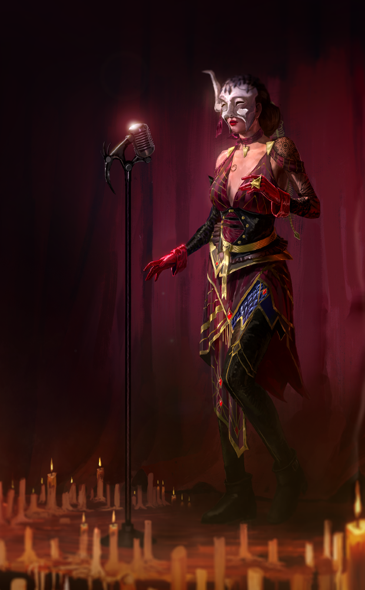
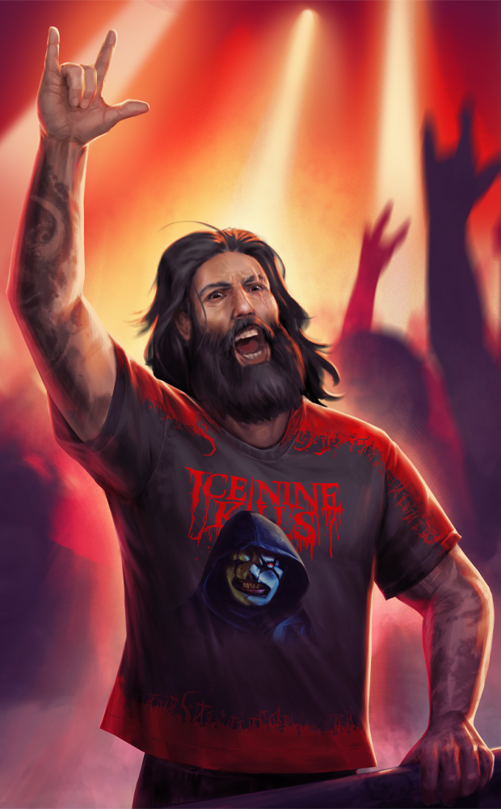
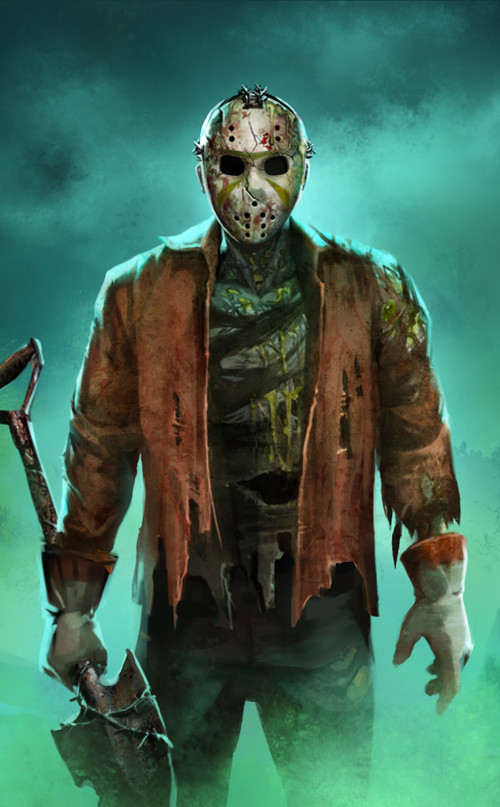
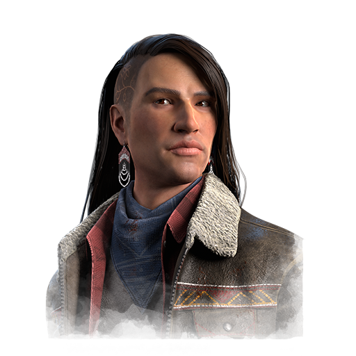
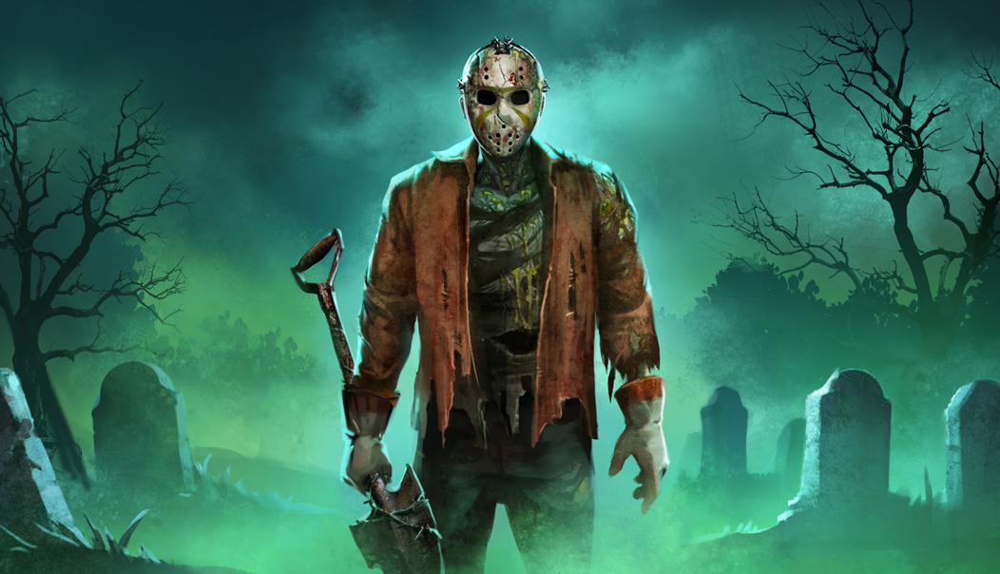

# live · 10.0.0_3475313live

| | |
|---|---|
| Build date | 2026-06-30 12:52 UTC |
| CDN version | `10.0.0_3475313live-1782823977` |
| Key | `10.0.0_live` |
| Compared with | [10.0.1_3473406live](../10.0.1_3473406live/CHANGES.md) (2026-06-29 17:52 UTC) |

## Summary

**8** added · **15** modified · **2** removed · 197 unchanged

## New or updated images

<a href="images/T_UI_ChapterBundle_Jason.png"></a>
<a href="images/T_UI_ChapterBundle_TheLifeRoad.png"></a>
<a href="images/T_UI_CollectionBanner_Black_Banquet.png"></a>
<a href="images/T_UI_CollectionBanner_Ice_Nine_Kills.png"></a>
<a href="images/T_UI_CollectionBanner_Jason.png"></a>
<a href="images/T_UI_S53_ShaneWiigwaas_Portrait.png"></a>
<a href="images/T_UI_SpecialPack_Ice_Nine_Kills.png"></a>
<a href="images/T_UI_SpecialPack_Jason.png"></a>

## Removed files

- `images/T_UI_CollectionBanner_TheLifeRoad.png`
- `images/T_UI_SpecialPack_TheLifeRoad.png`

## Modified files

### [`archiveJournals/archiveS3Journals.json`](archiveJournals/archiveS3Journals.json)

[Full line-by-line diff](diffs/archiveJournals/archiveS3Journals.json.diff)

```diff
- $.TOME24.vignettes[id=TOME24_02]
```

### [`archiveJournals/storyJournals.json`](archiveJournals/storyJournals.json)

[Full line-by-line diff](diffs/archiveJournals/storyJournals.json.diff)

```diff
- $.TOME24.TOME24_02
```

### [`archiveQuests/Tome10.json`](archiveQuests/Tome10.json)

[Full line-by-line diff](diffs/archiveQuests/Tome10.json.diff)

```diff
- $.Tome10.level[0].nodes.node_T10L1_Glyph02.clientInfoId: "WhiteGlyph"
+ $.Tome10.level[0].nodes.node_T10L1_Glyph02.clientInfoId: "YellowGlyph"
- $.Tome10.level[0].nodes.node_T10L1_Glyph02.objectives.WhiteGlyph
+ $.Tome10.level[0].nodes.node_T10L1_Glyph02.objectives.YellowGlyph
- $.Tome10.level[1].nodes.node_T10L2_Glyph03.clientInfoId: "WhiteGlyph"
+ $.Tome10.level[1].nodes.node_T10L2_Glyph03.clientInfoId: "YellowGlyph"
- $.Tome10.level[1].nodes.node_T10L2_Glyph03.objectives.WhiteGlyph
+ $.Tome10.level[1].nodes.node_T10L2_Glyph03.objectives.YellowGlyph
- $.Tome10.level[2].nodes.node_T10L3_Glyph01.clientInfoId: "WhiteGlyph"
+ $.Tome10.level[2].nodes.node_T10L3_Glyph01.clientInfoId: "YellowGlyph"
- $.Tome10.level[2].nodes.node_T10L3_Glyph01.objectives.WhiteGlyph
+ $.Tome10.level[2].nodes.node_T10L3_Glyph01.objectives.YellowGlyph
- $.Tome10.level[3].nodes.node_T10L4_Glyph03.clientInfoId: "WhiteGlyph"
+ $.Tome10.level[3].nodes.node_T10L4_Glyph03.clientInfoId: "YellowGlyph"
- $.Tome10.level[3].nodes.node_T10L4_Glyph03.objectives.WhiteGlyph
+ $.Tome10.level[3].nodes.node_T10L4_Glyph03.objectives.YellowGlyph
```

### [`archiveQuests/Tome11.json`](archiveQuests/Tome11.json)

[Full line-by-line diff](diffs/archiveQuests/Tome11.json.diff)

```diff
- $.Tome11.level[3].nodes.node_T11L4_Glyph03.clientInfoId: "WhiteGlyph"
+ $.Tome11.level[3].nodes.node_T11L4_Glyph03.clientInfoId: "YellowGlyph"
- $.Tome11.level[3].nodes.node_T11L4_Glyph03.objectives.WhiteGlyph
+ $.Tome11.level[3].nodes.node_T11L4_Glyph03.objectives.YellowGlyph
```

### [`archiveQuests/Tome12.json`](archiveQuests/Tome12.json)

[Full line-by-line diff](diffs/archiveQuests/Tome12.json.diff)

```diff
- $.Tome12.level[3].nodes.node_T12L4_Glyph01.clientInfoId: "WhiteGlyph"
+ $.Tome12.level[3].nodes.node_T12L4_Glyph01.clientInfoId: "YellowGlyph"
- $.Tome12.level[3].nodes.node_T12L4_Glyph01.objectives.WhiteGlyph
+ $.Tome12.level[3].nodes.node_T12L4_Glyph01.objectives.YellowGlyph
```

### [`archiveQuests/Tome15.json`](archiveQuests/Tome15.json)

[Full line-by-line diff](diffs/archiveQuests/Tome15.json.diff)

```diff
- $.Tome15.level[2].nodes.node_T15_L3_Glyph02.clientInfoId: "WhiteGlyph"
+ $.Tome15.level[2].nodes.node_T15_L3_Glyph02.clientInfoId: "YellowGlyph"
- $.Tome15.level[2].nodes.node_T15_L3_Glyph02.objectives.WhiteGlyph
+ $.Tome15.level[2].nodes.node_T15_L3_Glyph02.objectives.YellowGlyph
```

### [`archiveQuests/Tome16.json`](archiveQuests/Tome16.json)

[Full line-by-line diff](diffs/archiveQuests/Tome16.json.diff)

```diff
- $.Tome16.level[2].nodes.node_T16_L3_Glyph01.clientInfoId: "WhiteGlyph"
+ $.Tome16.level[2].nodes.node_T16_L3_Glyph01.clientInfoId: "YellowGlyph"
- $.Tome16.level[2].nodes.node_T16_L3_Glyph01.objectives.WhiteGlyph
+ $.Tome16.level[2].nodes.node_T16_L3_Glyph01.objectives.YellowGlyph
```

### [`archiveQuests/Tome17.json`](archiveQuests/Tome17.json)

[Full line-by-line diff](diffs/archiveQuests/Tome17.json.diff)

```diff
- $.Tome17.level[2].nodes.node_T17_L3_Glyph02.clientInfoId: "WhiteGlyph"
+ $.Tome17.level[2].nodes.node_T17_L3_Glyph02.clientInfoId: "YellowGlyph"
- $.Tome17.level[2].nodes.node_T17_L3_Glyph02.objectives.WhiteGlyph
+ $.Tome17.level[2].nodes.node_T17_L3_Glyph02.objectives.YellowGlyph
```

### [`archiveQuests/Tome18.json`](archiveQuests/Tome18.json)

[Full line-by-line diff](diffs/archiveQuests/Tome18.json.diff)

```diff
- $.Tome18.level[1].nodes.node_T18_L2_Glyph01.clientInfoId: "WhiteGlyph"
+ $.Tome18.level[1].nodes.node_T18_L2_Glyph01.clientInfoId: "YellowGlyph"
- $.Tome18.level[1].nodes.node_T18_L2_Glyph01.objectives.WhiteGlyph
+ $.Tome18.level[1].nodes.node_T18_L2_Glyph01.objectives.YellowGlyph
```

### [`archiveQuests/Tome20.json`](archiveQuests/Tome20.json)

[Full line-by-line diff](diffs/archiveQuests/Tome20.json.diff)

```diff
- $.Tome20.level[3].nodes.node_T20_L4_Glyph01.clientInfoId: "WhiteGlyph"
+ $.Tome20.level[3].nodes.node_T20_L4_Glyph01.clientInfoId: "YellowGlyph"
- $.Tome20.level[3].nodes.node_T20_L4_Glyph01.objectives.WhiteGlyph
+ $.Tome20.level[3].nodes.node_T20_L4_Glyph01.objectives.YellowGlyph
```

### [`catalog.json`](catalog.json)

[Full line-by-line diff](diffs/catalog.json.diff)

```diff
- $[id=SilentHillMega_collection_item]
- $[id=10.0.1_Chapter40_collection_item]
+ $[id=From_The_Rift_Bundle_260630]
+ $[id=Recurring_Charm_Bundle_260630]
+ $[id=Recurring_Dev_Bundle_260630]
- $[id=From_The_Rift_Bundle_260616].metaData.imageComposition.maxItemCount: 2
+ $[id=From_The_Rift_Bundle_260616].metaData.imageComposition.maxItemCount: 3
- $[id=From_The_Rift_Bundle_260623].metaData.imageComposition.maxItemCount: 2
+ $[id=From_The_Rift_Bundle_260623].metaData.imageComposition.maxItemCount: 3
```

### [`collections.json`](collections.json)

[Full line-by-line diff](diffs/collections.json.diff)

```diff
- $.collections[30].additionalImages[0].path: "/Game/UI/UMGAssets/Icons/Banners/BundleBanners/SpecialPack/T_UI_SpecialPack_SilentHill2_BC.T_UI_SpecialPack_SilentHill2_BC"
+ $.collections[30].additionalImages[0].path: "/Game/UI/UMGAssets/Icons/Banners/BundleBanners/SpecialPack/Maple/T_UI_SpecialPack_Castlevania_Richter.T_UI_SpecialPack_Castlevania_Richter"
- $.collections[30].collectionId: "SilentHillMega"
+ $.collections[30].collectionId: "Castlevania"
- $.collections[30].collectionTitle.de: "Silent Hill"
+ $.collections[30].collectionTitle.de: "Castlevania"
- $.collections[30].collectionTitle.en: "Silent Hill"
+ $.collections[30].collectionTitle.en: "Castlevania"
- $.collections[30].collectionTitle.es: "Silent Hill"
+ $.collections[30].collectionTitle.es: "Castlevania"
- $.collections[30].collectionTitle["es-MX"]: "Silent Hill"
+ $.collections[30].collectionTitle["es-MX"]: "Castlevania"
- $.collections[30].collectionTitle.fr: "Silent Hill"
+ $.collections[30].collectionTitle.fr: "Castlevania"
- $.collections[30].collectionTitle.it: "Silent Hill"
+ $.collections[30].collectionTitle.it: "Castlevania"
- $.collections[30].collectionTitle.ja: "サイレントヒル"
+ $.collections[30].collectionTitle.ja: "悪魔城ドラキュラ"
- $.collections[30].collectionTitle.ko: "사일런트 힐"
+ $.collections[30].collectionTitle.ko: "캐슬바니아"
- $.collections[30].collectionTitle.pl: "Silent Hill"
+ $.collections[30].collectionTitle.pl: "Castlevania"
- $.collections[30].collectionTitle["pt-BR"]: "Silent Hill"
+ $.collections[30].collectionTitle["pt-BR"]: "Castlevania"
- $.collections[30].collectionTitle.ru: "Сайлент Хилл"
+ $.collections[30].collectionTitle.ru: "Castlevania"
- $.collections[30].collectionTitle.th: "ไซเลนต์ฮิล"
+ $.collections[30].collectionTitle.th: "Castlevania"
- $.collections[30].collectionTitle.tr: "Silent Hill"
+ $.collections[30].collectionTitle.tr: "Castlevania"
- $.collections[30].collectionTitle["zh-Hans"]: "寂静岭"
+ $.collections[30].collectionTitle["zh-Hans"]: "恶魔城"
- $.collections[30].collectionTitle["zh-Hant"]: "沉默之丘"
+ $.collections[30].collectionTitle["zh-Hant"]: "惡魔城"
- $.collections[30].heroImage.path: "/Game/UI/UMGAssets/Icons/Banners/CollectionBanners/T_UI_CollectionBanner_SilentHill.T_UI_CollectionBanner_SilentHill"
+ $.collections[30].heroImage.path: "/Game/UI/UMGAssets/Icons/Banners/CollectionBanners/Maple/T_UI_CollectionBanner_Castlevania_Richter.T_UI_CollectionBanner_Castlevania_Richter"
- $.collections[30].inclusionVersion: "7.7.0 PTB"
+ $.collections[30].inclusionVersion: "8.2.0"
- $.collections[30].items[]: "FM_outfit_022"
- $.collections[30].items[]: "K20_outfit_006"
- $.collections[30].items[]: "K20_outfit_007"
- $.collections[30].items[]: "K20_outfit_008"
- $.collections[30].items[]: "K20_outfit_009"
- $.collections[30].items[]: "K20_outfit_010"
- $.collections[30].items[]: "KK_outfit_016"
- $.collections[30].items[]: "KK_outfit_016_01"
- $.collections[30].items[]: "KK_outfit_016_02"
- $.collections[30].items[]: "KK_outfit_016_03"
- $.collections[30].items[]: "S22_outfit_006"
- $.collections[30].items[]: "S22_outfit_007"
- $.collections[30].items[]: "S22_outfit_008"
- $.collections[30].items[]: "S22_outfit_010"
- $.collections[30].items[]: "S22_outfit_011"
- $.collections[30].items[]: "S22_outfit_012"
- $.collections[30].items[]: "S22_outfit_013"
- $.collections[30].items[]: "S22_outfit_02"
- $.collections[30].items[]: "S22_outfit_02_01"
- $.collections[30].items[]: "S22_Torso01_01"
- $.collections[30].items[]: "S22_Torso01_02"
- $.collections[30].items[]: "S22_Torso01_03"
- $.collections[30].items[]: "S22_Torso01_04"
- $.collections[30].items[]: "S22_Torso01_05"
- $.collections[30].items[]: "S22_Torso01_06"
+ $.collections[30].items[]: "GS_outfit_032"
+ $.collections[30].items[]: "K37_outfit_006"
+ $.collections[30].items[]: "K37_outfit_007"
+ $.collections[30].items[]: "K37_outfit_008"
+ $.collections[30].items[]: "K37_outfit_009"
+ $.collections[30].items[]: "S23_outfit_029"
+ $.collections[30].items[]: "S28_outfit_027"
+ $.collections[30].items[]: "S44_outfit_006"
+ $.collections[30].items[]: "S44_outfit_007"
+ $.collections[30].items[]: "S44_outfit_008"
+ $.collections[30].items[]: "S44_outfit_009"
+ $.collections[30].items[]: "S44_outfit_011"
+ $.collections[30].items[]: "SwedenSurvivor_outfit_027"
+ $.collections[30].items[]: "TN_outfit_021"
- $.collections[30].sortOrder: "-178"
+ $.collections[30].sortOrder: "-179"
- $.collections[30].updatedDate: "2025-10-23T16:36:27.198Z"
+ $.collections[30].updatedDate: "2025-10-23T16:36:58.015Z"
- $.collections[31].additionalImages[0]
- $.collections[31].collectionId: "Castlevania"
+ $.collections[31].collectionId: "CozyBreak"
- $.collections[31].collectionTitle.de: "Castlevania"
+ $.collections[31].collectionTitle.de: "Gemütliche Auszeit"
- $.collections[31].collectionTitle.en: "Castlevania"
+ $.collections[31].collectionTitle.en: "Cozy Break"
- $.collections[31].collectionTitle.es: "Castlevania"
+ $.collections[31].collectionTitle.es: "Tregua cómoda"
- $.collections[31].collectionTitle["es-MX"]: "Castlevania"
+ $.collections[31].collectionTitle["es-MX"]: "Descanso acogedor"
- $.collections[31].collectionTitle.fr: "Castlevania"
+ $.collections[31].collectionTitle.fr: "Vacances douillettes"
- $.collections[31].collectionTitle.it: "Castlevania"
+ $.collections[31].collectionTitle.it: "Pausa relax"
- $.collections[31].collectionTitle.ja: "悪魔城ドラキュラ"
+ $.collections[31].collectionTitle.ja: "くつろぐ休暇"
- $.collections[31].collectionTitle.ko: "캐슬바니아"
+ $.collections[31].collectionTitle.ko: "아늑한 휴식"
- $.collections[31].collectionTitle.pl: "Castlevania"
+ $.collections[31].collectionTitle.pl: "Przytulna przerwa"
- $.collections[31].collectionTitle["pt-BR"]: "Castlevania"
+ $.collections[31].collectionTitle["pt-BR"]: "Férias Relaxantes"
- $.collections[31].collectionTitle.ru: "Castlevania"
+ $.collections[31].collectionTitle.ru: "Уютный отдых"
- $.collections[31].collectionTitle.th: "Castlevania"
+ $.collections[31].collectionTitle.th: "พักสบายๆ"
- $.collections[31].collectionTitle.tr: "Castlevania"
+ $.collections[31].collectionTitle.tr: "Tatil Molası"
- $.collections[31].collectionTitle["zh-Hans"]: "恶魔城"
+ $.collections[31].collectionTitle["zh-Hans"]: "舒适歇息"
- $.collections[31].collectionTitle["zh-Hant"]: "惡魔城"
+ $.collections[31].collectionTitle["zh-Hant"]: "閒適小憩"
- $.collections[31].heroImage.path: "/Game/UI/UMGAssets/Icons/Banners/CollectionBanners/Maple/T_UI_CollectionBanner_Castlevania_Richter.T_UI_CollectionBanner_Castlevania_Richter"
+ $.collections[31].heroImage.path: "/Game/UI/UMGAssets/Icons/Banners/CollectionBanners/T_UI_CollectionBanner_CozyBreak.T_UI_CollectionBanner_CozyBreak"
- $.collections[31].inclusionVersion: "8.2.0"
+ $.collections[31].inclusionVersion: "7.7.0 PTB"
- $.collections[31].items[]: "GS_outfit_032"
- $.collections[31].items[]: "K37_outfit_006"
- $.collections[31].items[]: "K37_outfit_007"
- $.collections[31].items[]: "K37_outfit_008"
- $.collections[31].items[]: "K37_outfit_009"
- $.collections[31].items[]: "S23_outfit_029"
- $.collections[31].items[]: "S28_outfit_027"
- $.collections[31].items[]: "S44_outfit_006"
- $.collections[31].items[]: "S44_outfit_007"
- $.collections[31].items[]: "S44_outfit_008"
- $.collections[31].items[]: "S44_outfit_009"
- $.collections[31].items[]: "S44_outfit_011"
- $.collections[31].items[]: "SwedenSurvivor_outfit_027"
- $.collections[31].items[]: "TN_outfit_021"
+ $.collections[31].items[]: "AV_outfit_019"
+ $.collections[31].items[]: "FM_outfit_017"
+ $.collections[31].items[]: "GS_outfit_026"
+ $.collections[31].items[]: "HK_outfit_022"
+ $.collections[31].items[]: "KK_outfit_035"
+ $.collections[31].items[]: "KS_outfit_019"
+ $.collections[31].items[]: "MS_outfit_026"
+ $.collections[31].items[]: "S23_outfit_014"
+ $.collections[31].items[]: "S24_outfit_018"
+ $.collections[31].items[]: "S25_outfit_011"
+ $.collections[31].items[]: "S28_outfit_010"
+ $.collections[31].items[]: "S29_outfit_006"
+ $.collections[31].items[]: "S35_outfit_017"
+ $.collections[31].items[]: "S36_outfit_018"
+ $.collections[31].items[]: "S41_outfit_020"
- $.collections[31].sortOrder: "-179"
+ $.collections[31].sortOrder: "-180"
- $.collections[31].updatedDate: "2025-10-23T16:36:58.015Z"
+ $.collections[31].updatedDate: "2025-10-23T16:37:34.791Z"
+ $.collections[32].additionalImages[0]
- $.collections[32].collectionId: "CozyBreak"
+ $.collections[32].collectionId: "TheWalkingDead"
- $.collections[32].collectionTitle.de: "Gemütliche Auszeit"
+ $.collections[32].collectionTitle.de: "The Walking Dead"
- $.collections[32].collectionTitle.en: "Cozy Break"
+ $.collections[32].collectionTitle.en: "The Walking Dead"
- $.collections[32].collectionTitle.es: "Tregua cómoda"
+ $.collections[32].collectionTitle.es: "The Walking Dead"
- $.collections[32].collectionTitle["es-MX"]: "Descanso acogedor"
+ $.collections[32].collectionTitle["es-MX"]: "The Walking Dead"
- $.collections[32].collectionTitle.fr: "Vacances douillettes"
+ $.collections[32].collectionTitle.fr: "The Walking Dead"
- $.collections[32].collectionTitle.it: "Pausa relax"
+ $.collections[32].collectionTitle.it: "The Walking Dead"
- $.collections[32].collectionTitle.ja: "くつろぐ休暇"
+ $.collections[32].collectionTitle.ja: "ウォーキング・デッド"
- $.collections[32].collectionTitle.ko: "아늑한 휴식"
+ $.collections[32].collectionTitle.ko: "워킹 데드"
- $.collections[32].collectionTitle.pl: "Przytulna przerwa"
+ $.collections[32].collectionTitle.pl: "The Walking Dead"
- $.collections[32].collectionTitle["pt-BR"]: "Férias Relaxantes"
+ $.collections[32].collectionTitle["pt-BR"]: "The Walking Dead"
- $.collections[32].collectionTitle.ru: "Уютный отдых"
+ $.collections[32].collectionTitle.ru: "Ходячие мертвецы"
- $.collections[32].collectionTitle.th: "พักสบายๆ"
+ $.collections[32].collectionTitle.th: "The Walking Dead"
- $.collections[32].collectionTitle.tr: "Tatil Molası"
+ $.collections[32].collectionTitle.tr: "The Walking Dead"
- $.collections[32].collectionTitle["zh-Hans"]: "舒适歇息"
+ $.collections[32].collectionTitle["zh-Hans"]: "《The Walking Dead》"
- $.collections[32].collectionTitle["zh-Hant"]: "閒適小憩"
+ $.collections[32].collectionTitle["zh-Hant"]: "《陰屍路》"
- $.collections[32].heroImage.path: "/Game/UI/UMGAssets/Icons/Banners/CollectionBanners/T_UI_CollectionBanner_CozyBreak.T_UI_CollectionBanner_CozyBreak"
+ $.collections[32].heroImage.path: "/Game/UI/UMGAssets/Icons/Banners/CollectionBanners/Omelet/T_UI_CollectionBanner_TWD_Rick.T_UI_CollectionBanner_TWD_Rick"
- $.collections[32].inclusionVersion: "7.7.0 PTB"
+ $.collections[32].inclusionVersion: "9.1.0 PTB"
- $.collections[32].items[]: "AV_outfit_019"
- $.collections[32].items[]: "FM_outfit_017"
- $.collections[32].items[]: "GS_outfit_026"
- $.collections[32].items[]: "HK_outfit_022"
- $.collections[32].items[]: "KK_outfit_035"
- $.collections[32].items[]: "KS_outfit_019"
- $.collections[32].items[]: "MS_outfit_026"
- $.collections[32].items[]: "S23_outfit_014"
- $.collections[32].items[]: "S24_outfit_018"
- $.collections[32].items[]: "S25_outfit_011"
- $.collections[32].items[]: "S28_outfit_010"
- $.collections[32].items[]: "S29_outfit_006"
… 4686 more change(s) — see the commit diff for everything
```

### [`contentSchedule.json`](contentSchedule.json)

[Full line-by-line diff](diffs/contentSchedule.json.diff)

```diff
- $.schedule[4].MapsWeight.Fin_Hideout: "50"
+ $.schedule[4].MapsWeight.Swp_GrimPantry: "0"
+ $.schedule[5]
```

### [`dynamicContent/DynamicContent.json`](dynamicContent/DynamicContent.json)

[Full line-by-line diff](diffs/dynamicContent/DynamicContent.json.diff)

```diff
- $.entries[1].downloadStrategy: "preferRemote"
+ $.entries[1].downloadStrategy: "preferPackaged"
- $.entries[2].contentVersion: "491d730fa3e6382e368680fcd716f0478ea742ee"
+ $.entries[2].contentVersion: "db5309baacf020722b4fb45023708df4d48fc820"
- $.entries[2].downloadStrategy: "preferRemote"
+ $.entries[2].downloadStrategy: "preferPackaged"
- $.entries[2].packagedPath: "/Game/UI/UMGAssets/Icons/Banners/BundleBanners/SpecialPack/Sushi/T_UI_SpecialPack_Black_Banquet.T_UI_SpecialPack_Black_Banquet"
+ $.entries[2].packagedPath: "/Game/UI/UMGAssets/Icons/Banners/BundleBanners/SpecialPack/Sushi/T_UI_SpecialPack_Ice_Nine_Kills.T_UI_SpecialPack_Ice_Nine_Kills"
- $.entries[2].uri: "images/T_UI_SpecialPack_Black_Banquet.png"
+ $.entries[2].uri: "images/T_UI_SpecialPack_Ice_Nine_Kills.png"
- $.entries[3].contentVersion: "45dbc8795086ecc22e3ee59473bb597baae63b7f"
+ $.entries[3].contentVersion: "e44e4a7791219404be660d1cc9f395396f41fa54"
- $.entries[3].downloadStrategy: "preferRemote"
+ $.entries[3].downloadStrategy: "preferPackaged"
- $.entries[3].packagedPath: "/Game/UI/UMGAssets/Icons/Banners/CollectionBanners/Sushi/T_UI_CollectionBanner_TheLifeRoad.T_UI_CollectionBanner_TheLifeRoad"
+ $.entries[3].packagedPath: "/Game/UI/UMGAssets/Icons/Banners/BundleBanners/ChapterBundles/T_UI_ChapterBundle_TheLifeRoad.T_UI_ChapterBundle_TheLifeRoad"
- $.entries[3].uri: "images/T_UI_CollectionBanner_TheLifeRoad.png"
+ $.entries[3].uri: "images/T_UI_ChapterBundle_TheLifeRoad.png"
- $.entries[4].contentVersion: "623bb882552904b79446b6e334171fa8ca8d0345"
+ $.entries[4].contentVersion: "201d2c22c95e6cfa6cfa270728145726e7973c63"
- $.entries[4].downloadStrategy: "preferRemote"
+ $.entries[4].downloadStrategy: "preferPackaged"
- $.entries[4].packagedPath: "/Game/UI/UMGAssets/Icons/Banners/BundleBanners/SpecialPack/Sushi/T_UI_SpecialPack_TheLifeRoad.T_UI_SpecialPack_TheLifeRoad"
+ $.entries[4].packagedPath: "/Game/UI/UMGAssets/Icons/Banners/CollectionBanners/Sushi/T_UI_CollectionBanner_Black_Banquet.T_UI_CollectionBanner_Black_Banquet"
- $.entries[4].uri: "images/T_UI_SpecialPack_TheLifeRoad.png"
+ $.entries[4].uri: "images/T_UI_CollectionBanner_Black_Banquet.png"
- $.entries[5].contentVersion: "f7c93776f522193fdbac58c1416ed2bb8ee190ec"
+ $.entries[5].contentVersion: "491d730fa3e6382e368680fcd716f0478ea742ee"
- $.entries[5].packagedPath: "/DBDUICore/Assets/HUD/Tutorial/T_UI_Tutorial_ImageBG_GenQuest1.T_UI_Tutorial_ImageBG_GenQuest1"
+ $.entries[5].packagedPath: "/Game/UI/UMGAssets/Icons/Banners/BundleBanners/SpecialPack/Sushi/T_UI_SpecialPack_Black_Banquet.T_UI_SpecialPack_Black_Banquet"
- $.entries[5].uri: "images/T_UI_Tutorial_ImageBG_GenQuest1.png"
+ $.entries[5].uri: "images/T_UI_SpecialPack_Black_Banquet.png"
- $.entries[6].contentVersion: "4ae305ae1f966db3228ce77826da57e2ece140b4"
+ $.entries[6].contentVersion: "e24e946eb73c45120942d89c2de73814cc1a2e99"
- $.entries[6].packagedPath: "/DBDUICore/Assets/HUD/Tutorial/T_UI_Tutorial_ImageBG_cosmetic.T_UI_Tutorial_ImageBG_cosmetic"
+ $.entries[6].packagedPath: "/Game/UI/UMGAssets/Icons/Banners/CollectionBanners/Sushi/T_UI_CollectionBanner_Ice_Nine_Kills.T_UI_CollectionBanner_Ice_Nine_Kills"
- $.entries[6].uri: "images/T_UI_Tutorial_ImageBG_cosmetic.png"
+ $.entries[6].uri: "images/T_UI_CollectionBanner_Ice_Nine_Kills.png"
- $.entries[7].contentVersion: "f8c74b123d0ba3a66d82d9ba6e26486b88797b88"
+ $.entries[7].contentVersion: "db5309baacf020722b4fb45023708df4d48fc820"
- $.entries[7].packagedPath: "/DBDUICore/Assets/HUD/Tutorial/T_UI_Tutorial_ImageBG_gift.T_UI_Tutorial_ImageBG_gift"
+ $.entries[7].packagedPath: "/Game/UI/UMGAssets/Icons/Banners/BundleBanners/SpecialPack/Sushi/T_UI_SpecialPack_Ice_Nine_Kills.T_UI_SpecialPack_Ice_Nine_Kills"
- $.entries[7].uri: "images/T_UI_Tutorial_ImageBG_gift.png"
+ $.entries[7].uri: "images/T_UI_SpecialPack_Ice_Nine_Kills.png"
- $.entries[8].contentVersion: "1a73827d53e583dd03efaac5b38ab8fb04610088"
+ $.entries[8].contentVersion: "47c2ee482573517676b096d0f2c295d2e7751af7"
- $.entries[8].packagedPath: "/DBDUICore/Assets/Common/Event/Community/T_UI_icon_Event_LaFogata.T_UI_icon_Event_LaFogata"
+ $.entries[8].packagedPath: "/Game/UI/UMGAssets/Icons/Banners/CollectionBanners/Sushi/T_UI_CollectionBanner_Jason.T_UI_CollectionBanner_Jason"
- $.entries[8].uri: "images/T_UI_icon_Event_LaFogata.png"
+ $.entries[8].uri: "images/T_UI_CollectionBanner_Jason.png"
- $.entries[9].contentVersion: "491d730fa3e6382e368680fcd716f0478ea742ee"
+ $.entries[9].contentVersion: "89cd6761baa172e7467e358fd33d57a45f38c845"
- $.entries[9].downloadStrategy: "preferRemote"
+ $.entries[9].downloadStrategy: "preferPackaged"
- $.entries[9].packagedPath: "/Game/UI/UMGAssets/Icons/Banners/BundleBanners/SpecialPack/Sushi/T_UI_SpecialPack_Black_Banquet.T_UI_SpecialPack_Black_Banquet"
+ $.entries[9].packagedPath: "/Game/UI/UMGAssets/Icons/Banners/BundleBanners/SpecialPack/Sushi/T_UI_SpecialPack_Jason.T_UI_SpecialPack_Jason"
- $.entries[9].uri: "images/T_UI_SpecialPack_Black_Banquet.png"
+ $.entries[9].uri: "images/T_UI_SpecialPack_Jason.png"
- $.entries[10].contentVersion: "45dbc8795086ecc22e3ee59473bb597baae63b7f"
+ $.entries[10].contentVersion: "f7c93776f522193fdbac58c1416ed2bb8ee190ec"
- $.entries[10].downloadStrategy: "preferRemote"
+ $.entries[10].downloadStrategy: "preferPackaged"
- $.entries[10].packagedPath: "/Game/UI/UMGAssets/Icons/Banners/CollectionBanners/Sushi/T_UI_CollectionBanner_TheLifeRoad.T_UI_CollectionBanner_TheLifeRoad"
+ $.entries[10].packagedPath: "/DBDUICore/Assets/HUD/Tutorial/T_UI_Tutorial_ImageBG_GenQuest1.T_UI_Tutorial_ImageBG_GenQuest1"
- $.entries[10].uri: "images/T_UI_CollectionBanner_TheLifeRoad.png"
+ $.entries[10].uri: "images/T_UI_Tutorial_ImageBG_GenQuest1.png"
- $.entries[11].contentVersion: "623bb882552904b79446b6e334171fa8ca8d0345"
+ $.entries[11].contentVersion: "4ae305ae1f966db3228ce77826da57e2ece140b4"
- $.entries[11].downloadStrategy: "preferRemote"
+ $.entries[11].downloadStrategy: "preferPackaged"
- $.entries[11].packagedPath: "/Game/UI/UMGAssets/Icons/Banners/BundleBanners/SpecialPack/Sushi/T_UI_SpecialPack_TheLifeRoad.T_UI_SpecialPack_TheLifeRoad"
+ $.entries[11].packagedPath: "/DBDUICore/Assets/HUD/Tutorial/T_UI_Tutorial_ImageBG_cosmetic.T_UI_Tutorial_ImageBG_cosmetic"
- $.entries[11].uri: "images/T_UI_SpecialPack_TheLifeRoad.png"
+ $.entries[11].uri: "images/T_UI_Tutorial_ImageBG_cosmetic.png"
- $.entries[12].contentVersion: "0e8b98cf7feeff8d5e17450b4b4ad2293e782dac"
+ $.entries[12].contentVersion: "f8c74b123d0ba3a66d82d9ba6e26486b88797b88"
- $.entries[12].downloadStrategy: "preferRemote"
+ $.entries[12].downloadStrategy: "preferPackaged"
- $.entries[12].enableChecksum: true
+ $.entries[12].enableChecksum: false
- $.entries[12].packagedPath: ""
+ $.entries[12].packagedPath: "/DBDUICore/Assets/HUD/Tutorial/T_UI_Tutorial_ImageBG_gift.T_UI_Tutorial_ImageBG_gift"
- $.entries[12].schema: "s3ver://"
+ $.entries[12].schema: "s3verbin://"
- $.entries[12].uri: "catalog.json"
+ $.entries[12].uri: "images/T_UI_Tutorial_ImageBG_gift.png"
- $.entries[13].contentVersion: "81034fe5efd667a7bed072051acdc04a0d5e4868"
+ $.entries[13].contentVersion: "1a73827d53e583dd03efaac5b38ab8fb04610088"
- $.entries[13].enableChecksum: true
+ $.entries[13].enableChecksum: false
- $.entries[13].packagedPath: ""
+ $.entries[13].packagedPath: "/DBDUICore/Assets/Common/Event/Community/T_UI_icon_Event_LaFogata.T_UI_icon_Event_LaFogata"
- $.entries[13].schema: "s3ver://"
+ $.entries[13].schema: "s3verbin://"
- $.entries[13].uri: "bonusPointEventsContent.json"
+ $.entries[13].uri: "images/T_UI_icon_Event_LaFogata.png"
- $.entries[14].contentVersion: "898051766e5a8c40db1b33642c972d78dda97739"
+ $.entries[14].contentVersion: "14bd21a042f1ed4a0789bb0b95e7d362b731172a"
- $.entries[14].downloadStrategy: "preferRemote"
+ $.entries[14].downloadStrategy: "preferPackaged"
- $.entries[14].enableChecksum: true
+ $.entries[14].enableChecksum: false
- $.entries[14].packagedPath: ""
+ $.entries[14].packagedPath: "/Game/UI/UMGAssets/Icons/CharPortraits/Sushi/T_UI_S53_ShaneWiigwaas_Portrait.T_UI_S53_ShaneWiigwaas_Portrait"
- $.entries[14].schema: "s3ver://"
+ $.entries[14].schema: "s3verbin://"
- $.entries[14].uri: "freetoplay/NA/event.json"
+ $.entries[14].uri: "images/T_UI_S53_ShaneWiigwaas_Portrait.png"
- $.entries[15].contentVersion: "898051766e5a8c40db1b33642c972d78dda97739"
+ $.entries[15].contentVersion: "54d5075735b1b4725094ae412868732d720ee188"
- $.entries[15].downloadStrategy: "preferRemote"
+ $.entries[15].downloadStrategy: "preferPackaged"
- $.entries[15].enableChecksum: true
+ $.entries[15].enableChecksum: false
- $.entries[15].packagedPath: ""
+ $.entries[15].packagedPath: "/Game/UI/UMGAssets/Icons/Banners/BundleBanners/ChapterBundles/T_UI_ChapterBundle_Jason.T_UI_ChapterBundle_Jason"
- $.entries[15].schema: "s3ver://"
+ $.entries[15].schema: "s3verbin://"
- $.entries[15].uri: "freetoplay/EU/event.json"
+ $.entries[15].uri: "images/T_UI_ChapterBundle_Jason.png"
- $.entries[16].contentVersion: "23b1f95aaea33a5eb00ef8deb32d515af3be02b1"
+ $.entries[16].contentVersion: "e44e4a7791219404be660d1cc9f395396f41fa54"
- $.entries[16].downloadStrategy: "preferRemote"
+ $.entries[16].downloadStrategy: "preferPackaged"
- $.entries[16].enableChecksum: true
+ $.entries[16].enableChecksum: false
- $.entries[16].packagedPath: ""
+ $.entries[16].packagedPath: "/Game/UI/UMGAssets/Icons/Banners/BundleBanners/ChapterBundles/T_UI_ChapterBundle_TheLifeRoad.T_UI_ChapterBundle_TheLifeRoad"
- $.entries[16].schema: "s3ver://"
+ $.entries[16].schema: "s3verbin://"
- $.entries[16].uri: "archiveQuests/Anniversary2022.json"
+ $.entries[16].uri: "images/T_UI_ChapterBundle_TheLifeRoad.png"
- $.entries[17].contentVersion: "60542d2a101497b73a338989942ef496ae13d010"
+ $.entries[17].contentVersion: "201d2c22c95e6cfa6cfa270728145726e7973c63"
- $.entries[17].downloadStrategy: "preferRemote"
+ $.entries[17].downloadStrategy: "preferPackaged"
- $.entries[17].enableChecksum: true
+ $.entries[17].enableChecksum: false
- $.entries[17].packagedPath: ""
+ $.entries[17].packagedPath: "/Game/UI/UMGAssets/Icons/Banners/CollectionBanners/Sushi/T_UI_CollectionBanner_Black_Banquet.T_UI_CollectionBanner_Black_Banquet"
- $.entries[17].schema: "s3ver://"
+ $.entries[17].schema: "s3verbin://"
- $.entries[17].uri: "archiveQuests/Anniversary2023.json"
+ $.entries[17].uri: "images/T_UI_CollectionBanner_Black_Banquet.png"
- $.entries[18].contentVersion: "53077fd04e446bfa797e36d08f46746b74d7d514"
+ $.entries[18].contentVersion: "491d730fa3e6382e368680fcd716f0478ea742ee"
- $.entries[18].downloadStrategy: "preferRemote"
+ $.entries[18].downloadStrategy: "preferPackaged"
- $.entries[18].enableChecksum: true
+ $.entries[18].enableChecksum: false
- $.entries[18].packagedPath: ""
+ $.entries[18].packagedPath: "/Game/UI/UMGAssets/Icons/Banners/BundleBanners/SpecialPack/Sushi/T_UI_SpecialPack_Black_Banquet.T_UI_SpecialPack_Black_Banquet"
- $.entries[18].schema: "s3ver://"
+ $.entries[18].schema: "s3verbin://"
- $.entries[18].uri: "archiveQuests/Anniversary2024.json"
+ $.entries[18].uri: "images/T_UI_SpecialPack_Black_Banquet.png"
- $.entries[19].contentVersion: "30f6f91bea1afbf1b488a777cbd35039848da3dd"
+ $.entries[19].contentVersion: "e24e946eb73c45120942d89c2de73814cc1a2e99"
- $.entries[19].downloadStrategy: "preferRemote"
+ $.entries[19].downloadStrategy: "preferPackaged"
- $.entries[19].enableChecksum: true
+ $.entries[19].enableChecksum: false
- $.entries[19].packagedPath: ""
+ $.entries[19].packagedPath: "/Game/UI/UMGAssets/Icons/Banners/CollectionBanners/Sushi/T_UI_CollectionBanner_Ice_Nine_Kills.T_UI_CollectionBanner_Ice_Nine_Kills"
- $.entries[19].schema: "s3ver://"
+ $.entries[19].schema: "s3verbin://"
- $.entries[19].uri: "archiveQuests/CalamariV1.json"
+ $.entries[19].uri: "images/T_UI_CollectionBanner_Ice_Nine_Kills.png"
- $.entries[20].contentVersion: "979deafa6eaa6e239324ae0bb63a325b0b954060"
+ $.entries[20].contentVersion: "db5309baacf020722b4fb45023708df4d48fc820"
- $.entries[20].downloadStrategy: "preferRemote"
+ $.entries[20].downloadStrategy: "preferPackaged"
- $.entries[20].enableChecksum: true
+ $.entries[20].enableChecksum: false
- $.entries[20].packagedPath: ""
+ $.entries[20].packagedPath: "/Game/UI/UMGAssets/Icons/Banners/BundleBanners/SpecialPack/Sushi/T_UI_SpecialPack_Ice_Nine_Kills.T_UI_SpecialPack_Ice_Nine_Kills"
- $.entries[20].schema: "s3ver://"
+ $.entries[20].schema: "s3verbin://"
- $.entries[20].uri: "archiveQuests/CalamariV2.json"
+ $.entries[20].uri: "images/T_UI_SpecialPack_Ice_Nine_Kills.png"
- $.entries[21].contentVersion: "a929110e9b2f53b4ad7d9984a3619abad514c4bc"
+ $.entries[21].contentVersion: "47c2ee482573517676b096d0f2c295d2e7751af7"
- $.entries[21].downloadStrategy: "preferRemote"
+ $.entries[21].downloadStrategy: "preferPackaged"
- $.entries[21].enableChecksum: true
+ $.entries[21].enableChecksum: false
- $.entries[21].packagedPath: ""
+ $.entries[21].packagedPath: "/Game/UI/UMGAssets/Icons/Banners/CollectionBanners/Sushi/T_UI_CollectionBanner_Jason.T_UI_CollectionBanner_Jason"
- $.entries[21].schema: "s3ver://"
+ $.entries[21].schema: "s3verbin://"
- $.entries[21].uri: "archiveQuests/CalamariV3.json"
+ $.entries[21].uri: "images/T_UI_CollectionBanner_Jason.png"
- $.entries[22].contentVersion: "c4a0c4fb3e9426161dab7bdeb23c586d22c0b1b5"
+ $.entries[22].contentVersion: "89cd6761baa172e7467e358fd33d57a45f38c845"
- $.entries[22].downloadStrategy: "preferRemote"
+ $.entries[22].downloadStrategy: "preferPackaged"
- $.entries[22].enableChecksum: true
+ $.entries[22].enableChecksum: false
- $.entries[22].packagedPath: ""
+ $.entries[22].packagedPath: "/Game/UI/UMGAssets/Icons/Banners/BundleBanners/SpecialPack/Sushi/T_UI_SpecialPack_Jason.T_UI_SpecialPack_Jason"
… 865 more change(s) — see the commit diff for everything
```

### [`recommendations.json`](recommendations.json)

[Full line-by-line diff](diffs/recommendations.json.diff)

```diff
+ $.featuredCard[id=Sushi_W3]
+ $.featuredCustomizationRecommendations[id=Sushi_W3]
```

