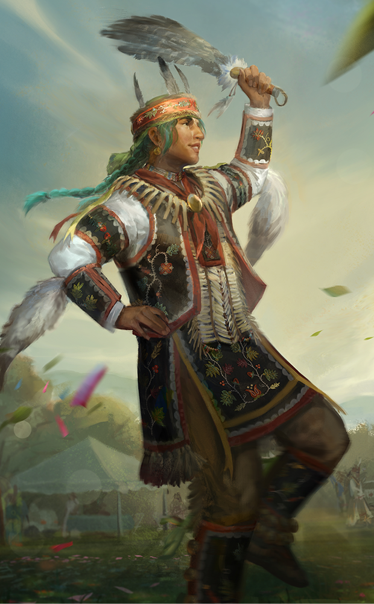

# live · 10.0.1_3461382live

| | |
|---|---|
| Build date | 2026-06-23 13:43 UTC |
| CDN version | `10.0.1_3461382live-1782222233` |
| Key | `10.0.1_live` |
| Compared with | [10.0.0_3461380live](../10.0.0_3461380live/CHANGES.md) (2026-06-23 13:41 UTC) |

## Summary

**2** added · **15** modified · **8** removed · 197 unchanged

## New or updated images

<a href="images/T_UI_CollectionBanner_TheLifeRoad.png"></a>
<a href="images/T_UI_SpecialPack_TheLifeRoad.png"></a>

## Removed files

- `images/T_UI_ChapterBundle_Jason.png`
- `images/T_UI_ChapterBundle_TheLifeRoad.png`
- `images/T_UI_CollectionBanner_Black_Banquet.png`
- `images/T_UI_CollectionBanner_Ice_Nine_Kills.png`
- `images/T_UI_CollectionBanner_Jason.png`
- `images/T_UI_S53_ShaneWiigwaas_Portrait.png`
- `images/T_UI_SpecialPack_Ice_Nine_Kills.png`
- `images/T_UI_SpecialPack_Jason.png`

## Modified files

### [`archiveJournals/archiveS3Journals.json`](archiveJournals/archiveS3Journals.json)

[Full line-by-line diff](diffs/archiveJournals/archiveS3Journals.json.diff)

```diff
+ $.TOME24.vignettes[id=TOME24_02]
```

### [`archiveJournals/storyJournals.json`](archiveJournals/storyJournals.json)

[Full line-by-line diff](diffs/archiveJournals/storyJournals.json.diff)

```diff
+ $.TOME24.TOME24_02
```

### [`archiveQuests/Tome10.json`](archiveQuests/Tome10.json)

[Full line-by-line diff](diffs/archiveQuests/Tome10.json.diff)

```diff
- $.Tome10.level[0].nodes.node_T10L1_Glyph02.clientInfoId: "YellowGlyph"
+ $.Tome10.level[0].nodes.node_T10L1_Glyph02.clientInfoId: "WhiteGlyph"
- $.Tome10.level[0].nodes.node_T10L1_Glyph02.objectives.YellowGlyph
+ $.Tome10.level[0].nodes.node_T10L1_Glyph02.objectives.WhiteGlyph
- $.Tome10.level[1].nodes.node_T10L2_Glyph03.clientInfoId: "YellowGlyph"
+ $.Tome10.level[1].nodes.node_T10L2_Glyph03.clientInfoId: "WhiteGlyph"
- $.Tome10.level[1].nodes.node_T10L2_Glyph03.objectives.YellowGlyph
+ $.Tome10.level[1].nodes.node_T10L2_Glyph03.objectives.WhiteGlyph
- $.Tome10.level[2].nodes.node_T10L3_Glyph01.clientInfoId: "YellowGlyph"
+ $.Tome10.level[2].nodes.node_T10L3_Glyph01.clientInfoId: "WhiteGlyph"
- $.Tome10.level[2].nodes.node_T10L3_Glyph01.objectives.YellowGlyph
+ $.Tome10.level[2].nodes.node_T10L3_Glyph01.objectives.WhiteGlyph
- $.Tome10.level[3].nodes.node_T10L4_Glyph03.clientInfoId: "YellowGlyph"
+ $.Tome10.level[3].nodes.node_T10L4_Glyph03.clientInfoId: "WhiteGlyph"
- $.Tome10.level[3].nodes.node_T10L4_Glyph03.objectives.YellowGlyph
+ $.Tome10.level[3].nodes.node_T10L4_Glyph03.objectives.WhiteGlyph
```

### [`archiveQuests/Tome11.json`](archiveQuests/Tome11.json)

[Full line-by-line diff](diffs/archiveQuests/Tome11.json.diff)

```diff
- $.Tome11.level[3].nodes.node_T11L4_Glyph03.clientInfoId: "YellowGlyph"
+ $.Tome11.level[3].nodes.node_T11L4_Glyph03.clientInfoId: "WhiteGlyph"
- $.Tome11.level[3].nodes.node_T11L4_Glyph03.objectives.YellowGlyph
+ $.Tome11.level[3].nodes.node_T11L4_Glyph03.objectives.WhiteGlyph
```

### [`archiveQuests/Tome12.json`](archiveQuests/Tome12.json)

[Full line-by-line diff](diffs/archiveQuests/Tome12.json.diff)

```diff
- $.Tome12.level[3].nodes.node_T12L4_Glyph01.clientInfoId: "YellowGlyph"
+ $.Tome12.level[3].nodes.node_T12L4_Glyph01.clientInfoId: "WhiteGlyph"
- $.Tome12.level[3].nodes.node_T12L4_Glyph01.objectives.YellowGlyph
+ $.Tome12.level[3].nodes.node_T12L4_Glyph01.objectives.WhiteGlyph
```

### [`archiveQuests/Tome15.json`](archiveQuests/Tome15.json)

[Full line-by-line diff](diffs/archiveQuests/Tome15.json.diff)

```diff
- $.Tome15.level[2].nodes.node_T15_L3_Glyph02.clientInfoId: "YellowGlyph"
+ $.Tome15.level[2].nodes.node_T15_L3_Glyph02.clientInfoId: "WhiteGlyph"
- $.Tome15.level[2].nodes.node_T15_L3_Glyph02.objectives.YellowGlyph
+ $.Tome15.level[2].nodes.node_T15_L3_Glyph02.objectives.WhiteGlyph
```

### [`archiveQuests/Tome16.json`](archiveQuests/Tome16.json)

[Full line-by-line diff](diffs/archiveQuests/Tome16.json.diff)

```diff
- $.Tome16.level[2].nodes.node_T16_L3_Glyph01.clientInfoId: "YellowGlyph"
+ $.Tome16.level[2].nodes.node_T16_L3_Glyph01.clientInfoId: "WhiteGlyph"
- $.Tome16.level[2].nodes.node_T16_L3_Glyph01.objectives.YellowGlyph
+ $.Tome16.level[2].nodes.node_T16_L3_Glyph01.objectives.WhiteGlyph
```

### [`archiveQuests/Tome17.json`](archiveQuests/Tome17.json)

[Full line-by-line diff](diffs/archiveQuests/Tome17.json.diff)

```diff
- $.Tome17.level[2].nodes.node_T17_L3_Glyph02.clientInfoId: "YellowGlyph"
+ $.Tome17.level[2].nodes.node_T17_L3_Glyph02.clientInfoId: "WhiteGlyph"
- $.Tome17.level[2].nodes.node_T17_L3_Glyph02.objectives.YellowGlyph
+ $.Tome17.level[2].nodes.node_T17_L3_Glyph02.objectives.WhiteGlyph
```

### [`archiveQuests/Tome18.json`](archiveQuests/Tome18.json)

[Full line-by-line diff](diffs/archiveQuests/Tome18.json.diff)

```diff
- $.Tome18.level[1].nodes.node_T18_L2_Glyph01.clientInfoId: "YellowGlyph"
+ $.Tome18.level[1].nodes.node_T18_L2_Glyph01.clientInfoId: "WhiteGlyph"
- $.Tome18.level[1].nodes.node_T18_L2_Glyph01.objectives.YellowGlyph
+ $.Tome18.level[1].nodes.node_T18_L2_Glyph01.objectives.WhiteGlyph
```

### [`archiveQuests/Tome20.json`](archiveQuests/Tome20.json)

[Full line-by-line diff](diffs/archiveQuests/Tome20.json.diff)

```diff
- $.Tome20.level[3].nodes.node_T20_L4_Glyph01.clientInfoId: "YellowGlyph"
+ $.Tome20.level[3].nodes.node_T20_L4_Glyph01.clientInfoId: "WhiteGlyph"
- $.Tome20.level[3].nodes.node_T20_L4_Glyph01.objectives.YellowGlyph
+ $.Tome20.level[3].nodes.node_T20_L4_Glyph01.objectives.WhiteGlyph
```

### [`catalog.json`](catalog.json)

[Full line-by-line diff](diffs/catalog.json.diff)

```diff
+ $[id=10.0.1_Chapter40_collection_item]
```

### [`collections.json`](collections.json)

[Full line-by-line diff](diffs/collections.json.diff)

```diff
- $.collections[67].limitedAvailabilityEndDate: "2026-07-16T15:00:00Z"
- $.collections[67].visibleAfterEndDate: false
- $.collections[67].additionalImages[0].path: "/Game/UI/UMGAssets/Icons/Banners/BundleBanners/SpecialPack/Sushi/T_UI_SpecialPack_Black_Banquet.T_UI_SpecialPack_Black_Banquet"
+ $.collections[67].additionalImages[0].path: "/Game/UI/UMGAssets/Icons/Banners/BundleBanners/SpecialPack/Sushi/T_UI_SpecialPack_TheLifeRoad.T_UI_SpecialPack_TheLifeRoad"
- $.collections[67].collectionId: "10.0.0_BlackBanquet"
+ $.collections[67].collectionId: "10.0.1_Chapter40"
- $.collections[67].collectionTitle.de: "Schwarzes Bankett"
+ $.collections[67].collectionTitle.de: "The Life Road"
- $.collections[67].collectionTitle.en: "Black Banquet"
+ $.collections[67].collectionTitle.en: "The Life Road"
- $.collections[67].collectionTitle.es: "Banquete oscuro"
+ $.collections[67].collectionTitle.es: "The Life Road"
- $.collections[67].collectionTitle["es-MX"]: "Banquete negro"
+ $.collections[67].collectionTitle["es-MX"]: "The Life Road"
- $.collections[67].collectionTitle.fr: "Sombre banquet"
+ $.collections[67].collectionTitle.fr: "The Life Road"
- $.collections[67].collectionTitle.it: "Banchetto nero"
+ $.collections[67].collectionTitle.it: "The Life Road"
- $.collections[67].collectionTitle.ja: "ブラックバンケット"
+ $.collections[67].collectionTitle.ja: "The Life Road"
- $.collections[67].collectionTitle.ko: "검은 연회"
+ $.collections[67].collectionTitle.ko: "인생의 길"
- $.collections[67].collectionTitle.pl: "Czarny bankiet"
+ $.collections[67].collectionTitle.pl: "Droga życia"
- $.collections[67].collectionTitle["pt-BR"]: "Banquete Sombrio"
+ $.collections[67].collectionTitle["pt-BR"]: "The Life Road"
- $.collections[67].collectionTitle.ru: "Black Banquet"
+ $.collections[67].collectionTitle.ru: "Дорога жизни"
- $.collections[67].collectionTitle.th: "งานเลี้ยงสีดำ"
+ $.collections[67].collectionTitle.th: "ถนนสายชีวิต"
- $.collections[67].collectionTitle.tr: "Siyah Şölen"
+ $.collections[67].collectionTitle.tr: "Hayat Yolu"
- $.collections[67].collectionTitle["zh-Hans"]: "黑暗盛宴"
+ $.collections[67].collectionTitle["zh-Hans"]: "The Life Road"
- $.collections[67].collectionTitle["zh-Hant"]: "黑色饗宴"
+ $.collections[67].collectionTitle["zh-Hant"]: "The Life Road"
- $.collections[67].heroImage.path: "/Game/UI/UMGAssets/Icons/Banners/CollectionBanners/Sushi/T_UI_CollectionBanner_Black_Banquet.T_UI_CollectionBanner_Black_Banquet"
+ $.collections[67].heroImage.path: "/Game/UI/UMGAssets/Icons/Banners/CollectionBanners/Sushi/T_UI_CollectionBanner_TheLifeRoad.T_UI_CollectionBanner_TheLifeRoad"
- $.collections[67].inclusionVersion: "10.0.0"
+ $.collections[67].inclusionVersion: "10.0.1"
- $.collections[67].items[]: "CM_outfit_036"
- $.collections[67].items[]: "DO_outfit_028"
- $.collections[67].items[]: "GS_outfit_040"
- $.collections[67].items[]: "KK_outfit_041"
+ $.collections[67].items[]: "S53_outfit_006"
+ $.collections[67].items[]: "S53_outfit_006_01"
+ $.collections[67].items[]: "S53_outfit_01_01"
+ $.collections[67].items[]: "S53_outfit_01_02"
+ $.collections[67].items[]: "S53_outfit_01_03"
+ $.collections[67].items[]: "S53_outfit_01_CV01"
+ $.collections[67].items[]: "S53_outfit_01_CV02"
+ $.collections[67].items[]: "S53_outfit_01_CV03"
+ $.collections[67].items[]: "S53_outfit_01_CV04"
+ $.collections[67].items[]: "S53_outfit_02"
+ $.collections[67].items[]: "S53_outfit_02_01"
- $.collections[67].sortOrder: "-239"
+ $.collections[67].sortOrder: "-238"
- $.collections[67].updatedDate: "2026-03-26T13:31:17.979Z"
+ $.collections[67].updatedDate: "2026-03-26T13:27:24.213Z"
+ $.collections[68].limitedAvailabilityEndDate: "2026-07-16T15:00:00Z"
+ $.collections[68].visibleAfterEndDate: false
- $.collections[68].additionalImages[0].path: "/Game/UI/UMGAssets/Icons/Banners/BundleBanners/SpecialPack/T_UI_SpecialPack_SilentHill2_BC.T_UI_SpecialPack_SilentHill2_BC"
+ $.collections[68].additionalImages[0].path: "/Game/UI/UMGAssets/Icons/Banners/BundleBanners/SpecialPack/Sushi/T_UI_SpecialPack_Black_Banquet.T_UI_SpecialPack_Black_Banquet"
- $.collections[68].collectionId: "10.0.0_SilentHill"
+ $.collections[68].collectionId: "10.0.0_BlackBanquet"
- $.collections[68].collectionTitle.de: "Silent Hill"
+ $.collections[68].collectionTitle.de: "Schwarzes Bankett"
- $.collections[68].collectionTitle.en: "Silent Hill"
+ $.collections[68].collectionTitle.en: "Black Banquet"
- $.collections[68].collectionTitle.es: "Silent Hill"
+ $.collections[68].collectionTitle.es: "Banquete oscuro"
- $.collections[68].collectionTitle["es-MX"]: "Silent Hill"
+ $.collections[68].collectionTitle["es-MX"]: "Banquete negro"
- $.collections[68].collectionTitle.fr: "Silent Hill"
+ $.collections[68].collectionTitle.fr: "Sombre banquet"
- $.collections[68].collectionTitle.it: "Silent Hill"
+ $.collections[68].collectionTitle.it: "Banchetto nero"
- $.collections[68].collectionTitle.ja: "サイレントヒル"
+ $.collections[68].collectionTitle.ja: "ブラックバンケット"
- $.collections[68].collectionTitle.ko: "사일런트 힐"
+ $.collections[68].collectionTitle.ko: "검은 연회"
- $.collections[68].collectionTitle.pl: "Silent Hill"
+ $.collections[68].collectionTitle.pl: "Czarny bankiet"
- $.collections[68].collectionTitle["pt-BR"]: "Silent Hill"
+ $.collections[68].collectionTitle["pt-BR"]: "Banquete Sombrio"
- $.collections[68].collectionTitle.ru: "Сайлент Хилл"
+ $.collections[68].collectionTitle.ru: "Black Banquet"
- $.collections[68].collectionTitle.th: "ไซเลนต์ฮิล"
+ $.collections[68].collectionTitle.th: "งานเลี้ยงสีดำ"
- $.collections[68].collectionTitle.tr: "Silent Hill"
+ $.collections[68].collectionTitle.tr: "Siyah Şölen"
- $.collections[68].collectionTitle["zh-Hans"]: "寂静岭"
+ $.collections[68].collectionTitle["zh-Hans"]: "黑暗盛宴"
- $.collections[68].collectionTitle["zh-Hant"]: "沉默之丘"
+ $.collections[68].collectionTitle["zh-Hant"]: "黑色饗宴"
- $.collections[68].heroImage.path: "/Game/UI/UMGAssets/Icons/Banners/CollectionBanners/T_UI_CollectionBanner_SilentHill.T_UI_CollectionBanner_SilentHill"
+ $.collections[68].heroImage.path: "/Game/UI/UMGAssets/Icons/Banners/CollectionBanners/Sushi/T_UI_CollectionBanner_Black_Banquet.T_UI_CollectionBanner_Black_Banquet"
- $.collections[68].items[]: "FM_outfit_022"
- $.collections[68].items[]: "K20_outfit_006"
- $.collections[68].items[]: "K20_outfit_007"
- $.collections[68].items[]: "K20_outfit_008"
- $.collections[68].items[]: "K20_outfit_009"
- $.collections[68].items[]: "K20_outfit_010"
- $.collections[68].items[]: "KK_outfit_016"
- $.collections[68].items[]: "KK_outfit_016_01"
- $.collections[68].items[]: "KK_outfit_016_02"
- $.collections[68].items[]: "KK_outfit_016_03"
- $.collections[68].items[]: "S22_outfit_006"
- $.collections[68].items[]: "S22_outfit_007"
- $.collections[68].items[]: "S22_outfit_008"
- $.collections[68].items[]: "S22_outfit_010"
- $.collections[68].items[]: "S22_outfit_011"
- $.collections[68].items[]: "S22_outfit_012"
- $.collections[68].items[]: "S22_outfit_013"
- $.collections[68].items[]: "S22_outfit_014"
- $.collections[68].items[]: "S22_outfit_02"
- $.collections[68].items[]: "S22_outfit_02_01"
- $.collections[68].items[]: "S22_Torso01_01"
- $.collections[68].items[]: "S22_Torso01_02"
- $.collections[68].items[]: "S22_Torso01_03"
- $.collections[68].items[]: "S22_Torso01_04"
- $.collections[68].items[]: "S22_Torso01_05"
- $.collections[68].items[]: "S22_Torso01_06"
+ $.collections[68].items[]: "CM_outfit_036"
+ $.collections[68].items[]: "DO_outfit_028"
+ $.collections[68].items[]: "GS_outfit_040"
+ $.collections[68].items[]: "KK_outfit_041"
- $.collections[68].limitedAvailabilityStartDate: "2026-06-30T15:00:00Z"
+ $.collections[68].limitedAvailabilityStartDate: "2026-06-25T15:00:00Z"
- $.collections[68].sortOrder: "-240"
+ $.collections[68].sortOrder: "-239"
- $.collections[68].updatedDate: "2026-03-26T13:29:45.882Z"
+ $.collections[68].updatedDate: "2026-03-26T13:31:17.979Z"
+ $.collections[69].limitedAvailabilityStartDate: "2026-06-30T15:00:00Z"
+ $.collections[69].visibleBeforeStartDate: false
+ $.collections[69].additionalImages[0]
- $.collections[69].collectionId: "GreekLegends"
+ $.collections[69].collectionId: "10.0.0_SilentHill"
- $.collections[69].collectionTitle.de: "Griechische Legenden"
+ $.collections[69].collectionTitle.de: "Silent Hill"
- $.collections[69].collectionTitle.en: "Greek Legends"
+ $.collections[69].collectionTitle.en: "Silent Hill"
- $.collections[69].collectionTitle.es: "Leyendas griegas"
+ $.collections[69].collectionTitle.es: "Silent Hill"
- $.collections[69].collectionTitle["es-MX"]: "Leyendas griegas"
+ $.collections[69].collectionTitle["es-MX"]: "Silent Hill"
- $.collections[69].collectionTitle.fr: "Légendes grecques"
+ $.collections[69].collectionTitle.fr: "Silent Hill"
- $.collections[69].collectionTitle.it: "Leggende greche"
+ $.collections[69].collectionTitle.it: "Silent Hill"
- $.collections[69].collectionTitle.ja: "ギリシャの伝説"
+ $.collections[69].collectionTitle.ja: "サイレントヒル"
- $.collections[69].collectionTitle.ko: "그리스 전설"
+ $.collections[69].collectionTitle.ko: "사일런트 힐"
- $.collections[69].collectionTitle.pl: "Greckie legendy"
+ $.collections[69].collectionTitle.pl: "Silent Hill"
- $.collections[69].collectionTitle["pt-BR"]: "Lendas Gregas"
+ $.collections[69].collectionTitle["pt-BR"]: "Silent Hill"
- $.collections[69].collectionTitle.ru: "Легенды Греции"
+ $.collections[69].collectionTitle.ru: "Сайлент Хилл"
- $.collections[69].collectionTitle.th: "ตำนานกรีก"
+ $.collections[69].collectionTitle.th: "ไซเลนต์ฮิล"
- $.collections[69].collectionTitle.tr: "Yunan Efsaneleri"
+ $.collections[69].collectionTitle.tr: "Silent Hill"
- $.collections[69].collectionTitle["zh-Hans"]: "希腊传说"
+ $.collections[69].collectionTitle["zh-Hans"]: "寂静岭"
- $.collections[69].collectionTitle["zh-Hant"]: "希臘傳奇"
+ $.collections[69].collectionTitle["zh-Hant"]: "沉默之丘"
- $.collections[69].heroImage.path: "/Game/UI/UMGAssets/Icons/Banners/CollectionBanners/T_UI_CollectionBanner_GreekLegends.T_UI_CollectionBanner_GreekLegends"
+ $.collections[69].heroImage.path: "/Game/UI/UMGAssets/Icons/Banners/CollectionBanners/T_UI_CollectionBanner_SilentHill.T_UI_CollectionBanner_SilentHill"
- $.collections[69].inclusionVersion: "7.7.0 PTB"
+ $.collections[69].inclusionVersion: "10.0.0"
- $.collections[69].items[]: "AV_outfit_014"
- $.collections[69].items[]: "DK_outfit_012"
- $.collections[69].items[]: "FM_outfit_012"
- $.collections[69].items[]: "GK_outfit_011"
- $.collections[69].items[]: "GS_outfit_016"
- $.collections[69].items[]: "HK_outfit_011"
- $.collections[69].items[]: "HS_outfit_010"
- $.collections[69].items[]: "K21_outfit_008"
- $.collections[69].items[]: "K26_outfit_009"
- $.collections[69].items[]: "K28_outfit_010"
- $.collections[69].items[]: "KS_outfit_012"
- $.collections[69].items[]: "MK_outfit_013"
- $.collections[69].items[]: "MS_outfit_013"
- $.collections[69].items[]: "NK_outfit_022"
- $.collections[69].items[]: "S24_outfit_009"
- $.collections[69].items[]: "S28_outfit_014"
- $.collections[69].items[]: "S35_outfit_009"
- $.collections[69].items[]: "S36_outfit_009"
- $.collections[69].items[]: "SwedenKiller_outfit_009"
- $.collections[69].items[]: "SwedenSurvivor_outfit_011"
- $.collections[69].items[]: "TN_outfit_013"
- $.collections[69].items[]: "US_outfit_009"
+ $.collections[69].items[]: "FM_outfit_022"
+ $.collections[69].items[]: "K20_outfit_006"
+ $.collections[69].items[]: "K20_outfit_007"
+ $.collections[69].items[]: "K20_outfit_008"
+ $.collections[69].items[]: "K20_outfit_009"
+ $.collections[69].items[]: "K20_outfit_010"
… 2060 more change(s) — see the commit diff for everything
```

### [`contentSchedule.json`](contentSchedule.json)

[Full line-by-line diff](diffs/contentSchedule.json.diff)

```diff
+ $.schedule[5].LinkedEventId: "MapShowcaseSushi01"
- $.schedule[5].Description: "Killswitch"
+ $.schedule[5].Description: "MapShowcase Map List"
- $.schedule[5].GameModes[]: "Online"
- $.schedule[5].GameModes[]: "KillYourFriends"
- $.schedule[5].GameModes[]: "SecretBotMatch"
- $.schedule[5].GameModes[]: "TutorialBotMatch"
- $.schedule[5].GameModes[]: "ChocolateBox"
- $.schedule[5].GameModes[]: "SeasonalEvent"
- $.schedule[5].GameModes[]: "SeasonalEvent_FuelGenerator"
+ $.schedule[5].GameModes[]: "MapShowcase"
- $.schedule[5].MapsWeight.Eng_Street_01: "0"
- $.schedule[5].MapsWeight.Swp_GrimPantry: "0"
- $.schedule[5].MapsWeight.Swp_PaleRose: "0"
+ $.schedule[5].MapsWeight.Jnk_GasStation: "1000"
+ $.schedule[6]
+ $.schedule[7]
+ $.schedule[8]
+ $.schedule[9]
+ $.schedule[10]
+ $.schedule[11]
+ $.schedule[12]
+ $.schedule[13]
+ $.schedule[14]
```

### [`dynamicContent/DynamicContent.json`](dynamicContent/DynamicContent.json)

[Full line-by-line diff](diffs/dynamicContent/DynamicContent.json.diff)

```diff
- $.entries[1].downloadStrategy: "preferPackaged"
+ $.entries[1].downloadStrategy: "preferRemote"
- $.entries[2].contentVersion: "db5309baacf020722b4fb45023708df4d48fc820"
+ $.entries[2].contentVersion: "491d730fa3e6382e368680fcd716f0478ea742ee"
- $.entries[2].downloadStrategy: "preferPackaged"
+ $.entries[2].downloadStrategy: "preferRemote"
- $.entries[2].packagedPath: "/Game/UI/UMGAssets/Icons/Banners/BundleBanners/SpecialPack/Sushi/T_UI_SpecialPack_Ice_Nine_Kills.T_UI_SpecialPack_Ice_Nine_Kills"
+ $.entries[2].packagedPath: "/Game/UI/UMGAssets/Icons/Banners/BundleBanners/SpecialPack/Sushi/T_UI_SpecialPack_Black_Banquet.T_UI_SpecialPack_Black_Banquet"
- $.entries[2].uri: "images/T_UI_SpecialPack_Ice_Nine_Kills.png"
+ $.entries[2].uri: "images/T_UI_SpecialPack_Black_Banquet.png"
- $.entries[3].contentVersion: "e44e4a7791219404be660d1cc9f395396f41fa54"
+ $.entries[3].contentVersion: "45dbc8795086ecc22e3ee59473bb597baae63b7f"
- $.entries[3].downloadStrategy: "preferPackaged"
+ $.entries[3].downloadStrategy: "preferRemote"
- $.entries[3].packagedPath: "/Game/UI/UMGAssets/Icons/Banners/BundleBanners/ChapterBundles/T_UI_ChapterBundle_TheLifeRoad.T_UI_ChapterBundle_TheLifeRoad"
+ $.entries[3].packagedPath: "/Game/UI/UMGAssets/Icons/Banners/CollectionBanners/Sushi/T_UI_CollectionBanner_TheLifeRoad.T_UI_CollectionBanner_TheLifeRoad"
- $.entries[3].uri: "images/T_UI_ChapterBundle_TheLifeRoad.png"
+ $.entries[3].uri: "images/T_UI_CollectionBanner_TheLifeRoad.png"
- $.entries[4].contentVersion: "201d2c22c95e6cfa6cfa270728145726e7973c63"
+ $.entries[4].contentVersion: "623bb882552904b79446b6e334171fa8ca8d0345"
- $.entries[4].downloadStrategy: "preferPackaged"
+ $.entries[4].downloadStrategy: "preferRemote"
- $.entries[4].packagedPath: "/Game/UI/UMGAssets/Icons/Banners/CollectionBanners/Sushi/T_UI_CollectionBanner_Black_Banquet.T_UI_CollectionBanner_Black_Banquet"
+ $.entries[4].packagedPath: "/Game/UI/UMGAssets/Icons/Banners/BundleBanners/SpecialPack/Sushi/T_UI_SpecialPack_TheLifeRoad.T_UI_SpecialPack_TheLifeRoad"
- $.entries[4].uri: "images/T_UI_CollectionBanner_Black_Banquet.png"
+ $.entries[4].uri: "images/T_UI_SpecialPack_TheLifeRoad.png"
- $.entries[5].contentVersion: "491d730fa3e6382e368680fcd716f0478ea742ee"
+ $.entries[5].contentVersion: "f7c93776f522193fdbac58c1416ed2bb8ee190ec"
- $.entries[5].packagedPath: "/Game/UI/UMGAssets/Icons/Banners/BundleBanners/SpecialPack/Sushi/T_UI_SpecialPack_Black_Banquet.T_UI_SpecialPack_Black_Banquet"
+ $.entries[5].packagedPath: "/DBDUICore/Assets/HUD/Tutorial/T_UI_Tutorial_ImageBG_GenQuest1.T_UI_Tutorial_ImageBG_GenQuest1"
- $.entries[5].uri: "images/T_UI_SpecialPack_Black_Banquet.png"
+ $.entries[5].uri: "images/T_UI_Tutorial_ImageBG_GenQuest1.png"
- $.entries[6].contentVersion: "e24e946eb73c45120942d89c2de73814cc1a2e99"
+ $.entries[6].contentVersion: "4ae305ae1f966db3228ce77826da57e2ece140b4"
- $.entries[6].packagedPath: "/Game/UI/UMGAssets/Icons/Banners/CollectionBanners/Sushi/T_UI_CollectionBanner_Ice_Nine_Kills.T_UI_CollectionBanner_Ice_Nine_Kills"
+ $.entries[6].packagedPath: "/DBDUICore/Assets/HUD/Tutorial/T_UI_Tutorial_ImageBG_cosmetic.T_UI_Tutorial_ImageBG_cosmetic"
- $.entries[6].uri: "images/T_UI_CollectionBanner_Ice_Nine_Kills.png"
+ $.entries[6].uri: "images/T_UI_Tutorial_ImageBG_cosmetic.png"
- $.entries[7].contentVersion: "db5309baacf020722b4fb45023708df4d48fc820"
+ $.entries[7].contentVersion: "f8c74b123d0ba3a66d82d9ba6e26486b88797b88"
- $.entries[7].packagedPath: "/Game/UI/UMGAssets/Icons/Banners/BundleBanners/SpecialPack/Sushi/T_UI_SpecialPack_Ice_Nine_Kills.T_UI_SpecialPack_Ice_Nine_Kills"
+ $.entries[7].packagedPath: "/DBDUICore/Assets/HUD/Tutorial/T_UI_Tutorial_ImageBG_gift.T_UI_Tutorial_ImageBG_gift"
- $.entries[7].uri: "images/T_UI_SpecialPack_Ice_Nine_Kills.png"
+ $.entries[7].uri: "images/T_UI_Tutorial_ImageBG_gift.png"
- $.entries[8].contentVersion: "47c2ee482573517676b096d0f2c295d2e7751af7"
+ $.entries[8].contentVersion: "1a73827d53e583dd03efaac5b38ab8fb04610088"
- $.entries[8].packagedPath: "/Game/UI/UMGAssets/Icons/Banners/CollectionBanners/Sushi/T_UI_CollectionBanner_Jason.T_UI_CollectionBanner_Jason"
+ $.entries[8].packagedPath: "/DBDUICore/Assets/Common/Event/Community/T_UI_icon_Event_LaFogata.T_UI_icon_Event_LaFogata"
- $.entries[8].uri: "images/T_UI_CollectionBanner_Jason.png"
+ $.entries[8].uri: "images/T_UI_icon_Event_LaFogata.png"
- $.entries[9].contentVersion: "89cd6761baa172e7467e358fd33d57a45f38c845"
+ $.entries[9].contentVersion: "491d730fa3e6382e368680fcd716f0478ea742ee"
- $.entries[9].downloadStrategy: "preferPackaged"
+ $.entries[9].downloadStrategy: "preferRemote"
- $.entries[9].packagedPath: "/Game/UI/UMGAssets/Icons/Banners/BundleBanners/SpecialPack/Sushi/T_UI_SpecialPack_Jason.T_UI_SpecialPack_Jason"
+ $.entries[9].packagedPath: "/Game/UI/UMGAssets/Icons/Banners/BundleBanners/SpecialPack/Sushi/T_UI_SpecialPack_Black_Banquet.T_UI_SpecialPack_Black_Banquet"
- $.entries[9].uri: "images/T_UI_SpecialPack_Jason.png"
+ $.entries[9].uri: "images/T_UI_SpecialPack_Black_Banquet.png"
- $.entries[10].contentVersion: "f7c93776f522193fdbac58c1416ed2bb8ee190ec"
+ $.entries[10].contentVersion: "45dbc8795086ecc22e3ee59473bb597baae63b7f"
- $.entries[10].downloadStrategy: "preferPackaged"
+ $.entries[10].downloadStrategy: "preferRemote"
- $.entries[10].packagedPath: "/DBDUICore/Assets/HUD/Tutorial/T_UI_Tutorial_ImageBG_GenQuest1.T_UI_Tutorial_ImageBG_GenQuest1"
+ $.entries[10].packagedPath: "/Game/UI/UMGAssets/Icons/Banners/CollectionBanners/Sushi/T_UI_CollectionBanner_TheLifeRoad.T_UI_CollectionBanner_TheLifeRoad"
- $.entries[10].uri: "images/T_UI_Tutorial_ImageBG_GenQuest1.png"
+ $.entries[10].uri: "images/T_UI_CollectionBanner_TheLifeRoad.png"
- $.entries[11].contentVersion: "4ae305ae1f966db3228ce77826da57e2ece140b4"
+ $.entries[11].contentVersion: "623bb882552904b79446b6e334171fa8ca8d0345"
- $.entries[11].downloadStrategy: "preferPackaged"
+ $.entries[11].downloadStrategy: "preferRemote"
- $.entries[11].packagedPath: "/DBDUICore/Assets/HUD/Tutorial/T_UI_Tutorial_ImageBG_cosmetic.T_UI_Tutorial_ImageBG_cosmetic"
+ $.entries[11].packagedPath: "/Game/UI/UMGAssets/Icons/Banners/BundleBanners/SpecialPack/Sushi/T_UI_SpecialPack_TheLifeRoad.T_UI_SpecialPack_TheLifeRoad"
- $.entries[11].uri: "images/T_UI_Tutorial_ImageBG_cosmetic.png"
+ $.entries[11].uri: "images/T_UI_SpecialPack_TheLifeRoad.png"
- $.entries[12].contentVersion: "f8c74b123d0ba3a66d82d9ba6e26486b88797b88"
+ $.entries[12].contentVersion: "2313cff3e377f6fe0cce9535d1d47a3c58649012"
- $.entries[12].downloadStrategy: "preferPackaged"
+ $.entries[12].downloadStrategy: "preferRemote"
- $.entries[12].enableChecksum: false
+ $.entries[12].enableChecksum: true
- $.entries[12].packagedPath: "/DBDUICore/Assets/HUD/Tutorial/T_UI_Tutorial_ImageBG_gift.T_UI_Tutorial_ImageBG_gift"
+ $.entries[12].packagedPath: ""
- $.entries[12].schema: "s3verbin://"
+ $.entries[12].schema: "s3ver://"
- $.entries[12].uri: "images/T_UI_Tutorial_ImageBG_gift.png"
+ $.entries[12].uri: "catalog.json"
- $.entries[13].contentVersion: "1a73827d53e583dd03efaac5b38ab8fb04610088"
+ $.entries[13].contentVersion: "81034fe5efd667a7bed072051acdc04a0d5e4868"
- $.entries[13].enableChecksum: false
+ $.entries[13].enableChecksum: true
- $.entries[13].packagedPath: "/DBDUICore/Assets/Common/Event/Community/T_UI_icon_Event_LaFogata.T_UI_icon_Event_LaFogata"
+ $.entries[13].packagedPath: ""
- $.entries[13].schema: "s3verbin://"
+ $.entries[13].schema: "s3ver://"
- $.entries[13].uri: "images/T_UI_icon_Event_LaFogata.png"
+ $.entries[13].uri: "bonusPointEventsContent.json"
- $.entries[14].contentVersion: "14bd21a042f1ed4a0789bb0b95e7d362b731172a"
+ $.entries[14].contentVersion: "898051766e5a8c40db1b33642c972d78dda97739"
- $.entries[14].downloadStrategy: "preferPackaged"
+ $.entries[14].downloadStrategy: "preferRemote"
- $.entries[14].enableChecksum: false
+ $.entries[14].enableChecksum: true
- $.entries[14].packagedPath: "/Game/UI/UMGAssets/Icons/CharPortraits/Sushi/T_UI_S53_ShaneWiigwaas_Portrait.T_UI_S53_ShaneWiigwaas_Portrait"
+ $.entries[14].packagedPath: ""
- $.entries[14].schema: "s3verbin://"
+ $.entries[14].schema: "s3ver://"
- $.entries[14].uri: "images/T_UI_S53_ShaneWiigwaas_Portrait.png"
+ $.entries[14].uri: "freetoplay/NA/event.json"
- $.entries[15].contentVersion: "54d5075735b1b4725094ae412868732d720ee188"
+ $.entries[15].contentVersion: "898051766e5a8c40db1b33642c972d78dda97739"
- $.entries[15].downloadStrategy: "preferPackaged"
+ $.entries[15].downloadStrategy: "preferRemote"
- $.entries[15].enableChecksum: false
+ $.entries[15].enableChecksum: true
- $.entries[15].packagedPath: "/Game/UI/UMGAssets/Icons/Banners/BundleBanners/ChapterBundles/T_UI_ChapterBundle_Jason.T_UI_ChapterBundle_Jason"
+ $.entries[15].packagedPath: ""
- $.entries[15].schema: "s3verbin://"
+ $.entries[15].schema: "s3ver://"
- $.entries[15].uri: "images/T_UI_ChapterBundle_Jason.png"
+ $.entries[15].uri: "freetoplay/EU/event.json"
- $.entries[16].contentVersion: "201d2c22c95e6cfa6cfa270728145726e7973c63"
+ $.entries[16].contentVersion: "23b1f95aaea33a5eb00ef8deb32d515af3be02b1"
- $.entries[16].downloadStrategy: "preferPackaged"
+ $.entries[16].downloadStrategy: "preferRemote"
- $.entries[16].enableChecksum: false
+ $.entries[16].enableChecksum: true
- $.entries[16].packagedPath: "/Game/UI/UMGAssets/Icons/Banners/CollectionBanners/Sushi/T_UI_CollectionBanner_Black_Banquet.T_UI_CollectionBanner_Black_Banquet"
+ $.entries[16].packagedPath: ""
- $.entries[16].schema: "s3verbin://"
+ $.entries[16].schema: "s3ver://"
- $.entries[16].uri: "images/T_UI_CollectionBanner_Black_Banquet.png"
+ $.entries[16].uri: "archiveQuests/Anniversary2022.json"
- $.entries[17].contentVersion: "491d730fa3e6382e368680fcd716f0478ea742ee"
+ $.entries[17].contentVersion: "60542d2a101497b73a338989942ef496ae13d010"
- $.entries[17].downloadStrategy: "preferPackaged"
+ $.entries[17].downloadStrategy: "preferRemote"
- $.entries[17].enableChecksum: false
+ $.entries[17].enableChecksum: true
- $.entries[17].packagedPath: "/Game/UI/UMGAssets/Icons/Banners/BundleBanners/SpecialPack/Sushi/T_UI_SpecialPack_Black_Banquet.T_UI_SpecialPack_Black_Banquet"
+ $.entries[17].packagedPath: ""
- $.entries[17].schema: "s3verbin://"
+ $.entries[17].schema: "s3ver://"
- $.entries[17].uri: "images/T_UI_SpecialPack_Black_Banquet.png"
+ $.entries[17].uri: "archiveQuests/Anniversary2023.json"
- $.entries[18].contentVersion: "e24e946eb73c45120942d89c2de73814cc1a2e99"
+ $.entries[18].contentVersion: "53077fd04e446bfa797e36d08f46746b74d7d514"
- $.entries[18].downloadStrategy: "preferPackaged"
+ $.entries[18].downloadStrategy: "preferRemote"
- $.entries[18].enableChecksum: false
+ $.entries[18].enableChecksum: true
- $.entries[18].packagedPath: "/Game/UI/UMGAssets/Icons/Banners/CollectionBanners/Sushi/T_UI_CollectionBanner_Ice_Nine_Kills.T_UI_CollectionBanner_Ice_Nine_Kills"
+ $.entries[18].packagedPath: ""
- $.entries[18].schema: "s3verbin://"
+ $.entries[18].schema: "s3ver://"
- $.entries[18].uri: "images/T_UI_CollectionBanner_Ice_Nine_Kills.png"
+ $.entries[18].uri: "archiveQuests/Anniversary2024.json"
- $.entries[19].contentVersion: "db5309baacf020722b4fb45023708df4d48fc820"
+ $.entries[19].contentVersion: "30f6f91bea1afbf1b488a777cbd35039848da3dd"
- $.entries[19].downloadStrategy: "preferPackaged"
+ $.entries[19].downloadStrategy: "preferRemote"
- $.entries[19].enableChecksum: false
+ $.entries[19].enableChecksum: true
- $.entries[19].packagedPath: "/Game/UI/UMGAssets/Icons/Banners/BundleBanners/SpecialPack/Sushi/T_UI_SpecialPack_Ice_Nine_Kills.T_UI_SpecialPack_Ice_Nine_Kills"
+ $.entries[19].packagedPath: ""
- $.entries[19].schema: "s3verbin://"
+ $.entries[19].schema: "s3ver://"
- $.entries[19].uri: "images/T_UI_SpecialPack_Ice_Nine_Kills.png"
+ $.entries[19].uri: "archiveQuests/CalamariV1.json"
- $.entries[20].contentVersion: "47c2ee482573517676b096d0f2c295d2e7751af7"
+ $.entries[20].contentVersion: "979deafa6eaa6e239324ae0bb63a325b0b954060"
- $.entries[20].downloadStrategy: "preferPackaged"
+ $.entries[20].downloadStrategy: "preferRemote"
- $.entries[20].enableChecksum: false
+ $.entries[20].enableChecksum: true
- $.entries[20].packagedPath: "/Game/UI/UMGAssets/Icons/Banners/CollectionBanners/Sushi/T_UI_CollectionBanner_Jason.T_UI_CollectionBanner_Jason"
+ $.entries[20].packagedPath: ""
- $.entries[20].schema: "s3verbin://"
+ $.entries[20].schema: "s3ver://"
- $.entries[20].uri: "images/T_UI_CollectionBanner_Jason.png"
+ $.entries[20].uri: "archiveQuests/CalamariV2.json"
- $.entries[21].contentVersion: "89cd6761baa172e7467e358fd33d57a45f38c845"
+ $.entries[21].contentVersion: "a929110e9b2f53b4ad7d9984a3619abad514c4bc"
- $.entries[21].downloadStrategy: "preferPackaged"
+ $.entries[21].downloadStrategy: "preferRemote"
- $.entries[21].enableChecksum: false
+ $.entries[21].enableChecksum: true
- $.entries[21].packagedPath: "/Game/UI/UMGAssets/Icons/Banners/BundleBanners/SpecialPack/Sushi/T_UI_SpecialPack_Jason.T_UI_SpecialPack_Jason"
+ $.entries[21].packagedPath: ""
- $.entries[21].schema: "s3verbin://"
+ $.entries[21].schema: "s3ver://"
- $.entries[21].uri: "images/T_UI_SpecialPack_Jason.png"
+ $.entries[21].uri: "archiveQuests/CalamariV3.json"
- $.entries[22].contentVersion: "de409c51550706623b1e2db2cab3adf8727bf632"
+ $.entries[22].contentVersion: "c4a0c4fb3e9426161dab7bdeb23c586d22c0b1b5"
- $.entries[22].uri: "catalog.json"
+ $.entries[22].uri: "archiveQuests/ChocolateBoxGelato.json"
- $.entries[23].contentVersion: "f4764fcbb566cc79367acf41554b54d9c6965ba0"
+ $.entries[23].contentVersion: "2bc9034be7302a71d8eb0ee4309188a1c7534a99"
- $.entries[23].uri: "bonusPointEventsContent.json"
+ $.entries[23].uri: "archiveQuests/ChocolateBoxV1.json"
… 850 more change(s) — see the commit diff for everything
```

### [`itemsKillswitch.json`](itemsKillswitch.json)

[Full line-by-line diff](diffs/itemsKillswitch.json.diff)

```diff
- $.disabledItems.GranmasCookbook
- $.disabledItems.ThePiedPiper
```

