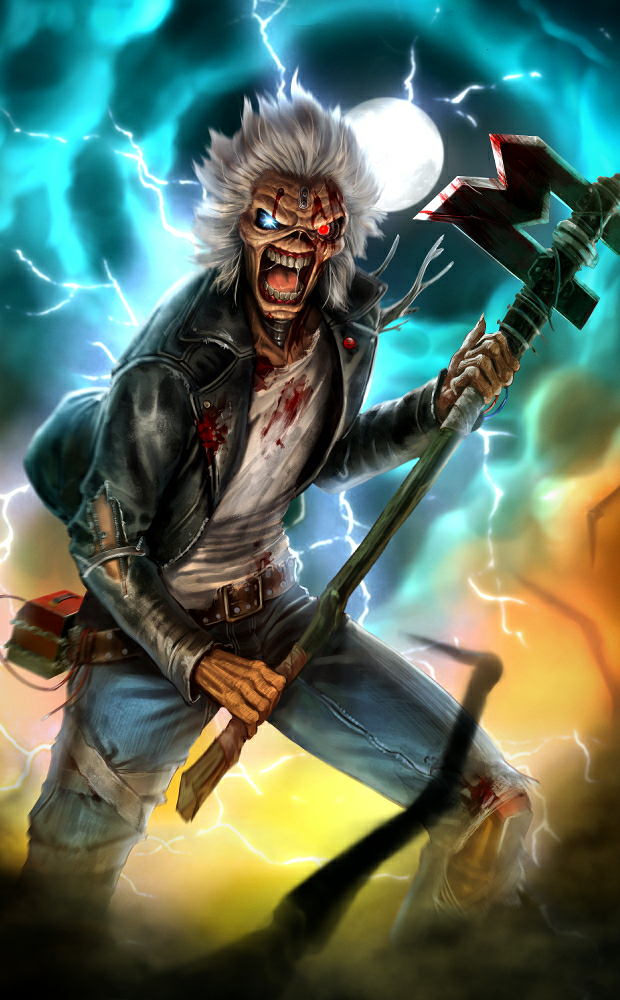
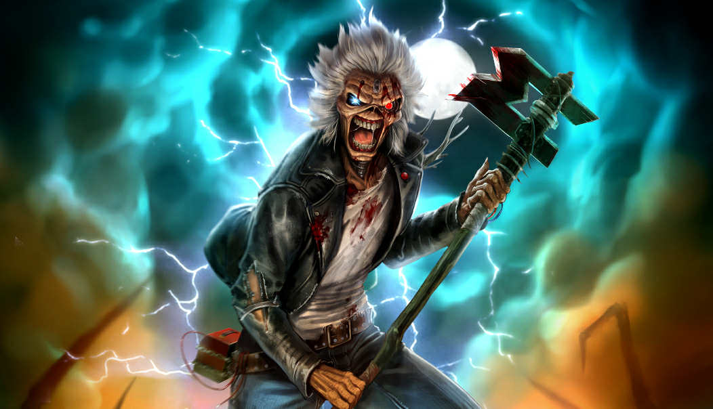
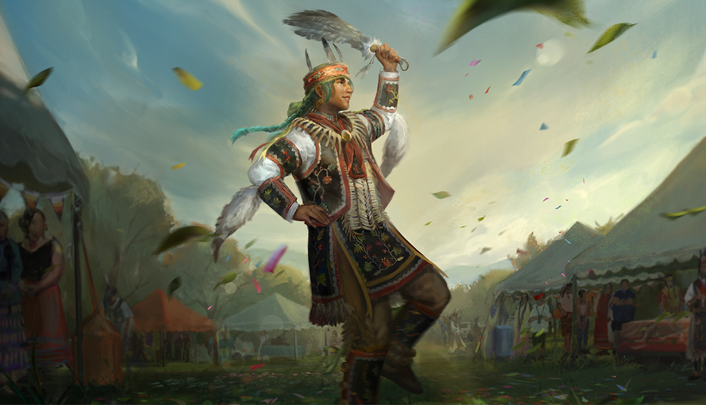

# live · 10.0.2_3487723live

| | |
|---|---|
| Build date | 2026-07-07 14:43 UTC |
| CDN version | `10.0.2_3487723live-1783435401` |
| Key | `10.0.2_live` |
| Compared with | [10.0.0_3487742live](../10.0.0_3487742live/CHANGES.md) (2026-07-07 13:57 UTC) |

## Summary

**4** added · **17** modified · **9** removed · 194 unchanged

## New or updated images

<a href="images/T_UI_CollectionBanner_IronMaiden_Huntress.png"></a>
<a href="images/T_UI_CollectionBanner_TheLifeRoad.png"></a>
<a href="images/T_UI_SpecialPack_IronMaiden_Huntress.png"></a>
<a href="images/T_UI_SpecialPack_TheLifeRoad.png"></a>

## Removed files

- `images/T_UI_ChapterBundle_Jason.png`
- `images/T_UI_ChapterBundle_TheLifeRoad.png`
- `images/T_UI_CollectionBanner_Black_Banquet.png`
- `images/T_UI_CollectionBanner_Ice_Nine_Kills.png`
- `images/T_UI_CollectionBanner_Jason.png`
- `images/T_UI_S53_ShaneWiigwaas_Portrait.png`
- `images/T_UI_SpecialPack_Ice_Nine_Kills.png`
- `images/T_UI_SpecialPack_Jason.png`
- `images/T_UI_icon_Event_LaFogata.png`

## Modified files

### [`archiveJournals/archiveS3Journals.json`](archiveJournals/archiveS3Journals.json)

[Full line-by-line diff](diffs/archiveJournals/archiveS3Journals.json.diff)

```diff
+ $.TOME24.vignettes[id=TOME24_02]
+ $.TOME24.vignettes[id=TOME24_03]
```

### [`archiveJournals/storyJournals.json`](archiveJournals/storyJournals.json)

[Full line-by-line diff](diffs/archiveJournals/storyJournals.json.diff)

```diff
+ $.TOME24.TOME24_02
+ $.TOME24.TOME24_03
```

### [`archiveQuests/Tome10.json`](archiveQuests/Tome10.json)

[Full line-by-line diff](diffs/archiveQuests/Tome10.json.diff)

```diff
- $.Tome10.level[0].nodes.node_T10L1_Glyph02.clientInfoId: "YellowGlyph"
+ $.Tome10.level[0].nodes.node_T10L1_Glyph02.clientInfoId: "WhiteGlyph"
- $.Tome10.level[0].nodes.node_T10L1_Glyph02.objectives.YellowGlyph
+ $.Tome10.level[0].nodes.node_T10L1_Glyph02.objectives.WhiteGlyph
- $.Tome10.level[1].nodes.node_T10L2_Glyph03.clientInfoId: "YellowGlyph"
+ $.Tome10.level[1].nodes.node_T10L2_Glyph03.clientInfoId: "WhiteGlyph"
- $.Tome10.level[1].nodes.node_T10L2_Glyph03.objectives.YellowGlyph
+ $.Tome10.level[1].nodes.node_T10L2_Glyph03.objectives.WhiteGlyph
- $.Tome10.level[2].nodes.node_T10L3_Glyph01.clientInfoId: "YellowGlyph"
+ $.Tome10.level[2].nodes.node_T10L3_Glyph01.clientInfoId: "WhiteGlyph"
- $.Tome10.level[2].nodes.node_T10L3_Glyph01.objectives.YellowGlyph
+ $.Tome10.level[2].nodes.node_T10L3_Glyph01.objectives.WhiteGlyph
- $.Tome10.level[3].nodes.node_T10L4_Glyph03.clientInfoId: "YellowGlyph"
+ $.Tome10.level[3].nodes.node_T10L4_Glyph03.clientInfoId: "WhiteGlyph"
- $.Tome10.level[3].nodes.node_T10L4_Glyph03.objectives.YellowGlyph
+ $.Tome10.level[3].nodes.node_T10L4_Glyph03.objectives.WhiteGlyph
```

### [`archiveQuests/Tome11.json`](archiveQuests/Tome11.json)

[Full line-by-line diff](diffs/archiveQuests/Tome11.json.diff)

```diff
- $.Tome11.level[3].nodes.node_T11L4_Glyph03.clientInfoId: "YellowGlyph"
+ $.Tome11.level[3].nodes.node_T11L4_Glyph03.clientInfoId: "WhiteGlyph"
- $.Tome11.level[3].nodes.node_T11L4_Glyph03.objectives.YellowGlyph
+ $.Tome11.level[3].nodes.node_T11L4_Glyph03.objectives.WhiteGlyph
```

### [`archiveQuests/Tome12.json`](archiveQuests/Tome12.json)

[Full line-by-line diff](diffs/archiveQuests/Tome12.json.diff)

```diff
- $.Tome12.level[3].nodes.node_T12L4_Glyph01.clientInfoId: "YellowGlyph"
+ $.Tome12.level[3].nodes.node_T12L4_Glyph01.clientInfoId: "WhiteGlyph"
- $.Tome12.level[3].nodes.node_T12L4_Glyph01.objectives.YellowGlyph
+ $.Tome12.level[3].nodes.node_T12L4_Glyph01.objectives.WhiteGlyph
```

### [`archiveQuests/Tome15.json`](archiveQuests/Tome15.json)

[Full line-by-line diff](diffs/archiveQuests/Tome15.json.diff)

```diff
- $.Tome15.level[2].nodes.node_T15_L3_Glyph02.clientInfoId: "YellowGlyph"
+ $.Tome15.level[2].nodes.node_T15_L3_Glyph02.clientInfoId: "WhiteGlyph"
- $.Tome15.level[2].nodes.node_T15_L3_Glyph02.objectives.YellowGlyph
+ $.Tome15.level[2].nodes.node_T15_L3_Glyph02.objectives.WhiteGlyph
```

### [`archiveQuests/Tome16.json`](archiveQuests/Tome16.json)

[Full line-by-line diff](diffs/archiveQuests/Tome16.json.diff)

```diff
- $.Tome16.level[2].nodes.node_T16_L3_Glyph01.clientInfoId: "YellowGlyph"
+ $.Tome16.level[2].nodes.node_T16_L3_Glyph01.clientInfoId: "WhiteGlyph"
- $.Tome16.level[2].nodes.node_T16_L3_Glyph01.objectives.YellowGlyph
+ $.Tome16.level[2].nodes.node_T16_L3_Glyph01.objectives.WhiteGlyph
```

### [`archiveQuests/Tome17.json`](archiveQuests/Tome17.json)

[Full line-by-line diff](diffs/archiveQuests/Tome17.json.diff)

```diff
- $.Tome17.level[2].nodes.node_T17_L3_Glyph02.clientInfoId: "YellowGlyph"
+ $.Tome17.level[2].nodes.node_T17_L3_Glyph02.clientInfoId: "WhiteGlyph"
- $.Tome17.level[2].nodes.node_T17_L3_Glyph02.objectives.YellowGlyph
+ $.Tome17.level[2].nodes.node_T17_L3_Glyph02.objectives.WhiteGlyph
```

### [`archiveQuests/Tome20.json`](archiveQuests/Tome20.json)

[Full line-by-line diff](diffs/archiveQuests/Tome20.json.diff)

```diff
- $.Tome20.level[3].nodes.node_T20_L4_Glyph01.clientInfoId: "YellowGlyph"
+ $.Tome20.level[3].nodes.node_T20_L4_Glyph01.clientInfoId: "WhiteGlyph"
- $.Tome20.level[3].nodes.node_T20_L4_Glyph01.objectives.YellowGlyph
+ $.Tome20.level[3].nodes.node_T20_L4_Glyph01.objectives.WhiteGlyph
```

### [`bloodwebGenerationRules.json`](bloodwebGenerationRules.json)

[Full line-by-line diff](diffs/bloodwebGenerationRules.json.diff)

```diff
- $.BulkCost[18].CostList[0].Value[]: 14000
- $.BulkCost[18].CostList[0].Value[]: 19750
- $.BulkCost[18].CostList[0].Value[]: 20500
- $.BulkCost[18].CostList[0].Value[]: 19250
- $.BulkCost[18].CostList[0].Value[]: 21000
- $.BulkCost[18].CostList[0].Value[]: 27500
- $.BulkCost[18].CostList[0].Value[]: 29500
- $.BulkCost[18].CostList[0].Value[]: 27000
- $.BulkCost[18].CostList[0].Value[]: 28250
- $.BulkCost[18].CostList[0].Value[]: 26250
- $.BulkCost[18].CostList[0].Value[]: 28750
- $.BulkCost[18].CostList[0].Value[]: 35250
- $.BulkCost[18].CostList[0].Value[]: 32750
- $.BulkCost[18].CostList[0].Value[]: 32000
- $.BulkCost[18].CostList[0].Value[]: 34750
- $.BulkCost[18].CostList[0].Value[]: 38500
+ $.BulkCost[18].CostList[0].Value[]: 10000
+ $.BulkCost[18].CostList[0].Value[]: 11250
+ $.BulkCost[18].CostList[0].Value[]: 15750
+ $.BulkCost[18].CostList[0].Value[]: 17000
+ $.BulkCost[18].CostList[0].Value[]: 16500
+ $.BulkCost[18].CostList[0].Value[]: 22750
+ $.BulkCost[18].CostList[0].Value[]: 18250
+ $.BulkCost[18].CostList[0].Value[]: 21500
+ $.BulkCost[18].CostList[0].Value[]: 23500
+ $.BulkCost[18].CostList[0].Value[]: 26000
+ $.BulkCost[18].CostList[0].Value[]: 30000
+ $.BulkCost[18].CostList[0].Value[]: 34000
+ $.BulkCost[18].CostList[0].Value[]: 30750
+ $.BulkCost[18].CostList[0].Value[]: 33250
+ $.BulkCost[18].CostList[0].Value[]: 36500
- $.BulkCost[18].CostList[1].Value[]: 14000
- $.BulkCost[18].CostList[1].Value[]: 19750
- $.BulkCost[18].CostList[1].Value[]: 20500
- $.BulkCost[18].CostList[1].Value[]: 19250
- $.BulkCost[18].CostList[1].Value[]: 21000
- $.BulkCost[18].CostList[1].Value[]: 27500
- $.BulkCost[18].CostList[1].Value[]: 27000
- $.BulkCost[18].CostList[1].Value[]: 28250
- $.BulkCost[18].CostList[1].Value[]: 26250
- $.BulkCost[18].CostList[1].Value[]: 31500
- $.BulkCost[18].CostList[1].Value[]: 35250
- $.BulkCost[18].CostList[1].Value[]: 34750
- $.BulkCost[18].CostList[1].Value[]: 38000
+ $.BulkCost[18].CostList[1].Value[]: 10000
+ $.BulkCost[18].CostList[1].Value[]: 11250
+ $.BulkCost[18].CostList[1].Value[]: 15750
+ $.BulkCost[18].CostList[1].Value[]: 17000
+ $.BulkCost[18].CostList[1].Value[]: 16500
+ $.BulkCost[18].CostList[1].Value[]: 18250
+ $.BulkCost[18].CostList[1].Value[]: 22750
+ $.BulkCost[18].CostList[1].Value[]: 23500
+ $.BulkCost[18].CostList[1].Value[]: 24750
+ $.BulkCost[18].CostList[1].Value[]: 30750
+ $.BulkCost[18].CostList[1].Value[]: 33250
+ $.BulkCost[18].CostList[1].Value[]: 36500
- $.BulkCost[18].CostList[2].Value[]: 14000
- $.BulkCost[18].CostList[2].Value[]: 19750
- $.BulkCost[18].CostList[2].Value[]: 20500
- $.BulkCost[18].CostList[2].Value[]: 19250
- $.BulkCost[18].CostList[2].Value[]: 21000
- $.BulkCost[18].CostList[2].Value[]: 27500
- $.BulkCost[18].CostList[2].Value[]: 27000
- $.BulkCost[18].CostList[2].Value[]: 28250
- $.BulkCost[18].CostList[2].Value[]: 26250
- $.BulkCost[18].CostList[2].Value[]: 28750
- $.BulkCost[18].CostList[2].Value[]: 31500
- $.BulkCost[18].CostList[2].Value[]: 35250
- $.BulkCost[18].CostList[2].Value[]: 34750
- $.BulkCost[18].CostList[2].Value[]: 38000
+ $.BulkCost[18].CostList[2].Value[]: 10000
+ $.BulkCost[18].CostList[2].Value[]: 11250
+ $.BulkCost[18].CostList[2].Value[]: 15750
+ $.BulkCost[18].CostList[2].Value[]: 17000
+ $.BulkCost[18].CostList[2].Value[]: 16500
+ $.BulkCost[18].CostList[2].Value[]: 18250
+ $.BulkCost[18].CostList[2].Value[]: 22750
+ $.BulkCost[18].CostList[2].Value[]: 23500
+ $.BulkCost[18].CostList[2].Value[]: 24750
+ $.BulkCost[18].CostList[2].Value[]: 30750
+ $.BulkCost[18].CostList[2].Value[]: 33250
+ $.BulkCost[18].CostList[2].Value[]: 36500
- $.BulkCost[18].CostList[3].Value[]: 14000
- $.BulkCost[18].CostList[3].Value[]: 19750
- $.BulkCost[18].CostList[3].Value[]: 20500
- $.BulkCost[18].CostList[3].Value[]: 19250
- $.BulkCost[18].CostList[3].Value[]: 21000
- $.BulkCost[18].CostList[3].Value[]: 27500
- $.BulkCost[18].CostList[3].Value[]: 27000
- $.BulkCost[18].CostList[3].Value[]: 28250
- $.BulkCost[18].CostList[3].Value[]: 26250
- $.BulkCost[18].CostList[3].Value[]: 28750
- $.BulkCost[18].CostList[3].Value[]: 31500
- $.BulkCost[18].CostList[3].Value[]: 35250
- $.BulkCost[18].CostList[3].Value[]: 34750
- $.BulkCost[18].CostList[3].Value[]: 38000
+ $.BulkCost[18].CostList[3].Value[]: 10000
+ $.BulkCost[18].CostList[3].Value[]: 11250
+ $.BulkCost[18].CostList[3].Value[]: 15750
+ $.BulkCost[18].CostList[3].Value[]: 17000
+ $.BulkCost[18].CostList[3].Value[]: 16500
+ $.BulkCost[18].CostList[3].Value[]: 18250
+ $.BulkCost[18].CostList[3].Value[]: 22750
+ $.BulkCost[18].CostList[3].Value[]: 23500
+ $.BulkCost[18].CostList[3].Value[]: 24750
+ $.BulkCost[18].CostList[3].Value[]: 30750
+ $.BulkCost[18].CostList[3].Value[]: 33250
+ $.BulkCost[18].CostList[3].Value[]: 36500
- $.BulkCost[18].CostList[4].Value[]: 14000
- $.BulkCost[18].CostList[4].Value[]: 19750
- $.BulkCost[18].CostList[4].Value[]: 20500
- $.BulkCost[18].CostList[4].Value[]: 19250
- $.BulkCost[18].CostList[4].Value[]: 21000
- $.BulkCost[18].CostList[4].Value[]: 27500
- $.BulkCost[18].CostList[4].Value[]: 27000
- $.BulkCost[18].CostList[4].Value[]: 28250
- $.BulkCost[18].CostList[4].Value[]: 26250
- $.BulkCost[18].CostList[4].Value[]: 28750
- $.BulkCost[18].CostList[4].Value[]: 31500
- $.BulkCost[18].CostList[4].Value[]: 35250
- $.BulkCost[18].CostList[4].Value[]: 34750
- $.BulkCost[18].CostList[4].Value[]: 38000
+ $.BulkCost[18].CostList[4].Value[]: 10000
+ $.BulkCost[18].CostList[4].Value[]: 11250
+ $.BulkCost[18].CostList[4].Value[]: 15750
+ $.BulkCost[18].CostList[4].Value[]: 17000
+ $.BulkCost[18].CostList[4].Value[]: 16500
+ $.BulkCost[18].CostList[4].Value[]: 18250
+ $.BulkCost[18].CostList[4].Value[]: 21500
+ $.BulkCost[18].CostList[4].Value[]: 22750
+ $.BulkCost[18].CostList[4].Value[]: 23500
+ $.BulkCost[18].CostList[4].Value[]: 24750
+ $.BulkCost[18].CostList[4].Value[]: 30000
+ $.BulkCost[18].CostList[4].Value[]: 26750
+ $.BulkCost[18].CostList[4].Value[]: 30750
+ $.BulkCost[18].CostList[4].Value[]: 33250
+ $.BulkCost[18].CostList[4].Value[]: 36500
- $.BulkCost[18].CostList[5].Value[]: 14000
- $.BulkCost[18].CostList[5].Value[]: 19750
- $.BulkCost[18].CostList[5].Value[]: 20500
- $.BulkCost[18].CostList[5].Value[]: 19250
- $.BulkCost[18].CostList[5].Value[]: 21000
- $.BulkCost[18].CostList[5].Value[]: 27500
- $.BulkCost[18].CostList[5].Value[]: 27000
- $.BulkCost[18].CostList[5].Value[]: 28250
- $.BulkCost[18].CostList[5].Value[]: 26250
- $.BulkCost[18].CostList[5].Value[]: 28750
- $.BulkCost[18].CostList[5].Value[]: 31500
- $.BulkCost[18].CostList[5].Value[]: 35250
- $.BulkCost[18].CostList[5].Value[]: 34750
- $.BulkCost[18].CostList[5].Value[]: 38000
+ $.BulkCost[18].CostList[5].Value[]: 10000
+ $.BulkCost[18].CostList[5].Value[]: 11250
+ $.BulkCost[18].CostList[5].Value[]: 15750
+ $.BulkCost[18].CostList[5].Value[]: 17000
+ $.BulkCost[18].CostList[5].Value[]: 16500
+ $.BulkCost[18].CostList[5].Value[]: 18250
+ $.BulkCost[18].CostList[5].Value[]: 21500
+ $.BulkCost[18].CostList[5].Value[]: 22750
+ $.BulkCost[18].CostList[5].Value[]: 23500
+ $.BulkCost[18].CostList[5].Value[]: 24750
+ $.BulkCost[18].CostList[5].Value[]: 30750
+ $.BulkCost[18].CostList[5].Value[]: 33250
+ $.BulkCost[18].CostList[5].Value[]: 36500
```

### [`catalog.json`](catalog.json)

[Full line-by-line diff](diffs/catalog.json.diff)

```diff
+ $[id=BE_Body031]
+ $[id=BE_Mask031]
+ $[id=BE_W031]
+ $[id=RAM_012]
+ $[id=RAM_013]
+ $[id=RAM_BDG_27]
+ $[id=RAM_BNR_18]
+ $[id=RAM_BNR_19]
+ $[id=RAM_BNR_20]
+ $[id=RAM_BNR_21]
+ $[id=SUS_BDG_24]
+ $[id=BE_outfit_031]
+ $[id=10.0.2_Iron_Maiden_Killer_Bundle]
+ $[id=10.0.2_Iron_Maiden_Shirt_Bundle]
+ $[id=10.0.1_Chapter40_collection_item]
+ $[id=10.0.2_IronMaiden_collection_item]
```

### [`collections.json`](collections.json)

[Full line-by-line diff](diffs/collections.json.diff)

```diff
- $.collections[66].limitedAvailabilityEndDate: "2026-07-16T15:00:00Z"
- $.collections[66].visibleAfterEndDate: false
- $.collections[66].additionalImages[0].path: "/Game/UI/UMGAssets/Icons/Banners/BundleBanners/SpecialPack/Sushi/T_UI_SpecialPack_Black_Banquet.T_UI_SpecialPack_Black_Banquet"
+ $.collections[66].additionalImages[0].path: "/Game/UI/UMGAssets/Icons/Banners/BundleBanners/SpecialPack/Sushi/T_UI_SpecialPack_TheLifeRoad.T_UI_SpecialPack_TheLifeRoad"
- $.collections[66].collectionId: "10.0.0_BlackBanquet"
+ $.collections[66].collectionId: "10.0.1_Chapter40"
- $.collections[66].collectionTitle.de: "Schwarzes Bankett"
+ $.collections[66].collectionTitle.de: "The Life Road"
- $.collections[66].collectionTitle.en: "Black Banquet"
+ $.collections[66].collectionTitle.en: "The Life Road"
- $.collections[66].collectionTitle.es: "Banquete oscuro"
+ $.collections[66].collectionTitle.es: "The Life Road"
- $.collections[66].collectionTitle["es-MX"]: "Banquete negro"
+ $.collections[66].collectionTitle["es-MX"]: "The Life Road"
- $.collections[66].collectionTitle.fr: "Sombre banquet"
+ $.collections[66].collectionTitle.fr: "The Life Road"
- $.collections[66].collectionTitle.it: "Banchetto nero"
+ $.collections[66].collectionTitle.it: "The Life Road"
- $.collections[66].collectionTitle.ja: "ブラックバンケット"
+ $.collections[66].collectionTitle.ja: "The Life Road"
- $.collections[66].collectionTitle.ko: "검은 연회"
+ $.collections[66].collectionTitle.ko: "인생의 길"
- $.collections[66].collectionTitle.pl: "Czarny bankiet"
+ $.collections[66].collectionTitle.pl: "Droga życia"
- $.collections[66].collectionTitle["pt-BR"]: "Banquete Sombrio"
+ $.collections[66].collectionTitle["pt-BR"]: "The Life Road"
- $.collections[66].collectionTitle.ru: "Black Banquet"
+ $.collections[66].collectionTitle.ru: "Дорога жизни"
- $.collections[66].collectionTitle.th: "งานเลี้ยงสีดำ"
+ $.collections[66].collectionTitle.th: "ถนนสายชีวิต"
- $.collections[66].collectionTitle.tr: "Siyah Şölen"
+ $.collections[66].collectionTitle.tr: "Hayat Yolu"
- $.collections[66].collectionTitle["zh-Hans"]: "黑暗盛宴"
+ $.collections[66].collectionTitle["zh-Hans"]: "The Life Road"
- $.collections[66].collectionTitle["zh-Hant"]: "黑色饗宴"
+ $.collections[66].collectionTitle["zh-Hant"]: "The Life Road"
- $.collections[66].heroImage.path: "/Game/UI/UMGAssets/Icons/Banners/CollectionBanners/Sushi/T_UI_CollectionBanner_Black_Banquet.T_UI_CollectionBanner_Black_Banquet"
+ $.collections[66].heroImage.path: "/Game/UI/UMGAssets/Icons/Banners/CollectionBanners/Sushi/T_UI_CollectionBanner_TheLifeRoad.T_UI_CollectionBanner_TheLifeRoad"
- $.collections[66].inclusionVersion: "10.0.0"
+ $.collections[66].inclusionVersion: "10.0.1"
- $.collections[66].items[]: "CM_outfit_036"
- $.collections[66].items[]: "DO_outfit_028"
- $.collections[66].items[]: "GS_outfit_040"
- $.collections[66].items[]: "KK_outfit_041"
+ $.collections[66].items[]: "S53_outfit_006"
+ $.collections[66].items[]: "S53_outfit_006_01"
+ $.collections[66].items[]: "S53_outfit_01_01"
+ $.collections[66].items[]: "S53_outfit_01_02"
+ $.collections[66].items[]: "S53_outfit_01_03"
+ $.collections[66].items[]: "S53_outfit_01_CV01"
+ $.collections[66].items[]: "S53_outfit_01_CV02"
+ $.collections[66].items[]: "S53_outfit_01_CV03"
+ $.collections[66].items[]: "S53_outfit_01_CV04"
+ $.collections[66].items[]: "S53_outfit_02"
+ $.collections[66].items[]: "S53_outfit_02_01"
- $.collections[66].sortOrder: "-239"
+ $.collections[66].sortOrder: "-238"
- $.collections[66].updatedDate: "2026-03-26T13:31:17.979Z"
+ $.collections[66].updatedDate: "2026-03-26T13:27:24.213Z"
+ $.collections[67].limitedAvailabilityEndDate: "2026-07-16T15:00:00Z"
+ $.collections[67].visibleAfterEndDate: false
- $.collections[67].additionalImages[0].path: "/Game/UI/UMGAssets/Icons/Banners/BundleBanners/SpecialPack/T_UI_SpecialPack_SilentHill2_BC.T_UI_SpecialPack_SilentHill2_BC"
+ $.collections[67].additionalImages[0].path: "/Game/UI/UMGAssets/Icons/Banners/BundleBanners/SpecialPack/Sushi/T_UI_SpecialPack_Black_Banquet.T_UI_SpecialPack_Black_Banquet"
- $.collections[67].collectionId: "10.0.0_SilentHill"
+ $.collections[67].collectionId: "10.0.0_BlackBanquet"
- $.collections[67].collectionTitle.de: "Silent Hill"
+ $.collections[67].collectionTitle.de: "Schwarzes Bankett"
- $.collections[67].collectionTitle.en: "Silent Hill"
+ $.collections[67].collectionTitle.en: "Black Banquet"
- $.collections[67].collectionTitle.es: "Silent Hill"
+ $.collections[67].collectionTitle.es: "Banquete oscuro"
- $.collections[67].collectionTitle["es-MX"]: "Silent Hill"
+ $.collections[67].collectionTitle["es-MX"]: "Banquete negro"
- $.collections[67].collectionTitle.fr: "Silent Hill"
+ $.collections[67].collectionTitle.fr: "Sombre banquet"
- $.collections[67].collectionTitle.it: "Silent Hill"
+ $.collections[67].collectionTitle.it: "Banchetto nero"
- $.collections[67].collectionTitle.ja: "サイレントヒル"
+ $.collections[67].collectionTitle.ja: "ブラックバンケット"
- $.collections[67].collectionTitle.ko: "사일런트 힐"
+ $.collections[67].collectionTitle.ko: "검은 연회"
- $.collections[67].collectionTitle.pl: "Silent Hill"
+ $.collections[67].collectionTitle.pl: "Czarny bankiet"
- $.collections[67].collectionTitle["pt-BR"]: "Silent Hill"
+ $.collections[67].collectionTitle["pt-BR"]: "Banquete Sombrio"
- $.collections[67].collectionTitle.ru: "Сайлент Хилл"
+ $.collections[67].collectionTitle.ru: "Black Banquet"
- $.collections[67].collectionTitle.th: "ไซเลนต์ฮิล"
+ $.collections[67].collectionTitle.th: "งานเลี้ยงสีดำ"
- $.collections[67].collectionTitle.tr: "Silent Hill"
+ $.collections[67].collectionTitle.tr: "Siyah Şölen"
- $.collections[67].collectionTitle["zh-Hans"]: "寂静岭"
+ $.collections[67].collectionTitle["zh-Hans"]: "黑暗盛宴"
- $.collections[67].collectionTitle["zh-Hant"]: "沉默之丘"
+ $.collections[67].collectionTitle["zh-Hant"]: "黑色饗宴"
- $.collections[67].heroImage.path: "/Game/UI/UMGAssets/Icons/Banners/CollectionBanners/T_UI_CollectionBanner_SilentHill.T_UI_CollectionBanner_SilentHill"
+ $.collections[67].heroImage.path: "/Game/UI/UMGAssets/Icons/Banners/CollectionBanners/Sushi/T_UI_CollectionBanner_Black_Banquet.T_UI_CollectionBanner_Black_Banquet"
- $.collections[67].items[]: "FM_outfit_022"
- $.collections[67].items[]: "K20_outfit_006"
- $.collections[67].items[]: "K20_outfit_007"
- $.collections[67].items[]: "K20_outfit_008"
- $.collections[67].items[]: "K20_outfit_009"
- $.collections[67].items[]: "K20_outfit_010"
- $.collections[67].items[]: "KK_outfit_016"
- $.collections[67].items[]: "KK_outfit_016_01"
- $.collections[67].items[]: "KK_outfit_016_02"
- $.collections[67].items[]: "KK_outfit_016_03"
- $.collections[67].items[]: "S22_outfit_006"
- $.collections[67].items[]: "S22_outfit_007"
- $.collections[67].items[]: "S22_outfit_008"
- $.collections[67].items[]: "S22_outfit_010"
- $.collections[67].items[]: "S22_outfit_011"
- $.collections[67].items[]: "S22_outfit_012"
- $.collections[67].items[]: "S22_outfit_013"
- $.collections[67].items[]: "S22_outfit_014"
- $.collections[67].items[]: "S22_outfit_02"
- $.collections[67].items[]: "S22_outfit_02_01"
- $.collections[67].items[]: "S22_Torso01_01"
- $.collections[67].items[]: "S22_Torso01_02"
- $.collections[67].items[]: "S22_Torso01_03"
- $.collections[67].items[]: "S22_Torso01_04"
- $.collections[67].items[]: "S22_Torso01_05"
- $.collections[67].items[]: "S22_Torso01_06"
+ $.collections[67].items[]: "CM_outfit_036"
+ $.collections[67].items[]: "DO_outfit_028"
+ $.collections[67].items[]: "GS_outfit_040"
+ $.collections[67].items[]: "KK_outfit_041"
- $.collections[67].limitedAvailabilityStartDate: "2026-06-30T15:00:00Z"
+ $.collections[67].limitedAvailabilityStartDate: "2026-06-25T15:00:00Z"
- $.collections[67].sortOrder: "-240"
+ $.collections[67].sortOrder: "-239"
- $.collections[67].updatedDate: "2026-03-26T13:29:45.882Z"
+ $.collections[67].updatedDate: "2026-03-26T13:31:17.979Z"
+ $.collections[68].limitedAvailabilityStartDate: "2026-06-30T15:00:00Z"
+ $.collections[68].visibleBeforeStartDate: false
+ $.collections[68].additionalImages[0]
- $.collections[68].collectionId: "GreekLegends"
+ $.collections[68].collectionId: "10.0.0_SilentHill"
- $.collections[68].collectionTitle.de: "Griechische Legenden"
+ $.collections[68].collectionTitle.de: "Silent Hill"
- $.collections[68].collectionTitle.en: "Greek Legends"
+ $.collections[68].collectionTitle.en: "Silent Hill"
- $.collections[68].collectionTitle.es: "Leyendas griegas"
+ $.collections[68].collectionTitle.es: "Silent Hill"
- $.collections[68].collectionTitle["es-MX"]: "Leyendas griegas"
+ $.collections[68].collectionTitle["es-MX"]: "Silent Hill"
- $.collections[68].collectionTitle.fr: "Légendes grecques"
+ $.collections[68].collectionTitle.fr: "Silent Hill"
- $.collections[68].collectionTitle.it: "Leggende greche"
+ $.collections[68].collectionTitle.it: "Silent Hill"
- $.collections[68].collectionTitle.ja: "ギリシャの伝説"
+ $.collections[68].collectionTitle.ja: "サイレントヒル"
- $.collections[68].collectionTitle.ko: "그리스 전설"
+ $.collections[68].collectionTitle.ko: "사일런트 힐"
- $.collections[68].collectionTitle.pl: "Greckie legendy"
+ $.collections[68].collectionTitle.pl: "Silent Hill"
- $.collections[68].collectionTitle["pt-BR"]: "Lendas Gregas"
+ $.collections[68].collectionTitle["pt-BR"]: "Silent Hill"
- $.collections[68].collectionTitle.ru: "Легенды Греции"
+ $.collections[68].collectionTitle.ru: "Сайлент Хилл"
- $.collections[68].collectionTitle.th: "ตำนานกรีก"
+ $.collections[68].collectionTitle.th: "ไซเลนต์ฮิล"
- $.collections[68].collectionTitle.tr: "Yunan Efsaneleri"
+ $.collections[68].collectionTitle.tr: "Silent Hill"
- $.collections[68].collectionTitle["zh-Hans"]: "希腊传说"
+ $.collections[68].collectionTitle["zh-Hans"]: "寂静岭"
- $.collections[68].collectionTitle["zh-Hant"]: "希臘傳奇"
+ $.collections[68].collectionTitle["zh-Hant"]: "沉默之丘"
- $.collections[68].heroImage.path: "/Game/UI/UMGAssets/Icons/Banners/CollectionBanners/T_UI_CollectionBanner_GreekLegends.T_UI_CollectionBanner_GreekLegends"
+ $.collections[68].heroImage.path: "/Game/UI/UMGAssets/Icons/Banners/CollectionBanners/T_UI_CollectionBanner_SilentHill.T_UI_CollectionBanner_SilentHill"
- $.collections[68].inclusionVersion: "7.7.0 PTB"
+ $.collections[68].inclusionVersion: "10.0.0"
- $.collections[68].items[]: "AV_outfit_014"
- $.collections[68].items[]: "DK_outfit_012"
- $.collections[68].items[]: "FM_outfit_012"
- $.collections[68].items[]: "GK_outfit_011"
- $.collections[68].items[]: "GS_outfit_016"
- $.collections[68].items[]: "HK_outfit_011"
- $.collections[68].items[]: "HS_outfit_010"
- $.collections[68].items[]: "K21_outfit_008"
- $.collections[68].items[]: "K26_outfit_009"
- $.collections[68].items[]: "K28_outfit_010"
- $.collections[68].items[]: "KS_outfit_012"
- $.collections[68].items[]: "MK_outfit_013"
- $.collections[68].items[]: "MS_outfit_013"
- $.collections[68].items[]: "NK_outfit_022"
- $.collections[68].items[]: "S24_outfit_009"
- $.collections[68].items[]: "S28_outfit_014"
- $.collections[68].items[]: "S35_outfit_009"
- $.collections[68].items[]: "S36_outfit_009"
- $.collections[68].items[]: "SwedenKiller_outfit_009"
- $.collections[68].items[]: "SwedenSurvivor_outfit_011"
- $.collections[68].items[]: "TN_outfit_013"
- $.collections[68].items[]: "US_outfit_009"
+ $.collections[68].items[]: "FM_outfit_022"
+ $.collections[68].items[]: "K20_outfit_006"
+ $.collections[68].items[]: "K20_outfit_007"
+ $.collections[68].items[]: "K20_outfit_008"
+ $.collections[68].items[]: "K20_outfit_009"
+ $.collections[68].items[]: "K20_outfit_010"
… 2104 more change(s) — see the commit diff for everything
```

### [`contentSchedule.json`](contentSchedule.json)

[Full line-by-line diff](diffs/contentSchedule.json.diff)

```diff
- $.schedule[4].MapsWeight.Swp_GrimPantry: "0"
+ $.schedule[4].MapsWeight.Fin_Hideout: "50"
- $.schedule[5]
```

### [`dynamicContent/DynamicContent.json`](dynamicContent/DynamicContent.json)

[Full line-by-line diff](diffs/dynamicContent/DynamicContent.json.diff)

```diff
- $.entries[0].downloadStrategy: "preferRemote"
+ $.entries[0].downloadStrategy: "preferPackaged"
- $.entries[2].contentVersion: "db5309baacf020722b4fb45023708df4d48fc820"
+ $.entries[2].contentVersion: "491d730fa3e6382e368680fcd716f0478ea742ee"
- $.entries[2].packagedPath: "/Game/UI/UMGAssets/Icons/Banners/BundleBanners/SpecialPack/Sushi/T_UI_SpecialPack_Ice_Nine_Kills.T_UI_SpecialPack_Ice_Nine_Kills"
+ $.entries[2].packagedPath: "/Game/UI/UMGAssets/Icons/Banners/BundleBanners/SpecialPack/Sushi/T_UI_SpecialPack_Black_Banquet.T_UI_SpecialPack_Black_Banquet"
- $.entries[2].uri: "images/T_UI_SpecialPack_Ice_Nine_Kills.png"
+ $.entries[2].uri: "images/T_UI_SpecialPack_Black_Banquet.png"
- $.entries[3].contentVersion: "e44e4a7791219404be660d1cc9f395396f41fa54"
+ $.entries[3].contentVersion: "45dbc8795086ecc22e3ee59473bb597baae63b7f"
- $.entries[3].packagedPath: "/Game/UI/UMGAssets/Icons/Banners/BundleBanners/ChapterBundles/T_UI_ChapterBundle_TheLifeRoad.T_UI_ChapterBundle_TheLifeRoad"
+ $.entries[3].packagedPath: "/Game/UI/UMGAssets/Icons/Banners/CollectionBanners/Sushi/T_UI_CollectionBanner_TheLifeRoad.T_UI_CollectionBanner_TheLifeRoad"
- $.entries[3].uri: "images/T_UI_ChapterBundle_TheLifeRoad.png"
+ $.entries[3].uri: "images/T_UI_CollectionBanner_TheLifeRoad.png"
- $.entries[4].contentVersion: "201d2c22c95e6cfa6cfa270728145726e7973c63"
+ $.entries[4].contentVersion: "623bb882552904b79446b6e334171fa8ca8d0345"
- $.entries[4].packagedPath: "/Game/UI/UMGAssets/Icons/Banners/CollectionBanners/Sushi/T_UI_CollectionBanner_Black_Banquet.T_UI_CollectionBanner_Black_Banquet"
+ $.entries[4].packagedPath: "/Game/UI/UMGAssets/Icons/Banners/BundleBanners/SpecialPack/Sushi/T_UI_SpecialPack_TheLifeRoad.T_UI_SpecialPack_TheLifeRoad"
- $.entries[4].uri: "images/T_UI_CollectionBanner_Black_Banquet.png"
+ $.entries[4].uri: "images/T_UI_SpecialPack_TheLifeRoad.png"
- $.entries[5].contentVersion: "491d730fa3e6382e368680fcd716f0478ea742ee"
+ $.entries[5].contentVersion: "43d348856127eef7569bb87e500916398edb21b9"
- $.entries[5].packagedPath: "/Game/UI/UMGAssets/Icons/Banners/BundleBanners/SpecialPack/Sushi/T_UI_SpecialPack_Black_Banquet.T_UI_SpecialPack_Black_Banquet"
+ $.entries[5].packagedPath: "/Game/UI/UMGAssets/Icons/Banners/CollectionBanners/Sushi/T_UI_CollectionBanner_IronMaiden_Huntress.T_UI_CollectionBanner_IronMaiden_Huntress"
- $.entries[5].uri: "images/T_UI_SpecialPack_Black_Banquet.png"
+ $.entries[5].uri: "images/T_UI_CollectionBanner_IronMaiden_Huntress.png"
- $.entries[6].contentVersion: "e24e946eb73c45120942d89c2de73814cc1a2e99"
+ $.entries[6].contentVersion: "d94c7a95edf46327051fd320ccbde523e59fb470"
- $.entries[6].packagedPath: "/Game/UI/UMGAssets/Icons/Banners/CollectionBanners/Sushi/T_UI_CollectionBanner_Ice_Nine_Kills.T_UI_CollectionBanner_Ice_Nine_Kills"
+ $.entries[6].packagedPath: "/Game/UI/UMGAssets/Icons/Banners/BundleBanners/SpecialPack/Sushi/T_UI_SpecialPack_IronMaiden_Huntress.T_UI_SpecialPack_IronMaiden_Huntress"
- $.entries[6].uri: "images/T_UI_CollectionBanner_Ice_Nine_Kills.png"
+ $.entries[6].uri: "images/T_UI_SpecialPack_IronMaiden_Huntress.png"
- $.entries[7].contentVersion: "db5309baacf020722b4fb45023708df4d48fc820"
+ $.entries[7].contentVersion: "f7c93776f522193fdbac58c1416ed2bb8ee190ec"
- $.entries[7].packagedPath: "/Game/UI/UMGAssets/Icons/Banners/BundleBanners/SpecialPack/Sushi/T_UI_SpecialPack_Ice_Nine_Kills.T_UI_SpecialPack_Ice_Nine_Kills"
+ $.entries[7].packagedPath: "/DBDUICore/Assets/HUD/Tutorial/T_UI_Tutorial_ImageBG_GenQuest1.T_UI_Tutorial_ImageBG_GenQuest1"
- $.entries[7].uri: "images/T_UI_SpecialPack_Ice_Nine_Kills.png"
+ $.entries[7].uri: "images/T_UI_Tutorial_ImageBG_GenQuest1.png"
- $.entries[8].contentVersion: "47c2ee482573517676b096d0f2c295d2e7751af7"
+ $.entries[8].contentVersion: "4ae305ae1f966db3228ce77826da57e2ece140b4"
- $.entries[8].packagedPath: "/Game/UI/UMGAssets/Icons/Banners/CollectionBanners/Sushi/T_UI_CollectionBanner_Jason.T_UI_CollectionBanner_Jason"
+ $.entries[8].packagedPath: "/DBDUICore/Assets/HUD/Tutorial/T_UI_Tutorial_ImageBG_cosmetic.T_UI_Tutorial_ImageBG_cosmetic"
- $.entries[8].uri: "images/T_UI_CollectionBanner_Jason.png"
+ $.entries[8].uri: "images/T_UI_Tutorial_ImageBG_cosmetic.png"
- $.entries[9].contentVersion: "89cd6761baa172e7467e358fd33d57a45f38c845"
+ $.entries[9].contentVersion: "f8c74b123d0ba3a66d82d9ba6e26486b88797b88"
- $.entries[9].packagedPath: "/Game/UI/UMGAssets/Icons/Banners/BundleBanners/SpecialPack/Sushi/T_UI_SpecialPack_Jason.T_UI_SpecialPack_Jason"
+ $.entries[9].packagedPath: "/DBDUICore/Assets/HUD/Tutorial/T_UI_Tutorial_ImageBG_gift.T_UI_Tutorial_ImageBG_gift"
- $.entries[9].uri: "images/T_UI_SpecialPack_Jason.png"
+ $.entries[9].uri: "images/T_UI_Tutorial_ImageBG_gift.png"
- $.entries[10].contentVersion: "f7c93776f522193fdbac58c1416ed2bb8ee190ec"
+ $.entries[10].contentVersion: "491d730fa3e6382e368680fcd716f0478ea742ee"
- $.entries[10].packagedPath: "/DBDUICore/Assets/HUD/Tutorial/T_UI_Tutorial_ImageBG_GenQuest1.T_UI_Tutorial_ImageBG_GenQuest1"
+ $.entries[10].packagedPath: "/Game/UI/UMGAssets/Icons/Banners/BundleBanners/SpecialPack/Sushi/T_UI_SpecialPack_Black_Banquet.T_UI_SpecialPack_Black_Banquet"
- $.entries[10].uri: "images/T_UI_Tutorial_ImageBG_GenQuest1.png"
+ $.entries[10].uri: "images/T_UI_SpecialPack_Black_Banquet.png"
- $.entries[11].contentVersion: "4ae305ae1f966db3228ce77826da57e2ece140b4"
+ $.entries[11].contentVersion: "45dbc8795086ecc22e3ee59473bb597baae63b7f"
- $.entries[11].packagedPath: "/DBDUICore/Assets/HUD/Tutorial/T_UI_Tutorial_ImageBG_cosmetic.T_UI_Tutorial_ImageBG_cosmetic"
+ $.entries[11].packagedPath: "/Game/UI/UMGAssets/Icons/Banners/CollectionBanners/Sushi/T_UI_CollectionBanner_TheLifeRoad.T_UI_CollectionBanner_TheLifeRoad"
- $.entries[11].uri: "images/T_UI_Tutorial_ImageBG_cosmetic.png"
+ $.entries[11].uri: "images/T_UI_CollectionBanner_TheLifeRoad.png"
- $.entries[12].contentVersion: "f8c74b123d0ba3a66d82d9ba6e26486b88797b88"
+ $.entries[12].contentVersion: "623bb882552904b79446b6e334171fa8ca8d0345"
- $.entries[12].packagedPath: "/DBDUICore/Assets/HUD/Tutorial/T_UI_Tutorial_ImageBG_gift.T_UI_Tutorial_ImageBG_gift"
+ $.entries[12].packagedPath: "/Game/UI/UMGAssets/Icons/Banners/BundleBanners/SpecialPack/Sushi/T_UI_SpecialPack_TheLifeRoad.T_UI_SpecialPack_TheLifeRoad"
- $.entries[12].uri: "images/T_UI_Tutorial_ImageBG_gift.png"
+ $.entries[12].uri: "images/T_UI_SpecialPack_TheLifeRoad.png"
- $.entries[13].contentVersion: "1a73827d53e583dd03efaac5b38ab8fb04610088"
+ $.entries[13].contentVersion: "43d348856127eef7569bb87e500916398edb21b9"
- $.entries[13].downloadStrategy: "preferRemote"
+ $.entries[13].downloadStrategy: "preferPackaged"
- $.entries[13].packagedPath: "/DBDUICore/Assets/Common/Event/Community/T_UI_icon_Event_LaFogata.T_UI_icon_Event_LaFogata"
+ $.entries[13].packagedPath: "/Game/UI/UMGAssets/Icons/Banners/CollectionBanners/Sushi/T_UI_CollectionBanner_IronMaiden_Huntress.T_UI_CollectionBanner_IronMaiden_Huntress"
- $.entries[13].uri: "images/T_UI_icon_Event_LaFogata.png"
+ $.entries[13].uri: "images/T_UI_CollectionBanner_IronMaiden_Huntress.png"
- $.entries[14].contentVersion: "14bd21a042f1ed4a0789bb0b95e7d362b731172a"
+ $.entries[14].contentVersion: "d94c7a95edf46327051fd320ccbde523e59fb470"
- $.entries[14].packagedPath: "/Game/UI/UMGAssets/Icons/CharPortraits/Sushi/T_UI_S53_ShaneWiigwaas_Portrait.T_UI_S53_ShaneWiigwaas_Portrait"
+ $.entries[14].packagedPath: "/Game/UI/UMGAssets/Icons/Banners/BundleBanners/SpecialPack/Sushi/T_UI_SpecialPack_IronMaiden_Huntress.T_UI_SpecialPack_IronMaiden_Huntress"
- $.entries[14].uri: "images/T_UI_S53_ShaneWiigwaas_Portrait.png"
+ $.entries[14].uri: "images/T_UI_SpecialPack_IronMaiden_Huntress.png"
- $.entries[15].contentVersion: "54d5075735b1b4725094ae412868732d720ee188"
+ $.entries[15].contentVersion: "d2a41f23bdd6c22204053a9dbb3d0b4a3dd83e4c"
- $.entries[15].downloadStrategy: "preferPackaged"
+ $.entries[15].downloadStrategy: "preferRemote"
- $.entries[15].enableChecksum: false
+ $.entries[15].enableChecksum: true
- $.entries[15].packagedPath: "/Game/UI/UMGAssets/Icons/Banners/BundleBanners/ChapterBundles/T_UI_ChapterBundle_Jason.T_UI_ChapterBundle_Jason"
+ $.entries[15].packagedPath: ""
- $.entries[15].schema: "s3verbin://"
+ $.entries[15].schema: "s3ver://"
- $.entries[15].uri: "images/T_UI_ChapterBundle_Jason.png"
+ $.entries[15].uri: "catalog.json"
- $.entries[16].contentVersion: "e44e4a7791219404be660d1cc9f395396f41fa54"
+ $.entries[16].contentVersion: "613ce2a3bcb444c2ec2797a0cc2f9dba8d84b544"
- $.entries[16].downloadStrategy: "preferPackaged"
+ $.entries[16].downloadStrategy: "preferRemote"
- $.entries[16].enableChecksum: false
+ $.entries[16].enableChecksum: true
- $.entries[16].packagedPath: "/Game/UI/UMGAssets/Icons/Banners/BundleBanners/ChapterBundles/T_UI_ChapterBundle_TheLifeRoad.T_UI_ChapterBundle_TheLifeRoad"
+ $.entries[16].packagedPath: ""
- $.entries[16].schema: "s3verbin://"
+ $.entries[16].schema: "s3ver://"
- $.entries[16].uri: "images/T_UI_ChapterBundle_TheLifeRoad.png"
+ $.entries[16].uri: "bonusPointEventsContent.json"
- $.entries[17].contentVersion: "201d2c22c95e6cfa6cfa270728145726e7973c63"
+ $.entries[17].contentVersion: "1f75c1dc50dee179d18a6fcc69f89e12c9f1d250"
- $.entries[17].downloadStrategy: "preferPackaged"
+ $.entries[17].downloadStrategy: "preferRemote"
- $.entries[17].enableChecksum: false
+ $.entries[17].enableChecksum: true
- $.entries[17].packagedPath: "/Game/UI/UMGAssets/Icons/Banners/CollectionBanners/Sushi/T_UI_CollectionBanner_Black_Banquet.T_UI_CollectionBanner_Black_Banquet"
+ $.entries[17].packagedPath: ""
- $.entries[17].schema: "s3verbin://"
+ $.entries[17].schema: "s3ver://"
- $.entries[17].uri: "images/T_UI_CollectionBanner_Black_Banquet.png"
+ $.entries[17].uri: "freetoplay/NA/event.json"
- $.entries[18].contentVersion: "491d730fa3e6382e368680fcd716f0478ea742ee"
+ $.entries[18].contentVersion: "1f75c1dc50dee179d18a6fcc69f89e12c9f1d250"
- $.entries[18].downloadStrategy: "preferPackaged"
+ $.entries[18].downloadStrategy: "preferRemote"
- $.entries[18].enableChecksum: false
+ $.entries[18].enableChecksum: true
- $.entries[18].packagedPath: "/Game/UI/UMGAssets/Icons/Banners/BundleBanners/SpecialPack/Sushi/T_UI_SpecialPack_Black_Banquet.T_UI_SpecialPack_Black_Banquet"
+ $.entries[18].packagedPath: ""
- $.entries[18].schema: "s3verbin://"
+ $.entries[18].schema: "s3ver://"
- $.entries[18].uri: "images/T_UI_SpecialPack_Black_Banquet.png"
+ $.entries[18].uri: "freetoplay/EU/event.json"
- $.entries[19].contentVersion: "e24e946eb73c45120942d89c2de73814cc1a2e99"
+ $.entries[19].contentVersion: "728990dee9d5732a2a4ac75c2c753147bc4e594b"
- $.entries[19].downloadStrategy: "preferPackaged"
+ $.entries[19].downloadStrategy: "preferRemote"
- $.entries[19].enableChecksum: false
+ $.entries[19].enableChecksum: true
- $.entries[19].packagedPath: "/Game/UI/UMGAssets/Icons/Banners/CollectionBanners/Sushi/T_UI_CollectionBanner_Ice_Nine_Kills.T_UI_CollectionBanner_Ice_Nine_Kills"
+ $.entries[19].packagedPath: ""
- $.entries[19].schema: "s3verbin://"
+ $.entries[19].schema: "s3ver://"
- $.entries[19].uri: "images/T_UI_CollectionBanner_Ice_Nine_Kills.png"
+ $.entries[19].uri: "archiveQuests/Anniversary2022.json"
- $.entries[20].contentVersion: "db5309baacf020722b4fb45023708df4d48fc820"
+ $.entries[20].contentVersion: "c6cd4df2d61da9a5a2f29358564b66457c6e2fc0"
- $.entries[20].downloadStrategy: "preferPackaged"
+ $.entries[20].downloadStrategy: "preferRemote"
- $.entries[20].enableChecksum: false
+ $.entries[20].enableChecksum: true
- $.entries[20].packagedPath: "/Game/UI/UMGAssets/Icons/Banners/BundleBanners/SpecialPack/Sushi/T_UI_SpecialPack_Ice_Nine_Kills.T_UI_SpecialPack_Ice_Nine_Kills"
+ $.entries[20].packagedPath: ""
- $.entries[20].schema: "s3verbin://"
+ $.entries[20].schema: "s3ver://"
- $.entries[20].uri: "images/T_UI_SpecialPack_Ice_Nine_Kills.png"
+ $.entries[20].uri: "archiveQuests/Anniversary2023.json"
- $.entries[21].contentVersion: "47c2ee482573517676b096d0f2c295d2e7751af7"
+ $.entries[21].contentVersion: "4ee674fb40449e7212c3953661120a74c959baaf"
- $.entries[21].downloadStrategy: "preferPackaged"
+ $.entries[21].downloadStrategy: "preferRemote"
- $.entries[21].enableChecksum: false
+ $.entries[21].enableChecksum: true
- $.entries[21].packagedPath: "/Game/UI/UMGAssets/Icons/Banners/CollectionBanners/Sushi/T_UI_CollectionBanner_Jason.T_UI_CollectionBanner_Jason"
+ $.entries[21].packagedPath: ""
- $.entries[21].schema: "s3verbin://"
+ $.entries[21].schema: "s3ver://"
- $.entries[21].uri: "images/T_UI_CollectionBanner_Jason.png"
+ $.entries[21].uri: "archiveQuests/Anniversary2024.json"
- $.entries[22].contentVersion: "89cd6761baa172e7467e358fd33d57a45f38c845"
+ $.entries[22].contentVersion: "7f5868c420eb9c75c1d671358a4ce010d13477d0"
- $.entries[22].downloadStrategy: "preferPackaged"
+ $.entries[22].downloadStrategy: "preferRemote"
- $.entries[22].enableChecksum: false
+ $.entries[22].enableChecksum: true
- $.entries[22].packagedPath: "/Game/UI/UMGAssets/Icons/Banners/BundleBanners/SpecialPack/Sushi/T_UI_SpecialPack_Jason.T_UI_SpecialPack_Jason"
+ $.entries[22].packagedPath: ""
- $.entries[22].schema: "s3verbin://"
+ $.entries[22].schema: "s3ver://"
- $.entries[22].uri: "images/T_UI_SpecialPack_Jason.png"
+ $.entries[22].uri: "archiveQuests/CalamariV1.json"
- $.entries[23].contentVersion: "089b1634357fa9c4a4531a81509d8972e64e4b97"
+ $.entries[23].contentVersion: "982cb91f4d3437f20b98a8646c5dc9f2a5777efd"
- $.entries[23].uri: "catalog.json"
+ $.entries[23].uri: "archiveQuests/CalamariV2.json"
- $.entries[24].contentVersion: "6d553b672cd9fa45f49863b4ce69a7e0114088a6"
+ $.entries[24].contentVersion: "4c4ed86024343728623d42092e7331372bfa4b4b"
- $.entries[24].uri: "bonusPointEventsContent.json"
+ $.entries[24].uri: "archiveQuests/CalamariV3.json"
- $.entries[25].contentVersion: "8ac430f2eb0c2d4eb4ffa6e2a41f03bb5b5f0cad"
+ $.entries[25].contentVersion: "aba3db56f0608ce792f5d246d9c7a5029298786e"
- $.entries[25].uri: "freetoplay/NA/event.json"
+ $.entries[25].uri: "archiveQuests/ChocolateBoxGelato.json"
- $.entries[26].contentVersion: "8ac430f2eb0c2d4eb4ffa6e2a41f03bb5b5f0cad"
+ $.entries[26].contentVersion: "d3512d8f6680c63afde0f805716cf913741a1e8d"
- $.entries[26].uri: "freetoplay/EU/event.json"
+ $.entries[26].uri: "archiveQuests/ChocolateBoxV1.json"
- $.entries[27].contentVersion: "512abd4e1543a2ebe13d87d00df6f846b9bef87a"
+ $.entries[27].contentVersion: "993ec614f8414864752cec6fcfa26251229d2529"
- $.entries[27].uri: "archiveQuests/Anniversary2022.json"
+ $.entries[27].uri: "archiveQuests/DreadByDaylightZodiac.json"
- $.entries[28].contentVersion: "fd09e1bc3401e603f3bfacbf832e486f8962122f"
+ $.entries[28].contentVersion: "a1dccb478f49bae14ff62cb51e528b3e94605aa1"
… 830 more change(s) — see the commit diff for everything
```

### [`gameplayTunables.json`](gameplayTunables.json)

[Full line-by-line diff](diffs/gameplayTunables.json.diff)

```diff
+ $.data["f:/Game/Data/MMRScore/MMRScoreTunableDB.MMRScoreTunableDB:benevolent_protectionhit_pointspervalue"]: 15.0
+ $.data["f:/Game/Data/MMRScore/MMRScoreTunableDB.MMRScoreTunableDB:benevolent_protectionhitendgame_pointspervalue"]: 20.0
+ $.data["f:/Game/Data/MMRScore/MMRScoreTunableDB.MMRScoreTunableDB:benevolent_savefromkiller_pointspervalue"]: 35.0
+ $.data["f:/Game/Data/MMRScore/MMRScoreTunableDB.MMRScoreTunableDB:benevolent_unhooksafe_pointspervalue"]: 20.0
+ $.data["f:/Game/Data/MMRScore/MMRScoreTunableDB.MMRScoreTunableDB:benevolent_unhooksafeendgame_pointspervalue"]: 20.0
+ $.data["f:/Game/Data/MMRScore/MMRScoreTunableDB.MMRScoreTunableDB:chaser_chasesurvivorescape_pointspervalue"]: -2.0
+ $.data["f:/Game/Data/MMRScore/MMRScoreTunableDB.MMRScoreTunableDB:evader_chasesurvivordowned_pointspervalue"]: 3.0
+ $.data["f:/Game/Data/MMRScore/MMRScoreTunableDB.MMRScoreTunableDB:evader_chasesurvivorescape_pointspervalue"]: 7.0
+ $.data["f:/Game/Data/MMRScore/MMRScoreTunableDB.MMRScoreTunableDB:evader_chasetimesurvivor_pointspervalue"]: 0.3
+ $.data["f:/Game/Data/MMRScore/MMRScoreTunableDB.MMRScoreTunableDB:evader_timestealthed_pointspervalue"]: 0.15
+ $.data["f:/Game/Data/MMRScore/MMRScoreTunableDB.MMRScoreTunableDB:gatekeeper_timebetweenchasesaverage_pointspervalue"]: 2.75
+ $.data["f:/Game/Data/MMRScore/MMRScoreTunableDB.MMRScoreTunableDB:gatekeeper_timebetweenchasesquick_pointspervalue"]: 3.5
+ $.data["f:/Game/Data/MMRScore/MMRScoreTunableDB.MMRScoreTunableDB:lightbringer_genchargesdone_pointspervalue"]: 0.5
+ $.data["f:/Game/Data/MMRScore/MMRScoreTunableDB.MMRScoreTunableDB:malicious_firsttimehook_pointspervalue"]: 4.0
+ $.data["f:/Game/Data/MMRScore/MMRScoreTunableDB.MMRScoreTunableDB:malicious_survivorhealthlost_pointspervalue"]: 3.0
+ $.data["f:/Game/Data/MMRScore/MMRScoreTunableDB.MMRScoreTunableDB:unbroken_survivorescapehatch_pointspervalue"]: 75.0
+ $.data["f:/Game/Data/MMRScore/MMRScoreTunableDB.MMRScoreTunableDB:unbroken_survivorhooked_pointspervalue"]: -20.0
+ $.data["f:/Game/Data/MMRScore/MMRScoreTunableDB.MMRScoreTunableDB:unbroken_survivorinjured_pointspervalue"]: -18.0
```

### [`itemsKillswitch.json`](itemsKillswitch.json)

[Full line-by-line diff](diffs/itemsKillswitch.json.diff)

```diff
- $.disabledItems.Killer07
```

### [`narrativeCollections.json`](narrativeCollections.json)

[Full line-by-line diff](diffs/narrativeCollections.json.diff)

```diff
+ $.DefaultChunk.collections[id=COLL_001].collectibles[id=COLL_001_08]
+ $.DefaultChunk.collections[id=COLL_001].collectibles[id=COLL_001_09]
+ $.DefaultChunk.collections[id=COLL_001].collectibles[id=COLL_001_10]
```

