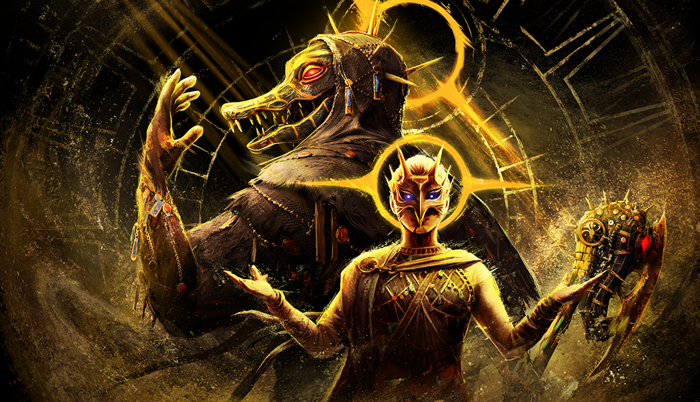

# live · 10.0.3_3513090live

| | |
|---|---|
| Build date | 2026-07-14 15:44 UTC |
| CDN version | `10.0.3_3513090live-1784043860` |
| Key | `10.0.3_live` |
| Compared with | [10.0.2_3513029live](../10.0.2_3513029live/CHANGES.md) (2026-07-14 15:27 UTC) |

## Summary

**1** added · **22** modified · **6** removed · 187 unchanged

## New or updated images

<a href="images/T_UI_SpecialPack_Rift6.png"></a>

## Removed files

- `images/T_UI_CollectionBanner_IronMaiden_Huntress.png`
- `images/T_UI_CollectionBanner_TheLifeRoad.png`
- `images/T_UI_SpecialPack_Black_Banquet.png`
- `images/T_UI_SpecialPack_IronMaiden_Huntress.png`
- `images/T_UI_SpecialPack_TheLifeRoad.png`
- `images/T_UI_SpecialPack_TwistedMasquerade_2025_Bundle.png`

## Modified files

### [`GameConfigs.json`](GameConfigs.json)

[Full line-by-line diff](diffs/GameConfigs.json.diff)

```diff
+ $.narrativeCollectionSyncDelayMaxSeconds: 90
```

### [`catalog.json`](catalog.json)

[Full line-by-line diff](diffs/catalog.json.diff)

```diff
+ $[id=CHALLENGE_REWARD_TIER_Rift_06]
+ $[id=CHALLENGE_BATTLE_PASS_Rift_06]
+ $[id=FM_Head044]
+ $[id=FM_Legs044]
+ $[id=FM_Torso044]
+ $[id=GS_Head041]
+ $[id=GS_Head041_01]
+ $[id=GS_Head041_02]
+ $[id=GS_Legs041]
+ $[id=GS_Legs041_01]
+ $[id=GS_Legs041_02]
+ $[id=GS_Torso041]
+ $[id=GS_Torso041_01]
+ $[id=GS_Torso041_02]
+ $[id=HS_Head017_01]
+ $[id=HS_Legs017_01]
+ $[id=HS_Torso010_02]
+ $[id=K23_Body022_01]
+ $[id=K23_Head022_01]
+ $[id=K23_W008_01]
+ $[id=K30_Body021]
+ $[id=K30_Head021]
+ $[id=K30_W021]
+ $[id=MK_Body021]
+ $[id=MK_Body021_01]
+ $[id=MK_Body021_02]
+ $[id=MK_Mask021]
+ $[id=MK_Mask021_01]
+ $[id=MK_Mask021_02]
+ $[id=MK_W021]
+ $[id=MK_W021_01]
+ $[id=MK_W021_02]
+ $[id=S24_Head016_01]
+ $[id=S24_Legs016_01]
+ $[id=S24_Torso016_01]
+ $[id=S28_Head014_01]
+ $[id=S28_Legs024_02]
+ $[id=S28_Torso014_01]
+ $[id=S45_Head016]
+ $[id=S45_Head016_01]
+ $[id=S45_Head016_02]
+ $[id=S45_Legs016]
+ $[id=S45_Legs016_01]
+ $[id=S45_Legs016_02]
+ $[id=S45_Torso016]
+ $[id=S45_Torso016_01]
+ $[id=S45_Torso016_02]
+ $[id=S46_Head016]
+ $[id=S46_Head016_01]
+ $[id=S46_Head016_02]
+ $[id=S46_Legs016]
+ $[id=S46_Legs016_01]
+ $[id=S46_Legs016_02]
+ $[id=S46_Torso016]
+ $[id=S46_Torso016_01]
+ $[id=S46_Torso016_02]
+ $[id=S47_Head011]
+ $[id=S47_Legs011]
+ $[id=S47_Torso011]
+ $[id=S49_Head012]
+ $[id=S49_Legs012]
+ $[id=S49_Torso012]
+ $[id=S52_Head008]
+ $[id=S52_Legs008]
+ $[id=S52_Torso008]
+ $[id=SUS_005]
+ $[id=SUS_006]
+ $[id=SUS_007]
+ $[id=SUS_008]
+ $[id=SUS_009]
+ $[id=SUS_010]
+ $[id=SUS_011]
+ $[id=SUS_012]
+ $[id=SUS_013]
+ $[id=SUS_014]
+ $[id=SUS_015]
+ $[id=SUS_BDG_12]
+ $[id=SUS_BDG_13]
+ $[id=SUS_BDG_14]
+ $[id=SUS_BDG_15]
+ $[id=SUS_BDG_16]
+ $[id=SUS_BDG_17]
+ $[id=SUS_BDG_18]
+ $[id=SUS_BDG_19]
+ $[id=SUS_BDG_20]
+ $[id=SUS_BDG_21]
+ $[id=SUS_BDG_25]
+ $[id=SUS_BNR_08]
+ $[id=SUS_BNR_09]
+ $[id=SUS_BNR_10]
+ $[id=SUS_BNR_15]
+ $[id=SUS_BNR_16]
+ $[id=SUS_BNR_17]
+ $[id=SUS_BNR_18]
+ $[id=SUS_BNR_19]
+ $[id=SUS_BNR_20]
+ $[id=SUS_BNR_21]
+ $[id=SUS_BNR_22]
+ $[id=SUS_BNR_23]
+ $[id=SUS_BNR_24]
+ $[id=SUS_BNR_25]
+ $[id=TW_Body025]
+ $[id=TW_Body025_01]
+ $[id=TW_Body025_02]
+ $[id=TW_Head025]
+ $[id=TW_Head025_01]
+ $[id=TW_Head025_02]
+ $[id=TW_W025]
+ $[id=TW_W025_01]
+ $[id=TW_W025_02]
+ $[id=UK_Body008_02]
+ $[id=UK_Head011_01]
+ $[id=UK_W008_02]
+ $[id=US_Head033]
+ $[id=US_Head033_01]
+ $[id=US_Head033_02]
+ $[id=US_Legs033]
+ $[id=US_Legs033_01]
+ $[id=US_Legs033_02]
+ $[id=US_Torso033]
+ $[id=US_Torso033_01]
+ $[id=US_Torso033_02]
+ $[id=FM_outfit_044]
+ $[id=GS_outfit_041]
+ $[id=GS_outfit_041_01]
+ $[id=GS_outfit_041_02]
+ $[id=HS_outfit_017_01]
+ $[id=K23_outfit_022_01]
+ $[id=K30_outfit_021]
+ $[id=MK_outfit_021]
+ $[id=MK_outfit_021_01]
+ $[id=MK_outfit_021_02]
+ $[id=S24_outfit_016_01]
+ $[id=S28_outfit_014_01]
+ $[id=S45_outfit_016]
+ $[id=S45_outfit_016_01]
+ $[id=S45_outfit_016_02]
+ $[id=S46_outfit_016]
+ $[id=S46_outfit_016_01]
+ $[id=S46_outfit_016_02]
+ $[id=S47_outfit_011]
+ $[id=S49_outfit_012]
+ $[id=S52_outfit_008]
+ $[id=TW_outfit_025]
+ $[id=TW_outfit_025_01]
+ $[id=TW_outfit_025_02]
+ $[id=UK_outfit_008_02]
+ $[id=US_Outfit_033]
+ $[id=US_Outfit_033_01]
+ $[id=US_Outfit_033_02]
+ $[id=10.0.3_Waterfront_Massacre_Bundle]
+ $[id=Rift_6_Bundle]
+ $[id=10.0.3_Community_collection_item]
+ $[id=10.0.3_WaterfrontMassacre_collection_item]
+ $[id=10.0.3_TheWalkingDead_collection_item]
- $[id=Armored_Bundle].defaultCost[0].price: 2808
+ $[id=Armored_Bundle].defaultCost[0].price: 5616
- $[id=Armored_Bundle].metaData.discount: 0.5
+ $[id=Armored_Bundle].metaData.discount: 0.0
- $[id=ChapterPack_AllKill].defaultCost[0].price: 250
+ $[id=ChapterPack_AllKill].defaultCost[0].price: 500
- $[id=ChapterPack_AllKill].metaData.discount: 0.5
+ $[id=ChapterPack_AllKill].metaData.discount: 0.0
- $[id=ChapterPack_BindingOfKin].defaultCost[0].price: 250
+ $[id=ChapterPack_BindingOfKin].defaultCost[0].price: 500
- $[id=ChapterPack_BindingOfKin].metaData.discount: 0.5
+ $[id=ChapterPack_BindingOfKin].metaData.discount: 0.0
- $[id=ChapterPack_ChainsofHate].defaultCost[0].price: 250
+ $[id=ChapterPack_ChainsofHate].defaultCost[0].price: 500
- $[id=ChapterPack_ChainsofHate].metaData.discount: 0.5
+ $[id=ChapterPack_ChainsofHate].metaData.discount: 0.0
- $[id=ChapterPack_CursedLegacy].defaultCost[0].price: 250
+ $[id=ChapterPack_CursedLegacy].defaultCost[0].price: 500
- $[id=ChapterPack_CursedLegacy].metaData.discount: 0.5
+ $[id=ChapterPack_CursedLegacy].metaData.discount: 0.0
- $[id=ChapterPack_CurtainCall].defaultCost[0].price: 125
+ $[id=ChapterPack_CurtainCall].defaultCost[0].price: 250
- $[id=ChapterPack_CurtainCall].metaData.discount: 0.5
+ $[id=ChapterPack_CurtainCall].metaData.discount: 0.0
- $[id=ChapterPack_DarknessAmongUs].defaultCost[0].price: 250
+ $[id=ChapterPack_DarknessAmongUs].defaultCost[0].price: 500
- $[id=ChapterPack_DarknessAmongUs].metaData.discount: 0.5
+ $[id=ChapterPack_DarknessAmongUs].metaData.discount: 0.0
- $[id=ChapterPack_Demise].defaultCost[0].price: 250
+ $[id=ChapterPack_Demise].defaultCost[0].price: 500
- $[id=ChapterPack_Demise].metaData.discount: 0.5
+ $[id=ChapterPack_Demise].metaData.discount: 0.0
- $[id=ChapterPack_DescendBeyond].defaultCost[0].price: 250
+ $[id=ChapterPack_DescendBeyond].defaultCost[0].price: 500
- $[id=ChapterPack_DescendBeyond].metaData.discount: 0.5
+ $[id=ChapterPack_DescendBeyond].metaData.discount: 0.0
- $[id=ChapterPack_FleshAndMud].defaultCost[0].price: 125
+ $[id=ChapterPack_FleshAndMud].defaultCost[0].price: 250
- $[id=ChapterPack_FleshAndMud].metaData.discount: 0.5
+ $[id=ChapterPack_FleshAndMud].metaData.discount: 0.0
- $[id=ChapterPack_ForgedInFog].defaultCost[0].price: 250
+ $[id=ChapterPack_ForgedInFog].defaultCost[0].price: 500
- $[id=ChapterPack_ForgedInFog].metaData.discount: 0.5
+ $[id=ChapterPack_ForgedInFog].metaData.discount: 0.0
- $[id=ChapterPack_HourOfTheWitch].defaultCost[0].price: 125
… 35 more change(s) — see the commit diff for everything
```

### [`challengeLocs/challengeText_de.json`](challengeLocs/challengeText_de.json)

[Full line-by-line diff](diffs/challengeLocs/challengeText_de.json.diff)

```diff
+ $.locText[640]
+ $.locText[641]
+ $.locText[642]
+ $.locText[643]
+ $.locText[644]
+ $.locText[645]
```

### [`challengeLocs/challengeText_en.json`](challengeLocs/challengeText_en.json)

[Full line-by-line diff](diffs/challengeLocs/challengeText_en.json.diff)

```diff
+ $.locText[640]
+ $.locText[641]
+ $.locText[642]
+ $.locText[643]
+ $.locText[644]
+ $.locText[645]
```

### [`challengeLocs/challengeText_es-MX.json`](challengeLocs/challengeText_es-MX.json)

[Full line-by-line diff](diffs/challengeLocs/challengeText_es-MX.json.diff)

```diff
+ $.locText[640]
+ $.locText[641]
+ $.locText[642]
+ $.locText[643]
+ $.locText[644]
+ $.locText[645]
```

### [`challengeLocs/challengeText_es.json`](challengeLocs/challengeText_es.json)

[Full line-by-line diff](diffs/challengeLocs/challengeText_es.json.diff)

```diff
+ $.locText[640]
+ $.locText[641]
+ $.locText[642]
+ $.locText[643]
+ $.locText[644]
+ $.locText[645]
```

### [`challengeLocs/challengeText_fr.json`](challengeLocs/challengeText_fr.json)

[Full line-by-line diff](diffs/challengeLocs/challengeText_fr.json.diff)

```diff
+ $.locText[640]
+ $.locText[641]
+ $.locText[642]
+ $.locText[643]
+ $.locText[644]
+ $.locText[645]
```

### [`challengeLocs/challengeText_it.json`](challengeLocs/challengeText_it.json)

[Full line-by-line diff](diffs/challengeLocs/challengeText_it.json.diff)

```diff
+ $.locText[640]
+ $.locText[641]
+ $.locText[642]
+ $.locText[643]
+ $.locText[644]
+ $.locText[645]
```

### [`challengeLocs/challengeText_ja.json`](challengeLocs/challengeText_ja.json)

[Full line-by-line diff](diffs/challengeLocs/challengeText_ja.json.diff)

```diff
+ $.locText[640]
+ $.locText[641]
+ $.locText[642]
+ $.locText[643]
+ $.locText[644]
+ $.locText[645]
```

### [`challengeLocs/challengeText_ko.json`](challengeLocs/challengeText_ko.json)

[Full line-by-line diff](diffs/challengeLocs/challengeText_ko.json.diff)

```diff
+ $.locText[640]
+ $.locText[641]
+ $.locText[642]
+ $.locText[643]
+ $.locText[644]
+ $.locText[645]
```

### [`challengeLocs/challengeText_pl.json`](challengeLocs/challengeText_pl.json)

[Full line-by-line diff](diffs/challengeLocs/challengeText_pl.json.diff)

```diff
+ $.locText[640]
+ $.locText[641]
+ $.locText[642]
+ $.locText[643]
+ $.locText[644]
+ $.locText[645]
```

### [`challengeLocs/challengeText_pt-BR.json`](challengeLocs/challengeText_pt-BR.json)

[Full line-by-line diff](diffs/challengeLocs/challengeText_pt-BR.json.diff)

```diff
+ $.locText[640]
+ $.locText[641]
+ $.locText[642]
+ $.locText[643]
+ $.locText[644]
+ $.locText[645]
```

### [`challengeLocs/challengeText_ru.json`](challengeLocs/challengeText_ru.json)

[Full line-by-line diff](diffs/challengeLocs/challengeText_ru.json.diff)

```diff
+ $.locText[640]
+ $.locText[641]
+ $.locText[642]
+ $.locText[643]
+ $.locText[644]
+ $.locText[645]
```

### [`challengeLocs/challengeText_th.json`](challengeLocs/challengeText_th.json)

[Full line-by-line diff](diffs/challengeLocs/challengeText_th.json.diff)

```diff
+ $.locText[640]
+ $.locText[641]
+ $.locText[642]
+ $.locText[643]
+ $.locText[644]
+ $.locText[645]
```

### [`challengeLocs/challengeText_tr.json`](challengeLocs/challengeText_tr.json)

[Full line-by-line diff](diffs/challengeLocs/challengeText_tr.json.diff)

```diff
+ $.locText[640]
+ $.locText[641]
+ $.locText[642]
+ $.locText[643]
+ $.locText[644]
+ $.locText[645]
```

### [`challengeLocs/challengeText_zh-Hans.json`](challengeLocs/challengeText_zh-Hans.json)

[Full line-by-line diff](diffs/challengeLocs/challengeText_zh-Hans.json.diff)

```diff
+ $.locText[640]
+ $.locText[641]
+ $.locText[642]
+ $.locText[643]
+ $.locText[644]
+ $.locText[645]
```

### [`challengeLocs/challengeText_zh-Hant.json`](challengeLocs/challengeText_zh-Hant.json)

[Full line-by-line diff](diffs/challengeLocs/challengeText_zh-Hant.json.diff)

```diff
+ $.locText[640]
+ $.locText[641]
+ $.locText[642]
+ $.locText[643]
+ $.locText[644]
+ $.locText[645]
```

### [`challengeRewardTrackers.json`](challengeRewardTrackers.json)

[Full line-by-line diff](diffs/challengeRewardTrackers.json.diff)

```diff
+ $.Rift_06
```

### [`challengeSets.json`](challengeSets.json)

[Full line-by-line diff](diffs/challengeSets.json.diff)

```diff
+ $.Milestone_06_Set
+ $.Rift_06_QuestSet
+ $.Summer2026
```

### [`collections.json`](collections.json)

[Full line-by-line diff](diffs/collections.json.diff)

```diff
+ $.collections[70].limitedAvailabilityStartDate: "2026-07-21T15:00:00Z"
+ $.collections[70].visibleBeforeStartDate: false
- $.collections[70].collectionId: "GreekLegends"
+ $.collections[70].collectionId: "10.0.3_Community"
- $.collections[70].collectionTitle.de: "Griechische Legenden"
+ $.collections[70].collectionTitle.de: "Heiliger Fluch"
- $.collections[70].collectionTitle.en: "Greek Legends"
+ $.collections[70].collectionTitle.en: "Community"
- $.collections[70].collectionTitle.es: "Leyendas griegas"
+ $.collections[70].collectionTitle.es: "Maldición sagrada"
- $.collections[70].collectionTitle["es-MX"]: "Leyendas griegas"
+ $.collections[70].collectionTitle["es-MX"]: "Maldición sagrada"
- $.collections[70].collectionTitle.fr: "Légendes grecques"
+ $.collections[70].collectionTitle.fr: "Malédiction consacrée"
- $.collections[70].collectionTitle.it: "Leggende greche"
+ $.collections[70].collectionTitle.it: "Maledizione numinosa"
- $.collections[70].collectionTitle.ja: "ギリシャの伝説"
+ $.collections[70].collectionTitle.ja: "コミュニティ"
- $.collections[70].collectionTitle.ko: "그리스 전설"
+ $.collections[70].collectionTitle.ko: "신성한 저주"
- $.collections[70].collectionTitle.pl: "Greckie legendy"
+ $.collections[70].collectionTitle.pl: "Społeczność"
- $.collections[70].collectionTitle["pt-BR"]: "Lendas Gregas"
+ $.collections[70].collectionTitle["pt-BR"]: "Maldição Sacrossanta"
- $.collections[70].collectionTitle.ru: "Легенды Греции"
+ $.collections[70].collectionTitle.ru: "Священное проклятие"
- $.collections[70].collectionTitle.th: "ตำนานกรีก"
+ $.collections[70].collectionTitle.th: "คำสาปศักดิ์สิทธิ์"
- $.collections[70].collectionTitle.tr: "Yunan Efsaneleri"
+ $.collections[70].collectionTitle.tr: "Kutsal Lanet"
- $.collections[70].collectionTitle["zh-Hans"]: "希腊传说"
+ $.collections[70].collectionTitle["zh-Hans"]: "社区"
- $.collections[70].collectionTitle["zh-Hant"]: "希臘傳奇"
+ $.collections[70].collectionTitle["zh-Hant"]: "社群"
- $.collections[70].heroImage.path: "/Game/UI/UMGAssets/Icons/Banners/CollectionBanners/T_UI_CollectionBanner_GreekLegends.T_UI_CollectionBanner_GreekLegends"
+ $.collections[70].heroImage.path: "/Game/UI/UMGAssets/Icons/Banners/CollectionBanners/T_UI_CollectionBanner_Community.T_UI_CollectionBanner_Community"
- $.collections[70].inclusionVersion: "7.7.0 PTB"
+ $.collections[70].inclusionVersion: "10.0.3"
- $.collections[70].items[]: "AV_outfit_014"
- $.collections[70].items[]: "DK_outfit_012"
- $.collections[70].items[]: "FM_outfit_012"
- $.collections[70].items[]: "GK_outfit_011"
- $.collections[70].items[]: "GS_outfit_016"
- $.collections[70].items[]: "HK_outfit_011"
- $.collections[70].items[]: "HS_outfit_010"
- $.collections[70].items[]: "K21_outfit_008"
- $.collections[70].items[]: "K26_outfit_009"
- $.collections[70].items[]: "K28_outfit_010"
- $.collections[70].items[]: "KS_outfit_012"
- $.collections[70].items[]: "MK_outfit_013"
- $.collections[70].items[]: "MS_outfit_013"
- $.collections[70].items[]: "NK_outfit_022"
- $.collections[70].items[]: "S24_outfit_009"
- $.collections[70].items[]: "S28_outfit_014"
- $.collections[70].items[]: "S35_outfit_009"
- $.collections[70].items[]: "S36_outfit_009"
- $.collections[70].items[]: "SwedenKiller_outfit_009"
- $.collections[70].items[]: "SwedenSurvivor_outfit_011"
- $.collections[70].items[]: "TN_outfit_013"
- $.collections[70].items[]: "US_outfit_009"
+ $.collections[70].items[]: "CM_outfit_015"
+ $.collections[70].items[]: "FM_outfit_010"
+ $.collections[70].items[]: "GK_outfit_010"
+ $.collections[70].items[]: "GK_outfit_019"
+ $.collections[70].items[]: "JP_outfit_030"
+ $.collections[70].items[]: "K26_outfit_010"
+ $.collections[70].items[]: "K32_outfit_013"
+ $.collections[70].items[]: "K35_outfit_014"
+ $.collections[70].items[]: "KK_outfit_017"
+ $.collections[70].items[]: "MK_outfit_011"
+ $.collections[70].items[]: "S24_outfit_012"
+ $.collections[70].items[]: "S25_outfit_021"
+ $.collections[70].items[]: "S41_outfit_019"
+ $.collections[70].items[]: "SwedenSurvivor_outfit_018"
- $.collections[70].sortOrder: "-25"
+ $.collections[70].sortOrder: "-242"
- $.collections[70].updatedDate: "2024-03-18T16:00:01Z"
+ $.collections[70].updatedDate: "2026-03-26T13:44:03.18Z"
+ $.collections[71].limitedAvailabilityStartDate: "2026-07-28T15:00:00Z"
+ $.collections[71].visibleBeforeStartDate: false
+ $.collections[71].additionalImages[0]
- $.collections[71].collectionId: "MeanStreets"
+ $.collections[71].collectionId: "10.0.3_WaterfrontMassacre"
- $.collections[71].collectionTitle.de: "Gefährliche Straßen"
+ $.collections[71].collectionTitle.de: "Hafenmassaker"
- $.collections[71].collectionTitle.en: "Mean Streets"
+ $.collections[71].collectionTitle.en: "Waterfront Massacre"
- $.collections[71].collectionTitle.es: "Calles peligrosas"
+ $.collections[71].collectionTitle.es: "Masacre de la costa"
- $.collections[71].collectionTitle["es-MX"]: "Calles peligrosas"
+ $.collections[71].collectionTitle["es-MX"]: "Masacre en la costa"
- $.collections[71].collectionTitle.fr: "Rues dangereuses"
+ $.collections[71].collectionTitle.fr: "Massacre au bord de la mer"
- $.collections[71].collectionTitle.it: "Bassifondi"
+ $.collections[71].collectionTitle.it: "Collezione Massacro sul lungomare"
- $.collections[71].collectionTitle.ja: "意地悪なストリート"
+ $.collections[71].collectionTitle.ja: "水辺の殺戮"
- $.collections[71].collectionTitle.ko: "비열한 거리"
+ $.collections[71].collectionTitle.ko: "해안가 대학살"
- $.collections[71].collectionTitle.pl: "Podła dzielnica"
+ $.collections[71].collectionTitle.pl: "Nadbrzeżna masakra"
- $.collections[71].collectionTitle["pt-BR"]: "Ruas Cruéis"
+ $.collections[71].collectionTitle["pt-BR"]: "Massacre da Costa"
- $.collections[71].collectionTitle.ru: "Трущобы"
+ $.collections[71].collectionTitle.ru: "Пляжная резня"
- $.collections[71].collectionTitle.th: "ถนนซอมซ่อ"
+ $.collections[71].collectionTitle.th: "การสังหารหมู่ริมน้ำ"
- $.collections[71].collectionTitle.tr: "Amansız Sokaklar"
+ $.collections[71].collectionTitle.tr: "Su Kenarı Katliamı"
- $.collections[71].collectionTitle["zh-Hans"]: "穷街陋巷"
+ $.collections[71].collectionTitle["zh-Hans"]: "滨水屠杀"
- $.collections[71].collectionTitle["zh-Hant"]: "窮街陋巷"
+ $.collections[71].collectionTitle["zh-Hant"]: "水邊屠殺"
- $.collections[71].heroImage.path: "/Game/UI/UMGAssets/Icons/Banners/CollectionBanners/T_UI_CollectionBanner_MeanStreets.T_UI_CollectionBanner_MeanStreets"
+ $.collections[71].heroImage.path: "/Game/UI/UMGAssets/Icons/Banners/CollectionBanners/Ketchup/T_UI_CollectionBanner_WaterfrontMassacreXenomorph.T_UI_CollectionBanner_WaterfrontMassacreXenomorph"
- $.collections[71].inclusionVersion: "7.7.0 PTB"
+ $.collections[71].inclusionVersion: "10.0.3"
- $.collections[71].items[]: "AV_outfit_010"
- $.collections[71].items[]: "Claudette_outfit_009_01"
- $.collections[71].items[]: "DK_outfit_011"
- $.collections[71].items[]: "HS_outfit_009"
- $.collections[71].items[]: "MT_outfit_012"
- $.collections[71].items[]: "Nea_outfit_008_01"
- $.collections[71].items[]: "US_outfit_008"
+ $.collections[71].items[]: "AV_outfit_028"
+ $.collections[71].items[]: "CM_outfit_012"
+ $.collections[71].items[]: "DF_outfit_015"
+ $.collections[71].items[]: "DK_outfit_014"
+ $.collections[71].items[]: "FM_outfit_019"
+ $.collections[71].items[]: "GS_outfit_015"
+ $.collections[71].items[]: "HS_outfit_023"
+ $.collections[71].items[]: "K23_outfit_016"
+ $.collections[71].items[]: "K33_outfit_012"
+ $.collections[71].items[]: "KS_outfit_017"
+ $.collections[71].items[]: "MS_outfit_008"
+ $.collections[71].items[]: "MT_outfit_024"
+ $.collections[71].items[]: "NK_outfit_015"
+ $.collections[71].items[]: "S23_outfit_017"
+ $.collections[71].items[]: "S24_outfit_025"
+ $.collections[71].items[]: "S25_outfit_016"
+ $.collections[71].items[]: "S28_outfit_012"
+ $.collections[71].items[]: "S31_outfit_006"
+ $.collections[71].items[]: "S37_outfit_016"
+ $.collections[71].items[]: "S41_outfit_009"
+ $.collections[71].items[]: "S46_outfit_009"
+ $.collections[71].items[]: "S49_outfit_012"
+ $.collections[71].items[]: "S52_outfit_008"
+ $.collections[71].items[]: "SwedenSurvivor_outfit_010"
+ $.collections[71].items[]: "TC_outfit_009"
+ $.collections[71].items[]: "TC_outfit_009_01"
+ $.collections[71].items[]: "TR_outfit_010"
- $.collections[71].sortOrder: "-3"
+ $.collections[71].sortOrder: "-243"
- $.collections[71].updatedDate: "2024-02-20T20:35:22Z"
+ $.collections[71].updatedDate: "2026-03-26T13:45:21Z"
+ $.collections[72].limitedAvailabilityStartDate: "2026-08-04T15:00:00Z"
+ $.collections[72].visibleBeforeStartDate: false
+ $.collections[72].additionalImages[0]
- $.collections[72].collectionId: "CursedCats"
+ $.collections[72].collectionId: "10.0.3_TheWalkingDead"
- $.collections[72].collectionTitle.de: "Verfluchte Katzen"
+ $.collections[72].collectionTitle.de: "The Walking Dead"
- $.collections[72].collectionTitle.en: "Cursed Cats"
+ $.collections[72].collectionTitle.en: "The Walking Dead"
- $.collections[72].collectionTitle.es: "Gatos malditos"
+ $.collections[72].collectionTitle.es: "The Walking Dead"
- $.collections[72].collectionTitle["es-MX"]: "Gatos malditos"
+ $.collections[72].collectionTitle["es-MX"]: "The Walking Dead"
- $.collections[72].collectionTitle.fr: "Chats maudits"
+ $.collections[72].collectionTitle.fr: "The Walking Dead"
- $.collections[72].collectionTitle.it: "Gatti maledetti"
+ $.collections[72].collectionTitle.it: "The Walking Dead"
- $.collections[72].collectionTitle.ja: "呪われた猫"
+ $.collections[72].collectionTitle.ja: "ウォーキング・デッド"
- $.collections[72].collectionTitle.ko: "저주받은 고양이"
+ $.collections[72].collectionTitle.ko: "워킹 데드"
- $.collections[72].collectionTitle.pl: "Przeklęte koty"
+ $.collections[72].collectionTitle.pl: "The Walking Dead"
- $.collections[72].collectionTitle["pt-BR"]: "Gatos Amaldiçoados"
+ $.collections[72].collectionTitle["pt-BR"]: "The Walking Dead"
- $.collections[72].collectionTitle.ru: "Проклятые коты"
+ $.collections[72].collectionTitle.ru: "Ходячие мертвецы"
- $.collections[72].collectionTitle.th: "แมวต้องสาป"
+ $.collections[72].collectionTitle.th: "The Walking Dead"
- $.collections[72].collectionTitle.tr: "Lanetli Kediler"
+ $.collections[72].collectionTitle.tr: "The Walking Dead"
- $.collections[72].collectionTitle["zh-Hans"]: "诅咒之猫"
+ $.collections[72].collectionTitle["zh-Hans"]: "《The Walking Dead》"
- $.collections[72].collectionTitle["zh-Hant"]: "詛咒之貓"
+ $.collections[72].collectionTitle["zh-Hant"]: "《陰屍路》"
- $.collections[72].heroImage.path: "/Game/UI/UMGAssets/Icons/Banners/CollectionBanners/T_UI_CollectionBanner_CursedCats.T_UI_CollectionBanner_CursedCats"
+ $.collections[72].heroImage.path: "/Game/UI/UMGAssets/Icons/Banners/CollectionBanners/Omelet/T_UI_CollectionBanner_TWD_Rick.T_UI_CollectionBanner_TWD_Rick"
- $.collections[72].inclusionVersion: "7.7.0 PTB"
+ $.collections[72].inclusionVersion: "10.0.3"
- $.collections[72].items[]: "GK_outfit_016"
- $.collections[72].items[]: "K21_outfit_015"
- $.collections[72].items[]: "K23_outfit_017"
- $.collections[72].items[]: "MK_outfit_014"
- $.collections[72].items[]: "TC_outfit_016"
- $.collections[72].items[]: "TW_outfit_017"
… 1943 more change(s) — see the commit diff for everything
```

### [`dynamicContent/DynamicContent.json`](dynamicContent/DynamicContent.json)

[Full line-by-line diff](diffs/dynamicContent/DynamicContent.json.diff)

```diff
- $.entries[0].contentVersion: "dfd9448cd4b776d86b9efc8edfd389e5246e4a17"
+ $.entries[0].contentVersion: "2e3756add2be7d9465389e75b953933bf07bf33c"
- $.entries[0].packagedPath: "/Game/UI/UMGAssets/Icons/Banners/BundleBanners/SpecialPack/Sushi/T_UI_SpecialPack_TwistedMasquerade_2025_Bundle.T_UI_SpecialPack_TwistedMasquerade_2025_Bundle"
+ $.entries[0].packagedPath: "/Game/UI/UMGAssets/Icons/Banners/BundleBanners/SpecialPack/Sushi/T_UI_SpecialPack_Rift6.T_UI_SpecialPack_Rift6"
- $.entries[0].uri: "images/T_UI_SpecialPack_TwistedMasquerade_2025_Bundle.png"
+ $.entries[0].uri: "images/T_UI_SpecialPack_Rift6.png"
- $.entries[1].contentVersion: "491d730fa3e6382e368680fcd716f0478ea742ee"
+ $.entries[1].contentVersion: "f7c93776f522193fdbac58c1416ed2bb8ee190ec"
- $.entries[1].packagedPath: "/Game/UI/UMGAssets/Icons/Banners/BundleBanners/SpecialPack/Sushi/T_UI_SpecialPack_Black_Banquet.T_UI_SpecialPack_Black_Banquet"
+ $.entries[1].packagedPath: "/DBDUICore/Assets/HUD/Tutorial/T_UI_Tutorial_ImageBG_GenQuest1.T_UI_Tutorial_ImageBG_GenQuest1"
- $.entries[1].uri: "images/T_UI_SpecialPack_Black_Banquet.png"
+ $.entries[1].uri: "images/T_UI_Tutorial_ImageBG_GenQuest1.png"
- $.entries[2].contentVersion: "491d730fa3e6382e368680fcd716f0478ea742ee"
+ $.entries[2].contentVersion: "4ae305ae1f966db3228ce77826da57e2ece140b4"
- $.entries[2].packagedPath: "/Game/UI/UMGAssets/Icons/Banners/BundleBanners/SpecialPack/Sushi/T_UI_SpecialPack_Black_Banquet.T_UI_SpecialPack_Black_Banquet"
+ $.entries[2].packagedPath: "/DBDUICore/Assets/HUD/Tutorial/T_UI_Tutorial_ImageBG_cosmetic.T_UI_Tutorial_ImageBG_cosmetic"
- $.entries[2].uri: "images/T_UI_SpecialPack_Black_Banquet.png"
+ $.entries[2].uri: "images/T_UI_Tutorial_ImageBG_cosmetic.png"
- $.entries[3].contentVersion: "45dbc8795086ecc22e3ee59473bb597baae63b7f"
+ $.entries[3].contentVersion: "f8c74b123d0ba3a66d82d9ba6e26486b88797b88"
- $.entries[3].packagedPath: "/Game/UI/UMGAssets/Icons/Banners/CollectionBanners/Sushi/T_UI_CollectionBanner_TheLifeRoad.T_UI_CollectionBanner_TheLifeRoad"
+ $.entries[3].packagedPath: "/DBDUICore/Assets/HUD/Tutorial/T_UI_Tutorial_ImageBG_gift.T_UI_Tutorial_ImageBG_gift"
- $.entries[3].uri: "images/T_UI_CollectionBanner_TheLifeRoad.png"
+ $.entries[3].uri: "images/T_UI_Tutorial_ImageBG_gift.png"
- $.entries[4].contentVersion: "623bb882552904b79446b6e334171fa8ca8d0345"
+ $.entries[4].contentVersion: "a19460a9f779964a9afa97113ade7dec9eccc1b7"
- $.entries[4].downloadStrategy: "preferPackaged"
+ $.entries[4].downloadStrategy: "preferRemote"
- $.entries[4].enableChecksum: false
+ $.entries[4].enableChecksum: true
- $.entries[4].packagedPath: "/Game/UI/UMGAssets/Icons/Banners/BundleBanners/SpecialPack/Sushi/T_UI_SpecialPack_TheLifeRoad.T_UI_SpecialPack_TheLifeRoad"
+ $.entries[4].packagedPath: ""
- $.entries[4].schema: "s3verbin://"
+ $.entries[4].schema: "s3ver://"
- $.entries[4].uri: "images/T_UI_SpecialPack_TheLifeRoad.png"
+ $.entries[4].uri: "catalog.json"
- $.entries[5].contentVersion: "43d348856127eef7569bb87e500916398edb21b9"
+ $.entries[5].contentVersion: "e3c0c8452df5534be306d4bc15511854f46937e8"
- $.entries[5].downloadStrategy: "preferPackaged"
+ $.entries[5].downloadStrategy: "preferRemote"
- $.entries[5].enableChecksum: false
+ $.entries[5].enableChecksum: true
- $.entries[5].packagedPath: "/Game/UI/UMGAssets/Icons/Banners/CollectionBanners/Sushi/T_UI_CollectionBanner_IronMaiden_Huntress.T_UI_CollectionBanner_IronMaiden_Huntress"
+ $.entries[5].packagedPath: ""
- $.entries[5].schema: "s3verbin://"
+ $.entries[5].schema: "s3ver://"
- $.entries[5].uri: "images/T_UI_CollectionBanner_IronMaiden_Huntress.png"
+ $.entries[5].uri: "bonusPointEventsContent.json"
- $.entries[6].contentVersion: "d94c7a95edf46327051fd320ccbde523e59fb470"
+ $.entries[6].contentVersion: "1d937a9bfe5bf3c5741e1be40fd3e3ae58d18be5"
- $.entries[6].downloadStrategy: "preferPackaged"
+ $.entries[6].downloadStrategy: "preferRemote"
- $.entries[6].enableChecksum: false
+ $.entries[6].enableChecksum: true
- $.entries[6].packagedPath: "/Game/UI/UMGAssets/Icons/Banners/BundleBanners/SpecialPack/Sushi/T_UI_SpecialPack_IronMaiden_Huntress.T_UI_SpecialPack_IronMaiden_Huntress"
+ $.entries[6].packagedPath: ""
- $.entries[6].schema: "s3verbin://"
+ $.entries[6].schema: "s3ver://"
- $.entries[6].uri: "images/T_UI_SpecialPack_IronMaiden_Huntress.png"
+ $.entries[6].uri: "freetoplay/NA/event.json"
- $.entries[7].contentVersion: "f7c93776f522193fdbac58c1416ed2bb8ee190ec"
+ $.entries[7].contentVersion: "1d937a9bfe5bf3c5741e1be40fd3e3ae58d18be5"
- $.entries[7].downloadStrategy: "preferPackaged"
+ $.entries[7].downloadStrategy: "preferRemote"
- $.entries[7].enableChecksum: false
+ $.entries[7].enableChecksum: true
- $.entries[7].packagedPath: "/DBDUICore/Assets/HUD/Tutorial/T_UI_Tutorial_ImageBG_GenQuest1.T_UI_Tutorial_ImageBG_GenQuest1"
+ $.entries[7].packagedPath: ""
- $.entries[7].schema: "s3verbin://"
+ $.entries[7].schema: "s3ver://"
- $.entries[7].uri: "images/T_UI_Tutorial_ImageBG_GenQuest1.png"
+ $.entries[7].uri: "freetoplay/EU/event.json"
- $.entries[8].contentVersion: "4ae305ae1f966db3228ce77826da57e2ece140b4"
+ $.entries[8].contentVersion: "e3d7f9f1c014f1b61a5a92272a7aa406d2b0cc8d"
- $.entries[8].downloadStrategy: "preferPackaged"
+ $.entries[8].downloadStrategy: "preferRemote"
- $.entries[8].enableChecksum: false
+ $.entries[8].enableChecksum: true
- $.entries[8].packagedPath: "/DBDUICore/Assets/HUD/Tutorial/T_UI_Tutorial_ImageBG_cosmetic.T_UI_Tutorial_ImageBG_cosmetic"
+ $.entries[8].packagedPath: ""
- $.entries[8].schema: "s3verbin://"
+ $.entries[8].schema: "s3ver://"
- $.entries[8].uri: "images/T_UI_Tutorial_ImageBG_cosmetic.png"
+ $.entries[8].uri: "archiveQuests/Anniversary2022.json"
- $.entries[9].contentVersion: "f8c74b123d0ba3a66d82d9ba6e26486b88797b88"
+ $.entries[9].contentVersion: "f65c70bdd1fe7f485ab79fd257b4f5258f26b998"
- $.entries[9].downloadStrategy: "preferPackaged"
+ $.entries[9].downloadStrategy: "preferRemote"
- $.entries[9].enableChecksum: false
+ $.entries[9].enableChecksum: true
- $.entries[9].packagedPath: "/DBDUICore/Assets/HUD/Tutorial/T_UI_Tutorial_ImageBG_gift.T_UI_Tutorial_ImageBG_gift"
+ $.entries[9].packagedPath: ""
- $.entries[9].schema: "s3verbin://"
+ $.entries[9].schema: "s3ver://"
- $.entries[9].uri: "images/T_UI_Tutorial_ImageBG_gift.png"
+ $.entries[9].uri: "archiveQuests/Anniversary2023.json"
- $.entries[10].contentVersion: "491d730fa3e6382e368680fcd716f0478ea742ee"
+ $.entries[10].contentVersion: "4574587fb5121d8f0b1c0bb8907aa4161b7da27f"
- $.entries[10].downloadStrategy: "preferPackaged"
+ $.entries[10].downloadStrategy: "preferRemote"
- $.entries[10].enableChecksum: false
+ $.entries[10].enableChecksum: true
- $.entries[10].packagedPath: "/Game/UI/UMGAssets/Icons/Banners/BundleBanners/SpecialPack/Sushi/T_UI_SpecialPack_Black_Banquet.T_UI_SpecialPack_Black_Banquet"
+ $.entries[10].packagedPath: ""
- $.entries[10].schema: "s3verbin://"
+ $.entries[10].schema: "s3ver://"
- $.entries[10].uri: "images/T_UI_SpecialPack_Black_Banquet.png"
+ $.entries[10].uri: "archiveQuests/Anniversary2024.json"
- $.entries[11].contentVersion: "45dbc8795086ecc22e3ee59473bb597baae63b7f"
+ $.entries[11].contentVersion: "0033222d5874c34279a718c63abda3ebd7aa68a8"
- $.entries[11].downloadStrategy: "preferPackaged"
+ $.entries[11].downloadStrategy: "preferRemote"
- $.entries[11].enableChecksum: false
+ $.entries[11].enableChecksum: true
- $.entries[11].packagedPath: "/Game/UI/UMGAssets/Icons/Banners/CollectionBanners/Sushi/T_UI_CollectionBanner_TheLifeRoad.T_UI_CollectionBanner_TheLifeRoad"
+ $.entries[11].packagedPath: ""
- $.entries[11].schema: "s3verbin://"
+ $.entries[11].schema: "s3ver://"
- $.entries[11].uri: "images/T_UI_CollectionBanner_TheLifeRoad.png"
+ $.entries[11].uri: "archiveQuests/CalamariV1.json"
- $.entries[12].contentVersion: "623bb882552904b79446b6e334171fa8ca8d0345"
+ $.entries[12].contentVersion: "c26643c869e9ad47e8fdfb56af4c23d1db1b4926"
- $.entries[12].downloadStrategy: "preferPackaged"
+ $.entries[12].downloadStrategy: "preferRemote"
- $.entries[12].enableChecksum: false
+ $.entries[12].enableChecksum: true
- $.entries[12].packagedPath: "/Game/UI/UMGAssets/Icons/Banners/BundleBanners/SpecialPack/Sushi/T_UI_SpecialPack_TheLifeRoad.T_UI_SpecialPack_TheLifeRoad"
+ $.entries[12].packagedPath: ""
- $.entries[12].schema: "s3verbin://"
+ $.entries[12].schema: "s3ver://"
- $.entries[12].uri: "images/T_UI_SpecialPack_TheLifeRoad.png"
+ $.entries[12].uri: "archiveQuests/CalamariV2.json"
- $.entries[13].contentVersion: "43d348856127eef7569bb87e500916398edb21b9"
+ $.entries[13].contentVersion: "37b3a378f67c212f42ee68750eb5d06455571d78"
- $.entries[13].downloadStrategy: "preferPackaged"
+ $.entries[13].downloadStrategy: "preferRemote"
- $.entries[13].enableChecksum: false
+ $.entries[13].enableChecksum: true
- $.entries[13].packagedPath: "/Game/UI/UMGAssets/Icons/Banners/CollectionBanners/Sushi/T_UI_CollectionBanner_IronMaiden_Huntress.T_UI_CollectionBanner_IronMaiden_Huntress"
+ $.entries[13].packagedPath: ""
- $.entries[13].schema: "s3verbin://"
+ $.entries[13].schema: "s3ver://"
- $.entries[13].uri: "images/T_UI_CollectionBanner_IronMaiden_Huntress.png"
+ $.entries[13].uri: "archiveQuests/CalamariV3.json"
- $.entries[14].contentVersion: "d94c7a95edf46327051fd320ccbde523e59fb470"
+ $.entries[14].contentVersion: "04c46d54365083e5fb9483d999084d7ab06afabe"
- $.entries[14].downloadStrategy: "preferPackaged"
+ $.entries[14].downloadStrategy: "preferRemote"
- $.entries[14].enableChecksum: false
+ $.entries[14].enableChecksum: true
- $.entries[14].packagedPath: "/Game/UI/UMGAssets/Icons/Banners/BundleBanners/SpecialPack/Sushi/T_UI_SpecialPack_IronMaiden_Huntress.T_UI_SpecialPack_IronMaiden_Huntress"
+ $.entries[14].packagedPath: ""
- $.entries[14].schema: "s3verbin://"
+ $.entries[14].schema: "s3ver://"
- $.entries[14].uri: "images/T_UI_SpecialPack_IronMaiden_Huntress.png"
+ $.entries[14].uri: "archiveQuests/ChocolateBoxGelato.json"
- $.entries[15].contentVersion: "4e7aa9d38dc1781dc1c26c6673935369b75f4577"
+ $.entries[15].contentVersion: "5b962cf5e3e1e9bee34b2ba583bf75f80bd920a6"
- $.entries[15].uri: "catalog.json"
+ $.entries[15].uri: "archiveQuests/ChocolateBoxV1.json"
- $.entries[16].contentVersion: "613ce2a3bcb444c2ec2797a0cc2f9dba8d84b544"
+ $.entries[16].contentVersion: "a4fdd1b9b9590a3b29de0436474534af2e50bddc"
- $.entries[16].uri: "bonusPointEventsContent.json"
+ $.entries[16].uri: "archiveQuests/DreadByDaylightZodiac.json"
- $.entries[17].contentVersion: "1f75c1dc50dee179d18a6fcc69f89e12c9f1d250"
+ $.entries[17].contentVersion: "3a9b9a2d29c3075723c633a86ff937a5e4f614c5"
- $.entries[17].uri: "freetoplay/NA/event.json"
+ $.entries[17].uri: "archiveQuests/FireflyV1.json"
- $.entries[18].contentVersion: "1f75c1dc50dee179d18a6fcc69f89e12c9f1d250"
+ $.entries[18].contentVersion: "7074b5a33354f9a5c7aec0f18b164e0c6825e9ff"
- $.entries[18].uri: "freetoplay/EU/event.json"
+ $.entries[18].uri: "archiveQuests/Halloween2021.json"
- $.entries[19].contentVersion: "728990dee9d5732a2a4ac75c2c753147bc4e594b"
+ $.entries[19].contentVersion: "9f4c61db43da8b379f6505a532361c4204878b6f"
- $.entries[19].uri: "archiveQuests/Anniversary2022.json"
+ $.entries[19].uri: "archiveQuests/Halloween2022.json"
- $.entries[20].contentVersion: "c6cd4df2d61da9a5a2f29358564b66457c6e2fc0"
+ $.entries[20].contentVersion: "2e251bc337c3032b4fba4dc06a81823a14a97ee2"
- $.entries[20].uri: "archiveQuests/Anniversary2023.json"
+ $.entries[20].uri: "archiveQuests/Halloween2023.json"
- $.entries[21].contentVersion: "4ee674fb40449e7212c3953661120a74c959baaf"
+ $.entries[21].contentVersion: "ccbc840a6eef4ddeb32149d05b3fc19626a8c452"
- $.entries[21].uri: "archiveQuests/Anniversary2024.json"
+ $.entries[21].uri: "archiveQuests/Halloween2024.json"
- $.entries[22].contentVersion: "7f5868c420eb9c75c1d671358a4ce010d13477d0"
+ $.entries[22].contentVersion: "0601bff58b0fc86d1e52a2c558539c3d1209b4c5"
- $.entries[22].uri: "archiveQuests/CalamariV1.json"
+ $.entries[22].uri: "archiveQuests/Spring2024.json"
- $.entries[23].contentVersion: "982cb91f4d3437f20b98a8646c5dc9f2a5777efd"
+ $.entries[23].contentVersion: "c3a5e6209a14903e40459e13a7c5444f2439eef9"
- $.entries[23].uri: "archiveQuests/CalamariV2.json"
+ $.entries[23].uri: "archiveQuests/Spring2025.json"
- $.entries[24].contentVersion: "4c4ed86024343728623d42092e7331372bfa4b4b"
+ $.entries[24].contentVersion: "e21988b7dcef18d5a9f03687c418c3ac3bf98a22"
- $.entries[24].uri: "archiveQuests/CalamariV3.json"
+ $.entries[24].uri: "archiveQuests/Summer2023.json"
- $.entries[25].contentVersion: "aba3db56f0608ce792f5d246d9c7a5029298786e"
+ $.entries[25].contentVersion: "1a31f2be80552e18ba433ae0b6c2b7f96778a0c0"
- $.entries[25].uri: "archiveQuests/ChocolateBoxGelato.json"
+ $.entries[25].uri: "archiveQuests/Tome01.json"
… 817 more change(s) — see the commit diff for everything
```

### [`specialEventsContent.json`](specialEventsContent.json)

[Full line-by-line diff](diffs/specialEventsContent.json.diff)

```diff
- $.specialEvents[70].eventName
- $.specialEvents[70].eventType: "MapShowcase"
- $.specialEvents[70].eventId: "MapShowcaseQuiche"
+ $.specialEvents[70].eventId: "ChocolateBoxSushi"
- $.specialEvents[70].mainEndTime: "2026-03-24T15:00:00"
+ $.specialEvents[70].mainEndTime: "2026-08-04T14:59:00"
- $.specialEvents[70].postEndTime: "2026-03-24T15:00:00"
+ $.specialEvents[70].postEndTime: "2026-08-04T14:59:00"
- $.specialEvents[70].startTime: "2026-03-17T15:00:00"
+ $.specialEvents[70].startTime: "2026-07-28T15:00:00"
- $.specialEvents[70].useCommonData: true
+ $.specialEvents[70].useCommonData: false
- $.specialEvents[71].eventName
- $.specialEvents[71].eventType: "MapShowcase"
- $.specialEvents[71].eventId: "MapShowcaseSushi01"
+ $.specialEvents[71].eventId: "FireflyV1Sushi"
- $.specialEvents[71].mainEndTime: "2026-05-26T15:00:00"
+ $.specialEvents[71].mainEndTime: "2026-08-11T14:59:00"
- $.specialEvents[71].postEndTime: "2026-05-26T15:00:00"
+ $.specialEvents[71].postEndTime: "2026-08-11T14:59:00"
- $.specialEvents[71].startTime: "2026-05-25T15:00:00"
+ $.specialEvents[71].startTime: "2026-08-04T15:00:00"
- $.specialEvents[71].useCommonData: true
+ $.specialEvents[71].useCommonData: false
- $.specialEvents[72].eventName
- $.specialEvents[72].eventType: "MapShowcase"
- $.specialEvents[72].eventId: "MapShowcaseSushi02"
+ $.specialEvents[72].eventId: "CalamariV8Sushi"
- $.specialEvents[72].mainEndTime: "2026-05-26T15:00:00"
+ $.specialEvents[72].mainEndTime: "2026-08-18T14:49:00"
- $.specialEvents[72].postEndTime: "2026-05-26T15:00:00"
+ $.specialEvents[72].postEndTime: "2026-08-18T14:49:00"
- $.specialEvents[72].startTime: "2026-05-25T15:00:00"
+ $.specialEvents[72].startTime: "2026-08-11T15:00:00"
- $.specialEvents[72].useCommonData: true
+ $.specialEvents[72].useCommonData: false
- $.specialEvents[73].eventName
- $.specialEvents[73].eventType: "MapShowcase"
- $.specialEvents[73].eventId: "MapShowcaseSushi03"
+ $.specialEvents[73].eventId: "Summer2026"
- $.specialEvents[73].mainEndTime: "2026-05-26T15:00:00"
+ $.specialEvents[73].mainEndTime: "2026-08-18T15:00:00"
- $.specialEvents[73].postEndTime: "2026-05-26T15:00:00"
+ $.specialEvents[73].postEndTime: "2026-08-18T15:00:00"
- $.specialEvents[73].startTime: "2026-05-25T15:00:00"
+ $.specialEvents[73].startTime: "2026-07-25T15:00:00"
- $.specialEvents[73].useCommonData: true
+ $.specialEvents[73].useCommonData: false
- $.specialEvents[74].eventId: "MapShowcaseSushi04"
+ $.specialEvents[74].eventId: "MapShowcaseQuiche"
- $.specialEvents[74].eventName.de: "Skiort am Mount Ormond"
+ $.specialEvents[74].eventName.de: "Illusion des Tricksters"
- $.specialEvents[74].eventName.en: "Mount Ormond Resort"
+ $.specialEvents[74].eventName.en: "Trickster's Delusion"
- $.specialEvents[74].eventName.es: "Complejo del monte Ormond"
+ $.specialEvents[74].eventName.es: "Delirio del Traicionero"
- $.specialEvents[74].eventName["es-MX"]: "Complejo del monte Ormond"
+ $.specialEvents[74].eventName["es-MX"]: "Delirio del Embaucador"
- $.specialEvents[74].eventName.fr: "Station du mont Ormond"
+ $.specialEvents[74].eventName.fr: "Illusion du Farceur"
- $.specialEvents[74].eventName.it: "Resort del Monte Ormond"
+ $.specialEvents[74].eventName.it: "Illusione dell'Ingannatore"
- $.specialEvents[74].eventName.ja: "オーモンド山のリゾート"
+ $.specialEvents[74].eventName.ja: "トリックスターの妄想"
- $.specialEvents[74].eventName.ko: "오르몬드 산 리조트"
+ $.specialEvents[74].eventName.ko: "트릭스터의 망상"
- $.specialEvents[74].eventName.pl: "Ośrodek Mount Ormond"
+ $.specialEvents[74].eventName.pl: "Urojenia Magika"
- $.specialEvents[74].eventName["pt-BR"]: "Resort do Monte Ormond"
+ $.specialEvents[74].eventName["pt-BR"]: "Desilusão do Trapaça"
- $.specialEvents[74].eventName.ru: "Курорт «Гора Ормонд»"
+ $.specialEvents[74].eventName.ru: "Морок Трюкача"
- $.specialEvents[74].eventName.th: "ที่พักตากอากาศเขาออร์มอนด์"
+ $.specialEvents[74].eventName.th: "ภาพหลอนของทริกสเตอร์"
- $.specialEvents[74].eventName.tr: "Ormond Dağı Tatil Yeri"
+ $.specialEvents[74].eventName.tr: "Dümenci'nin Yanılması"
- $.specialEvents[74].eventName["zh-Hans"]: "奥蒙德山度假村"
+ $.specialEvents[74].eventName["zh-Hans"]: "骗术师的妄想"
- $.specialEvents[74].eventName["zh-Hant"]: "奧蒙德山度假村"
+ $.specialEvents[74].eventName["zh-Hant"]: "騙術師的妄想"
- $.specialEvents[74].mainEndTime: "2026-05-26T15:00:00"
+ $.specialEvents[74].mainEndTime: "2026-03-24T15:00:00"
- $.specialEvents[74].postEndTime: "2026-05-26T15:00:00"
+ $.specialEvents[74].postEndTime: "2026-03-24T15:00:00"
- $.specialEvents[74].startTime: "2026-05-25T15:00:00"
+ $.specialEvents[74].startTime: "2026-03-17T15:00:00"
- $.specialEvents[75].eventId: "MapShowcaseSushi05"
+ $.specialEvents[75].eventId: "MapShowcaseSushi01"
- $.specialEvents[75].eventName.de: "Heiligtum des Zorns"
+ $.specialEvents[75].eventName.de: "Sprithimmel"
- $.specialEvents[75].eventName.en: "Sanctum of Wrath"
+ $.specialEvents[75].eventName.en: "Gas Heaven"
- $.specialEvents[75].eventName.es: "Santuario de la cólera"
+ $.specialEvents[75].eventName.es: "Gasolinera"
- $.specialEvents[75].eventName["es-MX"]: "Santuario de la ira"
+ $.specialEvents[75].eventName["es-MX"]: "Gasolinera"
- $.specialEvents[75].eventName.fr: "Sanctuaire du courroux"
+ $.specialEvents[75].eventName.fr: "Gas Heaven"
- $.specialEvents[75].eventName.it: "Sacrario dell'Ira"
+ $.specialEvents[75].eventName.it: "Gas Heaven"
- $.specialEvents[75].eventName.ja: "怒りの聖所"
+ $.specialEvents[75].eventName.ja: "ガス・ヘヴン"
- $.specialEvents[75].eventName.ko: "분노의 성소"
+ $.specialEvents[75].eventName.ko: "가스 헤븐"
- $.specialEvents[75].eventName.pl: "Sanktuarium Gniewu"
+ $.specialEvents[75].eventName.pl: "Stacja Paliw"
- $.specialEvents[75].eventName["pt-BR"]: "Santuário da Ira"
+ $.specialEvents[75].eventName["pt-BR"]: "Paraíso do Combustível"
- $.specialEvents[75].eventName.ru: "Прибежище гнева"
+ $.specialEvents[75].eventName.ru: "Гэс Хевен"
- $.specialEvents[75].eventName.th: "สักการสถานแห่งโทสะ"
+ $.specialEvents[75].eventName.th: "ร้านแก๊สเฮเว่น"
- $.specialEvents[75].eventName.tr: "Hiddet Sunağı"
+ $.specialEvents[75].eventName.tr: "Benzin İstasyonu"
- $.specialEvents[75].eventName["zh-Hans"]: "愤怒圣所"
+ $.specialEvents[75].eventName["zh-Hans"]: "汽油天堂"
- $.specialEvents[75].eventName["zh-Hant"]: "怒火聖地"
+ $.specialEvents[75].eventName["zh-Hant"]: "廢棄加油站"
- $.specialEvents[76].eventId: "MapShowcaseSushi06"
+ $.specialEvents[76].eventId: "MapShowcaseSushi02"
- $.specialEvents[76].eventName.de: "Dead Dawg Saloon"
+ $.specialEvents[76].eventName.de: "Pater Campbells Kapelle"
- $.specialEvents[76].eventName.en: "Dead Dawg Saloon"
+ $.specialEvents[76].eventName.en: "Father Campbell's Chapel"
- $.specialEvents[76].eventName.es: "Salón Dead Dawg"
+ $.specialEvents[76].eventName.es: "Capilla del padre Campbell"
- $.specialEvents[76].eventName["es-MX"]: "Cantina el perro muerto"
+ $.specialEvents[76].eventName["es-MX"]: "Capilla del padre Campbell"
- $.specialEvents[76].eventName.fr: "Saloon de Dead Dawg"
+ $.specialEvents[76].eventName.fr: "Chapelle du père Campbell"
- $.specialEvents[76].eventName.it: "Saloon Dead Dawg"
+ $.specialEvents[76].eventName.it: "Chiesa di Padre Campbell"
- $.specialEvents[76].eventName.ja: "死んだ犬の酒場"
+ $.specialEvents[76].eventName.ja: "ファザー・キャンベルズ・チャペル"
- $.specialEvents[76].eventName.ko: "폐허가 된 술집"
+ $.specialEvents[76].eventName.ko: "캠벨 신부의 예배당"
- $.specialEvents[76].eventName.pl: "Knajpa pod Martwym Ziomkiem"
+ $.specialEvents[76].eventName.pl: "Kaplica Ojca Campbella"
- $.specialEvents[76].eventName["pt-BR"]: "Saloon do Cachorro Morto"
+ $.specialEvents[76].eventName["pt-BR"]: "Capela do Padre Campbell"
- $.specialEvents[76].eventName.ru: "Салун «Мертвяк вусмерть»"
+ $.specialEvents[76].eventName.ru: "Часовня Отца Кэмпбелла"
- $.specialEvents[76].eventName.th: "ร้านเหล้าของเพื่อนที่ตายไปแล้ว"
+ $.specialEvents[76].eventName.th: "โบสถ์น้อยของบาทหลวงแคมป์เบล"
- $.specialEvents[76].eventName.tr: "Ölü İt Barı"
+ $.specialEvents[76].eventName.tr: "Peder Campbell'in Kilisesi"
- $.specialEvents[76].eventName["zh-Hans"]: "死狗酒馆"
+ $.specialEvents[76].eventName["zh-Hans"]: "坎贝尔神父的教堂"
- $.specialEvents[76].eventName["zh-Hant"]: "死狗沙龍"
+ $.specialEvents[76].eventName["zh-Hant"]: "坎貝爾神父的教堂"
- $.specialEvents[77].eventId: "MapShowcaseSushi07"
+ $.specialEvents[77].eventId: "MapShowcaseSushi03"
- $.specialEvents[77].eventName.de: "Ostflügel der Polizeistation von Raccoon City"
+ $.specialEvents[77].eventName.de: "Mutters Behausung"
- $.specialEvents[77].eventName.en: "Raccoon City Police Station East Wing"
+ $.specialEvents[77].eventName.en: "Mother's Dwelling"
- $.specialEvents[77].eventName.es: "Ala este de la comisaría de Raccoon City"
+ $.specialEvents[77].eventName.es: "Morada maternal"
- $.specialEvents[77].eventName["es-MX"]: "Ala este del departamento de policía de Raccoon City"
+ $.specialEvents[77].eventName["es-MX"]: "Morada maternal"
- $.specialEvents[77].eventName.fr: "Aile est du Commissariat de Raccoon City"
+ $.specialEvents[77].eventName.fr: "La maison maternelle"
- $.specialEvents[77].eventName.it: "Ala est della Stazione di polizia di Raccoon City"
+ $.specialEvents[77].eventName.it: "La casetta della mamma"
- $.specialEvents[77].eventName.ja: "ラクーンシティ警察署東棟"
+ $.specialEvents[77].eventName.ja: "マザーズ・ドゥエリング"
- $.specialEvents[77].eventName.ko: "라쿤 시티 경찰서 동쪽 부속 건물"
+ $.specialEvents[77].eventName.ko: "어머니의 집"
- $.specialEvents[77].eventName.pl: "Posterunek policji Raccoon City – wschodnie skrzydło"
+ $.specialEvents[77].eventName.pl: "Dom Matki"
- $.specialEvents[77].eventName["pt-BR"]: "Ala Leste da Delegacia de Raccoon City"
+ $.specialEvents[77].eventName["pt-BR"]: "A Casa da Mamãe"
- $.specialEvents[77].eventName.ru: "Восточное крыло полицейского участка Раккун-Сити"
+ $.specialEvents[77].eventName.ru: "Обитель Матери"
- $.specialEvents[77].eventName.th: "ปีกตะวันออกของสถานีตำรวจเมืองแร็กคูนซิตี้"
+ $.specialEvents[77].eventName.th: "ที่พำนักของแม่"
- $.specialEvents[77].eventName.tr: "Raccoon City Polis Karakolu Doğu Kanadı"
+ $.specialEvents[77].eventName.tr: "Ana Yuvası"
- $.specialEvents[77].eventName["zh-Hans"]: "浣熊市警察局东区"
+ $.specialEvents[77].eventName["zh-Hans"]: "母亲的住所"
- $.specialEvents[77].eventName["zh-Hant"]: "拉昆市警察局東側"
+ $.specialEvents[77].eventName["zh-Hant"]: "母親的住所"
- $.specialEvents[78].eventId: "MapShowcaseSushi08"
+ $.specialEvents[78].eventId: "MapShowcaseSushi04"
- $.specialEvents[78].eventName.de: "Hauptplatz von Greenville"
+ $.specialEvents[78].eventName.de: "Skiort am Mount Ormond"
- $.specialEvents[78].eventName.en: "Greenville Square"
+ $.specialEvents[78].eventName.en: "Mount Ormond Resort"
- $.specialEvents[78].eventName.es: "Plaza de Greenville"
+ $.specialEvents[78].eventName.es: "Complejo del monte Ormond"
- $.specialEvents[78].eventName["es-MX"]: "Plaza de Greenville"
+ $.specialEvents[78].eventName["es-MX"]: "Complejo del monte Ormond"
- $.specialEvents[78].eventName.fr: "Place de Greenville"
+ $.specialEvents[78].eventName.fr: "Station du mont Ormond"
- $.specialEvents[78].eventName.it: "Greenville Square"
+ $.specialEvents[78].eventName.it: "Resort del Monte Ormond"
- $.specialEvents[78].eventName.ja: "グリーンビル広場"
+ $.specialEvents[78].eventName.ja: "オーモンド山のリゾート"
- $.specialEvents[78].eventName.ko: "그린빌 광장"
+ $.specialEvents[78].eventName.ko: "오르몬드 산 리조트"
… 299 more change(s) — see the commit diff for everything
```

