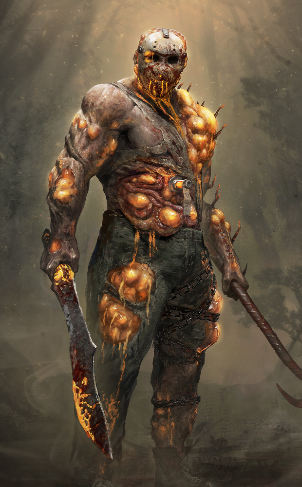
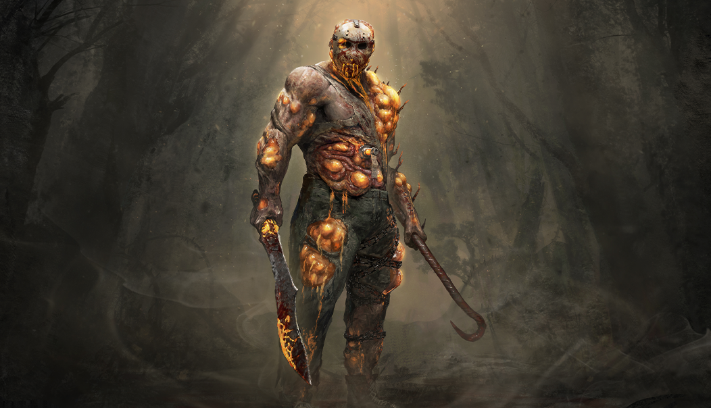

# live · 10.1.2_3758662live

| | |
|---|---|
| Build date | 2026-09-08 14:34 UTC |
| CDN version | `10.1.2_3758662live-1788878095` |
| Key | `10.1.2_live` |
| Compared with | [10.1.0_3758182live](../10.1.0_3758182live/CHANGES.md) (2026-09-08 12:44 UTC) |

## Summary

**2** added · **23** modified · **5** removed · 186 unchanged

## New or updated images

<a href="images/T_UI_CollectionBanner_HallowedBlight_Jason.png"></a>
<a href="images/T_UI_SpecialPack_HallowedBlight_Jason.png"></a>

## Removed files

- `images/T_UI_ChapterBundle_ChorusOfSin.png`
- `images/T_UI_CollectionBanner_GameplayExpo_Unknown.png`
- `images/T_UI_CollectionBanner_Xenomorph_King.png`
- `images/T_UI_SpecialPack_GameplayExpo_Unknown.png`
- `images/T_UI_SpecialPack_Xenomorph_King.png`

## Modified files

### [`GameConfigs.json`](GameConfigs.json)

[Full line-by-line diff](diffs/GameConfigs.json.diff)

```diff
+ $.hitValidation.validators[name=tail]
```

### [`catalog.json`](catalog.json)

[Full line-by-line diff](diffs/catalog.json.diff)

```diff
+ $[id=K30_Body022]
+ $[id=K30_Head022]
+ $[id=K30_W022]
+ $[id=K38_Body011]
+ $[id=K38_Head011]
+ $[id=K38_W011]
+ $[id=K43_Body008]
+ $[id=K43_Head008]
+ $[id=K43_W008]
+ $[id=MT_Head037]
+ $[id=MT_Legs037]
+ $[id=MT_Torso037]
+ $[id=POU_BDG_39]
+ $[id=S34_Head027]
+ $[id=S34_Legs027]
+ $[id=S34_Torso027]
+ $[id=S53_Head007]
+ $[id=S53_Legs007]
+ $[id=S53_Torso007]
+ $[id=UDO_004]
+ $[id=UDO_BDG_11]
+ $[id=UDO_BNR_06]
+ $[id=UDO_BNR_07]
+ $[id=VAN_012]
+ $[id=K30_outfit_022]
+ $[id=K38_outfit_011]
+ $[id=K43_outfit_008]
+ $[id=MT_outfit_037]
+ $[id=S34_outfit_027]
+ $[id=S53_outfit_007]
+ $[id=10.1.2_Autumn_Fashion]
+ $[id=10.1.2_Blighted_Bundle]
+ $[id=10.1.2_AutumnFashion_collection_item]
+ $[id=10.1.2_HallowedBlight_collection_item]
- $[id=RAM_BDG_05].metaData.releaseDate: "2026-09-08T15:00:00"
+ $[id=RAM_BDG_05].metaData.releaseDate: "2026-08-25T15:00:00"
- $[id=RAM_BDG_05].metaData.releaseDateInMs: 1788879600000
+ $[id=RAM_BDG_05].metaData.releaseDateInMs: 1787670000000
- $[id=UDO_002].metaData.releaseDate: "2026-09-08T15:00:00"
+ $[id=UDO_002].metaData.releaseDate: "2026-08-25T15:00:00"
- $[id=UDO_002].metaData.releaseDateInMs: 1788879600000
+ $[id=UDO_002].metaData.releaseDateInMs: 1787670000000
- $[id=UDO_003].metaData.releaseDate: "2026-09-08T15:00:00"
+ $[id=UDO_003].metaData.releaseDate: "2026-08-25T15:00:00"
- $[id=UDO_003].metaData.releaseDateInMs: 1788879600000
+ $[id=UDO_003].metaData.releaseDateInMs: 1787670000000
- $[id=UDO_BDG_09].metaData.releaseDate: "2026-09-08T15:00:00"
+ $[id=UDO_BDG_09].metaData.releaseDate: "2026-08-25T15:00:00"
- $[id=UDO_BDG_09].metaData.releaseDateInMs: 1788879600000
+ $[id=UDO_BDG_09].metaData.releaseDateInMs: 1787670000000
- $[id=UDO_BNR_01].metaData.releaseDate: "2026-09-08T15:00:00"
+ $[id=UDO_BNR_01].metaData.releaseDate: "2026-08-25T15:00:00"
- $[id=UDO_BNR_01].metaData.releaseDateInMs: 1788879600000
+ $[id=UDO_BNR_01].metaData.releaseDateInMs: 1787670000000
- $[id=UDO_BNR_05].metaData.releaseDate: "2026-09-15T15:00:00"
+ $[id=UDO_BNR_05].metaData.releaseDate: "2026-08-25T15:00:00"
- $[id=UDO_BNR_05].metaData.releaseDateInMs: 1789484400000
+ $[id=UDO_BNR_05].metaData.releaseDateInMs: 1787670000000
```

### [`challengeLocs/challengeText_de.json`](challengeLocs/challengeText_de.json)

[Full line-by-line diff](diffs/challengeLocs/challengeText_de.json.diff)

```diff
- $.locText[0].text: "Täglich"
+ $.locText[0].text: "Das schwarze Bankett"
- $.locText[0].textId: "CHALLENGESET_DailyTab_TITLE"
+ $.locText[0].textId: "CHALLENGESET_ANNIVERSARY2026_TITLE"
- $.locText[1].text: "@#CHALLENGESET_Daily_INFO"
+ $.locText[1].text: "Das schwarze Bankett"
- $.locText[1].textId: "CHALLENGESET_Daily_INFO"
+ $.locText[1].textId: "CHALLENGESET_ANNIVERSARY2026_INFO"
- $.locText[2].text: "@#CHALLENGE_HookOrUnhook_TITLE"
+ $.locText[2].text: "Schließe Prüfung(en) in „Das schwarze Bankett“ ab."
- $.locText[2].textId: "CHALLENGE_HookOrUnhook_TITLE"
+ $.locText[2].textId: "CHALLENGE_CommunityCompleteModeTrial_INFO"
- $.locText[3].text: "@#CHALLENGE_HookOrUnhook_DESC"
+ $.locText[3].text: "@#CHALLENGE_CompleteModeQuests_TITLE"
- $.locText[3].textId: "CHALLENGE_HookOrUnhook_DESC"
+ $.locText[3].textId: "CHALLENGE_CompleteModeQuests_TITLE"
- $.locText[4].text: "Hake {0} Überlebende(n) fest."
+ $.locText[4].text: "@#CHALLENGE_CompleteModeQuests_DESC"
- $.locText[4].textId: "CHALLENGE_Hook_INFO"
+ $.locText[4].textId: "CHALLENGE_CompleteModeQuests_DESC"
- $.locText[5].text: "Rette {0} Überlebende(n) sicher vom Haken."
+ $.locText[5].text: "Schließe {0} Quest(s) in „{1}“ ab."
- $.locText[5].textId: "CHALLENGE_Unhook_INFO"
+ $.locText[5].textId: "CHALLENGE_CompleteModeQuests_INFO"
- $.locText[6].text: "@#CHALLENGE_HitOrHeal_TITLE"
+ $.locText[6].text: "@#CHALLENGE_CollectMorsel_TITLE"
- $.locText[6].textId: "CHALLENGE_HitOrHeal_TITLE"
+ $.locText[6].textId: "CHALLENGE_CollectMorsel_TITLE"
- $.locText[7].text: "@#CHALLENGE_HitOrHeal_DESC"
+ $.locText[7].text: "@#CHALLENGE_CollectMorsel_DESC"
- $.locText[7].textId: "CHALLENGE_HitOrHeal_DESC"
+ $.locText[7].textId: "CHALLENGE_CollectMorsel_DESC"
- $.locText[8].text: "Triff {0} Überlebende(n) mit einem Grundangriff."
+ $.locText[8].text: "Sammle {0} Häppchen an Imbisswagen."
- $.locText[8].textId: "CHALLENGE_Hit_INFO"
+ $.locText[8].textId: "CHALLENGE_CollectMorsel_INFO"
- $.locText[9].text: "Heile insgesamt {0} Gesundheitsstatus."
+ $.locText[9].text: "@#CHALLENGE_PlaceMorsel_TITLE"
- $.locText[9].textId: "CHALLENGE_Heal_INFO"
+ $.locText[9].textId: "CHALLENGE_PlaceMorsel_TITLE"
- $.locText[10].text: "@#CHALLENGE_BreakGenOrGenSkillCheck_TITLE"
+ $.locText[10].text: "@#CHALLENGE_PlaceMorsel_DESC"
- $.locText[10].textId: "CHALLENGE_BreakGenOrGenSkillCheck_TITLE"
+ $.locText[10].textId: "CHALLENGE_PlaceMorsel_DESC"
- $.locText[11].text: "@#CHALLENGE_BreakGenOrGenSkillCheck_DESC"
+ $.locText[11].text: "Platziere {0} Häppchen auf Banketttischen."
- $.locText[11].textId: "CHALLENGE_BreakGenOrGenSkillCheck_DESC"
+ $.locText[11].textId: "CHALLENGE_PlaceMorsel_INFO"
- $.locText[12].text: "Beschädige {0} Generator(en)."
+ $.locText[12].text: "@#CHALLENGE_PoisonObject_TITLE"
- $.locText[12].textId: "CHALLENGE_BreakGen_INFO"
+ $.locText[12].textId: "CHALLENGE_PoisonObject_TITLE"
- $.locText[13].text: "Schließe {0} Fähigkeitscheck(s) an Generatoren erfolgreich ab."
+ $.locText[13].text: "@#CHALLENGE_PoisonObject_DESC"
- $.locText[13].textId: "CHALLENGE_GenSkillCheck_INFO"
+ $.locText[13].textId: "CHALLENGE_PoisonObject_DESC"
- $.locText[14].text: "@#CHALLENGE_KillSurvivorOrRepairGens_TITLE"
+ $.locText[14].text: "Vergifte {0} Objekt(e)."
- $.locText[14].textId: "CHALLENGE_KillSurvivorOrRepairGens_TITLE"
+ $.locText[14].textId: "CHALLENGE_PoisonObject_INFO"
- $.locText[15].text: "@#CHALLENGE_KillSurvivorOrRepairGens_DESC"
+ $.locText[15].text: "@#CHALLENGE_PoisonPlayerWithBottle_TITLE"
- $.locText[15].textId: "CHALLENGE_KillSurvivorOrRepairGens_DESC"
+ $.locText[15].textId: "CHALLENGE_PoisonPlayerWithBottle_TITLE"
- $.locText[16].text: "Töte {0} Überlebende(n)."
+ $.locText[16].text: "@#CHALLENGE_PoisonPlayerWithBottle_DESC"
- $.locText[16].textId: "CHALLENGE_Kill_INFO"
+ $.locText[16].textId: "CHALLENGE_PoisonPlayerWithBottle_DESC"
- $.locText[17].text: "Repariere insgesamt {0} Generator(en)."
+ $.locText[17].text: "Vergifte {0} Überlebende(n) mit Giftfläschchen."
- $.locText[17].textId: "CHALLENGE_Repair_INFO"
+ $.locText[17].textId: "CHALLENGE_PoisonPlayerWithBottle_INFO"
- $.locText[18].text: "Blutige Belohnungen"
+ $.locText[18].text: "@#CHALLENGE_CompleteTrial_TITLE"
- $.locText[18].textId: "CHALLENGE_EarnBloodpoints_TITLE"
+ $.locText[18].textId: "CHALLENGE_CompleteTrial_TITLE"
- $.locText[19].text: "Blutpunkte erhältst du für viele unterschiedliche Aktionen, zum Beispiel, wenn du mit anderen Überlebenden zusammenarbeitest und deine Killer-Stärken einsetzt.…
+ $.locText[19].text: "@#CHALLENGE_CompleteTrial_DESC"
- $.locText[19].textId: "CHALENGE_EarnBloodpoints_DESC"
+ $.locText[19].textId: "CHALLENGE_CompleteTrial_DESC"
- $.locText[20].text: "Verdiene {0} Blutpunkte."
+ $.locText[20].text: "Schließe {0} Prüfung(en) ab."
- $.locText[20].textId: "CHALENGE_EarnBloodpoints_INFO"
+ $.locText[20].textId: "CHALLENGE_CompleteTrial_INFO"
- $.locText[21].text: "@#CHALLENGE_CompleteTrial_TITLE"
+ $.locText[21].text: "@#CHALLENGE_ConsumeMorsel_TITLE"
- $.locText[21].textId: "CHALLENGE_CompleteTrial_TITLE"
+ $.locText[21].textId: "CHALLENGE_ConsumeMorsel_TITLE"
- $.locText[22].text: "@#CHALLENGE_CompleteTrial_DESC"
+ $.locText[22].text: "@#CHALLENGE_ConsumeMorsel_DESC"
- $.locText[22].textId: "CHALLENGE_CompleteTrial_DESC"
+ $.locText[22].textId: "CHALLENGE_ConsumeMorsel_DESC"
- $.locText[23].text: "Schließe {0} Prüfung(en) ab."
+ $.locText[23].text: "Iss {0} Häppchen."
- $.locText[23].textId: "CHALLENGE_CompleteTrial_INFO"
+ $.locText[23].textId: "CHALLENGE_ConsumeMorsel_INFO"
- $.locText[24].text: "@#CHALLENGE_ChaseOrBeChased_TITLE"
+ $.locText[24].text: "@#CHALLENGE_Hit_TITLE"
- $.locText[24].textId: "CHALLENGE_ChaseOrBeChased_TITLE"
+ $.locText[24].textId: "CHALLENGE_Hit_TITLE"
- $.locText[25].text: "@#CHALLENGE_ChaseOrBeChased_DESC"
+ $.locText[25].text: "Die Grundangriffe der Killer hängen nicht mit ihrer Stärke zusammen und eignen sich gut, um Überlebende niederzustrecken."
- $.locText[25].textId: "CHALLENGE_ChaseOrBeChased_DESC"
+ $.locText[25].textId: "CHALLENGE_Hit_DESC"
- $.locText[26].text: "Jage {0} Sekunden lang."
+ $.locText[26].text: "Triff {0} Überlebende(n) mit einem Grundangriff."
- $.locText[26].textId: "CHALLENGE_Chase_INFO"
+ $.locText[26].textId: "CHALLENGE_Hit_INFO"
- $.locText[27].text: "Werde {0} Sekunden lang gejagt."
+ $.locText[27].text: "@#CHALLENGE_CarryOrEscapeChase_TITLE"
- $.locText[27].textId: "CHALLENGE_BeChased_INFO"
+ $.locText[27].textId: "CHALLENGE_CarryOrEscapeChase_TITLE"
- $.locText[28].text: "@#CHALLENGE_BreakPalletsOrPalletDropInChase_TITLE"
+ $.locText[28].text: "@#CHALLENGE_CarryOrEscapeChase_DESC"
- $.locText[28].textId: "CHALLENGE_BreakPalletsOrPalletDropInChase_TITLE"
+ $.locText[28].textId: "CHALLENGE_CarryOrEscapeChase_DESC"
- $.locText[29].text: "@#CHALLENGE_BreakPalletsOrPalletDropInChase_DESC"
+ $.locText[29].text: "Trage Überlebende {0} Meter weit."
- $.locText[29].textId: "CHALLENGE_BreakPalletsOrPalletDropInChase_DESC"
+ $.locText[29].textId: "CHALLENGE_Carry_INFO"
- $.locText[30].text: "Zerstöre {0} Palette(n)."
+ $.locText[30].text: "Entkomme {0} Jagd(en)."
- $.locText[30].textId: "CHALLENGE_BreakPallets_INFO"
+ $.locText[30].textId: "CHALLENGE_EscapeChase_INFO"
- $.locText[31].text: "Stoße während einer Jagd {0} Palette(n) um."
+ $.locText[31].text: "@#CHALLENGE_AttackPoisonedPlayer_TITLE"
- $.locText[31].textId: "CHALLENGE_PalletDropInChase_INFO"
+ $.locText[31].textId: "CHALLENGE_AttackPoisonedPlayer_TITLE"
- $.locText[32].text: "TÄGLICHE QUESTS"
+ $.locText[32].text: "@#CHALLENGE_AttackPoisonedPlayer_DESC"
- $.locText[32].textId: "LIST_Daily_TITLE"
+ $.locText[32].textId: "CHALLENGE_AttackPoisonedPlayer_DESC"
- $.locText[33].text: "2 gegen 8"
+ $.locText[33].text: "Greife {0} vergiftete(n) Überlebende(n) an."
- $.locText[33].textId: "CHALLENGESET_CalamariJerky_TITLE"
+ $.locText[33].textId: "CHALLENGE_AttackPoisonedPlayer_INFO"
- $.locText[34].text: "Quests müssen in 2 gegen 8 abgeschlossen werden"
+ $.locText[34].text: "@#CHALLENGE_GenSkillCheck_TITLE"
- $.locText[34].textId: "CHALLENGESET_CalamariJerky_INFO"
+ $.locText[34].textId: "CHALLENGE_GenSkillCheck_TITLE"
- $.locText[35].text: "@#CHALLENGE_CompleteCalamariQuests1_TITLE"
+ $.locText[35].text: "Bei der Reparatur von Generatoren musst du auf Fähigkeitschecks vorbereitet sein. Wenn du versagst, ertönt ein Geräusch, das den Killer alarmieren könnte."
- $.locText[35].textId: "CHALLENGE_CompleteCalamariQuests1_TITLE"
+ $.locText[35].textId: "CHALLENGE_GenSkillCheck_DESC"
- $.locText[36].text: "@#CHALLENGE_CompleteCalamariQuests1_DESC"
+ $.locText[36].text: "Schließe {0} Fähigkeitscheck(s) an Generatoren erfolgreich ab."
- $.locText[36].textId: "CHALLENGE_CompleteCalamariQuests1_DESC"
+ $.locText[36].textId: "CHALLENGE_GenSkillCheck_INFO"
- $.locText[37].text: "Schließe {0} Quest(s) in 2 gegen 8 ab."
+ $.locText[37].text: "@#CHALLENGE_HookOrUnhook_TITLE"
- $.locText[37].textId: "CHALLENGE_CompleteCalamariQuests1_INFO"
+ $.locText[37].textId: "CHALLENGE_HookOrUnhook_TITLE"
- $.locText[38].text: "@#CHALLENGE_CompleteCalamariQuests2_TITLE"
+ $.locText[38].text: "@#CHALLENGE_HookOrUnhook_DESC"
- $.locText[38].textId: "CHALLENGE_CompleteCalamariQuests2_TITLE"
+ $.locText[38].textId: "CHALLENGE_HookOrUnhook_DESC"
- $.locText[39].text: "@#CHALLENGE_CompleteCalamariQuests2_DESC"
+ $.locText[39].text: "Hake {0} Überlebende(n) fest."
- $.locText[39].textId: "CHALLENGE_CompleteCalamariQuests2_DESC"
+ $.locText[39].textId: "CHALLENGE_Hook_INFO"
- $.locText[40].text: "Schließe {0} Quest(s) in 2 gegen 8 ab."
+ $.locText[40].text: "Rette {0} Überlebende(n) sicher vom Haken."
- $.locText[40].textId: "CHALLENGE_CompleteCalamariQuests2_INFO"
+ $.locText[40].textId: "CHALLENGE_Unhook_INFO"
- $.locText[41].text: "@#CHALLENGE_CompleteCalamariQuests3_TITLE"
+ $.locText[41].text: "@#CHALLENGE_StuffFaceDuringDessert_TITLE"
- $.locText[41].textId: "CHALLENGE_CompleteCalamariQuests3_TITLE"
+ $.locText[41].textId: "CHALLENGE_StuffFaceDuringDessert_TITLE"
- $.locText[42].text: "@#CHALLENGE_CompleteCalamariQuests3_DESC"
+ $.locText[42].text: "@#CHALLENGE_StuffFaceDuringDessert_DESC"
- $.locText[42].textId: "CHALLENGE_CompleteCalamariQuests3_DESC"
+ $.locText[42].textId: "CHALLENGE_StuffFaceDuringDessert_DESC"
- $.locText[43].text: "Schließe {0} Quest(s) in 2 gegen 8 ab."
+ $.locText[43].text: "Iss {0}-mal während der Nachtischphase."
- $.locText[43].textId: "CHALLENGE_CompleteCalamariQuests3_INFO"
+ $.locText[43].textId: "CHALLENGE_StuffFaceDuringDessert_INFO"
- $.locText[44].text: "@#CHALLENGE_PlayAsCharacterOrClass_TITLE"
+ $.locText[44].text: "@#CHALLENGE_ChaseOrBeChased_TITLE"
- $.locText[44].textId: "CHALLENGE_PlayAsCharacterOrClass_TITLE"
+ $.locText[44].textId: "CHALLENGE_ChaseOrBeChased_TITLE"
- $.locText[45].text: "@#CHALLENGE_PlayAsCharacterOrClass_"
+ $.locText[45].text: "@#CHALLENGE_ChaseOrBeChased_DESC"
- $.locText[45].textId: "CHALLENGE_PlayAsCharacterOrClass_"
+ $.locText[45].textId: "CHALLENGE_ChaseOrBeChased_DESC"
- $.locText[46].text: "Schließe {0} Prüfung(en) als {1} ab."
+ $.locText[46].text: "Jage {0} Sekunden lang."
- $.locText[46].textId: "CHALLENGE_PlayAsCharacter_INFO"
+ $.locText[46].textId: "CHALLENGE_Chase_INFO"
- $.locText[47].text: "Schließe {0} Prüfung(en) als {1} ab."
+ $.locText[47].text: "Werde {0} Sekunden lang gejagt."
- $.locText[47].textId: "CHALLENGE_PlayAsClass_INFO"
+ $.locText[47].textId: "CHALLENGE_BeChased_INFO"
- $.locText[48].text: "@#CHALLENGE_Crow_TITLE"
+ $.locText[48].text: "@#CHALLENGE_DownOrHeal_TITLE"
- $.locText[48].textId: "CHALLENGE_Crow_TITLE"
+ $.locText[48].textId: "CHALLENGE_DownOrHeal_TITLE"
- $.locText[49].text: "@#CHALLENGE_Crow_DESC"
+ $.locText[49].text: "@#CHALLENGE_DownOrHeal_DESC"
- $.locText[49].textId: "CHALLENGE_Crow_DESC"
+ $.locText[49].textId: "CHALLENGE_DownOrHeal_DESC"
… 2488 more change(s) — see the commit diff for everything
```

### [`challengeLocs/challengeText_en.json`](challengeLocs/challengeText_en.json)

[Full line-by-line diff](diffs/challengeLocs/challengeText_en.json.diff)

```diff
- $.locText[0].text: "Daily"
+ $.locText[0].text: "The Black Banquet"
- $.locText[0].textId: "CHALLENGESET_DailyTab_TITLE"
+ $.locText[0].textId: "CHALLENGESET_ANNIVERSARY2026_TITLE"
- $.locText[1].text: "@#CHALLENGESET_Daily_INFO"
+ $.locText[1].text: "The Black Banquet"
- $.locText[1].textId: "CHALLENGESET_Daily_INFO"
+ $.locText[1].textId: "CHALLENGESET_ANNIVERSARY2026_INFO"
- $.locText[2].text: "@#CHALLENGE_HookOrUnhook_TITLE"
+ $.locText[2].text: "Complete Black Banquet Trial(s)"
- $.locText[2].textId: "CHALLENGE_HookOrUnhook_TITLE"
+ $.locText[2].textId: "CHALLENGE_CommunityCompleteModeTrial_INFO"
- $.locText[3].text: "@#CHALLENGE_HookOrUnhook_DESC"
+ $.locText[3].text: "@#CHALLENGE_CompleteModeQuests_TITLE"
- $.locText[3].textId: "CHALLENGE_HookOrUnhook_DESC"
+ $.locText[3].textId: "CHALLENGE_CompleteModeQuests_TITLE"
- $.locText[4].text: "Hook {0} Survivor(s)"
+ $.locText[4].text: "@#CHALLENGE_CompleteModeQuests_DESC"
- $.locText[4].textId: "CHALLENGE_Hook_INFO"
+ $.locText[4].textId: "CHALLENGE_CompleteModeQuests_DESC"
- $.locText[5].text: "Safely unhook {0} Survivor(s)"
+ $.locText[5].text: "Complete {0} {1} quest(s)"
- $.locText[5].textId: "CHALLENGE_Unhook_INFO"
+ $.locText[5].textId: "CHALLENGE_CompleteModeQuests_INFO"
- $.locText[6].text: "@#CHALLENGE_HitOrHeal_TITLE"
+ $.locText[6].text: "@#CHALLENGE_CollectMorsel_TITLE"
- $.locText[6].textId: "CHALLENGE_HitOrHeal_TITLE"
+ $.locText[6].textId: "CHALLENGE_CollectMorsel_TITLE"
- $.locText[7].text: "@#CHALLENGE_HitOrHeal_DESC"
+ $.locText[7].text: "@#CHALLENGE_CollectMorsel_DESC"
- $.locText[7].textId: "CHALLENGE_HitOrHeal_DESC"
+ $.locText[7].textId: "CHALLENGE_CollectMorsel_DESC"
- $.locText[8].text: "Hit {0} Survivor(s) with a basic attack"
+ $.locText[8].text: "Collect {0} Morsel(s) from Food Carts"
- $.locText[8].textId: "CHALLENGE_Hit_INFO"
+ $.locText[8].textId: "CHALLENGE_CollectMorsel_INFO"
- $.locText[9].text: "Heal a total of {0} health state(s)"
+ $.locText[9].text: "@#CHALLENGE_PlaceMorsel_TITLE"
- $.locText[9].textId: "CHALLENGE_Heal_INFO"
+ $.locText[9].textId: "CHALLENGE_PlaceMorsel_TITLE"
- $.locText[10].text: "@#CHALLENGE_BreakGenOrGenSkillCheck_TITLE"
+ $.locText[10].text: "@#CHALLENGE_PlaceMorsel_DESC"
- $.locText[10].textId: "CHALLENGE_BreakGenOrGenSkillCheck_TITLE"
+ $.locText[10].textId: "CHALLENGE_PlaceMorsel_DESC"
- $.locText[11].text: "@#CHALLENGE_BreakGenOrGenSkillCheck_DESC"
+ $.locText[11].text: "Place {0} Morsel(s) on Banquet Tables"
- $.locText[11].textId: "CHALLENGE_BreakGenOrGenSkillCheck_DESC"
+ $.locText[11].textId: "CHALLENGE_PlaceMorsel_INFO"
- $.locText[12].text: "Damage {0} generator(s)"
+ $.locText[12].text: "@#CHALLENGE_PoisonObject_TITLE"
- $.locText[12].textId: "CHALLENGE_BreakGen_INFO"
+ $.locText[12].textId: "CHALLENGE_PoisonObject_TITLE"
- $.locText[13].text: "Succeed at {0} repair skill check(s)"
+ $.locText[13].text: "@#CHALLENGE_PoisonObject_DESC"
- $.locText[13].textId: "CHALLENGE_GenSkillCheck_INFO"
+ $.locText[13].textId: "CHALLENGE_PoisonObject_DESC"
- $.locText[14].text: "@#CHALLENGE_KillSurvivorOrRepairGens_TITLE"
+ $.locText[14].text: "Poison {0} Object(s)"
- $.locText[14].textId: "CHALLENGE_KillSurvivorOrRepairGens_TITLE"
+ $.locText[14].textId: "CHALLENGE_PoisonObject_INFO"
- $.locText[15].text: "@#CHALLENGE_KillSurvivorOrRepairGens_DESC"
+ $.locText[15].text: "@#CHALLENGE_PoisonPlayerWithBottle_TITLE"
- $.locText[15].textId: "CHALLENGE_KillSurvivorOrRepairGens_DESC"
+ $.locText[15].textId: "CHALLENGE_PoisonPlayerWithBottle_TITLE"
- $.locText[16].text: "Sacrifice or kill {0} Survivor(s)"
+ $.locText[16].text: "@#CHALLENGE_PoisonPlayerWithBottle_DESC"
- $.locText[16].textId: "CHALLENGE_Kill_INFO"
+ $.locText[16].textId: "CHALLENGE_PoisonPlayerWithBottle_DESC"
- $.locText[17].text: "Repair a total of {0} generator(s)"
+ $.locText[17].text: "Poison {0} Survivor(s) with Poison Bottles"
- $.locText[17].textId: "CHALLENGE_Repair_INFO"
+ $.locText[17].textId: "CHALLENGE_PoisonPlayerWithBottle_INFO"
- $.locText[18].text: "Bloody Rewards"
+ $.locText[18].text: "@#CHALLENGE_CompleteTrial_TITLE"
- $.locText[18].textId: "CHALLENGE_EarnBloodpoints_TITLE"
+ $.locText[18].textId: "CHALLENGE_CompleteTrial_TITLE"
- $.locText[19].text: "Many actions reward you with Bloodpoints, such as cooperating with other Survivors and using your Killer powers."
+ $.locText[19].text: "@#CHALLENGE_CompleteTrial_DESC"
- $.locText[19].textId: "CHALENGE_EarnBloodpoints_DESC"
+ $.locText[19].textId: "CHALLENGE_CompleteTrial_DESC"
- $.locText[20].text: "Earn {0} Bloodpoints"
+ $.locText[20].text: "Complete {0} trial(s)"
- $.locText[20].textId: "CHALENGE_EarnBloodpoints_INFO"
+ $.locText[20].textId: "CHALLENGE_CompleteTrial_INFO"
- $.locText[21].text: "@#CHALLENGE_CompleteTrial_TITLE"
+ $.locText[21].text: "@#CHALLENGE_ConsumeMorsel_TITLE"
- $.locText[21].textId: "CHALLENGE_CompleteTrial_TITLE"
+ $.locText[21].textId: "CHALLENGE_ConsumeMorsel_TITLE"
- $.locText[22].text: "@#CHALLENGE_CompleteTrial_DESC"
+ $.locText[22].text: "@#CHALLENGE_ConsumeMorsel_DESC"
- $.locText[22].textId: "CHALLENGE_CompleteTrial_DESC"
+ $.locText[22].textId: "CHALLENGE_ConsumeMorsel_DESC"
- $.locText[23].text: "Complete {0} trial(s)"
+ $.locText[23].text: "Eat {0} Morsel(s)"
- $.locText[23].textId: "CHALLENGE_CompleteTrial_INFO"
+ $.locText[23].textId: "CHALLENGE_ConsumeMorsel_INFO"
- $.locText[24].text: "@#CHALLENGE_ChaseOrBeChased_TITLE"
+ $.locText[24].text: "@#CHALLENGE_Hit_TITLE"
- $.locText[24].textId: "CHALLENGE_ChaseOrBeChased_TITLE"
+ $.locText[24].textId: "CHALLENGE_Hit_TITLE"
- $.locText[25].text: "@#CHALLENGE_ChaseOrBeChased_DESC"
+ $.locText[25].text: "Killers' basic attacks aren't dependent on their power. They're a good way to down Survivors."
- $.locText[25].textId: "CHALLENGE_ChaseOrBeChased_DESC"
+ $.locText[25].textId: "CHALLENGE_Hit_DESC"
- $.locText[26].text: "Chase for {0} seconds"
+ $.locText[26].text: "Hit {0} Survivor(s) with a basic attack"
- $.locText[26].textId: "CHALLENGE_Chase_INFO"
+ $.locText[26].textId: "CHALLENGE_Hit_INFO"
- $.locText[27].text: "Be chased for {0} seconds"
+ $.locText[27].text: "@#CHALLENGE_CarryOrEscapeChase_TITLE"
- $.locText[27].textId: "CHALLENGE_BeChased_INFO"
+ $.locText[27].textId: "CHALLENGE_CarryOrEscapeChase_TITLE"
- $.locText[28].text: "@#CHALLENGE_BreakPalletsOrPalletDropInChase_TITLE"
+ $.locText[28].text: "@#CHALLENGE_CarryOrEscapeChase_DESC"
- $.locText[28].textId: "CHALLENGE_BreakPalletsOrPalletDropInChase_TITLE"
+ $.locText[28].textId: "CHALLENGE_CarryOrEscapeChase_DESC"
- $.locText[29].text: "@#CHALLENGE_BreakPalletsOrPalletDropInChase_DESC"
+ $.locText[29].text: "Carry Survivors over {0} meters"
- $.locText[29].textId: "CHALLENGE_BreakPalletsOrPalletDropInChase_DESC"
+ $.locText[29].textId: "CHALLENGE_Carry_INFO"
- $.locText[30].text: "Destroy {0} pallet(s)"
+ $.locText[30].text: "Escape {0} chase(s)"
- $.locText[30].textId: "CHALLENGE_BreakPallets_INFO"
+ $.locText[30].textId: "CHALLENGE_EscapeChase_INFO"
- $.locText[31].text: "Drop {0} pallet(s) while in chase"
+ $.locText[31].text: "@#CHALLENGE_AttackPoisonedPlayer_TITLE"
- $.locText[31].textId: "CHALLENGE_PalletDropInChase_INFO"
+ $.locText[31].textId: "CHALLENGE_AttackPoisonedPlayer_TITLE"
- $.locText[32].text: "DAILY QUESTS"
+ $.locText[32].text: "@#CHALLENGE_AttackPoisonedPlayer_DESC"
- $.locText[32].textId: "LIST_Daily_TITLE"
+ $.locText[32].textId: "CHALLENGE_AttackPoisonedPlayer_DESC"
- $.locText[33].text: "2V8"
+ $.locText[33].text: "Attack {0} Poisoned Survivor(s)"
- $.locText[33].textId: "CHALLENGESET_CalamariJerky_TITLE"
+ $.locText[33].textId: "CHALLENGE_AttackPoisonedPlayer_INFO"
- $.locText[34].text: "Quests must be completed in 2v8"
+ $.locText[34].text: "@#CHALLENGE_GenSkillCheck_TITLE"
- $.locText[34].textId: "CHALLENGESET_CalamariJerky_INFO"
+ $.locText[34].textId: "CHALLENGE_GenSkillCheck_TITLE"
- $.locText[35].text: "@#CHALLENGE_CompleteCalamariQuests1_TITLE"
+ $.locText[35].text: "When repairing generators, be prepared for Skill Checks. Failing a Skill Check causes a noise that can alert the Killer."
- $.locText[35].textId: "CHALLENGE_CompleteCalamariQuests1_TITLE"
+ $.locText[35].textId: "CHALLENGE_GenSkillCheck_DESC"
- $.locText[36].text: "@#CHALLENGE_CompleteCalamariQuests1_DESC"
+ $.locText[36].text: "Succeed at {0} repair skill check(s)"
- $.locText[36].textId: "CHALLENGE_CompleteCalamariQuests1_DESC"
+ $.locText[36].textId: "CHALLENGE_GenSkillCheck_INFO"
- $.locText[37].text: "Complete {0} 2v8 quest(s)"
+ $.locText[37].text: "@#CHALLENGE_HookOrUnhook_TITLE"
- $.locText[37].textId: "CHALLENGE_CompleteCalamariQuests1_INFO"
+ $.locText[37].textId: "CHALLENGE_HookOrUnhook_TITLE"
- $.locText[38].text: "@#CHALLENGE_CompleteCalamariQuests2_TITLE"
+ $.locText[38].text: "@#CHALLENGE_HookOrUnhook_DESC"
- $.locText[38].textId: "CHALLENGE_CompleteCalamariQuests2_TITLE"
+ $.locText[38].textId: "CHALLENGE_HookOrUnhook_DESC"
- $.locText[39].text: "@#CHALLENGE_CompleteCalamariQuests2_DESC"
+ $.locText[39].text: "Hook {0} Survivor(s)"
- $.locText[39].textId: "CHALLENGE_CompleteCalamariQuests2_DESC"
+ $.locText[39].textId: "CHALLENGE_Hook_INFO"
- $.locText[40].text: "Complete {0} 2v8 quest(s)"
+ $.locText[40].text: "Safely unhook {0} Survivor(s)"
- $.locText[40].textId: "CHALLENGE_CompleteCalamariQuests2_INFO"
+ $.locText[40].textId: "CHALLENGE_Unhook_INFO"
- $.locText[41].text: "@#CHALLENGE_CompleteCalamariQuests3_TITLE"
+ $.locText[41].text: "@#CHALLENGE_StuffFaceDuringDessert_TITLE"
- $.locText[41].textId: "CHALLENGE_CompleteCalamariQuests3_TITLE"
+ $.locText[41].textId: "CHALLENGE_StuffFaceDuringDessert_TITLE"
- $.locText[42].text: "@#CHALLENGE_CompleteCalamariQuests3_DESC"
+ $.locText[42].text: "@#CHALLENGE_StuffFaceDuringDessert_DESC"
- $.locText[42].textId: "CHALLENGE_CompleteCalamariQuests3_DESC"
+ $.locText[42].textId: "CHALLENGE_StuffFaceDuringDessert_DESC"
- $.locText[43].text: "Complete {0} 2v8 quest(s)"
+ $.locText[43].text: "Eat during Dessert {0} time(s)"
- $.locText[43].textId: "CHALLENGE_CompleteCalamariQuests3_INFO"
+ $.locText[43].textId: "CHALLENGE_StuffFaceDuringDessert_INFO"
- $.locText[44].text: "@#CHALLENGE_PlayAsCharacterOrClass_TITLE"
+ $.locText[44].text: "@#CHALLENGE_ChaseOrBeChased_TITLE"
- $.locText[44].textId: "CHALLENGE_PlayAsCharacterOrClass_TITLE"
+ $.locText[44].textId: "CHALLENGE_ChaseOrBeChased_TITLE"
- $.locText[45].text: "@#CHALLENGE_PlayAsCharacterOrClass_"
+ $.locText[45].text: "@#CHALLENGE_ChaseOrBeChased_DESC"
- $.locText[45].textId: "CHALLENGE_PlayAsCharacterOrClass_"
+ $.locText[45].textId: "CHALLENGE_ChaseOrBeChased_DESC"
- $.locText[46].text: "Complete {0} trial(s) as {1}"
+ $.locText[46].text: "Chase for {0} seconds"
- $.locText[46].textId: "CHALLENGE_PlayAsCharacter_INFO"
+ $.locText[46].textId: "CHALLENGE_Chase_INFO"
- $.locText[47].text: "Complete {0} trial(s) as {1}"
+ $.locText[47].text: "Be chased for {0} seconds"
- $.locText[47].textId: "CHALLENGE_PlayAsClass_INFO"
+ $.locText[47].textId: "CHALLENGE_BeChased_INFO"
- $.locText[48].text: "@#CHALLENGE_Crow_TITLE"
+ $.locText[48].text: "@#CHALLENGE_DownOrHeal_TITLE"
- $.locText[48].textId: "CHALLENGE_Crow_TITLE"
+ $.locText[48].textId: "CHALLENGE_DownOrHeal_TITLE"
- $.locText[49].text: "@#CHALLENGE_Crow_DESC"
+ $.locText[49].text: "@#CHALLENGE_DownOrHeal_DESC"
- $.locText[49].textId: "CHALLENGE_Crow_DESC"
+ $.locText[49].textId: "CHALLENGE_DownOrHeal_DESC"
… 2488 more change(s) — see the commit diff for everything
```

### [`challengeLocs/challengeText_es-MX.json`](challengeLocs/challengeText_es-MX.json)

[Full line-by-line diff](diffs/challengeLocs/challengeText_es-MX.json.diff)

```diff
- $.locText[0].text: "Diario"
+ $.locText[0].text: "El banquete negro"
- $.locText[0].textId: "CHALLENGESET_DailyTab_TITLE"
+ $.locText[0].textId: "CHALLENGESET_ANNIVERSARY2026_TITLE"
- $.locText[1].text: "@#CHALLENGESET_Daily_INFO"
+ $.locText[1].text: "El banquete negro"
- $.locText[1].textId: "CHALLENGESET_Daily_INFO"
+ $.locText[1].textId: "CHALLENGESET_ANNIVERSARY2026_INFO"
- $.locText[2].text: "@#CHALLENGE_HookOrUnhook_TITLE"
+ $.locText[2].text: "Completa partida(s) del Banquete negro."
- $.locText[2].textId: "CHALLENGE_HookOrUnhook_TITLE"
+ $.locText[2].textId: "CHALLENGE_CommunityCompleteModeTrial_INFO"
- $.locText[3].text: "@#CHALLENGE_HookOrUnhook_DESC"
+ $.locText[3].text: "@#CHALLENGE_CompleteModeQuests_TITLE"
- $.locText[3].textId: "CHALLENGE_HookOrUnhook_DESC"
+ $.locText[3].textId: "CHALLENGE_CompleteModeQuests_TITLE"
- $.locText[4].text: "Cuelga a {0} sobreviviente(s)."
+ $.locText[4].text: "@#CHALLENGE_CompleteModeQuests_DESC"
- $.locText[4].textId: "CHALLENGE_Hook_INFO"
+ $.locText[4].textId: "CHALLENGE_CompleteModeQuests_DESC"
- $.locText[5].text: "Descuelga de forma segura a {0} sobreviviente(s)"
+ $.locText[5].text: "Completa {0} {1} misión/misiones."
- $.locText[5].textId: "CHALLENGE_Unhook_INFO"
+ $.locText[5].textId: "CHALLENGE_CompleteModeQuests_INFO"
- $.locText[6].text: "@#CHALLENGE_HitOrHeal_TITLE"
+ $.locText[6].text: "@#CHALLENGE_CollectMorsel_TITLE"
- $.locText[6].textId: "CHALLENGE_HitOrHeal_TITLE"
+ $.locText[6].textId: "CHALLENGE_CollectMorsel_TITLE"
- $.locText[7].text: "@#CHALLENGE_HitOrHeal_DESC"
+ $.locText[7].text: "@#CHALLENGE_CollectMorsel_DESC"
- $.locText[7].textId: "CHALLENGE_HitOrHeal_DESC"
+ $.locText[7].textId: "CHALLENGE_CollectMorsel_DESC"
- $.locText[8].text: "Golpea a {0} sobreviviente(s) con un ataque básico."
+ $.locText[8].text: "Junta {0} bocado(s) de carritos de comida."
- $.locText[8].textId: "CHALLENGE_Hit_INFO"
+ $.locText[8].textId: "CHALLENGE_CollectMorsel_INFO"
- $.locText[9].text: "Cura un total de {0} estado(s) de salud"
+ $.locText[9].text: "@#CHALLENGE_PlaceMorsel_TITLE"
- $.locText[9].textId: "CHALLENGE_Heal_INFO"
+ $.locText[9].textId: "CHALLENGE_PlaceMorsel_TITLE"
- $.locText[10].text: "@#CHALLENGE_BreakGenOrGenSkillCheck_TITLE"
+ $.locText[10].text: "@#CHALLENGE_PlaceMorsel_DESC"
- $.locText[10].textId: "CHALLENGE_BreakGenOrGenSkillCheck_TITLE"
+ $.locText[10].textId: "CHALLENGE_PlaceMorsel_DESC"
- $.locText[11].text: "@#CHALLENGE_BreakGenOrGenSkillCheck_DESC"
+ $.locText[11].text: "Coloca {0} bocado(s) en las mesas de banquete."
- $.locText[11].textId: "CHALLENGE_BreakGenOrGenSkillCheck_DESC"
+ $.locText[11].textId: "CHALLENGE_PlaceMorsel_INFO"
- $.locText[12].text: "Rompe {0} generador(es)."
+ $.locText[12].text: "@#CHALLENGE_PoisonObject_TITLE"
- $.locText[12].textId: "CHALLENGE_BreakGen_INFO"
+ $.locText[12].textId: "CHALLENGE_PoisonObject_TITLE"
- $.locText[13].text: "Supera {0} prueba(s) de habilidad de generadores"
+ $.locText[13].text: "@#CHALLENGE_PoisonObject_DESC"
- $.locText[13].textId: "CHALLENGE_GenSkillCheck_INFO"
+ $.locText[13].textId: "CHALLENGE_PoisonObject_DESC"
- $.locText[14].text: "@#CHALLENGE_KillSurvivorOrRepairGens_TITLE"
+ $.locText[14].text: "Envenena {0} objeto(s)."
- $.locText[14].textId: "CHALLENGE_KillSurvivorOrRepairGens_TITLE"
+ $.locText[14].textId: "CHALLENGE_PoisonObject_INFO"
- $.locText[15].text: "@#CHALLENGE_KillSurvivorOrRepairGens_DESC"
+ $.locText[15].text: "@#CHALLENGE_PoisonPlayerWithBottle_TITLE"
- $.locText[15].textId: "CHALLENGE_KillSurvivorOrRepairGens_DESC"
+ $.locText[15].textId: "CHALLENGE_PoisonPlayerWithBottle_TITLE"
- $.locText[16].text: "Mata a {0} sobreviviente(s)."
+ $.locText[16].text: "@#CHALLENGE_PoisonPlayerWithBottle_DESC"
- $.locText[16].textId: "CHALLENGE_Kill_INFO"
+ $.locText[16].textId: "CHALLENGE_PoisonPlayerWithBottle_DESC"
- $.locText[17].text: "Repara un total de {0} generador(es)."
+ $.locText[17].text: "Envenena a {0} sobreviviente(s) con botellas de veneno."
- $.locText[17].textId: "CHALLENGE_Repair_INFO"
+ $.locText[17].textId: "CHALLENGE_PoisonPlayerWithBottle_INFO"
- $.locText[18].text: "Recompensas ensangrentadas"
+ $.locText[18].text: "@#CHALLENGE_CompleteTrial_TITLE"
- $.locText[18].textId: "CHALLENGE_EarnBloodpoints_TITLE"
+ $.locText[18].textId: "CHALLENGE_CompleteTrial_TITLE"
- $.locText[19].text: "Muchas acciones te recompensan con puntos de sangre, como cooperar con otros sobrevivientes y usar tus poderes de asesino."
+ $.locText[19].text: "@#CHALLENGE_CompleteTrial_DESC"
- $.locText[19].textId: "CHALENGE_EarnBloodpoints_DESC"
+ $.locText[19].textId: "CHALLENGE_CompleteTrial_DESC"
- $.locText[20].text: "Gana {0} puntos de sangre."
+ $.locText[20].text: "Completa {0} partida(s)."
- $.locText[20].textId: "CHALENGE_EarnBloodpoints_INFO"
+ $.locText[20].textId: "CHALLENGE_CompleteTrial_INFO"
- $.locText[21].text: "@#CHALLENGE_CompleteTrial_TITLE"
+ $.locText[21].text: "@#CHALLENGE_ConsumeMorsel_TITLE"
- $.locText[21].textId: "CHALLENGE_CompleteTrial_TITLE"
+ $.locText[21].textId: "CHALLENGE_ConsumeMorsel_TITLE"
- $.locText[22].text: "@#CHALLENGE_CompleteTrial_DESC"
+ $.locText[22].text: "@#CHALLENGE_ConsumeMorsel_DESC"
- $.locText[22].textId: "CHALLENGE_CompleteTrial_DESC"
+ $.locText[22].textId: "CHALLENGE_ConsumeMorsel_DESC"
- $.locText[23].text: "Completa {0} partida(s)."
+ $.locText[23].text: "Come {0} bocado(s)."
- $.locText[23].textId: "CHALLENGE_CompleteTrial_INFO"
+ $.locText[23].textId: "CHALLENGE_ConsumeMorsel_INFO"
- $.locText[24].text: "@#CHALLENGE_ChaseOrBeChased_TITLE"
+ $.locText[24].text: "@#CHALLENGE_Hit_TITLE"
- $.locText[24].textId: "CHALLENGE_ChaseOrBeChased_TITLE"
+ $.locText[24].textId: "CHALLENGE_Hit_TITLE"
- $.locText[25].text: "@#CHALLENGE_ChaseOrBeChased_DESC"
+ $.locText[25].text: "Los ataques básicos de los asesinos no dependen de su poder. Son una buena manera de derribar sobrevivientes."
- $.locText[25].textId: "CHALLENGE_ChaseOrBeChased_DESC"
+ $.locText[25].textId: "CHALLENGE_Hit_DESC"
- $.locText[26].text: "Persigue durante {0} segundos."
+ $.locText[26].text: "Golpea a {0} sobreviviente(s) con un ataque básico."
- $.locText[26].textId: "CHALLENGE_Chase_INFO"
+ $.locText[26].textId: "CHALLENGE_Hit_INFO"
- $.locText[27].text: "Sé parte de una persecución durante {0} segundos."
+ $.locText[27].text: "@#CHALLENGE_CarryOrEscapeChase_TITLE"
- $.locText[27].textId: "CHALLENGE_BeChased_INFO"
+ $.locText[27].textId: "CHALLENGE_CarryOrEscapeChase_TITLE"
- $.locText[28].text: "@#CHALLENGE_BreakPalletsOrPalletDropInChase_TITLE"
+ $.locText[28].text: "@#CHALLENGE_CarryOrEscapeChase_DESC"
- $.locText[28].textId: "CHALLENGE_BreakPalletsOrPalletDropInChase_TITLE"
+ $.locText[28].textId: "CHALLENGE_CarryOrEscapeChase_DESC"
- $.locText[29].text: "@#CHALLENGE_BreakPalletsOrPalletDropInChase_DESC"
+ $.locText[29].text: "Carga sobrevivientes por más de {0} metros"
- $.locText[29].textId: "CHALLENGE_BreakPalletsOrPalletDropInChase_DESC"
+ $.locText[29].textId: "CHALLENGE_Carry_INFO"
- $.locText[30].text: "Rompe {0} tarima(s)."
+ $.locText[30].text: "Escapa de {0} persecución/persecuciones."
- $.locText[30].textId: "CHALLENGE_BreakPallets_INFO"
+ $.locText[30].textId: "CHALLENGE_EscapeChase_INFO"
- $.locText[31].text: "Deja caer {0} tarima(s) durante una persecución."
+ $.locText[31].text: "@#CHALLENGE_AttackPoisonedPlayer_TITLE"
- $.locText[31].textId: "CHALLENGE_PalletDropInChase_INFO"
+ $.locText[31].textId: "CHALLENGE_AttackPoisonedPlayer_TITLE"
- $.locText[32].text: "MISIONES DIARIAS"
+ $.locText[32].text: "@#CHALLENGE_AttackPoisonedPlayer_DESC"
- $.locText[32].textId: "LIST_Daily_TITLE"
+ $.locText[32].textId: "CHALLENGE_AttackPoisonedPlayer_DESC"
- $.locText[33].text: "2v8"
+ $.locText[33].text: "Ataca a {0} sobreviviente(s) envenenado(s)."
- $.locText[33].textId: "CHALLENGESET_CalamariJerky_TITLE"
+ $.locText[33].textId: "CHALLENGE_AttackPoisonedPlayer_INFO"
- $.locText[34].text: "Las misiones deben completarse en 2v8"
+ $.locText[34].text: "@#CHALLENGE_GenSkillCheck_TITLE"
- $.locText[34].textId: "CHALLENGESET_CalamariJerky_INFO"
+ $.locText[34].textId: "CHALLENGE_GenSkillCheck_TITLE"
- $.locText[35].text: "@#CHALLENGE_CompleteCalamariQuests1_TITLE"
+ $.locText[35].text: "Al reparar generadores, prepárate para las pruebas de habilidad. Si fallas en una prueba de habilidad, provocarás un ruido que llamará la atención del asesino.…
- $.locText[35].textId: "CHALLENGE_CompleteCalamariQuests1_TITLE"
+ $.locText[35].textId: "CHALLENGE_GenSkillCheck_DESC"
- $.locText[36].text: "@#CHALLENGE_CompleteCalamariQuests1_DESC"
+ $.locText[36].text: "Supera {0} prueba(s) de habilidad de generadores"
- $.locText[36].textId: "CHALLENGE_CompleteCalamariQuests1_DESC"
+ $.locText[36].textId: "CHALLENGE_GenSkillCheck_INFO"
- $.locText[37].text: "Completa {0} misión/misiones de 2v8."
+ $.locText[37].text: "@#CHALLENGE_HookOrUnhook_TITLE"
- $.locText[37].textId: "CHALLENGE_CompleteCalamariQuests1_INFO"
+ $.locText[37].textId: "CHALLENGE_HookOrUnhook_TITLE"
- $.locText[38].text: "@#CHALLENGE_CompleteCalamariQuests2_TITLE"
+ $.locText[38].text: "@#CHALLENGE_HookOrUnhook_DESC"
- $.locText[38].textId: "CHALLENGE_CompleteCalamariQuests2_TITLE"
+ $.locText[38].textId: "CHALLENGE_HookOrUnhook_DESC"
- $.locText[39].text: "@#CHALLENGE_CompleteCalamariQuests2_DESC"
+ $.locText[39].text: "Cuelga a {0} sobreviviente(s)."
- $.locText[39].textId: "CHALLENGE_CompleteCalamariQuests2_DESC"
+ $.locText[39].textId: "CHALLENGE_Hook_INFO"
- $.locText[40].text: "Completa {0} misión/misiones de 2v8."
+ $.locText[40].text: "Descuelga de forma segura a {0} sobreviviente(s)"
- $.locText[40].textId: "CHALLENGE_CompleteCalamariQuests2_INFO"
+ $.locText[40].textId: "CHALLENGE_Unhook_INFO"
- $.locText[41].text: "@#CHALLENGE_CompleteCalamariQuests3_TITLE"
+ $.locText[41].text: "@#CHALLENGE_StuffFaceDuringDessert_TITLE"
- $.locText[41].textId: "CHALLENGE_CompleteCalamariQuests3_TITLE"
+ $.locText[41].textId: "CHALLENGE_StuffFaceDuringDessert_TITLE"
- $.locText[42].text: "@#CHALLENGE_CompleteCalamariQuests3_DESC"
+ $.locText[42].text: "@#CHALLENGE_StuffFaceDuringDessert_DESC"
- $.locText[42].textId: "CHALLENGE_CompleteCalamariQuests3_DESC"
+ $.locText[42].textId: "CHALLENGE_StuffFaceDuringDessert_DESC"
- $.locText[43].text: "Completa {0} misión/misiones de 2v8."
+ $.locText[43].text: "Come durante el postre {0} vez/veces."
- $.locText[43].textId: "CHALLENGE_CompleteCalamariQuests3_INFO"
+ $.locText[43].textId: "CHALLENGE_StuffFaceDuringDessert_INFO"
- $.locText[44].text: "@#CHALLENGE_PlayAsCharacterOrClass_TITLE"
+ $.locText[44].text: "@#CHALLENGE_ChaseOrBeChased_TITLE"
- $.locText[44].textId: "CHALLENGE_PlayAsCharacterOrClass_TITLE"
+ $.locText[44].textId: "CHALLENGE_ChaseOrBeChased_TITLE"
- $.locText[45].text: "@#CHALLENGE_PlayAsCharacterOrClass_"
+ $.locText[45].text: "@#CHALLENGE_ChaseOrBeChased_DESC"
- $.locText[45].textId: "CHALLENGE_PlayAsCharacterOrClass_"
+ $.locText[45].textId: "CHALLENGE_ChaseOrBeChased_DESC"
- $.locText[46].text: "Como {1}, completa {0} partida(s)."
+ $.locText[46].text: "Persigue durante {0} segundos."
- $.locText[46].textId: "CHALLENGE_PlayAsCharacter_INFO"
+ $.locText[46].textId: "CHALLENGE_Chase_INFO"
- $.locText[47].text: "Como {1}, completa {0} partida(s)."
+ $.locText[47].text: "Sé parte de una persecución durante {0} segundos."
- $.locText[47].textId: "CHALLENGE_PlayAsClass_INFO"
+ $.locText[47].textId: "CHALLENGE_BeChased_INFO"
- $.locText[48].text: "@#CHALLENGE_Crow_TITLE"
+ $.locText[48].text: "@#CHALLENGE_DownOrHeal_TITLE"
- $.locText[48].textId: "CHALLENGE_Crow_TITLE"
+ $.locText[48].textId: "CHALLENGE_DownOrHeal_TITLE"
- $.locText[49].text: "@#CHALLENGE_Crow_DESC"
+ $.locText[49].text: "@#CHALLENGE_DownOrHeal_DESC"
- $.locText[49].textId: "CHALLENGE_Crow_DESC"
+ $.locText[49].textId: "CHALLENGE_DownOrHeal_DESC"
… 2488 more change(s) — see the commit diff for everything
```

### [`challengeLocs/challengeText_es.json`](challengeLocs/challengeText_es.json)

[Full line-by-line diff](diffs/challengeLocs/challengeText_es.json.diff)

```diff
- $.locText[0].text: "Diarias"
+ $.locText[0].text: "El banquete oscuro"
- $.locText[0].textId: "CHALLENGESET_DailyTab_TITLE"
+ $.locText[0].textId: "CHALLENGESET_ANNIVERSARY2026_TITLE"
- $.locText[1].text: "@#CHALLENGESET_Daily_INFO"
+ $.locText[1].text: "El banquete oscuro"
- $.locText[1].textId: "CHALLENGESET_Daily_INFO"
+ $.locText[1].textId: "CHALLENGESET_ANNIVERSARY2026_INFO"
- $.locText[2].text: "@#CHALLENGE_HookOrUnhook_TITLE"
+ $.locText[2].text: "Completa partida(s) del Banquete Oscuro"
- $.locText[2].textId: "CHALLENGE_HookOrUnhook_TITLE"
+ $.locText[2].textId: "CHALLENGE_CommunityCompleteModeTrial_INFO"
- $.locText[3].text: "@#CHALLENGE_HookOrUnhook_DESC"
+ $.locText[3].text: "@#CHALLENGE_CompleteModeQuests_TITLE"
- $.locText[3].textId: "CHALLENGE_HookOrUnhook_DESC"
+ $.locText[3].textId: "CHALLENGE_CompleteModeQuests_TITLE"
- $.locText[4].text: "Cuelga a {0} superviviente(s)."
+ $.locText[4].text: "@#CHALLENGE_CompleteModeQuests_DESC"
- $.locText[4].textId: "CHALLENGE_Hook_INFO"
+ $.locText[4].textId: "CHALLENGE_CompleteModeQuests_DESC"
- $.locText[5].text: "Descuelga a {0} superviviente(s) de forma segura."
+ $.locText[5].text: "Completa {0} misión/misiones de {1}."
- $.locText[5].textId: "CHALLENGE_Unhook_INFO"
+ $.locText[5].textId: "CHALLENGE_CompleteModeQuests_INFO"
- $.locText[6].text: "@#CHALLENGE_HitOrHeal_TITLE"
+ $.locText[6].text: "@#CHALLENGE_CollectMorsel_TITLE"
- $.locText[6].textId: "CHALLENGE_HitOrHeal_TITLE"
+ $.locText[6].textId: "CHALLENGE_CollectMorsel_TITLE"
- $.locText[7].text: "@#CHALLENGE_HitOrHeal_DESC"
+ $.locText[7].text: "@#CHALLENGE_CollectMorsel_DESC"
- $.locText[7].textId: "CHALLENGE_HitOrHeal_DESC"
+ $.locText[7].textId: "CHALLENGE_CollectMorsel_DESC"
- $.locText[8].text: "Golpea a {0} superviviente(s) con un ataque básico."
+ $.locText[8].text: "Recoge {0} bocado(s) de los carros de comida."
- $.locText[8].textId: "CHALLENGE_Hit_INFO"
+ $.locText[8].textId: "CHALLENGE_CollectMorsel_INFO"
- $.locText[9].text: "Cura un total de {0} estado(s) de salud."
+ $.locText[9].text: "@#CHALLENGE_PlaceMorsel_TITLE"
- $.locText[9].textId: "CHALLENGE_Heal_INFO"
+ $.locText[9].textId: "CHALLENGE_PlaceMorsel_TITLE"
- $.locText[10].text: "@#CHALLENGE_BreakGenOrGenSkillCheck_TITLE"
+ $.locText[10].text: "@#CHALLENGE_PlaceMorsel_DESC"
- $.locText[10].textId: "CHALLENGE_BreakGenOrGenSkillCheck_TITLE"
+ $.locText[10].textId: "CHALLENGE_PlaceMorsel_DESC"
- $.locText[11].text: "@#CHALLENGE_BreakGenOrGenSkillCheck_DESC"
+ $.locText[11].text: "Coloca {0} bocado(s) en las mesas de banquete."
- $.locText[11].textId: "CHALLENGE_BreakGenOrGenSkillCheck_DESC"
+ $.locText[11].textId: "CHALLENGE_PlaceMorsel_INFO"
- $.locText[12].text: "Rompe {0} generador(es)."
+ $.locText[12].text: "@#CHALLENGE_PoisonObject_TITLE"
- $.locText[12].textId: "CHALLENGE_BreakGen_INFO"
+ $.locText[12].textId: "CHALLENGE_PoisonObject_TITLE"
- $.locText[13].text: "Completa {0} prueba(s) de habilidad de generador."
+ $.locText[13].text: "@#CHALLENGE_PoisonObject_DESC"
- $.locText[13].textId: "CHALLENGE_GenSkillCheck_INFO"
+ $.locText[13].textId: "CHALLENGE_PoisonObject_DESC"
- $.locText[14].text: "@#CHALLENGE_KillSurvivorOrRepairGens_TITLE"
+ $.locText[14].text: "Envenena {0} objeto(s)."
- $.locText[14].textId: "CHALLENGE_KillSurvivorOrRepairGens_TITLE"
+ $.locText[14].textId: "CHALLENGE_PoisonObject_INFO"
- $.locText[15].text: "@#CHALLENGE_KillSurvivorOrRepairGens_DESC"
+ $.locText[15].text: "@#CHALLENGE_PoisonPlayerWithBottle_TITLE"
- $.locText[15].textId: "CHALLENGE_KillSurvivorOrRepairGens_DESC"
+ $.locText[15].textId: "CHALLENGE_PoisonPlayerWithBottle_TITLE"
- $.locText[16].text: "Mata a {0} superviviente(s)."
+ $.locText[16].text: "@#CHALLENGE_PoisonPlayerWithBottle_DESC"
- $.locText[16].textId: "CHALLENGE_Kill_INFO"
+ $.locText[16].textId: "CHALLENGE_PoisonPlayerWithBottle_DESC"
- $.locText[17].text: "Repara un total de {0} generador(es)."
+ $.locText[17].text: "Envenena a {0} superviviente(s) con botellas de veneno."
- $.locText[17].textId: "CHALLENGE_Repair_INFO"
+ $.locText[17].textId: "CHALLENGE_PoisonPlayerWithBottle_INFO"
- $.locText[18].text: "Recompensas ensangrentadas"
+ $.locText[18].text: "@#CHALLENGE_CompleteTrial_TITLE"
- $.locText[18].textId: "CHALLENGE_EarnBloodpoints_TITLE"
+ $.locText[18].textId: "CHALLENGE_CompleteTrial_TITLE"
- $.locText[19].text: "Varias acciones te recompensan con Puntos de sangre, tales como cooperar con otros supervivientes o utilizar tus poderes de asesino,"
+ $.locText[19].text: "@#CHALLENGE_CompleteTrial_DESC"
- $.locText[19].textId: "CHALENGE_EarnBloodpoints_DESC"
+ $.locText[19].textId: "CHALLENGE_CompleteTrial_DESC"
- $.locText[20].text: "Consigue {0} puntos de sangre."
+ $.locText[20].text: "Completa {0} partida(s)."
- $.locText[20].textId: "CHALENGE_EarnBloodpoints_INFO"
+ $.locText[20].textId: "CHALLENGE_CompleteTrial_INFO"
- $.locText[21].text: "@#CHALLENGE_CompleteTrial_TITLE"
+ $.locText[21].text: "@#CHALLENGE_ConsumeMorsel_TITLE"
- $.locText[21].textId: "CHALLENGE_CompleteTrial_TITLE"
+ $.locText[21].textId: "CHALLENGE_ConsumeMorsel_TITLE"
- $.locText[22].text: "@#CHALLENGE_CompleteTrial_DESC"
+ $.locText[22].text: "@#CHALLENGE_ConsumeMorsel_DESC"
- $.locText[22].textId: "CHALLENGE_CompleteTrial_DESC"
+ $.locText[22].textId: "CHALLENGE_ConsumeMorsel_DESC"
- $.locText[23].text: "Completa {0} partida(s)."
+ $.locText[23].text: "Come {0} bocado(s)."
- $.locText[23].textId: "CHALLENGE_CompleteTrial_INFO"
+ $.locText[23].textId: "CHALLENGE_ConsumeMorsel_INFO"
- $.locText[24].text: "@#CHALLENGE_ChaseOrBeChased_TITLE"
+ $.locText[24].text: "@#CHALLENGE_Hit_TITLE"
- $.locText[24].textId: "CHALLENGE_ChaseOrBeChased_TITLE"
+ $.locText[24].textId: "CHALLENGE_Hit_TITLE"
- $.locText[25].text: "@#CHALLENGE_ChaseOrBeChased_DESC"
+ $.locText[25].text: "Los ataques básicos de los asesinos no dependen de su poder. Son una buena manera de derribar supervivientes."
- $.locText[25].textId: "CHALLENGE_ChaseOrBeChased_DESC"
+ $.locText[25].textId: "CHALLENGE_Hit_DESC"
- $.locText[26].text: "Persigue durante {0} segundos."
+ $.locText[26].text: "Golpea a {0} superviviente(s) con un ataque básico."
- $.locText[26].textId: "CHALLENGE_Chase_INFO"
+ $.locText[26].textId: "CHALLENGE_Hit_INFO"
- $.locText[27].text: "Haz que te persigan durante {0} segundos."
+ $.locText[27].text: "@#CHALLENGE_CarryOrEscapeChase_TITLE"
- $.locText[27].textId: "CHALLENGE_BeChased_INFO"
+ $.locText[27].textId: "CHALLENGE_CarryOrEscapeChase_TITLE"
- $.locText[28].text: "@#CHALLENGE_BreakPalletsOrPalletDropInChase_TITLE"
+ $.locText[28].text: "@#CHALLENGE_CarryOrEscapeChase_DESC"
- $.locText[28].textId: "CHALLENGE_BreakPalletsOrPalletDropInChase_TITLE"
+ $.locText[28].textId: "CHALLENGE_CarryOrEscapeChase_DESC"
- $.locText[29].text: "@#CHALLENGE_BreakPalletsOrPalletDropInChase_DESC"
+ $.locText[29].text: "Carga con los supervivientes {0} metros"
- $.locText[29].textId: "CHALLENGE_BreakPalletsOrPalletDropInChase_DESC"
+ $.locText[29].textId: "CHALLENGE_Carry_INFO"
- $.locText[30].text: "Rompe {0} palé(s)."
+ $.locText[30].text: "Escapa de {0} persecución/persecuciones."
- $.locText[30].textId: "CHALLENGE_BreakPallets_INFO"
+ $.locText[30].textId: "CHALLENGE_EscapeChase_INFO"
- $.locText[31].text: "Suelta {0} palé(s) durante una persecución."
+ $.locText[31].text: "@#CHALLENGE_AttackPoisonedPlayer_TITLE"
- $.locText[31].textId: "CHALLENGE_PalletDropInChase_INFO"
+ $.locText[31].textId: "CHALLENGE_AttackPoisonedPlayer_TITLE"
- $.locText[32].text: "MISIONES DIARIAS"
+ $.locText[32].text: "@#CHALLENGE_AttackPoisonedPlayer_DESC"
- $.locText[32].textId: "LIST_Daily_TITLE"
+ $.locText[32].textId: "CHALLENGE_AttackPoisonedPlayer_DESC"
- $.locText[33].text: "2c8"
+ $.locText[33].text: "Ataca a {0} superviviente(s) envenenado(s)."
- $.locText[33].textId: "CHALLENGESET_CalamariJerky_TITLE"
+ $.locText[33].textId: "CHALLENGE_AttackPoisonedPlayer_INFO"
- $.locText[34].text: "Las misiones deben completarse en 2c8."
+ $.locText[34].text: "@#CHALLENGE_GenSkillCheck_TITLE"
- $.locText[34].textId: "CHALLENGESET_CalamariJerky_INFO"
+ $.locText[34].textId: "CHALLENGE_GenSkillCheck_TITLE"
- $.locText[35].text: "@#CHALLENGE_CompleteCalamariQuests1_TITLE"
+ $.locText[35].text: "Al reparar generadores, presta atención a las pruebas de habilidad. Si fallas una, emitirá un ruido que puede alertar al asesino."
- $.locText[35].textId: "CHALLENGE_CompleteCalamariQuests1_TITLE"
+ $.locText[35].textId: "CHALLENGE_GenSkillCheck_DESC"
- $.locText[36].text: "@#CHALLENGE_CompleteCalamariQuests1_DESC"
+ $.locText[36].text: "Completa {0} prueba(s) de habilidad de generador."
- $.locText[36].textId: "CHALLENGE_CompleteCalamariQuests1_DESC"
+ $.locText[36].textId: "CHALLENGE_GenSkillCheck_INFO"
- $.locText[37].text: "Completa {0} misión/misiones de 2c8."
+ $.locText[37].text: "@#CHALLENGE_HookOrUnhook_TITLE"
- $.locText[37].textId: "CHALLENGE_CompleteCalamariQuests1_INFO"
+ $.locText[37].textId: "CHALLENGE_HookOrUnhook_TITLE"
- $.locText[38].text: "@#CHALLENGE_CompleteCalamariQuests2_TITLE"
+ $.locText[38].text: "@#CHALLENGE_HookOrUnhook_DESC"
- $.locText[38].textId: "CHALLENGE_CompleteCalamariQuests2_TITLE"
+ $.locText[38].textId: "CHALLENGE_HookOrUnhook_DESC"
- $.locText[39].text: "@#CHALLENGE_CompleteCalamariQuests2_DESC"
+ $.locText[39].text: "Cuelga a {0} superviviente(s)."
- $.locText[39].textId: "CHALLENGE_CompleteCalamariQuests2_DESC"
+ $.locText[39].textId: "CHALLENGE_Hook_INFO"
- $.locText[40].text: "Completa {0} misión/misiones de 2c8."
+ $.locText[40].text: "Descuelga a {0} superviviente(s) de forma segura."
- $.locText[40].textId: "CHALLENGE_CompleteCalamariQuests2_INFO"
+ $.locText[40].textId: "CHALLENGE_Unhook_INFO"
- $.locText[41].text: "@#CHALLENGE_CompleteCalamariQuests3_TITLE"
+ $.locText[41].text: "@#CHALLENGE_StuffFaceDuringDessert_TITLE"
- $.locText[41].textId: "CHALLENGE_CompleteCalamariQuests3_TITLE"
+ $.locText[41].textId: "CHALLENGE_StuffFaceDuringDessert_TITLE"
- $.locText[42].text: "@#CHALLENGE_CompleteCalamariQuests3_DESC"
+ $.locText[42].text: "@#CHALLENGE_StuffFaceDuringDessert_DESC"
- $.locText[42].textId: "CHALLENGE_CompleteCalamariQuests3_DESC"
+ $.locText[42].textId: "CHALLENGE_StuffFaceDuringDessert_DESC"
- $.locText[43].text: "Completa {0} misión/misiones de 2c8."
+ $.locText[43].text: "Come durante el postre {0} vez/veces."
- $.locText[43].textId: "CHALLENGE_CompleteCalamariQuests3_INFO"
+ $.locText[43].textId: "CHALLENGE_StuffFaceDuringDessert_INFO"
- $.locText[44].text: "@#CHALLENGE_PlayAsCharacterOrClass_TITLE"
+ $.locText[44].text: "@#CHALLENGE_ChaseOrBeChased_TITLE"
- $.locText[44].textId: "CHALLENGE_PlayAsCharacterOrClass_TITLE"
+ $.locText[44].textId: "CHALLENGE_ChaseOrBeChased_TITLE"
- $.locText[45].text: "@#CHALLENGE_PlayAsCharacterOrClass_"
+ $.locText[45].text: "@#CHALLENGE_ChaseOrBeChased_DESC"
- $.locText[45].textId: "CHALLENGE_PlayAsCharacterOrClass_"
+ $.locText[45].textId: "CHALLENGE_ChaseOrBeChased_DESC"
- $.locText[46].text: "Completa {0} partida(s) con {1}."
+ $.locText[46].text: "Persigue durante {0} segundos."
- $.locText[46].textId: "CHALLENGE_PlayAsCharacter_INFO"
+ $.locText[46].textId: "CHALLENGE_Chase_INFO"
- $.locText[47].text: "Completa {0} partida(s) con {1}."
+ $.locText[47].text: "Haz que te persigan durante {0} segundos."
- $.locText[47].textId: "CHALLENGE_PlayAsClass_INFO"
+ $.locText[47].textId: "CHALLENGE_BeChased_INFO"
- $.locText[48].text: "@#CHALLENGE_Crow_TITLE"
+ $.locText[48].text: "@#CHALLENGE_DownOrHeal_TITLE"
- $.locText[48].textId: "CHALLENGE_Crow_TITLE"
+ $.locText[48].textId: "CHALLENGE_DownOrHeal_TITLE"
- $.locText[49].text: "@#CHALLENGE_Crow_DESC"
+ $.locText[49].text: "@#CHALLENGE_DownOrHeal_DESC"
- $.locText[49].textId: "CHALLENGE_Crow_DESC"
+ $.locText[49].textId: "CHALLENGE_DownOrHeal_DESC"
… 2488 more change(s) — see the commit diff for everything
```

### [`challengeLocs/challengeText_fr.json`](challengeLocs/challengeText_fr.json)

[Full line-by-line diff](diffs/challengeLocs/challengeText_fr.json.diff)

```diff
- $.locText[0].text: "Journalières"
+ $.locText[0].text: "Le Sombre banquet"
- $.locText[0].textId: "CHALLENGESET_DailyTab_TITLE"
+ $.locText[0].textId: "CHALLENGESET_ANNIVERSARY2026_TITLE"
- $.locText[1].text: "@#CHALLENGESET_Daily_INFO"
+ $.locText[1].text: "Le Sombre banquet"
- $.locText[1].textId: "CHALLENGESET_Daily_INFO"
+ $.locText[1].textId: "CHALLENGESET_ANNIVERSARY2026_INFO"
- $.locText[2].text: "@#CHALLENGE_HookOrUnhook_TITLE"
+ $.locText[2].text: "Accomplir des épreuve(s) du Sombre banquet"
- $.locText[2].textId: "CHALLENGE_HookOrUnhook_TITLE"
+ $.locText[2].textId: "CHALLENGE_CommunityCompleteModeTrial_INFO"
- $.locText[3].text: "@#CHALLENGE_HookOrUnhook_DESC"
+ $.locText[3].text: "@#CHALLENGE_CompleteModeQuests_TITLE"
- $.locText[3].textId: "CHALLENGE_HookOrUnhook_DESC"
+ $.locText[3].textId: "CHALLENGE_CompleteModeQuests_TITLE"
- $.locText[4].text: "Accrocher {0} survivant(s)"
+ $.locText[4].text: "@#CHALLENGE_CompleteModeQuests_DESC"
- $.locText[4].textId: "CHALLENGE_Hook_INFO"
+ $.locText[4].textId: "CHALLENGE_CompleteModeQuests_DESC"
- $.locText[5].text: "Décrocher {0} survivant(s) de façon sécurisée"
+ $.locText[5].text: "Accomplir {0} quête(s) pour : {1}"
- $.locText[5].textId: "CHALLENGE_Unhook_INFO"
+ $.locText[5].textId: "CHALLENGE_CompleteModeQuests_INFO"
- $.locText[6].text: "@#CHALLENGE_HitOrHeal_TITLE"
+ $.locText[6].text: "@#CHALLENGE_CollectMorsel_TITLE"
- $.locText[6].textId: "CHALLENGE_HitOrHeal_TITLE"
+ $.locText[6].textId: "CHALLENGE_CollectMorsel_TITLE"
- $.locText[7].text: "@#CHALLENGE_HitOrHeal_DESC"
+ $.locText[7].text: "@#CHALLENGE_CollectMorsel_DESC"
- $.locText[7].textId: "CHALLENGE_HitOrHeal_DESC"
+ $.locText[7].textId: "CHALLENGE_CollectMorsel_DESC"
- $.locText[8].text: "Frapper {0} survivants avec une attaque de base"
+ $.locText[8].text: "Ramasser {0} plat(s) sur les chariots de service"
- $.locText[8].textId: "CHALLENGE_Hit_INFO"
+ $.locText[8].textId: "CHALLENGE_CollectMorsel_INFO"
- $.locText[9].text: "Soigner {0} état(s) de santé au total"
+ $.locText[9].text: "@#CHALLENGE_PlaceMorsel_TITLE"
- $.locText[9].textId: "CHALLENGE_Heal_INFO"
+ $.locText[9].textId: "CHALLENGE_PlaceMorsel_TITLE"
- $.locText[10].text: "@#CHALLENGE_BreakGenOrGenSkillCheck_TITLE"
+ $.locText[10].text: "@#CHALLENGE_PlaceMorsel_DESC"
- $.locText[10].textId: "CHALLENGE_BreakGenOrGenSkillCheck_TITLE"
+ $.locText[10].textId: "CHALLENGE_PlaceMorsel_DESC"
- $.locText[11].text: "@#CHALLENGE_BreakGenOrGenSkillCheck_DESC"
+ $.locText[11].text: "Servir {0} plat(s) aux tables du banquet"
- $.locText[11].textId: "CHALLENGE_BreakGenOrGenSkillCheck_DESC"
+ $.locText[11].textId: "CHALLENGE_PlaceMorsel_INFO"
- $.locText[12].text: "Endommager {0} générateur(s)"
+ $.locText[12].text: "@#CHALLENGE_PoisonObject_TITLE"
- $.locText[12].textId: "CHALLENGE_BreakGen_INFO"
+ $.locText[12].textId: "CHALLENGE_PoisonObject_TITLE"
- $.locText[13].text: "Réussir {0} test(s) d'habileté de réparation"
+ $.locText[13].text: "@#CHALLENGE_PoisonObject_DESC"
- $.locText[13].textId: "CHALLENGE_GenSkillCheck_INFO"
+ $.locText[13].textId: "CHALLENGE_PoisonObject_DESC"
- $.locText[14].text: "@#CHALLENGE_KillSurvivorOrRepairGens_TITLE"
+ $.locText[14].text: "Empoisonner {0} élément(s)"
- $.locText[14].textId: "CHALLENGE_KillSurvivorOrRepairGens_TITLE"
+ $.locText[14].textId: "CHALLENGE_PoisonObject_INFO"
- $.locText[15].text: "@#CHALLENGE_KillSurvivorOrRepairGens_DESC"
+ $.locText[15].text: "@#CHALLENGE_PoisonPlayerWithBottle_TITLE"
- $.locText[15].textId: "CHALLENGE_KillSurvivorOrRepairGens_DESC"
+ $.locText[15].textId: "CHALLENGE_PoisonPlayerWithBottle_TITLE"
- $.locText[16].text: "Sacrifier ou tuer {0} survivant(s)"
+ $.locText[16].text: "@#CHALLENGE_PoisonPlayerWithBottle_DESC"
- $.locText[16].textId: "CHALLENGE_Kill_INFO"
+ $.locText[16].textId: "CHALLENGE_PoisonPlayerWithBottle_DESC"
- $.locText[17].text: "Réparer {0} générateur(s) au total"
+ $.locText[17].text: "Empoisonner {0} survivant(s) avec des bouteilles de poison"
- $.locText[17].textId: "CHALLENGE_Repair_INFO"
+ $.locText[17].textId: "CHALLENGE_PoisonPlayerWithBottle_INFO"
- $.locText[18].text: "Récompenses sanglantes"
+ $.locText[18].text: "@#CHALLENGE_CompleteTrial_TITLE"
- $.locText[18].textId: "CHALLENGE_EarnBloodpoints_TITLE"
+ $.locText[18].textId: "CHALLENGE_CompleteTrial_TITLE"
- $.locText[19].text: "De nombreuses actions vous donnent des points de sang en récompense, comme coopérer avec d'autres survivants et utiliser vos pouvoirs de tueur."
+ $.locText[19].text: "@#CHALLENGE_CompleteTrial_DESC"
- $.locText[19].textId: "CHALENGE_EarnBloodpoints_DESC"
+ $.locText[19].textId: "CHALLENGE_CompleteTrial_DESC"
- $.locText[20].text: "Gagner {0} points de sang"
+ $.locText[20].text: "Accomplir {0} épreuve(s)"
- $.locText[20].textId: "CHALENGE_EarnBloodpoints_INFO"
+ $.locText[20].textId: "CHALLENGE_CompleteTrial_INFO"
- $.locText[21].text: "@#CHALLENGE_CompleteTrial_TITLE"
+ $.locText[21].text: "@#CHALLENGE_ConsumeMorsel_TITLE"
- $.locText[21].textId: "CHALLENGE_CompleteTrial_TITLE"
+ $.locText[21].textId: "CHALLENGE_ConsumeMorsel_TITLE"
- $.locText[22].text: "@#CHALLENGE_CompleteTrial_DESC"
+ $.locText[22].text: "@#CHALLENGE_ConsumeMorsel_DESC"
- $.locText[22].textId: "CHALLENGE_CompleteTrial_DESC"
+ $.locText[22].textId: "CHALLENGE_ConsumeMorsel_DESC"
- $.locText[23].text: "Accomplir {0} épreuve(s)"
+ $.locText[23].text: "Manger {0} plat(s)"
- $.locText[23].textId: "CHALLENGE_CompleteTrial_INFO"
+ $.locText[23].textId: "CHALLENGE_ConsumeMorsel_INFO"
- $.locText[24].text: "@#CHALLENGE_ChaseOrBeChased_TITLE"
+ $.locText[24].text: "@#CHALLENGE_Hit_TITLE"
- $.locText[24].textId: "CHALLENGE_ChaseOrBeChased_TITLE"
+ $.locText[24].textId: "CHALLENGE_Hit_TITLE"
- $.locText[25].text: "@#CHALLENGE_ChaseOrBeChased_DESC"
+ $.locText[25].text: "Les attaques de base des tueurs ne dépendent pas de leur pouvoir. Elles sont un bon moyen de terrasser les survivants."
- $.locText[25].textId: "CHALLENGE_ChaseOrBeChased_DESC"
+ $.locText[25].textId: "CHALLENGE_Hit_DESC"
- $.locText[26].text: "Pourchasser pendant {0} secondes"
+ $.locText[26].text: "Frapper {0} survivants avec une attaque de base"
- $.locText[26].textId: "CHALLENGE_Chase_INFO"
+ $.locText[26].textId: "CHALLENGE_Hit_INFO"
- $.locText[27].text: "Se faire pourchasser pendant {0} secondes"
+ $.locText[27].text: "@#CHALLENGE_CarryOrEscapeChase_TITLE"
- $.locText[27].textId: "CHALLENGE_BeChased_INFO"
+ $.locText[27].textId: "CHALLENGE_CarryOrEscapeChase_TITLE"
- $.locText[28].text: "@#CHALLENGE_BreakPalletsOrPalletDropInChase_TITLE"
+ $.locText[28].text: "@#CHALLENGE_CarryOrEscapeChase_DESC"
- $.locText[28].textId: "CHALLENGE_BreakPalletsOrPalletDropInChase_TITLE"
+ $.locText[28].textId: "CHALLENGE_CarryOrEscapeChase_DESC"
- $.locText[29].text: "@#CHALLENGE_BreakPalletsOrPalletDropInChase_DESC"
+ $.locText[29].text: "Transporter des survivants sur {0} mètres"
- $.locText[29].textId: "CHALLENGE_BreakPalletsOrPalletDropInChase_DESC"
+ $.locText[29].textId: "CHALLENGE_Carry_INFO"
- $.locText[30].text: "Détruire {0} palette(s)"
+ $.locText[30].text: "Échapper à {0} poursuite(s)"
- $.locText[30].textId: "CHALLENGE_BreakPallets_INFO"
+ $.locText[30].textId: "CHALLENGE_EscapeChase_INFO"
- $.locText[31].text: "Renverser {0} palette(s) pendant une poursuite"
+ $.locText[31].text: "@#CHALLENGE_AttackPoisonedPlayer_TITLE"
- $.locText[31].textId: "CHALLENGE_PalletDropInChase_INFO"
+ $.locText[31].textId: "CHALLENGE_AttackPoisonedPlayer_TITLE"
- $.locText[32].text: "QUÊTES JOURNALIÈRES"
+ $.locText[32].text: "@#CHALLENGE_AttackPoisonedPlayer_DESC"
- $.locText[32].textId: "LIST_Daily_TITLE"
+ $.locText[32].textId: "CHALLENGE_AttackPoisonedPlayer_DESC"
- $.locText[33].text: "2V8"
+ $.locText[33].text: "Attaquer {0} survivant(s) empoisonné(s)"
- $.locText[33].textId: "CHALLENGESET_CalamariJerky_TITLE"
+ $.locText[33].textId: "CHALLENGE_AttackPoisonedPlayer_INFO"
- $.locText[34].text: "Les quêtes doivent être accomplies en 2v8"
+ $.locText[34].text: "@#CHALLENGE_GenSkillCheck_TITLE"
- $.locText[34].textId: "CHALLENGESET_CalamariJerky_INFO"
+ $.locText[34].textId: "CHALLENGE_GenSkillCheck_TITLE"
- $.locText[35].text: "@#CHALLENGE_CompleteCalamariQuests1_TITLE"
+ $.locText[35].text: "Lorsque vous réparez des générateurs, préparez-vous aux tests d'habileté. Rater un test d'habileté provoque un bruit susceptible d'alerter le tueur."
- $.locText[35].textId: "CHALLENGE_CompleteCalamariQuests1_TITLE"
+ $.locText[35].textId: "CHALLENGE_GenSkillCheck_DESC"
- $.locText[36].text: "@#CHALLENGE_CompleteCalamariQuests1_DESC"
+ $.locText[36].text: "Réussir {0} test(s) d'habileté de réparation"
- $.locText[36].textId: "CHALLENGE_CompleteCalamariQuests1_DESC"
+ $.locText[36].textId: "CHALLENGE_GenSkillCheck_INFO"
- $.locText[37].text: "Accomplir {0} quête(s) du 2v8"
+ $.locText[37].text: "@#CHALLENGE_HookOrUnhook_TITLE"
- $.locText[37].textId: "CHALLENGE_CompleteCalamariQuests1_INFO"
+ $.locText[37].textId: "CHALLENGE_HookOrUnhook_TITLE"
- $.locText[38].text: "@#CHALLENGE_CompleteCalamariQuests2_TITLE"
+ $.locText[38].text: "@#CHALLENGE_HookOrUnhook_DESC"
- $.locText[38].textId: "CHALLENGE_CompleteCalamariQuests2_TITLE"
+ $.locText[38].textId: "CHALLENGE_HookOrUnhook_DESC"
- $.locText[39].text: "@#CHALLENGE_CompleteCalamariQuests2_DESC"
+ $.locText[39].text: "Accrocher {0} survivant(s)"
- $.locText[39].textId: "CHALLENGE_CompleteCalamariQuests2_DESC"
+ $.locText[39].textId: "CHALLENGE_Hook_INFO"
- $.locText[40].text: "Accomplir {0} quête(s) du 2v8"
+ $.locText[40].text: "Décrocher {0} survivant(s) de façon sécurisée"
- $.locText[40].textId: "CHALLENGE_CompleteCalamariQuests2_INFO"
+ $.locText[40].textId: "CHALLENGE_Unhook_INFO"
- $.locText[41].text: "@#CHALLENGE_CompleteCalamariQuests3_TITLE"
+ $.locText[41].text: "@#CHALLENGE_StuffFaceDuringDessert_TITLE"
- $.locText[41].textId: "CHALLENGE_CompleteCalamariQuests3_TITLE"
+ $.locText[41].textId: "CHALLENGE_StuffFaceDuringDessert_TITLE"
- $.locText[42].text: "@#CHALLENGE_CompleteCalamariQuests3_DESC"
+ $.locText[42].text: "@#CHALLENGE_StuffFaceDuringDessert_DESC"
- $.locText[42].textId: "CHALLENGE_CompleteCalamariQuests3_DESC"
+ $.locText[42].textId: "CHALLENGE_StuffFaceDuringDessert_DESC"
- $.locText[43].text: "Accomplir {0} quête(s) du 2v8"
+ $.locText[43].text: "Manger pendant le dessert {0} fois"
- $.locText[43].textId: "CHALLENGE_CompleteCalamariQuests3_INFO"
+ $.locText[43].textId: "CHALLENGE_StuffFaceDuringDessert_INFO"
- $.locText[44].text: "@#CHALLENGE_PlayAsCharacterOrClass_TITLE"
+ $.locText[44].text: "@#CHALLENGE_ChaseOrBeChased_TITLE"
- $.locText[44].textId: "CHALLENGE_PlayAsCharacterOrClass_TITLE"
+ $.locText[44].textId: "CHALLENGE_ChaseOrBeChased_TITLE"
- $.locText[45].text: "@#CHALLENGE_PlayAsCharacterOrClass_"
+ $.locText[45].text: "@#CHALLENGE_ChaseOrBeChased_DESC"
- $.locText[45].textId: "CHALLENGE_PlayAsCharacterOrClass_"
+ $.locText[45].textId: "CHALLENGE_ChaseOrBeChased_DESC"
- $.locText[46].text: "Accomplir {0} Épreuve(s) avec {1}"
+ $.locText[46].text: "Pourchasser pendant {0} secondes"
- $.locText[46].textId: "CHALLENGE_PlayAsCharacter_INFO"
+ $.locText[46].textId: "CHALLENGE_Chase_INFO"
- $.locText[47].text: "Accomplir {0} Épreuve(s) avec {1}"
+ $.locText[47].text: "Se faire pourchasser pendant {0} secondes"
- $.locText[47].textId: "CHALLENGE_PlayAsClass_INFO"
+ $.locText[47].textId: "CHALLENGE_BeChased_INFO"
- $.locText[48].text: "@#CHALLENGE_Crow_TITLE"
+ $.locText[48].text: "@#CHALLENGE_DownOrHeal_TITLE"
- $.locText[48].textId: "CHALLENGE_Crow_TITLE"
+ $.locText[48].textId: "CHALLENGE_DownOrHeal_TITLE"
- $.locText[49].text: "@#CHALLENGE_Crow_DESC"
+ $.locText[49].text: "@#CHALLENGE_DownOrHeal_DESC"
- $.locText[49].textId: "CHALLENGE_Crow_DESC"
+ $.locText[49].textId: "CHALLENGE_DownOrHeal_DESC"
… 2488 more change(s) — see the commit diff for everything
```

### [`challengeLocs/challengeText_it.json`](challengeLocs/challengeText_it.json)

[Full line-by-line diff](diffs/challengeLocs/challengeText_it.json.diff)

```diff
- $.locText[0].text: "Giornaliere"
+ $.locText[0].text: "Il Banchetto nero"
- $.locText[0].textId: "CHALLENGESET_DailyTab_TITLE"
+ $.locText[0].textId: "CHALLENGESET_ANNIVERSARY2026_TITLE"
- $.locText[1].text: "@#CHALLENGESET_Daily_INFO"
+ $.locText[1].text: "Il Banchetto nero"
- $.locText[1].textId: "CHALLENGESET_Daily_INFO"
+ $.locText[1].textId: "CHALLENGESET_ANNIVERSARY2026_INFO"
- $.locText[2].text: "@#CHALLENGE_HookOrUnhook_TITLE"
+ $.locText[2].text: "Completa le prove del Banchetto nero"
- $.locText[2].textId: "CHALLENGE_HookOrUnhook_TITLE"
+ $.locText[2].textId: "CHALLENGE_CommunityCompleteModeTrial_INFO"
- $.locText[3].text: "@#CHALLENGE_HookOrUnhook_DESC"
+ $.locText[3].text: "@#CHALLENGE_CompleteModeQuests_TITLE"
- $.locText[3].textId: "CHALLENGE_HookOrUnhook_DESC"
+ $.locText[3].textId: "CHALLENGE_CompleteModeQuests_TITLE"
- $.locText[4].text: "Appendi al gancio {0} sopravvissuto/i"
+ $.locText[4].text: "@#CHALLENGE_CompleteModeQuests_DESC"
- $.locText[4].textId: "CHALLENGE_Hook_INFO"
+ $.locText[4].textId: "CHALLENGE_CompleteModeQuests_DESC"
- $.locText[5].text: "Libera dal gancio {0} sopravvissuto/i"
+ $.locText[5].text: "Completa {0} missione/i {1}"
- $.locText[5].textId: "CHALLENGE_Unhook_INFO"
+ $.locText[5].textId: "CHALLENGE_CompleteModeQuests_INFO"
- $.locText[6].text: "@#CHALLENGE_HitOrHeal_TITLE"
+ $.locText[6].text: "@#CHALLENGE_CollectMorsel_TITLE"
- $.locText[6].textId: "CHALLENGE_HitOrHeal_TITLE"
+ $.locText[6].textId: "CHALLENGE_CollectMorsel_TITLE"
- $.locText[7].text: "@#CHALLENGE_HitOrHeal_DESC"
+ $.locText[7].text: "@#CHALLENGE_CollectMorsel_DESC"
- $.locText[7].textId: "CHALLENGE_HitOrHeal_DESC"
+ $.locText[7].textId: "CHALLENGE_CollectMorsel_DESC"
- $.locText[8].text: "Colpisci {0} sopravvissuto/i con un attacco base."
+ $.locText[8].text: "Raccogli {0} boccone/i dai carrelli del cibo"
- $.locText[8].textId: "CHALLENGE_Hit_INFO"
+ $.locText[8].textId: "CHALLENGE_CollectMorsel_INFO"
- $.locText[9].text: "Cura un totale di {0} stato/i di salute"
+ $.locText[9].text: "@#CHALLENGE_PlaceMorsel_TITLE"
- $.locText[9].textId: "CHALLENGE_Heal_INFO"
+ $.locText[9].textId: "CHALLENGE_PlaceMorsel_TITLE"
- $.locText[10].text: "@#CHALLENGE_BreakGenOrGenSkillCheck_TITLE"
+ $.locText[10].text: "@#CHALLENGE_PlaceMorsel_DESC"
- $.locText[10].textId: "CHALLENGE_BreakGenOrGenSkillCheck_TITLE"
+ $.locText[10].textId: "CHALLENGE_PlaceMorsel_DESC"
- $.locText[11].text: "@#CHALLENGE_BreakGenOrGenSkillCheck_DESC"
+ $.locText[11].text: "Posiziona {0} boccone/i sui tavoli da banchetto"
- $.locText[11].textId: "CHALLENGE_BreakGenOrGenSkillCheck_DESC"
+ $.locText[11].textId: "CHALLENGE_PlaceMorsel_INFO"
- $.locText[12].text: "Rompi {0} generatore/i"
+ $.locText[12].text: "@#CHALLENGE_PoisonObject_TITLE"
- $.locText[12].textId: "CHALLENGE_BreakGen_INFO"
+ $.locText[12].textId: "CHALLENGE_PoisonObject_TITLE"
- $.locText[13].text: "Completa {0} Test Abilità nei generatori"
+ $.locText[13].text: "@#CHALLENGE_PoisonObject_DESC"
- $.locText[13].textId: "CHALLENGE_GenSkillCheck_INFO"
+ $.locText[13].textId: "CHALLENGE_PoisonObject_DESC"
- $.locText[14].text: "@#CHALLENGE_KillSurvivorOrRepairGens_TITLE"
+ $.locText[14].text: "Avvelena {0} oggetto/i"
- $.locText[14].textId: "CHALLENGE_KillSurvivorOrRepairGens_TITLE"
+ $.locText[14].textId: "CHALLENGE_PoisonObject_INFO"
- $.locText[15].text: "@#CHALLENGE_KillSurvivorOrRepairGens_DESC"
+ $.locText[15].text: "@#CHALLENGE_PoisonPlayerWithBottle_TITLE"
- $.locText[15].textId: "CHALLENGE_KillSurvivorOrRepairGens_DESC"
+ $.locText[15].textId: "CHALLENGE_PoisonPlayerWithBottle_TITLE"
- $.locText[16].text: "Uccidi {0} sopravvissuto/i"
+ $.locText[16].text: "@#CHALLENGE_PoisonPlayerWithBottle_DESC"
- $.locText[16].textId: "CHALLENGE_Kill_INFO"
+ $.locText[16].textId: "CHALLENGE_PoisonPlayerWithBottle_DESC"
- $.locText[17].text: "Ripara un totale di {0} generatore/i"
+ $.locText[17].text: "Avvelena {0} sopravvissuto/i con bottiglie di veleno"
- $.locText[17].textId: "CHALLENGE_Repair_INFO"
+ $.locText[17].textId: "CHALLENGE_PoisonPlayerWithBottle_INFO"
- $.locText[18].text: "Ricompense insanguinate"
+ $.locText[18].text: "@#CHALLENGE_CompleteTrial_TITLE"
- $.locText[18].textId: "CHALLENGE_EarnBloodpoints_TITLE"
+ $.locText[18].textId: "CHALLENGE_CompleteTrial_TITLE"
- $.locText[19].text: "Ci sono molte azioni per le quali si può venire ricompensati con Punti Sangue; ad esempio, cooperare con altri sopravvissuti o usare i tuoi poteri giocando com…
+ $.locText[19].text: "@#CHALLENGE_CompleteTrial_DESC"
- $.locText[19].textId: "CHALENGE_EarnBloodpoints_DESC"
+ $.locText[19].textId: "CHALLENGE_CompleteTrial_DESC"
- $.locText[20].text: "Ottieni {0} Punti Sangue"
+ $.locText[20].text: "Completa {0} prova/e"
- $.locText[20].textId: "CHALENGE_EarnBloodpoints_INFO"
+ $.locText[20].textId: "CHALLENGE_CompleteTrial_INFO"
- $.locText[21].text: "@#CHALLENGE_CompleteTrial_TITLE"
+ $.locText[21].text: "@#CHALLENGE_ConsumeMorsel_TITLE"
- $.locText[21].textId: "CHALLENGE_CompleteTrial_TITLE"
+ $.locText[21].textId: "CHALLENGE_ConsumeMorsel_TITLE"
- $.locText[22].text: "@#CHALLENGE_CompleteTrial_DESC"
+ $.locText[22].text: "@#CHALLENGE_ConsumeMorsel_DESC"
- $.locText[22].textId: "CHALLENGE_CompleteTrial_DESC"
+ $.locText[22].textId: "CHALLENGE_ConsumeMorsel_DESC"
- $.locText[23].text: "Completa {0} prova/e"
+ $.locText[23].text: "Mangia {0} boccone/i"
- $.locText[23].textId: "CHALLENGE_CompleteTrial_INFO"
+ $.locText[23].textId: "CHALLENGE_ConsumeMorsel_INFO"
- $.locText[24].text: "@#CHALLENGE_ChaseOrBeChased_TITLE"
+ $.locText[24].text: "@#CHALLENGE_Hit_TITLE"
- $.locText[24].textId: "CHALLENGE_ChaseOrBeChased_TITLE"
+ $.locText[24].textId: "CHALLENGE_Hit_TITLE"
- $.locText[25].text: "@#CHALLENGE_ChaseOrBeChased_DESC"
+ $.locText[25].text: "Gli attacchi base del killer non dipendono dal suo potere. Sono ottimi per abbattere i sopravvissuti."
- $.locText[25].textId: "CHALLENGE_ChaseOrBeChased_DESC"
+ $.locText[25].textId: "CHALLENGE_Hit_DESC"
- $.locText[26].text: "Insegui per {0} secondi"
+ $.locText[26].text: "Colpisci {0} sopravvissuto/i con un attacco base."
- $.locText[26].textId: "CHALLENGE_Chase_INFO"
+ $.locText[26].textId: "CHALLENGE_Hit_INFO"
- $.locText[27].text: "Fatti inseguire per {0} secondi"
+ $.locText[27].text: "@#CHALLENGE_CarryOrEscapeChase_TITLE"
- $.locText[27].textId: "CHALLENGE_BeChased_INFO"
+ $.locText[27].textId: "CHALLENGE_CarryOrEscapeChase_TITLE"
- $.locText[28].text: "@#CHALLENGE_BreakPalletsOrPalletDropInChase_TITLE"
+ $.locText[28].text: "@#CHALLENGE_CarryOrEscapeChase_DESC"
- $.locText[28].textId: "CHALLENGE_BreakPalletsOrPalletDropInChase_TITLE"
+ $.locText[28].textId: "CHALLENGE_CarryOrEscapeChase_DESC"
- $.locText[29].text: "@#CHALLENGE_BreakPalletsOrPalletDropInChase_DESC"
+ $.locText[29].text: "Trasporta i sopravvissuti per oltre {0} metri"
- $.locText[29].textId: "CHALLENGE_BreakPalletsOrPalletDropInChase_DESC"
+ $.locText[29].textId: "CHALLENGE_Carry_INFO"
- $.locText[30].text: "Distruggi {0} bancale/i"
+ $.locText[30].text: "Scampa a {0} inseguimento/i"
- $.locText[30].textId: "CHALLENGE_BreakPallets_INFO"
+ $.locText[30].textId: "CHALLENGE_EscapeChase_INFO"
- $.locText[31].text: "Lancia {0} bancale/i durante un inseguimento"
+ $.locText[31].text: "@#CHALLENGE_AttackPoisonedPlayer_TITLE"
- $.locText[31].textId: "CHALLENGE_PalletDropInChase_INFO"
+ $.locText[31].textId: "CHALLENGE_AttackPoisonedPlayer_TITLE"
- $.locText[32].text: "MISSIONI GIORNALIERE"
+ $.locText[32].text: "@#CHALLENGE_AttackPoisonedPlayer_DESC"
- $.locText[32].textId: "LIST_Daily_TITLE"
+ $.locText[32].textId: "CHALLENGE_AttackPoisonedPlayer_DESC"
- $.locText[33].text: "2v8"
+ $.locText[33].text: "Attacca {0} sopravvissuto/i avvelenato/i"
- $.locText[33].textId: "CHALLENGESET_CalamariJerky_TITLE"
+ $.locText[33].textId: "CHALLENGE_AttackPoisonedPlayer_INFO"
- $.locText[34].text: "Le missioni devono essere completate in 2v8"
+ $.locText[34].text: "@#CHALLENGE_GenSkillCheck_TITLE"
- $.locText[34].textId: "CHALLENGESET_CalamariJerky_INFO"
+ $.locText[34].textId: "CHALLENGE_GenSkillCheck_TITLE"
- $.locText[35].text: "@#CHALLENGE_CompleteCalamariQuests1_TITLE"
+ $.locText[35].text: "Quando ripari i generatori, preparati ai Test Abilità. Se fallisci un Test Abilità, provochi un rumore che può mettere in allarme il killer."
- $.locText[35].textId: "CHALLENGE_CompleteCalamariQuests1_TITLE"
+ $.locText[35].textId: "CHALLENGE_GenSkillCheck_DESC"
- $.locText[36].text: "@#CHALLENGE_CompleteCalamariQuests1_DESC"
+ $.locText[36].text: "Completa {0} Test Abilità nei generatori"
- $.locText[36].textId: "CHALLENGE_CompleteCalamariQuests1_DESC"
+ $.locText[36].textId: "CHALLENGE_GenSkillCheck_INFO"
- $.locText[37].text: "Completa {0} missione/i 2v8"
+ $.locText[37].text: "@#CHALLENGE_HookOrUnhook_TITLE"
- $.locText[37].textId: "CHALLENGE_CompleteCalamariQuests1_INFO"
+ $.locText[37].textId: "CHALLENGE_HookOrUnhook_TITLE"
- $.locText[38].text: "@#CHALLENGE_CompleteCalamariQuests2_TITLE"
+ $.locText[38].text: "@#CHALLENGE_HookOrUnhook_DESC"
- $.locText[38].textId: "CHALLENGE_CompleteCalamariQuests2_TITLE"
+ $.locText[38].textId: "CHALLENGE_HookOrUnhook_DESC"
- $.locText[39].text: "@#CHALLENGE_CompleteCalamariQuests2_DESC"
+ $.locText[39].text: "Appendi al gancio {0} sopravvissuto/i"
- $.locText[39].textId: "CHALLENGE_CompleteCalamariQuests2_DESC"
+ $.locText[39].textId: "CHALLENGE_Hook_INFO"
- $.locText[40].text: "Completa {0} missione/i 2v8"
+ $.locText[40].text: "Libera dal gancio {0} sopravvissuto/i"
- $.locText[40].textId: "CHALLENGE_CompleteCalamariQuests2_INFO"
+ $.locText[40].textId: "CHALLENGE_Unhook_INFO"
- $.locText[41].text: "@#CHALLENGE_CompleteCalamariQuests3_TITLE"
+ $.locText[41].text: "@#CHALLENGE_StuffFaceDuringDessert_TITLE"
- $.locText[41].textId: "CHALLENGE_CompleteCalamariQuests3_TITLE"
+ $.locText[41].textId: "CHALLENGE_StuffFaceDuringDessert_TITLE"
- $.locText[42].text: "@#CHALLENGE_CompleteCalamariQuests3_DESC"
+ $.locText[42].text: "@#CHALLENGE_StuffFaceDuringDessert_DESC"
- $.locText[42].textId: "CHALLENGE_CompleteCalamariQuests3_DESC"
+ $.locText[42].textId: "CHALLENGE_StuffFaceDuringDessert_DESC"
- $.locText[43].text: "Completa {0} missione/i 2v8"
+ $.locText[43].text: "Mangia durante il dessert {0} volta/e"
- $.locText[43].textId: "CHALLENGE_CompleteCalamariQuests3_INFO"
+ $.locText[43].textId: "CHALLENGE_StuffFaceDuringDessert_INFO"
- $.locText[44].text: "@#CHALLENGE_PlayAsCharacterOrClass_TITLE"
+ $.locText[44].text: "@#CHALLENGE_ChaseOrBeChased_TITLE"
- $.locText[44].textId: "CHALLENGE_PlayAsCharacterOrClass_TITLE"
+ $.locText[44].textId: "CHALLENGE_ChaseOrBeChased_TITLE"
- $.locText[45].text: "@#CHALLENGE_PlayAsCharacterOrClass_"
+ $.locText[45].text: "@#CHALLENGE_ChaseOrBeChased_DESC"
- $.locText[45].textId: "CHALLENGE_PlayAsCharacterOrClass_"
+ $.locText[45].textId: "CHALLENGE_ChaseOrBeChased_DESC"
- $.locText[46].text: "Completa {0} prova/e con {1}"
+ $.locText[46].text: "Insegui per {0} secondi"
- $.locText[46].textId: "CHALLENGE_PlayAsCharacter_INFO"
+ $.locText[46].textId: "CHALLENGE_Chase_INFO"
- $.locText[47].text: "Completa {0} prova/e con {1}"
+ $.locText[47].text: "Fatti inseguire per {0} secondi"
- $.locText[47].textId: "CHALLENGE_PlayAsClass_INFO"
+ $.locText[47].textId: "CHALLENGE_BeChased_INFO"
- $.locText[48].text: "@#CHALLENGE_Crow_TITLE"
+ $.locText[48].text: "@#CHALLENGE_DownOrHeal_TITLE"
- $.locText[48].textId: "CHALLENGE_Crow_TITLE"
+ $.locText[48].textId: "CHALLENGE_DownOrHeal_TITLE"
- $.locText[49].text: "@#CHALLENGE_Crow_DESC"
+ $.locText[49].text: "@#CHALLENGE_DownOrHeal_DESC"
- $.locText[49].textId: "CHALLENGE_Crow_DESC"
+ $.locText[49].textId: "CHALLENGE_DownOrHeal_DESC"
… 2488 more change(s) — see the commit diff for everything
```

### [`challengeLocs/challengeText_ja.json`](challengeLocs/challengeText_ja.json)

[Full line-by-line diff](diffs/challengeLocs/challengeText_ja.json.diff)

```diff
- $.locText[0].text: "デイリー"
+ $.locText[0].text: "ブラックバンケット"
- $.locText[0].textId: "CHALLENGESET_DailyTab_TITLE"
+ $.locText[0].textId: "CHALLENGESET_ANNIVERSARY2026_TITLE"
- $.locText[1].text: "@#CHALLENGESET_Daily_INFO"
+ $.locText[1].text: "ブラックバンケット"
- $.locText[1].textId: "CHALLENGESET_Daily_INFO"
+ $.locText[1].textId: "CHALLENGESET_ANNIVERSARY2026_INFO"
- $.locText[2].text: "@#CHALLENGE_HookOrUnhook_TITLE"
+ $.locText[2].text: "ブラックバンケットの儀式を完了する"
- $.locText[2].textId: "CHALLENGE_HookOrUnhook_TITLE"
+ $.locText[2].textId: "CHALLENGE_CommunityCompleteModeTrial_INFO"
- $.locText[3].text: "@#CHALLENGE_HookOrUnhook_DESC"
+ $.locText[3].text: "@#CHALLENGE_CompleteModeQuests_TITLE"
- $.locText[3].textId: "CHALLENGE_HookOrUnhook_DESC"
+ $.locText[3].textId: "CHALLENGE_CompleteModeQuests_TITLE"
- $.locText[4].text: "生存者{0}人をフックに吊るす"
+ $.locText[4].text: "@#CHALLENGE_CompleteModeQuests_DESC"
- $.locText[4].textId: "CHALLENGE_Hook_INFO"
+ $.locText[4].textId: "CHALLENGE_CompleteModeQuests_DESC"
- $.locText[5].text: "生存者{0}人を安全にフックから救助する"
+ $.locText[5].text: "{1}クエストを{0}個完了する"
- $.locText[5].textId: "CHALLENGE_Unhook_INFO"
+ $.locText[5].textId: "CHALLENGE_CompleteModeQuests_INFO"
- $.locText[6].text: "@#CHALLENGE_HitOrHeal_TITLE"
+ $.locText[6].text: "@#CHALLENGE_CollectMorsel_TITLE"
- $.locText[6].textId: "CHALLENGE_HitOrHeal_TITLE"
+ $.locText[6].textId: "CHALLENGE_CollectMorsel_TITLE"
- $.locText[7].text: "@#CHALLENGE_HitOrHeal_DESC"
+ $.locText[7].text: "@#CHALLENGE_CollectMorsel_DESC"
- $.locText[7].textId: "CHALLENGE_HitOrHeal_DESC"
+ $.locText[7].textId: "CHALLENGE_CollectMorsel_DESC"
- $.locText[8].text: "生存者に通常攻撃を{0}回命中させる"
+ $.locText[8].text: "配膳カートからごちそうを{0}個回収する"
- $.locText[8].textId: "CHALLENGE_Hit_INFO"
+ $.locText[8].textId: "CHALLENGE_CollectMorsel_INFO"
- $.locText[9].text: "健康状態を合計で{0}回分回復する"
+ $.locText[9].text: "@#CHALLENGE_PlaceMorsel_TITLE"
- $.locText[9].textId: "CHALLENGE_Heal_INFO"
+ $.locText[9].textId: "CHALLENGE_PlaceMorsel_TITLE"
- $.locText[10].text: "@#CHALLENGE_BreakGenOrGenSkillCheck_TITLE"
+ $.locText[10].text: "@#CHALLENGE_PlaceMorsel_DESC"
- $.locText[10].textId: "CHALLENGE_BreakGenOrGenSkillCheck_TITLE"
+ $.locText[10].textId: "CHALLENGE_PlaceMorsel_DESC"
- $.locText[11].text: "@#CHALLENGE_BreakGenOrGenSkillCheck_DESC"
+ $.locText[11].text: "ごちそうを{0}個テーブルに置く"
- $.locText[11].textId: "CHALLENGE_BreakGenOrGenSkillCheck_DESC"
+ $.locText[11].textId: "CHALLENGE_PlaceMorsel_INFO"
- $.locText[12].text: "発電機を{0}台破壊する"
+ $.locText[12].text: "@#CHALLENGE_PoisonObject_TITLE"
- $.locText[12].textId: "CHALLENGE_BreakGen_INFO"
+ $.locText[12].textId: "CHALLENGE_PoisonObject_TITLE"
- $.locText[13].text: "修理のスキルチェックに{0}回成功する"
+ $.locText[13].text: "@#CHALLENGE_PoisonObject_DESC"
- $.locText[13].textId: "CHALLENGE_GenSkillCheck_INFO"
+ $.locText[13].textId: "CHALLENGE_PoisonObject_DESC"
- $.locText[14].text: "@#CHALLENGE_KillSurvivorOrRepairGens_TITLE"
+ $.locText[14].text: "{0}個の物体に毒を盛る"
- $.locText[14].textId: "CHALLENGE_KillSurvivorOrRepairGens_TITLE"
+ $.locText[14].textId: "CHALLENGE_PoisonObject_INFO"
- $.locText[15].text: "@#CHALLENGE_KillSurvivorOrRepairGens_DESC"
+ $.locText[15].text: "@#CHALLENGE_PoisonPlayerWithBottle_TITLE"
- $.locText[15].textId: "CHALLENGE_KillSurvivorOrRepairGens_DESC"
+ $.locText[15].textId: "CHALLENGE_PoisonPlayerWithBottle_TITLE"
- $.locText[16].text: "生存者{0}人を処刑するか殺害する"
+ $.locText[16].text: "@#CHALLENGE_PoisonPlayerWithBottle_DESC"
- $.locText[16].textId: "CHALLENGE_Kill_INFO"
+ $.locText[16].textId: "CHALLENGE_PoisonPlayerWithBottle_DESC"
- $.locText[17].text: "発電機を合計{0}台修理する"
+ $.locText[17].text: "毒ボトルで生存者{0}人に毒を盛る"
- $.locText[17].textId: "CHALLENGE_Repair_INFO"
+ $.locText[17].textId: "CHALLENGE_PoisonPlayerWithBottle_INFO"
- $.locText[18].text: "血の報酬"
+ $.locText[18].text: "@#CHALLENGE_CompleteTrial_TITLE"
- $.locText[18].textId: "CHALLENGE_EarnBloodpoints_TITLE"
+ $.locText[18].textId: "CHALLENGE_CompleteTrial_TITLE"
- $.locText[19].text: "他の生存者と協力したり殺人鬼の特殊能力を使うことなど、様々なアクションを行うことでブラッドポイントを獲得できます。"
+ $.locText[19].text: "@#CHALLENGE_CompleteTrial_DESC"
- $.locText[19].textId: "CHALENGE_EarnBloodpoints_DESC"
+ $.locText[19].textId: "CHALLENGE_CompleteTrial_DESC"
- $.locText[20].text: "{0}ブラッドポイントを獲得する"
+ $.locText[20].text: "儀式を{0}回完了する"
- $.locText[20].textId: "CHALENGE_EarnBloodpoints_INFO"
+ $.locText[20].textId: "CHALLENGE_CompleteTrial_INFO"
- $.locText[21].text: "@#CHALLENGE_CompleteTrial_TITLE"
+ $.locText[21].text: "@#CHALLENGE_ConsumeMorsel_TITLE"
- $.locText[21].textId: "CHALLENGE_CompleteTrial_TITLE"
+ $.locText[21].textId: "CHALLENGE_ConsumeMorsel_TITLE"
- $.locText[22].text: "@#CHALLENGE_CompleteTrial_DESC"
+ $.locText[22].text: "@#CHALLENGE_ConsumeMorsel_DESC"
- $.locText[22].textId: "CHALLENGE_CompleteTrial_DESC"
+ $.locText[22].textId: "CHALLENGE_ConsumeMorsel_DESC"
- $.locText[23].text: "儀式を{0}回完了する"
+ $.locText[23].text: "ごちそうを{0}個食べる"
- $.locText[23].textId: "CHALLENGE_CompleteTrial_INFO"
+ $.locText[23].textId: "CHALLENGE_ConsumeMorsel_INFO"
- $.locText[24].text: "@#CHALLENGE_ChaseOrBeChased_TITLE"
+ $.locText[24].text: "@#CHALLENGE_Hit_TITLE"
- $.locText[24].textId: "CHALLENGE_ChaseOrBeChased_TITLE"
+ $.locText[24].textId: "CHALLENGE_Hit_TITLE"
- $.locText[25].text: "@#CHALLENGE_ChaseOrBeChased_DESC"
+ $.locText[25].text: "殺人鬼の通常攻撃は特殊能力とは関係なく使える攻撃で、生存者をダウンさせるのに有効な手段です。"
- $.locText[25].textId: "CHALLENGE_ChaseOrBeChased_DESC"
+ $.locText[25].textId: "CHALLENGE_Hit_DESC"
- $.locText[26].text: "{0}秒間追跡する"
+ $.locText[26].text: "生存者に通常攻撃を{0}回命中させる"
- $.locText[26].textId: "CHALLENGE_Chase_INFO"
+ $.locText[26].textId: "CHALLENGE_Hit_INFO"
- $.locText[27].text: "{0}秒間追跡される"
+ $.locText[27].text: "@#CHALLENGE_CarryOrEscapeChase_TITLE"
- $.locText[27].textId: "CHALLENGE_BeChased_INFO"
+ $.locText[27].textId: "CHALLENGE_CarryOrEscapeChase_TITLE"
- $.locText[28].text: "@#CHALLENGE_BreakPalletsOrPalletDropInChase_TITLE"
+ $.locText[28].text: "@#CHALLENGE_CarryOrEscapeChase_DESC"
- $.locText[28].textId: "CHALLENGE_BreakPalletsOrPalletDropInChase_TITLE"
+ $.locText[28].textId: "CHALLENGE_CarryOrEscapeChase_DESC"
- $.locText[29].text: "@#CHALLENGE_BreakPalletsOrPalletDropInChase_DESC"
+ $.locText[29].text: "生存者を{0}メートル運ぶ"
- $.locText[29].textId: "CHALLENGE_BreakPalletsOrPalletDropInChase_DESC"
+ $.locText[29].textId: "CHALLENGE_Carry_INFO"
- $.locText[30].text: "パレットを{0}枚破壊する"
+ $.locText[30].text: "追跡から{0}回逃れる"
- $.locText[30].textId: "CHALLENGE_BreakPallets_INFO"
+ $.locText[30].textId: "CHALLENGE_EscapeChase_INFO"
- $.locText[31].text: "追跡中にパレットを{0}枚倒す"
+ $.locText[31].text: "@#CHALLENGE_AttackPoisonedPlayer_TITLE"
- $.locText[31].textId: "CHALLENGE_PalletDropInChase_INFO"
+ $.locText[31].textId: "CHALLENGE_AttackPoisonedPlayer_TITLE"
- $.locText[32].text: "デイリークエスト"
+ $.locText[32].text: "@#CHALLENGE_AttackPoisonedPlayer_DESC"
- $.locText[32].textId: "LIST_Daily_TITLE"
+ $.locText[32].textId: "CHALLENGE_AttackPoisonedPlayer_DESC"
- $.locText[33].text: "2対8"
+ $.locText[33].text: "毒あたり状態の生存者{0}人に攻撃する"
- $.locText[33].textId: "CHALLENGESET_CalamariJerky_TITLE"
+ $.locText[33].textId: "CHALLENGE_AttackPoisonedPlayer_INFO"
- $.locText[34].text: "クエストは2対8で完了する必要があります"
+ $.locText[34].text: "@#CHALLENGE_GenSkillCheck_TITLE"
- $.locText[34].textId: "CHALLENGESET_CalamariJerky_INFO"
+ $.locText[34].textId: "CHALLENGE_GenSkillCheck_TITLE"
- $.locText[35].text: "@#CHALLENGE_CompleteCalamariQuests1_TITLE"
+ $.locText[35].text: "発電機の修理中は、発生するスキルチェックに備えましょう。スキルチェックに失敗すると音が鳴って殺人鬼に通知されます。"
- $.locText[35].textId: "CHALLENGE_CompleteCalamariQuests1_TITLE"
+ $.locText[35].textId: "CHALLENGE_GenSkillCheck_DESC"
- $.locText[36].text: "@#CHALLENGE_CompleteCalamariQuests1_DESC"
+ $.locText[36].text: "修理のスキルチェックに{0}回成功する"
- $.locText[36].textId: "CHALLENGE_CompleteCalamariQuests1_DESC"
+ $.locText[36].textId: "CHALLENGE_GenSkillCheck_INFO"
- $.locText[37].text: "2対8クエストを{0}個完了する"
+ $.locText[37].text: "@#CHALLENGE_HookOrUnhook_TITLE"
- $.locText[37].textId: "CHALLENGE_CompleteCalamariQuests1_INFO"
+ $.locText[37].textId: "CHALLENGE_HookOrUnhook_TITLE"
- $.locText[38].text: "@#CHALLENGE_CompleteCalamariQuests2_TITLE"
+ $.locText[38].text: "@#CHALLENGE_HookOrUnhook_DESC"
- $.locText[38].textId: "CHALLENGE_CompleteCalamariQuests2_TITLE"
+ $.locText[38].textId: "CHALLENGE_HookOrUnhook_DESC"
- $.locText[39].text: "@#CHALLENGE_CompleteCalamariQuests2_DESC"
+ $.locText[39].text: "生存者{0}人をフックに吊るす"
- $.locText[39].textId: "CHALLENGE_CompleteCalamariQuests2_DESC"
+ $.locText[39].textId: "CHALLENGE_Hook_INFO"
- $.locText[40].text: "2対8クエストを{0}個完了する"
+ $.locText[40].text: "生存者{0}人を安全にフックから救助する"
- $.locText[40].textId: "CHALLENGE_CompleteCalamariQuests2_INFO"
+ $.locText[40].textId: "CHALLENGE_Unhook_INFO"
- $.locText[41].text: "@#CHALLENGE_CompleteCalamariQuests3_TITLE"
+ $.locText[41].text: "@#CHALLENGE_StuffFaceDuringDessert_TITLE"
- $.locText[41].textId: "CHALLENGE_CompleteCalamariQuests3_TITLE"
+ $.locText[41].textId: "CHALLENGE_StuffFaceDuringDessert_TITLE"
- $.locText[42].text: "@#CHALLENGE_CompleteCalamariQuests3_DESC"
+ $.locText[42].text: "@#CHALLENGE_StuffFaceDuringDessert_DESC"
- $.locText[42].textId: "CHALLENGE_CompleteCalamariQuests3_DESC"
+ $.locText[42].textId: "CHALLENGE_StuffFaceDuringDessert_DESC"
- $.locText[43].text: "2対8クエストを{0}個完了する"
+ $.locText[43].text: "デザートを{0}回食べる"
- $.locText[43].textId: "CHALLENGE_CompleteCalamariQuests3_INFO"
+ $.locText[43].textId: "CHALLENGE_StuffFaceDuringDessert_INFO"
- $.locText[44].text: "@#CHALLENGE_PlayAsCharacterOrClass_TITLE"
+ $.locText[44].text: "@#CHALLENGE_ChaseOrBeChased_TITLE"
- $.locText[44].textId: "CHALLENGE_PlayAsCharacterOrClass_TITLE"
+ $.locText[44].textId: "CHALLENGE_ChaseOrBeChased_TITLE"
- $.locText[45].text: "@#CHALLENGE_PlayAsCharacterOrClass_"
+ $.locText[45].text: "@#CHALLENGE_ChaseOrBeChased_DESC"
- $.locText[45].textId: "CHALLENGE_PlayAsCharacterOrClass_"
+ $.locText[45].textId: "CHALLENGE_ChaseOrBeChased_DESC"
- $.locText[46].text: "{1}として{0}回の儀式を完了する"
+ $.locText[46].text: "{0}秒間追跡する"
- $.locText[46].textId: "CHALLENGE_PlayAsCharacter_INFO"
+ $.locText[46].textId: "CHALLENGE_Chase_INFO"
- $.locText[47].text: "{1}として{0}回の儀式を完了する"
+ $.locText[47].text: "{0}秒間追跡される"
- $.locText[47].textId: "CHALLENGE_PlayAsClass_INFO"
+ $.locText[47].textId: "CHALLENGE_BeChased_INFO"
- $.locText[48].text: "@#CHALLENGE_Crow_TITLE"
+ $.locText[48].text: "@#CHALLENGE_DownOrHeal_TITLE"
- $.locText[48].textId: "CHALLENGE_Crow_TITLE"
+ $.locText[48].textId: "CHALLENGE_DownOrHeal_TITLE"
- $.locText[49].text: "@#CHALLENGE_Crow_DESC"
+ $.locText[49].text: "@#CHALLENGE_DownOrHeal_DESC"
- $.locText[49].textId: "CHALLENGE_Crow_DESC"
+ $.locText[49].textId: "CHALLENGE_DownOrHeal_DESC"
… 2488 more change(s) — see the commit diff for everything
```

### [`challengeLocs/challengeText_ko.json`](challengeLocs/challengeText_ko.json)

[Full line-by-line diff](diffs/challengeLocs/challengeText_ko.json.diff)

```diff
- $.locText[0].text: "일일"
+ $.locText[0].text: "검은 연회"
- $.locText[0].textId: "CHALLENGESET_DailyTab_TITLE"
+ $.locText[0].textId: "CHALLENGESET_ANNIVERSARY2026_TITLE"
- $.locText[1].text: "@#CHALLENGESET_Daily_INFO"
+ $.locText[1].text: "검은 연회"
- $.locText[1].textId: "CHALLENGESET_Daily_INFO"
+ $.locText[1].textId: "CHALLENGESET_ANNIVERSARY2026_INFO"
- $.locText[2].text: "@#CHALLENGE_HookOrUnhook_TITLE"
+ $.locText[2].text: "검은 연회 희생제 완료하기"
- $.locText[2].textId: "CHALLENGE_HookOrUnhook_TITLE"
+ $.locText[2].textId: "CHALLENGE_CommunityCompleteModeTrial_INFO"
- $.locText[3].text: "@#CHALLENGE_HookOrUnhook_DESC"
+ $.locText[3].text: "@#CHALLENGE_CompleteModeQuests_TITLE"
- $.locText[3].textId: "CHALLENGE_HookOrUnhook_DESC"
+ $.locText[3].textId: "CHALLENGE_CompleteModeQuests_TITLE"
- $.locText[4].text: "갈고리에 생존자 {0}명 걸기"
+ $.locText[4].text: "@#CHALLENGE_CompleteModeQuests_DESC"
- $.locText[4].textId: "CHALLENGE_Hook_INFO"
+ $.locText[4].textId: "CHALLENGE_CompleteModeQuests_DESC"
- $.locText[5].text: "생존자 {0}명을 안전하게 갈고리에서 구출하기"
+ $.locText[5].text: "{1} 퀘스트 {0}개 완료하기"
- $.locText[5].textId: "CHALLENGE_Unhook_INFO"
+ $.locText[5].textId: "CHALLENGE_CompleteModeQuests_INFO"
- $.locText[6].text: "@#CHALLENGE_HitOrHeal_TITLE"
+ $.locText[6].text: "@#CHALLENGE_CollectMorsel_TITLE"
- $.locText[6].textId: "CHALLENGE_HitOrHeal_TITLE"
+ $.locText[6].textId: "CHALLENGE_CollectMorsel_TITLE"
- $.locText[7].text: "@#CHALLENGE_HitOrHeal_DESC"
+ $.locText[7].text: "@#CHALLENGE_CollectMorsel_DESC"
- $.locText[7].textId: "CHALLENGE_HitOrHeal_DESC"
+ $.locText[7].textId: "CHALLENGE_CollectMorsel_DESC"
- $.locText[8].text: "기본 공격으로 생존자 {0}명 타격하기"
+ $.locText[8].text: "푸드 카트에서 조각 {0}개 수집하기"
- $.locText[8].textId: "CHALLENGE_Hit_INFO"
+ $.locText[8].textId: "CHALLENGE_CollectMorsel_INFO"
- $.locText[9].text: "체력 상태 총 {0}개를 치료하기"
+ $.locText[9].text: "@#CHALLENGE_PlaceMorsel_TITLE"
- $.locText[9].textId: "CHALLENGE_Heal_INFO"
+ $.locText[9].textId: "CHALLENGE_PlaceMorsel_TITLE"
- $.locText[10].text: "@#CHALLENGE_BreakGenOrGenSkillCheck_TITLE"
+ $.locText[10].text: "@#CHALLENGE_PlaceMorsel_DESC"
- $.locText[10].textId: "CHALLENGE_BreakGenOrGenSkillCheck_TITLE"
+ $.locText[10].textId: "CHALLENGE_PlaceMorsel_DESC"
- $.locText[11].text: "@#CHALLENGE_BreakGenOrGenSkillCheck_DESC"
+ $.locText[11].text: "연회 테이블에 간식 {0}개 배치하기"
- $.locText[11].textId: "CHALLENGE_BreakGenOrGenSkillCheck_DESC"
+ $.locText[11].textId: "CHALLENGE_PlaceMorsel_INFO"
- $.locText[12].text: "발전기 {0}대 손상시키기"
+ $.locText[12].text: "@#CHALLENGE_PoisonObject_TITLE"
- $.locText[12].textId: "CHALLENGE_BreakGen_INFO"
+ $.locText[12].textId: "CHALLENGE_PoisonObject_TITLE"
- $.locText[13].text: "수리 스킬 체크 {0}회 성공하기"
+ $.locText[13].text: "@#CHALLENGE_PoisonObject_DESC"
- $.locText[13].textId: "CHALLENGE_GenSkillCheck_INFO"
+ $.locText[13].textId: "CHALLENGE_PoisonObject_DESC"
- $.locText[14].text: "@#CHALLENGE_KillSurvivorOrRepairGens_TITLE"
+ $.locText[14].text: "물체 {0}개를 독으로 오염시키기"
- $.locText[14].textId: "CHALLENGE_KillSurvivorOrRepairGens_TITLE"
+ $.locText[14].textId: "CHALLENGE_PoisonObject_INFO"
- $.locText[15].text: "@#CHALLENGE_KillSurvivorOrRepairGens_DESC"
+ $.locText[15].text: "@#CHALLENGE_PoisonPlayerWithBottle_TITLE"
- $.locText[15].textId: "CHALLENGE_KillSurvivorOrRepairGens_DESC"
+ $.locText[15].textId: "CHALLENGE_PoisonPlayerWithBottle_TITLE"
- $.locText[16].text: "생존자 {0}명을 희생하거나 살해하기"
+ $.locText[16].text: "@#CHALLENGE_PoisonPlayerWithBottle_DESC"
- $.locText[16].textId: "CHALLENGE_Kill_INFO"
+ $.locText[16].textId: "CHALLENGE_PoisonPlayerWithBottle_DESC"
- $.locText[17].text: "총 {0}개의 발전기 수리하기"
+ $.locText[17].text: "독약병으로 생존자 {0}명 독살하기"
- $.locText[17].textId: "CHALLENGE_Repair_INFO"
+ $.locText[17].textId: "CHALLENGE_PoisonPlayerWithBottle_INFO"
- $.locText[18].text: "부잣집 아이"
+ $.locText[18].text: "@#CHALLENGE_CompleteTrial_TITLE"
- $.locText[18].textId: "CHALLENGE_EarnBloodpoints_TITLE"
+ $.locText[18].textId: "CHALLENGE_CompleteTrial_TITLE"
- $.locText[19].text: "다른 생존자와 협력하거나 살인마 능력을 사용하는 등 많은 행동을 통해 블러드포인트를 보상으로 받을 수 있습니다."
+ $.locText[19].text: "@#CHALLENGE_CompleteTrial_DESC"
- $.locText[19].textId: "CHALENGE_EarnBloodpoints_DESC"
+ $.locText[19].textId: "CHALLENGE_CompleteTrial_DESC"
- $.locText[20].text: "{0} 블러드포인트 획득하기"
+ $.locText[20].text: "희생제 {0}회 완료하기"
- $.locText[20].textId: "CHALENGE_EarnBloodpoints_INFO"
+ $.locText[20].textId: "CHALLENGE_CompleteTrial_INFO"
- $.locText[21].text: "@#CHALLENGE_CompleteTrial_TITLE"
+ $.locText[21].text: "@#CHALLENGE_ConsumeMorsel_TITLE"
- $.locText[21].textId: "CHALLENGE_CompleteTrial_TITLE"
+ $.locText[21].textId: "CHALLENGE_ConsumeMorsel_TITLE"
- $.locText[22].text: "@#CHALLENGE_CompleteTrial_DESC"
+ $.locText[22].text: "@#CHALLENGE_ConsumeMorsel_DESC"
- $.locText[22].textId: "CHALLENGE_CompleteTrial_DESC"
+ $.locText[22].textId: "CHALLENGE_ConsumeMorsel_DESC"
- $.locText[23].text: "희생제 {0}회 완료하기"
+ $.locText[23].text: "간식 {0}개 먹기"
- $.locText[23].textId: "CHALLENGE_CompleteTrial_INFO"
+ $.locText[23].textId: "CHALLENGE_ConsumeMorsel_INFO"
- $.locText[24].text: "@#CHALLENGE_ChaseOrBeChased_TITLE"
+ $.locText[24].text: "@#CHALLENGE_Hit_TITLE"
- $.locText[24].textId: "CHALLENGE_ChaseOrBeChased_TITLE"
+ $.locText[24].textId: "CHALLENGE_Hit_TITLE"
- $.locText[25].text: "@#CHALLENGE_ChaseOrBeChased_DESC"
+ $.locText[25].text: "살인마의 기본 공격은 능력에 의존하지 않습니다. 생존자를 쓰러뜨리는 데 좋은 방법일 뿐."
- $.locText[25].textId: "CHALLENGE_ChaseOrBeChased_DESC"
+ $.locText[25].textId: "CHALLENGE_Hit_DESC"
- $.locText[26].text: "{0}초 동안 추격하기"
+ $.locText[26].text: "기본 공격으로 생존자 {0}명 타격하기"
- $.locText[26].textId: "CHALLENGE_Chase_INFO"
+ $.locText[26].textId: "CHALLENGE_Hit_INFO"
- $.locText[27].text: "{0}초 동안 추격 당하기"
+ $.locText[27].text: "@#CHALLENGE_CarryOrEscapeChase_TITLE"
- $.locText[27].textId: "CHALLENGE_BeChased_INFO"
+ $.locText[27].textId: "CHALLENGE_CarryOrEscapeChase_TITLE"
- $.locText[28].text: "@#CHALLENGE_BreakPalletsOrPalletDropInChase_TITLE"
+ $.locText[28].text: "@#CHALLENGE_CarryOrEscapeChase_DESC"
- $.locText[28].textId: "CHALLENGE_BreakPalletsOrPalletDropInChase_TITLE"
+ $.locText[28].textId: "CHALLENGE_CarryOrEscapeChase_DESC"
- $.locText[29].text: "@#CHALLENGE_BreakPalletsOrPalletDropInChase_DESC"
+ $.locText[29].text: "생존자를 {0}미터 이상 둘러업고 이동하기"
- $.locText[29].textId: "CHALLENGE_BreakPalletsOrPalletDropInChase_DESC"
+ $.locText[29].textId: "CHALLENGE_Carry_INFO"
- $.locText[30].text: "판자 {0}개 파괴하기"
+ $.locText[30].text: "추격 {0}회 탈출하기"
- $.locText[30].textId: "CHALLENGE_BreakPallets_INFO"
+ $.locText[30].textId: "CHALLENGE_EscapeChase_INFO"
- $.locText[31].text: "추격 중 판자 {0}개 내리기"
+ $.locText[31].text: "@#CHALLENGE_AttackPoisonedPlayer_TITLE"
- $.locText[31].textId: "CHALLENGE_PalletDropInChase_INFO"
+ $.locText[31].textId: "CHALLENGE_AttackPoisonedPlayer_TITLE"
- $.locText[32].text: "일일 퀘스트"
+ $.locText[32].text: "@#CHALLENGE_AttackPoisonedPlayer_DESC"
- $.locText[32].textId: "LIST_Daily_TITLE"
+ $.locText[32].textId: "CHALLENGE_AttackPoisonedPlayer_DESC"
- $.locText[33].text: "2V8"
+ $.locText[33].text: "독에 중독된 생존자 {0}명 공격하기"
- $.locText[33].textId: "CHALLENGESET_CalamariJerky_TITLE"
+ $.locText[33].textId: "CHALLENGE_AttackPoisonedPlayer_INFO"
- $.locText[34].text: "퀘스트는 2V8에서 완료해야 합니다"
+ $.locText[34].text: "@#CHALLENGE_GenSkillCheck_TITLE"
- $.locText[34].textId: "CHALLENGESET_CalamariJerky_INFO"
+ $.locText[34].textId: "CHALLENGE_GenSkillCheck_TITLE"
- $.locText[35].text: "@#CHALLENGE_CompleteCalamariQuests1_TITLE"
+ $.locText[35].text: "발전기를 수리할 때, 스킬 체크에 대비하세요. 스킬 체크에 실패하면 소음이 발생해 살인마에게 알림이 갈 수가 있습니다."
- $.locText[35].textId: "CHALLENGE_CompleteCalamariQuests1_TITLE"
+ $.locText[35].textId: "CHALLENGE_GenSkillCheck_DESC"
- $.locText[36].text: "@#CHALLENGE_CompleteCalamariQuests1_DESC"
+ $.locText[36].text: "수리 스킬 체크 {0}회 성공하기"
- $.locText[36].textId: "CHALLENGE_CompleteCalamariQuests1_DESC"
+ $.locText[36].textId: "CHALLENGE_GenSkillCheck_INFO"
- $.locText[37].text: "2v8 퀘스트 {0}개 완료하기"
+ $.locText[37].text: "@#CHALLENGE_HookOrUnhook_TITLE"
- $.locText[37].textId: "CHALLENGE_CompleteCalamariQuests1_INFO"
+ $.locText[37].textId: "CHALLENGE_HookOrUnhook_TITLE"
- $.locText[38].text: "@#CHALLENGE_CompleteCalamariQuests2_TITLE"
+ $.locText[38].text: "@#CHALLENGE_HookOrUnhook_DESC"
- $.locText[38].textId: "CHALLENGE_CompleteCalamariQuests2_TITLE"
+ $.locText[38].textId: "CHALLENGE_HookOrUnhook_DESC"
- $.locText[39].text: "@#CHALLENGE_CompleteCalamariQuests2_DESC"
+ $.locText[39].text: "갈고리에 생존자 {0}명 걸기"
- $.locText[39].textId: "CHALLENGE_CompleteCalamariQuests2_DESC"
+ $.locText[39].textId: "CHALLENGE_Hook_INFO"
- $.locText[40].text: "2v8 퀘스트 {0}개 완료하기"
+ $.locText[40].text: "생존자 {0}명을 안전하게 갈고리에서 구출하기"
- $.locText[40].textId: "CHALLENGE_CompleteCalamariQuests2_INFO"
+ $.locText[40].textId: "CHALLENGE_Unhook_INFO"
- $.locText[41].text: "@#CHALLENGE_CompleteCalamariQuests3_TITLE"
+ $.locText[41].text: "@#CHALLENGE_StuffFaceDuringDessert_TITLE"
- $.locText[41].textId: "CHALLENGE_CompleteCalamariQuests3_TITLE"
+ $.locText[41].textId: "CHALLENGE_StuffFaceDuringDessert_TITLE"
- $.locText[42].text: "@#CHALLENGE_CompleteCalamariQuests3_DESC"
+ $.locText[42].text: "@#CHALLENGE_StuffFaceDuringDessert_DESC"
- $.locText[42].textId: "CHALLENGE_CompleteCalamariQuests3_DESC"
+ $.locText[42].textId: "CHALLENGE_StuffFaceDuringDessert_DESC"
- $.locText[43].text: "2v8 퀘스트 {0}개 완료하기"
+ $.locText[43].text: "디저트 타임에 {0}회 먹기"
- $.locText[43].textId: "CHALLENGE_CompleteCalamariQuests3_INFO"
+ $.locText[43].textId: "CHALLENGE_StuffFaceDuringDessert_INFO"
- $.locText[44].text: "@#CHALLENGE_PlayAsCharacterOrClass_TITLE"
+ $.locText[44].text: "@#CHALLENGE_ChaseOrBeChased_TITLE"
- $.locText[44].textId: "CHALLENGE_PlayAsCharacterOrClass_TITLE"
+ $.locText[44].textId: "CHALLENGE_ChaseOrBeChased_TITLE"
- $.locText[45].text: "@#CHALLENGE_PlayAsCharacterOrClass_"
+ $.locText[45].text: "@#CHALLENGE_ChaseOrBeChased_DESC"
- $.locText[45].textId: "CHALLENGE_PlayAsCharacterOrClass_"
+ $.locText[45].textId: "CHALLENGE_ChaseOrBeChased_DESC"
- $.locText[46].text: "{1}(으)로 희생제 {0}회 완료하기"
+ $.locText[46].text: "{0}초 동안 추격하기"
- $.locText[46].textId: "CHALLENGE_PlayAsCharacter_INFO"
+ $.locText[46].textId: "CHALLENGE_Chase_INFO"
- $.locText[47].text: "{1}(으)로 희생제 {0}회 완료하기"
+ $.locText[47].text: "{0}초 동안 추격 당하기"
- $.locText[47].textId: "CHALLENGE_PlayAsClass_INFO"
+ $.locText[47].textId: "CHALLENGE_BeChased_INFO"
- $.locText[48].text: "@#CHALLENGE_Crow_TITLE"
+ $.locText[48].text: "@#CHALLENGE_DownOrHeal_TITLE"
- $.locText[48].textId: "CHALLENGE_Crow_TITLE"
+ $.locText[48].textId: "CHALLENGE_DownOrHeal_TITLE"
- $.locText[49].text: "@#CHALLENGE_Crow_DESC"
+ $.locText[49].text: "@#CHALLENGE_DownOrHeal_DESC"
- $.locText[49].textId: "CHALLENGE_Crow_DESC"
+ $.locText[49].textId: "CHALLENGE_DownOrHeal_DESC"
… 2488 more change(s) — see the commit diff for everything
```

### [`challengeLocs/challengeText_pl.json`](challengeLocs/challengeText_pl.json)

[Full line-by-line diff](diffs/challengeLocs/challengeText_pl.json.diff)

```diff
- $.locText[0].text: "Codzienne"
+ $.locText[0].text: "Czarny Bankiet"
- $.locText[0].textId: "CHALLENGESET_DailyTab_TITLE"
+ $.locText[0].textId: "CHALLENGESET_ANNIVERSARY2026_TITLE"
- $.locText[1].text: "@#CHALLENGESET_Daily_INFO"
+ $.locText[1].text: "Czarny Bankiet"
- $.locText[1].textId: "CHALLENGESET_Daily_INFO"
+ $.locText[1].textId: "CHALLENGESET_ANNIVERSARY2026_INFO"
- $.locText[2].text: "@#CHALLENGE_HookOrUnhook_TITLE"
+ $.locText[2].text: "Ukończ próby Czarnego Bankietu"
- $.locText[2].textId: "CHALLENGE_HookOrUnhook_TITLE"
+ $.locText[2].textId: "CHALLENGE_CommunityCompleteModeTrial_INFO"
- $.locText[3].text: "@#CHALLENGE_HookOrUnhook_DESC"
+ $.locText[3].text: "@#CHALLENGE_CompleteModeQuests_TITLE"
- $.locText[3].textId: "CHALLENGE_HookOrUnhook_DESC"
+ $.locText[3].textId: "CHALLENGE_CompleteModeQuests_TITLE"
- $.locText[4].text: "Powieś na haku tylu ocalałych: {0}"
+ $.locText[4].text: "@#CHALLENGE_CompleteModeQuests_DESC"
- $.locText[4].textId: "CHALLENGE_Hook_INFO"
+ $.locText[4].textId: "CHALLENGE_CompleteModeQuests_DESC"
- $.locText[5].text: "Bezpiecznie zdejmij z haka tylu ocalałych: {0}"
+ $.locText[5].text: "Ukończ tyle zadań {1}: {0}"
- $.locText[5].textId: "CHALLENGE_Unhook_INFO"
+ $.locText[5].textId: "CHALLENGE_CompleteModeQuests_INFO"
- $.locText[6].text: "@#CHALLENGE_HitOrHeal_TITLE"
+ $.locText[6].text: "@#CHALLENGE_CollectMorsel_TITLE"
- $.locText[6].textId: "CHALLENGE_HitOrHeal_TITLE"
+ $.locText[6].textId: "CHALLENGE_CollectMorsel_TITLE"
- $.locText[7].text: "@#CHALLENGE_HitOrHeal_DESC"
+ $.locText[7].text: "@#CHALLENGE_CollectMorsel_DESC"
- $.locText[7].textId: "CHALLENGE_HitOrHeal_DESC"
+ $.locText[7].textId: "CHALLENGE_CollectMorsel_DESC"
- $.locText[8].text: "Uderz tylu ocalałych podstawowym atakiem: {0}"
+ $.locText[8].text: "Zbierz tyle porcji z wózków z jedzeniem: {0}"
- $.locText[8].textId: "CHALLENGE_Hit_INFO"
+ $.locText[8].textId: "CHALLENGE_CollectMorsel_INFO"
- $.locText[9].text: "Ulecz łącznie tyle stanów zdrowia: {0}"
+ $.locText[9].text: "@#CHALLENGE_PlaceMorsel_TITLE"
- $.locText[9].textId: "CHALLENGE_Heal_INFO"
+ $.locText[9].textId: "CHALLENGE_PlaceMorsel_TITLE"
- $.locText[10].text: "@#CHALLENGE_BreakGenOrGenSkillCheck_TITLE"
+ $.locText[10].text: "@#CHALLENGE_PlaceMorsel_DESC"
- $.locText[10].textId: "CHALLENGE_BreakGenOrGenSkillCheck_TITLE"
+ $.locText[10].textId: "CHALLENGE_PlaceMorsel_DESC"
- $.locText[11].text: "@#CHALLENGE_BreakGenOrGenSkillCheck_DESC"
+ $.locText[11].text: "Umieść tyle porcji na stołach bankietowych: {0}"
- $.locText[11].textId: "CHALLENGE_BreakGenOrGenSkillCheck_DESC"
+ $.locText[11].textId: "CHALLENGE_PlaceMorsel_INFO"
- $.locText[12].text: "Uszkodź tyle generatorów: {0}"
+ $.locText[12].text: "@#CHALLENGE_PoisonObject_TITLE"
- $.locText[12].textId: "CHALLENGE_BreakGen_INFO"
+ $.locText[12].textId: "CHALLENGE_PoisonObject_TITLE"
- $.locText[13].text: "Wykonaj tyle udanych testów umiejętności naprawy: {0}."
+ $.locText[13].text: "@#CHALLENGE_PoisonObject_DESC"
- $.locText[13].textId: "CHALLENGE_GenSkillCheck_INFO"
+ $.locText[13].textId: "CHALLENGE_PoisonObject_DESC"
- $.locText[14].text: "@#CHALLENGE_KillSurvivorOrRepairGens_TITLE"
+ $.locText[14].text: "Zatruj tyle przedmiotów: {0}"
- $.locText[14].textId: "CHALLENGE_KillSurvivorOrRepairGens_TITLE"
+ $.locText[14].textId: "CHALLENGE_PoisonObject_INFO"
- $.locText[15].text: "@#CHALLENGE_KillSurvivorOrRepairGens_DESC"
+ $.locText[15].text: "@#CHALLENGE_PoisonPlayerWithBottle_TITLE"
- $.locText[15].textId: "CHALLENGE_KillSurvivorOrRepairGens_DESC"
+ $.locText[15].textId: "CHALLENGE_PoisonPlayerWithBottle_TITLE"
- $.locText[16].text: "Poświęć lub zabij tylu ocalałych: {0}"
+ $.locText[16].text: "@#CHALLENGE_PoisonPlayerWithBottle_DESC"
- $.locText[16].textId: "CHALLENGE_Kill_INFO"
+ $.locText[16].textId: "CHALLENGE_PoisonPlayerWithBottle_DESC"
- $.locText[17].text: "Napraw łącznie tyle generatorów: {0}"
+ $.locText[17].text: "Otruj tylu ocalałych butelkami trucizny: {0}"
- $.locText[17].textId: "CHALLENGE_Repair_INFO"
+ $.locText[17].textId: "CHALLENGE_PoisonPlayerWithBottle_INFO"
- $.locText[18].text: "Krwawe nagrody"
+ $.locText[18].text: "@#CHALLENGE_CompleteTrial_TITLE"
- $.locText[18].textId: "CHALLENGE_EarnBloodpoints_TITLE"
+ $.locText[18].textId: "CHALLENGE_CompleteTrial_TITLE"
- $.locText[19].text: "Wiele działań nagradza cię punktami krwi — na przykład współpraca z innymi ocalałymi lub korzystanie z mocy zabójcy."
+ $.locText[19].text: "@#CHALLENGE_CompleteTrial_DESC"
- $.locText[19].textId: "CHALENGE_EarnBloodpoints_DESC"
+ $.locText[19].textId: "CHALLENGE_CompleteTrial_DESC"
- $.locText[20].text: "Zdobądź tyle Punktów Krwi: {0}"
+ $.locText[20].text: "Ukończ tyle prób: {0}"
- $.locText[20].textId: "CHALENGE_EarnBloodpoints_INFO"
+ $.locText[20].textId: "CHALLENGE_CompleteTrial_INFO"
- $.locText[21].text: "@#CHALLENGE_CompleteTrial_TITLE"
+ $.locText[21].text: "@#CHALLENGE_ConsumeMorsel_TITLE"
- $.locText[21].textId: "CHALLENGE_CompleteTrial_TITLE"
+ $.locText[21].textId: "CHALLENGE_ConsumeMorsel_TITLE"
- $.locText[22].text: "@#CHALLENGE_CompleteTrial_DESC"
+ $.locText[22].text: "@#CHALLENGE_ConsumeMorsel_DESC"
- $.locText[22].textId: "CHALLENGE_CompleteTrial_DESC"
+ $.locText[22].textId: "CHALLENGE_ConsumeMorsel_DESC"
- $.locText[23].text: "Ukończ tyle prób: {0}"
+ $.locText[23].text: "Zjedz tyle porcji: {0}"
- $.locText[23].textId: "CHALLENGE_CompleteTrial_INFO"
+ $.locText[23].textId: "CHALLENGE_ConsumeMorsel_INFO"
- $.locText[24].text: "@#CHALLENGE_ChaseOrBeChased_TITLE"
+ $.locText[24].text: "@#CHALLENGE_Hit_TITLE"
- $.locText[24].textId: "CHALLENGE_ChaseOrBeChased_TITLE"
+ $.locText[24].textId: "CHALLENGE_Hit_TITLE"
- $.locText[25].text: "@#CHALLENGE_ChaseOrBeChased_DESC"
+ $.locText[25].text: "Podstawowe ataki zabójców nie zależą od ich mocy. Są dobrym sposobem na powalanie ocalałych."
- $.locText[25].textId: "CHALLENGE_ChaseOrBeChased_DESC"
+ $.locText[25].textId: "CHALLENGE_Hit_DESC"
- $.locText[26].text: "Wykonuj pościg przez {0} s"
+ $.locText[26].text: "Uderz tylu ocalałych podstawowym atakiem: {0}"
- $.locText[26].textId: "CHALLENGE_Chase_INFO"
+ $.locText[26].textId: "CHALLENGE_Hit_INFO"
- $.locText[27].text: "Uciekaj w pościgu przez {0} s"
+ $.locText[27].text: "@#CHALLENGE_CarryOrEscapeChase_TITLE"
- $.locText[27].textId: "CHALLENGE_BeChased_INFO"
+ $.locText[27].textId: "CHALLENGE_CarryOrEscapeChase_TITLE"
- $.locText[28].text: "@#CHALLENGE_BreakPalletsOrPalletDropInChase_TITLE"
+ $.locText[28].text: "@#CHALLENGE_CarryOrEscapeChase_DESC"
- $.locText[28].textId: "CHALLENGE_BreakPalletsOrPalletDropInChase_TITLE"
+ $.locText[28].textId: "CHALLENGE_CarryOrEscapeChase_DESC"
- $.locText[29].text: "@#CHALLENGE_BreakPalletsOrPalletDropInChase_DESC"
+ $.locText[29].text: "Nieś ocalałych przez ponad {0} m"
- $.locText[29].textId: "CHALLENGE_BreakPalletsOrPalletDropInChase_DESC"
+ $.locText[29].textId: "CHALLENGE_Carry_INFO"
- $.locText[30].text: "Zniszcz tyle palet: {0}"
+ $.locText[30].text: "Ucieknij z pościgu tyle razy: {0}"
- $.locText[30].textId: "CHALLENGE_BreakPallets_INFO"
+ $.locText[30].textId: "CHALLENGE_EscapeChase_INFO"
- $.locText[31].text: "Przewróć tyle palet w pościgu: {0}"
+ $.locText[31].text: "@#CHALLENGE_AttackPoisonedPlayer_TITLE"
- $.locText[31].textId: "CHALLENGE_PalletDropInChase_INFO"
+ $.locText[31].textId: "CHALLENGE_AttackPoisonedPlayer_TITLE"
- $.locText[32].text: "CODZIENNE ZADANIA"
+ $.locText[32].text: "@#CHALLENGE_AttackPoisonedPlayer_DESC"
- $.locText[32].textId: "LIST_Daily_TITLE"
+ $.locText[32].textId: "CHALLENGE_AttackPoisonedPlayer_DESC"
- $.locText[33].text: "2 na 8"
+ $.locText[33].text: "Zaatakuj tylu otrutych ocalałych: {0}"
- $.locText[33].textId: "CHALLENGESET_CalamariJerky_TITLE"
+ $.locText[33].textId: "CHALLENGE_AttackPoisonedPlayer_INFO"
- $.locText[34].text: "Zadania należy ukończyć w trybie 2 na 8"
+ $.locText[34].text: "@#CHALLENGE_GenSkillCheck_TITLE"
- $.locText[34].textId: "CHALLENGESET_CalamariJerky_INFO"
+ $.locText[34].textId: "CHALLENGE_GenSkillCheck_TITLE"
- $.locText[35].text: "@#CHALLENGE_CompleteCalamariQuests1_TITLE"
+ $.locText[35].text: "Podczas naprawiania generatorów, spodziewaj się testów umiejętności. Chybiony test umiejętności powoduje hałas, który może zaalarmować zabójcę."
- $.locText[35].textId: "CHALLENGE_CompleteCalamariQuests1_TITLE"
+ $.locText[35].textId: "CHALLENGE_GenSkillCheck_DESC"
- $.locText[36].text: "@#CHALLENGE_CompleteCalamariQuests1_DESC"
+ $.locText[36].text: "Wykonaj tyle udanych testów umiejętności naprawy: {0}."
- $.locText[36].textId: "CHALLENGE_CompleteCalamariQuests1_DESC"
+ $.locText[36].textId: "CHALLENGE_GenSkillCheck_INFO"
- $.locText[37].text: "Ukończ tyle zadań 2 na 8: {0}"
+ $.locText[37].text: "@#CHALLENGE_HookOrUnhook_TITLE"
- $.locText[37].textId: "CHALLENGE_CompleteCalamariQuests1_INFO"
+ $.locText[37].textId: "CHALLENGE_HookOrUnhook_TITLE"
- $.locText[38].text: "@#CHALLENGE_CompleteCalamariQuests2_TITLE"
+ $.locText[38].text: "@#CHALLENGE_HookOrUnhook_DESC"
- $.locText[38].textId: "CHALLENGE_CompleteCalamariQuests2_TITLE"
+ $.locText[38].textId: "CHALLENGE_HookOrUnhook_DESC"
- $.locText[39].text: "@#CHALLENGE_CompleteCalamariQuests2_DESC"
+ $.locText[39].text: "Powieś na haku tylu ocalałych: {0}"
- $.locText[39].textId: "CHALLENGE_CompleteCalamariQuests2_DESC"
+ $.locText[39].textId: "CHALLENGE_Hook_INFO"
- $.locText[40].text: "Ukończ tyle zadań 2 na 8: {0}"
+ $.locText[40].text: "Bezpiecznie zdejmij z haka tylu ocalałych: {0}"
- $.locText[40].textId: "CHALLENGE_CompleteCalamariQuests2_INFO"
+ $.locText[40].textId: "CHALLENGE_Unhook_INFO"
- $.locText[41].text: "@#CHALLENGE_CompleteCalamariQuests3_TITLE"
+ $.locText[41].text: "@#CHALLENGE_StuffFaceDuringDessert_TITLE"
- $.locText[41].textId: "CHALLENGE_CompleteCalamariQuests3_TITLE"
+ $.locText[41].textId: "CHALLENGE_StuffFaceDuringDessert_TITLE"
- $.locText[42].text: "@#CHALLENGE_CompleteCalamariQuests3_DESC"
+ $.locText[42].text: "@#CHALLENGE_StuffFaceDuringDessert_DESC"
- $.locText[42].textId: "CHALLENGE_CompleteCalamariQuests3_DESC"
+ $.locText[42].textId: "CHALLENGE_StuffFaceDuringDessert_DESC"
- $.locText[43].text: "Ukończ tyle zadań 2 na 8: {0}"
+ $.locText[43].text: "Jedz tyle razy podczas deseru: {0}"
- $.locText[43].textId: "CHALLENGE_CompleteCalamariQuests3_INFO"
+ $.locText[43].textId: "CHALLENGE_StuffFaceDuringDessert_INFO"
- $.locText[44].text: "@#CHALLENGE_PlayAsCharacterOrClass_TITLE"
+ $.locText[44].text: "@#CHALLENGE_ChaseOrBeChased_TITLE"
- $.locText[44].textId: "CHALLENGE_PlayAsCharacterOrClass_TITLE"
+ $.locText[44].textId: "CHALLENGE_ChaseOrBeChased_TITLE"
- $.locText[45].text: "@#CHALLENGE_PlayAsCharacterOrClass_"
+ $.locText[45].text: "@#CHALLENGE_ChaseOrBeChased_DESC"
- $.locText[45].textId: "CHALLENGE_PlayAsCharacterOrClass_"
+ $.locText[45].textId: "CHALLENGE_ChaseOrBeChased_DESC"
- $.locText[46].text: "Ukończ tyle prób jako {1}: {0}"
+ $.locText[46].text: "Wykonuj pościg przez {0} s"
- $.locText[46].textId: "CHALLENGE_PlayAsCharacter_INFO"
+ $.locText[46].textId: "CHALLENGE_Chase_INFO"
- $.locText[47].text: "Ukończ tyle prób jako {1}: {0}"
+ $.locText[47].text: "Uciekaj w pościgu przez {0} s"
- $.locText[47].textId: "CHALLENGE_PlayAsClass_INFO"
+ $.locText[47].textId: "CHALLENGE_BeChased_INFO"
- $.locText[48].text: "@#CHALLENGE_Crow_TITLE"
+ $.locText[48].text: "@#CHALLENGE_DownOrHeal_TITLE"
- $.locText[48].textId: "CHALLENGE_Crow_TITLE"
+ $.locText[48].textId: "CHALLENGE_DownOrHeal_TITLE"
- $.locText[49].text: "@#CHALLENGE_Crow_DESC"
+ $.locText[49].text: "@#CHALLENGE_DownOrHeal_DESC"
- $.locText[49].textId: "CHALLENGE_Crow_DESC"
+ $.locText[49].textId: "CHALLENGE_DownOrHeal_DESC"
… 2488 more change(s) — see the commit diff for everything
```

### [`challengeLocs/challengeText_pt-BR.json`](challengeLocs/challengeText_pt-BR.json)

[Full line-by-line diff](diffs/challengeLocs/challengeText_pt-BR.json.diff)

```diff
- $.locText[0].text: "Diário"
+ $.locText[0].text: "O Banquete Sombrio"
- $.locText[0].textId: "CHALLENGESET_DailyTab_TITLE"
+ $.locText[0].textId: "CHALLENGESET_ANNIVERSARY2026_TITLE"
- $.locText[1].text: "@#CHALLENGESET_Daily_INFO"
+ $.locText[1].text: "O Banquete Sombrio"
- $.locText[1].textId: "CHALLENGESET_Daily_INFO"
+ $.locText[1].textId: "CHALLENGESET_ANNIVERSARY2026_INFO"
- $.locText[2].text: "@#CHALLENGE_HookOrUnhook_TITLE"
+ $.locText[2].text: "Complete partida(s) do Banquete Sombrio"
- $.locText[2].textId: "CHALLENGE_HookOrUnhook_TITLE"
+ $.locText[2].textId: "CHALLENGE_CommunityCompleteModeTrial_INFO"
- $.locText[3].text: "@#CHALLENGE_HookOrUnhook_DESC"
+ $.locText[3].text: "@#CHALLENGE_CompleteModeQuests_TITLE"
- $.locText[3].textId: "CHALLENGE_HookOrUnhook_DESC"
+ $.locText[3].textId: "CHALLENGE_CompleteModeQuests_TITLE"
- $.locText[4].text: "Enganche {0} Sobrevivente(s)"
+ $.locText[4].text: "@#CHALLENGE_CompleteModeQuests_DESC"
- $.locText[4].textId: "CHALLENGE_Hook_INFO"
+ $.locText[4].textId: "CHALLENGE_CompleteModeQuests_DESC"
- $.locText[5].text: "Desenganche {0} Sobrevivente(s) com segurança"
+ $.locText[5].text: "Complete {0} missão(ões) de {1}"
- $.locText[5].textId: "CHALLENGE_Unhook_INFO"
+ $.locText[5].textId: "CHALLENGE_CompleteModeQuests_INFO"
- $.locText[6].text: "@#CHALLENGE_HitOrHeal_TITLE"
+ $.locText[6].text: "@#CHALLENGE_CollectMorsel_TITLE"
- $.locText[6].textId: "CHALLENGE_HitOrHeal_TITLE"
+ $.locText[6].textId: "CHALLENGE_CollectMorsel_TITLE"
- $.locText[7].text: "@#CHALLENGE_HitOrHeal_DESC"
+ $.locText[7].text: "@#CHALLENGE_CollectMorsel_DESC"
- $.locText[7].textId: "CHALLENGE_HitOrHeal_DESC"
+ $.locText[7].textId: "CHALLENGE_CollectMorsel_DESC"
- $.locText[8].text: "Acerte {0} Sobrevivente(s) com um ataque básico"
+ $.locText[8].text: "Colete {0} prato(s) em carrinhos de comida"
- $.locText[8].textId: "CHALLENGE_Hit_INFO"
+ $.locText[8].textId: "CHALLENGE_CollectMorsel_INFO"
- $.locText[9].text: "Cure um total de {0} estado(s) de saúde"
+ $.locText[9].text: "@#CHALLENGE_PlaceMorsel_TITLE"
- $.locText[9].textId: "CHALLENGE_Heal_INFO"
+ $.locText[9].textId: "CHALLENGE_PlaceMorsel_TITLE"
- $.locText[10].text: "@#CHALLENGE_BreakGenOrGenSkillCheck_TITLE"
+ $.locText[10].text: "@#CHALLENGE_PlaceMorsel_DESC"
- $.locText[10].textId: "CHALLENGE_BreakGenOrGenSkillCheck_TITLE"
+ $.locText[10].textId: "CHALLENGE_PlaceMorsel_DESC"
- $.locText[11].text: "@#CHALLENGE_BreakGenOrGenSkillCheck_DESC"
+ $.locText[11].text: "Coloque {0} prato(s) em mesas do banquete"
- $.locText[11].textId: "CHALLENGE_BreakGenOrGenSkillCheck_DESC"
+ $.locText[11].textId: "CHALLENGE_PlaceMorsel_INFO"
- $.locText[12].text: "Quebre {0} gerador(es)"
+ $.locText[12].text: "@#CHALLENGE_PoisonObject_TITLE"
- $.locText[12].textId: "CHALLENGE_BreakGen_INFO"
+ $.locText[12].textId: "CHALLENGE_PoisonObject_TITLE"
- $.locText[13].text: "Conclua {0} teste(s) de perícia de gerador"
+ $.locText[13].text: "@#CHALLENGE_PoisonObject_DESC"
- $.locText[13].textId: "CHALLENGE_GenSkillCheck_INFO"
+ $.locText[13].textId: "CHALLENGE_PoisonObject_DESC"
- $.locText[14].text: "@#CHALLENGE_KillSurvivorOrRepairGens_TITLE"
+ $.locText[14].text: "Envenene {0} objeto(s)"
- $.locText[14].textId: "CHALLENGE_KillSurvivorOrRepairGens_TITLE"
+ $.locText[14].textId: "CHALLENGE_PoisonObject_INFO"
- $.locText[15].text: "@#CHALLENGE_KillSurvivorOrRepairGens_DESC"
+ $.locText[15].text: "@#CHALLENGE_PoisonPlayerWithBottle_TITLE"
- $.locText[15].textId: "CHALLENGE_KillSurvivorOrRepairGens_DESC"
+ $.locText[15].textId: "CHALLENGE_PoisonPlayerWithBottle_TITLE"
- $.locText[16].text: "Mate {0} Sobrevivente(s)"
+ $.locText[16].text: "@#CHALLENGE_PoisonPlayerWithBottle_DESC"
- $.locText[16].textId: "CHALLENGE_Kill_INFO"
+ $.locText[16].textId: "CHALLENGE_PoisonPlayerWithBottle_DESC"
- $.locText[17].text: "Repare um total de {0} gerador(es)"
+ $.locText[17].text: "Envenene {0} Sobrevivente(s) com garrafas de veneno"
- $.locText[17].textId: "CHALLENGE_Repair_INFO"
+ $.locText[17].textId: "CHALLENGE_PoisonPlayerWithBottle_INFO"
- $.locText[18].text: "Recompensas Ensanguentadas"
+ $.locText[18].text: "@#CHALLENGE_CompleteTrial_TITLE"
- $.locText[18].textId: "CHALLENGE_EarnBloodpoints_TITLE"
+ $.locText[18].textId: "CHALLENGE_CompleteTrial_TITLE"
- $.locText[19].text: "Muitas ações recompensam você com Pontos de Sangue, como cooperar com outros Sobreviventes e usar seus poderes de Assassino."
+ $.locText[19].text: "@#CHALLENGE_CompleteTrial_DESC"
- $.locText[19].textId: "CHALENGE_EarnBloodpoints_DESC"
+ $.locText[19].textId: "CHALLENGE_CompleteTrial_DESC"
- $.locText[20].text: "Obtenha {0} Pontos de Sangue"
+ $.locText[20].text: "Complete {0} partida(s)"
- $.locText[20].textId: "CHALENGE_EarnBloodpoints_INFO"
+ $.locText[20].textId: "CHALLENGE_CompleteTrial_INFO"
- $.locText[21].text: "@#CHALLENGE_CompleteTrial_TITLE"
+ $.locText[21].text: "@#CHALLENGE_ConsumeMorsel_TITLE"
- $.locText[21].textId: "CHALLENGE_CompleteTrial_TITLE"
+ $.locText[21].textId: "CHALLENGE_ConsumeMorsel_TITLE"
- $.locText[22].text: "@#CHALLENGE_CompleteTrial_DESC"
+ $.locText[22].text: "@#CHALLENGE_ConsumeMorsel_DESC"
- $.locText[22].textId: "CHALLENGE_CompleteTrial_DESC"
+ $.locText[22].textId: "CHALLENGE_ConsumeMorsel_DESC"
- $.locText[23].text: "Complete {0} partida(s)"
+ $.locText[23].text: "Coma {0} prato(s) de comida"
- $.locText[23].textId: "CHALLENGE_CompleteTrial_INFO"
+ $.locText[23].textId: "CHALLENGE_ConsumeMorsel_INFO"
- $.locText[24].text: "@#CHALLENGE_ChaseOrBeChased_TITLE"
+ $.locText[24].text: "@#CHALLENGE_Hit_TITLE"
- $.locText[24].textId: "CHALLENGE_ChaseOrBeChased_TITLE"
+ $.locText[24].textId: "CHALLENGE_Hit_TITLE"
- $.locText[25].text: "@#CHALLENGE_ChaseOrBeChased_DESC"
+ $.locText[25].text: "Os ataques básicos dos Assassinos não dependem do poder deles. São uma boa maneira de derrubar Sobreviventes."
- $.locText[25].textId: "CHALLENGE_ChaseOrBeChased_DESC"
+ $.locText[25].textId: "CHALLENGE_Hit_DESC"
- $.locText[26].text: "Persiga por {0} s"
+ $.locText[26].text: "Acerte {0} Sobrevivente(s) com um ataque básico"
- $.locText[26].textId: "CHALLENGE_Chase_INFO"
+ $.locText[26].textId: "CHALLENGE_Hit_INFO"
- $.locText[27].text: "Seja perseguido por {0} s"
+ $.locText[27].text: "@#CHALLENGE_CarryOrEscapeChase_TITLE"
- $.locText[27].textId: "CHALLENGE_BeChased_INFO"
+ $.locText[27].textId: "CHALLENGE_CarryOrEscapeChase_TITLE"
- $.locText[28].text: "@#CHALLENGE_BreakPalletsOrPalletDropInChase_TITLE"
+ $.locText[28].text: "@#CHALLENGE_CarryOrEscapeChase_DESC"
- $.locText[28].textId: "CHALLENGE_BreakPalletsOrPalletDropInChase_TITLE"
+ $.locText[28].textId: "CHALLENGE_CarryOrEscapeChase_DESC"
- $.locText[29].text: "@#CHALLENGE_BreakPalletsOrPalletDropInChase_DESC"
+ $.locText[29].text: "Carregue Sobreviventes por mais de {0} m"
- $.locText[29].textId: "CHALLENGE_BreakPalletsOrPalletDropInChase_DESC"
+ $.locText[29].textId: "CHALLENGE_Carry_INFO"
- $.locText[30].text: "Quebre {0} barricada(s)"
+ $.locText[30].text: "Escape de {0} perseguição(ões)"
- $.locText[30].textId: "CHALLENGE_BreakPallets_INFO"
+ $.locText[30].textId: "CHALLENGE_EscapeChase_INFO"
- $.locText[31].text: "Derrube {0} barricada(s) durante uma perseguição"
+ $.locText[31].text: "@#CHALLENGE_AttackPoisonedPlayer_TITLE"
- $.locText[31].textId: "CHALLENGE_PalletDropInChase_INFO"
+ $.locText[31].textId: "CHALLENGE_AttackPoisonedPlayer_TITLE"
- $.locText[32].text: "MISSÕES DIÁRIAS"
+ $.locText[32].text: "@#CHALLENGE_AttackPoisonedPlayer_DESC"
- $.locText[32].textId: "LIST_Daily_TITLE"
+ $.locText[32].textId: "CHALLENGE_AttackPoisonedPlayer_DESC"
- $.locText[33].text: "Modo 2V8"
+ $.locText[33].text: "Ataque {0} Sobrevivente(s) envenenado(s)"
- $.locText[33].textId: "CHALLENGESET_CalamariJerky_TITLE"
+ $.locText[33].textId: "CHALLENGE_AttackPoisonedPlayer_INFO"
- $.locText[34].text: "Missões devem ser concluídas no Modo 2V8"
+ $.locText[34].text: "@#CHALLENGE_GenSkillCheck_TITLE"
- $.locText[34].textId: "CHALLENGESET_CalamariJerky_INFO"
+ $.locText[34].textId: "CHALLENGE_GenSkillCheck_TITLE"
- $.locText[35].text: "@#CHALLENGE_CompleteCalamariQuests1_TITLE"
+ $.locText[35].text: "Quando for reparar geradores, prepare-se para fazer Testes de Perícia. Falhar em um deles causa um ruído que pode alertar o Assassino."
- $.locText[35].textId: "CHALLENGE_CompleteCalamariQuests1_TITLE"
+ $.locText[35].textId: "CHALLENGE_GenSkillCheck_DESC"
- $.locText[36].text: "@#CHALLENGE_CompleteCalamariQuests1_DESC"
+ $.locText[36].text: "Conclua {0} teste(s) de perícia de gerador"
- $.locText[36].textId: "CHALLENGE_CompleteCalamariQuests1_DESC"
+ $.locText[36].textId: "CHALLENGE_GenSkillCheck_INFO"
- $.locText[37].text: "Complete {0} missão(ões) do Modo 2V8"
+ $.locText[37].text: "@#CHALLENGE_HookOrUnhook_TITLE"
- $.locText[37].textId: "CHALLENGE_CompleteCalamariQuests1_INFO"
+ $.locText[37].textId: "CHALLENGE_HookOrUnhook_TITLE"
- $.locText[38].text: "@#CHALLENGE_CompleteCalamariQuests2_TITLE"
+ $.locText[38].text: "@#CHALLENGE_HookOrUnhook_DESC"
- $.locText[38].textId: "CHALLENGE_CompleteCalamariQuests2_TITLE"
+ $.locText[38].textId: "CHALLENGE_HookOrUnhook_DESC"
- $.locText[39].text: "@#CHALLENGE_CompleteCalamariQuests2_DESC"
+ $.locText[39].text: "Enganche {0} Sobrevivente(s)"
- $.locText[39].textId: "CHALLENGE_CompleteCalamariQuests2_DESC"
+ $.locText[39].textId: "CHALLENGE_Hook_INFO"
- $.locText[40].text: "Complete {0} missão(ões) do Modo 2V8"
+ $.locText[40].text: "Desenganche {0} Sobrevivente(s) com segurança"
- $.locText[40].textId: "CHALLENGE_CompleteCalamariQuests2_INFO"
+ $.locText[40].textId: "CHALLENGE_Unhook_INFO"
- $.locText[41].text: "@#CHALLENGE_CompleteCalamariQuests3_TITLE"
+ $.locText[41].text: "@#CHALLENGE_StuffFaceDuringDessert_TITLE"
- $.locText[41].textId: "CHALLENGE_CompleteCalamariQuests3_TITLE"
+ $.locText[41].textId: "CHALLENGE_StuffFaceDuringDessert_TITLE"
- $.locText[42].text: "@#CHALLENGE_CompleteCalamariQuests3_DESC"
+ $.locText[42].text: "@#CHALLENGE_StuffFaceDuringDessert_DESC"
- $.locText[42].textId: "CHALLENGE_CompleteCalamariQuests3_DESC"
+ $.locText[42].textId: "CHALLENGE_StuffFaceDuringDessert_DESC"
- $.locText[43].text: "Complete {0} missão(ões) do Modo 2V8"
+ $.locText[43].text: "Coma durante a sobremesa {0} vez(es)"
- $.locText[43].textId: "CHALLENGE_CompleteCalamariQuests3_INFO"
+ $.locText[43].textId: "CHALLENGE_StuffFaceDuringDessert_INFO"
- $.locText[44].text: "@#CHALLENGE_PlayAsCharacterOrClass_TITLE"
+ $.locText[44].text: "@#CHALLENGE_ChaseOrBeChased_TITLE"
- $.locText[44].textId: "CHALLENGE_PlayAsCharacterOrClass_TITLE"
+ $.locText[44].textId: "CHALLENGE_ChaseOrBeChased_TITLE"
- $.locText[45].text: "@#CHALLENGE_PlayAsCharacterOrClass_"
+ $.locText[45].text: "@#CHALLENGE_ChaseOrBeChased_DESC"
- $.locText[45].textId: "CHALLENGE_PlayAsCharacterOrClass_"
+ $.locText[45].textId: "CHALLENGE_ChaseOrBeChased_DESC"
- $.locText[46].text: "Complete {0} partida(s) como {1}"
+ $.locText[46].text: "Persiga por {0} s"
- $.locText[46].textId: "CHALLENGE_PlayAsCharacter_INFO"
+ $.locText[46].textId: "CHALLENGE_Chase_INFO"
- $.locText[47].text: "Complete {0} partida(s) como {1}"
+ $.locText[47].text: "Seja perseguido por {0} s"
- $.locText[47].textId: "CHALLENGE_PlayAsClass_INFO"
+ $.locText[47].textId: "CHALLENGE_BeChased_INFO"
- $.locText[48].text: "@#CHALLENGE_Crow_TITLE"
+ $.locText[48].text: "@#CHALLENGE_DownOrHeal_TITLE"
- $.locText[48].textId: "CHALLENGE_Crow_TITLE"
+ $.locText[48].textId: "CHALLENGE_DownOrHeal_TITLE"
- $.locText[49].text: "@#CHALLENGE_Crow_DESC"
+ $.locText[49].text: "@#CHALLENGE_DownOrHeal_DESC"
- $.locText[49].textId: "CHALLENGE_Crow_DESC"
+ $.locText[49].textId: "CHALLENGE_DownOrHeal_DESC"
… 2488 more change(s) — see the commit diff for everything
```

### [`challengeLocs/challengeText_ru.json`](challengeLocs/challengeText_ru.json)

[Full line-by-line diff](diffs/challengeLocs/challengeText_ru.json.diff)

```diff
- $.locText[0].text: "Ежедневно"
+ $.locText[0].text: "Черный банкет"
- $.locText[0].textId: "CHALLENGESET_DailyTab_TITLE"
+ $.locText[0].textId: "CHALLENGESET_ANNIVERSARY2026_TITLE"
- $.locText[1].text: "@#CHALLENGESET_Daily_INFO"
+ $.locText[1].text: "Черный банкет"
- $.locText[1].textId: "CHALLENGESET_Daily_INFO"
+ $.locText[1].textId: "CHALLENGESET_ANNIVERSARY2026_INFO"
- $.locText[2].text: "@#CHALLENGE_HookOrUnhook_TITLE"
+ $.locText[2].text: "Участвуйте в матчах Черного банкета"
- $.locText[2].textId: "CHALLENGE_HookOrUnhook_TITLE"
+ $.locText[2].textId: "CHALLENGE_CommunityCompleteModeTrial_INFO"
- $.locText[3].text: "@#CHALLENGE_HookOrUnhook_DESC"
+ $.locText[3].text: "@#CHALLENGE_CompleteModeQuests_TITLE"
- $.locText[3].textId: "CHALLENGE_HookOrUnhook_DESC"
+ $.locText[3].textId: "CHALLENGE_CompleteModeQuests_TITLE"
- $.locText[4].text: "{0} раз(а) подвесьте выживших на крюк"
+ $.locText[4].text: "@#CHALLENGE_CompleteModeQuests_DESC"
- $.locText[4].textId: "CHALLENGE_Hook_INFO"
+ $.locText[4].textId: "CHALLENGE_CompleteModeQuests_DESC"
- $.locText[5].text: "Снимите выживших с крюка {0} р."
+ $.locText[5].text: "Выполните задание ({1}) {0} раз(а)"
- $.locText[5].textId: "CHALLENGE_Unhook_INFO"
+ $.locText[5].textId: "CHALLENGE_CompleteModeQuests_INFO"
- $.locText[6].text: "@#CHALLENGE_HitOrHeal_TITLE"
+ $.locText[6].text: "@#CHALLENGE_CollectMorsel_TITLE"
- $.locText[6].textId: "CHALLENGE_HitOrHeal_TITLE"
+ $.locText[6].textId: "CHALLENGE_CollectMorsel_TITLE"
- $.locText[7].text: "@#CHALLENGE_HitOrHeal_DESC"
+ $.locText[7].text: "@#CHALLENGE_CollectMorsel_DESC"
- $.locText[7].textId: "CHALLENGE_HitOrHeal_DESC"
+ $.locText[7].textId: "CHALLENGE_CollectMorsel_DESC"
- $.locText[8].text: "Поразите выживших ({0} чел.) базовой атакой"
+ $.locText[8].text: "{0} раз(а) заберите закуску с тележки с едой"
- $.locText[8].textId: "CHALLENGE_Hit_INFO"
+ $.locText[8].textId: "CHALLENGE_CollectMorsel_INFO"
- $.locText[9].text: "Восстановите уровни здоровья, суммарно {0} шт."
+ $.locText[9].text: "@#CHALLENGE_PlaceMorsel_TITLE"
- $.locText[9].textId: "CHALLENGE_Heal_INFO"
+ $.locText[9].textId: "CHALLENGE_PlaceMorsel_TITLE"
- $.locText[10].text: "@#CHALLENGE_BreakGenOrGenSkillCheck_TITLE"
+ $.locText[10].text: "@#CHALLENGE_PlaceMorsel_DESC"
- $.locText[10].textId: "CHALLENGE_BreakGenOrGenSkillCheck_TITLE"
+ $.locText[10].textId: "CHALLENGE_PlaceMorsel_DESC"
- $.locText[11].text: "@#CHALLENGE_BreakGenOrGenSkillCheck_DESC"
+ $.locText[11].text: "{0} раз(а) положите закуску на банкетный стол"
- $.locText[11].textId: "CHALLENGE_BreakGenOrGenSkillCheck_DESC"
+ $.locText[11].textId: "CHALLENGE_PlaceMorsel_INFO"
- $.locText[12].text: "Повредите генераторы: {0} шт."
+ $.locText[12].text: "@#CHALLENGE_PoisonObject_TITLE"
- $.locText[12].textId: "CHALLENGE_BreakGen_INFO"
+ $.locText[12].textId: "CHALLENGE_PoisonObject_TITLE"
- $.locText[13].text: "Успешно пройдите проверки реакции во время ремонта {0} раз(а)"
+ $.locText[13].text: "@#CHALLENGE_PoisonObject_DESC"
- $.locText[13].textId: "CHALLENGE_GenSkillCheck_INFO"
+ $.locText[13].textId: "CHALLENGE_PoisonObject_DESC"
- $.locText[14].text: "@#CHALLENGE_KillSurvivorOrRepairGens_TITLE"
+ $.locText[14].text: "{0} раз(а) отравите объекты"
- $.locText[14].textId: "CHALLENGE_KillSurvivorOrRepairGens_TITLE"
+ $.locText[14].textId: "CHALLENGE_PoisonObject_INFO"
- $.locText[15].text: "@#CHALLENGE_KillSurvivorOrRepairGens_DESC"
+ $.locText[15].text: "@#CHALLENGE_PoisonPlayerWithBottle_TITLE"
- $.locText[15].textId: "CHALLENGE_KillSurvivorOrRepairGens_DESC"
+ $.locText[15].textId: "CHALLENGE_PoisonPlayerWithBottle_TITLE"
- $.locText[16].text: "{0} раз(а) принесите в жертву или убейте выживших"
+ $.locText[16].text: "@#CHALLENGE_PoisonPlayerWithBottle_DESC"
- $.locText[16].textId: "CHALLENGE_Kill_INFO"
+ $.locText[16].textId: "CHALLENGE_PoisonPlayerWithBottle_DESC"
- $.locText[17].text: "Почините генераторы, в общей сложности {0} шт."
+ $.locText[17].text: "{0} раз(а) отравите выжившего бутылкой с ядом"
- $.locText[17].textId: "CHALLENGE_Repair_INFO"
+ $.locText[17].textId: "CHALLENGE_PoisonPlayerWithBottle_INFO"
- $.locText[18].text: "Кровавые награды"
+ $.locText[18].text: "@#CHALLENGE_CompleteTrial_TITLE"
- $.locText[18].textId: "CHALLENGE_EarnBloodpoints_TITLE"
+ $.locText[18].textId: "CHALLENGE_CompleteTrial_TITLE"
- $.locText[19].text: "За многие действия вы получаете очки крови. Например, за взаимодействие с другими выжившими или применение сил убийцы."
+ $.locText[19].text: "@#CHALLENGE_CompleteTrial_DESC"
- $.locText[19].textId: "CHALENGE_EarnBloodpoints_DESC"
+ $.locText[19].textId: "CHALLENGE_CompleteTrial_DESC"
- $.locText[20].text: "Получите {0} оч. крови"
+ $.locText[20].text: "{0} раз(а) завершите матч"
- $.locText[20].textId: "CHALENGE_EarnBloodpoints_INFO"
+ $.locText[20].textId: "CHALLENGE_CompleteTrial_INFO"
- $.locText[21].text: "@#CHALLENGE_CompleteTrial_TITLE"
+ $.locText[21].text: "@#CHALLENGE_ConsumeMorsel_TITLE"
- $.locText[21].textId: "CHALLENGE_CompleteTrial_TITLE"
+ $.locText[21].textId: "CHALLENGE_ConsumeMorsel_TITLE"
- $.locText[22].text: "@#CHALLENGE_CompleteTrial_DESC"
+ $.locText[22].text: "@#CHALLENGE_ConsumeMorsel_DESC"
- $.locText[22].textId: "CHALLENGE_CompleteTrial_DESC"
+ $.locText[22].textId: "CHALLENGE_ConsumeMorsel_DESC"
- $.locText[23].text: "{0} раз(а) завершите матч"
+ $.locText[23].text: "{0} раз(а) съешьте закуску"
- $.locText[23].textId: "CHALLENGE_CompleteTrial_INFO"
+ $.locText[23].textId: "CHALLENGE_ConsumeMorsel_INFO"
- $.locText[24].text: "@#CHALLENGE_ChaseOrBeChased_TITLE"
+ $.locText[24].text: "@#CHALLENGE_Hit_TITLE"
- $.locText[24].textId: "CHALLENGE_ChaseOrBeChased_TITLE"
+ $.locText[24].textId: "CHALLENGE_Hit_TITLE"
- $.locText[25].text: "@#CHALLENGE_ChaseOrBeChased_DESC"
+ $.locText[25].text: "Базовые атаки убийцы не зависят от его силы. Если нужно смертельно ранить выжившего, без них не обойтись."
- $.locText[25].textId: "CHALLENGE_ChaseOrBeChased_DESC"
+ $.locText[25].textId: "CHALLENGE_Hit_DESC"
- $.locText[26].text: "Участвуйте в погоне в течение {0} сек."
+ $.locText[26].text: "Поразите выживших ({0} чел.) базовой атакой"
- $.locText[26].textId: "CHALLENGE_Chase_INFO"
+ $.locText[26].textId: "CHALLENGE_Hit_INFO"
- $.locText[27].text: "Уходите от погони в течение {0} сек."
+ $.locText[27].text: "@#CHALLENGE_CarryOrEscapeChase_TITLE"
- $.locText[27].textId: "CHALLENGE_BeChased_INFO"
+ $.locText[27].textId: "CHALLENGE_CarryOrEscapeChase_TITLE"
- $.locText[28].text: "@#CHALLENGE_BreakPalletsOrPalletDropInChase_TITLE"
+ $.locText[28].text: "@#CHALLENGE_CarryOrEscapeChase_DESC"
- $.locText[28].textId: "CHALLENGE_BreakPalletsOrPalletDropInChase_TITLE"
+ $.locText[28].textId: "CHALLENGE_CarryOrEscapeChase_DESC"
- $.locText[29].text: "@#CHALLENGE_BreakPalletsOrPalletDropInChase_DESC"
+ $.locText[29].text: "Пронесите выжившего {0} м"
- $.locText[29].textId: "CHALLENGE_BreakPalletsOrPalletDropInChase_DESC"
+ $.locText[29].textId: "CHALLENGE_Carry_INFO"
- $.locText[30].text: "{0} раз(а) сломайте доску"
+ $.locText[30].text: "Оторвитесь от погони {0} раз(а)"
- $.locText[30].textId: "CHALLENGE_BreakPallets_INFO"
+ $.locText[30].textId: "CHALLENGE_EscapeChase_INFO"
- $.locText[31].text: "{0} раз(а) уроните доски во время погони"
+ $.locText[31].text: "@#CHALLENGE_AttackPoisonedPlayer_TITLE"
- $.locText[31].textId: "CHALLENGE_PalletDropInChase_INFO"
+ $.locText[31].textId: "CHALLENGE_AttackPoisonedPlayer_TITLE"
- $.locText[32].text: "ЗАДАНИЯ ДНЯ"
+ $.locText[32].text: "@#CHALLENGE_AttackPoisonedPlayer_DESC"
- $.locText[32].textId: "LIST_Daily_TITLE"
+ $.locText[32].textId: "CHALLENGE_AttackPoisonedPlayer_DESC"
- $.locText[33].text: "2 против 8"
+ $.locText[33].text: "{0} раз(а) атакуйте отравленных выживших"
- $.locText[33].textId: "CHALLENGESET_CalamariJerky_TITLE"
+ $.locText[33].textId: "CHALLENGE_AttackPoisonedPlayer_INFO"
- $.locText[34].text: "Задания необходимо выполнить в режиме «2 против 8»"
+ $.locText[34].text: "@#CHALLENGE_GenSkillCheck_TITLE"
- $.locText[34].textId: "CHALLENGESET_CalamariJerky_INFO"
+ $.locText[34].textId: "CHALLENGE_GenSkillCheck_TITLE"
- $.locText[35].text: "@#CHALLENGE_CompleteCalamariQuests1_TITLE"
+ $.locText[35].text: "Готовьтесь к проверке реакции во время починки генераторов. При провале проверки реакции раздается шум, который слышит убийца."
- $.locText[35].textId: "CHALLENGE_CompleteCalamariQuests1_TITLE"
+ $.locText[35].textId: "CHALLENGE_GenSkillCheck_DESC"
- $.locText[36].text: "@#CHALLENGE_CompleteCalamariQuests1_DESC"
+ $.locText[36].text: "Успешно пройдите проверки реакции во время ремонта {0} раз(а)"
- $.locText[36].textId: "CHALLENGE_CompleteCalamariQuests1_DESC"
+ $.locText[36].textId: "CHALLENGE_GenSkillCheck_INFO"
- $.locText[37].text: "Выполните задания «2 против 8»: {0}"
+ $.locText[37].text: "@#CHALLENGE_HookOrUnhook_TITLE"
- $.locText[37].textId: "CHALLENGE_CompleteCalamariQuests1_INFO"
+ $.locText[37].textId: "CHALLENGE_HookOrUnhook_TITLE"
- $.locText[38].text: "@#CHALLENGE_CompleteCalamariQuests2_TITLE"
+ $.locText[38].text: "@#CHALLENGE_HookOrUnhook_DESC"
- $.locText[38].textId: "CHALLENGE_CompleteCalamariQuests2_TITLE"
+ $.locText[38].textId: "CHALLENGE_HookOrUnhook_DESC"
- $.locText[39].text: "@#CHALLENGE_CompleteCalamariQuests2_DESC"
+ $.locText[39].text: "{0} раз(а) подвесьте выживших на крюк"
- $.locText[39].textId: "CHALLENGE_CompleteCalamariQuests2_DESC"
+ $.locText[39].textId: "CHALLENGE_Hook_INFO"
- $.locText[40].text: "Выполните задания «2 против 8»: {0}"
+ $.locText[40].text: "Снимите выживших с крюка {0} р."
- $.locText[40].textId: "CHALLENGE_CompleteCalamariQuests2_INFO"
+ $.locText[40].textId: "CHALLENGE_Unhook_INFO"
- $.locText[41].text: "@#CHALLENGE_CompleteCalamariQuests3_TITLE"
+ $.locText[41].text: "@#CHALLENGE_StuffFaceDuringDessert_TITLE"
- $.locText[41].textId: "CHALLENGE_CompleteCalamariQuests3_TITLE"
+ $.locText[41].textId: "CHALLENGE_StuffFaceDuringDessert_TITLE"
- $.locText[42].text: "@#CHALLENGE_CompleteCalamariQuests3_DESC"
+ $.locText[42].text: "@#CHALLENGE_StuffFaceDuringDessert_DESC"
- $.locText[42].textId: "CHALLENGE_CompleteCalamariQuests3_DESC"
+ $.locText[42].textId: "CHALLENGE_StuffFaceDuringDessert_DESC"
- $.locText[43].text: "Выполните задания «2 против 8»: {0}"
+ $.locText[43].text: "{0} раз(а) поешьте после подачи десерта"
- $.locText[43].textId: "CHALLENGE_CompleteCalamariQuests3_INFO"
+ $.locText[43].textId: "CHALLENGE_StuffFaceDuringDessert_INFO"
- $.locText[44].text: "@#CHALLENGE_PlayAsCharacterOrClass_TITLE"
+ $.locText[44].text: "@#CHALLENGE_ChaseOrBeChased_TITLE"
- $.locText[44].textId: "CHALLENGE_PlayAsCharacterOrClass_TITLE"
+ $.locText[44].textId: "CHALLENGE_ChaseOrBeChased_TITLE"
- $.locText[45].text: "@#CHALLENGE_PlayAsCharacterOrClass_"
+ $.locText[45].text: "@#CHALLENGE_ChaseOrBeChased_DESC"
- $.locText[45].textId: "CHALLENGE_PlayAsCharacterOrClass_"
+ $.locText[45].textId: "CHALLENGE_ChaseOrBeChased_DESC"
- $.locText[46].text: "Завершите матч {0} раз(а), играя за персонажа по имени {1}"
+ $.locText[46].text: "Участвуйте в погоне в течение {0} сек."
- $.locText[46].textId: "CHALLENGE_PlayAsCharacter_INFO"
+ $.locText[46].textId: "CHALLENGE_Chase_INFO"
- $.locText[47].text: "Завершите матч {0} раз(а), играя за персонажа по имени {1}"
+ $.locText[47].text: "Уходите от погони в течение {0} сек."
- $.locText[47].textId: "CHALLENGE_PlayAsClass_INFO"
+ $.locText[47].textId: "CHALLENGE_BeChased_INFO"
- $.locText[48].text: "@#CHALLENGE_Crow_TITLE"
+ $.locText[48].text: "@#CHALLENGE_DownOrHeal_TITLE"
- $.locText[48].textId: "CHALLENGE_Crow_TITLE"
+ $.locText[48].textId: "CHALLENGE_DownOrHeal_TITLE"
- $.locText[49].text: "@#CHALLENGE_Crow_DESC"
+ $.locText[49].text: "@#CHALLENGE_DownOrHeal_DESC"
- $.locText[49].textId: "CHALLENGE_Crow_DESC"
+ $.locText[49].textId: "CHALLENGE_DownOrHeal_DESC"
… 2488 more change(s) — see the commit diff for everything
```

### [`challengeLocs/challengeText_th.json`](challengeLocs/challengeText_th.json)

[Full line-by-line diff](diffs/challengeLocs/challengeText_th.json.diff)

```diff
- $.locText[0].text: "ประจำวัน"
+ $.locText[0].text: "งานเลี้ยงสีดำ"
- $.locText[0].textId: "CHALLENGESET_DailyTab_TITLE"
+ $.locText[0].textId: "CHALLENGESET_ANNIVERSARY2026_TITLE"
- $.locText[1].text: "@#CHALLENGESET_Daily_INFO"
+ $.locText[1].text: "งานเลี้ยงสีดำ"
- $.locText[1].textId: "CHALLENGESET_Daily_INFO"
+ $.locText[1].textId: "CHALLENGESET_ANNIVERSARY2026_INFO"
- $.locText[2].text: "@#CHALLENGE_HookOrUnhook_TITLE"
+ $.locText[2].text: "เล่นงานเลี้ยงสีดำจบ"
- $.locText[2].textId: "CHALLENGE_HookOrUnhook_TITLE"
+ $.locText[2].textId: "CHALLENGE_CommunityCompleteModeTrial_INFO"
- $.locText[3].text: "@#CHALLENGE_HookOrUnhook_DESC"
+ $.locText[3].text: "@#CHALLENGE_CompleteModeQuests_TITLE"
- $.locText[3].textId: "CHALLENGE_HookOrUnhook_DESC"
+ $.locText[3].textId: "CHALLENGE_CompleteModeQuests_TITLE"
- $.locText[4].text: "จับผู้รอดชีวิตแขวนตะขอ {0} คน"
+ $.locText[4].text: "@#CHALLENGE_CompleteModeQuests_DESC"
- $.locText[4].textId: "CHALLENGE_Hook_INFO"
+ $.locText[4].textId: "CHALLENGE_CompleteModeQuests_DESC"
- $.locText[5].text: "ปลดผู้รอดชีวิตลงจากตะขออย่างปลอดภัย {0} คน"
+ $.locText[5].text: "พิชิตเควสต์{1} {0} เควสต์"
- $.locText[5].textId: "CHALLENGE_Unhook_INFO"
+ $.locText[5].textId: "CHALLENGE_CompleteModeQuests_INFO"
- $.locText[6].text: "@#CHALLENGE_HitOrHeal_TITLE"
+ $.locText[6].text: "@#CHALLENGE_CollectMorsel_TITLE"
- $.locText[6].textId: "CHALLENGE_HitOrHeal_TITLE"
+ $.locText[6].textId: "CHALLENGE_CollectMorsel_TITLE"
- $.locText[7].text: "@#CHALLENGE_HitOrHeal_DESC"
+ $.locText[7].text: "@#CHALLENGE_CollectMorsel_DESC"
- $.locText[7].textId: "CHALLENGE_HitOrHeal_DESC"
+ $.locText[7].textId: "CHALLENGE_CollectMorsel_DESC"
- $.locText[8].text: "ใช้การโจมตีพื้นฐานโจมตีผู้รอดชีวิต {0} คน"
+ $.locText[8].text: "เก็บเศษอาหารจากรถเข็นอาหาร {0} ชิ้น"
- $.locText[8].textId: "CHALLENGE_Hit_INFO"
+ $.locText[8].textId: "CHALLENGE_CollectMorsel_INFO"
- $.locText[9].text: "รักษาสภาวะร่างกายรวม {0} ขั้น"
+ $.locText[9].text: "@#CHALLENGE_PlaceMorsel_TITLE"
- $.locText[9].textId: "CHALLENGE_Heal_INFO"
+ $.locText[9].textId: "CHALLENGE_PlaceMorsel_TITLE"
- $.locText[10].text: "@#CHALLENGE_BreakGenOrGenSkillCheck_TITLE"
+ $.locText[10].text: "@#CHALLENGE_PlaceMorsel_DESC"
- $.locText[10].textId: "CHALLENGE_BreakGenOrGenSkillCheck_TITLE"
+ $.locText[10].textId: "CHALLENGE_PlaceMorsel_DESC"
- $.locText[11].text: "@#CHALLENGE_BreakGenOrGenSkillCheck_DESC"
+ $.locText[11].text: "วางเศษอาหารบนโต๊ะทานอาหาร {0} ชิ้น"
- $.locText[11].textId: "CHALLENGE_BreakGenOrGenSkillCheck_DESC"
+ $.locText[11].textId: "CHALLENGE_PlaceMorsel_INFO"
- $.locText[12].text: "ทำเครื่องปั่นไฟเสียหาย {0} เครื่อง"
+ $.locText[12].text: "@#CHALLENGE_PoisonObject_TITLE"
- $.locText[12].textId: "CHALLENGE_BreakGen_INFO"
+ $.locText[12].textId: "CHALLENGE_PoisonObject_TITLE"
- $.locText[13].text: "ตรวจสอบทักษะที่เครื่องปั่นไฟสำเร็จ {0} ครั้ง"
+ $.locText[13].text: "@#CHALLENGE_PoisonObject_DESC"
- $.locText[13].textId: "CHALLENGE_GenSkillCheck_INFO"
+ $.locText[13].textId: "CHALLENGE_PoisonObject_DESC"
- $.locText[14].text: "@#CHALLENGE_KillSurvivorOrRepairGens_TITLE"
+ $.locText[14].text: "วางยาของ {0} ชิ้น"
- $.locText[14].textId: "CHALLENGE_KillSurvivorOrRepairGens_TITLE"
+ $.locText[14].textId: "CHALLENGE_PoisonObject_INFO"
- $.locText[15].text: "@#CHALLENGE_KillSurvivorOrRepairGens_DESC"
+ $.locText[15].text: "@#CHALLENGE_PoisonPlayerWithBottle_TITLE"
- $.locText[15].textId: "CHALLENGE_KillSurvivorOrRepairGens_DESC"
+ $.locText[15].textId: "CHALLENGE_PoisonPlayerWithBottle_TITLE"
- $.locText[16].text: "ฆ่าผู้รอดชีวิต {0} คน"
+ $.locText[16].text: "@#CHALLENGE_PoisonPlayerWithBottle_DESC"
- $.locText[16].textId: "CHALLENGE_Kill_INFO"
+ $.locText[16].textId: "CHALLENGE_PoisonPlayerWithBottle_DESC"
- $.locText[17].text: "ซ่อมแซมเครื่องปั่นไฟรวม {0} เครื่อง"
+ $.locText[17].text: "ใช้ขวดยาพิษวางยาผู้รอดชีวิต {0} คน"
- $.locText[17].textId: "CHALLENGE_Repair_INFO"
+ $.locText[17].textId: "CHALLENGE_PoisonPlayerWithBottle_INFO"
- $.locText[18].text: "รางวัลเปื้อนเลือด"
+ $.locText[18].text: "@#CHALLENGE_CompleteTrial_TITLE"
- $.locText[18].textId: "CHALLENGE_EarnBloodpoints_TITLE"
+ $.locText[18].textId: "CHALLENGE_CompleteTrial_TITLE"
- $.locText[19].text: "การกระทำหลายๆ อย่างจะทำให้ได้รางวัลเป็นแต้มเลือด เช่น การร่วมมือกับผู้รอดชีวิตคนอื่น และการใช้พลังฆาตกรของคุณ"
+ $.locText[19].text: "@#CHALLENGE_CompleteTrial_DESC"
- $.locText[19].textId: "CHALENGE_EarnBloodpoints_DESC"
+ $.locText[19].textId: "CHALLENGE_CompleteTrial_DESC"
- $.locText[20].text: "รับแต้มเลือด {0} แต้ม"
+ $.locText[20].text: "จบ {0} เกม"
- $.locText[20].textId: "CHALENGE_EarnBloodpoints_INFO"
+ $.locText[20].textId: "CHALLENGE_CompleteTrial_INFO"
- $.locText[21].text: "@#CHALLENGE_CompleteTrial_TITLE"
+ $.locText[21].text: "@#CHALLENGE_ConsumeMorsel_TITLE"
- $.locText[21].textId: "CHALLENGE_CompleteTrial_TITLE"
+ $.locText[21].textId: "CHALLENGE_ConsumeMorsel_TITLE"
- $.locText[22].text: "@#CHALLENGE_CompleteTrial_DESC"
+ $.locText[22].text: "@#CHALLENGE_ConsumeMorsel_DESC"
- $.locText[22].textId: "CHALLENGE_CompleteTrial_DESC"
+ $.locText[22].textId: "CHALLENGE_ConsumeMorsel_DESC"
- $.locText[23].text: "จบ {0} เกม"
+ $.locText[23].text: "กินเศษอาหาร {0} ชิ้น"
- $.locText[23].textId: "CHALLENGE_CompleteTrial_INFO"
+ $.locText[23].textId: "CHALLENGE_ConsumeMorsel_INFO"
- $.locText[24].text: "@#CHALLENGE_ChaseOrBeChased_TITLE"
+ $.locText[24].text: "@#CHALLENGE_Hit_TITLE"
- $.locText[24].textId: "CHALLENGE_ChaseOrBeChased_TITLE"
+ $.locText[24].textId: "CHALLENGE_Hit_TITLE"
- $.locText[25].text: "@#CHALLENGE_ChaseOrBeChased_DESC"
+ $.locText[25].text: "การโจมตีพื้นฐานของฆาตกรไม่ได้ขึ้นอยู่กับพลังของตัวฆาตกร แต่คือวิธีที่เหมาะกับการทำให้ผู้รอดชีวิตล้มลงคลาน"
- $.locText[25].textId: "CHALLENGE_ChaseOrBeChased_DESC"
+ $.locText[25].textId: "CHALLENGE_Hit_DESC"
- $.locText[26].text: "ไล่ล่านาน {0} วินาที"
+ $.locText[26].text: "ใช้การโจมตีพื้นฐานโจมตีผู้รอดชีวิต {0} คน"
- $.locText[26].textId: "CHALLENGE_Chase_INFO"
+ $.locText[26].textId: "CHALLENGE_Hit_INFO"
- $.locText[27].text: "ถูกไล่ล่านาน {0} วินาที"
+ $.locText[27].text: "@#CHALLENGE_CarryOrEscapeChase_TITLE"
- $.locText[27].textId: "CHALLENGE_BeChased_INFO"
+ $.locText[27].textId: "CHALLENGE_CarryOrEscapeChase_TITLE"
- $.locText[28].text: "@#CHALLENGE_BreakPalletsOrPalletDropInChase_TITLE"
+ $.locText[28].text: "@#CHALLENGE_CarryOrEscapeChase_DESC"
- $.locText[28].textId: "CHALLENGE_BreakPalletsOrPalletDropInChase_TITLE"
+ $.locText[28].textId: "CHALLENGE_CarryOrEscapeChase_DESC"
- $.locText[29].text: "@#CHALLENGE_BreakPalletsOrPalletDropInChase_DESC"
+ $.locText[29].text: "แบกผู้รอดชีวิตเป็นระยะทาง {0} เมตร"
- $.locText[29].textId: "CHALLENGE_BreakPalletsOrPalletDropInChase_DESC"
+ $.locText[29].textId: "CHALLENGE_Carry_INFO"
- $.locText[30].text: "ทำลายแท่นไม้ {0} แท่น"
+ $.locText[30].text: "หลบหนีจากการไล่ล่า {0} ครั้ง"
- $.locText[30].textId: "CHALLENGE_BreakPallets_INFO"
+ $.locText[30].textId: "CHALLENGE_EscapeChase_INFO"
- $.locText[31].text: "ล้มแท่นไม้ {0} แท่นระหว่างการไล่ล่า"
+ $.locText[31].text: "@#CHALLENGE_AttackPoisonedPlayer_TITLE"
- $.locText[31].textId: "CHALLENGE_PalletDropInChase_INFO"
+ $.locText[31].textId: "CHALLENGE_AttackPoisonedPlayer_TITLE"
- $.locText[32].text: "เควสต์ประจำวัน"
+ $.locText[32].text: "@#CHALLENGE_AttackPoisonedPlayer_DESC"
- $.locText[32].textId: "LIST_Daily_TITLE"
+ $.locText[32].textId: "CHALLENGE_AttackPoisonedPlayer_DESC"
- $.locText[33].text: "2V8"
+ $.locText[33].text: "โจมตีผู้รอดชีวิตที่ติดพิษ {0} คน"
- $.locText[33].textId: "CHALLENGESET_CalamariJerky_TITLE"
+ $.locText[33].textId: "CHALLENGE_AttackPoisonedPlayer_INFO"
- $.locText[34].text: "ต้องพิชิตเควสต์ใน 2v8"
+ $.locText[34].text: "@#CHALLENGE_GenSkillCheck_TITLE"
- $.locText[34].textId: "CHALLENGESET_CalamariJerky_INFO"
+ $.locText[34].textId: "CHALLENGE_GenSkillCheck_TITLE"
- $.locText[35].text: "@#CHALLENGE_CompleteCalamariQuests1_TITLE"
+ $.locText[35].text: "ขณะซ่อมแซมเครื่องปั่นไฟ ให้เตรียมตัวพบกับการตรวจสอบทักษะด้วย หากตรวจสอบทักษะล้มเหลวจะเกิดเสียงเตือนให้ฆาตกรรู้"
- $.locText[35].textId: "CHALLENGE_CompleteCalamariQuests1_TITLE"
+ $.locText[35].textId: "CHALLENGE_GenSkillCheck_DESC"
- $.locText[36].text: "@#CHALLENGE_CompleteCalamariQuests1_DESC"
+ $.locText[36].text: "ตรวจสอบทักษะที่เครื่องปั่นไฟสำเร็จ {0} ครั้ง"
- $.locText[36].textId: "CHALLENGE_CompleteCalamariQuests1_DESC"
+ $.locText[36].textId: "CHALLENGE_GenSkillCheck_INFO"
- $.locText[37].text: "ผ่านเควสต์ 2v8 {0} เควสต์"
+ $.locText[37].text: "@#CHALLENGE_HookOrUnhook_TITLE"
- $.locText[37].textId: "CHALLENGE_CompleteCalamariQuests1_INFO"
+ $.locText[37].textId: "CHALLENGE_HookOrUnhook_TITLE"
- $.locText[38].text: "@#CHALLENGE_CompleteCalamariQuests2_TITLE"
+ $.locText[38].text: "@#CHALLENGE_HookOrUnhook_DESC"
- $.locText[38].textId: "CHALLENGE_CompleteCalamariQuests2_TITLE"
+ $.locText[38].textId: "CHALLENGE_HookOrUnhook_DESC"
- $.locText[39].text: "@#CHALLENGE_CompleteCalamariQuests2_DESC"
+ $.locText[39].text: "จับผู้รอดชีวิตแขวนตะขอ {0} คน"
- $.locText[39].textId: "CHALLENGE_CompleteCalamariQuests2_DESC"
+ $.locText[39].textId: "CHALLENGE_Hook_INFO"
- $.locText[40].text: "ผ่านเควสต์ 2v8 {0} เควสต์"
+ $.locText[40].text: "ปลดผู้รอดชีวิตลงจากตะขออย่างปลอดภัย {0} คน"
- $.locText[40].textId: "CHALLENGE_CompleteCalamariQuests2_INFO"
+ $.locText[40].textId: "CHALLENGE_Unhook_INFO"
- $.locText[41].text: "@#CHALLENGE_CompleteCalamariQuests3_TITLE"
+ $.locText[41].text: "@#CHALLENGE_StuffFaceDuringDessert_TITLE"
- $.locText[41].textId: "CHALLENGE_CompleteCalamariQuests3_TITLE"
+ $.locText[41].textId: "CHALLENGE_StuffFaceDuringDessert_TITLE"
- $.locText[42].text: "@#CHALLENGE_CompleteCalamariQuests3_DESC"
+ $.locText[42].text: "@#CHALLENGE_StuffFaceDuringDessert_DESC"
- $.locText[42].textId: "CHALLENGE_CompleteCalamariQuests3_DESC"
+ $.locText[42].textId: "CHALLENGE_StuffFaceDuringDessert_DESC"
- $.locText[43].text: "ผ่านเควสต์ 2v8 {0} เควสต์"
+ $.locText[43].text: "กินในช่วงของหวาน {0} ครั้ง"
- $.locText[43].textId: "CHALLENGE_CompleteCalamariQuests3_INFO"
+ $.locText[43].textId: "CHALLENGE_StuffFaceDuringDessert_INFO"
- $.locText[44].text: "@#CHALLENGE_PlayAsCharacterOrClass_TITLE"
+ $.locText[44].text: "@#CHALLENGE_ChaseOrBeChased_TITLE"
- $.locText[44].textId: "CHALLENGE_PlayAsCharacterOrClass_TITLE"
+ $.locText[44].textId: "CHALLENGE_ChaseOrBeChased_TITLE"
- $.locText[45].text: "@#CHALLENGE_PlayAsCharacterOrClass_"
+ $.locText[45].text: "@#CHALLENGE_ChaseOrBeChased_DESC"
- $.locText[45].textId: "CHALLENGE_PlayAsCharacterOrClass_"
+ $.locText[45].textId: "CHALLENGE_ChaseOrBeChased_DESC"
- $.locText[46].text: "จบ {0} เกมโดยเล่นเป็น{1}"
+ $.locText[46].text: "ไล่ล่านาน {0} วินาที"
- $.locText[46].textId: "CHALLENGE_PlayAsCharacter_INFO"
+ $.locText[46].textId: "CHALLENGE_Chase_INFO"
- $.locText[47].text: "จบ {0} เกมโดยเล่นเป็น{1}"
+ $.locText[47].text: "ถูกไล่ล่านาน {0} วินาที"
- $.locText[47].textId: "CHALLENGE_PlayAsClass_INFO"
+ $.locText[47].textId: "CHALLENGE_BeChased_INFO"
- $.locText[48].text: "@#CHALLENGE_Crow_TITLE"
+ $.locText[48].text: "@#CHALLENGE_DownOrHeal_TITLE"
- $.locText[48].textId: "CHALLENGE_Crow_TITLE"
+ $.locText[48].textId: "CHALLENGE_DownOrHeal_TITLE"
- $.locText[49].text: "@#CHALLENGE_Crow_DESC"
+ $.locText[49].text: "@#CHALLENGE_DownOrHeal_DESC"
- $.locText[49].textId: "CHALLENGE_Crow_DESC"
+ $.locText[49].textId: "CHALLENGE_DownOrHeal_DESC"
… 2488 more change(s) — see the commit diff for everything
```

### [`challengeLocs/challengeText_tr.json`](challengeLocs/challengeText_tr.json)

[Full line-by-line diff](diffs/challengeLocs/challengeText_tr.json.diff)

```diff
- $.locText[0].text: "Günlük"
+ $.locText[0].text: "Siyah Şölen"
- $.locText[0].textId: "CHALLENGESET_DailyTab_TITLE"
+ $.locText[0].textId: "CHALLENGESET_ANNIVERSARY2026_TITLE"
- $.locText[1].text: "@#CHALLENGESET_Daily_INFO"
+ $.locText[1].text: "Siyah Şölen"
- $.locText[1].textId: "CHALLENGESET_Daily_INFO"
+ $.locText[1].textId: "CHALLENGESET_ANNIVERSARY2026_INFO"
- $.locText[2].text: "@#CHALLENGE_HookOrUnhook_TITLE"
+ $.locText[2].text: "Siyah Şölen Mücadelelerini Tamamla"
- $.locText[2].textId: "CHALLENGE_HookOrUnhook_TITLE"
+ $.locText[2].textId: "CHALLENGE_CommunityCompleteModeTrial_INFO"
- $.locText[3].text: "@#CHALLENGE_HookOrUnhook_DESC"
+ $.locText[3].text: "@#CHALLENGE_CompleteModeQuests_TITLE"
- $.locText[3].textId: "CHALLENGE_HookOrUnhook_DESC"
+ $.locText[3].textId: "CHALLENGE_CompleteModeQuests_TITLE"
- $.locText[4].text: "{0} Kurban'ı Kancaya as"
+ $.locText[4].text: "@#CHALLENGE_CompleteModeQuests_DESC"
- $.locText[4].textId: "CHALLENGE_Hook_INFO"
+ $.locText[4].textId: "CHALLENGE_CompleteModeQuests_DESC"
- $.locText[5].text: "{0} Kurban'ı güvenle kancadan kurtar"
+ $.locText[5].text: "{0} {1} görevi tamamla."
- $.locText[5].textId: "CHALLENGE_Unhook_INFO"
+ $.locText[5].textId: "CHALLENGE_CompleteModeQuests_INFO"
- $.locText[6].text: "@#CHALLENGE_HitOrHeal_TITLE"
+ $.locText[6].text: "@#CHALLENGE_CollectMorsel_TITLE"
- $.locText[6].textId: "CHALLENGE_HitOrHeal_TITLE"
+ $.locText[6].textId: "CHALLENGE_CollectMorsel_TITLE"
- $.locText[7].text: "@#CHALLENGE_HitOrHeal_DESC"
+ $.locText[7].text: "@#CHALLENGE_CollectMorsel_DESC"
- $.locText[7].textId: "CHALLENGE_HitOrHeal_DESC"
+ $.locText[7].textId: "CHALLENGE_CollectMorsel_DESC"
- $.locText[8].text: "Normal saldırıyla {0} Kurban'a vur."
+ $.locText[8].text: "Yemek Arabalarından {0} Lokma Topla"
- $.locText[8].textId: "CHALLENGE_Hit_INFO"
+ $.locText[8].textId: "CHALLENGE_CollectMorsel_INFO"
- $.locText[9].text: "Toplamda {0} sağlık aşamasını iyileştir"
+ $.locText[9].text: "@#CHALLENGE_PlaceMorsel_TITLE"
- $.locText[9].textId: "CHALLENGE_Heal_INFO"
+ $.locText[9].textId: "CHALLENGE_PlaceMorsel_TITLE"
- $.locText[10].text: "@#CHALLENGE_BreakGenOrGenSkillCheck_TITLE"
+ $.locText[10].text: "@#CHALLENGE_PlaceMorsel_DESC"
- $.locText[10].textId: "CHALLENGE_BreakGenOrGenSkillCheck_TITLE"
+ $.locText[10].textId: "CHALLENGE_PlaceMorsel_DESC"
- $.locText[11].text: "@#CHALLENGE_BreakGenOrGenSkillCheck_DESC"
+ $.locText[11].text: "Şölen Masalarına {0} Lokma Yerleştir"
- $.locText[11].textId: "CHALLENGE_BreakGenOrGenSkillCheck_DESC"
+ $.locText[11].textId: "CHALLENGE_PlaceMorsel_INFO"
- $.locText[12].text: "{0} jeneratöre hasar ver."
+ $.locText[12].text: "@#CHALLENGE_PoisonObject_TITLE"
- $.locText[12].textId: "CHALLENGE_BreakGen_INFO"
+ $.locText[12].textId: "CHALLENGE_PoisonObject_TITLE"
- $.locText[13].text: "{0} onarma beceri denemesinde başarılı ol."
+ $.locText[13].text: "@#CHALLENGE_PoisonObject_DESC"
- $.locText[13].textId: "CHALLENGE_GenSkillCheck_INFO"
+ $.locText[13].textId: "CHALLENGE_PoisonObject_DESC"
- $.locText[14].text: "@#CHALLENGE_KillSurvivorOrRepairGens_TITLE"
+ $.locText[14].text: "{0} Nesneyi Zehirle"
- $.locText[14].textId: "CHALLENGE_KillSurvivorOrRepairGens_TITLE"
+ $.locText[14].textId: "CHALLENGE_PoisonObject_INFO"
- $.locText[15].text: "@#CHALLENGE_KillSurvivorOrRepairGens_DESC"
+ $.locText[15].text: "@#CHALLENGE_PoisonPlayerWithBottle_TITLE"
- $.locText[15].textId: "CHALLENGE_KillSurvivorOrRepairGens_DESC"
+ $.locText[15].textId: "CHALLENGE_PoisonPlayerWithBottle_TITLE"
- $.locText[16].text: "{0} Kurban'ı öldür veya kurban et."
+ $.locText[16].text: "@#CHALLENGE_PoisonPlayerWithBottle_DESC"
- $.locText[16].textId: "CHALLENGE_Kill_INFO"
+ $.locText[16].textId: "CHALLENGE_PoisonPlayerWithBottle_DESC"
- $.locText[17].text: "Toplam {0} jeneratör tamir et"
+ $.locText[17].text: "{0} Kurban'ı Zehir Şişeleriyle Zehirle"
- $.locText[17].textId: "CHALLENGE_Repair_INFO"
+ $.locText[17].textId: "CHALLENGE_PoisonPlayerWithBottle_INFO"
- $.locText[18].text: "Kanlı Ödüller"
+ $.locText[18].text: "@#CHALLENGE_CompleteTrial_TITLE"
- $.locText[18].textId: "CHALLENGE_EarnBloodpoints_TITLE"
+ $.locText[18].textId: "CHALLENGE_CompleteTrial_TITLE"
- $.locText[19].text: "Diğer Kurbanlarla birlikte çalışmak ve Katil güçlerini kullanmak gibi birçok eylem sana Kan Puanı kazandırır."
+ $.locText[19].text: "@#CHALLENGE_CompleteTrial_DESC"
- $.locText[19].textId: "CHALENGE_EarnBloodpoints_DESC"
+ $.locText[19].textId: "CHALLENGE_CompleteTrial_DESC"
- $.locText[20].text: "{0} Kan Puanı kazan"
+ $.locText[20].text: "{0} mücadele tamamla"
- $.locText[20].textId: "CHALENGE_EarnBloodpoints_INFO"
+ $.locText[20].textId: "CHALLENGE_CompleteTrial_INFO"
- $.locText[21].text: "@#CHALLENGE_CompleteTrial_TITLE"
+ $.locText[21].text: "@#CHALLENGE_ConsumeMorsel_TITLE"
- $.locText[21].textId: "CHALLENGE_CompleteTrial_TITLE"
+ $.locText[21].textId: "CHALLENGE_ConsumeMorsel_TITLE"
- $.locText[22].text: "@#CHALLENGE_CompleteTrial_DESC"
+ $.locText[22].text: "@#CHALLENGE_ConsumeMorsel_DESC"
- $.locText[22].textId: "CHALLENGE_CompleteTrial_DESC"
+ $.locText[22].textId: "CHALLENGE_ConsumeMorsel_DESC"
- $.locText[23].text: "{0} mücadele tamamla"
+ $.locText[23].text: "{0} Lokma Ye"
- $.locText[23].textId: "CHALLENGE_CompleteTrial_INFO"
+ $.locText[23].textId: "CHALLENGE_ConsumeMorsel_INFO"
- $.locText[24].text: "@#CHALLENGE_ChaseOrBeChased_TITLE"
+ $.locText[24].text: "@#CHALLENGE_Hit_TITLE"
- $.locText[24].textId: "CHALLENGE_ChaseOrBeChased_TITLE"
+ $.locText[24].textId: "CHALLENGE_Hit_TITLE"
- $.locText[25].text: "@#CHALLENGE_ChaseOrBeChased_DESC"
+ $.locText[25].text: "Katillerin normal saldırıları güçlerinden bağımsızdır. Bu saldırılar, Kurbanları yere düşürmek için iyi bir yöntemdir."
- $.locText[25].textId: "CHALLENGE_ChaseOrBeChased_DESC"
+ $.locText[25].textId: "CHALLENGE_Hit_DESC"
- $.locText[26].text: "{0} saniye boyunca kovala"
+ $.locText[26].text: "Normal saldırıyla {0} Kurban'a vur."
- $.locText[26].textId: "CHALLENGE_Chase_INFO"
+ $.locText[26].textId: "CHALLENGE_Hit_INFO"
- $.locText[27].text: "{0} saniye boyunca kovalan."
+ $.locText[27].text: "@#CHALLENGE_CarryOrEscapeChase_TITLE"
- $.locText[27].textId: "CHALLENGE_BeChased_INFO"
+ $.locText[27].textId: "CHALLENGE_CarryOrEscapeChase_TITLE"
- $.locText[28].text: "@#CHALLENGE_BreakPalletsOrPalletDropInChase_TITLE"
+ $.locText[28].text: "@#CHALLENGE_CarryOrEscapeChase_DESC"
- $.locText[28].textId: "CHALLENGE_BreakPalletsOrPalletDropInChase_TITLE"
+ $.locText[28].textId: "CHALLENGE_CarryOrEscapeChase_DESC"
- $.locText[29].text: "@#CHALLENGE_BreakPalletsOrPalletDropInChase_DESC"
+ $.locText[29].text: "Kurbanları {0} metre boyunca taşı"
- $.locText[29].textId: "CHALLENGE_BreakPalletsOrPalletDropInChase_DESC"
+ $.locText[29].textId: "CHALLENGE_Carry_INFO"
- $.locText[30].text: "{0} palet parçala."
+ $.locText[30].text: "{0} kovalamacadan sağ çık"
- $.locText[30].textId: "CHALLENGE_BreakPallets_INFO"
+ $.locText[30].textId: "CHALLENGE_EscapeChase_INFO"
- $.locText[31].text: "Kovalama sırasında {0} palet düşür"
+ $.locText[31].text: "@#CHALLENGE_AttackPoisonedPlayer_TITLE"
- $.locText[31].textId: "CHALLENGE_PalletDropInChase_INFO"
+ $.locText[31].textId: "CHALLENGE_AttackPoisonedPlayer_TITLE"
- $.locText[32].text: "GÜNLÜK GÖREVLER"
+ $.locText[32].text: "@#CHALLENGE_AttackPoisonedPlayer_DESC"
- $.locText[32].textId: "LIST_Daily_TITLE"
+ $.locText[32].textId: "CHALLENGE_AttackPoisonedPlayer_DESC"
- $.locText[33].text: "2'ye 8"
+ $.locText[33].text: "{0} Zehirlenen Kurban'a Saldır"
- $.locText[33].textId: "CHALLENGESET_CalamariJerky_TITLE"
+ $.locText[33].textId: "CHALLENGE_AttackPoisonedPlayer_INFO"
- $.locText[34].text: "Görevlerin 2'ye 8'de tamamlanması gerekir"
+ $.locText[34].text: "@#CHALLENGE_GenSkillCheck_TITLE"
- $.locText[34].textId: "CHALLENGESET_CalamariJerky_INFO"
+ $.locText[34].textId: "CHALLENGE_GenSkillCheck_TITLE"
- $.locText[35].text: "@#CHALLENGE_CompleteCalamariQuests1_TITLE"
+ $.locText[35].text: "Jeneratörleri onarırken Beceri Denemeleri için hazırlıklı ol. Başarısız bir Beceri Denemesi gerçekleştirmek, Katil'in dikkatini çekebilecek bir ses çıkarır."
- $.locText[35].textId: "CHALLENGE_CompleteCalamariQuests1_TITLE"
+ $.locText[35].textId: "CHALLENGE_GenSkillCheck_DESC"
- $.locText[36].text: "@#CHALLENGE_CompleteCalamariQuests1_DESC"
+ $.locText[36].text: "{0} onarma beceri denemesinde başarılı ol."
- $.locText[36].textId: "CHALLENGE_CompleteCalamariQuests1_DESC"
+ $.locText[36].textId: "CHALLENGE_GenSkillCheck_INFO"
- $.locText[37].text: "{0} 2'ye 8 Görevi tamamla."
+ $.locText[37].text: "@#CHALLENGE_HookOrUnhook_TITLE"
- $.locText[37].textId: "CHALLENGE_CompleteCalamariQuests1_INFO"
+ $.locText[37].textId: "CHALLENGE_HookOrUnhook_TITLE"
- $.locText[38].text: "@#CHALLENGE_CompleteCalamariQuests2_TITLE"
+ $.locText[38].text: "@#CHALLENGE_HookOrUnhook_DESC"
- $.locText[38].textId: "CHALLENGE_CompleteCalamariQuests2_TITLE"
+ $.locText[38].textId: "CHALLENGE_HookOrUnhook_DESC"
- $.locText[39].text: "@#CHALLENGE_CompleteCalamariQuests2_DESC"
+ $.locText[39].text: "{0} Kurban'ı Kancaya as"
- $.locText[39].textId: "CHALLENGE_CompleteCalamariQuests2_DESC"
+ $.locText[39].textId: "CHALLENGE_Hook_INFO"
- $.locText[40].text: "{0} 2'ye 8 Görevi tamamla."
+ $.locText[40].text: "{0} Kurban'ı güvenle kancadan kurtar"
- $.locText[40].textId: "CHALLENGE_CompleteCalamariQuests2_INFO"
+ $.locText[40].textId: "CHALLENGE_Unhook_INFO"
- $.locText[41].text: "@#CHALLENGE_CompleteCalamariQuests3_TITLE"
+ $.locText[41].text: "@#CHALLENGE_StuffFaceDuringDessert_TITLE"
- $.locText[41].textId: "CHALLENGE_CompleteCalamariQuests3_TITLE"
+ $.locText[41].textId: "CHALLENGE_StuffFaceDuringDessert_TITLE"
- $.locText[42].text: "@#CHALLENGE_CompleteCalamariQuests3_DESC"
+ $.locText[42].text: "@#CHALLENGE_StuffFaceDuringDessert_DESC"
- $.locText[42].textId: "CHALLENGE_CompleteCalamariQuests3_DESC"
+ $.locText[42].textId: "CHALLENGE_StuffFaceDuringDessert_DESC"
- $.locText[43].text: "{0} 2'ye 8 Görevi tamamla."
+ $.locText[43].text: "Tatlı Esnasında {0} Defa Ye"
- $.locText[43].textId: "CHALLENGE_CompleteCalamariQuests3_INFO"
+ $.locText[43].textId: "CHALLENGE_StuffFaceDuringDessert_INFO"
- $.locText[44].text: "@#CHALLENGE_PlayAsCharacterOrClass_TITLE"
+ $.locText[44].text: "@#CHALLENGE_ChaseOrBeChased_TITLE"
- $.locText[44].textId: "CHALLENGE_PlayAsCharacterOrClass_TITLE"
+ $.locText[44].textId: "CHALLENGE_ChaseOrBeChased_TITLE"
- $.locText[45].text: "@#CHALLENGE_PlayAsCharacterOrClass_"
+ $.locText[45].text: "@#CHALLENGE_ChaseOrBeChased_DESC"
- $.locText[45].textId: "CHALLENGE_PlayAsCharacterOrClass_"
+ $.locText[45].textId: "CHALLENGE_ChaseOrBeChased_DESC"
- $.locText[46].text: "{1} olarak {0} mücadele tamamla"
+ $.locText[46].text: "{0} saniye boyunca kovala"
- $.locText[46].textId: "CHALLENGE_PlayAsCharacter_INFO"
+ $.locText[46].textId: "CHALLENGE_Chase_INFO"
- $.locText[47].text: "{1} olarak {0} mücadele tamamla"
+ $.locText[47].text: "{0} saniye boyunca kovalan."
- $.locText[47].textId: "CHALLENGE_PlayAsClass_INFO"
+ $.locText[47].textId: "CHALLENGE_BeChased_INFO"
- $.locText[48].text: "@#CHALLENGE_Crow_TITLE"
+ $.locText[48].text: "@#CHALLENGE_DownOrHeal_TITLE"
- $.locText[48].textId: "CHALLENGE_Crow_TITLE"
+ $.locText[48].textId: "CHALLENGE_DownOrHeal_TITLE"
- $.locText[49].text: "@#CHALLENGE_Crow_DESC"
+ $.locText[49].text: "@#CHALLENGE_DownOrHeal_DESC"
- $.locText[49].textId: "CHALLENGE_Crow_DESC"
+ $.locText[49].textId: "CHALLENGE_DownOrHeal_DESC"
… 2488 more change(s) — see the commit diff for everything
```

### [`challengeLocs/challengeText_zh-Hans.json`](challengeLocs/challengeText_zh-Hans.json)

[Full line-by-line diff](diffs/challengeLocs/challengeText_zh-Hans.json.diff)

```diff
- $.locText[0].text: "每日"
+ $.locText[0].text: "黑暗盛宴"
- $.locText[0].textId: "CHALLENGESET_DailyTab_TITLE"
+ $.locText[0].textId: "CHALLENGESET_ANNIVERSARY2026_TITLE"
- $.locText[1].text: "@#CHALLENGESET_Daily_INFO"
+ $.locText[1].text: "黑暗盛宴"
- $.locText[1].textId: "CHALLENGESET_Daily_INFO"
+ $.locText[1].textId: "CHALLENGESET_ANNIVERSARY2026_INFO"
- $.locText[2].text: "@#CHALLENGE_HookOrUnhook_TITLE"
+ $.locText[2].text: "完成黑暗盛宴对局"
- $.locText[2].textId: "CHALLENGE_HookOrUnhook_TITLE"
+ $.locText[2].textId: "CHALLENGE_CommunityCompleteModeTrial_INFO"
- $.locText[3].text: "@#CHALLENGE_HookOrUnhook_DESC"
+ $.locText[3].text: "@#CHALLENGE_CompleteModeQuests_TITLE"
- $.locText[3].textId: "CHALLENGE_HookOrUnhook_DESC"
+ $.locText[3].textId: "CHALLENGE_CompleteModeQuests_TITLE"
- $.locText[4].text: "将{0}名逃生者挂上钩子"
+ $.locText[4].text: "@#CHALLENGE_CompleteModeQuests_DESC"
- $.locText[4].textId: "CHALLENGE_Hook_INFO"
+ $.locText[4].textId: "CHALLENGE_CompleteModeQuests_DESC"
- $.locText[5].text: "安全解救{0}名逃生者"
+ $.locText[5].text: "完成{0}项{1}任务"
- $.locText[5].textId: "CHALLENGE_Unhook_INFO"
+ $.locText[5].textId: "CHALLENGE_CompleteModeQuests_INFO"
- $.locText[6].text: "@#CHALLENGE_HitOrHeal_TITLE"
+ $.locText[6].text: "@#CHALLENGE_CollectMorsel_TITLE"
- $.locText[6].textId: "CHALLENGE_HitOrHeal_TITLE"
+ $.locText[6].textId: "CHALLENGE_CollectMorsel_TITLE"
- $.locText[7].text: "@#CHALLENGE_HitOrHeal_DESC"
+ $.locText[7].text: "@#CHALLENGE_CollectMorsel_DESC"
- $.locText[7].textId: "CHALLENGE_HitOrHeal_DESC"
+ $.locText[7].textId: "CHALLENGE_CollectMorsel_DESC"
- $.locText[8].text: "普通攻击命中{0}名逃生者"
+ $.locText[8].text: "从餐车上收集{0}份食物"
- $.locText[8].textId: "CHALLENGE_Hit_INFO"
+ $.locText[8].textId: "CHALLENGE_CollectMorsel_INFO"
- $.locText[9].text: "累计治疗{0}层健康状态"
+ $.locText[9].text: "@#CHALLENGE_PlaceMorsel_TITLE"
- $.locText[9].textId: "CHALLENGE_Heal_INFO"
+ $.locText[9].textId: "CHALLENGE_PlaceMorsel_TITLE"
- $.locText[10].text: "@#CHALLENGE_BreakGenOrGenSkillCheck_TITLE"
+ $.locText[10].text: "@#CHALLENGE_PlaceMorsel_DESC"
- $.locText[10].textId: "CHALLENGE_BreakGenOrGenSkillCheck_TITLE"
+ $.locText[10].textId: "CHALLENGE_PlaceMorsel_DESC"
- $.locText[11].text: "@#CHALLENGE_BreakGenOrGenSkillCheck_DESC"
+ $.locText[11].text: "在宴会桌上放置{0}份食物"
- $.locText[11].textId: "CHALLENGE_BreakGenOrGenSkillCheck_DESC"
+ $.locText[11].textId: "CHALLENGE_PlaceMorsel_INFO"
- $.locText[12].text: "破坏{0}台发电机"
+ $.locText[12].text: "@#CHALLENGE_PoisonObject_TITLE"
- $.locText[12].textId: "CHALLENGE_BreakGen_INFO"
+ $.locText[12].textId: "CHALLENGE_PoisonObject_TITLE"
- $.locText[13].text: "完成{0}次修理检定成功"
+ $.locText[13].text: "@#CHALLENGE_PoisonObject_DESC"
- $.locText[13].textId: "CHALLENGE_GenSkillCheck_INFO"
+ $.locText[13].textId: "CHALLENGE_PoisonObject_DESC"
- $.locText[14].text: "@#CHALLENGE_KillSurvivorOrRepairGens_TITLE"
+ $.locText[14].text: "对{0}个对象下毒"
- $.locText[14].textId: "CHALLENGE_KillSurvivorOrRepairGens_TITLE"
+ $.locText[14].textId: "CHALLENGE_PoisonObject_INFO"
- $.locText[15].text: "@#CHALLENGE_KillSurvivorOrRepairGens_DESC"
+ $.locText[15].text: "@#CHALLENGE_PoisonPlayerWithBottle_TITLE"
- $.locText[15].textId: "CHALLENGE_KillSurvivorOrRepairGens_DESC"
+ $.locText[15].textId: "CHALLENGE_PoisonPlayerWithBottle_TITLE"
- $.locText[16].text: "献祭或击杀{0}名逃生者"
+ $.locText[16].text: "@#CHALLENGE_PoisonPlayerWithBottle_DESC"
- $.locText[16].textId: "CHALLENGE_Kill_INFO"
+ $.locText[16].textId: "CHALLENGE_PoisonPlayerWithBottle_DESC"
- $.locText[17].text: "累计修理{0}台发电机"
+ $.locText[17].text: "使用毒瓶命中{0}名逃生者"
- $.locText[17].textId: "CHALLENGE_Repair_INFO"
+ $.locText[17].textId: "CHALLENGE_PoisonPlayerWithBottle_INFO"
- $.locText[18].text: "血腥奖励"
+ $.locText[18].text: "@#CHALLENGE_CompleteTrial_TITLE"
- $.locText[18].textId: "CHALLENGE_EarnBloodpoints_TITLE"
+ $.locText[18].textId: "CHALLENGE_CompleteTrial_TITLE"
- $.locText[19].text: "很多行为都会奖励血点，比如和其他逃生者合作或使用你的杀手力量。"
+ $.locText[19].text: "@#CHALLENGE_CompleteTrial_DESC"
- $.locText[19].textId: "CHALENGE_EarnBloodpoints_DESC"
+ $.locText[19].textId: "CHALLENGE_CompleteTrial_DESC"
- $.locText[20].text: "获得{0}血点 "
+ $.locText[20].text: "完成{0}场比赛"
- $.locText[20].textId: "CHALENGE_EarnBloodpoints_INFO"
+ $.locText[20].textId: "CHALLENGE_CompleteTrial_INFO"
- $.locText[21].text: "@#CHALLENGE_CompleteTrial_TITLE"
+ $.locText[21].text: "@#CHALLENGE_ConsumeMorsel_TITLE"
- $.locText[21].textId: "CHALLENGE_CompleteTrial_TITLE"
+ $.locText[21].textId: "CHALLENGE_ConsumeMorsel_TITLE"
- $.locText[22].text: "@#CHALLENGE_CompleteTrial_DESC"
+ $.locText[22].text: "@#CHALLENGE_ConsumeMorsel_DESC"
- $.locText[22].textId: "CHALLENGE_CompleteTrial_DESC"
+ $.locText[22].textId: "CHALLENGE_ConsumeMorsel_DESC"
- $.locText[23].text: "完成{0}场比赛"
+ $.locText[23].text: "吃掉{0}份食物"
- $.locText[23].textId: "CHALLENGE_CompleteTrial_INFO"
+ $.locText[23].textId: "CHALLENGE_ConsumeMorsel_INFO"
- $.locText[24].text: "@#CHALLENGE_ChaseOrBeChased_TITLE"
+ $.locText[24].text: "@#CHALLENGE_Hit_TITLE"
- $.locText[24].textId: "CHALLENGE_ChaseOrBeChased_TITLE"
+ $.locText[24].textId: "CHALLENGE_Hit_TITLE"
- $.locText[25].text: "@#CHALLENGE_ChaseOrBeChased_DESC"
+ $.locText[25].text: "杀手的普通攻击与杀手能力无关。这是击倒逃生者的绝佳手段。"
- $.locText[25].textId: "CHALLENGE_ChaseOrBeChased_DESC"
+ $.locText[25].textId: "CHALLENGE_Hit_DESC"
- $.locText[26].text: "追逐{0}秒"
+ $.locText[26].text: "普通攻击命中{0}名逃生者"
- $.locText[26].textId: "CHALLENGE_Chase_INFO"
+ $.locText[26].textId: "CHALLENGE_Hit_INFO"
- $.locText[27].text: "被追逐{0}秒"
+ $.locText[27].text: "@#CHALLENGE_CarryOrEscapeChase_TITLE"
- $.locText[27].textId: "CHALLENGE_BeChased_INFO"
+ $.locText[27].textId: "CHALLENGE_CarryOrEscapeChase_TITLE"
- $.locText[28].text: "@#CHALLENGE_BreakPalletsOrPalletDropInChase_TITLE"
+ $.locText[28].text: "@#CHALLENGE_CarryOrEscapeChase_DESC"
- $.locText[28].textId: "CHALLENGE_BreakPalletsOrPalletDropInChase_TITLE"
+ $.locText[28].textId: "CHALLENGE_CarryOrEscapeChase_DESC"
- $.locText[29].text: "@#CHALLENGE_BreakPalletsOrPalletDropInChase_DESC"
+ $.locText[29].text: "搬运逃生者，累计移动{0}米"
- $.locText[29].textId: "CHALLENGE_BreakPalletsOrPalletDropInChase_DESC"
+ $.locText[29].textId: "CHALLENGE_Carry_INFO"
- $.locText[30].text: "破坏{0}处木板"
+ $.locText[30].text: "逃脱{0}次追逐"
- $.locText[30].textId: "CHALLENGE_BreakPallets_INFO"
+ $.locText[30].textId: "CHALLENGE_EscapeChase_INFO"
- $.locText[31].text: "被追逐时，扔下{0}处木板"
+ $.locText[31].text: "@#CHALLENGE_AttackPoisonedPlayer_TITLE"
- $.locText[31].textId: "CHALLENGE_PalletDropInChase_INFO"
+ $.locText[31].textId: "CHALLENGE_AttackPoisonedPlayer_TITLE"
- $.locText[32].text: "每日任务"
+ $.locText[32].text: "@#CHALLENGE_AttackPoisonedPlayer_DESC"
- $.locText[32].textId: "LIST_Daily_TITLE"
+ $.locText[32].textId: "CHALLENGE_AttackPoisonedPlayer_DESC"
- $.locText[33].text: "2V8"
+ $.locText[33].text: "攻击{0}名中毒的逃生者"
- $.locText[33].textId: "CHALLENGESET_CalamariJerky_TITLE"
+ $.locText[33].textId: "CHALLENGE_AttackPoisonedPlayer_INFO"
- $.locText[34].text: "任务必须在2V8中完成"
+ $.locText[34].text: "@#CHALLENGE_GenSkillCheck_TITLE"
- $.locText[34].textId: "CHALLENGESET_CalamariJerky_INFO"
+ $.locText[34].textId: "CHALLENGE_GenSkillCheck_TITLE"
- $.locText[35].text: "@#CHALLENGE_CompleteCalamariQuests1_TITLE"
+ $.locText[35].text: "修理发电机时，需要时刻为检定做好准备。检定失败会发出噪音，引起杀手注意。"
- $.locText[35].textId: "CHALLENGE_CompleteCalamariQuests1_TITLE"
+ $.locText[35].textId: "CHALLENGE_GenSkillCheck_DESC"
- $.locText[36].text: "@#CHALLENGE_CompleteCalamariQuests1_DESC"
+ $.locText[36].text: "完成{0}次修理检定成功"
- $.locText[36].textId: "CHALLENGE_CompleteCalamariQuests1_DESC"
+ $.locText[36].textId: "CHALLENGE_GenSkillCheck_INFO"
- $.locText[37].text: "完成{0}项2v8任务"
+ $.locText[37].text: "@#CHALLENGE_HookOrUnhook_TITLE"
- $.locText[37].textId: "CHALLENGE_CompleteCalamariQuests1_INFO"
+ $.locText[37].textId: "CHALLENGE_HookOrUnhook_TITLE"
- $.locText[38].text: "@#CHALLENGE_CompleteCalamariQuests2_TITLE"
+ $.locText[38].text: "@#CHALLENGE_HookOrUnhook_DESC"
- $.locText[38].textId: "CHALLENGE_CompleteCalamariQuests2_TITLE"
+ $.locText[38].textId: "CHALLENGE_HookOrUnhook_DESC"
- $.locText[39].text: "@#CHALLENGE_CompleteCalamariQuests2_DESC"
+ $.locText[39].text: "将{0}名逃生者挂上钩子"
- $.locText[39].textId: "CHALLENGE_CompleteCalamariQuests2_DESC"
+ $.locText[39].textId: "CHALLENGE_Hook_INFO"
- $.locText[40].text: "完成{0}项2v8任务"
+ $.locText[40].text: "安全解救{0}名逃生者"
- $.locText[40].textId: "CHALLENGE_CompleteCalamariQuests2_INFO"
+ $.locText[40].textId: "CHALLENGE_Unhook_INFO"
- $.locText[41].text: "@#CHALLENGE_CompleteCalamariQuests3_TITLE"
+ $.locText[41].text: "@#CHALLENGE_StuffFaceDuringDessert_TITLE"
- $.locText[41].textId: "CHALLENGE_CompleteCalamariQuests3_TITLE"
+ $.locText[41].textId: "CHALLENGE_StuffFaceDuringDessert_TITLE"
- $.locText[42].text: "@#CHALLENGE_CompleteCalamariQuests3_DESC"
+ $.locText[42].text: "@#CHALLENGE_StuffFaceDuringDessert_DESC"
- $.locText[42].textId: "CHALLENGE_CompleteCalamariQuests3_DESC"
+ $.locText[42].textId: "CHALLENGE_StuffFaceDuringDessert_DESC"
- $.locText[43].text: "完成{0}项2v8任务"
+ $.locText[43].text: "吃{0}次甜点"
- $.locText[43].textId: "CHALLENGE_CompleteCalamariQuests3_INFO"
+ $.locText[43].textId: "CHALLENGE_StuffFaceDuringDessert_INFO"
- $.locText[44].text: "@#CHALLENGE_PlayAsCharacterOrClass_TITLE"
+ $.locText[44].text: "@#CHALLENGE_ChaseOrBeChased_TITLE"
- $.locText[44].textId: "CHALLENGE_PlayAsCharacterOrClass_TITLE"
+ $.locText[44].textId: "CHALLENGE_ChaseOrBeChased_TITLE"
- $.locText[45].text: "@#CHALLENGE_PlayAsCharacterOrClass_"
+ $.locText[45].text: "@#CHALLENGE_ChaseOrBeChased_DESC"
- $.locText[45].textId: "CHALLENGE_PlayAsCharacterOrClass_"
+ $.locText[45].textId: "CHALLENGE_ChaseOrBeChased_DESC"
- $.locText[46].text: "扮演{1}，完成{0}场比赛"
+ $.locText[46].text: "追逐{0}秒"
- $.locText[46].textId: "CHALLENGE_PlayAsCharacter_INFO"
+ $.locText[46].textId: "CHALLENGE_Chase_INFO"
- $.locText[47].text: "扮演{1}职能，完成{0}场比赛"
+ $.locText[47].text: "被追逐{0}秒"
- $.locText[47].textId: "CHALLENGE_PlayAsClass_INFO"
+ $.locText[47].textId: "CHALLENGE_BeChased_INFO"
- $.locText[48].text: "@#CHALLENGE_Crow_TITLE"
+ $.locText[48].text: "@#CHALLENGE_DownOrHeal_TITLE"
- $.locText[48].textId: "CHALLENGE_Crow_TITLE"
+ $.locText[48].textId: "CHALLENGE_DownOrHeal_TITLE"
- $.locText[49].text: "@#CHALLENGE_Crow_DESC"
+ $.locText[49].text: "@#CHALLENGE_DownOrHeal_DESC"
- $.locText[49].textId: "CHALLENGE_Crow_DESC"
+ $.locText[49].textId: "CHALLENGE_DownOrHeal_DESC"
… 2488 more change(s) — see the commit diff for everything
```

### [`challengeLocs/challengeText_zh-Hant.json`](challengeLocs/challengeText_zh-Hant.json)

[Full line-by-line diff](diffs/challengeLocs/challengeText_zh-Hant.json.diff)

```diff
- $.locText[0].text: "每天"
+ $.locText[0].text: "黑色饗宴"
- $.locText[0].textId: "CHALLENGESET_DailyTab_TITLE"
+ $.locText[0].textId: "CHALLENGESET_ANNIVERSARY2026_TITLE"
- $.locText[1].text: "@#CHALLENGESET_Daily_INFO"
+ $.locText[1].text: "黑色饗宴"
- $.locText[1].textId: "CHALLENGESET_Daily_INFO"
+ $.locText[1].textId: "CHALLENGESET_ANNIVERSARY2026_INFO"
- $.locText[2].text: "@#CHALLENGE_HookOrUnhook_TITLE"
+ $.locText[2].text: "完成黑色饗宴遊戲"
- $.locText[2].textId: "CHALLENGE_HookOrUnhook_TITLE"
+ $.locText[2].textId: "CHALLENGE_CommunityCompleteModeTrial_INFO"
- $.locText[3].text: "@#CHALLENGE_HookOrUnhook_DESC"
+ $.locText[3].text: "@#CHALLENGE_CompleteModeQuests_TITLE"
- $.locText[3].textId: "CHALLENGE_HookOrUnhook_DESC"
+ $.locText[3].textId: "CHALLENGE_CompleteModeQuests_TITLE"
- $.locText[4].text: "把{0}個倖存者掛上鉤子"
+ $.locText[4].text: "@#CHALLENGE_CompleteModeQuests_DESC"
- $.locText[4].textId: "CHALLENGE_Hook_INFO"
+ $.locText[4].textId: "CHALLENGE_CompleteModeQuests_DESC"
- $.locText[5].text: "將{0}名倖存者平安救下鉤子"
+ $.locText[5].text: "完成{0}項{1}任務"
- $.locText[5].textId: "CHALLENGE_Unhook_INFO"
+ $.locText[5].textId: "CHALLENGE_CompleteModeQuests_INFO"
- $.locText[6].text: "@#CHALLENGE_HitOrHeal_TITLE"
+ $.locText[6].text: "@#CHALLENGE_CollectMorsel_TITLE"
- $.locText[6].textId: "CHALLENGE_HitOrHeal_TITLE"
+ $.locText[6].textId: "CHALLENGE_CollectMorsel_TITLE"
- $.locText[7].text: "@#CHALLENGE_HitOrHeal_DESC"
+ $.locText[7].text: "@#CHALLENGE_CollectMorsel_DESC"
- $.locText[7].textId: "CHALLENGE_HitOrHeal_DESC"
+ $.locText[7].textId: "CHALLENGE_CollectMorsel_DESC"
- $.locText[8].text: "使用普通攻擊命中{0}位倖存者"
+ $.locText[8].text: "從餐車收集{0}份餐點"
- $.locText[8].textId: "CHALLENGE_Hit_INFO"
+ $.locText[8].textId: "CHALLENGE_CollectMorsel_INFO"
- $.locText[9].text: "治療共計{0}個生命值狀態"
+ $.locText[9].text: "@#CHALLENGE_PlaceMorsel_TITLE"
- $.locText[9].textId: "CHALLENGE_Heal_INFO"
+ $.locText[9].textId: "CHALLENGE_PlaceMorsel_TITLE"
- $.locText[10].text: "@#CHALLENGE_BreakGenOrGenSkillCheck_TITLE"
+ $.locText[10].text: "@#CHALLENGE_PlaceMorsel_DESC"
- $.locText[10].textId: "CHALLENGE_BreakGenOrGenSkillCheck_TITLE"
+ $.locText[10].textId: "CHALLENGE_PlaceMorsel_DESC"
- $.locText[11].text: "@#CHALLENGE_BreakGenOrGenSkillCheck_DESC"
+ $.locText[11].text: "在宴會桌放置{0}份餐點"
- $.locText[11].textId: "CHALLENGE_BreakGenOrGenSkillCheck_DESC"
+ $.locText[11].textId: "CHALLENGE_PlaceMorsel_INFO"
- $.locText[12].text: "破壞{0}台發電機"
+ $.locText[12].text: "@#CHALLENGE_PoisonObject_TITLE"
- $.locText[12].textId: "CHALLENGE_BreakGen_INFO"
+ $.locText[12].textId: "CHALLENGE_PoisonObject_TITLE"
- $.locText[13].text: "成功完成{0}次修理技能檢驗"
+ $.locText[13].text: "@#CHALLENGE_PoisonObject_DESC"
- $.locText[13].textId: "CHALLENGE_GenSkillCheck_INFO"
+ $.locText[13].textId: "CHALLENGE_PoisonObject_DESC"
- $.locText[14].text: "@#CHALLENGE_KillSurvivorOrRepairGens_TITLE"
+ $.locText[14].text: "對{0}個物品下毒"
- $.locText[14].textId: "CHALLENGE_KillSurvivorOrRepairGens_TITLE"
+ $.locText[14].textId: "CHALLENGE_PoisonObject_INFO"
- $.locText[15].text: "@#CHALLENGE_KillSurvivorOrRepairGens_DESC"
+ $.locText[15].text: "@#CHALLENGE_PoisonPlayerWithBottle_TITLE"
- $.locText[15].textId: "CHALLENGE_KillSurvivorOrRepairGens_DESC"
+ $.locText[15].textId: "CHALLENGE_PoisonPlayerWithBottle_TITLE"
- $.locText[16].text: "獻祭或殺死{0}位倖存者"
+ $.locText[16].text: "@#CHALLENGE_PoisonPlayerWithBottle_DESC"
- $.locText[16].textId: "CHALLENGE_Kill_INFO"
+ $.locText[16].textId: "CHALLENGE_PoisonPlayerWithBottle_DESC"
- $.locText[17].text: "共修復{0}個發電機"
+ $.locText[17].text: "用毒瓶命中{0}名倖存者"
- $.locText[17].textId: "CHALLENGE_Repair_INFO"
+ $.locText[17].textId: "CHALLENGE_PoisonPlayerWithBottle_INFO"
- $.locText[18].text: "血腥獎勵"
+ $.locText[18].text: "@#CHALLENGE_CompleteTrial_TITLE"
- $.locText[18].textId: "CHALLENGE_EarnBloodpoints_TITLE"
+ $.locText[18].textId: "CHALLENGE_CompleteTrial_TITLE"
- $.locText[19].text: "許多動作都會給你血點獎勵，例如與其他倖存者合作以及使用殺手的力量。"
+ $.locText[19].text: "@#CHALLENGE_CompleteTrial_DESC"
- $.locText[19].textId: "CHALENGE_EarnBloodpoints_DESC"
+ $.locText[19].textId: "CHALLENGE_CompleteTrial_DESC"
- $.locText[20].text: "獲得{0}血點"
+ $.locText[20].text: "完成{0}場遊戲"
- $.locText[20].textId: "CHALENGE_EarnBloodpoints_INFO"
+ $.locText[20].textId: "CHALLENGE_CompleteTrial_INFO"
- $.locText[21].text: "@#CHALLENGE_CompleteTrial_TITLE"
+ $.locText[21].text: "@#CHALLENGE_ConsumeMorsel_TITLE"
- $.locText[21].textId: "CHALLENGE_CompleteTrial_TITLE"
+ $.locText[21].textId: "CHALLENGE_ConsumeMorsel_TITLE"
- $.locText[22].text: "@#CHALLENGE_CompleteTrial_DESC"
+ $.locText[22].text: "@#CHALLENGE_ConsumeMorsel_DESC"
- $.locText[22].textId: "CHALLENGE_CompleteTrial_DESC"
+ $.locText[22].textId: "CHALLENGE_ConsumeMorsel_DESC"
- $.locText[23].text: "完成{0}場遊戲"
+ $.locText[23].text: "吃下{0}份餐點"
- $.locText[23].textId: "CHALLENGE_CompleteTrial_INFO"
+ $.locText[23].textId: "CHALLENGE_ConsumeMorsel_INFO"
- $.locText[24].text: "@#CHALLENGE_ChaseOrBeChased_TITLE"
+ $.locText[24].text: "@#CHALLENGE_Hit_TITLE"
- $.locText[24].textId: "CHALLENGE_ChaseOrBeChased_TITLE"
+ $.locText[24].textId: "CHALLENGE_Hit_TITLE"
- $.locText[25].text: "@#CHALLENGE_ChaseOrBeChased_DESC"
+ $.locText[25].text: "殺手的普通攻擊不依賴於自身的力量。這是擊倒倖存者的好方法。"
- $.locText[25].textId: "CHALLENGE_ChaseOrBeChased_DESC"
+ $.locText[25].textId: "CHALLENGE_Hit_DESC"
- $.locText[26].text: "追殺{0}秒"
+ $.locText[26].text: "使用普通攻擊命中{0}位倖存者"
- $.locText[26].textId: "CHALLENGE_Chase_INFO"
+ $.locText[26].textId: "CHALLENGE_Hit_INFO"
- $.locText[27].text: "被追殺{0}秒"
+ $.locText[27].text: "@#CHALLENGE_CarryOrEscapeChase_TITLE"
- $.locText[27].textId: "CHALLENGE_BeChased_INFO"
+ $.locText[27].textId: "CHALLENGE_CarryOrEscapeChase_TITLE"
- $.locText[28].text: "@#CHALLENGE_BreakPalletsOrPalletDropInChase_TITLE"
+ $.locText[28].text: "@#CHALLENGE_CarryOrEscapeChase_DESC"
- $.locText[28].textId: "CHALLENGE_BreakPalletsOrPalletDropInChase_TITLE"
+ $.locText[28].textId: "CHALLENGE_CarryOrEscapeChase_DESC"
- $.locText[29].text: "@#CHALLENGE_BreakPalletsOrPalletDropInChase_DESC"
+ $.locText[29].text: "抓住倖存者並跨越{0}公尺"
- $.locText[29].textId: "CHALLENGE_BreakPalletsOrPalletDropInChase_DESC"
+ $.locText[29].textId: "CHALLENGE_Carry_INFO"
- $.locText[30].text: "擊破{0}個木板"
+ $.locText[30].text: "逃脫{0}次追殺"
- $.locText[30].textId: "CHALLENGE_BreakPallets_INFO"
+ $.locText[30].textId: "CHALLENGE_EscapeChase_INFO"
- $.locText[31].text: "在追殺時掉落木板{0}次"
+ $.locText[31].text: "@#CHALLENGE_AttackPoisonedPlayer_TITLE"
- $.locText[31].textId: "CHALLENGE_PalletDropInChase_INFO"
+ $.locText[31].textId: "CHALLENGE_AttackPoisonedPlayer_TITLE"
- $.locText[32].text: "每日任務"
+ $.locText[32].text: "@#CHALLENGE_AttackPoisonedPlayer_DESC"
- $.locText[32].textId: "LIST_Daily_TITLE"
+ $.locText[32].textId: "CHALLENGE_AttackPoisonedPlayer_DESC"
- $.locText[33].text: "2v8模式"
+ $.locText[33].text: "攻擊{0}名中毒的倖存者"
- $.locText[33].textId: "CHALLENGESET_CalamariJerky_TITLE"
+ $.locText[33].textId: "CHALLENGE_AttackPoisonedPlayer_INFO"
- $.locText[34].text: "任務必須在2V8中完成"
+ $.locText[34].text: "@#CHALLENGE_GenSkillCheck_TITLE"
- $.locText[34].textId: "CHALLENGESET_CalamariJerky_INFO"
+ $.locText[34].textId: "CHALLENGE_GenSkillCheck_TITLE"
- $.locText[35].text: "@#CHALLENGE_CompleteCalamariQuests1_TITLE"
+ $.locText[35].text: "修理發電機時，準備好應對技能檢驗。技能檢驗失敗的話會發出噪音，可能會驚動殺手。"
- $.locText[35].textId: "CHALLENGE_CompleteCalamariQuests1_TITLE"
+ $.locText[35].textId: "CHALLENGE_GenSkillCheck_DESC"
- $.locText[36].text: "@#CHALLENGE_CompleteCalamariQuests1_DESC"
+ $.locText[36].text: "成功完成{0}次修理技能檢驗"
- $.locText[36].textId: "CHALLENGE_CompleteCalamariQuests1_DESC"
+ $.locText[36].textId: "CHALLENGE_GenSkillCheck_INFO"
- $.locText[37].text: "完成{0}個2v8任務"
+ $.locText[37].text: "@#CHALLENGE_HookOrUnhook_TITLE"
- $.locText[37].textId: "CHALLENGE_CompleteCalamariQuests1_INFO"
+ $.locText[37].textId: "CHALLENGE_HookOrUnhook_TITLE"
- $.locText[38].text: "@#CHALLENGE_CompleteCalamariQuests2_TITLE"
+ $.locText[38].text: "@#CHALLENGE_HookOrUnhook_DESC"
- $.locText[38].textId: "CHALLENGE_CompleteCalamariQuests2_TITLE"
+ $.locText[38].textId: "CHALLENGE_HookOrUnhook_DESC"
- $.locText[39].text: "@#CHALLENGE_CompleteCalamariQuests2_DESC"
+ $.locText[39].text: "把{0}個倖存者掛上鉤子"
- $.locText[39].textId: "CHALLENGE_CompleteCalamariQuests2_DESC"
+ $.locText[39].textId: "CHALLENGE_Hook_INFO"
- $.locText[40].text: "完成{0}個2v8任務"
+ $.locText[40].text: "將{0}名倖存者平安救下鉤子"
- $.locText[40].textId: "CHALLENGE_CompleteCalamariQuests2_INFO"
+ $.locText[40].textId: "CHALLENGE_Unhook_INFO"
- $.locText[41].text: "@#CHALLENGE_CompleteCalamariQuests3_TITLE"
+ $.locText[41].text: "@#CHALLENGE_StuffFaceDuringDessert_TITLE"
- $.locText[41].textId: "CHALLENGE_CompleteCalamariQuests3_TITLE"
+ $.locText[41].textId: "CHALLENGE_StuffFaceDuringDessert_TITLE"
- $.locText[42].text: "@#CHALLENGE_CompleteCalamariQuests3_DESC"
+ $.locText[42].text: "@#CHALLENGE_StuffFaceDuringDessert_DESC"
- $.locText[42].textId: "CHALLENGE_CompleteCalamariQuests3_DESC"
+ $.locText[42].textId: "CHALLENGE_StuffFaceDuringDessert_DESC"
- $.locText[43].text: "完成{0}個2v8任務"
+ $.locText[43].text: "在甜點時間進食{0}次"
- $.locText[43].textId: "CHALLENGE_CompleteCalamariQuests3_INFO"
+ $.locText[43].textId: "CHALLENGE_StuffFaceDuringDessert_INFO"
- $.locText[44].text: "@#CHALLENGE_PlayAsCharacterOrClass_TITLE"
+ $.locText[44].text: "@#CHALLENGE_ChaseOrBeChased_TITLE"
- $.locText[44].textId: "CHALLENGE_PlayAsCharacterOrClass_TITLE"
+ $.locText[44].textId: "CHALLENGE_ChaseOrBeChased_TITLE"
- $.locText[45].text: "@#CHALLENGE_PlayAsCharacterOrClass_"
+ $.locText[45].text: "@#CHALLENGE_ChaseOrBeChased_DESC"
- $.locText[45].textId: "CHALLENGE_PlayAsCharacterOrClass_"
+ $.locText[45].textId: "CHALLENGE_ChaseOrBeChased_DESC"
- $.locText[46].text: "扮演{1}完成{0}場審判"
+ $.locText[46].text: "追殺{0}秒"
- $.locText[46].textId: "CHALLENGE_PlayAsCharacter_INFO"
+ $.locText[46].textId: "CHALLENGE_Chase_INFO"
- $.locText[47].text: "扮演{1}完成{0}場審判"
+ $.locText[47].text: "被追殺{0}秒"
- $.locText[47].textId: "CHALLENGE_PlayAsClass_INFO"
+ $.locText[47].textId: "CHALLENGE_BeChased_INFO"
- $.locText[48].text: "@#CHALLENGE_Crow_TITLE"
+ $.locText[48].text: "@#CHALLENGE_DownOrHeal_TITLE"
- $.locText[48].textId: "CHALLENGE_Crow_TITLE"
+ $.locText[48].textId: "CHALLENGE_DownOrHeal_TITLE"
- $.locText[49].text: "@#CHALLENGE_Crow_DESC"
+ $.locText[49].text: "@#CHALLENGE_DownOrHeal_DESC"
- $.locText[49].textId: "CHALLENGE_Crow_DESC"
+ $.locText[49].textId: "CHALLENGE_DownOrHeal_DESC"
… 2488 more change(s) — see the commit diff for everything
```

### [`challengeSets.json`](challengeSets.json)

[Full line-by-line diff](diffs/challengeSets.json.diff)

```diff
- $.ChapterQuests_Udon.challengeList[1].challenges[id=ChapterQuests_Udon-Quest_List_1-B_IncrementS54P01Token].objectives.IncrementS54P01Token.questEvent[0].parameters: "instigator:me"
+ $.ChapterQuests_Udon.challengeList[1].challenges[id=ChapterQuests_Udon-Quest_List_1-B_IncrementS54P01Token].objectives.IncrementS54P01Token.questEvent[0].parameters: "instigator:me;EventCustomObject:S054P01"
```

### [`collections.json`](collections.json)

[Full line-by-line diff](diffs/collections.json.diff)

```diff
+ $.collections[72].limitedAvailabilityStartDate: "2026-09-22T15:00:00Z"
+ $.collections[72].visibleBeforeStartDate: false
+ $.collections[72].additionalImages[0]
- $.collections[72].collectionId: "GreekLegends"
+ $.collections[72].collectionId: "10.1.2_AutumnFashion"
- $.collections[72].collectionTitle.de: "Griechische Legenden"
+ $.collections[72].collectionTitle.de: "Herbstmode"
- $.collections[72].collectionTitle.en: "Greek Legends"
+ $.collections[72].collectionTitle.en: "Autumn Fashion"
- $.collections[72].collectionTitle.es: "Leyendas griegas"
+ $.collections[72].collectionTitle.es: "Moda otoñal"
- $.collections[72].collectionTitle["es-MX"]: "Leyendas griegas"
+ $.collections[72].collectionTitle["es-MX"]: "Moda otoñal"
- $.collections[72].collectionTitle.fr: "Légendes grecques"
+ $.collections[72].collectionTitle.fr: "Mode d'automne"
- $.collections[72].collectionTitle.it: "Leggende greche"
+ $.collections[72].collectionTitle.it: "Moda autunnale"
- $.collections[72].collectionTitle.ja: "ギリシャの伝説"
+ $.collections[72].collectionTitle.ja: "秋のファッション"
- $.collections[72].collectionTitle.ko: "그리스 전설"
+ $.collections[72].collectionTitle.ko: "가을 패션"
- $.collections[72].collectionTitle.pl: "Greckie legendy"
+ $.collections[72].collectionTitle.pl: "Jesienna moda"
- $.collections[72].collectionTitle["pt-BR"]: "Lendas Gregas"
+ $.collections[72].collectionTitle["pt-BR"]: "Moda Outono"
- $.collections[72].collectionTitle.ru: "Легенды Греции"
+ $.collections[72].collectionTitle.ru: "Стиль осени"
- $.collections[72].collectionTitle.th: "ตำนานกรีก"
+ $.collections[72].collectionTitle.th: "แฟชั่นฤดูใบไม้ร่วง"
- $.collections[72].collectionTitle.tr: "Yunan Efsaneleri"
+ $.collections[72].collectionTitle.tr: "Sonbahar Modası"
- $.collections[72].collectionTitle["zh-Hans"]: "希腊传说"
+ $.collections[72].collectionTitle["zh-Hans"]: "秋日时尚"
- $.collections[72].collectionTitle["zh-Hant"]: "希臘傳奇"
+ $.collections[72].collectionTitle["zh-Hant"]: "秋季時尚"
- $.collections[72].heroImage.path: "/Game/UI/UMGAssets/Icons/Banners/CollectionBanners/T_UI_CollectionBanner_GreekLegends.T_UI_CollectionBanner_GreekLegends"
+ $.collections[72].heroImage.path: "/Game/UI/UMGAssets/Icons/Banners/CollectionBanners/Eclair/T_UI_CollectionBanner_AutumnFashion.T_UI_CollectionBanner_AutumnFashion"
- $.collections[72].inclusionVersion: "7.7.0 PTB"
+ $.collections[72].inclusionVersion: "10.1.2"
- $.collections[72].items[]: "AV_outfit_014"
- $.collections[72].items[]: "DK_outfit_012"
- $.collections[72].items[]: "FM_outfit_012"
- $.collections[72].items[]: "GK_outfit_011"
- $.collections[72].items[]: "GS_outfit_016"
- $.collections[72].items[]: "HK_outfit_011"
- $.collections[72].items[]: "HS_outfit_010"
- $.collections[72].items[]: "K21_outfit_008"
- $.collections[72].items[]: "K26_outfit_009"
- $.collections[72].items[]: "K28_outfit_010"
- $.collections[72].items[]: "KS_outfit_012"
- $.collections[72].items[]: "MK_outfit_013"
- $.collections[72].items[]: "MS_outfit_013"
- $.collections[72].items[]: "NK_outfit_022"
- $.collections[72].items[]: "S24_outfit_009"
- $.collections[72].items[]: "S28_outfit_014"
- $.collections[72].items[]: "S35_outfit_009"
- $.collections[72].items[]: "S36_outfit_009"
- $.collections[72].items[]: "SwedenKiller_outfit_009"
- $.collections[72].items[]: "SwedenSurvivor_outfit_011"
- $.collections[72].items[]: "TN_outfit_013"
- $.collections[72].items[]: "US_outfit_009"
+ $.collections[72].items[]: "FM_outfit_035"
+ $.collections[72].items[]: "GS_outfit_038"
+ $.collections[72].items[]: "K28_outfit_015"
+ $.collections[72].items[]: "KK_outfit_039"
+ $.collections[72].items[]: "MT_outfit_037"
+ $.collections[72].items[]: "S25_outfit_026"
+ $.collections[72].items[]: "S28_outfit_032"
+ $.collections[72].items[]: "S34_outfit_027"
+ $.collections[72].items[]: "S46_outfit_012"
+ $.collections[72].items[]: "S53_outfit_007"
- $.collections[72].sortOrder: "-25"
+ $.collections[72].sortOrder: "-248"
- $.collections[72].updatedDate: "2024-03-18T16:00:01Z"
+ $.collections[72].updatedDate: "2026-07-02T15:29:21.197Z"
+ $.collections[73].limitedAvailabilityStartDate: "2026-10-01T15:00:00Z"
+ $.collections[73].visibleBeforeStartDate: false
+ $.collections[73].additionalImages[0]
- $.collections[73].collectionId: "MeanStreets"
+ $.collections[73].collectionId: "10.1.2_HallowedBlight"
- $.collections[73].collectionTitle.de: "Gefährliche Straßen"
+ $.collections[73].collectionTitle.de: "Heilige Fäule"
- $.collections[73].collectionTitle.en: "Mean Streets"
+ $.collections[73].collectionTitle.en: "Hallowed Blight"
- $.collections[73].collectionTitle.es: "Calles peligrosas"
+ $.collections[73].collectionTitle.es: "Plaga sagrada"
- $.collections[73].collectionTitle["es-MX"]: "Calles peligrosas"
+ $.collections[73].collectionTitle["es-MX"]: "Plaga sagrada"
- $.collections[73].collectionTitle.fr: "Rues dangereuses"
+ $.collections[73].collectionTitle.fr: "Fléau consacré"
- $.collections[73].collectionTitle.it: "Bassifondi"
+ $.collections[73].collectionTitle.it: "Sacra piaga"
- $.collections[73].collectionTitle.ja: "意地悪なストリート"
+ $.collections[73].collectionTitle.ja: "神聖なる疫病"
- $.collections[73].collectionTitle.ko: "비열한 거리"
+ $.collections[73].collectionTitle.ko: "신성한 황폐화"
- $.collections[73].collectionTitle.pl: "Podła dzielnica"
+ $.collections[73].collectionTitle.pl: "Halloweenowa Zaraza"
- $.collections[73].collectionTitle["pt-BR"]: "Ruas Cruéis"
+ $.collections[73].collectionTitle["pt-BR"]: "Dia da Praga"
- $.collections[73].collectionTitle.ru: "Трущобы"
+ $.collections[73].collectionTitle.ru: "Священное увядание"
- $.collections[73].collectionTitle.th: "ถนนซอมซ่อ"
+ $.collections[73].collectionTitle.th: "โรคไม้ศักดิ์สิทธิ์"
- $.collections[73].collectionTitle.tr: "Amansız Sokaklar"
+ $.collections[73].collectionTitle.tr: "Kutsal Felaket"
- $.collections[73].collectionTitle["zh-Hans"]: "穷街陋巷"
+ $.collections[73].collectionTitle["zh-Hans"]: "万圣枯萎"
- $.collections[73].collectionTitle["zh-Hant"]: "窮街陋巷"
+ $.collections[73].collectionTitle["zh-Hant"]: "萬聖枯萎"
- $.collections[73].heroImage.path: "/Game/UI/UMGAssets/Icons/Banners/CollectionBanners/T_UI_CollectionBanner_MeanStreets.T_UI_CollectionBanner_MeanStreets"
+ $.collections[73].heroImage.path: "/Game/UI/UMGAssets/Icons/Banners/CollectionBanners/Udon/T_UI_CollectionBanner_HallowedBlight_Jason.T_UI_CollectionBanner_HallowedBlight_Jason"
- $.collections[73].inclusionVersion: "7.7.0 PTB"
+ $.collections[73].inclusionVersion: "10.1.2"
- $.collections[73].items[]: "AV_outfit_010"
- $.collections[73].items[]: "Claudette_outfit_009_01"
- $.collections[73].items[]: "DK_outfit_011"
- $.collections[73].items[]: "HS_outfit_009"
- $.collections[73].items[]: "MT_outfit_012"
- $.collections[73].items[]: "Nea_outfit_008_01"
- $.collections[73].items[]: "US_outfit_008"
+ $.collections[73].items[]: "Bear_outfit_006"
+ $.collections[73].items[]: "Bob_outfit_010"
+ $.collections[73].items[]: "Chuckles_outfit_010"
+ $.collections[73].items[]: "Claudette_outfit_019"
+ $.collections[73].items[]: "DK_outfit_013"
+ $.collections[73].items[]: "Dwight_outfit_019"
+ $.collections[73].items[]: "FK_outfit_011"
+ $.collections[73].items[]: "FM_outfit_013"
+ $.collections[73].items[]: "GK_outfit_009"
+ $.collections[73].items[]: "HillBilly_outfit_010"
+ $.collections[73].items[]: "HK_outfit_008"
+ $.collections[73].items[]: "HS_outfit_014"
+ $.collections[73].items[]: "JP_outfit_011"
+ $.collections[73].items[]: "K20_outfit_008"
+ $.collections[73].items[]: "K21_outfit_007"
+ $.collections[73].items[]: "K24_outfit_007"
+ $.collections[73].items[]: "K27_outfit_007"
+ $.collections[73].items[]: "K29_outfit_007"
+ $.collections[73].items[]: "K30_outfit_022"
+ $.collections[73].items[]: "K33_outfit_008"
+ $.collections[73].items[]: "K34_outfit_010"
+ $.collections[73].items[]: "K35_outfit_015"
+ $.collections[73].items[]: "K38_outfit_011"
+ $.collections[73].items[]: "K40_outfit_010"
+ $.collections[73].items[]: "K43_outfit_008"
+ $.collections[73].items[]: "Killer07_outfit_013"
+ $.collections[73].items[]: "KK_outfit_018"
+ $.collections[73].items[]: "MK_outfit_008"
+ $.collections[73].items[]: "NK_outfit_017"
+ $.collections[73].items[]: "OK_outfit_009"
+ $.collections[73].items[]: "S23_outfit_008"
+ $.collections[73].items[]: "S30_outfit_008"
+ $.collections[73].items[]: "S38_outfit_015"
+ $.collections[73].items[]: "SwedenKiller_outfit_013"
+ $.collections[73].items[]: "SwedenSurvivor_outfit_012"
+ $.collections[73].items[]: "TN_outfit_009"
+ $.collections[73].items[]: "UK_outfit_018"
+ $.collections[73].items[]: "WI_outfit_008"
- $.collections[73].sortOrder: "-3"
+ $.collections[73].sortOrder: "-249"
- $.collections[73].updatedDate: "2024-02-20T20:35:22Z"
+ $.collections[73].updatedDate: "2026-07-02T15:28:05.295Z"
- $.collections[74].collectionId: "CursedCats"
+ $.collections[74].collectionId: "GreekLegends"
- $.collections[74].collectionTitle.de: "Verfluchte Katzen"
+ $.collections[74].collectionTitle.de: "Griechische Legenden"
- $.collections[74].collectionTitle.en: "Cursed Cats"
+ $.collections[74].collectionTitle.en: "Greek Legends"
- $.collections[74].collectionTitle.es: "Gatos malditos"
+ $.collections[74].collectionTitle.es: "Leyendas griegas"
- $.collections[74].collectionTitle["es-MX"]: "Gatos malditos"
+ $.collections[74].collectionTitle["es-MX"]: "Leyendas griegas"
- $.collections[74].collectionTitle.fr: "Chats maudits"
+ $.collections[74].collectionTitle.fr: "Légendes grecques"
- $.collections[74].collectionTitle.it: "Gatti maledetti"
+ $.collections[74].collectionTitle.it: "Leggende greche"
- $.collections[74].collectionTitle.ja: "呪われた猫"
+ $.collections[74].collectionTitle.ja: "ギリシャの伝説"
- $.collections[74].collectionTitle.ko: "저주받은 고양이"
+ $.collections[74].collectionTitle.ko: "그리스 전설"
- $.collections[74].collectionTitle.pl: "Przeklęte koty"
+ $.collections[74].collectionTitle.pl: "Greckie legendy"
- $.collections[74].collectionTitle["pt-BR"]: "Gatos Amaldiçoados"
+ $.collections[74].collectionTitle["pt-BR"]: "Lendas Gregas"
- $.collections[74].collectionTitle.ru: "Проклятые коты"
+ $.collections[74].collectionTitle.ru: "Легенды Греции"
- $.collections[74].collectionTitle.th: "แมวต้องสาป"
+ $.collections[74].collectionTitle.th: "ตำนานกรีก"
- $.collections[74].collectionTitle.tr: "Lanetli Kediler"
+ $.collections[74].collectionTitle.tr: "Yunan Efsaneleri"
- $.collections[74].collectionTitle["zh-Hans"]: "诅咒之猫"
+ $.collections[74].collectionTitle["zh-Hans"]: "希腊传说"
- $.collections[74].collectionTitle["zh-Hant"]: "詛咒之貓"
+ $.collections[74].collectionTitle["zh-Hant"]: "希臘傳奇"
- $.collections[74].heroImage.path: "/Game/UI/UMGAssets/Icons/Banners/CollectionBanners/T_UI_CollectionBanner_CursedCats.T_UI_CollectionBanner_CursedCats"
+ $.collections[74].heroImage.path: "/Game/UI/UMGAssets/Icons/Banners/CollectionBanners/T_UI_CollectionBanner_GreekLegends.T_UI_CollectionBanner_GreekLegends"
- $.collections[74].items[]: "GK_outfit_016"
- $.collections[74].items[]: "K21_outfit_015"
- $.collections[74].items[]: "K23_outfit_017"
… 1960 more change(s) — see the commit diff for everything
```

### [`dlcList.json`](dlcList.json)

[Full line-by-line diff](diffs/dlcList.json.diff)

```diff
+ $.dlcList.UdonCharm
```

### [`dynamicContent/DynamicContent.json`](dynamicContent/DynamicContent.json)

[Full line-by-line diff](diffs/dynamicContent/DynamicContent.json.diff)

```diff
- $.entries[0].contentVersion: "6ad1cf5875c504b324b2c8aab95125751e99e446"
+ $.entries[0].contentVersion: "50957483ec91d6b5c2d6930d4fbec8f379e11c8b"
- $.entries[0].packagedPath: "/Game/UI/UMGAssets/Icons/Banners/CollectionBanners/Udon/T_UI_CollectionBanner_Xenomorph_King.T_UI_CollectionBanner_Xenomorph_King"
+ $.entries[0].packagedPath: "/Game/UI/UMGAssets/Icons/Banners/CollectionBanners/Udon/T_UI_CollectionBanner_HallowedBlight_Jason.T_UI_CollectionBanner_HallowedBlight_Jason"
- $.entries[0].uri: "images/T_UI_CollectionBanner_Xenomorph_King.png"
+ $.entries[0].uri: "images/T_UI_CollectionBanner_HallowedBlight_Jason.png"
- $.entries[1].contentVersion: "ca487a772a08014f6d0a3e74742e79c5faedcabc"
+ $.entries[1].contentVersion: "fe3f266d086baf8ab0546e1d2715211f7fa708d5"
- $.entries[1].packagedPath: "/Game/UI/UMGAssets/Icons/Banners/BundleBanners/SpecialPack/Udon/T_UI_SpecialPack_Xenomorph_King.T_UI_SpecialPack_Xenomorph_King"
+ $.entries[1].packagedPath: "/Game/UI/UMGAssets/Icons/Banners/BundleBanners/SpecialPack/Udon/T_UI_SpecialPack_HallowedBlight_Jason.T_UI_SpecialPack_HallowedBlight_Jason"
- $.entries[1].uri: "images/T_UI_SpecialPack_Xenomorph_King.png"
+ $.entries[1].uri: "images/T_UI_SpecialPack_HallowedBlight_Jason.png"
- $.entries[2].contentVersion: "35d3b861df2c981a9225a5163c411552507da85c"
+ $.entries[2].contentVersion: "f7c93776f522193fdbac58c1416ed2bb8ee190ec"
- $.entries[2].packagedPath: "/Game/UI/UMGAssets/Icons/Banners/CollectionBanners/Udon/T_UI_CollectionBanner_GameplayExpo_Unknown.T_UI_CollectionBanner_GameplayExpo_Unknown"
+ $.entries[2].packagedPath: "/DBDUICore/Assets/HUD/Tutorial/T_UI_Tutorial_ImageBG_GenQuest1.T_UI_Tutorial_ImageBG_GenQuest1"
- $.entries[2].uri: "images/T_UI_CollectionBanner_GameplayExpo_Unknown.png"
+ $.entries[2].uri: "images/T_UI_Tutorial_ImageBG_GenQuest1.png"
- $.entries[3].contentVersion: "274d4251fdd8df990a72352dfb0ab845a3c82815"
+ $.entries[3].contentVersion: "4ae305ae1f966db3228ce77826da57e2ece140b4"
- $.entries[3].packagedPath: "/Game/UI/UMGAssets/Icons/Banners/BundleBanners/SpecialPack/Udon/T_UI_SpecialPack_GameplayExpo_Unknown.T_UI_SpecialPack_GameplayExpo_Unknown"
+ $.entries[3].packagedPath: "/DBDUICore/Assets/HUD/Tutorial/T_UI_Tutorial_ImageBG_cosmetic.T_UI_Tutorial_ImageBG_cosmetic"
- $.entries[3].uri: "images/T_UI_SpecialPack_GameplayExpo_Unknown.png"
+ $.entries[3].uri: "images/T_UI_Tutorial_ImageBG_cosmetic.png"
- $.entries[4].contentVersion: "f7c93776f522193fdbac58c1416ed2bb8ee190ec"
+ $.entries[4].contentVersion: "f8c74b123d0ba3a66d82d9ba6e26486b88797b88"
- $.entries[4].packagedPath: "/DBDUICore/Assets/HUD/Tutorial/T_UI_Tutorial_ImageBG_GenQuest1.T_UI_Tutorial_ImageBG_GenQuest1"
+ $.entries[4].packagedPath: "/DBDUICore/Assets/HUD/Tutorial/T_UI_Tutorial_ImageBG_gift.T_UI_Tutorial_ImageBG_gift"
- $.entries[4].uri: "images/T_UI_Tutorial_ImageBG_GenQuest1.png"
+ $.entries[4].uri: "images/T_UI_Tutorial_ImageBG_gift.png"
- $.entries[5].contentVersion: "4ae305ae1f966db3228ce77826da57e2ece140b4"
+ $.entries[5].contentVersion: "50957483ec91d6b5c2d6930d4fbec8f379e11c8b"
- $.entries[5].packagedPath: "/DBDUICore/Assets/HUD/Tutorial/T_UI_Tutorial_ImageBG_cosmetic.T_UI_Tutorial_ImageBG_cosmetic"
+ $.entries[5].packagedPath: "/Game/UI/UMGAssets/Icons/Banners/CollectionBanners/Udon/T_UI_CollectionBanner_HallowedBlight_Jason.T_UI_CollectionBanner_HallowedBlight_Jason"
- $.entries[5].uri: "images/T_UI_Tutorial_ImageBG_cosmetic.png"
+ $.entries[5].uri: "images/T_UI_CollectionBanner_HallowedBlight_Jason.png"
- $.entries[6].contentVersion: "f8c74b123d0ba3a66d82d9ba6e26486b88797b88"
+ $.entries[6].contentVersion: "fe3f266d086baf8ab0546e1d2715211f7fa708d5"
- $.entries[6].packagedPath: "/DBDUICore/Assets/HUD/Tutorial/T_UI_Tutorial_ImageBG_gift.T_UI_Tutorial_ImageBG_gift"
+ $.entries[6].packagedPath: "/Game/UI/UMGAssets/Icons/Banners/BundleBanners/SpecialPack/Udon/T_UI_SpecialPack_HallowedBlight_Jason.T_UI_SpecialPack_HallowedBlight_Jason"
- $.entries[6].uri: "images/T_UI_Tutorial_ImageBG_gift.png"
+ $.entries[6].uri: "images/T_UI_SpecialPack_HallowedBlight_Jason.png"
- $.entries[7].contentVersion: "f2780391ab1bfefe81feb4d2f6db4d91fba90962"
+ $.entries[7].contentVersion: "777a9399dfeab63ec5406a260aeff69cffa849c2"
- $.entries[7].downloadStrategy: "preferPackaged"
+ $.entries[7].downloadStrategy: "preferRemote"
- $.entries[7].enableChecksum: false
+ $.entries[7].enableChecksum: true
- $.entries[7].packagedPath: "/Game/UI/UMGAssets/Icons/Banners/BundleBanners/ChapterBundles/T_UI_ChapterBundle_ChorusOfSin.T_UI_ChapterBundle_ChorusOfSin"
+ $.entries[7].packagedPath: ""
- $.entries[7].schema: "s3verbin://"
+ $.entries[7].schema: "s3ver://"
- $.entries[7].uri: "images/T_UI_ChapterBundle_ChorusOfSin.png"
+ $.entries[7].uri: "catalog.json"
- $.entries[8].contentVersion: "6ad1cf5875c504b324b2c8aab95125751e99e446"
+ $.entries[8].contentVersion: "33b08ab576345ec86e26472b9411c56c81dc528b"
- $.entries[8].downloadStrategy: "preferPackaged"
+ $.entries[8].downloadStrategy: "preferRemote"
- $.entries[8].enableChecksum: false
+ $.entries[8].enableChecksum: true
- $.entries[8].packagedPath: "/Game/UI/UMGAssets/Icons/Banners/CollectionBanners/Udon/T_UI_CollectionBanner_Xenomorph_King.T_UI_CollectionBanner_Xenomorph_King"
+ $.entries[8].packagedPath: ""
- $.entries[8].schema: "s3verbin://"
+ $.entries[8].schema: "s3ver://"
- $.entries[8].uri: "images/T_UI_CollectionBanner_Xenomorph_King.png"
+ $.entries[8].uri: "bonusPointEventsContent.json"
- $.entries[9].contentVersion: "ca487a772a08014f6d0a3e74742e79c5faedcabc"
+ $.entries[9].contentVersion: "95d4affcdcad2de1f4eb0144d08561461d1dd971"
- $.entries[9].downloadStrategy: "preferPackaged"
+ $.entries[9].downloadStrategy: "preferRemote"
- $.entries[9].enableChecksum: false
+ $.entries[9].enableChecksum: true
- $.entries[9].packagedPath: "/Game/UI/UMGAssets/Icons/Banners/BundleBanners/SpecialPack/Udon/T_UI_SpecialPack_Xenomorph_King.T_UI_SpecialPack_Xenomorph_King"
+ $.entries[9].packagedPath: ""
- $.entries[9].schema: "s3verbin://"
+ $.entries[9].schema: "s3ver://"
- $.entries[9].uri: "images/T_UI_SpecialPack_Xenomorph_King.png"
+ $.entries[9].uri: "freetoplay/NA/event.json"
- $.entries[10].contentVersion: "35d3b861df2c981a9225a5163c411552507da85c"
+ $.entries[10].contentVersion: "95d4affcdcad2de1f4eb0144d08561461d1dd971"
- $.entries[10].downloadStrategy: "preferPackaged"
+ $.entries[10].downloadStrategy: "preferRemote"
- $.entries[10].enableChecksum: false
+ $.entries[10].enableChecksum: true
- $.entries[10].packagedPath: "/Game/UI/UMGAssets/Icons/Banners/CollectionBanners/Udon/T_UI_CollectionBanner_GameplayExpo_Unknown.T_UI_CollectionBanner_GameplayExpo_Unknown"
+ $.entries[10].packagedPath: ""
- $.entries[10].schema: "s3verbin://"
+ $.entries[10].schema: "s3ver://"
- $.entries[10].uri: "images/T_UI_CollectionBanner_GameplayExpo_Unknown.png"
+ $.entries[10].uri: "freetoplay/EU/event.json"
- $.entries[11].contentVersion: "274d4251fdd8df990a72352dfb0ab845a3c82815"
+ $.entries[11].contentVersion: "ed6c0d8e2b19e05f3c3b8f5f827c91649527ef52"
- $.entries[11].downloadStrategy: "preferPackaged"
+ $.entries[11].downloadStrategy: "preferRemote"
- $.entries[11].enableChecksum: false
+ $.entries[11].enableChecksum: true
- $.entries[11].packagedPath: "/Game/UI/UMGAssets/Icons/Banners/BundleBanners/SpecialPack/Udon/T_UI_SpecialPack_GameplayExpo_Unknown.T_UI_SpecialPack_GameplayExpo_Unknown"
+ $.entries[11].packagedPath: ""
- $.entries[11].schema: "s3verbin://"
+ $.entries[11].schema: "s3ver://"
- $.entries[11].uri: "images/T_UI_SpecialPack_GameplayExpo_Unknown.png"
+ $.entries[11].uri: "archiveQuests/Anniversary2022.json"
- $.entries[12].contentVersion: "042cf1059dff54aa788d288c750758f457981d13"
+ $.entries[12].contentVersion: "828234cff37360ac44089af8a5fce20c936ae7ea"
- $.entries[12].uri: "catalog.json"
+ $.entries[12].uri: "archiveQuests/Anniversary2023.json"
- $.entries[13].contentVersion: "696b13e774ba1cfa685a5703047d7c0af3b77d34"
+ $.entries[13].contentVersion: "b8c6e34c138c8254da327d925c8286613b7e1196"
- $.entries[13].uri: "bonusPointEventsContent.json"
+ $.entries[13].uri: "archiveQuests/Anniversary2024.json"
- $.entries[14].contentVersion: "173a2638e3b1857de63abeb944eb9b0ff6218e21"
+ $.entries[14].contentVersion: "5206d7ac243b495101a44b463db367f70b879b3f"
- $.entries[14].uri: "freetoplay/NA/event.json"
+ $.entries[14].uri: "archiveQuests/CalamariV1.json"
- $.entries[15].contentVersion: "173a2638e3b1857de63abeb944eb9b0ff6218e21"
+ $.entries[15].contentVersion: "adb9cefe00e088e9aad3e7685f36c860930b64ea"
- $.entries[15].uri: "freetoplay/EU/event.json"
+ $.entries[15].uri: "archiveQuests/CalamariV2.json"
- $.entries[16].contentVersion: "ac77ac7a1642a7efb4bc864e9c67f747f86a5f92"
+ $.entries[16].contentVersion: "40d150294f1451a4f8136847342fe9821259ef4f"
- $.entries[16].uri: "archiveQuests/Anniversary2022.json"
+ $.entries[16].uri: "archiveQuests/CalamariV3.json"
- $.entries[17].contentVersion: "c4fb8d2666ec6657aa45c12ddb27cf2449b94ba0"
+ $.entries[17].contentVersion: "c33ced63a2ae92fb054f30407f524cc29712c406"
- $.entries[17].uri: "archiveQuests/Anniversary2023.json"
+ $.entries[17].uri: "archiveQuests/ChocolateBoxGelato.json"
- $.entries[18].contentVersion: "55039826f66fc353004b940f0815607ecfddaeb1"
+ $.entries[18].contentVersion: "1feb0b7951c7513f7c68c86b1d8ae030d1fb10d5"
- $.entries[18].uri: "archiveQuests/Anniversary2024.json"
+ $.entries[18].uri: "archiveQuests/ChocolateBoxV1.json"
- $.entries[19].contentVersion: "36a63c830ed5d93297877f0fc8ef2fd0bfe6627e"
+ $.entries[19].contentVersion: "8b1087ee9fc1e3e9e02c85ad419f8bcccf6486f1"
- $.entries[19].uri: "archiveQuests/CalamariV1.json"
+ $.entries[19].uri: "archiveQuests/DreadByDaylightZodiac.json"
- $.entries[20].contentVersion: "c3f0412daa48318e89213205faa02ae4502b3c5b"
+ $.entries[20].contentVersion: "d67dedd78d161d2c1a9d5486082096913524cf69"
- $.entries[20].uri: "archiveQuests/CalamariV2.json"
+ $.entries[20].uri: "archiveQuests/FireflyV1.json"
- $.entries[21].contentVersion: "6abc65cf2e027f908bfced528deed6166a1e73f0"
+ $.entries[21].contentVersion: "20b1901dc05b99cc1822445fd15300ed850e9737"
- $.entries[21].uri: "archiveQuests/CalamariV3.json"
+ $.entries[21].uri: "archiveQuests/Halloween2021.json"
- $.entries[22].contentVersion: "6afdc17527a235432ea0abd3e9958a983b67bb5c"
+ $.entries[22].contentVersion: "c028ed930b25455e6754372a1b01d2c40c2eea58"
- $.entries[22].uri: "archiveQuests/ChocolateBoxGelato.json"
+ $.entries[22].uri: "archiveQuests/Halloween2022.json"
- $.entries[23].contentVersion: "62ce66e582e6bb182e82439e0a3f4d1c226587d2"
+ $.entries[23].contentVersion: "5cf99c72371a0a143aa24f2f7c0c24291adf9429"
- $.entries[23].uri: "archiveQuests/ChocolateBoxV1.json"
+ $.entries[23].uri: "archiveQuests/Halloween2023.json"
- $.entries[24].contentVersion: "88b006d567786b29cff8ec45147cbde1cd708f8d"
+ $.entries[24].contentVersion: "47ab95056bc77824677debfd03fdad7a831ef87a"
- $.entries[24].uri: "archiveQuests/DreadByDaylightZodiac.json"
+ $.entries[24].uri: "archiveQuests/Halloween2024.json"
- $.entries[25].contentVersion: "36f8593031737abc44ddd1bf12bb22fafffca9ef"
+ $.entries[25].contentVersion: "db4a819f74db8c33a2188e4ae01014053ce6b28e"
- $.entries[25].uri: "archiveQuests/FireflyV1.json"
+ $.entries[25].uri: "archiveQuests/Spring2024.json"
- $.entries[26].contentVersion: "b71b6b29853eb26367396ad8a9993fa7b3226191"
+ $.entries[26].contentVersion: "410bffda1bd2e11a285e809005bef3c010ad5974"
- $.entries[26].uri: "archiveQuests/Halloween2021.json"
+ $.entries[26].uri: "archiveQuests/Spring2025.json"
- $.entries[27].contentVersion: "42bd9b11fc3be7da347cb19e9116bafaccc85383"
+ $.entries[27].contentVersion: "f591417b16e610a9c2eaa8da51c3507a381348ef"
- $.entries[27].uri: "archiveQuests/Halloween2022.json"
+ $.entries[27].uri: "archiveQuests/Summer2023.json"
- $.entries[28].contentVersion: "74c37a58b17659788ab8212a58a5bbaf368fe7b3"
+ $.entries[28].contentVersion: "08a18bd37fb29609068d94666098444a32186780"
- $.entries[28].uri: "archiveQuests/Halloween2023.json"
+ $.entries[28].uri: "archiveQuests/Tome01.json"
- $.entries[29].contentVersion: "cfbc3949e82318270d00804a7addee4d7d62a8df"
+ $.entries[29].contentVersion: "2762069a6939a68ea984520297b936d755ce0417"
- $.entries[29].uri: "archiveQuests/Halloween2024.json"
+ $.entries[29].uri: "archiveQuests/Tome02.json"
- $.entries[30].contentVersion: "3998c2f5e7998503f2341546e00e0b18cde874e2"
+ $.entries[30].contentVersion: "e750d79c818c82dc65dbe3e657e82fab9b620309"
- $.entries[30].uri: "archiveQuests/Spring2024.json"
+ $.entries[30].uri: "archiveQuests/Tome03.json"
- $.entries[31].contentVersion: "13b1f038133b7d852322befdc2f1cb734acd8572"
+ $.entries[31].contentVersion: "8ff1b882e879cedb851495a650c663102239a6a0"
- $.entries[31].uri: "archiveQuests/Spring2025.json"
+ $.entries[31].uri: "archiveQuests/Tome04.json"
- $.entries[32].contentVersion: "63c981cd2298712c7fa07e90280dd2501b6baa41"
+ $.entries[32].contentVersion: "4af903a2c911c1d4ff69fd2f4444cbb921f65b09"
- $.entries[32].uri: "archiveQuests/Summer2023.json"
+ $.entries[32].uri: "archiveQuests/Tome05.json"
- $.entries[33].contentVersion: "c43b1a4a53798e39ddf68bc1146e8e8db10bbbc1"
+ $.entries[33].contentVersion: "9b574877f8953ccbdd136b6721e68e49df76eab5"
- $.entries[33].uri: "archiveQuests/Tome01.json"
+ $.entries[33].uri: "archiveQuests/Tome06.json"
- $.entries[34].contentVersion: "041b76980ca6db831c2fe3f566406afac60deefc"
+ $.entries[34].contentVersion: "fc919d3dd465972d0354d73bf427f7ccad3ac832"
- $.entries[34].uri: "archiveQuests/Tome02.json"
+ $.entries[34].uri: "archiveQuests/Tome07.json"
- $.entries[35].contentVersion: "d57156753dd242963aaedecb7c912b39fc6af1a0"
+ $.entries[35].contentVersion: "026f033b1546798f6f6acaaa6b9a980570b77efb"
- $.entries[35].uri: "archiveQuests/Tome03.json"
+ $.entries[35].uri: "archiveQuests/Tome08.json"
- $.entries[36].contentVersion: "1ffb8252cf62f9e173df88b3210316011292f37e"
+ $.entries[36].contentVersion: "bcbc9d692577ae1a974a7e52046ba60905b9423a"
… 745 more change(s) — see the commit diff for everything
```

### [`narrativeCollections.json`](narrativeCollections.json)

[Full line-by-line diff](diffs/narrativeCollections.json.diff)

```diff
+ $.DefaultChunk.collections[id=COLL_002].collectibles[id=COLL_002_02]
+ $.DefaultChunk.collections[id=COLL_002].collectibles[id=COLL_002_03]
+ $.DefaultChunk.collections[id=COLL_002].collectibles[id=COLL_002_05]
+ $.DefaultChunk.collections[id=COLL_002].collectibles[id=COLL_002_07]
```

### [`recommendations.json`](recommendations.json)

[Full line-by-line diff](diffs/recommendations.json.diff)

```diff
+ $.featuredCard[id=Udon_W4]
+ $.featuredCard[id=Udon_W5]
- $.featuredCard[id=HotdogW3].entries[0].entryId: "ResidentEvilMega"
+ $.featuredCard[id=HotdogW3].entries[0].entryId: "ResidentEvil_Killer_Outfit_Bundle"
- $.featuredCard[id=HotdogW3].entries[0].type: "Collection"
+ $.featuredCard[id=HotdogW3].entries[0].type: "SpecialPack"
- $.featuredCard[id=HotdogW3].entries[0].weight: 0
+ $.featuredCard[id=HotdogW3].entries[0].weight: 4
- $.featuredCard[id=HotdogW3].entries[1].entryId: "RiftPass22_Bundle"
+ $.featuredCard[id=HotdogW3].entries[1].entryId: "ResidentEvil_Survivor_Outfit_Bundle"
- $.featuredCard[id=HotdogW3].entries[1].weight: 1
+ $.featuredCard[id=HotdogW3].entries[1].weight: 3
- $.featuredCard[id=HotdogW3].entries[3].entryId: "ResidentEvil_Survivor_Outfit_Bundle"
+ $.featuredCard[id=HotdogW3].entries[3].entryId: "RiftPass22_Bundle"
- $.featuredCard[id=HotdogW3].entries[3].weight: 3
+ $.featuredCard[id=HotdogW3].entries[3].weight: 1
- $.featuredCard[id=HotdogW3].entries[4].entryId: "ResidentEvil_Killer_Outfit_Bundle"
+ $.featuredCard[id=HotdogW3].entries[4].entryId: "ResidentEvilMega"
- $.featuredCard[id=HotdogW3].entries[4].type: "SpecialPack"
+ $.featuredCard[id=HotdogW3].entries[4].type: "Collection"
- $.featuredCard[id=HotdogW3].entries[4].weight: 4
+ $.featuredCard[id=HotdogW3].entries[4].weight: 0
- $.featuredCard[id=HotdogW4].entries[0].entryId: "ResidentEvilMega"
+ $.featuredCard[id=HotdogW4].entries[0].entryId: "IronMaiden"
- $.featuredCard[id=HotdogW4].entries[0].weight: 0
+ $.featuredCard[id=HotdogW4].entries[0].weight: 4
- $.featuredCard[id=HotdogW4].entries[1].entryId: "RiftPass22_Bundle"
+ $.featuredCard[id=HotdogW4].entries[1].entryId: "DBD-Store-Promo_2"
- $.featuredCard[id=HotdogW4].entries[1].type: "SpecialPack"
+ $.featuredCard[id=HotdogW4].entries[1].type: "CrossPromotion"
- $.featuredCard[id=HotdogW4].entries[1].weight: 1
+ $.featuredCard[id=HotdogW4].entries[1].weight: 2
- $.featuredCard[id=HotdogW4].entries[2].entryId: "DBD-Store-Promo_2"
+ $.featuredCard[id=HotdogW4].entries[2].entryId: "RiftPass22_Bundle"
- $.featuredCard[id=HotdogW4].entries[2].type: "CrossPromotion"
+ $.featuredCard[id=HotdogW4].entries[2].type: "SpecialPack"
- $.featuredCard[id=HotdogW4].entries[2].weight: 2
+ $.featuredCard[id=HotdogW4].entries[2].weight: 1
- $.featuredCard[id=HotdogW4].entries[3].entryId: "IronMaiden"
+ $.featuredCard[id=HotdogW4].entries[3].entryId: "ResidentEvilMega"
- $.featuredCard[id=HotdogW4].entries[3].weight: 4
+ $.featuredCard[id=HotdogW4].entries[3].weight: 0
- $.featuredCard[id=HotdogW5].entries[0].entryId: "LicensorBundle_Hellraiser"
+ $.featuredCard[id=HotdogW5].entries[0].entryId: "DBD-Store-Promo_2"
- $.featuredCard[id=HotdogW5].entries[0].type: "SpecialPack"
+ $.featuredCard[id=HotdogW5].entries[0].type: "CrossPromotion"
- $.featuredCard[id=HotdogW5].entries[0].weight: 0
+ $.featuredCard[id=HotdogW5].entries[0].weight: 2
- $.featuredCard[id=HotdogW5].entries[1].entryId: "Tome_1_Bundle"
+ $.featuredCard[id=HotdogW5].entries[1].entryId: "RiftPass22_Bundle"
- $.featuredCard[id=HotdogW5].entries[1].weight: 0
+ $.featuredCard[id=HotdogW5].entries[1].weight: 1
- $.featuredCard[id=HotdogW5].entries[2].entryId: "RiftPass22_Bundle"
+ $.featuredCard[id=HotdogW5].entries[2].entryId: "Tome_1_Bundle"
- $.featuredCard[id=HotdogW5].entries[2].weight: 1
+ $.featuredCard[id=HotdogW5].entries[2].weight: 0
- $.featuredCard[id=HotdogW5].entries[3].entryId: "DBD-Store-Promo_2"
+ $.featuredCard[id=HotdogW5].entries[3].entryId: "LicensorBundle_Hellraiser"
- $.featuredCard[id=HotdogW5].entries[3].type: "CrossPromotion"
+ $.featuredCard[id=HotdogW5].entries[3].type: "SpecialPack"
- $.featuredCard[id=HotdogW5].entries[3].weight: 2
+ $.featuredCard[id=HotdogW5].entries[3].weight: 0
- $.featuredCard[id=HotdogW6].entries[0].entryId: "LicensorBundle_Hellraiser"
+ $.featuredCard[id=HotdogW6].entries[0].entryId: "DBD-Store-Promo_2"
- $.featuredCard[id=HotdogW6].entries[0].type: "SpecialPack"
+ $.featuredCard[id=HotdogW6].entries[0].type: "CrossPromotion"
- $.featuredCard[id=HotdogW6].entries[0].weight: 0
+ $.featuredCard[id=HotdogW6].entries[0].weight: 2
- $.featuredCard[id=HotdogW6].entries[1].entryId: "Tome_2_Bundle"
+ $.featuredCard[id=HotdogW6].entries[1].entryId: "RiftPass22_Bundle"
- $.featuredCard[id=HotdogW6].entries[1].weight: 0
+ $.featuredCard[id=HotdogW6].entries[1].weight: 1
- $.featuredCard[id=HotdogW6].entries[2].entryId: "RiftPass22_Bundle"
+ $.featuredCard[id=HotdogW6].entries[2].entryId: "Tome_2_Bundle"
- $.featuredCard[id=HotdogW6].entries[2].weight: 1
+ $.featuredCard[id=HotdogW6].entries[2].weight: 0
- $.featuredCard[id=HotdogW6].entries[3].entryId: "DBD-Store-Promo_2"
+ $.featuredCard[id=HotdogW6].entries[3].entryId: "LicensorBundle_Hellraiser"
- $.featuredCard[id=HotdogW6].entries[3].type: "CrossPromotion"
+ $.featuredCard[id=HotdogW6].entries[3].type: "SpecialPack"
- $.featuredCard[id=HotdogW6].entries[3].weight: 2
+ $.featuredCard[id=HotdogW6].entries[3].weight: 0
- $.featuredCard[id=HotdogW7].entries[0].entryId: "LicensorBundle_Hellraiser"
+ $.featuredCard[id=HotdogW7].entries[0].entryId: "DBD-Store-Promo_2"
- $.featuredCard[id=HotdogW7].entries[0].type: "SpecialPack"
+ $.featuredCard[id=HotdogW7].entries[0].type: "CrossPromotion"
- $.featuredCard[id=HotdogW7].entries[0].weight: 0
+ $.featuredCard[id=HotdogW7].entries[0].weight: 2
- $.featuredCard[id=HotdogW7].entries[1].entryId: "Tome_3_Bundle"
+ $.featuredCard[id=HotdogW7].entries[1].entryId: "RiftPass22_Bundle"
- $.featuredCard[id=HotdogW7].entries[1].weight: 0
+ $.featuredCard[id=HotdogW7].entries[1].weight: 1
- $.featuredCard[id=HotdogW7].entries[2].entryId: "RiftPass22_Bundle"
+ $.featuredCard[id=HotdogW7].entries[2].entryId: "Tome_3_Bundle"
- $.featuredCard[id=HotdogW7].entries[2].weight: 1
+ $.featuredCard[id=HotdogW7].entries[2].weight: 0
- $.featuredCard[id=HotdogW7].entries[3].entryId: "DBD-Store-Promo_2"
+ $.featuredCard[id=HotdogW7].entries[3].entryId: "LicensorBundle_Hellraiser"
- $.featuredCard[id=HotdogW7].entries[3].type: "CrossPromotion"
+ $.featuredCard[id=HotdogW7].entries[3].type: "SpecialPack"
- $.featuredCard[id=HotdogW7].entries[3].weight: 2
+ $.featuredCard[id=HotdogW7].entries[3].weight: 0
- $.featuredCard[id=HotdogW8].entries[0].entryId: "LicensorBundle_Hellraiser"
+ $.featuredCard[id=HotdogW8].entries[0].entryId: "DBD-Store-Promo_2"
- $.featuredCard[id=HotdogW8].entries[0].type: "SpecialPack"
+ $.featuredCard[id=HotdogW8].entries[0].type: "CrossPromotion"
- $.featuredCard[id=HotdogW8].entries[0].weight: 0
+ $.featuredCard[id=HotdogW8].entries[0].weight: 2
- $.featuredCard[id=HotdogW8].entries[1].entryId: "Tome_4_Bundle"
+ $.featuredCard[id=HotdogW8].entries[1].entryId: "RiftPass22_Bundle"
- $.featuredCard[id=HotdogW8].entries[1].weight: 0
+ $.featuredCard[id=HotdogW8].entries[1].weight: 1
- $.featuredCard[id=HotdogW8].entries[2].entryId: "RiftPass22_Bundle"
+ $.featuredCard[id=HotdogW8].entries[2].entryId: "Tome_4_Bundle"
- $.featuredCard[id=HotdogW8].entries[2].weight: 1
+ $.featuredCard[id=HotdogW8].entries[2].weight: 0
- $.featuredCard[id=HotdogW8].entries[3].entryId: "DBD-Store-Promo_2"
+ $.featuredCard[id=HotdogW8].entries[3].entryId: "LicensorBundle_Hellraiser"
- $.featuredCard[id=HotdogW8].entries[3].type: "CrossPromotion"
+ $.featuredCard[id=HotdogW8].entries[3].type: "SpecialPack"
- $.featuredCard[id=HotdogW8].entries[3].weight: 2
+ $.featuredCard[id=HotdogW8].entries[3].weight: 0
- $.featuredCard[id=IcecreamW1].entries[0].entryId: "TokyoGhoul"
+ $.featuredCard[id=IcecreamW1].entries[0].entryId: "LicensorBundle_Domrebel"
- $.featuredCard[id=IcecreamW1].entries[0].type: "Collection"
+ $.featuredCard[id=IcecreamW1].entries[0].type: "SpecialPack"
- $.featuredCard[id=IcecreamW1].entries[0].weight: 0
+ $.featuredCard[id=IcecreamW1].entries[0].weight: 4
- $.featuredCard[id=IcecreamW1].entries[2].entryId: "LicensorBundle_Domrebel"
+ $.featuredCard[id=IcecreamW1].entries[2].entryId: "TokyoGhoul"
- $.featuredCard[id=IcecreamW1].entries[2].type: "SpecialPack"
+ $.featuredCard[id=IcecreamW1].entries[2].type: "Collection"
- $.featuredCard[id=IcecreamW1].entries[2].weight: 4
+ $.featuredCard[id=IcecreamW1].entries[2].weight: 0
- $.featuredCard[id=IcecreamW2].entries[0].entryId: "TokyoGhoul"
+ $.featuredCard[id=IcecreamW2].entries[0].entryId: "DBD-Store-Promo_2"
- $.featuredCard[id=IcecreamW2].entries[0].type: "Collection"
+ $.featuredCard[id=IcecreamW2].entries[0].type: "CrossPromotion"
- $.featuredCard[id=IcecreamW2].entries[0].weight: 0
+ $.featuredCard[id=IcecreamW2].entries[0].weight: 2
- $.featuredCard[id=IcecreamW2].entries[1].entryId: "DBD-Store-Promo_2"
+ $.featuredCard[id=IcecreamW2].entries[1].entryId: "TokyoGhoul"
- $.featuredCard[id=IcecreamW2].entries[1].type: "CrossPromotion"
+ $.featuredCard[id=IcecreamW2].entries[1].type: "Collection"
- $.featuredCard[id=IcecreamW2].entries[1].weight: 2
+ $.featuredCard[id=IcecreamW2].entries[1].weight: 0
- $.featuredCard[id=Jerky_W5].entries[3].entryId: "SteadyPulse"
+ $.featuredCard[id=Jerky_W5].entries[3].entryId: "Jerky"
- $.featuredCard[id=Jerky_W5].entries[3].type: "Collection"
+ $.featuredCard[id=Jerky_W5].entries[3].type: "ChapterPack"
- $.featuredCard[id=Jerky_W5].entries[4].entryId: "Jerky"
+ $.featuredCard[id=Jerky_W5].entries[4].entryId: "SteadyPulse"
- $.featuredCard[id=Jerky_W5].entries[4].type: "ChapterPack"
+ $.featuredCard[id=Jerky_W5].entries[4].type: "Collection"
- $.featuredCard[id=Jerky_W6].entries[0].entryId: "Cats&Dogs"
+ $.featuredCard[id=Jerky_W6].entries[0].entryId: "Chrysalis"
- $.featuredCard[id=Jerky_W6].entries[0].weight: 0
+ $.featuredCard[id=Jerky_W6].entries[0].weight: 3
- $.featuredCard[id=Jerky_W6].entries[1].entryId: "Chrysalis"
+ $.featuredCard[id=Jerky_W6].entries[1].entryId: "GuardiansAndShadows"
- $.featuredCard[id=Jerky_W6].entries[1].weight: 3
+ $.featuredCard[id=Jerky_W6].entries[1].weight: 2
- $.featuredCard[id=Jerky_W6].entries[2].entryId: "GuardiansAndShadows"
+ $.featuredCard[id=Jerky_W6].entries[2].entryId: "Rift_1_Bundle"
- $.featuredCard[id=Jerky_W6].entries[2].type: "Collection"
+ $.featuredCard[id=Jerky_W6].entries[2].type: "SpecialPack"
- $.featuredCard[id=Jerky_W6].entries[2].weight: 2
+ $.featuredCard[id=Jerky_W6].entries[2].weight: 1
- $.featuredCard[id=Jerky_W6].entries[3].entryId: "Rift_1_Bundle"
+ $.featuredCard[id=Jerky_W6].entries[3].entryId: "Jerky"
- $.featuredCard[id=Jerky_W6].entries[3].type: "SpecialPack"
+ $.featuredCard[id=Jerky_W6].entries[3].type: "ChapterPack"
- $.featuredCard[id=Jerky_W6].entries[3].weight: 1
+ $.featuredCard[id=Jerky_W6].entries[3].weight: 0
- $.featuredCard[id=Jerky_W6].entries[4].entryId: "Jerky"
+ $.featuredCard[id=Jerky_W6].entries[4].entryId: "Cats&Dogs"
- $.featuredCard[id=Jerky_W6].entries[4].type: "ChapterPack"
+ $.featuredCard[id=Jerky_W6].entries[4].type: "Collection"
- $.featuredCard[id=KetchupW1].entries[0].entryId: "FNAF"
+ $.featuredCard[id=KetchupW1].entries[0].entryId: "FNAF_Shirt_Bundle"
- $.featuredCard[id=KetchupW1].entries[0].type: "Collection"
+ $.featuredCard[id=KetchupW1].entries[0].type: "SpecialPack"
- $.featuredCard[id=KetchupW1].entries[1].entryId: "FNAF_Shirt_Bundle"
+ $.featuredCard[id=KetchupW1].entries[1].entryId: "Rift_1_Bundle"
- $.featuredCard[id=KetchupW1].entries[2].entryId: "Rift_1_Bundle"
+ $.featuredCard[id=KetchupW1].entries[2].entryId: "FNAF"
- $.featuredCard[id=KetchupW1].entries[2].type: "SpecialPack"
+ $.featuredCard[id=KetchupW1].entries[2].type: "Collection"
- $.featuredCard[id=KetchupW2].entries[0].entryId: "TwistedMasquerade"
+ $.featuredCard[id=KetchupW2].entries[0].entryId: "TwistedMasqueradeBundle"
- $.featuredCard[id=KetchupW2].entries[0].type: "Collection"
+ $.featuredCard[id=KetchupW2].entries[0].type: "SpecialPack"
- $.featuredCard[id=KetchupW2].entries[1].entryId: "TwistedMasqueradeBundle"
+ $.featuredCard[id=KetchupW2].entries[1].entryId: "FNAF"
- $.featuredCard[id=KetchupW2].entries[1].type: "SpecialPack"
+ $.featuredCard[id=KetchupW2].entries[1].type: "Collection"
- $.featuredCard[id=KetchupW2].entries[2].entryId: "FNAF"
+ $.featuredCard[id=KetchupW2].entries[2].entryId: "Rift_1_Bundle"
- $.featuredCard[id=KetchupW2].entries[2].type: "Collection"
+ $.featuredCard[id=KetchupW2].entries[2].type: "SpecialPack"
… 80 more change(s) — see the commit diff for everything
```

