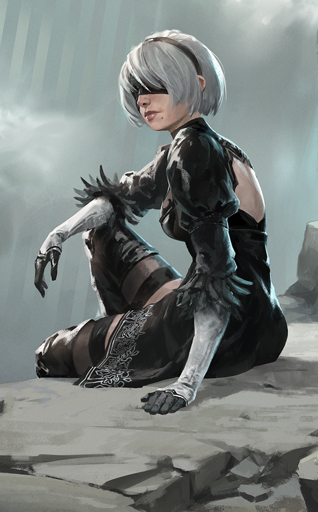
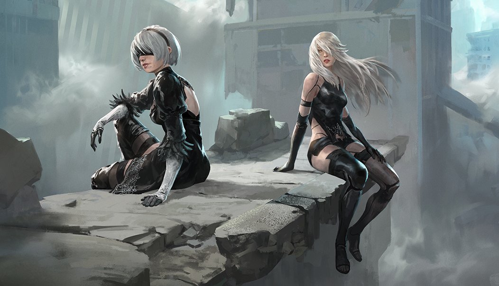
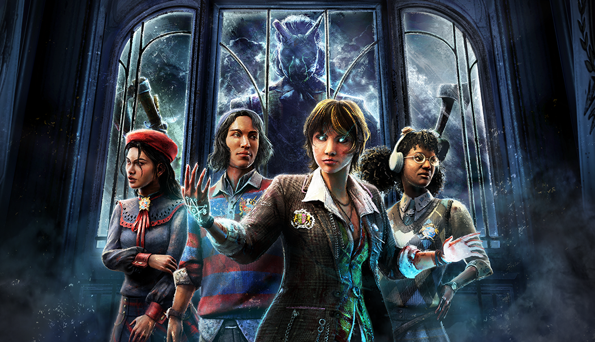

# live · 10.2.0_3859469live

| | |
|---|---|
| Build date | 2026-10-05 15:07 UTC |
| CDN version | `10.2.0_3859469live-1791212861` |
| Key | `10.2.0_live` |
| Compared with | [10.1.2_3856411live](../10.1.2_3856411live/CHANGES.md) (2026-10-02 13:36 UTC) |

## Summary

**4** added · **31** modified · **4** removed · 178 unchanged

## New or updated images

<a href="images/T_UI_CollectionBanner_NieR.png"></a>
<a href="images/T_UI_SpecialPack_NieR.png"></a>
<a href="images/T_UI_SpecialPack_Rift7.png"></a>

## Added files

- [`streamVideo/streamVideo.json`](streamVideo/streamVideo.json)

## Removed files

- `images/T_UI_CollectionBanner_HallowedBlight_Jason.png`
- `images/T_UI_SpecialPack_HallowedBlight_Jason.png`
- `images/T_UI_SpecialPack_SAW_Bundle.png`
- `images/T_UI_SpecialPack_Tome8.png`

## Modified files

### [`GameConfigs.json`](GameConfigs.json)

[Full line-by-line diff](diffs/GameConfigs.json.diff)

```diff
+ $.archivesCompendiumEndDate: "2027-01-26T16:00:00"
+ $.enableFlashlightPrediction: true
+ $.enableLastFrameSkillCheckForgiveness: true
+ $.enablePlayerIntentFeature: true
+ $.enableStreamVideo: false
- $.analytics.detailedScoreTypeBlacklist
+ $.analytics.gameEventCountTypeWhitelist
- $.analytics.detailedScoreTypeWhitelist[]: "*"
+ $.analytics.detailedScoreTypeWhitelist[]: "GameEvent.ScoreEvent.Slasher.BleedOutPercent"
+ $.analytics.detailedScoreTypeWhitelist[]: "GameEvent.K42.FocusedAttack.Activated"
+ $.analytics.detailedScoreTypeWhitelist[]: "GameEvent.ScoreEvent.Slasher.Doctor.BringSurvivorsUpOneMadnessTier"
+ $.analytics.detailedScoreTypeWhitelist[]: "GameEvent.K43.ProjectileAbility.Killer.PickUpProjectile.Hook"
+ $.analytics.detailedScoreTypeWhitelist[]: "GameEvent.K39.Aim.End"
+ $.analytics.detailedScoreTypeWhitelist[]: "GameEvent.K41.KillerProjectileAbility.ProjectileAbility.HitEnvironment"
+ $.analytics.detailedScoreTypeWhitelist[]: "GameEvent.CurseAbility.K41.Mushroom.SpawnMushroom"
+ $.analytics.detailedScoreTypeWhitelist[]: "GameEvent.K39.AttachTentacle"
+ $.analytics.detailedScoreTypeWhitelist[]: "GameEvent.ScoreEvent.Slasher.ApplyDeepWound"
+ $.analytics.detailedScoreTypeWhitelist[]: "GameEvent.Player.Item.CollectFromChest.ForFirstTime"
+ $.analytics.detailedScoreTypeWhitelist[]: "GameEvent.Killer.Gunslinger.LinkWithSurvivor"
+ $.analytics.detailedScoreTypeWhitelist[]: "GameEvent.ScoreEvent.Slasher.PowerBoltActive"
+ $.analytics.detailedScoreTypeWhitelist[]: "GameEvent.K40.SecuritySystemAbility.Killer.StartUsingDoor"
+ $.analytics.detailedScoreTypeWhitelist[]: "GameEvent.K40.SecuritySystemAbility.Killer.ExitSecurityDoor"
+ $.analytics.detailedScoreTypeWhitelist[]: "GameEvent.CamperUnhookedUnsafely"
+ $.analytics.detailedScoreTypeWhitelist[]: "GameEvent.ScoreEvent.Killer.K28.Teleport"
+ $.analytics.detailedScoreTypeWhitelist[]: "GameEvent.ScoreEvent.K37.Killer.BatAbility.InjureSurvivorAfterFormSwitch"
+ $.analytics.detailedScoreTypeWhitelist[]: "GameEvent.ScoreEvent.EndGame.Slasher.KillSurvivor"
+ $.analytics.detailedScoreTypeWhitelist[]: "GameEvent.K42.Survivor.GrandfatherClockInteraction.CompletedSuccess"
+ $.analytics.detailedScoreTypeWhitelist[]: "GameEvent.K32.LocksOnToSurvivor"
+ $.analytics.detailedScoreTypeWhitelist[]: "GameEvent.DespawnPallet.Illusionary"
+ $.analytics.detailedScoreTypeWhitelist[]: "GameEvent.ScoreEvent.Hillbilly.Chainsaw.Hit"
+ $.analytics.detailedScoreTypeWhitelist[]: "GameEvent.Slasher.StartChargingVomit"
+ $.analytics.detailedScoreTypeWhitelist[]: "GameEvent.ScoreEvent.Killer.K30.ActivateGuardOrder"
+ $.analytics.detailedScoreTypeWhitelist[]: "GameEvent.Killer.K29.RushVaultDuringChase"
+ $.analytics.detailedScoreTypeWhitelist[]: "GameEvent.K29.SurvivorDamagedByThrowCollision"
+ $.analytics.detailedScoreTypeWhitelist[]: "GameEvent.K37.VampireAbility.HitSurvivorWithFlamePillar"
+ $.analytics.detailedScoreTypeWhitelist[]: "GameEvent.Cage.PlayerTeleportedToCage"
+ $.analytics.detailedScoreTypeWhitelist[]: "GameEvent.ScoreEvent.K39.Killer.Normal.VaultSwing"
+ $.analytics.detailedScoreTypeWhitelist[]: "GameEvent.ScoreEvent.CoreMemory.FragmentCollected.Survivor"
+ $.analytics.detailedScoreTypeWhitelist[]: "GameEvent.ScoreEvent.Killer.K28.AbductSurvivorInLocker.FromSurvivorInteraction"
+ $.analytics.detailedScoreTypeWhitelist[]: "GameEvent.K42.Survivor.Fullycursed.FloatingEnded"
+ $.analytics.detailedScoreTypeWhitelist[]: "GameEvent.ScoreEvent.Slasher.InterruptCleanseTotem"
+ $.analytics.detailedScoreTypeWhitelist[]: "GameEvent.K43.ProjectileAbility.Survivor.HitByProjectile.Hook"
+ $.analytics.detailedScoreTypeWhitelist[]: "GameEvent.Camper.Opened.SupplyCrate"
+ $.analytics.detailedScoreTypeWhitelist[]: "GameEvent.Survivor.K27.CondemnedSegment7"
+ $.analytics.detailedScoreTypeWhitelist[]: "GameEvent.Slasher.Plague.ApplyMaxSickness"
+ $.analytics.detailedScoreTypeWhitelist[]: "GameEvent.K35.SurvivorAfflictedWithKillerEffect"
+ $.analytics.detailedScoreTypeWhitelist[]: "GameEvent.ScoreEvent.K36.Killer.Dispelling.HitSurvivor"
+ $.analytics.detailedScoreTypeWhitelist[]: "GameEvent.ScoreEvent.Survivor.K32.EvadeAfterTeleport"
+ $.analytics.detailedScoreTypeWhitelist[]: "GameEvent.K41.KillerAbility.HeadModeAbility.GutsAttack.HitSurvivor"
+ $.analytics.detailedScoreTypeWhitelist[]: "GameEvent.Slasher.Hag.PhantomTrapTeleportAttackAllCampers"
+ $.analytics.detailedScoreTypeWhitelist[]: "GameEvent.ScoreEvent.CoreMemory.EscapeWithMemory.Survivor"
+ $.analytics.detailedScoreTypeWhitelist[]: "GameEvent.Camper.VaultInChase.AfterDodge"
+ $.analytics.detailedScoreTypeWhitelist[]: "GameEvent.Killer.HookedSurvivor"
+ $.analytics.detailedScoreTypeWhitelist[]: "GameEvent.CamperWasScourgedHooked"
+ $.analytics.detailedScoreTypeWhitelist[]: "GameEvent.CamperInjuredBleedoutHitWithUnhookEndurance"
+ $.analytics.detailedScoreTypeWhitelist[]: "GameEvent.K39.AdjustingTimer.Expired"
+ $.analytics.detailedScoreTypeWhitelist[]: "GameEvent.K41.BodyModes.Transition.HeadToFullBody.Completed"
+ $.analytics.detailedScoreTypeWhitelist[]: "GameEvent.ScoreEvent.K41.Killer.CurseAbility.ReachCurseTierOnSurvivor"
+ $.analytics.detailedScoreTypeWhitelist[]: "GameEvent.K28.TeleportInteractionStarted"
+ $.analytics.detailedScoreTypeWhitelist[]: "GameEvent.Slasher.Blight.Power.Stop"
+ $.analytics.detailedScoreTypeWhitelist[]: "GameEvent.Slasher.Twins.ConjoinedTwin.BackToSister"
+ $.analytics.detailedScoreTypeWhitelist[]: "GameEvent.Generator.RegressionCurseRemoved"
+ $.analytics.detailedScoreTypeWhitelist[]: "GameEvent.K37.WolfAbility.WolfModeStarted"
+ $.analytics.detailedScoreTypeWhitelist[]: "GameEvent.ScoreEvent.Slasher.Blight.EndDash.Lethal"
+ $.analytics.detailedScoreTypeWhitelist[]: "GameEvent.K43.ProjectileAbility.Survivor.HitByProjectile.Tool"
+ $.analytics.detailedScoreTypeWhitelist[]: "GameEvent.ScoreEvent.Slasher.Trapper.Trap.Reset"
+ $.analytics.detailedScoreTypeWhitelist[]: "GameEvent.ScoreEvent.K33.Killer.SpecialMode.Activated"
+ $.analytics.detailedScoreTypeWhitelist[]: "GameEvent.K35.CreatedKillerTeleportPoint"
+ $.analytics.detailedScoreTypeWhitelist[]: "GameEvent.K40.SecuritySystemAbility.Survivor.StopUsingCamera.ByTeleporting"
+ $.analytics.detailedScoreTypeWhitelist[]: "GameEvent.Perk.Activate.Adrenaline"
+ $.analytics.detailedScoreTypeWhitelist[]: "GameEvent.Nightmare.SurvivorOverlapDreamSnare"
+ $.analytics.detailedScoreTypeWhitelist[]: "GameEvent.PlaguePowerupBegins"
+ $.analytics.detailedScoreTypeWhitelist[]: "GameEvent.ScoreEvent.Survivor.Clown.Bomb.SurvivorCured"
+ $.analytics.detailedScoreTypeWhitelist[]: "GameEvent.ScoreEvent.K43.ProjectileAbility.Killer.MiniMori.Pinned"
+ $.analytics.detailedScoreTypeWhitelist[]: "GameEvent.K28.Survivor.Abducted"
+ $.analytics.detailedScoreTypeWhitelist[]: "GameEvent.Survivor.K25.Chain.BreakFreeAllChains"
+ $.analytics.detailedScoreTypeWhitelist[]: "GameEvent.Slasher.Hag.PhantomTrapTeleportAttackCamper"
+ $.analytics.detailedScoreTypeWhitelist[]: "GameEvent.Camper.Heal.WithPerk.Adrenaline"
+ $.analytics.detailedScoreTypeWhitelist[]: "GameEvent.HeadOn.StunFail"
+ $.analytics.detailedScoreTypeWhitelist[]: "GameEvent.ScoreEvent.Slasher.ActivateOrangeGlyph"
+ $.analytics.detailedScoreTypeWhitelist[]: "GameEvent.PlayerExitLocker.Manually"
+ $.analytics.detailedScoreTypeWhitelist[]: "GameEvent.ScoreEvent.Camper.Pallet.Drop.InChase"
+ $.analytics.detailedScoreTypeWhitelist[]: "GameEvent.K34.SliceAndDice.Attempt"
+ $.analytics.detailedScoreTypeWhitelist[]: "GameEvent.ChaseEndWithSurvivorDowned"
+ $.analytics.detailedScoreTypeWhitelist[]: "GameEvent.CurseAbility.K41.Mushroom.Spawned"
+ $.analytics.detailedScoreTypeWhitelist[]: "GameEvent.K43.ProjectileAbility.Killer.Aim.End"
+ $.analytics.detailedScoreTypeWhitelist[]: "GameEvent.Camper.CoopHealingPercent"
+ $.analytics.detailedScoreTypeWhitelist[]: "GameEvent.ScoreEvent.Camper.OpenDoorPercent"
+ $.analytics.detailedScoreTypeWhitelist[]: "GameEvent.ScoreEvent.Nurse.BlinkAttackHit"
+ $.analytics.detailedScoreTypeWhitelist[]: "GameEvent.SurvivorFakeEnterLocker"
+ $.analytics.detailedScoreTypeWhitelist[]: "GameEvent.ScoreEvent.Camper.Harpoon.BreakFree.CloseRange"
+ $.analytics.detailedScoreTypeWhitelist[]: "GameEvent.Slasher.DownSurvivorWhileCarrying"
+ $.analytics.detailedScoreTypeWhitelist[]: "GameEvent.K42.Survivor.GrandfatherClockInteraction.Ended"
+ $.analytics.detailedScoreTypeWhitelist[]: "GameEvent.ScoreEvent.Camper.SnapOutOfIt"
+ $.analytics.detailedScoreTypeWhitelist[]: "GameEvent.ScoreEvent.Cannibal.Chainsaw.Attempt"
+ $.analytics.detailedScoreTypeWhitelist[]: "GameEvent.K36.TreasureChestDiceRollFinished"
+ $.analytics.detailedScoreTypeWhitelist[]: "GameEvent.ScoreEvent.K42.Killer.FocusedAttack.CurseSurvivor"
+ $.analytics.detailedScoreTypeWhitelist[]: "GameEvent.ScoreEvent.Camper.FullRecovery"
+ $.analytics.detailedScoreTypeWhitelist[]: "GameEvent.ScoreEvent.Killer.K26.HitSurvivorWithDamageCrow"
+ $.analytics.detailedScoreTypeWhitelist[]: "GameEvent.SurvivorActivateRedHerring"
+ $.analytics.detailedScoreTypeWhitelist[]: "GameEvent.K41.KillerProjectileAttempt"
+ $.analytics.detailedScoreTypeWhitelist[]: "GameEvent.ScoreEvent.Nightmare.Camper.WakeUp.Self"
+ $.analytics.detailedScoreTypeWhitelist[]: "GameEvent.ScoreEvent.K06.Killer.SpecialPounceAttack.HitSurvivor"
+ $.analytics.detailedScoreTypeWhitelist[]: "GameEvent.Survivor.K36.OnMergedWithVecnaArtifact"
+ $.analytics.detailedScoreTypeWhitelist[]: "GameEvent.K32.AssimilatedAndTeleportedToSameSurvivorFromOnePod"
+ $.analytics.detailedScoreTypeWhitelist[]: "GameEvent.ScoreEvent.Camper.DeathBed.Rescue.Other"
+ $.analytics.detailedScoreTypeWhitelist[]: "GameEvent.ScoreEvent.Camper.ZombieKilled"
+ $.analytics.detailedScoreTypeWhitelist[]: "GameEvent.ScoreEvent.K29.DamagedFullyInfectedSurvivorWithRush"
+ $.analytics.detailedScoreTypeWhitelist[]: "GameEvent.ScoreEvent.Camper.UnlockHatch"
+ $.analytics.detailedScoreTypeWhitelist[]: "GameEvent.K41.KillerAbility.HeadModeAbility.GutsAttack.DownSurvivor.InDoomedState"
+ $.analytics.detailedScoreTypeWhitelist[]: "GameEvent.ScoreEvent.Camper.Chest.Search.Complete.WhileOpenFromKey"
+ $.analytics.detailedScoreTypeWhitelist[]: "GameEvent.Camper.Vault.Pallet.Rushed"
+ $.analytics.detailedScoreTypeWhitelist[]: "GameEvent.ScoreEvent.Camper.Heal.Other.Medkit.Percent"
+ $.analytics.detailedScoreTypeWhitelist[]: "GameEvent.ScoreEvent.Trickster.Laceration.DownSurvivor"
+ $.analytics.detailedScoreTypeWhitelist[]: "GameEvent.ScoreEvent.K36.Killer.MageHand.Activated"
+ $.analytics.detailedScoreTypeWhitelist[]: "GameEvent.ScoreEvent.Camper.ActivateWhiteGlyph"
+ $.analytics.detailedScoreTypeWhitelist[]: "GameEvent.ScoreEvent.Camper.StunSlasher.WithAbility.S48P02"
+ $.analytics.detailedScoreTypeWhitelist[]: "GameEvent.K32.TeleportToSurvivor.Cancel"
+ $.analytics.detailedScoreTypeWhitelist[]: "GameEvent.Survivor.FailedSkillCheckCountedAsGreat"
+ $.analytics.detailedScoreTypeWhitelist[]: "GameEvent.Camper.Vault.Window"
+ $.analytics.detailedScoreTypeWhitelist[]: "GameEvent.Survivor.EscapeChaseWhileInLocker"
+ $.analytics.detailedScoreTypeWhitelist[]: "GameEvent.Slasher.DownSurvivorWithBasicAttack"
+ $.analytics.detailedScoreTypeWhitelist[]: "GameEvent.ScoreEvent.Slasher.PickupCamper"
+ $.analytics.detailedScoreTypeWhitelist[]: "GameEvent.K34.SliceAndDiceAttack.Aim.Start"
+ $.analytics.detailedScoreTypeWhitelist[]: "GameEvent.ScoreEvent.K43.TeleportAbility.Killer.TeleportStart"
+ $.analytics.detailedScoreTypeWhitelist[]: "GameEvent.K43.TeleportAbility.DramaticEntrance.Killer.Camera.FadeIn"
+ $.analytics.detailedScoreTypeWhitelist[]: "GameEvent.EscapeChase.AfterStunningKillerWithPallet"
+ $.analytics.detailedScoreTypeWhitelist[]: "GameEvent.HitDuringChaseAfterPalletDrop"
+ $.analytics.detailedScoreTypeWhitelist[]: "GameEvent.ScoreEvent.Camper.ObsessionEscape"
+ $.analytics.detailedScoreTypeWhitelist[]: "GameEvent.Slasher.Twins.BrotherJumpSuccess.WithDown"
+ $.analytics.detailedScoreTypeWhitelist[]: "GameEvent.Slasher.Clown.Hit.WhileInvigorated"
+ $.analytics.detailedScoreTypeWhitelist[]: "GameEvent.PlayerExitLocker.FoundByKiller"
+ $.analytics.detailedScoreTypeWhitelist[]: "GameEvent.ScoreEvent.Slasher.Clown.Bomb.SurvivorEnteredGasCloud"
+ $.analytics.detailedScoreTypeWhitelist[]: "GameEvent.ScoreEvent.Killer.K25.Chain.Controlled.SurvivorHit"
+ $.analytics.detailedScoreTypeWhitelist[]: "GameEvent.Slasher.Vault.Pallet.Frenzy"
+ $.analytics.detailedScoreTypeWhitelist[]: "GameEvent.Perk.Activate.S38P03"
+ $.analytics.detailedScoreTypeWhitelist[]: "GameEvent.ScoreEvent.K23.Style.DRank"
+ $.analytics.detailedScoreTypeWhitelist[]: "GameEvent.ScoreEvent.Killer.K28.AbductSurvivorInLocker.FromTeleport"
+ $.analytics.detailedScoreTypeWhitelist[]: "GameEvent.ScoreEvent.Killer.K31.Drone.BuildUpWeakPointOnSurvivor"
+ $.analytics.detailedScoreTypeWhitelist[]: "GameEvent.K32.AssimilatedTwoSurvivorsFromOnePod"
+ $.analytics.detailedScoreTypeWhitelist[]: "GameEvent.Survivor.K29.DroppedFromLedgeAfterRush"
+ $.analytics.detailedScoreTypeWhitelist[]: "GameEvent.K43.TeleportAbility.TeleportStart"
+ $.analytics.detailedScoreTypeWhitelist[]: "GameEvent.K43.ProjectileAbility.Survivor.RemoveImpaledHook"
+ $.analytics.detailedScoreTypeWhitelist[]: "GameEvent.Slasher.Legion.FrenzySlash.Attempt"
+ $.analytics.detailedScoreTypeWhitelist[]: "GameEvent.K40.KillerProjectileAimStart"
+ $.analytics.detailedScoreTypeWhitelist[]: "GameEvent.Slasher.Blight.ConsumedAllDashToken"
+ $.analytics.detailedScoreTypeWhitelist[]: "GameEvent.ScoreEvent.K33.Survivor.Turret.Deploy"
+ $.analytics.detailedScoreTypeWhitelist[]: "GameEvent.K32.Assimilation.RemovedViaHook"
+ $.analytics.detailedScoreTypeWhitelist[]: "GameEvent.ScoreEvent.Slasher.InterruptOpenHatch"
+ $.analytics.detailedScoreTypeWhitelist[]: "GameEvent.Player.Item.PickedUp"
+ $.analytics.detailedScoreTypeWhitelist[]: "GameEvent.CleanupQuestEvents"
+ $.analytics.detailedScoreTypeWhitelist[]: "GameEvent.K42.FocusedAttack.Cooldown.Ended"
+ $.analytics.detailedScoreTypeWhitelist[]: "GameEvent.HealStart"
+ $.analytics.detailedScoreTypeWhitelist[]: "GameEvent.SurvivorDrainStageChanged"
+ $.analytics.detailedScoreTypeWhitelist[]: "GameEvent.ScoreEvent.Camper.GeneratorSkillCheckSuccess"
+ $.analytics.detailedScoreTypeWhitelist[]: "GameEvent.K34.SliceAndDice.DashingStop"
+ $.analytics.detailedScoreTypeWhitelist[]: "GameEvent.Camper.Unhook.EndSuccess"
+ $.analytics.detailedScoreTypeWhitelist[]: "GameEvent.K41.KillerProjectileAimEnd"
+ $.analytics.detailedScoreTypeWhitelist[]: "GameEvent.ScoreEvent.K43.ProjectileAbility.Killer.ImpaleSurvivor"
+ $.analytics.detailedScoreTypeWhitelist[]: "GameEvent.ScoreEvent.K40.ProjectileKillerInstinctReveal"
+ $.analytics.detailedScoreTypeWhitelist[]: "GameEvent.ScoreEvent.Killer.K30.Guard2DetectSurvivor"
+ $.analytics.detailedScoreTypeWhitelist[]: "GameEvent.ScoreEvent.Survivor.K28.LockerLocked"
+ $.analytics.detailedScoreTypeWhitelist[]: "GameEvent.K43.ProjectileAbility.Killer.PickUpProjectile.Tool"
+ $.analytics.detailedScoreTypeWhitelist[]: "GameEvent.SlasherInterruption"
+ $.analytics.detailedScoreTypeWhitelist[]: "GameEvent.DestroyBreakableWithPower.End.Pallet"
+ $.analytics.detailedScoreTypeWhitelist[]: "GameEvent.K32.Assimilation.RemovedViaEmp"
+ $.analytics.detailedScoreTypeWhitelist[]: "GameEvent.K37.Killer.WolfBiteAttack.Attempt"
+ $.analytics.detailedScoreTypeWhitelist[]: "GameEvent.SurvivorWithElusiveStatusEffectHitByKiller"
+ $.analytics.detailedScoreTypeWhitelist[]: "GameEvent.ScoreEvent.K29.ThrowingSurvivor"
+ $.analytics.detailedScoreTypeWhitelist[]: "GameEvent.Trapper.CollectTrap"
+ $.analytics.detailedScoreTypeWhitelist[]: "GameEvent.K36.Killer.Spell.FOTD.SpectralEntity.DamageSurvivor"
+ $.analytics.detailedScoreTypeWhitelist[]: "GameEvent.ScoreEvent.Nightmare.GeneratorTeleport"
+ $.analytics.detailedScoreTypeWhitelist[]: "GameEvent.Killer.K31.DeployDroneNearAnyTotems"
+ $.analytics.detailedScoreTypeWhitelist[]: "GameEvent.Survivor.K31.SensedBelowDrone.Stop"
+ $.analytics.detailedScoreTypeWhitelist[]: "GameEvent.Perk.Activate.S36P02"
+ $.analytics.detailedScoreTypeWhitelist[]: "GameEvent.ScoreEvent.K43.ProjectileAbility.Killer.ComboHit.Brutality"
+ $.analytics.detailedScoreTypeWhitelist[]: "GameEvent.K41.KillerAbility.HeadModeAbility.GutsAttack.CurseSurvivor"
+ $.analytics.detailedScoreTypeWhitelist[]: "GameEvent.ScoreEvent.Survivor.K28.DestroyRemnant"
+ $.analytics.detailedScoreTypeWhitelist[]: "GameEvent.ScoreEvent.Camper.ActivatePinkGlyph"
+ $.analytics.detailedScoreTypeWhitelist[]: "GameEvent.Camper.Pallet.Repair.S47P01Perk"
+ $.analytics.detailedScoreTypeWhitelist[]: "GameEvent.ScoreEvent.Killer.Onryo.Manifest.Then.Interrupt"
+ $.analytics.detailedScoreTypeWhitelist[]: "GameEvent.Zombie.Killed"
+ $.analytics.detailedScoreTypeWhitelist[]: "GameEvent.Perk.ChangeObsession"
+ $.analytics.detailedScoreTypeWhitelist[]: "GameEvent.ScoreEvent.K29.CuredInfectionSelf"
+ $.analytics.detailedScoreTypeWhitelist[]: "GameEvent.HuskInitialized"
+ $.analytics.detailedScoreTypeWhitelist[]: "GameEvent.K32.EnterPodDuringChase"
+ $.analytics.detailedScoreTypeWhitelist[]: "GameEvent.K39.Killer.PowerUp.HitSurvivor.VaultSwing"
+ $.analytics.detailedScoreTypeWhitelist[]: "GameEvent.Slasher.Oni.Attack.DemonPowerPounce.Missed"
+ $.analytics.detailedScoreTypeWhitelist[]: "GameEvent.Perk.Activate.StartPauseOtherStruggle"
+ $.analytics.detailedScoreTypeWhitelist[]: "GameEvent.ScoreEvent.Slasher.InterruptBlessTotem"
+ $.analytics.detailedScoreTypeWhitelist[]: "GameEvent.ScoreEvent.K35.InjureWithAreaBlast"
+ $.analytics.detailedScoreTypeWhitelist[]: "GameEvent.Player.Item.Dropped"
+ $.analytics.detailedScoreTypeWhitelist[]: "GameEvent.Camper.CleansedTotem"
+ $.analytics.detailedScoreTypeWhitelist[]: "GameEvent.ScoreEvent.Slasher.HookCamper"
+ $.analytics.detailedScoreTypeWhitelist[]: "GameEvent.K42.FocusedAttack.Charge.Charged"
+ $.analytics.detailedScoreTypeWhitelist[]: "GameEvent.Killer.Onryo.TV.Shutdown.ByKiller"
+ $.analytics.detailedScoreTypeWhitelist[]: "GameEvent.BlockedInteractable"
+ $.analytics.detailedScoreTypeWhitelist[]: "GameEvent.ScoreEvent.Survivor.HealthyInBasement"
+ $.analytics.detailedScoreTypeWhitelist[]: "GameEvent.K39.DamagingTentacleHitSurvivor"
+ $.analytics.detailedScoreTypeWhitelist[]: "GameEvent.ScoreEvent.Camper.MendOther"
… 1220 more change(s) — see the commit diff for everything
```

### [`GameConfigsDS.json`](GameConfigsDS.json)

[Full line-by-line diff](diffs/GameConfigsDS.json.diff)

```diff
+ $.analyticsRulesDedicatedServer.KA[]: "IntentUsageAnalytics"
```

### [`archiveJournals/archiveS3Journals.json`](archiveJournals/archiveS3Journals.json)

[Full line-by-line diff](diffs/archiveJournals/archiveS3Journals.json.diff)

```diff
+ $.TOME25
```

### [`archiveJournals/storyJournals.json`](archiveJournals/storyJournals.json)

[Full line-by-line diff](diffs/archiveJournals/storyJournals.json.diff)

```diff
+ $.TOME25
```

### [`bloodwebGenerationRules.json`](bloodwebGenerationRules.json)

[Full line-by-line diff](diffs/bloodwebGenerationRules.json.diff)

```diff
+ $.BulkCost[19]
+ $.EventChestProbability[16]
```

### [`catalog.json`](catalog.json)

[Full line-by-line diff](diffs/catalog.json.diff)

```diff
- $[id=Recurring_Dev_Bundle_260929]
+ $[id=CHALLENGE_REWARD_TIER_Rift_07]
+ $[id=CHALLENGE_BATTLE_PASS_Rift_07]
+ $[id=AV_Head030]
+ $[id=AV_Legs030]
+ $[id=AV_Torso030]
+ $[id=BE_Body033]
+ $[id=BE_Body033_01]
+ $[id=BE_Body033_02]
+ $[id=BE_Mask033]
+ $[id=BE_Mask033_01]
+ $[id=BE_Mask033_02]
+ $[id=BE_W033]
+ $[id=BE_W033_01]
+ $[id=BE_W033_02]
+ $[id=CM_Head037]
+ $[id=CM_Head037_01]
+ $[id=CM_Head037_02]
+ $[id=CM_Legs037]
+ $[id=CM_Legs037_01]
+ $[id=CM_Legs037_02]
+ $[id=CM_Torso037]
+ $[id=CM_Torso037_01]
+ $[id=CM_Torso037_02]
+ $[id=DF_Head006_02]
+ $[id=DF_Legs006_02]
+ $[id=DF_Torso016_01]
+ $[id=DO_Body008_01]
+ $[id=DO_Head007_02]
+ $[id=DO_W03_01]
+ $[id=FM_Head045]
+ $[id=FM_Legs045]
+ $[id=FM_Torso045]
+ $[id=GK_Body027]
+ $[id=GK_Body027_01]
+ $[id=GK_Body027_02]
+ $[id=GK_Head027]
+ $[id=GK_Head027_01]
+ $[id=GK_Head027_02]
+ $[id=GK_W027]
+ $[id=GK_W027_01]
+ $[id=GK_W027_02]
+ $[id=GS_Head042]
+ $[id=GS_Legs042]
+ $[id=GS_Torso042]
+ $[id=HK_Body006_06]
+ $[id=HK_Head014_01]
+ $[id=HK_W017_01]
+ $[id=HS_Torso033]
+ $[id=K32_Head016]
+ $[id=K35_Head020]
+ $[id=KK_Body042]
+ $[id=KK_Mask042]
+ $[id=KK_W042]
+ $[id=KS_Torso028]
+ $[id=MS_Head016_01]
+ $[id=MS_Legs024_01]
+ $[id=MS_Torso023_01]
+ $[id=NK_Head039]
+ $[id=NK_Legs039]
+ $[id=NK_Torso039]
+ $[id=S31_Head014_01]
+ $[id=S31_Legs009_01]
+ $[id=S31_Torso007_01]
+ $[id=S35_Head027]
+ $[id=S35_Head027_01]
+ $[id=S35_Head027_02]
+ $[id=S35_Legs027]
+ $[id=S35_Legs027_01]
+ $[id=S35_Legs027_02]
+ $[id=S35_Torso027]
+ $[id=S35_Torso027_01]
+ $[id=S35_Torso027_02]
+ $[id=S36_Head027]
+ $[id=S36_Head027_01]
+ $[id=S36_Head027_02]
+ $[id=S36_Legs027]
+ $[id=S36_Legs027_01]
+ $[id=S36_Legs027_02]
+ $[id=S36_Torso027]
+ $[id=S36_Torso027_01]
+ $[id=S36_Torso027_02]
+ $[id=S41_Torso024]
+ $[id=S49_Head013]
+ $[id=S49_Head013_01]
+ $[id=S49_Head013_02]
+ $[id=S49_Legs013]
+ $[id=S49_Legs013_01]
+ $[id=S49_Legs013_02]
+ $[id=S49_Torso013]
+ $[id=S49_Torso013_01]
+ $[id=S49_Torso013_02]
+ $[id=S53_Head008]
+ $[id=S53_Legs008]
+ $[id=S53_Torso008]
+ $[id=SS_Head034]
+ $[id=SS_Legs034]
+ $[id=SS_Torso034]
+ $[id=TC_Legs024]
+ $[id=TC_Torso024]
+ $[id=TC_W024]
+ $[id=TR_Mask032]
+ $[id=UDO_BDG_01]
+ $[id=UDO_BDG_02]
+ $[id=UK_Body021]
+ $[id=UK_Head021]
+ $[id=UK_W021]
+ $[id=VAN_001]
+ $[id=VAN_002]
+ $[id=VAN_003]
+ $[id=VAN_004]
+ $[id=VAN_005]
+ $[id=VAN_006]
+ $[id=VAN_007]
+ $[id=VAN_008]
+ $[id=VAN_009]
+ $[id=VAN_010]
+ $[id=VAN_011]
+ $[id=VAN_014]
+ $[id=VAN_016]
+ $[id=VAN_017]
+ $[id=VAN_BDG_03]
+ $[id=VAN_BDG_04]
+ $[id=VAN_BDG_05]
+ $[id=VAN_BDG_07]
+ $[id=VAN_BDG_08]
+ $[id=VAN_BDG_09]
+ $[id=VAN_BDG_10]
+ $[id=VAN_BDG_11]
+ $[id=VAN_BDG_12]
+ $[id=VAN_BDG_13]
+ $[id=VAN_BDG_14]
+ $[id=VAN_BDG_15]
+ $[id=VAN_BDG_16]
+ $[id=VAN_BDG_17]
+ $[id=VAN_BDG_18]
+ $[id=VAN_BDG_19]
+ $[id=VAN_BNR_01]
+ $[id=VAN_BNR_02]
+ $[id=VAN_BNR_03]
+ $[id=VAN_BNR_05]
+ $[id=VAN_BNR_06]
+ $[id=VAN_BNR_07]
+ $[id=VAN_BNR_08]
+ $[id=VAN_BNR_09]
+ $[id=VAN_BNR_10]
+ $[id=VAN_BNR_11]
+ $[id=VAN_BNR_12]
+ $[id=VAN_BNR_13]
+ $[id=VAN_BNR_14]
+ $[id=VAN_BNR_15]
+ $[id=VAN_BNR_16]
+ $[id=VAN_BNR_17]
+ $[id=VAN_BNR_18]
+ $[id=AV_outfit_030]
+ $[id=BE_outfit_033]
+ $[id=BE_outfit_033_01]
+ $[id=BE_outfit_033_02]
+ $[id=CM_outfit_037]
+ $[id=CM_outfit_037_01]
+ $[id=CM_outfit_037_02]
+ $[id=DF_outfit_006_02]
+ $[id=DO_outfit_007_02]
+ $[id=FM_Outfit_045]
+ $[id=GK_outfit_027]
+ $[id=GK_outfit_027_01]
+ $[id=GK_outfit_027_02]
+ $[id=GS_outfit_042]
+ $[id=HK_outfit_014_01]
+ $[id=KK_outfit_042]
+ $[id=MS_outfit_016_01]
+ $[id=NK_outfit_039]
+ $[id=S31_outfit_014_01]
+ $[id=S35_outfit_027]
+ $[id=S35_outfit_027_01]
+ $[id=S35_outfit_027_02]
+ $[id=S36_outfit_027]
+ $[id=S36_outfit_027_01]
+ $[id=S36_outfit_027_02]
+ $[id=S49_outfit_013]
+ $[id=S49_outfit_013_01]
+ $[id=S49_outfit_013_02]
+ $[id=S53_outfit_008]
+ $[id=SS_Outfit_034]
+ $[id=TC_outfit_024]
+ $[id=UK_outfit_021]
+ $[id=Halloween_2025_Bundle]
+ $[id=Rift_7_Bundle]
+ $[id=Tricks_And_Treats_2025_Bundle]
+ $[id=BlightedMega_collection_item]
+ $[id=10.2.0_Nier_collection_item]
+ $[id=Ace].eventCostList
+ $[id=Ace].metaData.temporaryDiscounts
+ $[id=Witch].eventCostList
+ $[id=Witch].metaData.temporaryDiscounts
+ $[id=Feng].eventCostList
+ $[id=Feng].metaData.temporaryDiscounts
+ $[id=Killer07].eventCostList
+ $[id=Killer07].metaData.temporaryDiscounts
+ $[id=Kate].eventCostList
… 3855 more change(s) — see the commit diff for everything
```

### [`challengeLocs/challengeText_de.json`](challengeLocs/challengeText_de.json)

[Full line-by-line diff](diffs/challengeLocs/challengeText_de.json.diff)

```diff
- $.locText[312].textId: "CHALLENGESET_DbdDay_TITLE"
+ $.locText[312].textId: "CHALLENGESET_DBD_DAY2026_TITLE"
- $.locText[313].text: "DbD-Tag"
+ $.locText[313].text: "@#CHALLENGESET_DBD_DAY2026_INFO"
- $.locText[313].textId: "CHALLENGESET_DbDDay_INFO"
+ $.locText[313].textId: "CHALLENGESET_DBD_DAY2026_INFO"
- $.locText[314].text: "@#CHALLENGE_PlayAnyKillerOrPlayAnySurvivor_TITLE"
+ $.locText[314].text: "Schließe Quest(s) ab."
- $.locText[314].textId: "CHALLENGE_PlayAnyKillerOrPlayAnySurvivor_TITLE"
+ $.locText[314].textId: "CHALLENGE_CommunityCompleteModeQuests_INFO"
- $.locText[315].text: "@#CHALLENGE_PlayAnyKillerOrPlayAnySurvivor_DESC"
+ $.locText[315].text: "@#CHALLENGE_EarnBloodPoints_TITLE"
- $.locText[315].textId: "CHALLENGE_PlayAnyKillerOrPlayAnySurvivor_DESC"
+ $.locText[315].textId: "CHALLENGE_EarnBloodPoints_TITLE"
- $.locText[316].text: "Spiele als Killer"
+ $.locText[316].text: "@#CHALLENGE_EarnBloodPoints_DESC"
- $.locText[316].textId: "CHALLENGE_CommunityPlayAnyKiller_INFO"
+ $.locText[316].textId: "CHALLENGE_EarnBloodPoints_DESC"
- $.locText[317].text: "Spiele als Überlebender"
+ $.locText[317].text: "Verdiene Blutpunkt(e)"
- $.locText[317].textId: "CHALLENGE_CommunityPlayAnySurvivor_INFO"
+ $.locText[317].textId: "CHALLENGE_CommunityEarnBloodPoints_INFO"
- $.locText[318].text: "Schließe Quest(s) ab."
+ $.locText[318].text: "@#CHALLENGE_CompleteQuests_TITLE"
- $.locText[318].textId: "CHALLENGE_CommunityCompleteModeQuests_INFO"
+ $.locText[318].textId: "CHALLENGE_CompleteQuests_TITLE"
- $.locText[319].text: "Community-Quests"
+ $.locText[319].text: "@#CHALLENGE_CompleteQuests_DESC"
- $.locText[319].textId: "DbbDay_CommunityQuests_Title"
+ $.locText[319].textId: "CHALLENGE_CompleteQuests_DESC"
- $.locText[320].text: "DbD-Tag – Teil 1"
+ $.locText[320].text: "Schließe {0} Quest(s) ab."
- $.locText[320].textId: "DbDDay_QuestList_1_Title"
+ $.locText[320].textId: "CHALLENGE_CompleteQuests_INFO"
- $.locText[321].text: "DbD-Tag – Teil 2"
+ $.locText[321].text: "@#CHALLENGE_HideNearKillerAsCharacterInTrialOrAnySurvivor_TITLE"
- $.locText[321].textId: "DbDDay_QuestList_2_Title"
+ $.locText[321].textId: "CHALLENGE_HideNearKillerAsCharacterInTrialOrAnySurvivor_TITLE"
- $.locText[322].text: "Nebelkarneval"
+ $.locText[322].text: "@#CHALLENGE_HideNearKillerAsCharacterInTrialOrAnySurvivor_DESC"
- $.locText[322].textId: "CHALLENGESET_FogCarnival_TITLE"
+ $.locText[322].textId: "CHALLENGE_HideNearKillerAsCharacterInTrialOrAnySurvivor_DESC"
- $.locText[323].text: "Nebelkarneval"
+ $.locText[323].text: "Hide in the Killer's Terror Radius for {0} seconds as Dwight Fairfield"
- $.locText[323].textId: "CHALLENGESET_FogCarnival_INFO"
+ $.locText[323].textId: "CHALLENGE_HideNearKillerAsCharacter_INFO"
- $.locText[324].text: "@#CHALLENGE_ChaseSingleTrialOrBeChasedSingleTrial_TITLE"
+ $.locText[324].text: "Hide in the Killer's Terror Radius for {0} seconds as any Survivor"
- $.locText[324].textId: "CHALLENGE_ChaseSingleTrialOrBeChasedSingleTrial_TITLE"
+ $.locText[324].textId: "CHALLENGE_HideNearKillerAsAnySurvivor_INFO"
- $.locText[325].text: "@#CHALLENGE_ChaseSingleTrialOrBeChasedSingleTrial_DESC"
+ $.locText[325].text: "@#CHALLENGE_SkillCheckHealingSuccessAsCharacterInTrialOrAnySurvivor_TITLE"
- $.locText[325].textId: "CHALLENGE_ChaseSingleTrialOrBeChasedSingleTrial_DESC"
+ $.locText[325].textId: "CHALLENGE_SkillCheckHealingSuccessAsCharacterInTrialOrAnySurvivor_TITLE"
- $.locText[326].text: "Jage in einer einzigen Prüfung {0} Sek. lang."
+ $.locText[326].text: "@#CHALLENGE_SkillCheckHealingSuccessAsCharacterInTrialOrAnySurvivor_DESC"
- $.locText[326].textId: "CHALLENGE_ChaseSingleTrial_INFO"
+ $.locText[326].textId: "CHALLENGE_SkillCheckHealingSuccessAsCharacterInTrialOrAnySurvivor_DESC"
- $.locText[327].text: "Hake Überlebende fest."
+ $.locText[327].text: "Schaffe als Claudette Morel {0} Fähigkeitschecks beim Heilen von Überlebenden."
- $.locText[327].textId: "CHALLENGE_CommunityHook_INFO"
+ $.locText[327].textId: "CHALLENGE_SkillCheckHealingSuccessAsCharacterInTrial_INFO"
- $.locText[328].text: "Rette Überlebende sicher vom Haken."
+ $.locText[328].text: "Schaffe als beliebiger Überlebender {0} Fähigkeitschecks beim Heilen von Überlebenden."
- $.locText[328].textId: "CHALLENGE_CommunityUnhook_INFO"
+ $.locText[328].textId: "CHALLENGE_SkillCheckHealingSuccessAsAnySurvivorInTrial_INFO"
- $.locText[329].text: "@#CHALLENGE_EarnMaliciousOrBenevolentGold_TITLE"
+ $.locText[329].text: "@#CHALLENGE_EscapeChaseEscapeAsCharacterInTrialOrAnySurvivor_TITLE"
- $.locText[329].textId: "CHALLENGE_EarnMaliciousOrBenevolentGold_TITLE"
+ $.locText[329].textId: "CHALLENGE_EscapeChaseEscapeAsCharacterInTrialOrAnySurvivor_TITLE"
- $.locText[330].text: "@#CHALLENGE_EarnMaliciousOrBenevolentGold_DESC"
+ $.locText[330].text: "@#CHALLENGE_EscapeChaseEscapeAsCharacterInTrialOrAnySurvivor_DESC"
- $.locText[330].textId: "CHALLENGE_EarnMaliciousOrBenevolentGold_DESC"
+ $.locText[330].textId: "CHALLENGE_EscapeChaseEscapeAsCharacterInTrialOrAnySurvivor_DESC"
- $.locText[331].text: "Verdiene {0} goldene(s) Boshaft-Emblem(e)."
+ $.locText[331].text: "Entkomme als Meg Thomas {0} Jagden und der Prüfung."
- $.locText[331].textId: "CHALLENGE_EarnMaliciousGold_INFO"
+ $.locText[331].textId: "CHALLENGE_EscapeChaseEscapeAsCharacterInTrial_INFO"
- $.locText[332].text: "Ausgeschaltet"
+ $.locText[332].text: "Entkomme als beliebiger Überlebender {0} Jagden und der Prüfung."
- $.locText[332].textId: "CHALLENGE_Down_TITLE"
+ $.locText[332].textId: "CHALLENGE_EscapeChaseEscapeAsAnySurvivorInTrial_INFO"
- $.locText[333].text: "Strecke <b>{0} Überlebende(n)</b> nieder."
+ $.locText[333].text: "@#CHALLENGE_EscapeAsCharacterInTrialOrAnySurvivor_TITLE"
- $.locText[333].textId: "CHALLENGE_Down_DESC"
+ $.locText[333].textId: "CHALLENGE_EscapeAsCharacterInTrialOrAnySurvivor_TITLE"
- $.locText[334].text: "@#CHALLENGE_ReviveDying_TITLE"
+ $.locText[334].text: "@#CHALLENGE_EscapeAsCharacterInTrialOrAnySurvivor_DESC"
- $.locText[334].textId: "CHALLENGE_ReviveDying_TITLE"
+ $.locText[334].textId: "CHALLENGE_EscapeAsCharacterInTrialOrAnySurvivor_DESC"
- $.locText[335].text: "@#CHALLENGE_ReviveDying_DESC"
+ $.locText[335].text: "Entkomme als Adam Francis einer Prüfung."
- $.locText[335].textId: "CHALLENGE_ReviveDying_DESC"
+ $.locText[335].textId: "CHALLENGE_EscapeAsCharacterInTrial_INFO"
- $.locText[336].text: "Heile {0} Überlebende(n) im Todesstatus."
+ $.locText[336].text: "Entkomme als beliebiger Überlebender einer Prüfung."
- $.locText[336].textId: "CHALLENGE_ReviveDying_INFO"
+ $.locText[336].textId: "CHALLENGE_EscapeAsAnySurvivorInTrial_INFO"
- $.locText[337].text: "@#CHALLENGE_EarnChaserOrEvaderGold_TITLE"
+ $.locText[337].text: "@#CHALLENGE_VaultInChaseAsCharacterInTrialOrAnySurvivor_TITLE"
- $.locText[337].textId: "CHALLENGE_EarnChaserOrEvaderGold_TITLE"
+ $.locText[337].textId: "CHALLENGE_VaultInChaseAsCharacterInTrialOrAnySurvivor_TITLE"
- $.locText[338].text: "@#CHALLENGE_EarnChaserOrEvaderGold_DESC"
+ $.locText[338].text: "Springe als beliebiger Überlebender während einer Jagd {0}-mal und entkomme der Prüfung."
- $.locText[338].textId: "CHALLENGE_EarnChaserOrEvaderGold_DESC"
+ $.locText[338].textId: "CHALLENGE_VaultInChaseAsCharacterInTrialOrAnySurvivor_DESC"
- $.locText[339].text: "Verdiene {0} goldene(s) Verfolger-Emblem(e)."
+ $.locText[339].text: "Springe als Yui Kimura während einer Jagd {0}-mal und entkomme der Prüfung."
- $.locText[339].textId: "CHALLENGE_EarnChaserGold_INFO"
+ $.locText[339].textId: "CHALLENGE_VaultInChaseAsCharacterInTrial_INFO"
- $.locText[340].text: "Verdiene {0} goldene(s) Flüchtling-Emblem(e)."
+ $.locText[340].text: "Vault while in chase {0} times as any Survivor"
- $.locText[340].textId: "CHALLENGE_EarnEvaderGold_INFO"
+ $.locText[340].textId: "CHALLENGE_VaultInChaseAsAnySurvivorInTrial_INFO"
- $.locText[341].text: "Weitermachen"
+ $.locText[341].text: "@#CHALLENGE_SpiritHitPostPhaseInTrialOrPlayasKiller_TITLE"
- $.locText[341].textId: "CHALLENGE_Carry_TITLE"
+ $.locText[341].textId: "CHALLENGE_SpiritHitPostPhaseInTrialOrPlayasKiller_TITLE"
- $.locText[342].text: "Trage Überlebende <b>{0} Meter</b> weit."
+ $.locText[342].text: "@#CHALLENGE_SpiritHitPostPhaseInTrialOrPlayasKiller_DESC"
- $.locText[342].textId: "CHALLENGE_Carry_DESC"
+ $.locText[342].textId: "CHALLENGE_SpiritHitPostPhaseInTrialOrPlayasKiller_DESC"
- $.locText[343].text: "@#CHALLENGE_EscapeChase_TITLE"
+ $.locText[343].text: "Triff {0} Überlebende direkt nach dem Phasenlauf. "
- $.locText[343].textId: "CHALLENGE_EscapeChase_TITLE"
+ $.locText[343].textId: "CHALLENGE_SpiritHitPostPhaseInTrial_INFO"
- $.locText[344].text: "@#CHALLENGE_EscapeChase_DESC"
+ $.locText[344].text: "@#CHALLENGE_OniStrikeInTrialOrPlayasKiller_TITLE"
- $.locText[344].textId: "CHALLENGE_EscapeChase_DESC"
+ $.locText[344].textId: "CHALLENGE_OniStrikeInTrialOrPlayasKiller_TITLE"
- $.locText[345].text: "Nebelkarneval-Community-Quests"
+ $.locText[345].text: "@#CHALLENGE_OniStrikeInTrialOrPlayasKiller_DESC"
- $.locText[345].textId: "FogCarnival_CommunityQuests_Title"
+ $.locText[345].textId: "CHALLENGE_OniStrikeInTrialOrPlayasKiller_DESC"
- $.locText[346].text: "Nebelkarneval – Teil 1"
+ $.locText[346].text: "Triff Überlebende als Oni {0}-mal mit Dämonenschlag."
- $.locText[346].textId: "FogCarnival_QuestList_1_Title"
+ $.locText[346].textId: "CHALLENGE_OniStrikeInTrialOr_INFO"
- $.locText[347].text: "Nebelkarneval – Teil 2"
+ $.locText[347].text: "Community-Quests"
- $.locText[347].textId: "FogCarnival_QuestList_2_Title"
+ $.locText[347].textId: "DbbDay_CommunityQuests_Title"
- $.locText[348].text: "Spuk in Dead by Daylight"
+ $.locText[348].text: "DbD-Tag – Abschlussquests"
- $.locText[348].textId: "CHALLENGESET_Halloween_TITLE"
+ $.locText[348].textId: "DbDDay_CompletionList_Title"
- $.locText[349].text: "@#CHALLENGESET_Halloween_INFO"
+ $.locText[349].text: "DbD-Tag – Teil 1"
- $.locText[349].textId: "CHALLENGESET_Halloween_INFO"
+ $.locText[349].textId: "DbDDay_QuestList_1_Title"
- $.locText[350].text: "@#CHALLENGE_SmashPumpkins_TITLE"
+ $.locText[350].text: "DbD-Tag"
- $.locText[350].textId: "CHALLENGE_SmashPumpkins_TITLE"
+ $.locText[350].textId: "CHALLENGESET_DbdDay_TITLE"
- $.locText[351].text: "@#CHALLENGE_SmashPumpkins_DESC"
+ $.locText[351].text: "DbD-Tag"
- $.locText[351].textId: "CHALLENGE_SmashPumpkins_DESC"
+ $.locText[351].textId: "CHALLENGESET_DbDDay_INFO"
- $.locText[352].text: "Zerstöre {0} Kürbis(se)."
+ $.locText[352].text: "@#CHALLENGE_PlayAnyKillerOrPlayAnySurvivor_TITLE"
- $.locText[352].textId: "CHALLENGE_SmashPumpkins_INFO"
+ $.locText[352].textId: "CHALLENGE_PlayAnyKillerOrPlayAnySurvivor_TITLE"
- $.locText[353].text: "@#CHALLENGE_CollectVoidEnergyFromOrb_TITLE"
+ $.locText[353].text: "@#CHALLENGE_PlayAnyKillerOrPlayAnySurvivor_DESC"
- $.locText[353].textId: "CHALLENGE_CollectVoidEnergyFromOrb_TITLE"
+ $.locText[353].textId: "CHALLENGE_PlayAnyKillerOrPlayAnySurvivor_DESC"
- $.locText[354].text: "@#CHALLENGE_CollectVoidEnergyFromOrb_DESC"
+ $.locText[354].text: "Spiele als Killer"
- $.locText[354].textId: "CHALLENGE_CollectVoidEnergyFromOrb_DESC"
+ $.locText[354].textId: "CHALLENGE_CommunityPlayAnyKiller_INFO"
- $.locText[355].text: "Sammle {0}-mal Leereenergie aus einer Leerekugel."
+ $.locText[355].text: "Spiele als Überlebender"
- $.locText[355].textId: "CHALLENGE_CollectVoidEnergyFromOrb_INFO"
+ $.locText[355].textId: "CHALLENGE_CommunityPlayAnySurvivor_INFO"
- $.locText[356].text: "@#CHALLENGE_HookInVoidMap_TITLE"
+ $.locText[356].text: "DbD-Tag – Teil 2"
- $.locText[356].textId: "CHALLENGE_HookInVoidMap_TITLE"
+ $.locText[356].textId: "DbDDay_QuestList_2_Title"
- $.locText[357].text: "@#CHALLENGE_HookInVoidMap_DESC"
+ $.locText[357].text: "Nebelkarneval"
- $.locText[357].textId: "CHALLENGE_HookInVoidMap_DESC"
+ $.locText[357].textId: "CHALLENGESET_FogCarnival_TITLE"
- $.locText[358].text: "Hake {0} Überlebende(n) in der Leere fest."
+ $.locText[358].text: "Nebelkarneval"
- $.locText[358].textId: "CHALLENGE_HookInVoidMap_INFO"
+ $.locText[358].textId: "CHALLENGESET_FogCarnival_INFO"
- $.locText[359].text: "@#CHALLENGE_RepairGenWithVoidCrystal_TITLE"
+ $.locText[359].text: "@#CHALLENGE_ChaseSingleTrialOrBeChasedSingleTrial_TITLE"
- $.locText[359].textId: "CHALLENGE_RepairGenWithVoidCrystal_TITLE"
+ $.locText[359].textId: "CHALLENGE_ChaseSingleTrialOrBeChasedSingleTrial_TITLE"
- $.locText[360].text: "@#CHALLENGE_RepairGenWithVoidCrystal_DESC"
+ $.locText[360].text: "@#CHALLENGE_ChaseSingleTrialOrBeChasedSingleTrial_DESC"
- $.locText[360].textId: "CHALLENGE_RepairGenWithVoidCrystal_DESC"
+ $.locText[360].textId: "CHALLENGE_ChaseSingleTrialOrBeChasedSingleTrial_DESC"
- $.locText[361].text: "Repariere {0} Generator(en) mit einem Leerekristall."
+ $.locText[361].text: "Jage in einer einzigen Prüfung {0} Sek. lang."
- $.locText[361].textId: "CHALLENGE_RepairGenWithVoidCrystal_INFO"
+ $.locText[361].textId: "CHALLENGE_ChaseSingleTrial_INFO"
- $.locText[362].text: "@#CHALLENGE_OpenVoidPortal_TITLE"
+ $.locText[362].text: "Hake Überlebende fest."
… 1292 more change(s) — see the commit diff for everything
```

### [`challengeLocs/challengeText_en.json`](challengeLocs/challengeText_en.json)

[Full line-by-line diff](diffs/challengeLocs/challengeText_en.json.diff)

```diff
- $.locText[312].textId: "CHALLENGESET_DbdDay_TITLE"
+ $.locText[312].textId: "CHALLENGESET_DBD_DAY2026_TITLE"
- $.locText[313].text: "DBD Day"
+ $.locText[313].text: "@#CHALLENGESET_DBD_DAY2026_INFO"
- $.locText[313].textId: "CHALLENGESET_DbDDay_INFO"
+ $.locText[313].textId: "CHALLENGESET_DBD_DAY2026_INFO"
- $.locText[314].text: "@#CHALLENGE_PlayAnyKillerOrPlayAnySurvivor_TITLE"
+ $.locText[314].text: "Complete quest(s)"
- $.locText[314].textId: "CHALLENGE_PlayAnyKillerOrPlayAnySurvivor_TITLE"
+ $.locText[314].textId: "CHALLENGE_CommunityCompleteModeQuests_INFO"
- $.locText[315].text: "@#CHALLENGE_PlayAnyKillerOrPlayAnySurvivor_DESC"
+ $.locText[315].text: "@#CHALLENGE_EarnBloodPoints_TITLE"
- $.locText[315].textId: "CHALLENGE_PlayAnyKillerOrPlayAnySurvivor_DESC"
+ $.locText[315].textId: "CHALLENGE_EarnBloodPoints_TITLE"
- $.locText[316].text: "Play as a Killer"
+ $.locText[316].text: "@#CHALLENGE_EarnBloodPoints_DESC"
- $.locText[316].textId: "CHALLENGE_CommunityPlayAnyKiller_INFO"
+ $.locText[316].textId: "CHALLENGE_EarnBloodPoints_DESC"
- $.locText[317].text: "Play as a Survivor"
+ $.locText[317].text: "Earn bloodpoint(s)"
- $.locText[317].textId: "CHALLENGE_CommunityPlayAnySurvivor_INFO"
+ $.locText[317].textId: "CHALLENGE_CommunityEarnBloodPoints_INFO"
- $.locText[318].text: "Complete quest(s)"
+ $.locText[318].text: "@#CHALLENGE_CompleteQuests_TITLE"
- $.locText[318].textId: "CHALLENGE_CommunityCompleteModeQuests_INFO"
+ $.locText[318].textId: "CHALLENGE_CompleteQuests_TITLE"
- $.locText[319].text: "Community Quests"
+ $.locText[319].text: "@#CHALLENGE_CompleteQuests_DESC"
- $.locText[319].textId: "DbbDay_CommunityQuests_Title"
+ $.locText[319].textId: "CHALLENGE_CompleteQuests_DESC"
- $.locText[320].text: "DBD Day - Part 1"
+ $.locText[320].text: "Complete {0} quest(s)"
- $.locText[320].textId: "DbDDay_QuestList_1_Title"
+ $.locText[320].textId: "CHALLENGE_CompleteQuests_INFO"
- $.locText[321].text: "DBD Day - Part 2"
+ $.locText[321].text: "@#CHALLENGE_HideNearKillerAsCharacterInTrialOrAnySurvivor_TITLE"
- $.locText[321].textId: "DbDDay_QuestList_2_Title"
+ $.locText[321].textId: "CHALLENGE_HideNearKillerAsCharacterInTrialOrAnySurvivor_TITLE"
- $.locText[322].text: "Fog Carnival"
+ $.locText[322].text: "@#CHALLENGE_HideNearKillerAsCharacterInTrialOrAnySurvivor_DESC"
- $.locText[322].textId: "CHALLENGESET_FogCarnival_TITLE"
+ $.locText[322].textId: "CHALLENGE_HideNearKillerAsCharacterInTrialOrAnySurvivor_DESC"
- $.locText[323].text: "Fog Carnival"
+ $.locText[323].text: "Hide in the Killer's Terror Radius for {0} seconds as Dwight Fairfield"
- $.locText[323].textId: "CHALLENGESET_FogCarnival_INFO"
+ $.locText[323].textId: "CHALLENGE_HideNearKillerAsCharacter_INFO"
- $.locText[324].text: "@#CHALLENGE_ChaseSingleTrialOrBeChasedSingleTrial_TITLE"
+ $.locText[324].text: "Hide in the Killer's Terror Radius for {0} seconds as any Survivor"
- $.locText[324].textId: "CHALLENGE_ChaseSingleTrialOrBeChasedSingleTrial_TITLE"
+ $.locText[324].textId: "CHALLENGE_HideNearKillerAsAnySurvivor_INFO"
- $.locText[325].text: "@#CHALLENGE_ChaseSingleTrialOrBeChasedSingleTrial_DESC"
+ $.locText[325].text: "@#CHALLENGE_SkillCheckHealingSuccessAsCharacterInTrialOrAnySurvivor_TITLE"
- $.locText[325].textId: "CHALLENGE_ChaseSingleTrialOrBeChasedSingleTrial_DESC"
+ $.locText[325].textId: "CHALLENGE_SkillCheckHealingSuccessAsCharacterInTrialOrAnySurvivor_TITLE"
- $.locText[326].text: "Chase for {0} seconds in a single trial"
+ $.locText[326].text: "@#CHALLENGE_SkillCheckHealingSuccessAsCharacterInTrialOrAnySurvivor_DESC"
- $.locText[326].textId: "CHALLENGE_ChaseSingleTrial_INFO"
+ $.locText[326].textId: "CHALLENGE_SkillCheckHealingSuccessAsCharacterInTrialOrAnySurvivor_DESC"
- $.locText[327].text: "Hook Survivor(s)"
+ $.locText[327].text: "Hit {0} Skill Checks while healing Survivors as Claudette Morel"
- $.locText[327].textId: "CHALLENGE_CommunityHook_INFO"
+ $.locText[327].textId: "CHALLENGE_SkillCheckHealingSuccessAsCharacterInTrial_INFO"
- $.locText[328].text: "Safely unhook Survivor(s)"
+ $.locText[328].text: "Hit {0} Skill Checks while healing Survivors as any Survivor"
- $.locText[328].textId: "CHALLENGE_CommunityUnhook_INFO"
+ $.locText[328].textId: "CHALLENGE_SkillCheckHealingSuccessAsAnySurvivorInTrial_INFO"
- $.locText[329].text: "@#CHALLENGE_EarnMaliciousOrBenevolentGold_TITLE"
+ $.locText[329].text: "@#CHALLENGE_EscapeChaseEscapeAsCharacterInTrialOrAnySurvivor_TITLE"
- $.locText[329].textId: "CHALLENGE_EarnMaliciousOrBenevolentGold_TITLE"
+ $.locText[329].textId: "CHALLENGE_EscapeChaseEscapeAsCharacterInTrialOrAnySurvivor_TITLE"
- $.locText[330].text: "@#CHALLENGE_EarnMaliciousOrBenevolentGold_DESC"
+ $.locText[330].text: "@#CHALLENGE_EscapeChaseEscapeAsCharacterInTrialOrAnySurvivor_DESC"
- $.locText[330].textId: "CHALLENGE_EarnMaliciousOrBenevolentGold_DESC"
+ $.locText[330].textId: "CHALLENGE_EscapeChaseEscapeAsCharacterInTrialOrAnySurvivor_DESC"
- $.locText[331].text: "Earn {0} Gold Malicious emblem(s)"
+ $.locText[331].text: "Escape {0} chase as Meg Thomas"
- $.locText[331].textId: "CHALLENGE_EarnMaliciousGold_INFO"
+ $.locText[331].textId: "CHALLENGE_EscapeChaseEscapeAsCharacterInTrial_INFO"
- $.locText[332].text: "Knockout"
+ $.locText[332].text: "Escape {0} chases as any Survivor"
- $.locText[332].textId: "CHALLENGE_Down_TITLE"
+ $.locText[332].textId: "CHALLENGE_EscapeChaseEscapeAsAnySurvivorInTrial_INFO"
- $.locText[333].text: "Knock down <b>{0} Survivor(s)</b>."
+ $.locText[333].text: "@#CHALLENGE_EscapeAsCharacterInTrialOrAnySurvivor_TITLE"
- $.locText[333].textId: "CHALLENGE_Down_DESC"
+ $.locText[333].textId: "CHALLENGE_EscapeAsCharacterInTrialOrAnySurvivor_TITLE"
- $.locText[334].text: "@#CHALLENGE_ReviveDying_TITLE"
+ $.locText[334].text: "@#CHALLENGE_EscapeAsCharacterInTrialOrAnySurvivor_DESC"
- $.locText[334].textId: "CHALLENGE_ReviveDying_TITLE"
+ $.locText[334].textId: "CHALLENGE_EscapeAsCharacterInTrialOrAnySurvivor_DESC"
- $.locText[335].text: "@#CHALLENGE_ReviveDying_DESC"
+ $.locText[335].text: "Escape a trial as Adam Francis"
- $.locText[335].textId: "CHALLENGE_ReviveDying_DESC"
+ $.locText[335].textId: "CHALLENGE_EscapeAsCharacterInTrial_INFO"
- $.locText[336].text: "Heal {0} Survivor(s) from the dying state"
+ $.locText[336].text: "Escape a trial as any Survivor"
- $.locText[336].textId: "CHALLENGE_ReviveDying_INFO"
+ $.locText[336].textId: "CHALLENGE_EscapeAsAnySurvivorInTrial_INFO"
- $.locText[337].text: "@#CHALLENGE_EarnChaserOrEvaderGold_TITLE"
+ $.locText[337].text: "@#CHALLENGE_VaultInChaseAsCharacterInTrialOrAnySurvivor_TITLE"
- $.locText[337].textId: "CHALLENGE_EarnChaserOrEvaderGold_TITLE"
+ $.locText[337].textId: "CHALLENGE_VaultInChaseAsCharacterInTrialOrAnySurvivor_TITLE"
- $.locText[338].text: "@#CHALLENGE_EarnChaserOrEvaderGold_DESC"
+ $.locText[338].text: "Vault while in a chase {0} times and escape the trial as any Survivor."
- $.locText[338].textId: "CHALLENGE_EarnChaserOrEvaderGold_DESC"
+ $.locText[338].textId: "CHALLENGE_VaultInChaseAsCharacterInTrialOrAnySurvivor_DESC"
- $.locText[339].text: "Earn {0} Gold Chaser emblem(s)"
+ $.locText[339].text: "Vault while in chase {0} times as Yui Kimura"
- $.locText[339].textId: "CHALLENGE_EarnChaserGold_INFO"
+ $.locText[339].textId: "CHALLENGE_VaultInChaseAsCharacterInTrial_INFO"
- $.locText[340].text: "Earn {0} Gold Evader emblem(s)"
+ $.locText[340].text: "Vault while in chase {0} times as any Survivor"
- $.locText[340].textId: "CHALLENGE_EarnEvaderGold_INFO"
+ $.locText[340].textId: "CHALLENGE_VaultInChaseAsAnySurvivorInTrial_INFO"
- $.locText[341].text: "Carry On"
+ $.locText[341].text: "@#CHALLENGE_SpiritHitPostPhaseInTrialOrPlayasKiller_TITLE"
- $.locText[341].textId: "CHALLENGE_Carry_TITLE"
+ $.locText[341].textId: "CHALLENGE_SpiritHitPostPhaseInTrialOrPlayasKiller_TITLE"
- $.locText[342].text: "Carry Survivors over <b>{0} meters</b>."
+ $.locText[342].text: "@#CHALLENGE_SpiritHitPostPhaseInTrialOrPlayasKiller_DESC"
- $.locText[342].textId: "CHALLENGE_Carry_DESC"
+ $.locText[342].textId: "CHALLENGE_SpiritHitPostPhaseInTrialOrPlayasKiller_DESC"
- $.locText[343].text: "@#CHALLENGE_EscapeChase_TITLE"
+ $.locText[343].text: "Hit {0} Survivors right after Phase Walking"
- $.locText[343].textId: "CHALLENGE_EscapeChase_TITLE"
+ $.locText[343].textId: "CHALLENGE_SpiritHitPostPhaseInTrial_INFO"
- $.locText[344].text: "@#CHALLENGE_EscapeChase_DESC"
+ $.locText[344].text: "@#CHALLENGE_OniStrikeInTrialOrPlayasKiller_TITLE"
- $.locText[344].textId: "CHALLENGE_EscapeChase_DESC"
+ $.locText[344].textId: "CHALLENGE_OniStrikeInTrialOrPlayasKiller_TITLE"
- $.locText[345].text: "Fog Carnival Community Quests"
+ $.locText[345].text: "@#CHALLENGE_OniStrikeInTrialOrPlayasKiller_DESC"
- $.locText[345].textId: "FogCarnival_CommunityQuests_Title"
+ $.locText[345].textId: "CHALLENGE_OniStrikeInTrialOrPlayasKiller_DESC"
- $.locText[346].text: "Fog Carnival - Part 1"
+ $.locText[346].text: "Hit Survivors with Demon Strike {0} times as The Oni"
- $.locText[346].textId: "FogCarnival_QuestList_1_Title"
+ $.locText[346].textId: "CHALLENGE_OniStrikeInTrialOr_INFO"
- $.locText[347].text: "Fog Carnival - Part 2"
+ $.locText[347].text: "Community Quests"
- $.locText[347].textId: "FogCarnival_QuestList_2_Title"
+ $.locText[347].textId: "DbbDay_CommunityQuests_Title"
- $.locText[348].text: "Haunted by Daylight"
+ $.locText[348].text: "DBD Day - Completion Quests"
- $.locText[348].textId: "CHALLENGESET_Halloween_TITLE"
+ $.locText[348].textId: "DbDDay_CompletionList_Title"
- $.locText[349].text: "@#CHALLENGESET_Halloween_INFO"
+ $.locText[349].text: "DBD Day - Part 1"
- $.locText[349].textId: "CHALLENGESET_Halloween_INFO"
+ $.locText[349].textId: "DbDDay_QuestList_1_Title"
- $.locText[350].text: "@#CHALLENGE_SmashPumpkins_TITLE"
+ $.locText[350].text: "DBD Day"
- $.locText[350].textId: "CHALLENGE_SmashPumpkins_TITLE"
+ $.locText[350].textId: "CHALLENGESET_DbdDay_TITLE"
- $.locText[351].text: "@#CHALLENGE_SmashPumpkins_DESC"
+ $.locText[351].text: "DBD Day"
- $.locText[351].textId: "CHALLENGE_SmashPumpkins_DESC"
+ $.locText[351].textId: "CHALLENGESET_DbDDay_INFO"
- $.locText[352].text: "Smash {0} pumpkin(s)"
+ $.locText[352].text: "@#CHALLENGE_PlayAnyKillerOrPlayAnySurvivor_TITLE"
- $.locText[352].textId: "CHALLENGE_SmashPumpkins_INFO"
+ $.locText[352].textId: "CHALLENGE_PlayAnyKillerOrPlayAnySurvivor_TITLE"
- $.locText[353].text: "@#CHALLENGE_CollectVoidEnergyFromOrb_TITLE"
+ $.locText[353].text: "@#CHALLENGE_PlayAnyKillerOrPlayAnySurvivor_DESC"
- $.locText[353].textId: "CHALLENGE_CollectVoidEnergyFromOrb_TITLE"
+ $.locText[353].textId: "CHALLENGE_PlayAnyKillerOrPlayAnySurvivor_DESC"
- $.locText[354].text: "@#CHALLENGE_CollectVoidEnergyFromOrb_DESC"
+ $.locText[354].text: "Play as a Killer"
- $.locText[354].textId: "CHALLENGE_CollectVoidEnergyFromOrb_DESC"
+ $.locText[354].textId: "CHALLENGE_CommunityPlayAnyKiller_INFO"
- $.locText[355].text: "Collect Void Energy from a Void Orb {0} time(s)"
+ $.locText[355].text: "Play as a Survivor"
- $.locText[355].textId: "CHALLENGE_CollectVoidEnergyFromOrb_INFO"
+ $.locText[355].textId: "CHALLENGE_CommunityPlayAnySurvivor_INFO"
- $.locText[356].text: "@#CHALLENGE_HookInVoidMap_TITLE"
+ $.locText[356].text: "DBD Day - Part 2"
- $.locText[356].textId: "CHALLENGE_HookInVoidMap_TITLE"
+ $.locText[356].textId: "DbDDay_QuestList_2_Title"
- $.locText[357].text: "@#CHALLENGE_HookInVoidMap_DESC"
+ $.locText[357].text: "Fog Carnival"
- $.locText[357].textId: "CHALLENGE_HookInVoidMap_DESC"
+ $.locText[357].textId: "CHALLENGESET_FogCarnival_TITLE"
- $.locText[358].text: "Hook {0} Survivor(s) in the Void"
+ $.locText[358].text: "Fog Carnival"
- $.locText[358].textId: "CHALLENGE_HookInVoidMap_INFO"
+ $.locText[358].textId: "CHALLENGESET_FogCarnival_INFO"
- $.locText[359].text: "@#CHALLENGE_RepairGenWithVoidCrystal_TITLE"
+ $.locText[359].text: "@#CHALLENGE_ChaseSingleTrialOrBeChasedSingleTrial_TITLE"
- $.locText[359].textId: "CHALLENGE_RepairGenWithVoidCrystal_TITLE"
+ $.locText[359].textId: "CHALLENGE_ChaseSingleTrialOrBeChasedSingleTrial_TITLE"
- $.locText[360].text: "@#CHALLENGE_RepairGenWithVoidCrystal_DESC"
+ $.locText[360].text: "@#CHALLENGE_ChaseSingleTrialOrBeChasedSingleTrial_DESC"
- $.locText[360].textId: "CHALLENGE_RepairGenWithVoidCrystal_DESC"
+ $.locText[360].textId: "CHALLENGE_ChaseSingleTrialOrBeChasedSingleTrial_DESC"
- $.locText[361].text: "Repair {0} generator(s) with a Void Crystal"
+ $.locText[361].text: "Chase for {0} seconds in a single trial"
- $.locText[361].textId: "CHALLENGE_RepairGenWithVoidCrystal_INFO"
+ $.locText[361].textId: "CHALLENGE_ChaseSingleTrial_INFO"
- $.locText[362].text: "@#CHALLENGE_OpenVoidPortal_TITLE"
+ $.locText[362].text: "Hook Survivor(s)"
… 1292 more change(s) — see the commit diff for everything
```

### [`challengeLocs/challengeText_es-MX.json`](challengeLocs/challengeText_es-MX.json)

[Full line-by-line diff](diffs/challengeLocs/challengeText_es-MX.json.diff)

```diff
- $.locText[312].textId: "CHALLENGESET_DbdDay_TITLE"
+ $.locText[312].textId: "CHALLENGESET_DBD_DAY2026_TITLE"
- $.locText[313].text: "Día de DbD"
+ $.locText[313].text: "@#CHALLENGESET_DBD_DAY2026_INFO"
- $.locText[313].textId: "CHALLENGESET_DbDDay_INFO"
+ $.locText[313].textId: "CHALLENGESET_DBD_DAY2026_INFO"
- $.locText[314].text: "@#CHALLENGE_PlayAnyKillerOrPlayAnySurvivor_TITLE"
+ $.locText[314].text: "Completa misiones"
- $.locText[314].textId: "CHALLENGE_PlayAnyKillerOrPlayAnySurvivor_TITLE"
+ $.locText[314].textId: "CHALLENGE_CommunityCompleteModeQuests_INFO"
- $.locText[315].text: "@#CHALLENGE_PlayAnyKillerOrPlayAnySurvivor_DESC"
+ $.locText[315].text: "@#CHALLENGE_EarnBloodPoints_TITLE"
- $.locText[315].textId: "CHALLENGE_PlayAnyKillerOrPlayAnySurvivor_DESC"
+ $.locText[315].textId: "CHALLENGE_EarnBloodPoints_TITLE"
- $.locText[316].text: "Juega como asesino"
+ $.locText[316].text: "@#CHALLENGE_EarnBloodPoints_DESC"
- $.locText[316].textId: "CHALLENGE_CommunityPlayAnyKiller_INFO"
+ $.locText[316].textId: "CHALLENGE_EarnBloodPoints_DESC"
- $.locText[317].text: "Juega como sobreviviente"
+ $.locText[317].text: "Gana punto(s) de sangre"
- $.locText[317].textId: "CHALLENGE_CommunityPlayAnySurvivor_INFO"
+ $.locText[317].textId: "CHALLENGE_CommunityEarnBloodPoints_INFO"
- $.locText[318].text: "Completa misiones"
+ $.locText[318].text: "@#CHALLENGE_CompleteQuests_TITLE"
- $.locText[318].textId: "CHALLENGE_CommunityCompleteModeQuests_INFO"
+ $.locText[318].textId: "CHALLENGE_CompleteQuests_TITLE"
- $.locText[319].text: "Misiones de la comunidad"
+ $.locText[319].text: "@#CHALLENGE_CompleteQuests_DESC"
- $.locText[319].textId: "DbbDay_CommunityQuests_Title"
+ $.locText[319].textId: "CHALLENGE_CompleteQuests_DESC"
- $.locText[320].text: "Día de DBD - Parte 1"
+ $.locText[320].text: "Completa {0} misión/misiones"
- $.locText[320].textId: "DbDDay_QuestList_1_Title"
+ $.locText[320].textId: "CHALLENGE_CompleteQuests_INFO"
- $.locText[321].text: "Día de DBD - Parte 2"
+ $.locText[321].text: "@#CHALLENGE_HideNearKillerAsCharacterInTrialOrAnySurvivor_TITLE"
- $.locText[321].textId: "DbDDay_QuestList_2_Title"
+ $.locText[321].textId: "CHALLENGE_HideNearKillerAsCharacterInTrialOrAnySurvivor_TITLE"
- $.locText[322].text: "Carnaval de Niebla"
+ $.locText[322].text: "@#CHALLENGE_HideNearKillerAsCharacterInTrialOrAnySurvivor_DESC"
- $.locText[322].textId: "CHALLENGESET_FogCarnival_TITLE"
+ $.locText[322].textId: "CHALLENGE_HideNearKillerAsCharacterInTrialOrAnySurvivor_DESC"
- $.locText[323].text: "Carnaval de Niebla"
+ $.locText[323].text: "Hide in the Killer's Terror Radius for {0} seconds as Dwight Fairfield"
- $.locText[323].textId: "CHALLENGESET_FogCarnival_INFO"
+ $.locText[323].textId: "CHALLENGE_HideNearKillerAsCharacter_INFO"
- $.locText[324].text: "@#CHALLENGE_ChaseSingleTrialOrBeChasedSingleTrial_TITLE"
+ $.locText[324].text: "Hide in the Killer's Terror Radius for {0} seconds as any Survivor"
- $.locText[324].textId: "CHALLENGE_ChaseSingleTrialOrBeChasedSingleTrial_TITLE"
+ $.locText[324].textId: "CHALLENGE_HideNearKillerAsAnySurvivor_INFO"
- $.locText[325].text: "@#CHALLENGE_ChaseSingleTrialOrBeChasedSingleTrial_DESC"
+ $.locText[325].text: "@#CHALLENGE_SkillCheckHealingSuccessAsCharacterInTrialOrAnySurvivor_TITLE"
- $.locText[325].textId: "CHALLENGE_ChaseSingleTrialOrBeChasedSingleTrial_DESC"
+ $.locText[325].textId: "CHALLENGE_SkillCheckHealingSuccessAsCharacterInTrialOrAnySurvivor_TITLE"
- $.locText[326].text: "Persigue durante {0} segundos en una sola partida"
+ $.locText[326].text: "@#CHALLENGE_SkillCheckHealingSuccessAsCharacterInTrialOrAnySurvivor_DESC"
- $.locText[326].textId: "CHALLENGE_ChaseSingleTrial_INFO"
+ $.locText[326].textId: "CHALLENGE_SkillCheckHealingSuccessAsCharacterInTrialOrAnySurvivor_DESC"
- $.locText[327].text: "Cuelga sobreviviente(s)"
+ $.locText[327].text: "Acierta {0} pruebas de habilidad mientras curas sobrevivientes como Claudette Morel."
- $.locText[327].textId: "CHALLENGE_CommunityHook_INFO"
+ $.locText[327].textId: "CHALLENGE_SkillCheckHealingSuccessAsCharacterInTrial_INFO"
- $.locText[328].text: "Descuelga de forma segura a sobreviviente(s)"
+ $.locText[328].text: "Acierta {0} pruebas de habilidad mientras curas sobrevivientes como cualquier sobreviviente."
- $.locText[328].textId: "CHALLENGE_CommunityUnhook_INFO"
+ $.locText[328].textId: "CHALLENGE_SkillCheckHealingSuccessAsAnySurvivorInTrial_INFO"
- $.locText[329].text: "@#CHALLENGE_EarnMaliciousOrBenevolentGold_TITLE"
+ $.locText[329].text: "@#CHALLENGE_EscapeChaseEscapeAsCharacterInTrialOrAnySurvivor_TITLE"
- $.locText[329].textId: "CHALLENGE_EarnMaliciousOrBenevolentGold_TITLE"
+ $.locText[329].textId: "CHALLENGE_EscapeChaseEscapeAsCharacterInTrialOrAnySurvivor_TITLE"
- $.locText[330].text: "@#CHALLENGE_EarnMaliciousOrBenevolentGold_DESC"
+ $.locText[330].text: "@#CHALLENGE_EscapeChaseEscapeAsCharacterInTrialOrAnySurvivor_DESC"
- $.locText[330].textId: "CHALLENGE_EarnMaliciousOrBenevolentGold_DESC"
+ $.locText[330].textId: "CHALLENGE_EscapeChaseEscapeAsCharacterInTrialOrAnySurvivor_DESC"
- $.locText[331].text: "Gana {0} emblema(s) de Malvado de oro"
+ $.locText[331].text: "Huye de {0} persecuciones y escapa de la partida como Meg Thomas."
- $.locText[331].textId: "CHALLENGE_EarnMaliciousGold_INFO"
+ $.locText[331].textId: "CHALLENGE_EscapeChaseEscapeAsCharacterInTrial_INFO"
- $.locText[332].text: "Fuera de combate"
+ $.locText[332].text: "Huye de {0} persecuciones y escapa de la partida como cualquier sobreviviente."
- $.locText[332].textId: "CHALLENGE_Down_TITLE"
+ $.locText[332].textId: "CHALLENGE_EscapeChaseEscapeAsAnySurvivorInTrial_INFO"
- $.locText[333].text: "Noquea a <b>{0} sobreviviente(s)</b>."
+ $.locText[333].text: "@#CHALLENGE_EscapeAsCharacterInTrialOrAnySurvivor_TITLE"
- $.locText[333].textId: "CHALLENGE_Down_DESC"
+ $.locText[333].textId: "CHALLENGE_EscapeAsCharacterInTrialOrAnySurvivor_TITLE"
- $.locText[334].text: "@#CHALLENGE_ReviveDying_TITLE"
+ $.locText[334].text: "@#CHALLENGE_EscapeAsCharacterInTrialOrAnySurvivor_DESC"
- $.locText[334].textId: "CHALLENGE_ReviveDying_TITLE"
+ $.locText[334].textId: "CHALLENGE_EscapeAsCharacterInTrialOrAnySurvivor_DESC"
- $.locText[335].text: "@#CHALLENGE_ReviveDying_DESC"
+ $.locText[335].text: "Escapa de la partida como Adam Francis."
- $.locText[335].textId: "CHALLENGE_ReviveDying_DESC"
+ $.locText[335].textId: "CHALLENGE_EscapeAsCharacterInTrial_INFO"
- $.locText[336].text: "Cura a {0} sobreviviente(s) del estado agonizante."
+ $.locText[336].text: "Escapa de la partida como cualquier sobreviviente."
- $.locText[336].textId: "CHALLENGE_ReviveDying_INFO"
+ $.locText[336].textId: "CHALLENGE_EscapeAsAnySurvivorInTrial_INFO"
- $.locText[337].text: "@#CHALLENGE_EarnChaserOrEvaderGold_TITLE"
+ $.locText[337].text: "@#CHALLENGE_VaultInChaseAsCharacterInTrialOrAnySurvivor_TITLE"
- $.locText[337].textId: "CHALLENGE_EarnChaserOrEvaderGold_TITLE"
+ $.locText[337].textId: "CHALLENGE_VaultInChaseAsCharacterInTrialOrAnySurvivor_TITLE"
- $.locText[338].text: "@#CHALLENGE_EarnChaserOrEvaderGold_DESC"
+ $.locText[338].text: "Salta durante una persecución {0} veces y escapa de la partida como cualquier sobreviviente."
- $.locText[338].textId: "CHALLENGE_EarnChaserOrEvaderGold_DESC"
+ $.locText[338].textId: "CHALLENGE_VaultInChaseAsCharacterInTrialOrAnySurvivor_DESC"
- $.locText[339].text: "Gana {0} emblema(s) de Perseguidor de oro"
+ $.locText[339].text: "Salta durante una persecución {0} veces y escapa de la partida como Yui Kimura."
- $.locText[339].textId: "CHALLENGE_EarnChaserGold_INFO"
+ $.locText[339].textId: "CHALLENGE_VaultInChaseAsCharacterInTrial_INFO"
- $.locText[340].text: "Gana {0} emblema(s) de Evasor de oro"
+ $.locText[340].text: "Vault while in chase {0} times as any Survivor"
- $.locText[340].textId: "CHALLENGE_EarnEvaderGold_INFO"
+ $.locText[340].textId: "CHALLENGE_VaultInChaseAsAnySurvivorInTrial_INFO"
- $.locText[341].text: "Continúa"
+ $.locText[341].text: "@#CHALLENGE_SpiritHitPostPhaseInTrialOrPlayasKiller_TITLE"
- $.locText[341].textId: "CHALLENGE_Carry_TITLE"
+ $.locText[341].textId: "CHALLENGE_SpiritHitPostPhaseInTrialOrPlayasKiller_TITLE"
- $.locText[342].text: "Carga sobrevivientes por más de <b>{0} metros</b>."
+ $.locText[342].text: "@#CHALLENGE_SpiritHitPostPhaseInTrialOrPlayasKiller_DESC"
- $.locText[342].textId: "CHALLENGE_Carry_DESC"
+ $.locText[342].textId: "CHALLENGE_SpiritHitPostPhaseInTrialOrPlayasKiller_DESC"
- $.locText[343].text: "@#CHALLENGE_EscapeChase_TITLE"
+ $.locText[343].text: "Golpea a {0} sobrevivientes después de Cambio de plano. "
- $.locText[343].textId: "CHALLENGE_EscapeChase_TITLE"
+ $.locText[343].textId: "CHALLENGE_SpiritHitPostPhaseInTrial_INFO"
- $.locText[344].text: "@#CHALLENGE_EscapeChase_DESC"
+ $.locText[344].text: "@#CHALLENGE_OniStrikeInTrialOrPlayasKiller_TITLE"
- $.locText[344].textId: "CHALLENGE_EscapeChase_DESC"
+ $.locText[344].textId: "CHALLENGE_OniStrikeInTrialOrPlayasKiller_TITLE"
- $.locText[345].text: "Misiones de la comunidad de Carnaval de Niebla"
+ $.locText[345].text: "@#CHALLENGE_OniStrikeInTrialOrPlayasKiller_DESC"
- $.locText[345].textId: "FogCarnival_CommunityQuests_Title"
+ $.locText[345].textId: "CHALLENGE_OniStrikeInTrialOrPlayasKiller_DESC"
- $.locText[346].text: "Carnaval de Niebla - Parte 1"
+ $.locText[346].text: "Golpea a los sobrevivientes con Golpe demoníaco {0} veces como el Oni."
- $.locText[346].textId: "FogCarnival_QuestList_1_Title"
+ $.locText[346].textId: "CHALLENGE_OniStrikeInTrialOr_INFO"
- $.locText[347].text: "Carnaval de Niebla - Parte 2"
+ $.locText[347].text: "Misiones de la comunidad"
- $.locText[347].textId: "FogCarnival_QuestList_2_Title"
+ $.locText[347].textId: "DbbDay_CommunityQuests_Title"
- $.locText[348].text: "Haunted By Daylight"
+ $.locText[348].text: "Día de DbD: Misiones de finalización"
- $.locText[348].textId: "CHALLENGESET_Halloween_TITLE"
+ $.locText[348].textId: "DbDDay_CompletionList_Title"
- $.locText[349].text: "@#CHALLENGESET_Halloween_INFO"
+ $.locText[349].text: "Día de DBD - Parte 1"
- $.locText[349].textId: "CHALLENGESET_Halloween_INFO"
+ $.locText[349].textId: "DbDDay_QuestList_1_Title"
- $.locText[350].text: "@#CHALLENGE_SmashPumpkins_TITLE"
+ $.locText[350].text: "Día de DbD"
- $.locText[350].textId: "CHALLENGE_SmashPumpkins_TITLE"
+ $.locText[350].textId: "CHALLENGESET_DbdDay_TITLE"
- $.locText[351].text: "@#CHALLENGE_SmashPumpkins_DESC"
+ $.locText[351].text: "Día de DbD"
- $.locText[351].textId: "CHALLENGE_SmashPumpkins_DESC"
+ $.locText[351].textId: "CHALLENGESET_DbDDay_INFO"
- $.locText[352].text: "Aplasta {0} calabaza(s)"
+ $.locText[352].text: "@#CHALLENGE_PlayAnyKillerOrPlayAnySurvivor_TITLE"
- $.locText[352].textId: "CHALLENGE_SmashPumpkins_INFO"
+ $.locText[352].textId: "CHALLENGE_PlayAnyKillerOrPlayAnySurvivor_TITLE"
- $.locText[353].text: "@#CHALLENGE_CollectVoidEnergyFromOrb_TITLE"
+ $.locText[353].text: "@#CHALLENGE_PlayAnyKillerOrPlayAnySurvivor_DESC"
- $.locText[353].textId: "CHALLENGE_CollectVoidEnergyFromOrb_TITLE"
+ $.locText[353].textId: "CHALLENGE_PlayAnyKillerOrPlayAnySurvivor_DESC"
- $.locText[354].text: "@#CHALLENGE_CollectVoidEnergyFromOrb_DESC"
+ $.locText[354].text: "Juega como asesino"
- $.locText[354].textId: "CHALLENGE_CollectVoidEnergyFromOrb_DESC"
+ $.locText[354].textId: "CHALLENGE_CommunityPlayAnyKiller_INFO"
- $.locText[355].text: "Obtén {0} vez/veces energía del Vacío de un orbe del Vacío"
+ $.locText[355].text: "Juega como sobreviviente"
- $.locText[355].textId: "CHALLENGE_CollectVoidEnergyFromOrb_INFO"
+ $.locText[355].textId: "CHALLENGE_CommunityPlayAnySurvivor_INFO"
- $.locText[356].text: "@#CHALLENGE_HookInVoidMap_TITLE"
+ $.locText[356].text: "Día de DBD - Parte 2"
- $.locText[356].textId: "CHALLENGE_HookInVoidMap_TITLE"
+ $.locText[356].textId: "DbDDay_QuestList_2_Title"
- $.locText[357].text: "@#CHALLENGE_HookInVoidMap_DESC"
+ $.locText[357].text: "Carnaval de Niebla"
- $.locText[357].textId: "CHALLENGE_HookInVoidMap_DESC"
+ $.locText[357].textId: "CHALLENGESET_FogCarnival_TITLE"
- $.locText[358].text: "Cuelga a {0} sobreviviente(s) en el Vacío"
+ $.locText[358].text: "Carnaval de Niebla"
- $.locText[358].textId: "CHALLENGE_HookInVoidMap_INFO"
+ $.locText[358].textId: "CHALLENGESET_FogCarnival_INFO"
- $.locText[359].text: "@#CHALLENGE_RepairGenWithVoidCrystal_TITLE"
+ $.locText[359].text: "@#CHALLENGE_ChaseSingleTrialOrBeChasedSingleTrial_TITLE"
- $.locText[359].textId: "CHALLENGE_RepairGenWithVoidCrystal_TITLE"
+ $.locText[359].textId: "CHALLENGE_ChaseSingleTrialOrBeChasedSingleTrial_TITLE"
- $.locText[360].text: "@#CHALLENGE_RepairGenWithVoidCrystal_DESC"
+ $.locText[360].text: "@#CHALLENGE_ChaseSingleTrialOrBeChasedSingleTrial_DESC"
- $.locText[360].textId: "CHALLENGE_RepairGenWithVoidCrystal_DESC"
+ $.locText[360].textId: "CHALLENGE_ChaseSingleTrialOrBeChasedSingleTrial_DESC"
- $.locText[361].text: "Repara {0} generador(es) con un cristal del Vacío"
+ $.locText[361].text: "Persigue durante {0} segundos en una sola partida"
- $.locText[361].textId: "CHALLENGE_RepairGenWithVoidCrystal_INFO"
+ $.locText[361].textId: "CHALLENGE_ChaseSingleTrial_INFO"
- $.locText[362].text: "@#CHALLENGE_OpenVoidPortal_TITLE"
+ $.locText[362].text: "Cuelga sobreviviente(s)"
… 1292 more change(s) — see the commit diff for everything
```

### [`challengeLocs/challengeText_es.json`](challengeLocs/challengeText_es.json)

[Full line-by-line diff](diffs/challengeLocs/challengeText_es.json.diff)

```diff
- $.locText[312].textId: "CHALLENGESET_DbdDay_TITLE"
+ $.locText[312].textId: "CHALLENGESET_DBD_DAY2026_TITLE"
- $.locText[313].text: "Día de DbD"
+ $.locText[313].text: "@#CHALLENGESET_DBD_DAY2026_INFO"
- $.locText[313].textId: "CHALLENGESET_DbDDay_INFO"
+ $.locText[313].textId: "CHALLENGESET_DBD_DAY2026_INFO"
- $.locText[314].text: "@#CHALLENGE_PlayAnyKillerOrPlayAnySurvivor_TITLE"
+ $.locText[314].text: "Completa misión/misiones."
- $.locText[314].textId: "CHALLENGE_PlayAnyKillerOrPlayAnySurvivor_TITLE"
+ $.locText[314].textId: "CHALLENGE_CommunityCompleteModeQuests_INFO"
- $.locText[315].text: "@#CHALLENGE_PlayAnyKillerOrPlayAnySurvivor_DESC"
+ $.locText[315].text: "@#CHALLENGE_EarnBloodPoints_TITLE"
- $.locText[315].textId: "CHALLENGE_PlayAnyKillerOrPlayAnySurvivor_DESC"
+ $.locText[315].textId: "CHALLENGE_EarnBloodPoints_TITLE"
- $.locText[316].text: "Juega como asesino."
+ $.locText[316].text: "@#CHALLENGE_EarnBloodPoints_DESC"
- $.locText[316].textId: "CHALLENGE_CommunityPlayAnyKiller_INFO"
+ $.locText[316].textId: "CHALLENGE_EarnBloodPoints_DESC"
- $.locText[317].text: "Juega como superviviente."
+ $.locText[317].text: "Consigue punto(s) de sangre."
- $.locText[317].textId: "CHALLENGE_CommunityPlayAnySurvivor_INFO"
+ $.locText[317].textId: "CHALLENGE_CommunityEarnBloodPoints_INFO"
- $.locText[318].text: "Completa misión/misiones."
+ $.locText[318].text: "@#CHALLENGE_CompleteQuests_TITLE"
- $.locText[318].textId: "CHALLENGE_CommunityCompleteModeQuests_INFO"
+ $.locText[318].textId: "CHALLENGE_CompleteQuests_TITLE"
- $.locText[319].text: "Misiones de la comunidad"
+ $.locText[319].text: "@#CHALLENGE_CompleteQuests_DESC"
- $.locText[319].textId: "DbbDay_CommunityQuests_Title"
+ $.locText[319].textId: "CHALLENGE_CompleteQuests_DESC"
- $.locText[320].text: "Día de Dbd: parte 1"
+ $.locText[320].text: "Completa {0} misión/misiones."
- $.locText[320].textId: "DbDDay_QuestList_1_Title"
+ $.locText[320].textId: "CHALLENGE_CompleteQuests_INFO"
- $.locText[321].text: "Día de Dbd: parte 2"
+ $.locText[321].text: "@#CHALLENGE_HideNearKillerAsCharacterInTrialOrAnySurvivor_TITLE"
- $.locText[321].textId: "DbDDay_QuestList_2_Title"
+ $.locText[321].textId: "CHALLENGE_HideNearKillerAsCharacterInTrialOrAnySurvivor_TITLE"
- $.locText[322].text: "Carnaval de la niebla"
+ $.locText[322].text: "@#CHALLENGE_HideNearKillerAsCharacterInTrialOrAnySurvivor_DESC"
- $.locText[322].textId: "CHALLENGESET_FogCarnival_TITLE"
+ $.locText[322].textId: "CHALLENGE_HideNearKillerAsCharacterInTrialOrAnySurvivor_DESC"
- $.locText[323].text: "Carnaval de la niebla"
+ $.locText[323].text: "Hide in the Killer's Terror Radius for {0} seconds as Dwight Fairfield"
- $.locText[323].textId: "CHALLENGESET_FogCarnival_INFO"
+ $.locText[323].textId: "CHALLENGE_HideNearKillerAsCharacter_INFO"
- $.locText[324].text: "@#CHALLENGE_ChaseSingleTrialOrBeChasedSingleTrial_TITLE"
+ $.locText[324].text: "Hide in the Killer's Terror Radius for {0} seconds as any Survivor"
- $.locText[324].textId: "CHALLENGE_ChaseSingleTrialOrBeChasedSingleTrial_TITLE"
+ $.locText[324].textId: "CHALLENGE_HideNearKillerAsAnySurvivor_INFO"
- $.locText[325].text: "@#CHALLENGE_ChaseSingleTrialOrBeChasedSingleTrial_DESC"
+ $.locText[325].text: "@#CHALLENGE_SkillCheckHealingSuccessAsCharacterInTrialOrAnySurvivor_TITLE"
- $.locText[325].textId: "CHALLENGE_ChaseSingleTrialOrBeChasedSingleTrial_DESC"
+ $.locText[325].textId: "CHALLENGE_SkillCheckHealingSuccessAsCharacterInTrialOrAnySurvivor_TITLE"
- $.locText[326].text: "Persigue durante {0} segundos en una sola partida."
+ $.locText[326].text: "@#CHALLENGE_SkillCheckHealingSuccessAsCharacterInTrialOrAnySurvivor_DESC"
- $.locText[326].textId: "CHALLENGE_ChaseSingleTrial_INFO"
+ $.locText[326].textId: "CHALLENGE_SkillCheckHealingSuccessAsCharacterInTrialOrAnySurvivor_DESC"
- $.locText[327].text: "Cuelga a superviviente(s)."
+ $.locText[327].text: "Supera {0} pruebas de habilidad mientras curas a supervivientes con Claudette Morel."
- $.locText[327].textId: "CHALLENGE_CommunityHook_INFO"
+ $.locText[327].textId: "CHALLENGE_SkillCheckHealingSuccessAsCharacterInTrial_INFO"
- $.locText[328].text: "Desengancha a superviviente(s) de forma segura."
+ $.locText[328].text: "Supera {0} pruebas de habilidad mientras curas a supervivientes con cualquier superviviente."
- $.locText[328].textId: "CHALLENGE_CommunityUnhook_INFO"
+ $.locText[328].textId: "CHALLENGE_SkillCheckHealingSuccessAsAnySurvivorInTrial_INFO"
- $.locText[329].text: "@#CHALLENGE_EarnMaliciousOrBenevolentGold_TITLE"
+ $.locText[329].text: "@#CHALLENGE_EscapeChaseEscapeAsCharacterInTrialOrAnySurvivor_TITLE"
- $.locText[329].textId: "CHALLENGE_EarnMaliciousOrBenevolentGold_TITLE"
+ $.locText[329].textId: "CHALLENGE_EscapeChaseEscapeAsCharacterInTrialOrAnySurvivor_TITLE"
- $.locText[330].text: "@#CHALLENGE_EarnMaliciousOrBenevolentGold_DESC"
+ $.locText[330].text: "@#CHALLENGE_EscapeChaseEscapeAsCharacterInTrialOrAnySurvivor_DESC"
- $.locText[330].textId: "CHALLENGE_EarnMaliciousOrBenevolentGold_DESC"
+ $.locText[330].textId: "CHALLENGE_EscapeChaseEscapeAsCharacterInTrialOrAnySurvivor_DESC"
- $.locText[331].text: "Consigue {0} emblema(s) de Brutalidad de oro."
+ $.locText[331].text: "Escapa de {0} persecuciones y escapa de la partida con Meg Thomas."
- $.locText[331].textId: "CHALLENGE_EarnMaliciousGold_INFO"
+ $.locText[331].textId: "CHALLENGE_EscapeChaseEscapeAsCharacterInTrial_INFO"
- $.locText[332].text: "Fuera de combate"
+ $.locText[332].text: "Escapa de {0} persecuciones y escapa de la partida con cualquier superviviente."
- $.locText[332].textId: "CHALLENGE_Down_TITLE"
+ $.locText[332].textId: "CHALLENGE_EscapeChaseEscapeAsAnySurvivorInTrial_INFO"
- $.locText[333].text: "Derriba a <b>{0} superviviente(s)</b>."
+ $.locText[333].text: "@#CHALLENGE_EscapeAsCharacterInTrialOrAnySurvivor_TITLE"
- $.locText[333].textId: "CHALLENGE_Down_DESC"
+ $.locText[333].textId: "CHALLENGE_EscapeAsCharacterInTrialOrAnySurvivor_TITLE"
- $.locText[334].text: "@#CHALLENGE_ReviveDying_TITLE"
+ $.locText[334].text: "@#CHALLENGE_EscapeAsCharacterInTrialOrAnySurvivor_DESC"
- $.locText[334].textId: "CHALLENGE_ReviveDying_TITLE"
+ $.locText[334].textId: "CHALLENGE_EscapeAsCharacterInTrialOrAnySurvivor_DESC"
- $.locText[335].text: "@#CHALLENGE_ReviveDying_DESC"
+ $.locText[335].text: "Escapa de una partida con Adam Francis."
- $.locText[335].textId: "CHALLENGE_ReviveDying_DESC"
+ $.locText[335].textId: "CHALLENGE_EscapeAsCharacterInTrial_INFO"
- $.locText[336].text: "Cura a {0} superviviente(s) del estado agonizante."
+ $.locText[336].text: "Escapa de una partida con cualquier superviviente."
- $.locText[336].textId: "CHALLENGE_ReviveDying_INFO"
+ $.locText[336].textId: "CHALLENGE_EscapeAsAnySurvivorInTrial_INFO"
- $.locText[337].text: "@#CHALLENGE_EarnChaserOrEvaderGold_TITLE"
+ $.locText[337].text: "@#CHALLENGE_VaultInChaseAsCharacterInTrialOrAnySurvivor_TITLE"
- $.locText[337].textId: "CHALLENGE_EarnChaserOrEvaderGold_TITLE"
+ $.locText[337].textId: "CHALLENGE_VaultInChaseAsCharacterInTrialOrAnySurvivor_TITLE"
- $.locText[338].text: "@#CHALLENGE_EarnChaserOrEvaderGold_DESC"
+ $.locText[338].text: "Realiza un salto durante una persecución {0} veces y escapa de la partida con cualquier superviviente."
- $.locText[338].textId: "CHALLENGE_EarnChaserOrEvaderGold_DESC"
+ $.locText[338].textId: "CHALLENGE_VaultInChaseAsCharacterInTrialOrAnySurvivor_DESC"
- $.locText[339].text: "Consigue {0} emblema(s) de Caza de oro."
+ $.locText[339].text: "Realiza un salto durante una persecución {0} veces y escapa de la partida con Yui Kimura."
- $.locText[339].textId: "CHALLENGE_EarnChaserGold_INFO"
+ $.locText[339].textId: "CHALLENGE_VaultInChaseAsCharacterInTrial_INFO"
- $.locText[340].text: "Consigue {0} emblema(s) de Audacia de oro."
+ $.locText[340].text: "Vault while in chase {0} times as any Survivor"
- $.locText[340].textId: "CHALLENGE_EarnEvaderGold_INFO"
+ $.locText[340].textId: "CHALLENGE_VaultInChaseAsAnySurvivorInTrial_INFO"
- $.locText[341].text: "Sigue así"
+ $.locText[341].text: "@#CHALLENGE_SpiritHitPostPhaseInTrialOrPlayasKiller_TITLE"
- $.locText[341].textId: "CHALLENGE_Carry_TITLE"
+ $.locText[341].textId: "CHALLENGE_SpiritHitPostPhaseInTrialOrPlayasKiller_TITLE"
- $.locText[342].text: "Carga con los supervivientes <b>{0} metros</b>."
+ $.locText[342].text: "@#CHALLENGE_SpiritHitPostPhaseInTrialOrPlayasKiller_DESC"
- $.locText[342].textId: "CHALLENGE_Carry_DESC"
+ $.locText[342].textId: "CHALLENGE_SpiritHitPostPhaseInTrialOrPlayasKiller_DESC"
- $.locText[343].text: "@#CHALLENGE_EscapeChase_TITLE"
+ $.locText[343].text: "Golpea a {0} supervivientes justo después de realizar un cambio de plano. "
- $.locText[343].textId: "CHALLENGE_EscapeChase_TITLE"
+ $.locText[343].textId: "CHALLENGE_SpiritHitPostPhaseInTrial_INFO"
- $.locText[344].text: "@#CHALLENGE_EscapeChase_DESC"
+ $.locText[344].text: "@#CHALLENGE_OniStrikeInTrialOrPlayasKiller_TITLE"
- $.locText[344].textId: "CHALLENGE_EscapeChase_DESC"
+ $.locText[344].textId: "CHALLENGE_OniStrikeInTrialOrPlayasKiller_TITLE"
- $.locText[345].text: "Misiones de la comunidad de Carnaval de la niebla"
+ $.locText[345].text: "@#CHALLENGE_OniStrikeInTrialOrPlayasKiller_DESC"
- $.locText[345].textId: "FogCarnival_CommunityQuests_Title"
+ $.locText[345].textId: "CHALLENGE_OniStrikeInTrialOrPlayasKiller_DESC"
- $.locText[346].text: "Carnaval de la niebla: parte 1"
+ $.locText[346].text: "Golpea a supervivientes con Golpe demoníaco {0} veces con el Oni."
- $.locText[346].textId: "FogCarnival_QuestList_1_Title"
+ $.locText[346].textId: "CHALLENGE_OniStrikeInTrialOr_INFO"
- $.locText[347].text: "Carnaval de la niebla: parte 2"
+ $.locText[347].text: "Misiones de la comunidad"
- $.locText[347].textId: "FogCarnival_QuestList_2_Title"
+ $.locText[347].textId: "DbbDay_CommunityQuests_Title"
- $.locText[348].text: "Terror hasta el alba"
+ $.locText[348].text: "Misiones de finalización del Día de DbD"
- $.locText[348].textId: "CHALLENGESET_Halloween_TITLE"
+ $.locText[348].textId: "DbDDay_CompletionList_Title"
- $.locText[349].text: "@#CHALLENGESET_Halloween_INFO"
+ $.locText[349].text: "Día de Dbd: parte 1"
- $.locText[349].textId: "CHALLENGESET_Halloween_INFO"
+ $.locText[349].textId: "DbDDay_QuestList_1_Title"
- $.locText[350].text: "@#CHALLENGE_SmashPumpkins_TITLE"
+ $.locText[350].text: "Día de DbD"
- $.locText[350].textId: "CHALLENGE_SmashPumpkins_TITLE"
+ $.locText[350].textId: "CHALLENGESET_DbdDay_TITLE"
- $.locText[351].text: "@#CHALLENGE_SmashPumpkins_DESC"
+ $.locText[351].text: "Día de DbD"
- $.locText[351].textId: "CHALLENGE_SmashPumpkins_DESC"
+ $.locText[351].textId: "CHALLENGESET_DbDDay_INFO"
- $.locText[352].text: "Aplasta {0} calabaza(s)."
+ $.locText[352].text: "@#CHALLENGE_PlayAnyKillerOrPlayAnySurvivor_TITLE"
- $.locText[352].textId: "CHALLENGE_SmashPumpkins_INFO"
+ $.locText[352].textId: "CHALLENGE_PlayAnyKillerOrPlayAnySurvivor_TITLE"
- $.locText[353].text: "@#CHALLENGE_CollectVoidEnergyFromOrb_TITLE"
+ $.locText[353].text: "@#CHALLENGE_PlayAnyKillerOrPlayAnySurvivor_DESC"
- $.locText[353].textId: "CHALLENGE_CollectVoidEnergyFromOrb_TITLE"
+ $.locText[353].textId: "CHALLENGE_PlayAnyKillerOrPlayAnySurvivor_DESC"
- $.locText[354].text: "@#CHALLENGE_CollectVoidEnergyFromOrb_DESC"
+ $.locText[354].text: "Juega como asesino."
- $.locText[354].textId: "CHALLENGE_CollectVoidEnergyFromOrb_DESC"
+ $.locText[354].textId: "CHALLENGE_CommunityPlayAnyKiller_INFO"
- $.locText[355].text: "Recoge energía del vacío con un orbe del vacío {0} vez/veces."
+ $.locText[355].text: "Juega como superviviente."
- $.locText[355].textId: "CHALLENGE_CollectVoidEnergyFromOrb_INFO"
+ $.locText[355].textId: "CHALLENGE_CommunityPlayAnySurvivor_INFO"
- $.locText[356].text: "@#CHALLENGE_HookInVoidMap_TITLE"
+ $.locText[356].text: "Día de Dbd: parte 2"
- $.locText[356].textId: "CHALLENGE_HookInVoidMap_TITLE"
+ $.locText[356].textId: "DbDDay_QuestList_2_Title"
- $.locText[357].text: "@#CHALLENGE_HookInVoidMap_DESC"
+ $.locText[357].text: "Carnaval de la niebla"
- $.locText[357].textId: "CHALLENGE_HookInVoidMap_DESC"
+ $.locText[357].textId: "CHALLENGESET_FogCarnival_TITLE"
- $.locText[358].text: "Cuelga a {0} superviviente(s) en el Vacío."
+ $.locText[358].text: "Carnaval de la niebla"
- $.locText[358].textId: "CHALLENGE_HookInVoidMap_INFO"
+ $.locText[358].textId: "CHALLENGESET_FogCarnival_INFO"
- $.locText[359].text: "@#CHALLENGE_RepairGenWithVoidCrystal_TITLE"
+ $.locText[359].text: "@#CHALLENGE_ChaseSingleTrialOrBeChasedSingleTrial_TITLE"
- $.locText[359].textId: "CHALLENGE_RepairGenWithVoidCrystal_TITLE"
+ $.locText[359].textId: "CHALLENGE_ChaseSingleTrialOrBeChasedSingleTrial_TITLE"
- $.locText[360].text: "@#CHALLENGE_RepairGenWithVoidCrystal_DESC"
+ $.locText[360].text: "@#CHALLENGE_ChaseSingleTrialOrBeChasedSingleTrial_DESC"
- $.locText[360].textId: "CHALLENGE_RepairGenWithVoidCrystal_DESC"
+ $.locText[360].textId: "CHALLENGE_ChaseSingleTrialOrBeChasedSingleTrial_DESC"
- $.locText[361].text: "Repara {0} generador(es) con un cristal del vacío."
+ $.locText[361].text: "Persigue durante {0} segundos en una sola partida."
- $.locText[361].textId: "CHALLENGE_RepairGenWithVoidCrystal_INFO"
+ $.locText[361].textId: "CHALLENGE_ChaseSingleTrial_INFO"
- $.locText[362].text: "@#CHALLENGE_OpenVoidPortal_TITLE"
+ $.locText[362].text: "Cuelga a superviviente(s)."
… 1292 more change(s) — see the commit diff for everything
```

### [`challengeLocs/challengeText_fr.json`](challengeLocs/challengeText_fr.json)

[Full line-by-line diff](diffs/challengeLocs/challengeText_fr.json.diff)

```diff
- $.locText[312].textId: "CHALLENGESET_DbdDay_TITLE"
+ $.locText[312].textId: "CHALLENGESET_DBD_DAY2026_TITLE"
- $.locText[313].text: "Journée de DbD"
+ $.locText[313].text: "@#CHALLENGESET_DBD_DAY2026_INFO"
- $.locText[313].textId: "CHALLENGESET_DbDDay_INFO"
+ $.locText[313].textId: "CHALLENGESET_DBD_DAY2026_INFO"
- $.locText[314].text: "@#CHALLENGE_PlayAnyKillerOrPlayAnySurvivor_TITLE"
+ $.locText[314].text: "Accomplissez des quêtes"
- $.locText[314].textId: "CHALLENGE_PlayAnyKillerOrPlayAnySurvivor_TITLE"
+ $.locText[314].textId: "CHALLENGE_CommunityCompleteModeQuests_INFO"
- $.locText[315].text: "@#CHALLENGE_PlayAnyKillerOrPlayAnySurvivor_DESC"
+ $.locText[315].text: "@#CHALLENGE_EarnBloodPoints_TITLE"
- $.locText[315].textId: "CHALLENGE_PlayAnyKillerOrPlayAnySurvivor_DESC"
+ $.locText[315].textId: "CHALLENGE_EarnBloodPoints_TITLE"
- $.locText[316].text: "Incarnez un tueur."
+ $.locText[316].text: "@#CHALLENGE_EarnBloodPoints_DESC"
- $.locText[316].textId: "CHALLENGE_CommunityPlayAnyKiller_INFO"
+ $.locText[316].textId: "CHALLENGE_EarnBloodPoints_DESC"
- $.locText[317].text: "Incarnez un survivant."
+ $.locText[317].text: "Gagner des points de sang"
- $.locText[317].textId: "CHALLENGE_CommunityPlayAnySurvivor_INFO"
+ $.locText[317].textId: "CHALLENGE_CommunityEarnBloodPoints_INFO"
- $.locText[318].text: "Accomplissez des quêtes"
+ $.locText[318].text: "@#CHALLENGE_CompleteQuests_TITLE"
- $.locText[318].textId: "CHALLENGE_CommunityCompleteModeQuests_INFO"
+ $.locText[318].textId: "CHALLENGE_CompleteQuests_TITLE"
- $.locText[319].text: "Quêtes de la communauté"
+ $.locText[319].text: "@#CHALLENGE_CompleteQuests_DESC"
- $.locText[319].textId: "DbbDay_CommunityQuests_Title"
+ $.locText[319].textId: "CHALLENGE_CompleteQuests_DESC"
- $.locText[320].text: "Journée de DbD — Partie 1"
+ $.locText[320].text: "Accomplir {0} quête(s)"
- $.locText[320].textId: "DbDDay_QuestList_1_Title"
+ $.locText[320].textId: "CHALLENGE_CompleteQuests_INFO"
- $.locText[321].text: "Journée de DbD — Partie 2"
+ $.locText[321].text: "@#CHALLENGE_HideNearKillerAsCharacterInTrialOrAnySurvivor_TITLE"
- $.locText[321].textId: "DbDDay_QuestList_2_Title"
+ $.locText[321].textId: "CHALLENGE_HideNearKillerAsCharacterInTrialOrAnySurvivor_TITLE"
- $.locText[322].text: "Carnaval du Brouillard"
+ $.locText[322].text: "@#CHALLENGE_HideNearKillerAsCharacterInTrialOrAnySurvivor_DESC"
- $.locText[322].textId: "CHALLENGESET_FogCarnival_TITLE"
+ $.locText[322].textId: "CHALLENGE_HideNearKillerAsCharacterInTrialOrAnySurvivor_DESC"
- $.locText[323].text: "Carnaval du Brouillard"
+ $.locText[323].text: "Se cacher dans le rayon de terreur du tueur pendant {0} secondes avec Dwight Fairfield"
- $.locText[323].textId: "CHALLENGESET_FogCarnival_INFO"
+ $.locText[323].textId: "CHALLENGE_HideNearKillerAsCharacter_INFO"
- $.locText[324].text: "@#CHALLENGE_ChaseSingleTrialOrBeChasedSingleTrial_TITLE"
+ $.locText[324].text: "Se cacher dans le rayon de terreur du tueur pendant {0} secondes avec n'importe quel survivant"
- $.locText[324].textId: "CHALLENGE_ChaseSingleTrialOrBeChasedSingleTrial_TITLE"
+ $.locText[324].textId: "CHALLENGE_HideNearKillerAsAnySurvivor_INFO"
- $.locText[325].text: "@#CHALLENGE_ChaseSingleTrialOrBeChasedSingleTrial_DESC"
+ $.locText[325].text: "@#CHALLENGE_SkillCheckHealingSuccessAsCharacterInTrialOrAnySurvivor_TITLE"
- $.locText[325].textId: "CHALLENGE_ChaseSingleTrialOrBeChasedSingleTrial_DESC"
+ $.locText[325].textId: "CHALLENGE_SkillCheckHealingSuccessAsCharacterInTrialOrAnySurvivor_TITLE"
- $.locText[326].text: "Poursuivre pendant {0} secondes en une seule épreuve"
+ $.locText[326].text: "@#CHALLENGE_SkillCheckHealingSuccessAsCharacterInTrialOrAnySurvivor_DESC"
- $.locText[326].textId: "CHALLENGE_ChaseSingleTrial_INFO"
+ $.locText[326].textId: "CHALLENGE_SkillCheckHealingSuccessAsCharacterInTrialOrAnySurvivor_DESC"
- $.locText[327].text: "Accrocher des survivants"
+ $.locText[327].text: "Réussir {0} tests d'habileté en soignant des survivants avec Claudette Morel"
- $.locText[327].textId: "CHALLENGE_CommunityHook_INFO"
+ $.locText[327].textId: "CHALLENGE_SkillCheckHealingSuccessAsCharacterInTrial_INFO"
- $.locText[328].text: "Décrocher des survivants de manière sécuritaire"
+ $.locText[328].text: "Réussir {0} tests d'habileté en soignant des survivants avec n'importe quel survivant"
- $.locText[328].textId: "CHALLENGE_CommunityUnhook_INFO"
+ $.locText[328].textId: "CHALLENGE_SkillCheckHealingSuccessAsAnySurvivorInTrial_INFO"
- $.locText[329].text: "@#CHALLENGE_EarnMaliciousOrBenevolentGold_TITLE"
+ $.locText[329].text: "@#CHALLENGE_EscapeChaseEscapeAsCharacterInTrialOrAnySurvivor_TITLE"
- $.locText[329].textId: "CHALLENGE_EarnMaliciousOrBenevolentGold_TITLE"
+ $.locText[329].textId: "CHALLENGE_EscapeChaseEscapeAsCharacterInTrialOrAnySurvivor_TITLE"
- $.locText[330].text: "@#CHALLENGE_EarnMaliciousOrBenevolentGold_DESC"
+ $.locText[330].text: "@#CHALLENGE_EscapeChaseEscapeAsCharacterInTrialOrAnySurvivor_DESC"
- $.locText[330].textId: "CHALLENGE_EarnMaliciousOrBenevolentGold_DESC"
+ $.locText[330].textId: "CHALLENGE_EscapeChaseEscapeAsCharacterInTrialOrAnySurvivor_DESC"
- $.locText[331].text: "Gagner {0} emblème(s) Malveillant de qualité Or"
+ $.locText[331].text: "Échapper à {0} poursuites avec Meg Thomas"
- $.locText[331].textId: "CHALLENGE_EarnMaliciousGold_INFO"
+ $.locText[331].textId: "CHALLENGE_EscapeChaseEscapeAsCharacterInTrial_INFO"
- $.locText[332].text: "K.-O."
+ $.locText[332].text: "Échapper à {0} poursuites avec n'importe quel survivant"
- $.locText[332].textId: "CHALLENGE_Down_TITLE"
+ $.locText[332].textId: "CHALLENGE_EscapeChaseEscapeAsAnySurvivorInTrial_INFO"
- $.locText[333].text: "Terrassez <b>{0} survivant(s)</b>."
+ $.locText[333].text: "@#CHALLENGE_EscapeAsCharacterInTrialOrAnySurvivor_TITLE"
- $.locText[333].textId: "CHALLENGE_Down_DESC"
+ $.locText[333].textId: "CHALLENGE_EscapeAsCharacterInTrialOrAnySurvivor_TITLE"
- $.locText[334].text: "@#CHALLENGE_ReviveDying_TITLE"
+ $.locText[334].text: "@#CHALLENGE_EscapeAsCharacterInTrialOrAnySurvivor_DESC"
- $.locText[334].textId: "CHALLENGE_ReviveDying_TITLE"
+ $.locText[334].textId: "CHALLENGE_EscapeAsCharacterInTrialOrAnySurvivor_DESC"
- $.locText[335].text: "@#CHALLENGE_ReviveDying_DESC"
+ $.locText[335].text: "S'échapper d'une épreuve avec Adam Francis"
- $.locText[335].textId: "CHALLENGE_ReviveDying_DESC"
+ $.locText[335].textId: "CHALLENGE_EscapeAsCharacterInTrial_INFO"
- $.locText[336].text: "Soigner {0} survivant(s) de l'état critique"
+ $.locText[336].text: "S'échapper d'une épreuve avec n'importe quel survivant"
- $.locText[336].textId: "CHALLENGE_ReviveDying_INFO"
+ $.locText[336].textId: "CHALLENGE_EscapeAsAnySurvivorInTrial_INFO"
- $.locText[337].text: "@#CHALLENGE_EarnChaserOrEvaderGold_TITLE"
+ $.locText[337].text: "@#CHALLENGE_VaultInChaseAsCharacterInTrialOrAnySurvivor_TITLE"
- $.locText[337].textId: "CHALLENGE_EarnChaserOrEvaderGold_TITLE"
+ $.locText[337].textId: "CHALLENGE_VaultInChaseAsCharacterInTrialOrAnySurvivor_TITLE"
- $.locText[338].text: "@#CHALLENGE_EarnChaserOrEvaderGold_DESC"
+ $.locText[338].text: "Franchir un obstacle en courant pendant une poursuite {0} fois et s'échapper de l'Épreuve avec n'importe quel survivant."
- $.locText[338].textId: "CHALLENGE_EarnChaserOrEvaderGold_DESC"
+ $.locText[338].textId: "CHALLENGE_VaultInChaseAsCharacterInTrialOrAnySurvivor_DESC"
- $.locText[339].text: "Gagner {0} emblème(s) Poursuivant de qualité Or"
+ $.locText[339].text: "Franchir un obstacle en courant pendant une poursuite {0} fois avec Yui Kimura"
- $.locText[339].textId: "CHALLENGE_EarnChaserGold_INFO"
+ $.locText[339].textId: "CHALLENGE_VaultInChaseAsCharacterInTrial_INFO"
- $.locText[340].text: "Gagner {0} emblème(s) Évadé de qualité Or"
+ $.locText[340].text: "Franchir un obstacle en courant pendant une poursuite {0} fois avec n'importe quel survivant"
- $.locText[340].textId: "CHALLENGE_EarnEvaderGold_INFO"
+ $.locText[340].textId: "CHALLENGE_VaultInChaseAsAnySurvivorInTrial_INFO"
- $.locText[341].text: "Manutention"
+ $.locText[341].text: "@#CHALLENGE_SpiritHitPostPhaseInTrialOrPlayasKiller_TITLE"
- $.locText[341].textId: "CHALLENGE_Carry_TITLE"
+ $.locText[341].textId: "CHALLENGE_SpiritHitPostPhaseInTrialOrPlayasKiller_TITLE"
- $.locText[342].text: "Transportez des survivants sur <b>{0} mètres</b>."
+ $.locText[342].text: "@#CHALLENGE_SpiritHitPostPhaseInTrialOrPlayasKiller_DESC"
- $.locText[342].textId: "CHALLENGE_Carry_DESC"
+ $.locText[342].textId: "CHALLENGE_SpiritHitPostPhaseInTrialOrPlayasKiller_DESC"
- $.locText[343].text: "@#CHALLENGE_EscapeChase_TITLE"
+ $.locText[343].text: "Frapper {0} survivants tout de suite après une Marche phasique"
- $.locText[343].textId: "CHALLENGE_EscapeChase_TITLE"
+ $.locText[343].textId: "CHALLENGE_SpiritHitPostPhaseInTrial_INFO"
- $.locText[344].text: "@#CHALLENGE_EscapeChase_DESC"
+ $.locText[344].text: "@#CHALLENGE_OniStrikeInTrialOrPlayasKiller_TITLE"
- $.locText[344].textId: "CHALLENGE_EscapeChase_DESC"
+ $.locText[344].textId: "CHALLENGE_OniStrikeInTrialOrPlayasKiller_TITLE"
- $.locText[345].text: "Quêtes de la communauté du Carnaval du Brouillard"
+ $.locText[345].text: "@#CHALLENGE_OniStrikeInTrialOrPlayasKiller_DESC"
- $.locText[345].textId: "FogCarnival_CommunityQuests_Title"
+ $.locText[345].textId: "CHALLENGE_OniStrikeInTrialOrPlayasKiller_DESC"
- $.locText[346].text: "Carnaval du Brouillard — partie 1"
+ $.locText[346].text: "Frapper des survivants avec Coup démoniaque {0} fois avec l'Oni"
- $.locText[346].textId: "FogCarnival_QuestList_1_Title"
+ $.locText[346].textId: "CHALLENGE_OniStrikeInTrialOr_INFO"
- $.locText[347].text: "Carnaval du Brouillard — partie 2"
+ $.locText[347].text: "Quêtes de la communauté"
- $.locText[347].textId: "FogCarnival_QuestList_2_Title"
+ $.locText[347].textId: "DbbDay_CommunityQuests_Title"
- $.locText[348].text: "Hantise en plein jour"
+ $.locText[348].text: "Journée de DBD — Quêtes d'accomplissement"
- $.locText[348].textId: "CHALLENGESET_Halloween_TITLE"
+ $.locText[348].textId: "DbDDay_CompletionList_Title"
- $.locText[349].text: "@#CHALLENGESET_Halloween_INFO"
+ $.locText[349].text: "Journée de DbD — Partie 1"
- $.locText[349].textId: "CHALLENGESET_Halloween_INFO"
+ $.locText[349].textId: "DbDDay_QuestList_1_Title"
- $.locText[350].text: "@#CHALLENGE_SmashPumpkins_TITLE"
+ $.locText[350].text: "Journée de DbD"
- $.locText[350].textId: "CHALLENGE_SmashPumpkins_TITLE"
+ $.locText[350].textId: "CHALLENGESET_DbdDay_TITLE"
- $.locText[351].text: "@#CHALLENGE_SmashPumpkins_DESC"
+ $.locText[351].text: "Journée de DbD"
- $.locText[351].textId: "CHALLENGE_SmashPumpkins_DESC"
+ $.locText[351].textId: "CHALLENGESET_DbDDay_INFO"
- $.locText[352].text: "Écraser {0} citrouille(s)"
+ $.locText[352].text: "@#CHALLENGE_PlayAnyKillerOrPlayAnySurvivor_TITLE"
- $.locText[352].textId: "CHALLENGE_SmashPumpkins_INFO"
+ $.locText[352].textId: "CHALLENGE_PlayAnyKillerOrPlayAnySurvivor_TITLE"
- $.locText[353].text: "@#CHALLENGE_CollectVoidEnergyFromOrb_TITLE"
+ $.locText[353].text: "@#CHALLENGE_PlayAnyKillerOrPlayAnySurvivor_DESC"
- $.locText[353].textId: "CHALLENGE_CollectVoidEnergyFromOrb_TITLE"
+ $.locText[353].textId: "CHALLENGE_PlayAnyKillerOrPlayAnySurvivor_DESC"
- $.locText[354].text: "@#CHALLENGE_CollectVoidEnergyFromOrb_DESC"
+ $.locText[354].text: "Incarnez un tueur."
- $.locText[354].textId: "CHALLENGE_CollectVoidEnergyFromOrb_DESC"
+ $.locText[354].textId: "CHALLENGE_CommunityPlayAnyKiller_INFO"
- $.locText[355].text: "Récolter de l'Énergie du Vide d'un Orbe du Vide {0} fois"
+ $.locText[355].text: "Incarnez un survivant."
- $.locText[355].textId: "CHALLENGE_CollectVoidEnergyFromOrb_INFO"
+ $.locText[355].textId: "CHALLENGE_CommunityPlayAnySurvivor_INFO"
- $.locText[356].text: "@#CHALLENGE_HookInVoidMap_TITLE"
+ $.locText[356].text: "Journée de DbD — Partie 2"
- $.locText[356].textId: "CHALLENGE_HookInVoidMap_TITLE"
+ $.locText[356].textId: "DbDDay_QuestList_2_Title"
- $.locText[357].text: "@#CHALLENGE_HookInVoidMap_DESC"
+ $.locText[357].text: "Carnaval du Brouillard"
- $.locText[357].textId: "CHALLENGE_HookInVoidMap_DESC"
+ $.locText[357].textId: "CHALLENGESET_FogCarnival_TITLE"
- $.locText[358].text: "Accrocher {0} survivant(s) dans le Vide"
+ $.locText[358].text: "Carnaval du Brouillard"
- $.locText[358].textId: "CHALLENGE_HookInVoidMap_INFO"
+ $.locText[358].textId: "CHALLENGESET_FogCarnival_INFO"
- $.locText[359].text: "@#CHALLENGE_RepairGenWithVoidCrystal_TITLE"
+ $.locText[359].text: "@#CHALLENGE_ChaseSingleTrialOrBeChasedSingleTrial_TITLE"
- $.locText[359].textId: "CHALLENGE_RepairGenWithVoidCrystal_TITLE"
+ $.locText[359].textId: "CHALLENGE_ChaseSingleTrialOrBeChasedSingleTrial_TITLE"
- $.locText[360].text: "@#CHALLENGE_RepairGenWithVoidCrystal_DESC"
+ $.locText[360].text: "@#CHALLENGE_ChaseSingleTrialOrBeChasedSingleTrial_DESC"
- $.locText[360].textId: "CHALLENGE_RepairGenWithVoidCrystal_DESC"
+ $.locText[360].textId: "CHALLENGE_ChaseSingleTrialOrBeChasedSingleTrial_DESC"
- $.locText[361].text: "Réparer {0} générateur(s) avec un Cristal du Vide"
+ $.locText[361].text: "Poursuivre pendant {0} secondes en une seule épreuve"
- $.locText[361].textId: "CHALLENGE_RepairGenWithVoidCrystal_INFO"
+ $.locText[361].textId: "CHALLENGE_ChaseSingleTrial_INFO"
- $.locText[362].text: "@#CHALLENGE_OpenVoidPortal_TITLE"
+ $.locText[362].text: "Accrocher des survivants"
… 1292 more change(s) — see the commit diff for everything
```

### [`challengeLocs/challengeText_it.json`](challengeLocs/challengeText_it.json)

[Full line-by-line diff](diffs/challengeLocs/challengeText_it.json.diff)

```diff
- $.locText[312].textId: "CHALLENGESET_DbdDay_TITLE"
+ $.locText[312].textId: "CHALLENGESET_DBD_DAY2026_TITLE"
- $.locText[313].text: "DBD Day"
+ $.locText[313].text: "@#CHALLENGESET_DBD_DAY2026_INFO"
- $.locText[313].textId: "CHALLENGESET_DbDDay_INFO"
+ $.locText[313].textId: "CHALLENGESET_DBD_DAY2026_INFO"
- $.locText[314].text: "@#CHALLENGE_PlayAnyKillerOrPlayAnySurvivor_TITLE"
+ $.locText[314].text: "Completa missione/i"
- $.locText[314].textId: "CHALLENGE_PlayAnyKillerOrPlayAnySurvivor_TITLE"
+ $.locText[314].textId: "CHALLENGE_CommunityCompleteModeQuests_INFO"
- $.locText[315].text: "@#CHALLENGE_PlayAnyKillerOrPlayAnySurvivor_DESC"
+ $.locText[315].text: "@#CHALLENGE_EarnBloodPoints_TITLE"
- $.locText[315].textId: "CHALLENGE_PlayAnyKillerOrPlayAnySurvivor_DESC"
+ $.locText[315].textId: "CHALLENGE_EarnBloodPoints_TITLE"
- $.locText[316].text: "Gioca nei panni del killer"
+ $.locText[316].text: "@#CHALLENGE_EarnBloodPoints_DESC"
- $.locText[316].textId: "CHALLENGE_CommunityPlayAnyKiller_INFO"
+ $.locText[316].textId: "CHALLENGE_EarnBloodPoints_DESC"
- $.locText[317].text: "Gioca nei panni del sopravvissuto"
+ $.locText[317].text: "Ottieni Punto/i Sangue"
- $.locText[317].textId: "CHALLENGE_CommunityPlayAnySurvivor_INFO"
+ $.locText[317].textId: "CHALLENGE_CommunityEarnBloodPoints_INFO"
- $.locText[318].text: "Completa missione/i"
+ $.locText[318].text: "@#CHALLENGE_CompleteQuests_TITLE"
- $.locText[318].textId: "CHALLENGE_CommunityCompleteModeQuests_INFO"
+ $.locText[318].textId: "CHALLENGE_CompleteQuests_TITLE"
- $.locText[319].text: "Missioni community"
+ $.locText[319].text: "@#CHALLENGE_CompleteQuests_DESC"
- $.locText[319].textId: "DbbDay_CommunityQuests_Title"
+ $.locText[319].textId: "CHALLENGE_CompleteQuests_DESC"
- $.locText[320].text: "DBD Day: parte 1"
+ $.locText[320].text: "Completa {0} missione/i"
- $.locText[320].textId: "DbDDay_QuestList_1_Title"
+ $.locText[320].textId: "CHALLENGE_CompleteQuests_INFO"
- $.locText[321].text: "DBD Day: parte 2"
+ $.locText[321].text: "@#CHALLENGE_HideNearKillerAsCharacterInTrialOrAnySurvivor_TITLE"
- $.locText[321].textId: "DbDDay_QuestList_2_Title"
+ $.locText[321].textId: "CHALLENGE_HideNearKillerAsCharacterInTrialOrAnySurvivor_TITLE"
- $.locText[322].text: "Carnevale della Nebbia"
+ $.locText[322].text: "@#CHALLENGE_HideNearKillerAsCharacterInTrialOrAnySurvivor_DESC"
- $.locText[322].textId: "CHALLENGESET_FogCarnival_TITLE"
+ $.locText[322].textId: "CHALLENGE_HideNearKillerAsCharacterInTrialOrAnySurvivor_DESC"
- $.locText[323].text: "Carnevale della Nebbia"
+ $.locText[323].text: "Hide in the Killer's Terror Radius for {0} seconds as Dwight Fairfield"
- $.locText[323].textId: "CHALLENGESET_FogCarnival_INFO"
+ $.locText[323].textId: "CHALLENGE_HideNearKillerAsCharacter_INFO"
- $.locText[324].text: "@#CHALLENGE_ChaseSingleTrialOrBeChasedSingleTrial_TITLE"
+ $.locText[324].text: "Hide in the Killer's Terror Radius for {0} seconds as any Survivor"
- $.locText[324].textId: "CHALLENGE_ChaseSingleTrialOrBeChasedSingleTrial_TITLE"
+ $.locText[324].textId: "CHALLENGE_HideNearKillerAsAnySurvivor_INFO"
- $.locText[325].text: "@#CHALLENGE_ChaseSingleTrialOrBeChasedSingleTrial_DESC"
+ $.locText[325].text: "@#CHALLENGE_SkillCheckHealingSuccessAsCharacterInTrialOrAnySurvivor_TITLE"
- $.locText[325].textId: "CHALLENGE_ChaseSingleTrialOrBeChasedSingleTrial_DESC"
+ $.locText[325].textId: "CHALLENGE_SkillCheckHealingSuccessAsCharacterInTrialOrAnySurvivor_TITLE"
- $.locText[326].text: "Insegui per {0} secondi in una sola prova"
+ $.locText[326].text: "@#CHALLENGE_SkillCheckHealingSuccessAsCharacterInTrialOrAnySurvivor_DESC"
- $.locText[326].textId: "CHALLENGE_ChaseSingleTrial_INFO"
+ $.locText[326].textId: "CHALLENGE_SkillCheckHealingSuccessAsCharacterInTrialOrAnySurvivor_DESC"
- $.locText[327].text: "Appendi sopravvissuto/i al gancio"
+ $.locText[327].text: "Effettua {0} Test Abilità mentre curi dei sopravvissuti nei panni di Claudette Morel."
- $.locText[327].textId: "CHALLENGE_CommunityHook_INFO"
+ $.locText[327].textId: "CHALLENGE_SkillCheckHealingSuccessAsCharacterInTrial_INFO"
- $.locText[328].text: "Libera sopravvissuto/i dal gancio"
+ $.locText[328].text: "Effettua {0} Test Abilità mentre curi dei sopravvissuti nei panni di qualsiasi sopravvissuto."
- $.locText[328].textId: "CHALLENGE_CommunityUnhook_INFO"
+ $.locText[328].textId: "CHALLENGE_SkillCheckHealingSuccessAsAnySurvivorInTrial_INFO"
- $.locText[329].text: "@#CHALLENGE_EarnMaliciousOrBenevolentGold_TITLE"
+ $.locText[329].text: "@#CHALLENGE_EscapeChaseEscapeAsCharacterInTrialOrAnySurvivor_TITLE"
- $.locText[329].textId: "CHALLENGE_EarnMaliciousOrBenevolentGold_TITLE"
+ $.locText[329].textId: "CHALLENGE_EscapeChaseEscapeAsCharacterInTrialOrAnySurvivor_TITLE"
- $.locText[330].text: "@#CHALLENGE_EarnMaliciousOrBenevolentGold_DESC"
+ $.locText[330].text: "@#CHALLENGE_EscapeChaseEscapeAsCharacterInTrialOrAnySurvivor_DESC"
- $.locText[330].textId: "CHALLENGE_EarnMaliciousOrBenevolentGold_DESC"
+ $.locText[330].textId: "CHALLENGE_EscapeChaseEscapeAsCharacterInTrialOrAnySurvivor_DESC"
- $.locText[331].text: "Ottieni {0} emblema/i della Malignità d'oro"
+ $.locText[331].text: "Scampa a {0} inseguimenti e fuggi dalla prova nei panni di Meg Thomas."
- $.locText[331].textId: "CHALLENGE_EarnMaliciousGold_INFO"
+ $.locText[331].textId: "CHALLENGE_EscapeChaseEscapeAsCharacterInTrial_INFO"
- $.locText[332].text: "KO"
+ $.locText[332].text: "Scampa a {0} inseguimenti e fuggi dalla prova con qualunque sopravvissuto."
- $.locText[332].textId: "CHALLENGE_Down_TITLE"
+ $.locText[332].textId: "CHALLENGE_EscapeChaseEscapeAsAnySurvivorInTrial_INFO"
- $.locText[333].text: "Abbatti <b>{0} sopravvissuto/i</b>."
+ $.locText[333].text: "@#CHALLENGE_EscapeAsCharacterInTrialOrAnySurvivor_TITLE"
- $.locText[333].textId: "CHALLENGE_Down_DESC"
+ $.locText[333].textId: "CHALLENGE_EscapeAsCharacterInTrialOrAnySurvivor_TITLE"
- $.locText[334].text: "@#CHALLENGE_ReviveDying_TITLE"
+ $.locText[334].text: "@#CHALLENGE_EscapeAsCharacterInTrialOrAnySurvivor_DESC"
- $.locText[334].textId: "CHALLENGE_ReviveDying_TITLE"
+ $.locText[334].textId: "CHALLENGE_EscapeAsCharacterInTrialOrAnySurvivor_DESC"
- $.locText[335].text: "@#CHALLENGE_ReviveDying_DESC"
+ $.locText[335].text: "Fuggi da una prova nei panni di Adam Francis."
- $.locText[335].textId: "CHALLENGE_ReviveDying_DESC"
+ $.locText[335].textId: "CHALLENGE_EscapeAsCharacterInTrial_INFO"
- $.locText[336].text: "Cura {0} sopravvissuto/i in fin di vita"
+ $.locText[336].text: "Fuggi da una prova nei panni di qualsiasi sopravvissuto."
- $.locText[336].textId: "CHALLENGE_ReviveDying_INFO"
+ $.locText[336].textId: "CHALLENGE_EscapeAsAnySurvivorInTrial_INFO"
- $.locText[337].text: "@#CHALLENGE_EarnChaserOrEvaderGold_TITLE"
+ $.locText[337].text: "@#CHALLENGE_VaultInChaseAsCharacterInTrialOrAnySurvivor_TITLE"
- $.locText[337].textId: "CHALLENGE_EarnChaserOrEvaderGold_TITLE"
+ $.locText[337].textId: "CHALLENGE_VaultInChaseAsCharacterInTrialOrAnySurvivor_TITLE"
- $.locText[338].text: "@#CHALLENGE_EarnChaserOrEvaderGold_DESC"
+ $.locText[338].text: "Salta durante un inseguimento {0} volte e fuggi dalla prova nei panni di qualsiasi sopravvissuto."
- $.locText[338].textId: "CHALLENGE_EarnChaserOrEvaderGold_DESC"
+ $.locText[338].textId: "CHALLENGE_VaultInChaseAsCharacterInTrialOrAnySurvivor_DESC"
- $.locText[339].text: "Ottieni {0} emblema/i dell'Inseguitore d'oro"
+ $.locText[339].text: "Salta durante un inseguimento  {0} volte e fuggi dalla prova nei panni di Yui Kimura."
- $.locText[339].textId: "CHALLENGE_EarnChaserGold_INFO"
+ $.locText[339].textId: "CHALLENGE_VaultInChaseAsCharacterInTrial_INFO"
- $.locText[340].text: "Ottieni {0} emblema/i dell'Evasione d'oro"
+ $.locText[340].text: "Vault while in chase {0} times as any Survivor"
- $.locText[340].textId: "CHALLENGE_EarnEvaderGold_INFO"
+ $.locText[340].textId: "CHALLENGE_VaultInChaseAsAnySurvivorInTrial_INFO"
- $.locText[341].text: "Vai avanti"
+ $.locText[341].text: "@#CHALLENGE_SpiritHitPostPhaseInTrialOrPlayasKiller_TITLE"
- $.locText[341].textId: "CHALLENGE_Carry_TITLE"
+ $.locText[341].textId: "CHALLENGE_SpiritHitPostPhaseInTrialOrPlayasKiller_TITLE"
- $.locText[342].text: "Trasporta i sopravvissuti per oltre <b>{0} metri</b>."
+ $.locText[342].text: "@#CHALLENGE_SpiritHitPostPhaseInTrialOrPlayasKiller_DESC"
- $.locText[342].textId: "CHALLENGE_Carry_DESC"
+ $.locText[342].textId: "CHALLENGE_SpiritHitPostPhaseInTrialOrPlayasKiller_DESC"
- $.locText[343].text: "@#CHALLENGE_EscapeChase_TITLE"
+ $.locText[343].text: "Colpisci {0} sopravvissuti subito dopo una Invisibilità dinamica. "
- $.locText[343].textId: "CHALLENGE_EscapeChase_TITLE"
+ $.locText[343].textId: "CHALLENGE_SpiritHitPostPhaseInTrial_INFO"
- $.locText[344].text: "@#CHALLENGE_EscapeChase_DESC"
+ $.locText[344].text: "@#CHALLENGE_OniStrikeInTrialOrPlayasKiller_TITLE"
- $.locText[344].textId: "CHALLENGE_EscapeChase_DESC"
+ $.locText[344].textId: "CHALLENGE_OniStrikeInTrialOrPlayasKiller_TITLE"
- $.locText[345].text: "Missioni community Carnevale della Nebbia"
+ $.locText[345].text: "@#CHALLENGE_OniStrikeInTrialOrPlayasKiller_DESC"
- $.locText[345].textId: "FogCarnival_CommunityQuests_Title"
+ $.locText[345].textId: "CHALLENGE_OniStrikeInTrialOrPlayasKiller_DESC"
- $.locText[346].text: "Carnevale della Nebbia - Parte 1"
+ $.locText[346].text: "Colpisci i sopravvissuti con il Colpo demoniaco {0} volte nei panni dell'Oni."
- $.locText[346].textId: "FogCarnival_QuestList_1_Title"
+ $.locText[346].textId: "CHALLENGE_OniStrikeInTrialOr_INFO"
- $.locText[347].text: "Carnevale della Nebbia - Parte 2"
+ $.locText[347].text: "Missioni community"
- $.locText[347].textId: "FogCarnival_QuestList_2_Title"
+ $.locText[347].textId: "DbbDay_CommunityQuests_Title"
- $.locText[348].text: "Persecuzione aurorale"
+ $.locText[348].text: "DBD Day - Missioni di completamento"
- $.locText[348].textId: "CHALLENGESET_Halloween_TITLE"
+ $.locText[348].textId: "DbDDay_CompletionList_Title"
- $.locText[349].text: "@#CHALLENGESET_Halloween_INFO"
+ $.locText[349].text: "DBD Day: parte 1"
- $.locText[349].textId: "CHALLENGESET_Halloween_INFO"
+ $.locText[349].textId: "DbDDay_QuestList_1_Title"
- $.locText[350].text: "@#CHALLENGE_SmashPumpkins_TITLE"
+ $.locText[350].text: "DBD Day"
- $.locText[350].textId: "CHALLENGE_SmashPumpkins_TITLE"
+ $.locText[350].textId: "CHALLENGESET_DbdDay_TITLE"
- $.locText[351].text: "@#CHALLENGE_SmashPumpkins_DESC"
+ $.locText[351].text: "DBD Day"
- $.locText[351].textId: "CHALLENGE_SmashPumpkins_DESC"
+ $.locText[351].textId: "CHALLENGESET_DbDDay_INFO"
- $.locText[352].text: "Spacca {0} zucca/zucche"
+ $.locText[352].text: "@#CHALLENGE_PlayAnyKillerOrPlayAnySurvivor_TITLE"
- $.locText[352].textId: "CHALLENGE_SmashPumpkins_INFO"
+ $.locText[352].textId: "CHALLENGE_PlayAnyKillerOrPlayAnySurvivor_TITLE"
- $.locText[353].text: "@#CHALLENGE_CollectVoidEnergyFromOrb_TITLE"
+ $.locText[353].text: "@#CHALLENGE_PlayAnyKillerOrPlayAnySurvivor_DESC"
- $.locText[353].textId: "CHALLENGE_CollectVoidEnergyFromOrb_TITLE"
+ $.locText[353].textId: "CHALLENGE_PlayAnyKillerOrPlayAnySurvivor_DESC"
- $.locText[354].text: "@#CHALLENGE_CollectVoidEnergyFromOrb_DESC"
+ $.locText[354].text: "Gioca nei panni del killer"
- $.locText[354].textId: "CHALLENGE_CollectVoidEnergyFromOrb_DESC"
+ $.locText[354].textId: "CHALLENGE_CommunityPlayAnyKiller_INFO"
- $.locText[355].text: "Ottieni energia del Vuoto da una sfera del Vuoto {0} volta/e"
+ $.locText[355].text: "Gioca nei panni del sopravvissuto"
- $.locText[355].textId: "CHALLENGE_CollectVoidEnergyFromOrb_INFO"
+ $.locText[355].textId: "CHALLENGE_CommunityPlayAnySurvivor_INFO"
- $.locText[356].text: "@#CHALLENGE_HookInVoidMap_TITLE"
+ $.locText[356].text: "DBD Day: parte 2"
- $.locText[356].textId: "CHALLENGE_HookInVoidMap_TITLE"
+ $.locText[356].textId: "DbDDay_QuestList_2_Title"
- $.locText[357].text: "@#CHALLENGE_HookInVoidMap_DESC"
+ $.locText[357].text: "Carnevale della Nebbia"
- $.locText[357].textId: "CHALLENGE_HookInVoidMap_DESC"
+ $.locText[357].textId: "CHALLENGESET_FogCarnival_TITLE"
- $.locText[358].text: "Appendi {0} sopravvissuto/i nel Vuoto"
+ $.locText[358].text: "Carnevale della Nebbia"
- $.locText[358].textId: "CHALLENGE_HookInVoidMap_INFO"
+ $.locText[358].textId: "CHALLENGESET_FogCarnival_INFO"
- $.locText[359].text: "@#CHALLENGE_RepairGenWithVoidCrystal_TITLE"
+ $.locText[359].text: "@#CHALLENGE_ChaseSingleTrialOrBeChasedSingleTrial_TITLE"
- $.locText[359].textId: "CHALLENGE_RepairGenWithVoidCrystal_TITLE"
+ $.locText[359].textId: "CHALLENGE_ChaseSingleTrialOrBeChasedSingleTrial_TITLE"
- $.locText[360].text: "@#CHALLENGE_RepairGenWithVoidCrystal_DESC"
+ $.locText[360].text: "@#CHALLENGE_ChaseSingleTrialOrBeChasedSingleTrial_DESC"
- $.locText[360].textId: "CHALLENGE_RepairGenWithVoidCrystal_DESC"
+ $.locText[360].textId: "CHALLENGE_ChaseSingleTrialOrBeChasedSingleTrial_DESC"
- $.locText[361].text: "Ripara {0} generatore/i con un Cristallo del Vuoto"
+ $.locText[361].text: "Insegui per {0} secondi in una sola prova"
- $.locText[361].textId: "CHALLENGE_RepairGenWithVoidCrystal_INFO"
+ $.locText[361].textId: "CHALLENGE_ChaseSingleTrial_INFO"
- $.locText[362].text: "@#CHALLENGE_OpenVoidPortal_TITLE"
+ $.locText[362].text: "Appendi sopravvissuto/i al gancio"
… 1292 more change(s) — see the commit diff for everything
```

### [`challengeLocs/challengeText_ja.json`](challengeLocs/challengeText_ja.json)

[Full line-by-line diff](diffs/challengeLocs/challengeText_ja.json.diff)

```diff
- $.locText[312].textId: "CHALLENGESET_DbdDay_TITLE"
+ $.locText[312].textId: "CHALLENGESET_DBD_DAY2026_TITLE"
- $.locText[313].text: "デドバの日"
+ $.locText[313].text: "@#CHALLENGESET_DBD_DAY2026_INFO"
- $.locText[313].textId: "CHALLENGESET_DbDDay_INFO"
+ $.locText[313].textId: "CHALLENGESET_DBD_DAY2026_INFO"
- $.locText[314].text: "@#CHALLENGE_PlayAnyKillerOrPlayAnySurvivor_TITLE"
+ $.locText[314].text: "クエストを完了する"
- $.locText[314].textId: "CHALLENGE_PlayAnyKillerOrPlayAnySurvivor_TITLE"
+ $.locText[314].textId: "CHALLENGE_CommunityCompleteModeQuests_INFO"
- $.locText[315].text: "@#CHALLENGE_PlayAnyKillerOrPlayAnySurvivor_DESC"
+ $.locText[315].text: "@#CHALLENGE_EarnBloodPoints_TITLE"
- $.locText[315].textId: "CHALLENGE_PlayAnyKillerOrPlayAnySurvivor_DESC"
+ $.locText[315].textId: "CHALLENGE_EarnBloodPoints_TITLE"
- $.locText[316].text: "殺人鬼としてプレイする"
+ $.locText[316].text: "@#CHALLENGE_EarnBloodPoints_DESC"
- $.locText[316].textId: "CHALLENGE_CommunityPlayAnyKiller_INFO"
+ $.locText[316].textId: "CHALLENGE_EarnBloodPoints_DESC"
- $.locText[317].text: "生存者としてプレイする"
+ $.locText[317].text: "ブラッドポイントを獲得する"
- $.locText[317].textId: "CHALLENGE_CommunityPlayAnySurvivor_INFO"
+ $.locText[317].textId: "CHALLENGE_CommunityEarnBloodPoints_INFO"
- $.locText[318].text: "クエストを完了する"
+ $.locText[318].text: "@#CHALLENGE_CompleteQuests_TITLE"
- $.locText[318].textId: "CHALLENGE_CommunityCompleteModeQuests_INFO"
+ $.locText[318].textId: "CHALLENGE_CompleteQuests_TITLE"
- $.locText[319].text: "コミュニティクエスト"
+ $.locText[319].text: "@#CHALLENGE_CompleteQuests_DESC"
- $.locText[319].textId: "DbbDay_CommunityQuests_Title"
+ $.locText[319].textId: "CHALLENGE_CompleteQuests_DESC"
- $.locText[320].text: "デドバの日 - パート1"
+ $.locText[320].text: "クエストを{0}個完了する"
- $.locText[320].textId: "DbDDay_QuestList_1_Title"
+ $.locText[320].textId: "CHALLENGE_CompleteQuests_INFO"
- $.locText[321].text: "デドバの日 - パート2"
+ $.locText[321].text: "@#CHALLENGE_HideNearKillerAsCharacterInTrialOrAnySurvivor_TITLE"
- $.locText[321].textId: "DbDDay_QuestList_2_Title"
+ $.locText[321].textId: "CHALLENGE_HideNearKillerAsCharacterInTrialOrAnySurvivor_TITLE"
- $.locText[322].text: "霧のカーニバル"
+ $.locText[322].text: "@#CHALLENGE_HideNearKillerAsCharacterInTrialOrAnySurvivor_DESC"
- $.locText[322].textId: "CHALLENGESET_FogCarnival_TITLE"
+ $.locText[322].textId: "CHALLENGE_HideNearKillerAsCharacterInTrialOrAnySurvivor_DESC"
- $.locText[323].text: "霧のカーニバル"
+ $.locText[323].text: "ドワイト・フェアフィールドで、殺人鬼の脅威範囲内で{0}秒間隠れる"
- $.locText[323].textId: "CHALLENGESET_FogCarnival_INFO"
+ $.locText[323].textId: "CHALLENGE_HideNearKillerAsCharacter_INFO"
- $.locText[324].text: "@#CHALLENGE_ChaseSingleTrialOrBeChasedSingleTrial_TITLE"
+ $.locText[324].text: "いずれかの生存者で、殺人鬼の脅威範囲内で{0}秒間隠れる"
- $.locText[324].textId: "CHALLENGE_ChaseSingleTrialOrBeChasedSingleTrial_TITLE"
+ $.locText[324].textId: "CHALLENGE_HideNearKillerAsAnySurvivor_INFO"
- $.locText[325].text: "@#CHALLENGE_ChaseSingleTrialOrBeChasedSingleTrial_DESC"
+ $.locText[325].text: "@#CHALLENGE_SkillCheckHealingSuccessAsCharacterInTrialOrAnySurvivor_TITLE"
- $.locText[325].textId: "CHALLENGE_ChaseSingleTrialOrBeChasedSingleTrial_DESC"
+ $.locText[325].textId: "CHALLENGE_SkillCheckHealingSuccessAsCharacterInTrialOrAnySurvivor_TITLE"
- $.locText[326].text: "1回の儀式で{0}秒間追跡する"
+ $.locText[326].text: "@#CHALLENGE_SkillCheckHealingSuccessAsCharacterInTrialOrAnySurvivor_DESC"
- $.locText[326].textId: "CHALLENGE_ChaseSingleTrial_INFO"
+ $.locText[326].textId: "CHALLENGE_SkillCheckHealingSuccessAsCharacterInTrialOrAnySurvivor_DESC"
- $.locText[327].text: "生存者をフックに吊るす"
+ $.locText[327].text: "クローデット・モレルで、生存者の治療中にスキルチェックを{0}回成功させる"
- $.locText[327].textId: "CHALLENGE_CommunityHook_INFO"
+ $.locText[327].textId: "CHALLENGE_SkillCheckHealingSuccessAsCharacterInTrial_INFO"
- $.locText[328].text: "生存者を安全にフックから救出する"
+ $.locText[328].text: "いずれかの生存者で、生存者の治療中にスキルチェックを{0}回成功させる"
- $.locText[328].textId: "CHALLENGE_CommunityUnhook_INFO"
+ $.locText[328].textId: "CHALLENGE_SkillCheckHealingSuccessAsAnySurvivorInTrial_INFO"
- $.locText[329].text: "@#CHALLENGE_EarnMaliciousOrBenevolentGold_TITLE"
+ $.locText[329].text: "@#CHALLENGE_EscapeChaseEscapeAsCharacterInTrialOrAnySurvivor_TITLE"
- $.locText[329].textId: "CHALLENGE_EarnMaliciousOrBenevolentGold_TITLE"
+ $.locText[329].textId: "CHALLENGE_EscapeChaseEscapeAsCharacterInTrialOrAnySurvivor_TITLE"
- $.locText[330].text: "@#CHALLENGE_EarnMaliciousOrBenevolentGold_DESC"
+ $.locText[330].text: "@#CHALLENGE_EscapeChaseEscapeAsCharacterInTrialOrAnySurvivor_DESC"
- $.locText[330].textId: "CHALLENGE_EarnMaliciousOrBenevolentGold_DESC"
+ $.locText[330].textId: "CHALLENGE_EscapeChaseEscapeAsCharacterInTrialOrAnySurvivor_DESC"
- $.locText[331].text: "金の邪悪な意思のエンブレムを{0}個獲得する"
+ $.locText[331].text: "メグ・トーマスで、追跡から{0}回逃れる"
- $.locText[331].textId: "CHALLENGE_EarnMaliciousGold_INFO"
+ $.locText[331].textId: "CHALLENGE_EscapeChaseEscapeAsCharacterInTrial_INFO"
- $.locText[332].text: "ノックアウト"
+ $.locText[332].text: "いずれかの生存者で、追跡から{0}回逃れる"
- $.locText[332].textId: "CHALLENGE_Down_TITLE"
+ $.locText[332].textId: "CHALLENGE_EscapeChaseEscapeAsAnySurvivorInTrial_INFO"
- $.locText[333].text: "<b>生存者{0}人</b>をダウンさせる。"
+ $.locText[333].text: "@#CHALLENGE_EscapeAsCharacterInTrialOrAnySurvivor_TITLE"
- $.locText[333].textId: "CHALLENGE_Down_DESC"
+ $.locText[333].textId: "CHALLENGE_EscapeAsCharacterInTrialOrAnySurvivor_TITLE"
- $.locText[334].text: "@#CHALLENGE_ReviveDying_TITLE"
+ $.locText[334].text: "@#CHALLENGE_EscapeAsCharacterInTrialOrAnySurvivor_DESC"
- $.locText[334].textId: "CHALLENGE_ReviveDying_TITLE"
+ $.locText[334].textId: "CHALLENGE_EscapeAsCharacterInTrialOrAnySurvivor_DESC"
- $.locText[335].text: "@#CHALLENGE_ReviveDying_DESC"
+ $.locText[335].text: "アダム・フランシスで、儀式から1回脱出する"
- $.locText[335].textId: "CHALLENGE_ReviveDying_DESC"
+ $.locText[335].textId: "CHALLENGE_EscapeAsCharacterInTrial_INFO"
- $.locText[336].text: "生存者{0}人を瀕死状態から回復する"
+ $.locText[336].text: "いずれかの生存者で、儀式から1回脱出する"
- $.locText[336].textId: "CHALLENGE_ReviveDying_INFO"
+ $.locText[336].textId: "CHALLENGE_EscapeAsAnySurvivorInTrial_INFO"
- $.locText[337].text: "@#CHALLENGE_EarnChaserOrEvaderGold_TITLE"
+ $.locText[337].text: "@#CHALLENGE_VaultInChaseAsCharacterInTrialOrAnySurvivor_TITLE"
- $.locText[337].textId: "CHALLENGE_EarnChaserOrEvaderGold_TITLE"
+ $.locText[337].textId: "CHALLENGE_VaultInChaseAsCharacterInTrialOrAnySurvivor_TITLE"
- $.locText[338].text: "@#CHALLENGE_EarnChaserOrEvaderGold_DESC"
+ $.locText[338].text: "いずれかの生存者で、追跡されている間に乗り越えを{0}回行い、儀式から脱出する。"
- $.locText[338].textId: "CHALLENGE_EarnChaserOrEvaderGold_DESC"
+ $.locText[338].textId: "CHALLENGE_VaultInChaseAsCharacterInTrialOrAnySurvivor_DESC"
- $.locText[339].text: "金の追跡者のエンブレムを{0}個獲得する"
+ $.locText[339].text: "木村結衣で、追跡されている間に乗り越えを{0}回行う"
- $.locText[339].textId: "CHALLENGE_EarnChaserGold_INFO"
+ $.locText[339].textId: "CHALLENGE_VaultInChaseAsCharacterInTrial_INFO"
- $.locText[340].text: "金の逃走者のエンブレムを{0}個獲得する"
+ $.locText[340].text: "いずれかの生存者で、追跡されている間に乗り越えを{0}回行う"
- $.locText[340].textId: "CHALLENGE_EarnEvaderGold_INFO"
+ $.locText[340].textId: "CHALLENGE_VaultInChaseAsAnySurvivorInTrial_INFO"
- $.locText[341].text: "続行"
+ $.locText[341].text: "@#CHALLENGE_SpiritHitPostPhaseInTrialOrPlayasKiller_TITLE"
- $.locText[341].textId: "CHALLENGE_Carry_TITLE"
+ $.locText[341].textId: "CHALLENGE_SpiritHitPostPhaseInTrialOrPlayasKiller_TITLE"
- $.locText[342].text: "生存者を<b>{0}メートル</b>以上運ぶ。"
+ $.locText[342].text: "@#CHALLENGE_SpiritHitPostPhaseInTrialOrPlayasKiller_DESC"
- $.locText[342].textId: "CHALLENGE_Carry_DESC"
+ $.locText[342].textId: "CHALLENGE_SpiritHitPostPhaseInTrialOrPlayasKiller_DESC"
- $.locText[343].text: "@#CHALLENGE_EscapeChase_TITLE"
+ $.locText[343].text: "フェイズウォーク直後に生存者{0}人に攻撃を命中させる。"
- $.locText[343].textId: "CHALLENGE_EscapeChase_TITLE"
+ $.locText[343].textId: "CHALLENGE_SpiritHitPostPhaseInTrial_INFO"
- $.locText[344].text: "@#CHALLENGE_EscapeChase_DESC"
+ $.locText[344].text: "@#CHALLENGE_OniStrikeInTrialOrPlayasKiller_TITLE"
- $.locText[344].textId: "CHALLENGE_EscapeChase_DESC"
+ $.locText[344].textId: "CHALLENGE_OniStrikeInTrialOrPlayasKiller_TITLE"
- $.locText[345].text: "霧のカーニバル コミュニティクエスト"
+ $.locText[345].text: "@#CHALLENGE_OniStrikeInTrialOrPlayasKiller_DESC"
- $.locText[345].textId: "FogCarnival_CommunityQuests_Title"
+ $.locText[345].textId: "CHALLENGE_OniStrikeInTrialOrPlayasKiller_DESC"
- $.locText[346].text: "霧のカーニバル - パート1"
+ $.locText[346].text: "鬼で、生存者に鬼の一撃を{0}回命中させる"
- $.locText[346].textId: "FogCarnival_QuestList_1_Title"
+ $.locText[346].textId: "CHALLENGE_OniStrikeInTrialOr_INFO"
- $.locText[347].text: "霧のカーニバル - パート2"
+ $.locText[347].text: "コミュニティクエスト"
- $.locText[347].textId: "FogCarnival_QuestList_2_Title"
+ $.locText[347].textId: "DbbDay_CommunityQuests_Title"
- $.locText[348].text: "ホーンテッド・バイ・デイライト"
+ $.locText[348].text: "デドバの日 - 完了クエスト"
- $.locText[348].textId: "CHALLENGESET_Halloween_TITLE"
+ $.locText[348].textId: "DbDDay_CompletionList_Title"
- $.locText[349].text: "@#CHALLENGESET_Halloween_INFO"
+ $.locText[349].text: "デドバの日 - パート1"
- $.locText[349].textId: "CHALLENGESET_Halloween_INFO"
+ $.locText[349].textId: "DbDDay_QuestList_1_Title"
- $.locText[350].text: "@#CHALLENGE_SmashPumpkins_TITLE"
+ $.locText[350].text: "デドバの日"
- $.locText[350].textId: "CHALLENGE_SmashPumpkins_TITLE"
+ $.locText[350].textId: "CHALLENGESET_DbdDay_TITLE"
- $.locText[351].text: "@#CHALLENGE_SmashPumpkins_DESC"
+ $.locText[351].text: "デドバの日"
- $.locText[351].textId: "CHALLENGE_SmashPumpkins_DESC"
+ $.locText[351].textId: "CHALLENGESET_DbDDay_INFO"
- $.locText[352].text: "カボチャを{0}個たたき割る"
+ $.locText[352].text: "@#CHALLENGE_PlayAnyKillerOrPlayAnySurvivor_TITLE"
- $.locText[352].textId: "CHALLENGE_SmashPumpkins_INFO"
+ $.locText[352].textId: "CHALLENGE_PlayAnyKillerOrPlayAnySurvivor_TITLE"
- $.locText[353].text: "@#CHALLENGE_CollectVoidEnergyFromOrb_TITLE"
+ $.locText[353].text: "@#CHALLENGE_PlayAnyKillerOrPlayAnySurvivor_DESC"
- $.locText[353].textId: "CHALLENGE_CollectVoidEnergyFromOrb_TITLE"
+ $.locText[353].textId: "CHALLENGE_PlayAnyKillerOrPlayAnySurvivor_DESC"
- $.locText[354].text: "@#CHALLENGE_CollectVoidEnergyFromOrb_DESC"
+ $.locText[354].text: "殺人鬼としてプレイする"
- $.locText[354].textId: "CHALLENGE_CollectVoidEnergyFromOrb_DESC"
+ $.locText[354].textId: "CHALLENGE_CommunityPlayAnyKiller_INFO"
- $.locText[355].text: "虚無の玉から虚無エネルギーを{0}回集める"
+ $.locText[355].text: "生存者としてプレイする"
- $.locText[355].textId: "CHALLENGE_CollectVoidEnergyFromOrb_INFO"
+ $.locText[355].textId: "CHALLENGE_CommunityPlayAnySurvivor_INFO"
- $.locText[356].text: "@#CHALLENGE_HookInVoidMap_TITLE"
+ $.locText[356].text: "デドバの日 - パート2"
- $.locText[356].textId: "CHALLENGE_HookInVoidMap_TITLE"
+ $.locText[356].textId: "DbDDay_QuestList_2_Title"
- $.locText[357].text: "@#CHALLENGE_HookInVoidMap_DESC"
+ $.locText[357].text: "霧のカーニバル"
- $.locText[357].textId: "CHALLENGE_HookInVoidMap_DESC"
+ $.locText[357].textId: "CHALLENGESET_FogCarnival_TITLE"
- $.locText[358].text: "虚無で生存者{0}人をフックに吊るす"
+ $.locText[358].text: "霧のカーニバル"
- $.locText[358].textId: "CHALLENGE_HookInVoidMap_INFO"
+ $.locText[358].textId: "CHALLENGESET_FogCarnival_INFO"
- $.locText[359].text: "@#CHALLENGE_RepairGenWithVoidCrystal_TITLE"
+ $.locText[359].text: "@#CHALLENGE_ChaseSingleTrialOrBeChasedSingleTrial_TITLE"
- $.locText[359].textId: "CHALLENGE_RepairGenWithVoidCrystal_TITLE"
+ $.locText[359].textId: "CHALLENGE_ChaseSingleTrialOrBeChasedSingleTrial_TITLE"
- $.locText[360].text: "@#CHALLENGE_RepairGenWithVoidCrystal_DESC"
+ $.locText[360].text: "@#CHALLENGE_ChaseSingleTrialOrBeChasedSingleTrial_DESC"
- $.locText[360].textId: "CHALLENGE_RepairGenWithVoidCrystal_DESC"
+ $.locText[360].textId: "CHALLENGE_ChaseSingleTrialOrBeChasedSingleTrial_DESC"
- $.locText[361].text: "虚無クリスタルを使って発電機{0}台を修理する"
+ $.locText[361].text: "1回の儀式で{0}秒間追跡する"
- $.locText[361].textId: "CHALLENGE_RepairGenWithVoidCrystal_INFO"
+ $.locText[361].textId: "CHALLENGE_ChaseSingleTrial_INFO"
- $.locText[362].text: "@#CHALLENGE_OpenVoidPortal_TITLE"
+ $.locText[362].text: "生存者をフックに吊るす"
… 1292 more change(s) — see the commit diff for everything
```

### [`challengeLocs/challengeText_ko.json`](challengeLocs/challengeText_ko.json)

[Full line-by-line diff](diffs/challengeLocs/challengeText_ko.json.diff)

```diff
- $.locText[312].textId: "CHALLENGESET_DbdDay_TITLE"
+ $.locText[312].textId: "CHALLENGESET_DBD_DAY2026_TITLE"
- $.locText[313].text: "데바데 데이"
+ $.locText[313].text: "@#CHALLENGESET_DBD_DAY2026_INFO"
- $.locText[313].textId: "CHALLENGESET_DbDDay_INFO"
+ $.locText[313].textId: "CHALLENGESET_DBD_DAY2026_INFO"
- $.locText[314].text: "@#CHALLENGE_PlayAnyKillerOrPlayAnySurvivor_TITLE"
+ $.locText[314].text: "퀘스트 완료하기"
- $.locText[314].textId: "CHALLENGE_PlayAnyKillerOrPlayAnySurvivor_TITLE"
+ $.locText[314].textId: "CHALLENGE_CommunityCompleteModeQuests_INFO"
- $.locText[315].text: "@#CHALLENGE_PlayAnyKillerOrPlayAnySurvivor_DESC"
+ $.locText[315].text: "@#CHALLENGE_EarnBloodPoints_TITLE"
- $.locText[315].textId: "CHALLENGE_PlayAnyKillerOrPlayAnySurvivor_DESC"
+ $.locText[315].textId: "CHALLENGE_EarnBloodPoints_TITLE"
- $.locText[316].text: "살인마로 플레이하세요"
+ $.locText[316].text: "@#CHALLENGE_EarnBloodPoints_DESC"
- $.locText[316].textId: "CHALLENGE_CommunityPlayAnyKiller_INFO"
+ $.locText[316].textId: "CHALLENGE_EarnBloodPoints_DESC"
- $.locText[317].text: "생존자로 플레이하세요"
+ $.locText[317].text: "블러드포인트 획득하기"
- $.locText[317].textId: "CHALLENGE_CommunityPlayAnySurvivor_INFO"
+ $.locText[317].textId: "CHALLENGE_CommunityEarnBloodPoints_INFO"
- $.locText[318].text: "퀘스트 완료하기"
+ $.locText[318].text: "@#CHALLENGE_CompleteQuests_TITLE"
- $.locText[318].textId: "CHALLENGE_CommunityCompleteModeQuests_INFO"
+ $.locText[318].textId: "CHALLENGE_CompleteQuests_TITLE"
- $.locText[319].text: "커뮤니티 퀘스트"
+ $.locText[319].text: "@#CHALLENGE_CompleteQuests_DESC"
- $.locText[319].textId: "DbbDay_CommunityQuests_Title"
+ $.locText[319].textId: "CHALLENGE_CompleteQuests_DESC"
- $.locText[320].text: "데바데 데이 - 파트 1"
+ $.locText[320].text: "퀘스트 {0}개 완료하기"
- $.locText[320].textId: "DbDDay_QuestList_1_Title"
+ $.locText[320].textId: "CHALLENGE_CompleteQuests_INFO"
- $.locText[321].text: "데바데 데이 - 파트 2"
+ $.locText[321].text: "@#CHALLENGE_HideNearKillerAsCharacterInTrialOrAnySurvivor_TITLE"
- $.locText[321].textId: "DbDDay_QuestList_2_Title"
+ $.locText[321].textId: "CHALLENGE_HideNearKillerAsCharacterInTrialOrAnySurvivor_TITLE"
- $.locText[322].text: "안개 축제"
+ $.locText[322].text: "@#CHALLENGE_HideNearKillerAsCharacterInTrialOrAnySurvivor_DESC"
- $.locText[322].textId: "CHALLENGESET_FogCarnival_TITLE"
+ $.locText[322].textId: "CHALLENGE_HideNearKillerAsCharacterInTrialOrAnySurvivor_DESC"
- $.locText[323].text: "안개 축제"
+ $.locText[323].text: "Hide in the Killer's Terror Radius for {0} seconds as Dwight Fairfield"
- $.locText[323].textId: "CHALLENGESET_FogCarnival_INFO"
+ $.locText[323].textId: "CHALLENGE_HideNearKillerAsCharacter_INFO"
- $.locText[324].text: "@#CHALLENGE_ChaseSingleTrialOrBeChasedSingleTrial_TITLE"
+ $.locText[324].text: "Hide in the Killer's Terror Radius for {0} seconds as any Survivor"
- $.locText[324].textId: "CHALLENGE_ChaseSingleTrialOrBeChasedSingleTrial_TITLE"
+ $.locText[324].textId: "CHALLENGE_HideNearKillerAsAnySurvivor_INFO"
- $.locText[325].text: "@#CHALLENGE_ChaseSingleTrialOrBeChasedSingleTrial_DESC"
+ $.locText[325].text: "@#CHALLENGE_SkillCheckHealingSuccessAsCharacterInTrialOrAnySurvivor_TITLE"
- $.locText[325].textId: "CHALLENGE_ChaseSingleTrialOrBeChasedSingleTrial_DESC"
+ $.locText[325].textId: "CHALLENGE_SkillCheckHealingSuccessAsCharacterInTrialOrAnySurvivor_TITLE"
- $.locText[326].text: "한 번의 희생제에서 {0}초 동안 추격하기"
+ $.locText[326].text: "@#CHALLENGE_SkillCheckHealingSuccessAsCharacterInTrialOrAnySurvivor_DESC"
- $.locText[326].textId: "CHALLENGE_ChaseSingleTrial_INFO"
+ $.locText[326].textId: "CHALLENGE_SkillCheckHealingSuccessAsCharacterInTrialOrAnySurvivor_DESC"
- $.locText[327].text: "갈고리에 생존자 걸기"
+ $.locText[327].text: "클로뎃 모렐로 플레이하며, 생존자를 치료하는 동안 스킬 체크 {0}회 성공하기."
- $.locText[327].textId: "CHALLENGE_CommunityHook_INFO"
+ $.locText[327].textId: "CHALLENGE_SkillCheckHealingSuccessAsCharacterInTrial_INFO"
- $.locText[328].text: "생존자를 안전하게 갈고리에서 구출하기"
+ $.locText[328].text: "생존자 캐릭터로 플레이하며, 생존자를 치료하는 동안 스킬 체크 {0}회 성공하기."
- $.locText[328].textId: "CHALLENGE_CommunityUnhook_INFO"
+ $.locText[328].textId: "CHALLENGE_SkillCheckHealingSuccessAsAnySurvivorInTrial_INFO"
- $.locText[329].text: "@#CHALLENGE_EarnMaliciousOrBenevolentGold_TITLE"
+ $.locText[329].text: "@#CHALLENGE_EscapeChaseEscapeAsCharacterInTrialOrAnySurvivor_TITLE"
- $.locText[329].textId: "CHALLENGE_EarnMaliciousOrBenevolentGold_TITLE"
+ $.locText[329].textId: "CHALLENGE_EscapeChaseEscapeAsCharacterInTrialOrAnySurvivor_TITLE"
- $.locText[330].text: "@#CHALLENGE_EarnMaliciousOrBenevolentGold_DESC"
+ $.locText[330].text: "@#CHALLENGE_EscapeChaseEscapeAsCharacterInTrialOrAnySurvivor_DESC"
- $.locText[330].textId: "CHALLENGE_EarnMaliciousOrBenevolentGold_DESC"
+ $.locText[330].textId: "CHALLENGE_EscapeChaseEscapeAsCharacterInTrialOrAnySurvivor_DESC"
- $.locText[331].text: "찬란한 빛 악의 엠블럼 {0}개 획득하기"
+ $.locText[331].text: "메그 토마스로 플레이하며, 추격에서 {0}회 벗어나고 희생제 탈출하기."
- $.locText[331].textId: "CHALLENGE_EarnMaliciousGold_INFO"
+ $.locText[331].textId: "CHALLENGE_EscapeChaseEscapeAsCharacterInTrial_INFO"
- $.locText[332].text: "빈사 상태"
+ $.locText[332].text: "생존자 캐릭터로 플레이하며, 추격에서 {0}회 벗어나고 희생제 탈출하기."
- $.locText[332].textId: "CHALLENGE_Down_TITLE"
+ $.locText[332].textId: "CHALLENGE_EscapeChaseEscapeAsAnySurvivorInTrial_INFO"
- $.locText[333].text: "<b>생존자 {0}명</b> 쓰러뜨리기."
+ $.locText[333].text: "@#CHALLENGE_EscapeAsCharacterInTrialOrAnySurvivor_TITLE"
- $.locText[333].textId: "CHALLENGE_Down_DESC"
+ $.locText[333].textId: "CHALLENGE_EscapeAsCharacterInTrialOrAnySurvivor_TITLE"
- $.locText[334].text: "@#CHALLENGE_ReviveDying_TITLE"
+ $.locText[334].text: "@#CHALLENGE_EscapeAsCharacterInTrialOrAnySurvivor_DESC"
- $.locText[334].textId: "CHALLENGE_ReviveDying_TITLE"
+ $.locText[334].textId: "CHALLENGE_EscapeAsCharacterInTrialOrAnySurvivor_DESC"
- $.locText[335].text: "@#CHALLENGE_ReviveDying_DESC"
+ $.locText[335].text: "아담 프란시스로 플레이하며 희생제에서 탈출하기."
- $.locText[335].textId: "CHALLENGE_ReviveDying_DESC"
+ $.locText[335].textId: "CHALLENGE_EscapeAsCharacterInTrial_INFO"
- $.locText[336].text: "빈사 상태의 생존자 {0}명 치료하기"
+ $.locText[336].text: "생존자 캐릭터로 플레이하며 희생제 탈출하기."
- $.locText[336].textId: "CHALLENGE_ReviveDying_INFO"
+ $.locText[336].textId: "CHALLENGE_EscapeAsAnySurvivorInTrial_INFO"
- $.locText[337].text: "@#CHALLENGE_EarnChaserOrEvaderGold_TITLE"
+ $.locText[337].text: "@#CHALLENGE_VaultInChaseAsCharacterInTrialOrAnySurvivor_TITLE"
- $.locText[337].textId: "CHALLENGE_EarnChaserOrEvaderGold_TITLE"
+ $.locText[337].textId: "CHALLENGE_VaultInChaseAsCharacterInTrialOrAnySurvivor_TITLE"
- $.locText[338].text: "@#CHALLENGE_EarnChaserOrEvaderGold_DESC"
+ $.locText[338].text: "생존자 캐릭터로 플레이하며, 추격 당하는 동안 뛰어넘기 {0}회를 수행하고 희생제에서 탈출하기."
- $.locText[338].textId: "CHALLENGE_EarnChaserOrEvaderGold_DESC"
+ $.locText[338].textId: "CHALLENGE_VaultInChaseAsCharacterInTrialOrAnySurvivor_DESC"
- $.locText[339].text: "찬란한 빛 추격자 엠블럼 {0}개 획득하기"
+ $.locText[339].text: "유이 키무라로 플레이하며, 추격 당하는 동안 뛰어넘기 {0}회를 수행하고 희생제에서 탈출하기."
- $.locText[339].textId: "CHALLENGE_EarnChaserGold_INFO"
+ $.locText[339].textId: "CHALLENGE_VaultInChaseAsCharacterInTrial_INFO"
- $.locText[340].text: "찬란한 빛 도망자 엠블럼 {0}개 획득하기"
+ $.locText[340].text: "Vault while in chase {0} times as any Survivor"
- $.locText[340].textId: "CHALLENGE_EarnEvaderGold_INFO"
+ $.locText[340].textId: "CHALLENGE_VaultInChaseAsAnySurvivorInTrial_INFO"
- $.locText[341].text: "계속"
+ $.locText[341].text: "@#CHALLENGE_SpiritHitPostPhaseInTrialOrPlayasKiller_TITLE"
- $.locText[341].textId: "CHALLENGE_Carry_TITLE"
+ $.locText[341].textId: "CHALLENGE_SpiritHitPostPhaseInTrialOrPlayasKiller_TITLE"
- $.locText[342].text: "생존자를 <b>{0}미터</b> 이상 둘러업고 이동하기."
+ $.locText[342].text: "@#CHALLENGE_SpiritHitPostPhaseInTrialOrPlayasKiller_DESC"
- $.locText[342].textId: "CHALLENGE_Carry_DESC"
+ $.locText[342].textId: "CHALLENGE_SpiritHitPostPhaseInTrialOrPlayasKiller_DESC"
- $.locText[343].text: "@#CHALLENGE_EscapeChase_TITLE"
+ $.locText[343].text: "영적 세계로 이동 직후 생존자 {0}명 타격하기. "
- $.locText[343].textId: "CHALLENGE_EscapeChase_TITLE"
+ $.locText[343].textId: "CHALLENGE_SpiritHitPostPhaseInTrial_INFO"
- $.locText[344].text: "@#CHALLENGE_EscapeChase_DESC"
+ $.locText[344].text: "@#CHALLENGE_OniStrikeInTrialOrPlayasKiller_TITLE"
- $.locText[344].textId: "CHALLENGE_EscapeChase_DESC"
+ $.locText[344].textId: "CHALLENGE_OniStrikeInTrialOrPlayasKiller_TITLE"
- $.locText[345].text: "안개 축제 커뮤니티 퀘스트"
+ $.locText[345].text: "@#CHALLENGE_OniStrikeInTrialOrPlayasKiller_DESC"
- $.locText[345].textId: "FogCarnival_CommunityQuests_Title"
+ $.locText[345].textId: "CHALLENGE_OniStrikeInTrialOrPlayasKiller_DESC"
- $.locText[346].text: "안개 축제 - 파트 1"
+ $.locText[346].text: "악귀로 플레이하며, 악마의 일격을 사용하여 생존자 {0}회 공격하기."
- $.locText[346].textId: "FogCarnival_QuestList_1_Title"
+ $.locText[346].textId: "CHALLENGE_OniStrikeInTrialOr_INFO"
- $.locText[347].text: "안개 축제 - 파트 2"
+ $.locText[347].text: "커뮤니티 퀘스트"
- $.locText[347].textId: "FogCarnival_QuestList_2_Title"
+ $.locText[347].textId: "DbbDay_CommunityQuests_Title"
- $.locText[348].text: "데이라이트의 출몰"
+ $.locText[348].text: "데바데 데이 - 완료 퀘스트"
- $.locText[348].textId: "CHALLENGESET_Halloween_TITLE"
+ $.locText[348].textId: "DbDDay_CompletionList_Title"
- $.locText[349].text: "@#CHALLENGESET_Halloween_INFO"
+ $.locText[349].text: "데바데 데이 - 파트 1"
- $.locText[349].textId: "CHALLENGESET_Halloween_INFO"
+ $.locText[349].textId: "DbDDay_QuestList_1_Title"
- $.locText[350].text: "@#CHALLENGE_SmashPumpkins_TITLE"
+ $.locText[350].text: "데바데 데이"
- $.locText[350].textId: "CHALLENGE_SmashPumpkins_TITLE"
+ $.locText[350].textId: "CHALLENGESET_DbdDay_TITLE"
- $.locText[351].text: "@#CHALLENGE_SmashPumpkins_DESC"
+ $.locText[351].text: "데바데 데이"
- $.locText[351].textId: "CHALLENGE_SmashPumpkins_DESC"
+ $.locText[351].textId: "CHALLENGESET_DbDDay_INFO"
- $.locText[352].text: "호박 {0}개 박살 내기"
+ $.locText[352].text: "@#CHALLENGE_PlayAnyKillerOrPlayAnySurvivor_TITLE"
- $.locText[352].textId: "CHALLENGE_SmashPumpkins_INFO"
+ $.locText[352].textId: "CHALLENGE_PlayAnyKillerOrPlayAnySurvivor_TITLE"
- $.locText[353].text: "@#CHALLENGE_CollectVoidEnergyFromOrb_TITLE"
+ $.locText[353].text: "@#CHALLENGE_PlayAnyKillerOrPlayAnySurvivor_DESC"
- $.locText[353].textId: "CHALLENGE_CollectVoidEnergyFromOrb_TITLE"
+ $.locText[353].textId: "CHALLENGE_PlayAnyKillerOrPlayAnySurvivor_DESC"
- $.locText[354].text: "@#CHALLENGE_CollectVoidEnergyFromOrb_DESC"
+ $.locText[354].text: "살인마로 플레이하세요"
- $.locText[354].textId: "CHALLENGE_CollectVoidEnergyFromOrb_DESC"
+ $.locText[354].textId: "CHALLENGE_CommunityPlayAnyKiller_INFO"
- $.locText[355].text: "공허한 구체에서 공허한 에너지 {0}회 수집하기"
+ $.locText[355].text: "생존자로 플레이하세요"
- $.locText[355].textId: "CHALLENGE_CollectVoidEnergyFromOrb_INFO"
+ $.locText[355].textId: "CHALLENGE_CommunityPlayAnySurvivor_INFO"
- $.locText[356].text: "@#CHALLENGE_HookInVoidMap_TITLE"
+ $.locText[356].text: "데바데 데이 - 파트 2"
- $.locText[356].textId: "CHALLENGE_HookInVoidMap_TITLE"
+ $.locText[356].textId: "DbDDay_QuestList_2_Title"
- $.locText[357].text: "@#CHALLENGE_HookInVoidMap_DESC"
+ $.locText[357].text: "안개 축제"
- $.locText[357].textId: "CHALLENGE_HookInVoidMap_DESC"
+ $.locText[357].textId: "CHALLENGESET_FogCarnival_TITLE"
- $.locText[358].text: "공허에서 생존자 {0}명 걸기"
+ $.locText[358].text: "안개 축제"
- $.locText[358].textId: "CHALLENGE_HookInVoidMap_INFO"
+ $.locText[358].textId: "CHALLENGESET_FogCarnival_INFO"
- $.locText[359].text: "@#CHALLENGE_RepairGenWithVoidCrystal_TITLE"
+ $.locText[359].text: "@#CHALLENGE_ChaseSingleTrialOrBeChasedSingleTrial_TITLE"
- $.locText[359].textId: "CHALLENGE_RepairGenWithVoidCrystal_TITLE"
+ $.locText[359].textId: "CHALLENGE_ChaseSingleTrialOrBeChasedSingleTrial_TITLE"
- $.locText[360].text: "@#CHALLENGE_RepairGenWithVoidCrystal_DESC"
+ $.locText[360].text: "@#CHALLENGE_ChaseSingleTrialOrBeChasedSingleTrial_DESC"
- $.locText[360].textId: "CHALLENGE_RepairGenWithVoidCrystal_DESC"
+ $.locText[360].textId: "CHALLENGE_ChaseSingleTrialOrBeChasedSingleTrial_DESC"
- $.locText[361].text: "공허한 크리스탈로 발전기 {0}대 수리하기"
+ $.locText[361].text: "한 번의 희생제에서 {0}초 동안 추격하기"
- $.locText[361].textId: "CHALLENGE_RepairGenWithVoidCrystal_INFO"
+ $.locText[361].textId: "CHALLENGE_ChaseSingleTrial_INFO"
- $.locText[362].text: "@#CHALLENGE_OpenVoidPortal_TITLE"
+ $.locText[362].text: "갈고리에 생존자 걸기"
… 1292 more change(s) — see the commit diff for everything
```

### [`challengeLocs/challengeText_pl.json`](challengeLocs/challengeText_pl.json)

[Full line-by-line diff](diffs/challengeLocs/challengeText_pl.json.diff)

```diff
- $.locText[312].textId: "CHALLENGESET_DbdDay_TITLE"
+ $.locText[312].textId: "CHALLENGESET_DBD_DAY2026_TITLE"
- $.locText[313].text: "Dzień DBD"
+ $.locText[313].text: "@#CHALLENGESET_DBD_DAY2026_INFO"
- $.locText[313].textId: "CHALLENGESET_DbDDay_INFO"
+ $.locText[313].textId: "CHALLENGESET_DBD_DAY2026_INFO"
- $.locText[314].text: "@#CHALLENGE_PlayAnyKillerOrPlayAnySurvivor_TITLE"
+ $.locText[314].text: "Ukończ zadania"
- $.locText[314].textId: "CHALLENGE_PlayAnyKillerOrPlayAnySurvivor_TITLE"
+ $.locText[314].textId: "CHALLENGE_CommunityCompleteModeQuests_INFO"
- $.locText[315].text: "@#CHALLENGE_PlayAnyKillerOrPlayAnySurvivor_DESC"
+ $.locText[315].text: "@#CHALLENGE_EarnBloodPoints_TITLE"
- $.locText[315].textId: "CHALLENGE_PlayAnyKillerOrPlayAnySurvivor_DESC"
+ $.locText[315].textId: "CHALLENGE_EarnBloodPoints_TITLE"
- $.locText[316].text: "Zagraj zabójcą"
+ $.locText[316].text: "@#CHALLENGE_EarnBloodPoints_DESC"
- $.locText[316].textId: "CHALLENGE_CommunityPlayAnyKiller_INFO"
+ $.locText[316].textId: "CHALLENGE_EarnBloodPoints_DESC"
- $.locText[317].text: "Zagraj ocalałym"
+ $.locText[317].text: "Zdobądź Punkt(y) Krwi"
- $.locText[317].textId: "CHALLENGE_CommunityPlayAnySurvivor_INFO"
+ $.locText[317].textId: "CHALLENGE_CommunityEarnBloodPoints_INFO"
- $.locText[318].text: "Ukończ zadania"
+ $.locText[318].text: "@#CHALLENGE_CompleteQuests_TITLE"
- $.locText[318].textId: "CHALLENGE_CommunityCompleteModeQuests_INFO"
+ $.locText[318].textId: "CHALLENGE_CompleteQuests_TITLE"
- $.locText[319].text: "Zadania społeczności"
+ $.locText[319].text: "@#CHALLENGE_CompleteQuests_DESC"
- $.locText[319].textId: "DbbDay_CommunityQuests_Title"
+ $.locText[319].textId: "CHALLENGE_CompleteQuests_DESC"
- $.locText[320].text: "Dzień DBD – część 1"
+ $.locText[320].text: "Ukończ tyle zadań: {0}"
- $.locText[320].textId: "DbDDay_QuestList_1_Title"
+ $.locText[320].textId: "CHALLENGE_CompleteQuests_INFO"
- $.locText[321].text: "Dzień DBD – część 2"
+ $.locText[321].text: "@#CHALLENGE_HideNearKillerAsCharacterInTrialOrAnySurvivor_TITLE"
- $.locText[321].textId: "DbDDay_QuestList_2_Title"
+ $.locText[321].textId: "CHALLENGE_HideNearKillerAsCharacterInTrialOrAnySurvivor_TITLE"
- $.locText[322].text: "Karnawał Mgły"
+ $.locText[322].text: "@#CHALLENGE_HideNearKillerAsCharacterInTrialOrAnySurvivor_DESC"
- $.locText[322].textId: "CHALLENGESET_FogCarnival_TITLE"
+ $.locText[322].textId: "CHALLENGE_HideNearKillerAsCharacterInTrialOrAnySurvivor_DESC"
- $.locText[323].text: "Karnawał Mgły"
+ $.locText[323].text: "Hide in the Killer's Terror Radius for {0} seconds as Dwight Fairfield"
- $.locText[323].textId: "CHALLENGESET_FogCarnival_INFO"
+ $.locText[323].textId: "CHALLENGE_HideNearKillerAsCharacter_INFO"
- $.locText[324].text: "@#CHALLENGE_ChaseSingleTrialOrBeChasedSingleTrial_TITLE"
+ $.locText[324].text: "Hide in the Killer's Terror Radius for {0} seconds as any Survivor"
- $.locText[324].textId: "CHALLENGE_ChaseSingleTrialOrBeChasedSingleTrial_TITLE"
+ $.locText[324].textId: "CHALLENGE_HideNearKillerAsAnySurvivor_INFO"
- $.locText[325].text: "@#CHALLENGE_ChaseSingleTrialOrBeChasedSingleTrial_DESC"
+ $.locText[325].text: "@#CHALLENGE_SkillCheckHealingSuccessAsCharacterInTrialOrAnySurvivor_TITLE"
- $.locText[325].textId: "CHALLENGE_ChaseSingleTrialOrBeChasedSingleTrial_DESC"
+ $.locText[325].textId: "CHALLENGE_SkillCheckHealingSuccessAsCharacterInTrialOrAnySurvivor_TITLE"
- $.locText[326].text: "Ścigaj przez {0} s podczas jednej próby"
+ $.locText[326].text: "@#CHALLENGE_SkillCheckHealingSuccessAsCharacterInTrialOrAnySurvivor_DESC"
- $.locText[326].textId: "CHALLENGE_ChaseSingleTrial_INFO"
+ $.locText[326].textId: "CHALLENGE_SkillCheckHealingSuccessAsCharacterInTrialOrAnySurvivor_DESC"
- $.locText[327].text: "Powieś na haku ocalałego lub ocalałych"
+ $.locText[327].text: "Podczas leczenia ocalałych jako Claudette Morel, zdaj tyle testów umiejętności: {0}."
- $.locText[327].textId: "CHALLENGE_CommunityHook_INFO"
+ $.locText[327].textId: "CHALLENGE_SkillCheckHealingSuccessAsCharacterInTrial_INFO"
- $.locText[328].text: "Bezpiecznie zdejmij z haka ocalałych"
+ $.locText[328].text: "Podczas leczenia ocalałych którymkolwiek ocalałym, zdaj tyle testów umiejętności: {0}."
- $.locText[328].textId: "CHALLENGE_CommunityUnhook_INFO"
+ $.locText[328].textId: "CHALLENGE_SkillCheckHealingSuccessAsAnySurvivorInTrial_INFO"
- $.locText[329].text: "@#CHALLENGE_EarnMaliciousOrBenevolentGold_TITLE"
+ $.locText[329].text: "@#CHALLENGE_EscapeChaseEscapeAsCharacterInTrialOrAnySurvivor_TITLE"
- $.locText[329].textId: "CHALLENGE_EarnMaliciousOrBenevolentGold_TITLE"
+ $.locText[329].textId: "CHALLENGE_EscapeChaseEscapeAsCharacterInTrialOrAnySurvivor_TITLE"
- $.locText[330].text: "@#CHALLENGE_EarnMaliciousOrBenevolentGold_DESC"
+ $.locText[330].text: "@#CHALLENGE_EscapeChaseEscapeAsCharacterInTrialOrAnySurvivor_DESC"
- $.locText[330].textId: "CHALLENGE_EarnMaliciousOrBenevolentGold_DESC"
+ $.locText[330].textId: "CHALLENGE_EscapeChaseEscapeAsCharacterInTrialOrAnySurvivor_DESC"
- $.locText[331].text: "Zdobądź tyle złotych emblematów sadysty: {0}"
+ $.locText[331].text: "Ucieknij z tylu pościgów: {0}, a także ucieknij z próby jako Meg Thomas."
- $.locText[331].textId: "CHALLENGE_EarnMaliciousGold_INFO"
+ $.locText[331].textId: "CHALLENGE_EscapeChaseEscapeAsCharacterInTrial_INFO"
- $.locText[332].text: "Nokaut"
+ $.locText[332].text: "Ucieknij z tylu pościgów: {0}, a także ucieknij z próby którymkolwiek ocalałym."
- $.locText[332].textId: "CHALLENGE_Down_TITLE"
+ $.locText[332].textId: "CHALLENGE_EscapeChaseEscapeAsAnySurvivorInTrial_INFO"
- $.locText[333].text: "Powal tylu ocalałych: <b>{0}</b>."
+ $.locText[333].text: "@#CHALLENGE_EscapeAsCharacterInTrialOrAnySurvivor_TITLE"
- $.locText[333].textId: "CHALLENGE_Down_DESC"
+ $.locText[333].textId: "CHALLENGE_EscapeAsCharacterInTrialOrAnySurvivor_TITLE"
- $.locText[334].text: "@#CHALLENGE_ReviveDying_TITLE"
+ $.locText[334].text: "@#CHALLENGE_EscapeAsCharacterInTrialOrAnySurvivor_DESC"
- $.locText[334].textId: "CHALLENGE_ReviveDying_TITLE"
+ $.locText[334].textId: "CHALLENGE_EscapeAsCharacterInTrialOrAnySurvivor_DESC"
- $.locText[335].text: "@#CHALLENGE_ReviveDying_DESC"
+ $.locText[335].text: "Ucieknij z próby jako Adam Francis."
- $.locText[335].textId: "CHALLENGE_ReviveDying_DESC"
+ $.locText[335].textId: "CHALLENGE_EscapeAsCharacterInTrial_INFO"
- $.locText[336].text: "Wylecz tylu ocalałych ze stanu agonii: {0}"
+ $.locText[336].text: "Ucieknij z próby którymkolwiek ocalałym."
- $.locText[336].textId: "CHALLENGE_ReviveDying_INFO"
+ $.locText[336].textId: "CHALLENGE_EscapeAsAnySurvivorInTrial_INFO"
- $.locText[337].text: "@#CHALLENGE_EarnChaserOrEvaderGold_TITLE"
+ $.locText[337].text: "@#CHALLENGE_VaultInChaseAsCharacterInTrialOrAnySurvivor_TITLE"
- $.locText[337].textId: "CHALLENGE_EarnChaserOrEvaderGold_TITLE"
+ $.locText[337].textId: "CHALLENGE_VaultInChaseAsCharacterInTrialOrAnySurvivor_TITLE"
- $.locText[338].text: "@#CHALLENGE_EarnChaserOrEvaderGold_DESC"
+ $.locText[338].text: "Wykonaj tyle przeskoków w trakcie pościgu: {0}, a także ucieknij z próby którymkolwiek ocalałym."
- $.locText[338].textId: "CHALLENGE_EarnChaserOrEvaderGold_DESC"
+ $.locText[338].textId: "CHALLENGE_VaultInChaseAsCharacterInTrialOrAnySurvivor_DESC"
- $.locText[339].text: "Zdobądź tyle złotych emblematów myśliwego: {0}"
+ $.locText[339].text: "Wykonaj tyle przeskoków w trakcie pościgu: {0}, a także ucieknij z próby jako Yui Kimura."
- $.locText[339].textId: "CHALLENGE_EarnChaserGold_INFO"
+ $.locText[339].textId: "CHALLENGE_VaultInChaseAsCharacterInTrial_INFO"
- $.locText[340].text: "Zdobądź tyle złotych emblematów spryciarza: {0}"
+ $.locText[340].text: "Vault while in chase {0} times as any Survivor"
- $.locText[340].textId: "CHALLENGE_EarnEvaderGold_INFO"
+ $.locText[340].textId: "CHALLENGE_VaultInChaseAsAnySurvivorInTrial_INFO"
- $.locText[341].text: "Kontynuuj"
+ $.locText[341].text: "@#CHALLENGE_SpiritHitPostPhaseInTrialOrPlayasKiller_TITLE"
- $.locText[341].textId: "CHALLENGE_Carry_TITLE"
+ $.locText[341].textId: "CHALLENGE_SpiritHitPostPhaseInTrialOrPlayasKiller_TITLE"
- $.locText[342].text: "Nieś ocalałych przez ponad <b>{0} m</b>."
+ $.locText[342].text: "@#CHALLENGE_SpiritHitPostPhaseInTrialOrPlayasKiller_DESC"
- $.locText[342].textId: "CHALLENGE_Carry_DESC"
+ $.locText[342].textId: "CHALLENGE_SpiritHitPostPhaseInTrialOrPlayasKiller_DESC"
- $.locText[343].text: "@#CHALLENGE_EscapeChase_TITLE"
+ $.locText[343].text: "Uderz tylu ocalałych tuż po wykonaniu Przejścia fazowego: {0} "
- $.locText[343].textId: "CHALLENGE_EscapeChase_TITLE"
+ $.locText[343].textId: "CHALLENGE_SpiritHitPostPhaseInTrial_INFO"
- $.locText[344].text: "@#CHALLENGE_EscapeChase_DESC"
+ $.locText[344].text: "@#CHALLENGE_OniStrikeInTrialOrPlayasKiller_TITLE"
- $.locText[344].textId: "CHALLENGE_EscapeChase_DESC"
+ $.locText[344].textId: "CHALLENGE_OniStrikeInTrialOrPlayasKiller_TITLE"
- $.locText[345].text: "Karnawał Mgły – zadania społeczności"
+ $.locText[345].text: "@#CHALLENGE_OniStrikeInTrialOrPlayasKiller_DESC"
- $.locText[345].textId: "FogCarnival_CommunityQuests_Title"
+ $.locText[345].textId: "CHALLENGE_OniStrikeInTrialOrPlayasKiller_DESC"
- $.locText[346].text: "Karnawał Mgły – część 1"
+ $.locText[346].text: "Grając Oni uderz ocalałych Ciosem Demona tyle razy: {0}."
- $.locText[346].textId: "FogCarnival_QuestList_1_Title"
+ $.locText[346].textId: "CHALLENGE_OniStrikeInTrialOr_INFO"
- $.locText[347].text: "Karnawał Mgły – część 2"
+ $.locText[347].text: "Zadania społeczności"
- $.locText[347].textId: "FogCarnival_QuestList_2_Title"
+ $.locText[347].textId: "DbbDay_CommunityQuests_Title"
- $.locText[348].text: "Haunted By Daylight"
+ $.locText[348].text: "Dzień DBD – zadania końcowe"
- $.locText[348].textId: "CHALLENGESET_Halloween_TITLE"
+ $.locText[348].textId: "DbDDay_CompletionList_Title"
- $.locText[349].text: "@#CHALLENGESET_Halloween_INFO"
+ $.locText[349].text: "Dzień DBD – część 1"
- $.locText[349].textId: "CHALLENGESET_Halloween_INFO"
+ $.locText[349].textId: "DbDDay_QuestList_1_Title"
- $.locText[350].text: "@#CHALLENGE_SmashPumpkins_TITLE"
+ $.locText[350].text: "Dzień DBD"
- $.locText[350].textId: "CHALLENGE_SmashPumpkins_TITLE"
+ $.locText[350].textId: "CHALLENGESET_DbdDay_TITLE"
- $.locText[351].text: "@#CHALLENGE_SmashPumpkins_DESC"
+ $.locText[351].text: "Dzień DBD"
- $.locText[351].textId: "CHALLENGE_SmashPumpkins_DESC"
+ $.locText[351].textId: "CHALLENGESET_DbDDay_INFO"
- $.locText[352].text: "Zniszcz tyle dyń: {0}"
+ $.locText[352].text: "@#CHALLENGE_PlayAnyKillerOrPlayAnySurvivor_TITLE"
- $.locText[352].textId: "CHALLENGE_SmashPumpkins_INFO"
+ $.locText[352].textId: "CHALLENGE_PlayAnyKillerOrPlayAnySurvivor_TITLE"
- $.locText[353].text: "@#CHALLENGE_CollectVoidEnergyFromOrb_TITLE"
+ $.locText[353].text: "@#CHALLENGE_PlayAnyKillerOrPlayAnySurvivor_DESC"
- $.locText[353].textId: "CHALLENGE_CollectVoidEnergyFromOrb_TITLE"
+ $.locText[353].textId: "CHALLENGE_PlayAnyKillerOrPlayAnySurvivor_DESC"
- $.locText[354].text: "@#CHALLENGE_CollectVoidEnergyFromOrb_DESC"
+ $.locText[354].text: "Zagraj zabójcą"
- $.locText[354].textId: "CHALLENGE_CollectVoidEnergyFromOrb_DESC"
+ $.locText[354].textId: "CHALLENGE_CommunityPlayAnyKiller_INFO"
- $.locText[355].text: "Zbierz energię pustki z kuli pustki tyle razy: {0}"
+ $.locText[355].text: "Zagraj ocalałym"
- $.locText[355].textId: "CHALLENGE_CollectVoidEnergyFromOrb_INFO"
+ $.locText[355].textId: "CHALLENGE_CommunityPlayAnySurvivor_INFO"
- $.locText[356].text: "@#CHALLENGE_HookInVoidMap_TITLE"
+ $.locText[356].text: "Dzień DBD – część 2"
- $.locText[356].textId: "CHALLENGE_HookInVoidMap_TITLE"
+ $.locText[356].textId: "DbDDay_QuestList_2_Title"
- $.locText[357].text: "@#CHALLENGE_HookInVoidMap_DESC"
+ $.locText[357].text: "Karnawał Mgły"
- $.locText[357].textId: "CHALLENGE_HookInVoidMap_DESC"
+ $.locText[357].textId: "CHALLENGESET_FogCarnival_TITLE"
- $.locText[358].text: "Powieś tylu ocalałych na haku w pustce: {0}"
+ $.locText[358].text: "Karnawał Mgły"
- $.locText[358].textId: "CHALLENGE_HookInVoidMap_INFO"
+ $.locText[358].textId: "CHALLENGESET_FogCarnival_INFO"
- $.locText[359].text: "@#CHALLENGE_RepairGenWithVoidCrystal_TITLE"
+ $.locText[359].text: "@#CHALLENGE_ChaseSingleTrialOrBeChasedSingleTrial_TITLE"
- $.locText[359].textId: "CHALLENGE_RepairGenWithVoidCrystal_TITLE"
+ $.locText[359].textId: "CHALLENGE_ChaseSingleTrialOrBeChasedSingleTrial_TITLE"
- $.locText[360].text: "@#CHALLENGE_RepairGenWithVoidCrystal_DESC"
+ $.locText[360].text: "@#CHALLENGE_ChaseSingleTrialOrBeChasedSingleTrial_DESC"
- $.locText[360].textId: "CHALLENGE_RepairGenWithVoidCrystal_DESC"
+ $.locText[360].textId: "CHALLENGE_ChaseSingleTrialOrBeChasedSingleTrial_DESC"
- $.locText[361].text: "Napraw tyle generatorów za pomocą kryształu pustki: {0}"
+ $.locText[361].text: "Ścigaj przez {0} s podczas jednej próby"
- $.locText[361].textId: "CHALLENGE_RepairGenWithVoidCrystal_INFO"
+ $.locText[361].textId: "CHALLENGE_ChaseSingleTrial_INFO"
- $.locText[362].text: "@#CHALLENGE_OpenVoidPortal_TITLE"
+ $.locText[362].text: "Powieś na haku ocalałego lub ocalałych"
… 1292 more change(s) — see the commit diff for everything
```

### [`challengeLocs/challengeText_pt-BR.json`](challengeLocs/challengeText_pt-BR.json)

[Full line-by-line diff](diffs/challengeLocs/challengeText_pt-BR.json.diff)

```diff
- $.locText[312].textId: "CHALLENGESET_DbdDay_TITLE"
+ $.locText[312].textId: "CHALLENGESET_DBD_DAY2026_TITLE"
- $.locText[313].text: "Dia de DbD"
+ $.locText[313].text: "@#CHALLENGESET_DBD_DAY2026_INFO"
- $.locText[313].textId: "CHALLENGESET_DbDDay_INFO"
+ $.locText[313].textId: "CHALLENGESET_DBD_DAY2026_INFO"
- $.locText[314].text: "@#CHALLENGE_PlayAnyKillerOrPlayAnySurvivor_TITLE"
+ $.locText[314].text: "Complete missão(ões)"
- $.locText[314].textId: "CHALLENGE_PlayAnyKillerOrPlayAnySurvivor_TITLE"
+ $.locText[314].textId: "CHALLENGE_CommunityCompleteModeQuests_INFO"
- $.locText[315].text: "@#CHALLENGE_PlayAnyKillerOrPlayAnySurvivor_DESC"
+ $.locText[315].text: "@#CHALLENGE_EarnBloodPoints_TITLE"
- $.locText[315].textId: "CHALLENGE_PlayAnyKillerOrPlayAnySurvivor_DESC"
+ $.locText[315].textId: "CHALLENGE_EarnBloodPoints_TITLE"
- $.locText[316].text: "Jogue como Assassino"
+ $.locText[316].text: "@#CHALLENGE_EarnBloodPoints_DESC"
- $.locText[316].textId: "CHALLENGE_CommunityPlayAnyKiller_INFO"
+ $.locText[316].textId: "CHALLENGE_EarnBloodPoints_DESC"
- $.locText[317].text: "Jogue como Sobrevivente"
+ $.locText[317].text: "Obtenha Ponto(s) de Sangue"
- $.locText[317].textId: "CHALLENGE_CommunityPlayAnySurvivor_INFO"
+ $.locText[317].textId: "CHALLENGE_CommunityEarnBloodPoints_INFO"
- $.locText[318].text: "Complete missão(ões)"
+ $.locText[318].text: "@#CHALLENGE_CompleteQuests_TITLE"
- $.locText[318].textId: "CHALLENGE_CommunityCompleteModeQuests_INFO"
+ $.locText[318].textId: "CHALLENGE_CompleteQuests_TITLE"
- $.locText[319].text: "Missões da Comunidade"
+ $.locText[319].text: "@#CHALLENGE_CompleteQuests_DESC"
- $.locText[319].textId: "DbbDay_CommunityQuests_Title"
+ $.locText[319].textId: "CHALLENGE_CompleteQuests_DESC"
- $.locText[320].text: "Dia de DbD - Parte 1"
+ $.locText[320].text: "Complete {0} missão(ões)"
- $.locText[320].textId: "DbDDay_QuestList_1_Title"
+ $.locText[320].textId: "CHALLENGE_CompleteQuests_INFO"
- $.locText[321].text: "Dia de DbD - Parte 2"
+ $.locText[321].text: "@#CHALLENGE_HideNearKillerAsCharacterInTrialOrAnySurvivor_TITLE"
- $.locText[321].textId: "DbDDay_QuestList_2_Title"
+ $.locText[321].textId: "CHALLENGE_HideNearKillerAsCharacterInTrialOrAnySurvivor_TITLE"
- $.locText[322].text: "Parque de Diversões da Névoa"
+ $.locText[322].text: "@#CHALLENGE_HideNearKillerAsCharacterInTrialOrAnySurvivor_DESC"
- $.locText[322].textId: "CHALLENGESET_FogCarnival_TITLE"
+ $.locText[322].textId: "CHALLENGE_HideNearKillerAsCharacterInTrialOrAnySurvivor_DESC"
- $.locText[323].text: "Parque de Diversões da Névoa"
+ $.locText[323].text: "Hide in the Killer's Terror Radius for {0} seconds as Dwight Fairfield"
- $.locText[323].textId: "CHALLENGESET_FogCarnival_INFO"
+ $.locText[323].textId: "CHALLENGE_HideNearKillerAsCharacter_INFO"
- $.locText[324].text: "@#CHALLENGE_ChaseSingleTrialOrBeChasedSingleTrial_TITLE"
+ $.locText[324].text: "Hide in the Killer's Terror Radius for {0} seconds as any Survivor"
- $.locText[324].textId: "CHALLENGE_ChaseSingleTrialOrBeChasedSingleTrial_TITLE"
+ $.locText[324].textId: "CHALLENGE_HideNearKillerAsAnySurvivor_INFO"
- $.locText[325].text: "@#CHALLENGE_ChaseSingleTrialOrBeChasedSingleTrial_DESC"
+ $.locText[325].text: "@#CHALLENGE_SkillCheckHealingSuccessAsCharacterInTrialOrAnySurvivor_TITLE"
- $.locText[325].textId: "CHALLENGE_ChaseSingleTrialOrBeChasedSingleTrial_DESC"
+ $.locText[325].textId: "CHALLENGE_SkillCheckHealingSuccessAsCharacterInTrialOrAnySurvivor_TITLE"
- $.locText[326].text: "Persiga por {0} s em uma única partida"
+ $.locText[326].text: "@#CHALLENGE_SkillCheckHealingSuccessAsCharacterInTrialOrAnySurvivor_DESC"
- $.locText[326].textId: "CHALLENGE_ChaseSingleTrial_INFO"
+ $.locText[326].textId: "CHALLENGE_SkillCheckHealingSuccessAsCharacterInTrialOrAnySurvivor_DESC"
- $.locText[327].text: "Enganche Sobrevivente(s)"
+ $.locText[327].text: "Como Claudette Morel, acerte {0} testes de perícia enquanto cura Sobreviventes."
- $.locText[327].textId: "CHALLENGE_CommunityHook_INFO"
+ $.locText[327].textId: "CHALLENGE_SkillCheckHealingSuccessAsCharacterInTrial_INFO"
- $.locText[328].text: "Desenganche Sobrevivente(s) com segurança"
+ $.locText[328].text: "Como qualquer Sobrevivente, acerte {0} testes de perícia enquanto cura Sobreviventes."
- $.locText[328].textId: "CHALLENGE_CommunityUnhook_INFO"
+ $.locText[328].textId: "CHALLENGE_SkillCheckHealingSuccessAsAnySurvivorInTrial_INFO"
- $.locText[329].text: "@#CHALLENGE_EarnMaliciousOrBenevolentGold_TITLE"
+ $.locText[329].text: "@#CHALLENGE_EscapeChaseEscapeAsCharacterInTrialOrAnySurvivor_TITLE"
- $.locText[329].textId: "CHALLENGE_EarnMaliciousOrBenevolentGold_TITLE"
+ $.locText[329].textId: "CHALLENGE_EscapeChaseEscapeAsCharacterInTrialOrAnySurvivor_TITLE"
- $.locText[330].text: "@#CHALLENGE_EarnMaliciousOrBenevolentGold_DESC"
+ $.locText[330].text: "@#CHALLENGE_EscapeChaseEscapeAsCharacterInTrialOrAnySurvivor_DESC"
- $.locText[330].textId: "CHALLENGE_EarnMaliciousOrBenevolentGold_DESC"
+ $.locText[330].textId: "CHALLENGE_EscapeChaseEscapeAsCharacterInTrialOrAnySurvivor_DESC"
- $.locText[331].text: "Obtenha {0} Emblema(s) de Malícia de Ouro"
+ $.locText[331].text: "Fuja de {0} perseguições e escape da partida como Meg Thomas."
- $.locText[331].textId: "CHALLENGE_EarnMaliciousGold_INFO"
+ $.locText[331].textId: "CHALLENGE_EscapeChaseEscapeAsCharacterInTrial_INFO"
- $.locText[332].text: "Nocaute"
+ $.locText[332].text: "Fuja de {0} perseguições e escape da partida como qualquer Sobrevivente."
- $.locText[332].textId: "CHALLENGE_Down_TITLE"
+ $.locText[332].textId: "CHALLENGE_EscapeChaseEscapeAsAnySurvivorInTrial_INFO"
- $.locText[333].text: "Derrube <b>{0} Sobrevivente(s)</b>."
+ $.locText[333].text: "@#CHALLENGE_EscapeAsCharacterInTrialOrAnySurvivor_TITLE"
- $.locText[333].textId: "CHALLENGE_Down_DESC"
+ $.locText[333].textId: "CHALLENGE_EscapeAsCharacterInTrialOrAnySurvivor_TITLE"
- $.locText[334].text: "@#CHALLENGE_ReviveDying_TITLE"
+ $.locText[334].text: "@#CHALLENGE_EscapeAsCharacterInTrialOrAnySurvivor_DESC"
- $.locText[334].textId: "CHALLENGE_ReviveDying_TITLE"
+ $.locText[334].textId: "CHALLENGE_EscapeAsCharacterInTrialOrAnySurvivor_DESC"
- $.locText[335].text: "@#CHALLENGE_ReviveDying_DESC"
+ $.locText[335].text: "Fuja de uma partida como Adam Francis."
- $.locText[335].textId: "CHALLENGE_ReviveDying_DESC"
+ $.locText[335].textId: "CHALLENGE_EscapeAsCharacterInTrial_INFO"
- $.locText[336].text: "Cure {0} Sobrevivente(s) do estado Morrendo"
+ $.locText[336].text: "Fuja de uma partida como qualquer Sobrevivente."
- $.locText[336].textId: "CHALLENGE_ReviveDying_INFO"
+ $.locText[336].textId: "CHALLENGE_EscapeAsAnySurvivorInTrial_INFO"
- $.locText[337].text: "@#CHALLENGE_EarnChaserOrEvaderGold_TITLE"
+ $.locText[337].text: "@#CHALLENGE_VaultInChaseAsCharacterInTrialOrAnySurvivor_TITLE"
- $.locText[337].textId: "CHALLENGE_EarnChaserOrEvaderGold_TITLE"
+ $.locText[337].textId: "CHALLENGE_VaultInChaseAsCharacterInTrialOrAnySurvivor_TITLE"
- $.locText[338].text: "@#CHALLENGE_EarnChaserOrEvaderGold_DESC"
+ $.locText[338].text: "Salte durante uma perseguição {0} vezes e escape da partida como qualquer Sobrevivente."
- $.locText[338].textId: "CHALLENGE_EarnChaserOrEvaderGold_DESC"
+ $.locText[338].textId: "CHALLENGE_VaultInChaseAsCharacterInTrialOrAnySurvivor_DESC"
- $.locText[339].text: "Obtenha {0} Emblema(s) de Caçador de Ouro"
+ $.locText[339].text: "Salte durante uma perseguição {0} vezes e escape da partida como Yui Kimura."
- $.locText[339].textId: "CHALLENGE_EarnChaserGold_INFO"
+ $.locText[339].textId: "CHALLENGE_VaultInChaseAsCharacterInTrial_INFO"
- $.locText[340].text: "Obtenha {0} Emblema(s) de Evasão de Ouro"
+ $.locText[340].text: "Vault while in chase {0} times as any Survivor"
- $.locText[340].textId: "CHALLENGE_EarnEvaderGold_INFO"
+ $.locText[340].textId: "CHALLENGE_VaultInChaseAsAnySurvivorInTrial_INFO"
- $.locText[341].text: "Levando Adiante"
+ $.locText[341].text: "@#CHALLENGE_SpiritHitPostPhaseInTrialOrPlayasKiller_TITLE"
- $.locText[341].textId: "CHALLENGE_Carry_TITLE"
+ $.locText[341].textId: "CHALLENGE_SpiritHitPostPhaseInTrialOrPlayasKiller_TITLE"
- $.locText[342].text: "Carregue Sobreviventes por mais de <b>{0} m</b>."
+ $.locText[342].text: "@#CHALLENGE_SpiritHitPostPhaseInTrialOrPlayasKiller_DESC"
- $.locText[342].textId: "CHALLENGE_Carry_DESC"
+ $.locText[342].textId: "CHALLENGE_SpiritHitPostPhaseInTrialOrPlayasKiller_DESC"
- $.locText[343].text: "@#CHALLENGE_EscapeChase_TITLE"
+ $.locText[343].text: "Acerte {0} Sobreviventes logo após o Transporte Multifásico. "
- $.locText[343].textId: "CHALLENGE_EscapeChase_TITLE"
+ $.locText[343].textId: "CHALLENGE_SpiritHitPostPhaseInTrial_INFO"
- $.locText[344].text: "@#CHALLENGE_EscapeChase_DESC"
+ $.locText[344].text: "@#CHALLENGE_OniStrikeInTrialOrPlayasKiller_TITLE"
- $.locText[344].textId: "CHALLENGE_EscapeChase_DESC"
+ $.locText[344].textId: "CHALLENGE_OniStrikeInTrialOrPlayasKiller_TITLE"
- $.locText[345].text: "Missões do CarnaNévoa"
+ $.locText[345].text: "@#CHALLENGE_OniStrikeInTrialOrPlayasKiller_DESC"
- $.locText[345].textId: "FogCarnival_CommunityQuests_Title"
+ $.locText[345].textId: "CHALLENGE_OniStrikeInTrialOrPlayasKiller_DESC"
- $.locText[346].text: "CarnaNévoa - Parte 1"
+ $.locText[346].text: "Como o Oni, acerte Sobreviventes com o Ataque Demoníaco {0} vezes."
- $.locText[346].textId: "FogCarnival_QuestList_1_Title"
+ $.locText[346].textId: "CHALLENGE_OniStrikeInTrialOr_INFO"
- $.locText[347].text: "CarnaNévoa - Parte 2"
+ $.locText[347].text: "Missões da Comunidade"
- $.locText[347].textId: "FogCarnival_QuestList_2_Title"
+ $.locText[347].textId: "DbbDay_CommunityQuests_Title"
- $.locText[348].text: "Assombrados até a Aurora"
+ $.locText[348].text: "Dia de DbD - Missões de Conclusão"
- $.locText[348].textId: "CHALLENGESET_Halloween_TITLE"
+ $.locText[348].textId: "DbDDay_CompletionList_Title"
- $.locText[349].text: "@#CHALLENGESET_Halloween_INFO"
+ $.locText[349].text: "Dia de DbD - Parte 1"
- $.locText[349].textId: "CHALLENGESET_Halloween_INFO"
+ $.locText[349].textId: "DbDDay_QuestList_1_Title"
- $.locText[350].text: "@#CHALLENGE_SmashPumpkins_TITLE"
+ $.locText[350].text: "Dia de DbD"
- $.locText[350].textId: "CHALLENGE_SmashPumpkins_TITLE"
+ $.locText[350].textId: "CHALLENGESET_DbdDay_TITLE"
- $.locText[351].text: "@#CHALLENGE_SmashPumpkins_DESC"
+ $.locText[351].text: "Dia de DbD"
- $.locText[351].textId: "CHALLENGE_SmashPumpkins_DESC"
+ $.locText[351].textId: "CHALLENGESET_DbDDay_INFO"
- $.locText[352].text: "Destrua {0} abóbora(s)"
+ $.locText[352].text: "@#CHALLENGE_PlayAnyKillerOrPlayAnySurvivor_TITLE"
- $.locText[352].textId: "CHALLENGE_SmashPumpkins_INFO"
+ $.locText[352].textId: "CHALLENGE_PlayAnyKillerOrPlayAnySurvivor_TITLE"
- $.locText[353].text: "@#CHALLENGE_CollectVoidEnergyFromOrb_TITLE"
+ $.locText[353].text: "@#CHALLENGE_PlayAnyKillerOrPlayAnySurvivor_DESC"
- $.locText[353].textId: "CHALLENGE_CollectVoidEnergyFromOrb_TITLE"
+ $.locText[353].textId: "CHALLENGE_PlayAnyKillerOrPlayAnySurvivor_DESC"
- $.locText[354].text: "@#CHALLENGE_CollectVoidEnergyFromOrb_DESC"
+ $.locText[354].text: "Jogue como Assassino"
- $.locText[354].textId: "CHALLENGE_CollectVoidEnergyFromOrb_DESC"
+ $.locText[354].textId: "CHALLENGE_CommunityPlayAnyKiller_INFO"
- $.locText[355].text: "Colete Energia do Vácuo de um Orbe do Vácuo {0} vez(es)"
+ $.locText[355].text: "Jogue como Sobrevivente"
- $.locText[355].textId: "CHALLENGE_CollectVoidEnergyFromOrb_INFO"
+ $.locText[355].textId: "CHALLENGE_CommunityPlayAnySurvivor_INFO"
- $.locText[356].text: "@#CHALLENGE_HookInVoidMap_TITLE"
+ $.locText[356].text: "Dia de DbD - Parte 2"
- $.locText[356].textId: "CHALLENGE_HookInVoidMap_TITLE"
+ $.locText[356].textId: "DbDDay_QuestList_2_Title"
- $.locText[357].text: "@#CHALLENGE_HookInVoidMap_DESC"
+ $.locText[357].text: "Parque de Diversões da Névoa"
- $.locText[357].textId: "CHALLENGE_HookInVoidMap_DESC"
+ $.locText[357].textId: "CHALLENGESET_FogCarnival_TITLE"
- $.locText[358].text: "Enganche {0} Sobrevivente(s) no Vácuo"
+ $.locText[358].text: "Parque de Diversões da Névoa"
- $.locText[358].textId: "CHALLENGE_HookInVoidMap_INFO"
+ $.locText[358].textId: "CHALLENGESET_FogCarnival_INFO"
- $.locText[359].text: "@#CHALLENGE_RepairGenWithVoidCrystal_TITLE"
+ $.locText[359].text: "@#CHALLENGE_ChaseSingleTrialOrBeChasedSingleTrial_TITLE"
- $.locText[359].textId: "CHALLENGE_RepairGenWithVoidCrystal_TITLE"
+ $.locText[359].textId: "CHALLENGE_ChaseSingleTrialOrBeChasedSingleTrial_TITLE"
- $.locText[360].text: "@#CHALLENGE_RepairGenWithVoidCrystal_DESC"
+ $.locText[360].text: "@#CHALLENGE_ChaseSingleTrialOrBeChasedSingleTrial_DESC"
- $.locText[360].textId: "CHALLENGE_RepairGenWithVoidCrystal_DESC"
+ $.locText[360].textId: "CHALLENGE_ChaseSingleTrialOrBeChasedSingleTrial_DESC"
- $.locText[361].text: "Repare {0} gerador(es) com um Cristal do Vácuo"
+ $.locText[361].text: "Persiga por {0} s em uma única partida"
- $.locText[361].textId: "CHALLENGE_RepairGenWithVoidCrystal_INFO"
+ $.locText[361].textId: "CHALLENGE_ChaseSingleTrial_INFO"
- $.locText[362].text: "@#CHALLENGE_OpenVoidPortal_TITLE"
+ $.locText[362].text: "Enganche Sobrevivente(s)"
… 1292 more change(s) — see the commit diff for everything
```

### [`challengeLocs/challengeText_ru.json`](challengeLocs/challengeText_ru.json)

[Full line-by-line diff](diffs/challengeLocs/challengeText_ru.json.diff)

```diff
- $.locText[312].textId: "CHALLENGESET_DbdDay_TITLE"
+ $.locText[312].textId: "CHALLENGESET_DBD_DAY2026_TITLE"
- $.locText[313].text: "День DBD"
+ $.locText[313].text: "@#CHALLENGESET_DBD_DAY2026_INFO"
- $.locText[313].textId: "CHALLENGESET_DbDDay_INFO"
+ $.locText[313].textId: "CHALLENGESET_DBD_DAY2026_INFO"
- $.locText[314].text: "@#CHALLENGE_PlayAnyKillerOrPlayAnySurvivor_TITLE"
+ $.locText[314].text: "Выполните задания"
- $.locText[314].textId: "CHALLENGE_PlayAnyKillerOrPlayAnySurvivor_TITLE"
+ $.locText[314].textId: "CHALLENGE_CommunityCompleteModeQuests_INFO"
- $.locText[315].text: "@#CHALLENGE_PlayAnyKillerOrPlayAnySurvivor_DESC"
+ $.locText[315].text: "@#CHALLENGE_EarnBloodPoints_TITLE"
- $.locText[315].textId: "CHALLENGE_PlayAnyKillerOrPlayAnySurvivor_DESC"
+ $.locText[315].textId: "CHALLENGE_EarnBloodPoints_TITLE"
- $.locText[316].text: "Сыграйте за убийцу"
+ $.locText[316].text: "@#CHALLENGE_EarnBloodPoints_DESC"
- $.locText[316].textId: "CHALLENGE_CommunityPlayAnyKiller_INFO"
+ $.locText[316].textId: "CHALLENGE_EarnBloodPoints_DESC"
- $.locText[317].text: "Сыграйте за выжившего"
+ $.locText[317].text: "Получите оч. крови"
- $.locText[317].textId: "CHALLENGE_CommunityPlayAnySurvivor_INFO"
+ $.locText[317].textId: "CHALLENGE_CommunityEarnBloodPoints_INFO"
- $.locText[318].text: "Выполните задания"
+ $.locText[318].text: "@#CHALLENGE_CompleteQuests_TITLE"
- $.locText[318].textId: "CHALLENGE_CommunityCompleteModeQuests_INFO"
+ $.locText[318].textId: "CHALLENGE_CompleteQuests_TITLE"
- $.locText[319].text: "Задания сообщества"
+ $.locText[319].text: "@#CHALLENGE_CompleteQuests_DESC"
- $.locText[319].textId: "DbbDay_CommunityQuests_Title"
+ $.locText[319].textId: "CHALLENGE_CompleteQuests_DESC"
- $.locText[320].text: "День DBD — часть 1"
+ $.locText[320].text: "Выполните задание {0} раз(а)"
- $.locText[320].textId: "DbDDay_QuestList_1_Title"
+ $.locText[320].textId: "CHALLENGE_CompleteQuests_INFO"
- $.locText[321].text: "День DBD — часть 2"
+ $.locText[321].text: "@#CHALLENGE_HideNearKillerAsCharacterInTrialOrAnySurvivor_TITLE"
- $.locText[321].textId: "DbDDay_QuestList_2_Title"
+ $.locText[321].textId: "CHALLENGE_HideNearKillerAsCharacterInTrialOrAnySurvivor_TITLE"
- $.locText[322].text: "Карнавал в Тумане"
+ $.locText[322].text: "@#CHALLENGE_HideNearKillerAsCharacterInTrialOrAnySurvivor_DESC"
- $.locText[322].textId: "CHALLENGESET_FogCarnival_TITLE"
+ $.locText[322].textId: "CHALLENGE_HideNearKillerAsCharacterInTrialOrAnySurvivor_DESC"
- $.locText[323].text: "Карнавал в Тумане"
+ $.locText[323].text: "Hide in the Killer's Terror Radius for {0} seconds as Dwight Fairfield"
- $.locText[323].textId: "CHALLENGESET_FogCarnival_INFO"
+ $.locText[323].textId: "CHALLENGE_HideNearKillerAsCharacter_INFO"
- $.locText[324].text: "@#CHALLENGE_ChaseSingleTrialOrBeChasedSingleTrial_TITLE"
+ $.locText[324].text: "Hide in the Killer's Terror Radius for {0} seconds as any Survivor"
- $.locText[324].textId: "CHALLENGE_ChaseSingleTrialOrBeChasedSingleTrial_TITLE"
+ $.locText[324].textId: "CHALLENGE_HideNearKillerAsAnySurvivor_INFO"
- $.locText[325].text: "@#CHALLENGE_ChaseSingleTrialOrBeChasedSingleTrial_DESC"
+ $.locText[325].text: "@#CHALLENGE_SkillCheckHealingSuccessAsCharacterInTrialOrAnySurvivor_TITLE"
- $.locText[325].textId: "CHALLENGE_ChaseSingleTrialOrBeChasedSingleTrial_DESC"
+ $.locText[325].textId: "CHALLENGE_SkillCheckHealingSuccessAsCharacterInTrialOrAnySurvivor_TITLE"
- $.locText[326].text: "Преследуйте в течение {0} сек. за один матч"
+ $.locText[326].text: "@#CHALLENGE_SkillCheckHealingSuccessAsCharacterInTrialOrAnySurvivor_DESC"
- $.locText[326].textId: "CHALLENGE_ChaseSingleTrial_INFO"
+ $.locText[326].textId: "CHALLENGE_SkillCheckHealingSuccessAsCharacterInTrialOrAnySurvivor_DESC"
- $.locText[327].text: "Подвесьте выживших на крюк"
+ $.locText[327].text: "Как Клодетт Морель, пройдите проверку {0} раз(а) при исцелении товарищей."
- $.locText[327].textId: "CHALLENGE_CommunityHook_INFO"
+ $.locText[327].textId: "CHALLENGE_SkillCheckHealingSuccessAsCharacterInTrial_INFO"
- $.locText[328].text: "Снимите выживших с крюка"
+ $.locText[328].text: "Как выживший, пройдите проверку {0} раз(а) при исцелении товарищей."
- $.locText[328].textId: "CHALLENGE_CommunityUnhook_INFO"
+ $.locText[328].textId: "CHALLENGE_SkillCheckHealingSuccessAsAnySurvivorInTrial_INFO"
- $.locText[329].text: "@#CHALLENGE_EarnMaliciousOrBenevolentGold_TITLE"
+ $.locText[329].text: "@#CHALLENGE_EscapeChaseEscapeAsCharacterInTrialOrAnySurvivor_TITLE"
- $.locText[329].textId: "CHALLENGE_EarnMaliciousOrBenevolentGold_TITLE"
+ $.locText[329].textId: "CHALLENGE_EscapeChaseEscapeAsCharacterInTrialOrAnySurvivor_TITLE"
- $.locText[330].text: "@#CHALLENGE_EarnMaliciousOrBenevolentGold_DESC"
+ $.locText[330].text: "@#CHALLENGE_EscapeChaseEscapeAsCharacterInTrialOrAnySurvivor_DESC"
- $.locText[330].textId: "CHALLENGE_EarnMaliciousOrBenevolentGold_DESC"
+ $.locText[330].textId: "CHALLENGE_EscapeChaseEscapeAsCharacterInTrialOrAnySurvivor_DESC"
- $.locText[331].text: "{0} раз(а) получите золотую эмблему злобного"
+ $.locText[331].text: "Как Мэг Томас, уйдите от погони {0} раз(а) и сбегите из матча."
- $.locText[331].textId: "CHALLENGE_EarnMaliciousGold_INFO"
+ $.locText[331].textId: "CHALLENGE_EscapeChaseEscapeAsCharacterInTrial_INFO"
- $.locText[332].text: "Нокаут"
+ $.locText[332].text: "Как выживший, уйдите от погони {0} раз(а) и сбегите из матча."
- $.locText[332].textId: "CHALLENGE_Down_TITLE"
+ $.locText[332].textId: "CHALLENGE_EscapeChaseEscapeAsAnySurvivorInTrial_INFO"
- $.locText[333].text: "Сбейте с ног <b>выживших: {0} чел.</b>"
+ $.locText[333].text: "@#CHALLENGE_EscapeAsCharacterInTrialOrAnySurvivor_TITLE"
- $.locText[333].textId: "CHALLENGE_Down_DESC"
+ $.locText[333].textId: "CHALLENGE_EscapeAsCharacterInTrialOrAnySurvivor_TITLE"
- $.locText[334].text: "@#CHALLENGE_ReviveDying_TITLE"
+ $.locText[334].text: "@#CHALLENGE_EscapeAsCharacterInTrialOrAnySurvivor_DESC"
- $.locText[334].textId: "CHALLENGE_ReviveDying_TITLE"
+ $.locText[334].textId: "CHALLENGE_EscapeAsCharacterInTrialOrAnySurvivor_DESC"
- $.locText[335].text: "@#CHALLENGE_ReviveDying_DESC"
+ $.locText[335].text: "Как Адам Фрэнсис, сбегите из матча."
- $.locText[335].textId: "CHALLENGE_ReviveDying_DESC"
+ $.locText[335].textId: "CHALLENGE_EscapeAsCharacterInTrial_INFO"
- $.locText[336].text: "{0} раз(а) вылечите выживших, находящихся при смерти"
+ $.locText[336].text: "Как выживший, сбегите из матча."
- $.locText[336].textId: "CHALLENGE_ReviveDying_INFO"
+ $.locText[336].textId: "CHALLENGE_EscapeAsAnySurvivorInTrial_INFO"
- $.locText[337].text: "@#CHALLENGE_EarnChaserOrEvaderGold_TITLE"
+ $.locText[337].text: "@#CHALLENGE_VaultInChaseAsCharacterInTrialOrAnySurvivor_TITLE"
- $.locText[337].textId: "CHALLENGE_EarnChaserOrEvaderGold_TITLE"
+ $.locText[337].textId: "CHALLENGE_VaultInChaseAsCharacterInTrialOrAnySurvivor_TITLE"
- $.locText[338].text: "@#CHALLENGE_EarnChaserOrEvaderGold_DESC"
+ $.locText[338].text: "Как выживший, сделайте прыжок в погоне {0} раз(а) и сбегите из матча."
- $.locText[338].textId: "CHALLENGE_EarnChaserOrEvaderGold_DESC"
+ $.locText[338].textId: "CHALLENGE_VaultInChaseAsCharacterInTrialOrAnySurvivor_DESC"
- $.locText[339].text: "{0} раз(а) получите золотую эмблему преследователя"
+ $.locText[339].text: "Как Юи Кимура, сделайте прыжок в погоне {0} раз(а) и сбегите из матча."
- $.locText[339].textId: "CHALLENGE_EarnChaserGold_INFO"
+ $.locText[339].textId: "CHALLENGE_VaultInChaseAsCharacterInTrial_INFO"
- $.locText[340].text: "{0} раз(а) получите золотую эмблему беглеца"
+ $.locText[340].text: "Vault while in chase {0} times as any Survivor"
- $.locText[340].textId: "CHALLENGE_EarnEvaderGold_INFO"
+ $.locText[340].textId: "CHALLENGE_VaultInChaseAsAnySurvivorInTrial_INFO"
- $.locText[341].text: "Так держать"
+ $.locText[341].text: "@#CHALLENGE_SpiritHitPostPhaseInTrialOrPlayasKiller_TITLE"
- $.locText[341].textId: "CHALLENGE_Carry_TITLE"
+ $.locText[341].textId: "CHALLENGE_SpiritHitPostPhaseInTrialOrPlayasKiller_TITLE"
- $.locText[342].text: "Пронесите выжившего <b>{0} м</b>."
+ $.locText[342].text: "@#CHALLENGE_SpiritHitPostPhaseInTrialOrPlayasKiller_DESC"
- $.locText[342].textId: "CHALLENGE_Carry_DESC"
+ $.locText[342].textId: "CHALLENGE_SpiritHitPostPhaseInTrialOrPlayasKiller_DESC"
- $.locText[343].text: "@#CHALLENGE_EscapeChase_TITLE"
+ $.locText[343].text: "{0} раз(а) поразите выживших сразу после «Фазового перехода». "
- $.locText[343].textId: "CHALLENGE_EscapeChase_TITLE"
+ $.locText[343].textId: "CHALLENGE_SpiritHitPostPhaseInTrial_INFO"
- $.locText[344].text: "@#CHALLENGE_EscapeChase_DESC"
+ $.locText[344].text: "@#CHALLENGE_OniStrikeInTrialOrPlayasKiller_TITLE"
- $.locText[344].textId: "CHALLENGE_EscapeChase_DESC"
+ $.locText[344].textId: "CHALLENGE_OniStrikeInTrialOrPlayasKiller_TITLE"
- $.locText[345].text: "Задания сообщества «Карнавал в Тумане»"
+ $.locText[345].text: "@#CHALLENGE_OniStrikeInTrialOrPlayasKiller_DESC"
- $.locText[345].textId: "FogCarnival_CommunityQuests_Title"
+ $.locText[345].textId: "CHALLENGE_OniStrikeInTrialOrPlayasKiller_DESC"
- $.locText[346].text: "Карнавал в Тумане — часть 1"
+ $.locText[346].text: "Как Они, поразите выживших «Ударом демона» {0} раз(а)."
- $.locText[346].textId: "FogCarnival_QuestList_1_Title"
+ $.locText[346].textId: "CHALLENGE_OniStrikeInTrialOr_INFO"
- $.locText[347].text: "Карнавал в Тумане — часть 2"
+ $.locText[347].text: "Задания сообщества"
- $.locText[347].textId: "FogCarnival_QuestList_2_Title"
+ $.locText[347].textId: "DbbDay_CommunityQuests_Title"
- $.locText[348].text: "Haunted by Daylight"
+ $.locText[348].text: "День DBD: задания завершения"
- $.locText[348].textId: "CHALLENGESET_Halloween_TITLE"
+ $.locText[348].textId: "DbDDay_CompletionList_Title"
- $.locText[349].text: "@#CHALLENGESET_Halloween_INFO"
+ $.locText[349].text: "День DBD — часть 1"
- $.locText[349].textId: "CHALLENGESET_Halloween_INFO"
+ $.locText[349].textId: "DbDDay_QuestList_1_Title"
- $.locText[350].text: "@#CHALLENGE_SmashPumpkins_TITLE"
+ $.locText[350].text: "День DBD"
- $.locText[350].textId: "CHALLENGE_SmashPumpkins_TITLE"
+ $.locText[350].textId: "CHALLENGESET_DbdDay_TITLE"
- $.locText[351].text: "@#CHALLENGE_SmashPumpkins_DESC"
+ $.locText[351].text: "День DBD"
- $.locText[351].textId: "CHALLENGE_SmashPumpkins_DESC"
+ $.locText[351].textId: "CHALLENGESET_DbDDay_INFO"
- $.locText[352].text: "Раздавите тыквы ({0} шт.)"
+ $.locText[352].text: "@#CHALLENGE_PlayAnyKillerOrPlayAnySurvivor_TITLE"
- $.locText[352].textId: "CHALLENGE_SmashPumpkins_INFO"
+ $.locText[352].textId: "CHALLENGE_PlayAnyKillerOrPlayAnySurvivor_TITLE"
- $.locText[353].text: "@#CHALLENGE_CollectVoidEnergyFromOrb_TITLE"
+ $.locText[353].text: "@#CHALLENGE_PlayAnyKillerOrPlayAnySurvivor_DESC"
- $.locText[353].textId: "CHALLENGE_CollectVoidEnergyFromOrb_TITLE"
+ $.locText[353].textId: "CHALLENGE_PlayAnyKillerOrPlayAnySurvivor_DESC"
- $.locText[354].text: "@#CHALLENGE_CollectVoidEnergyFromOrb_DESC"
+ $.locText[354].text: "Сыграйте за убийцу"
- $.locText[354].textId: "CHALLENGE_CollectVoidEnergyFromOrb_DESC"
+ $.locText[354].textId: "CHALLENGE_CommunityPlayAnyKiller_INFO"
- $.locText[355].text: "{0} раз(а) заберите пустотную энергию из сферы Пустоты"
+ $.locText[355].text: "Сыграйте за выжившего"
- $.locText[355].textId: "CHALLENGE_CollectVoidEnergyFromOrb_INFO"
+ $.locText[355].textId: "CHALLENGE_CommunityPlayAnySurvivor_INFO"
- $.locText[356].text: "@#CHALLENGE_HookInVoidMap_TITLE"
+ $.locText[356].text: "День DBD — часть 2"
- $.locText[356].textId: "CHALLENGE_HookInVoidMap_TITLE"
+ $.locText[356].textId: "DbDDay_QuestList_2_Title"
- $.locText[357].text: "@#CHALLENGE_HookInVoidMap_DESC"
+ $.locText[357].text: "Карнавал в Тумане"
- $.locText[357].textId: "CHALLENGE_HookInVoidMap_DESC"
+ $.locText[357].textId: "CHALLENGESET_FogCarnival_TITLE"
- $.locText[358].text: "Повесьте выживших ({0} чел.) на крюки в Пустоте"
+ $.locText[358].text: "Карнавал в Тумане"
- $.locText[358].textId: "CHALLENGE_HookInVoidMap_INFO"
+ $.locText[358].textId: "CHALLENGESET_FogCarnival_INFO"
- $.locText[359].text: "@#CHALLENGE_RepairGenWithVoidCrystal_TITLE"
+ $.locText[359].text: "@#CHALLENGE_ChaseSingleTrialOrBeChasedSingleTrial_TITLE"
- $.locText[359].textId: "CHALLENGE_RepairGenWithVoidCrystal_TITLE"
+ $.locText[359].textId: "CHALLENGE_ChaseSingleTrialOrBeChasedSingleTrial_TITLE"
- $.locText[360].text: "@#CHALLENGE_RepairGenWithVoidCrystal_DESC"
+ $.locText[360].text: "@#CHALLENGE_ChaseSingleTrialOrBeChasedSingleTrial_DESC"
- $.locText[360].textId: "CHALLENGE_RepairGenWithVoidCrystal_DESC"
+ $.locText[360].textId: "CHALLENGE_ChaseSingleTrialOrBeChasedSingleTrial_DESC"
- $.locText[361].text: "Почините генератор кристаллом Пустоты {0} раз(а)"
+ $.locText[361].text: "Преследуйте в течение {0} сек. за один матч"
- $.locText[361].textId: "CHALLENGE_RepairGenWithVoidCrystal_INFO"
+ $.locText[361].textId: "CHALLENGE_ChaseSingleTrial_INFO"
- $.locText[362].text: "@#CHALLENGE_OpenVoidPortal_TITLE"
+ $.locText[362].text: "Подвесьте выживших на крюк"
… 1292 more change(s) — see the commit diff for everything
```

### [`challengeLocs/challengeText_th.json`](challengeLocs/challengeText_th.json)

[Full line-by-line diff](diffs/challengeLocs/challengeText_th.json.diff)

```diff
- $.locText[312].textId: "CHALLENGESET_DbdDay_TITLE"
+ $.locText[312].textId: "CHALLENGESET_DBD_DAY2026_TITLE"
- $.locText[313].text: "วัน DBD"
+ $.locText[313].text: "@#CHALLENGESET_DBD_DAY2026_INFO"
- $.locText[313].textId: "CHALLENGESET_DbDDay_INFO"
+ $.locText[313].textId: "CHALLENGESET_DBD_DAY2026_INFO"
- $.locText[314].text: "@#CHALLENGE_PlayAnyKillerOrPlayAnySurvivor_TITLE"
+ $.locText[314].text: "พิชิตเควสต์"
- $.locText[314].textId: "CHALLENGE_PlayAnyKillerOrPlayAnySurvivor_TITLE"
+ $.locText[314].textId: "CHALLENGE_CommunityCompleteModeQuests_INFO"
- $.locText[315].text: "@#CHALLENGE_PlayAnyKillerOrPlayAnySurvivor_DESC"
+ $.locText[315].text: "@#CHALLENGE_EarnBloodPoints_TITLE"
- $.locText[315].textId: "CHALLENGE_PlayAnyKillerOrPlayAnySurvivor_DESC"
+ $.locText[315].textId: "CHALLENGE_EarnBloodPoints_TITLE"
- $.locText[316].text: "เล่นเป็นฆาตกร"
+ $.locText[316].text: "@#CHALLENGE_EarnBloodPoints_DESC"
- $.locText[316].textId: "CHALLENGE_CommunityPlayAnyKiller_INFO"
+ $.locText[316].textId: "CHALLENGE_EarnBloodPoints_DESC"
- $.locText[317].text: "เล่นเป็นผู้รอดชีวิต"
+ $.locText[317].text: "รับแต้มเลือด"
- $.locText[317].textId: "CHALLENGE_CommunityPlayAnySurvivor_INFO"
+ $.locText[317].textId: "CHALLENGE_CommunityEarnBloodPoints_INFO"
- $.locText[318].text: "พิชิตเควสต์"
+ $.locText[318].text: "@#CHALLENGE_CompleteQuests_TITLE"
- $.locText[318].textId: "CHALLENGE_CommunityCompleteModeQuests_INFO"
+ $.locText[318].textId: "CHALLENGE_CompleteQuests_TITLE"
- $.locText[319].text: "เควสต์ชุมชน"
+ $.locText[319].text: "@#CHALLENGE_CompleteQuests_DESC"
- $.locText[319].textId: "DbbDay_CommunityQuests_Title"
+ $.locText[319].textId: "CHALLENGE_CompleteQuests_DESC"
- $.locText[320].text: "วัน DBD - ส่วนที่ 1"
+ $.locText[320].text: "พิชิตเควสต์ {0} เควสต์"
- $.locText[320].textId: "DbDDay_QuestList_1_Title"
+ $.locText[320].textId: "CHALLENGE_CompleteQuests_INFO"
- $.locText[321].text: "วัน DBD - ส่วนที่ 2"
+ $.locText[321].text: "@#CHALLENGE_HideNearKillerAsCharacterInTrialOrAnySurvivor_TITLE"
- $.locText[321].textId: "DbDDay_QuestList_2_Title"
+ $.locText[321].textId: "CHALLENGE_HideNearKillerAsCharacterInTrialOrAnySurvivor_TITLE"
- $.locText[322].text: "งานคาร์นิวัลสายหมอก"
+ $.locText[322].text: "@#CHALLENGE_HideNearKillerAsCharacterInTrialOrAnySurvivor_DESC"
- $.locText[322].textId: "CHALLENGESET_FogCarnival_TITLE"
+ $.locText[322].textId: "CHALLENGE_HideNearKillerAsCharacterInTrialOrAnySurvivor_DESC"
- $.locText[323].text: "งานคาร์นิวัลสายหมอก"
+ $.locText[323].text: "Hide in the Killer's Terror Radius for {0} seconds as Dwight Fairfield"
- $.locText[323].textId: "CHALLENGESET_FogCarnival_INFO"
+ $.locText[323].textId: "CHALLENGE_HideNearKillerAsCharacter_INFO"
- $.locText[324].text: "@#CHALLENGE_ChaseSingleTrialOrBeChasedSingleTrial_TITLE"
+ $.locText[324].text: "Hide in the Killer's Terror Radius for {0} seconds as any Survivor"
- $.locText[324].textId: "CHALLENGE_ChaseSingleTrialOrBeChasedSingleTrial_TITLE"
+ $.locText[324].textId: "CHALLENGE_HideNearKillerAsAnySurvivor_INFO"
- $.locText[325].text: "@#CHALLENGE_ChaseSingleTrialOrBeChasedSingleTrial_DESC"
+ $.locText[325].text: "@#CHALLENGE_SkillCheckHealingSuccessAsCharacterInTrialOrAnySurvivor_TITLE"
- $.locText[325].textId: "CHALLENGE_ChaseSingleTrialOrBeChasedSingleTrial_DESC"
+ $.locText[325].textId: "CHALLENGE_SkillCheckHealingSuccessAsCharacterInTrialOrAnySurvivor_TITLE"
- $.locText[326].text: "ไล่ล่านาน {0} วินาทีในเกมเดียว"
+ $.locText[326].text: "@#CHALLENGE_SkillCheckHealingSuccessAsCharacterInTrialOrAnySurvivor_DESC"
- $.locText[326].textId: "CHALLENGE_ChaseSingleTrial_INFO"
+ $.locText[326].textId: "CHALLENGE_SkillCheckHealingSuccessAsCharacterInTrialOrAnySurvivor_DESC"
- $.locText[327].text: "จับผู้รอดชีวิตแขวนตะขอ"
+ $.locText[327].text: "ตรวจสอบทักษะ {0} ครั้งขณะรักษาผู้รอดชีวิตโดยเล่นเป็นคอลเด็ตต์ มอเรล"
- $.locText[327].textId: "CHALLENGE_CommunityHook_INFO"
+ $.locText[327].textId: "CHALLENGE_SkillCheckHealingSuccessAsCharacterInTrial_INFO"
- $.locText[328].text: "ปลดผู้รอดชีวิตลงจากตะขออย่างปลอดภัย"
+ $.locText[328].text: "ตรวจสอบทักษะ {0} ครั้งขณะรักษาผู้รอดชีวิตโดยเล่นเป็นผู้รอดชีวิตคนใดก็ได้"
- $.locText[328].textId: "CHALLENGE_CommunityUnhook_INFO"
+ $.locText[328].textId: "CHALLENGE_SkillCheckHealingSuccessAsAnySurvivorInTrial_INFO"
- $.locText[329].text: "@#CHALLENGE_EarnMaliciousOrBenevolentGold_TITLE"
+ $.locText[329].text: "@#CHALLENGE_EscapeChaseEscapeAsCharacterInTrialOrAnySurvivor_TITLE"
- $.locText[329].textId: "CHALLENGE_EarnMaliciousOrBenevolentGold_TITLE"
+ $.locText[329].textId: "CHALLENGE_EscapeChaseEscapeAsCharacterInTrialOrAnySurvivor_TITLE"
- $.locText[330].text: "@#CHALLENGE_EarnMaliciousOrBenevolentGold_DESC"
+ $.locText[330].text: "@#CHALLENGE_EscapeChaseEscapeAsCharacterInTrialOrAnySurvivor_DESC"
- $.locText[330].textId: "CHALLENGE_EarnMaliciousOrBenevolentGold_DESC"
+ $.locText[330].textId: "CHALLENGE_EscapeChaseEscapeAsCharacterInTrialOrAnySurvivor_DESC"
- $.locText[331].text: "ได้รับตรามุ่งร้ายทอง {0} ชิ้น"
+ $.locText[331].text: "หลบหนีจากการไล่ล่า {0} ครั้งแล้วหนีจากเกมโดยเล่นเป็นเม็ก โทมัส"
- $.locText[331].textId: "CHALLENGE_EarnMaliciousGold_INFO"
+ $.locText[331].textId: "CHALLENGE_EscapeChaseEscapeAsCharacterInTrial_INFO"
- $.locText[332].text: "โดนน็อก"
+ $.locText[332].text: "หลบหนีจากการไล่ล่า {0} ครั้งแล้วหนีจากเกมโดยเล่นเป็นผู้รอดชีวิตคนใดก็ได้"
- $.locText[332].textId: "CHALLENGE_Down_TITLE"
+ $.locText[332].textId: "CHALLENGE_EscapeChaseEscapeAsAnySurvivorInTrial_INFO"
- $.locText[333].text: "โจมตีผู้รอดชีวิตให้ล้มลงคลาน <b>{0} คน</b>"
+ $.locText[333].text: "@#CHALLENGE_EscapeAsCharacterInTrialOrAnySurvivor_TITLE"
- $.locText[333].textId: "CHALLENGE_Down_DESC"
+ $.locText[333].textId: "CHALLENGE_EscapeAsCharacterInTrialOrAnySurvivor_TITLE"
- $.locText[334].text: "@#CHALLENGE_ReviveDying_TITLE"
+ $.locText[334].text: "@#CHALLENGE_EscapeAsCharacterInTrialOrAnySurvivor_DESC"
- $.locText[334].textId: "CHALLENGE_ReviveDying_TITLE"
+ $.locText[334].textId: "CHALLENGE_EscapeAsCharacterInTrialOrAnySurvivor_DESC"
- $.locText[335].text: "@#CHALLENGE_ReviveDying_DESC"
+ $.locText[335].text: "หลบหนีจากเกมโดยเล่นเป็นอดัม ฟรานซิส"
- $.locText[335].textId: "CHALLENGE_ReviveDying_DESC"
+ $.locText[335].textId: "CHALLENGE_EscapeAsCharacterInTrial_INFO"
- $.locText[336].text: "รักษาผู้รอดชีวิตจากสภาวะใกล้ตาย {0} คน"
+ $.locText[336].text: "หลบหนีจากเกมโดยเล่นเป็นผู้รอดชีวิตคนใดก็ได้"
- $.locText[336].textId: "CHALLENGE_ReviveDying_INFO"
+ $.locText[336].textId: "CHALLENGE_EscapeAsAnySurvivorInTrial_INFO"
- $.locText[337].text: "@#CHALLENGE_EarnChaserOrEvaderGold_TITLE"
+ $.locText[337].text: "@#CHALLENGE_VaultInChaseAsCharacterInTrialOrAnySurvivor_TITLE"
- $.locText[337].textId: "CHALLENGE_EarnChaserOrEvaderGold_TITLE"
+ $.locText[337].textId: "CHALLENGE_VaultInChaseAsCharacterInTrialOrAnySurvivor_TITLE"
- $.locText[338].text: "@#CHALLENGE_EarnChaserOrEvaderGold_DESC"
+ $.locText[338].text: "กระโดดข้ามระหว่างไล่ล่า {0} ครั้งแล้วหนีจากเกมโดยเล่นเป็นผู้รอดชีวิตคนใดก็ได้"
- $.locText[338].textId: "CHALLENGE_EarnChaserOrEvaderGold_DESC"
+ $.locText[338].textId: "CHALLENGE_VaultInChaseAsCharacterInTrialOrAnySurvivor_DESC"
- $.locText[339].text: "ได้รับตราไล่ล่าทอง {0} ชิ้น"
+ $.locText[339].text: "กระโดดข้ามระหว่างไล่ล่า {0} ครั้งแล้วหนีจากเกมโดยเล่นเป็นคิมูระ ยูอิ"
- $.locText[339].textId: "CHALLENGE_EarnChaserGold_INFO"
+ $.locText[339].textId: "CHALLENGE_VaultInChaseAsCharacterInTrial_INFO"
- $.locText[340].text: "ได้รับตราจอมหลบหลีกทอง {0} ชิ้น"
+ $.locText[340].text: "Vault while in chase {0} times as any Survivor"
- $.locText[340].textId: "CHALLENGE_EarnEvaderGold_INFO"
+ $.locText[340].textId: "CHALLENGE_VaultInChaseAsAnySurvivorInTrial_INFO"
- $.locText[341].text: "ทำต่อไป"
+ $.locText[341].text: "@#CHALLENGE_SpiritHitPostPhaseInTrialOrPlayasKiller_TITLE"
- $.locText[341].textId: "CHALLENGE_Carry_TITLE"
+ $.locText[341].textId: "CHALLENGE_SpiritHitPostPhaseInTrialOrPlayasKiller_TITLE"
- $.locText[342].text: "แบกผู้รอดชีวิตเป็นระยะทาง <b>{0} เมตร</b>"
+ $.locText[342].text: "@#CHALLENGE_SpiritHitPostPhaseInTrialOrPlayasKiller_DESC"
- $.locText[342].textId: "CHALLENGE_Carry_DESC"
+ $.locText[342].textId: "CHALLENGE_SpiritHitPostPhaseInTrialOrPlayasKiller_DESC"
- $.locText[343].text: "@#CHALLENGE_EscapeChase_TITLE"
+ $.locText[343].text: "หลังจากเดินล่องหนแล้วโจมตีโดนผู้รอดชีวิตทันที {0} คน "
- $.locText[343].textId: "CHALLENGE_EscapeChase_TITLE"
+ $.locText[343].textId: "CHALLENGE_SpiritHitPostPhaseInTrial_INFO"
- $.locText[344].text: "@#CHALLENGE_EscapeChase_DESC"
+ $.locText[344].text: "@#CHALLENGE_OniStrikeInTrialOrPlayasKiller_TITLE"
- $.locText[344].textId: "CHALLENGE_EscapeChase_DESC"
+ $.locText[344].textId: "CHALLENGE_OniStrikeInTrialOrPlayasKiller_TITLE"
- $.locText[345].text: "เควสต์ชุมชนของอีเวนต์งานคาร์นิวัลสายหมอก"
+ $.locText[345].text: "@#CHALLENGE_OniStrikeInTrialOrPlayasKiller_DESC"
- $.locText[345].textId: "FogCarnival_CommunityQuests_Title"
+ $.locText[345].textId: "CHALLENGE_OniStrikeInTrialOrPlayasKiller_DESC"
- $.locText[346].text: "งานคาร์นิวัลสายหมอก - ส่วนที่ 1"
+ $.locText[346].text: "ใช้อสูรจู่โจมโจมตีโดนผู้รอดชีวิต {0} ครั้งเมื่อเล่นเป็นโอนิ"
- $.locText[346].textId: "FogCarnival_QuestList_1_Title"
+ $.locText[346].textId: "CHALLENGE_OniStrikeInTrialOr_INFO"
- $.locText[347].text: "งานคาร์นิวัลสายหมอก - ส่วนที่ 2"
+ $.locText[347].text: "เควสต์ชุมชน"
- $.locText[347].textId: "FogCarnival_QuestList_2_Title"
+ $.locText[347].textId: "DbbDay_CommunityQuests_Title"
- $.locText[348].text: "ทิวาหลอน"
+ $.locText[348].text: "วัน DBD - การพิชิตเควสต์"
- $.locText[348].textId: "CHALLENGESET_Halloween_TITLE"
+ $.locText[348].textId: "DbDDay_CompletionList_Title"
- $.locText[349].text: "@#CHALLENGESET_Halloween_INFO"
+ $.locText[349].text: "วัน DBD - ส่วนที่ 1"
- $.locText[349].textId: "CHALLENGESET_Halloween_INFO"
+ $.locText[349].textId: "DbDDay_QuestList_1_Title"
- $.locText[350].text: "@#CHALLENGE_SmashPumpkins_TITLE"
+ $.locText[350].text: "วัน DBD"
- $.locText[350].textId: "CHALLENGE_SmashPumpkins_TITLE"
+ $.locText[350].textId: "CHALLENGESET_DbdDay_TITLE"
- $.locText[351].text: "@#CHALLENGE_SmashPumpkins_DESC"
+ $.locText[351].text: "วัน DBD"
- $.locText[351].textId: "CHALLENGE_SmashPumpkins_DESC"
+ $.locText[351].textId: "CHALLENGESET_DbDDay_INFO"
- $.locText[352].text: "ทุบฟักทอง {0} ลูก"
+ $.locText[352].text: "@#CHALLENGE_PlayAnyKillerOrPlayAnySurvivor_TITLE"
- $.locText[352].textId: "CHALLENGE_SmashPumpkins_INFO"
+ $.locText[352].textId: "CHALLENGE_PlayAnyKillerOrPlayAnySurvivor_TITLE"
- $.locText[353].text: "@#CHALLENGE_CollectVoidEnergyFromOrb_TITLE"
+ $.locText[353].text: "@#CHALLENGE_PlayAnyKillerOrPlayAnySurvivor_DESC"
- $.locText[353].textId: "CHALLENGE_CollectVoidEnergyFromOrb_TITLE"
+ $.locText[353].textId: "CHALLENGE_PlayAnyKillerOrPlayAnySurvivor_DESC"
- $.locText[354].text: "@#CHALLENGE_CollectVoidEnergyFromOrb_DESC"
+ $.locText[354].text: "เล่นเป็นฆาตกร"
- $.locText[354].textId: "CHALLENGE_CollectVoidEnergyFromOrb_DESC"
+ $.locText[354].textId: "CHALLENGE_CommunityPlayAnyKiller_INFO"
- $.locText[355].text: "เก็บพลังงานความว่างเปล่าจากลูกแก้วว่างเปล่า {0} ครั้ง"
+ $.locText[355].text: "เล่นเป็นผู้รอดชีวิต"
- $.locText[355].textId: "CHALLENGE_CollectVoidEnergyFromOrb_INFO"
+ $.locText[355].textId: "CHALLENGE_CommunityPlayAnySurvivor_INFO"
- $.locText[356].text: "@#CHALLENGE_HookInVoidMap_TITLE"
+ $.locText[356].text: "วัน DBD - ส่วนที่ 2"
- $.locText[356].textId: "CHALLENGE_HookInVoidMap_TITLE"
+ $.locText[356].textId: "DbDDay_QuestList_2_Title"
- $.locText[357].text: "@#CHALLENGE_HookInVoidMap_DESC"
+ $.locText[357].text: "งานคาร์นิวัลสายหมอก"
- $.locText[357].textId: "CHALLENGE_HookInVoidMap_DESC"
+ $.locText[357].textId: "CHALLENGESET_FogCarnival_TITLE"
- $.locText[358].text: "จับผู้รอดชีวิตแขวนบนตะขอในความว่างเปล่า {0} คน"
+ $.locText[358].text: "งานคาร์นิวัลสายหมอก"
- $.locText[358].textId: "CHALLENGE_HookInVoidMap_INFO"
+ $.locText[358].textId: "CHALLENGESET_FogCarnival_INFO"
- $.locText[359].text: "@#CHALLENGE_RepairGenWithVoidCrystal_TITLE"
+ $.locText[359].text: "@#CHALLENGE_ChaseSingleTrialOrBeChasedSingleTrial_TITLE"
- $.locText[359].textId: "CHALLENGE_RepairGenWithVoidCrystal_TITLE"
+ $.locText[359].textId: "CHALLENGE_ChaseSingleTrialOrBeChasedSingleTrial_TITLE"
- $.locText[360].text: "@#CHALLENGE_RepairGenWithVoidCrystal_DESC"
+ $.locText[360].text: "@#CHALLENGE_ChaseSingleTrialOrBeChasedSingleTrial_DESC"
- $.locText[360].textId: "CHALLENGE_RepairGenWithVoidCrystal_DESC"
+ $.locText[360].textId: "CHALLENGE_ChaseSingleTrialOrBeChasedSingleTrial_DESC"
- $.locText[361].text: "ใช้คริสตัลความว่างเปล่าซ่อมแซมเครื่องปั่นไฟ {0} เครื่อง"
+ $.locText[361].text: "ไล่ล่านาน {0} วินาทีในเกมเดียว"
- $.locText[361].textId: "CHALLENGE_RepairGenWithVoidCrystal_INFO"
+ $.locText[361].textId: "CHALLENGE_ChaseSingleTrial_INFO"
- $.locText[362].text: "@#CHALLENGE_OpenVoidPortal_TITLE"
+ $.locText[362].text: "จับผู้รอดชีวิตแขวนตะขอ"
… 1292 more change(s) — see the commit diff for everything
```

### [`challengeLocs/challengeText_tr.json`](challengeLocs/challengeText_tr.json)

[Full line-by-line diff](diffs/challengeLocs/challengeText_tr.json.diff)

```diff
- $.locText[312].textId: "CHALLENGESET_DbdDay_TITLE"
+ $.locText[312].textId: "CHALLENGESET_DBD_DAY2026_TITLE"
- $.locText[313].text: "DBD Günü"
+ $.locText[313].text: "@#CHALLENGESET_DBD_DAY2026_INFO"
- $.locText[313].textId: "CHALLENGESET_DbDDay_INFO"
+ $.locText[313].textId: "CHALLENGESET_DBD_DAY2026_INFO"
- $.locText[314].text: "@#CHALLENGE_PlayAnyKillerOrPlayAnySurvivor_TITLE"
+ $.locText[314].text: "Görev tamamla"
- $.locText[314].textId: "CHALLENGE_PlayAnyKillerOrPlayAnySurvivor_TITLE"
+ $.locText[314].textId: "CHALLENGE_CommunityCompleteModeQuests_INFO"
- $.locText[315].text: "@#CHALLENGE_PlayAnyKillerOrPlayAnySurvivor_DESC"
+ $.locText[315].text: "@#CHALLENGE_EarnBloodPoints_TITLE"
- $.locText[315].textId: "CHALLENGE_PlayAnyKillerOrPlayAnySurvivor_DESC"
+ $.locText[315].textId: "CHALLENGE_EarnBloodPoints_TITLE"
- $.locText[316].text: "Katil olarak oyna"
+ $.locText[316].text: "@#CHALLENGE_EarnBloodPoints_DESC"
- $.locText[316].textId: "CHALLENGE_CommunityPlayAnyKiller_INFO"
+ $.locText[316].textId: "CHALLENGE_EarnBloodPoints_DESC"
- $.locText[317].text: "Kurban olarak oyna"
+ $.locText[317].text: "Kan puanı kazan"
- $.locText[317].textId: "CHALLENGE_CommunityPlayAnySurvivor_INFO"
+ $.locText[317].textId: "CHALLENGE_CommunityEarnBloodPoints_INFO"
- $.locText[318].text: "Görev tamamla"
+ $.locText[318].text: "@#CHALLENGE_CompleteQuests_TITLE"
- $.locText[318].textId: "CHALLENGE_CommunityCompleteModeQuests_INFO"
+ $.locText[318].textId: "CHALLENGE_CompleteQuests_TITLE"
- $.locText[319].text: "Topluluk Görevleri"
+ $.locText[319].text: "@#CHALLENGE_CompleteQuests_DESC"
- $.locText[319].textId: "DbbDay_CommunityQuests_Title"
+ $.locText[319].textId: "CHALLENGE_CompleteQuests_DESC"
- $.locText[320].text: "DBD Günü - 1. Kısım"
+ $.locText[320].text: "{0} görev tamamla."
- $.locText[320].textId: "DbDDay_QuestList_1_Title"
+ $.locText[320].textId: "CHALLENGE_CompleteQuests_INFO"
- $.locText[321].text: "DBD Günü - 2. Kısım"
+ $.locText[321].text: "@#CHALLENGE_HideNearKillerAsCharacterInTrialOrAnySurvivor_TITLE"
- $.locText[321].textId: "DbDDay_QuestList_2_Title"
+ $.locText[321].textId: "CHALLENGE_HideNearKillerAsCharacterInTrialOrAnySurvivor_TITLE"
- $.locText[322].text: "Sis Karnavalı"
+ $.locText[322].text: "@#CHALLENGE_HideNearKillerAsCharacterInTrialOrAnySurvivor_DESC"
- $.locText[322].textId: "CHALLENGESET_FogCarnival_TITLE"
+ $.locText[322].textId: "CHALLENGE_HideNearKillerAsCharacterInTrialOrAnySurvivor_DESC"
- $.locText[323].text: "Sis Karnavalı"
+ $.locText[323].text: "Hide in the Killer's Terror Radius for {0} seconds as Dwight Fairfield"
- $.locText[323].textId: "CHALLENGESET_FogCarnival_INFO"
+ $.locText[323].textId: "CHALLENGE_HideNearKillerAsCharacter_INFO"
- $.locText[324].text: "@#CHALLENGE_ChaseSingleTrialOrBeChasedSingleTrial_TITLE"
+ $.locText[324].text: "Hide in the Killer's Terror Radius for {0} seconds as any Survivor"
- $.locText[324].textId: "CHALLENGE_ChaseSingleTrialOrBeChasedSingleTrial_TITLE"
+ $.locText[324].textId: "CHALLENGE_HideNearKillerAsAnySurvivor_INFO"
- $.locText[325].text: "@#CHALLENGE_ChaseSingleTrialOrBeChasedSingleTrial_DESC"
+ $.locText[325].text: "@#CHALLENGE_SkillCheckHealingSuccessAsCharacterInTrialOrAnySurvivor_TITLE"
- $.locText[325].textId: "CHALLENGE_ChaseSingleTrialOrBeChasedSingleTrial_DESC"
+ $.locText[325].textId: "CHALLENGE_SkillCheckHealingSuccessAsCharacterInTrialOrAnySurvivor_TITLE"
- $.locText[326].text: "Tek bir mücadelede {0} saniye boyunca kovala."
+ $.locText[326].text: "@#CHALLENGE_SkillCheckHealingSuccessAsCharacterInTrialOrAnySurvivor_DESC"
- $.locText[326].textId: "CHALLENGE_ChaseSingleTrial_INFO"
+ $.locText[326].textId: "CHALLENGE_SkillCheckHealingSuccessAsCharacterInTrialOrAnySurvivor_DESC"
- $.locText[327].text: "Kancaya Kurban(lar) As"
+ $.locText[327].text: "Claudette Morel olarak Kurbanları iyileştirirken {0} Beceri Denemesi gerçekleştir."
- $.locText[327].textId: "CHALLENGE_CommunityHook_INFO"
+ $.locText[327].textId: "CHALLENGE_SkillCheckHealingSuccessAsCharacterInTrial_INFO"
- $.locText[328].text: "Kurban'ı güvenle kancadan kurtar"
+ $.locText[328].text: "Herhangi bir Kurban olarak Kurbanları iyileştirirken {0} Beceri Denemesi gerçekleştir."
- $.locText[328].textId: "CHALLENGE_CommunityUnhook_INFO"
+ $.locText[328].textId: "CHALLENGE_SkillCheckHealingSuccessAsAnySurvivorInTrial_INFO"
- $.locText[329].text: "@#CHALLENGE_EarnMaliciousOrBenevolentGold_TITLE"
+ $.locText[329].text: "@#CHALLENGE_EscapeChaseEscapeAsCharacterInTrialOrAnySurvivor_TITLE"
- $.locText[329].textId: "CHALLENGE_EarnMaliciousOrBenevolentGold_TITLE"
+ $.locText[329].textId: "CHALLENGE_EscapeChaseEscapeAsCharacterInTrialOrAnySurvivor_TITLE"
- $.locText[330].text: "@#CHALLENGE_EarnMaliciousOrBenevolentGold_DESC"
+ $.locText[330].text: "@#CHALLENGE_EscapeChaseEscapeAsCharacterInTrialOrAnySurvivor_DESC"
- $.locText[330].textId: "CHALLENGE_EarnMaliciousOrBenevolentGold_DESC"
+ $.locText[330].textId: "CHALLENGE_EscapeChaseEscapeAsCharacterInTrialOrAnySurvivor_DESC"
- $.locText[331].text: "{0} Altın Art Niyetli arması kazan."
+ $.locText[331].text: "Meg Thomas ile oynarken {0} kovalamacadan sağ çık ve mücadeleden kaç."
- $.locText[331].textId: "CHALLENGE_EarnMaliciousGold_INFO"
+ $.locText[331].textId: "CHALLENGE_EscapeChaseEscapeAsCharacterInTrial_INFO"
- $.locText[332].text: "Nakavt"
+ $.locText[332].text: "Herhangi bir Kurban ile oynarken {0} kovalamacadan sağ çık ve mücadeleden kaç."
- $.locText[332].textId: "CHALLENGE_Down_TITLE"
+ $.locText[332].textId: "CHALLENGE_EscapeChaseEscapeAsAnySurvivorInTrial_INFO"
- $.locText[333].text: "<b>{0} Kurban</b> indir."
+ $.locText[333].text: "@#CHALLENGE_EscapeAsCharacterInTrialOrAnySurvivor_TITLE"
- $.locText[333].textId: "CHALLENGE_Down_DESC"
+ $.locText[333].textId: "CHALLENGE_EscapeAsCharacterInTrialOrAnySurvivor_TITLE"
- $.locText[334].text: "@#CHALLENGE_ReviveDying_TITLE"
+ $.locText[334].text: "@#CHALLENGE_EscapeAsCharacterInTrialOrAnySurvivor_DESC"
- $.locText[334].textId: "CHALLENGE_ReviveDying_TITLE"
+ $.locText[334].textId: "CHALLENGE_EscapeAsCharacterInTrialOrAnySurvivor_DESC"
- $.locText[335].text: "@#CHALLENGE_ReviveDying_DESC"
+ $.locText[335].text: "Adam Francis olarak bir mücadeleden kaç."
- $.locText[335].textId: "CHALLENGE_ReviveDying_DESC"
+ $.locText[335].textId: "CHALLENGE_EscapeAsCharacterInTrial_INFO"
- $.locText[336].text: "Can çekişme durumundaki {0} Kurban'ı iyileştir"
+ $.locText[336].text: "Herhangi bir Kurban olarak bir mücadeleden kaç."
- $.locText[336].textId: "CHALLENGE_ReviveDying_INFO"
+ $.locText[336].textId: "CHALLENGE_EscapeAsAnySurvivorInTrial_INFO"
- $.locText[337].text: "@#CHALLENGE_EarnChaserOrEvaderGold_TITLE"
+ $.locText[337].text: "@#CHALLENGE_VaultInChaseAsCharacterInTrialOrAnySurvivor_TITLE"
- $.locText[337].textId: "CHALLENGE_EarnChaserOrEvaderGold_TITLE"
+ $.locText[337].textId: "CHALLENGE_VaultInChaseAsCharacterInTrialOrAnySurvivor_TITLE"
- $.locText[338].text: "@#CHALLENGE_EarnChaserOrEvaderGold_DESC"
+ $.locText[338].text: "Herhangi bir Kurban ile oynarken {0} kez kovalamaca esnasında atla ve mücadeleden kaç."
- $.locText[338].textId: "CHALLENGE_EarnChaserOrEvaderGold_DESC"
+ $.locText[338].textId: "CHALLENGE_VaultInChaseAsCharacterInTrialOrAnySurvivor_DESC"
- $.locText[339].text: "{0} Altın Kovalayan arması kazan."
+ $.locText[339].text: "Yui Kimura ile oynarken {0} kez kovalamaca esnasında atla ve mücadeleden kaç."
- $.locText[339].textId: "CHALLENGE_EarnChaserGold_INFO"
+ $.locText[339].textId: "CHALLENGE_VaultInChaseAsCharacterInTrial_INFO"
- $.locText[340].text: "{0} Altın Kaçak arması kazan."
+ $.locText[340].text: "Vault while in chase {0} times as any Survivor"
- $.locText[340].textId: "CHALLENGE_EarnEvaderGold_INFO"
+ $.locText[340].textId: "CHALLENGE_VaultInChaseAsAnySurvivorInTrial_INFO"
- $.locText[341].text: "Devam"
+ $.locText[341].text: "@#CHALLENGE_SpiritHitPostPhaseInTrialOrPlayasKiller_TITLE"
- $.locText[341].textId: "CHALLENGE_Carry_TITLE"
+ $.locText[341].textId: "CHALLENGE_SpiritHitPostPhaseInTrialOrPlayasKiller_TITLE"
- $.locText[342].text: "Kurbanları <b>{0} metre</b> boyunca taşı."
+ $.locText[342].text: "@#CHALLENGE_SpiritHitPostPhaseInTrialOrPlayasKiller_DESC"
- $.locText[342].textId: "CHALLENGE_Carry_DESC"
+ $.locText[342].textId: "CHALLENGE_SpiritHitPostPhaseInTrialOrPlayasKiller_DESC"
- $.locText[343].text: "@#CHALLENGE_EscapeChase_TITLE"
+ $.locText[343].text: "Ruhlar Âleminde Yürüdükten hemen sonra {0} Kurban'a vur. "
- $.locText[343].textId: "CHALLENGE_EscapeChase_TITLE"
+ $.locText[343].textId: "CHALLENGE_SpiritHitPostPhaseInTrial_INFO"
- $.locText[344].text: "@#CHALLENGE_EscapeChase_DESC"
+ $.locText[344].text: "@#CHALLENGE_OniStrikeInTrialOrPlayasKiller_TITLE"
- $.locText[344].textId: "CHALLENGE_EscapeChase_DESC"
+ $.locText[344].textId: "CHALLENGE_OniStrikeInTrialOrPlayasKiller_TITLE"
- $.locText[345].text: "Sis Karnavalı Topluluk Görevleri"
+ $.locText[345].text: "@#CHALLENGE_OniStrikeInTrialOrPlayasKiller_DESC"
- $.locText[345].textId: "FogCarnival_CommunityQuests_Title"
+ $.locText[345].textId: "CHALLENGE_OniStrikeInTrialOrPlayasKiller_DESC"
- $.locText[346].text: "Sis Karnavalı - 1. Kısım"
+ $.locText[346].text: "Oni olarak İblis Saldırısı ile Kurbanlara {0} kere vur."
- $.locText[346].textId: "FogCarnival_QuestList_1_Title"
+ $.locText[346].textId: "CHALLENGE_OniStrikeInTrialOr_INFO"
- $.locText[347].text: "Sis Karnavalı - 2. Kısım"
+ $.locText[347].text: "Topluluk Görevleri"
- $.locText[347].textId: "FogCarnival_QuestList_2_Title"
+ $.locText[347].textId: "DbbDay_CommunityQuests_Title"
- $.locText[348].text: "Haunted By Daylight"
+ $.locText[348].text: "DBD Günü - Tamamlama Görevleri"
- $.locText[348].textId: "CHALLENGESET_Halloween_TITLE"
+ $.locText[348].textId: "DbDDay_CompletionList_Title"
- $.locText[349].text: "@#CHALLENGESET_Halloween_INFO"
+ $.locText[349].text: "DBD Günü - 1. Kısım"
- $.locText[349].textId: "CHALLENGESET_Halloween_INFO"
+ $.locText[349].textId: "DbDDay_QuestList_1_Title"
- $.locText[350].text: "@#CHALLENGE_SmashPumpkins_TITLE"
+ $.locText[350].text: "DBD Günü"
- $.locText[350].textId: "CHALLENGE_SmashPumpkins_TITLE"
+ $.locText[350].textId: "CHALLENGESET_DbdDay_TITLE"
- $.locText[351].text: "@#CHALLENGE_SmashPumpkins_DESC"
+ $.locText[351].text: "DBD Günü"
- $.locText[351].textId: "CHALLENGE_SmashPumpkins_DESC"
+ $.locText[351].textId: "CHALLENGESET_DbDDay_INFO"
- $.locText[352].text: "{0} balkabağı ez."
+ $.locText[352].text: "@#CHALLENGE_PlayAnyKillerOrPlayAnySurvivor_TITLE"
- $.locText[352].textId: "CHALLENGE_SmashPumpkins_INFO"
+ $.locText[352].textId: "CHALLENGE_PlayAnyKillerOrPlayAnySurvivor_TITLE"
- $.locText[353].text: "@#CHALLENGE_CollectVoidEnergyFromOrb_TITLE"
+ $.locText[353].text: "@#CHALLENGE_PlayAnyKillerOrPlayAnySurvivor_DESC"
- $.locText[353].textId: "CHALLENGE_CollectVoidEnergyFromOrb_TITLE"
+ $.locText[353].textId: "CHALLENGE_PlayAnyKillerOrPlayAnySurvivor_DESC"
- $.locText[354].text: "@#CHALLENGE_CollectVoidEnergyFromOrb_DESC"
+ $.locText[354].text: "Katil olarak oyna"
- $.locText[354].textId: "CHALLENGE_CollectVoidEnergyFromOrb_DESC"
+ $.locText[354].textId: "CHALLENGE_CommunityPlayAnyKiller_INFO"
- $.locText[355].text: "Bir Hiçlik Küresinden {0} kez Hiçlik Enerjisi topla."
+ $.locText[355].text: "Kurban olarak oyna"
- $.locText[355].textId: "CHALLENGE_CollectVoidEnergyFromOrb_INFO"
+ $.locText[355].textId: "CHALLENGE_CommunityPlayAnySurvivor_INFO"
- $.locText[356].text: "@#CHALLENGE_HookInVoidMap_TITLE"
+ $.locText[356].text: "DBD Günü - 2. Kısım"
- $.locText[356].textId: "CHALLENGE_HookInVoidMap_TITLE"
+ $.locText[356].textId: "DbDDay_QuestList_2_Title"
- $.locText[357].text: "@#CHALLENGE_HookInVoidMap_DESC"
+ $.locText[357].text: "Sis Karnavalı"
- $.locText[357].textId: "CHALLENGE_HookInVoidMap_DESC"
+ $.locText[357].textId: "CHALLENGESET_FogCarnival_TITLE"
- $.locText[358].text: "{0} Kurban'ı Hiçlik'te kancaya as."
+ $.locText[358].text: "Sis Karnavalı"
- $.locText[358].textId: "CHALLENGE_HookInVoidMap_INFO"
+ $.locText[358].textId: "CHALLENGESET_FogCarnival_INFO"
- $.locText[359].text: "@#CHALLENGE_RepairGenWithVoidCrystal_TITLE"
+ $.locText[359].text: "@#CHALLENGE_ChaseSingleTrialOrBeChasedSingleTrial_TITLE"
- $.locText[359].textId: "CHALLENGE_RepairGenWithVoidCrystal_TITLE"
+ $.locText[359].textId: "CHALLENGE_ChaseSingleTrialOrBeChasedSingleTrial_TITLE"
- $.locText[360].text: "@#CHALLENGE_RepairGenWithVoidCrystal_DESC"
+ $.locText[360].text: "@#CHALLENGE_ChaseSingleTrialOrBeChasedSingleTrial_DESC"
- $.locText[360].textId: "CHALLENGE_RepairGenWithVoidCrystal_DESC"
+ $.locText[360].textId: "CHALLENGE_ChaseSingleTrialOrBeChasedSingleTrial_DESC"
- $.locText[361].text: "Hiçlik Kristali kullanarak {0} jeneratör onar."
+ $.locText[361].text: "Tek bir mücadelede {0} saniye boyunca kovala."
- $.locText[361].textId: "CHALLENGE_RepairGenWithVoidCrystal_INFO"
+ $.locText[361].textId: "CHALLENGE_ChaseSingleTrial_INFO"
- $.locText[362].text: "@#CHALLENGE_OpenVoidPortal_TITLE"
+ $.locText[362].text: "Kancaya Kurban(lar) As"
… 1292 more change(s) — see the commit diff for everything
```

### [`challengeLocs/challengeText_zh-Hans.json`](challengeLocs/challengeText_zh-Hans.json)

[Full line-by-line diff](diffs/challengeLocs/challengeText_zh-Hans.json.diff)

```diff
- $.locText[312].textId: "CHALLENGESET_DbdDay_TITLE"
+ $.locText[312].textId: "CHALLENGESET_DBD_DAY2026_TITLE"
- $.locText[313].text: "DBD日"
+ $.locText[313].text: "@#CHALLENGESET_DBD_DAY2026_INFO"
- $.locText[313].textId: "CHALLENGESET_DbDDay_INFO"
+ $.locText[313].textId: "CHALLENGESET_DBD_DAY2026_INFO"
- $.locText[314].text: "@#CHALLENGE_PlayAnyKillerOrPlayAnySurvivor_TITLE"
+ $.locText[314].text: "完成任务"
- $.locText[314].textId: "CHALLENGE_PlayAnyKillerOrPlayAnySurvivor_TITLE"
+ $.locText[314].textId: "CHALLENGE_CommunityCompleteModeQuests_INFO"
- $.locText[315].text: "@#CHALLENGE_PlayAnyKillerOrPlayAnySurvivor_DESC"
+ $.locText[315].text: "@#CHALLENGE_EarnBloodPoints_TITLE"
- $.locText[315].textId: "CHALLENGE_PlayAnyKillerOrPlayAnySurvivor_DESC"
+ $.locText[315].textId: "CHALLENGE_EarnBloodPoints_TITLE"
- $.locText[316].text: "扮演杀手游戏"
+ $.locText[316].text: "@#CHALLENGE_EarnBloodPoints_DESC"
- $.locText[316].textId: "CHALLENGE_CommunityPlayAnyKiller_INFO"
+ $.locText[316].textId: "CHALLENGE_EarnBloodPoints_DESC"
- $.locText[317].text: "扮演逃生者游戏"
+ $.locText[317].text: "赚取血点"
- $.locText[317].textId: "CHALLENGE_CommunityPlayAnySurvivor_INFO"
+ $.locText[317].textId: "CHALLENGE_CommunityEarnBloodPoints_INFO"
- $.locText[318].text: "完成任务"
+ $.locText[318].text: "@#CHALLENGE_CompleteQuests_TITLE"
- $.locText[318].textId: "CHALLENGE_CommunityCompleteModeQuests_INFO"
+ $.locText[318].textId: "CHALLENGE_CompleteQuests_TITLE"
- $.locText[319].text: "社区任务"
+ $.locText[319].text: "@#CHALLENGE_CompleteQuests_DESC"
- $.locText[319].textId: "DbbDay_CommunityQuests_Title"
+ $.locText[319].textId: "CHALLENGE_CompleteQuests_DESC"
- $.locText[320].text: "DBD日 - 第1部分"
+ $.locText[320].text: "完成{0}项任务"
- $.locText[320].textId: "DbDDay_QuestList_1_Title"
+ $.locText[320].textId: "CHALLENGE_CompleteQuests_INFO"
- $.locText[321].text: "DBD日 - 第2部分"
+ $.locText[321].text: "@#CHALLENGE_HideNearKillerAsCharacterInTrialOrAnySurvivor_TITLE"
- $.locText[321].textId: "DbDDay_QuestList_2_Title"
+ $.locText[321].textId: "CHALLENGE_HideNearKillerAsCharacterInTrialOrAnySurvivor_TITLE"
- $.locText[322].text: "迷雾嘉年华"
+ $.locText[322].text: "@#CHALLENGE_HideNearKillerAsCharacterInTrialOrAnySurvivor_DESC"
- $.locText[322].textId: "CHALLENGESET_FogCarnival_TITLE"
+ $.locText[322].textId: "CHALLENGE_HideNearKillerAsCharacterInTrialOrAnySurvivor_DESC"
- $.locText[323].text: "迷雾嘉年华"
+ $.locText[323].text: "扮演德怀特·费菲尔德，在杀手恐惧范围内隐藏{0}秒。"
- $.locText[323].textId: "CHALLENGESET_FogCarnival_INFO"
+ $.locText[323].textId: "CHALLENGE_HideNearKillerAsCharacter_INFO"
- $.locText[324].text: "@#CHALLENGE_ChaseSingleTrialOrBeChasedSingleTrial_TITLE"
+ $.locText[324].text: "扮演任意逃生者，在杀手恐惧范围内隐藏{0}秒。"
- $.locText[324].textId: "CHALLENGE_ChaseSingleTrialOrBeChasedSingleTrial_TITLE"
+ $.locText[324].textId: "CHALLENGE_HideNearKillerAsAnySurvivor_INFO"
- $.locText[325].text: "@#CHALLENGE_ChaseSingleTrialOrBeChasedSingleTrial_DESC"
+ $.locText[325].text: "@#CHALLENGE_SkillCheckHealingSuccessAsCharacterInTrialOrAnySurvivor_TITLE"
- $.locText[325].textId: "CHALLENGE_ChaseSingleTrialOrBeChasedSingleTrial_DESC"
+ $.locText[325].textId: "CHALLENGE_SkillCheckHealingSuccessAsCharacterInTrialOrAnySurvivor_TITLE"
- $.locText[326].text: "在单场对局中，累计追逐{0}秒"
+ $.locText[326].text: "@#CHALLENGE_SkillCheckHealingSuccessAsCharacterInTrialOrAnySurvivor_DESC"
- $.locText[326].textId: "CHALLENGE_ChaseSingleTrial_INFO"
+ $.locText[326].textId: "CHALLENGE_SkillCheckHealingSuccessAsCharacterInTrialOrAnySurvivor_DESC"
- $.locText[327].text: "钩住逃生者"
+ $.locText[327].text: "扮演克劳黛特·莫莱，在治疗逃生者期间检定成功，累计{0}次。"
- $.locText[327].textId: "CHALLENGE_CommunityHook_INFO"
+ $.locText[327].textId: "CHALLENGE_SkillCheckHealingSuccessAsCharacterInTrial_INFO"
- $.locText[328].text: "安全解救逃生者"
+ $.locText[328].text: "扮演任意逃生者，在治疗逃生者期间检定成功，累计{0}次。"
- $.locText[328].textId: "CHALLENGE_CommunityUnhook_INFO"
+ $.locText[328].textId: "CHALLENGE_SkillCheckHealingSuccessAsAnySurvivorInTrial_INFO"
- $.locText[329].text: "@#CHALLENGE_EarnMaliciousOrBenevolentGold_TITLE"
+ $.locText[329].text: "@#CHALLENGE_EscapeChaseEscapeAsCharacterInTrialOrAnySurvivor_TITLE"
- $.locText[329].textId: "CHALLENGE_EarnMaliciousOrBenevolentGold_TITLE"
+ $.locText[329].textId: "CHALLENGE_EscapeChaseEscapeAsCharacterInTrialOrAnySurvivor_TITLE"
- $.locText[330].text: "@#CHALLENGE_EarnMaliciousOrBenevolentGold_DESC"
+ $.locText[330].text: "@#CHALLENGE_EscapeChaseEscapeAsCharacterInTrialOrAnySurvivor_DESC"
- $.locText[330].textId: "CHALLENGE_EarnMaliciousOrBenevolentGold_DESC"
+ $.locText[330].textId: "CHALLENGE_EscapeChaseEscapeAsCharacterInTrialOrAnySurvivor_DESC"
- $.locText[331].text: "获得{0}块黄金心狠手辣徽章"
+ $.locText[331].text: "扮演梅格·托马斯成功逃脱{0}次。"
- $.locText[331].textId: "CHALLENGE_EarnMaliciousGold_INFO"
+ $.locText[331].textId: "CHALLENGE_EscapeChaseEscapeAsCharacterInTrial_INFO"
- $.locText[332].text: "击倒"
+ $.locText[332].text: "扮演任意逃生者成功逃脱{0}次。"
- $.locText[332].textId: "CHALLENGE_Down_TITLE"
+ $.locText[332].textId: "CHALLENGE_EscapeChaseEscapeAsAnySurvivorInTrial_INFO"
- $.locText[333].text: "击倒<b>{0}名逃生者</b>。"
+ $.locText[333].text: "@#CHALLENGE_EscapeAsCharacterInTrialOrAnySurvivor_TITLE"
- $.locText[333].textId: "CHALLENGE_Down_DESC"
+ $.locText[333].textId: "CHALLENGE_EscapeAsCharacterInTrialOrAnySurvivor_TITLE"
- $.locText[334].text: "@#CHALLENGE_ReviveDying_TITLE"
+ $.locText[334].text: "@#CHALLENGE_EscapeAsCharacterInTrialOrAnySurvivor_DESC"
- $.locText[334].textId: "CHALLENGE_ReviveDying_TITLE"
+ $.locText[334].textId: "CHALLENGE_EscapeAsCharacterInTrialOrAnySurvivor_DESC"
- $.locText[335].text: "@#CHALLENGE_ReviveDying_DESC"
+ $.locText[335].text: "扮演亚当·弗朗西斯成功逃脱对局。"
- $.locText[335].textId: "CHALLENGE_ReviveDying_DESC"
+ $.locText[335].textId: "CHALLENGE_EscapeAsCharacterInTrial_INFO"
- $.locText[336].text: "治疗{0}名濒死状态的逃生者"
+ $.locText[336].text: "扮演任意逃生者成功逃脱对局。"
- $.locText[336].textId: "CHALLENGE_ReviveDying_INFO"
+ $.locText[336].textId: "CHALLENGE_EscapeAsAnySurvivorInTrial_INFO"
- $.locText[337].text: "@#CHALLENGE_EarnChaserOrEvaderGold_TITLE"
+ $.locText[337].text: "@#CHALLENGE_VaultInChaseAsCharacterInTrialOrAnySurvivor_TITLE"
- $.locText[337].textId: "CHALLENGE_EarnChaserOrEvaderGold_TITLE"
+ $.locText[337].textId: "CHALLENGE_VaultInChaseAsCharacterInTrialOrAnySurvivor_TITLE"
- $.locText[338].text: "@#CHALLENGE_EarnChaserOrEvaderGold_DESC"
+ $.locText[338].text: "扮演任意逃生者，在被追逐期间翻越{0}次并成功逃脱。"
- $.locText[338].textId: "CHALLENGE_EarnChaserOrEvaderGold_DESC"
+ $.locText[338].textId: "CHALLENGE_VaultInChaseAsCharacterInTrialOrAnySurvivor_DESC"
- $.locText[339].text: "获得{0}块黄金赶尽杀绝徽章"
+ $.locText[339].text: "扮演木村唯，在被追逐期间翻越{0}次。"
- $.locText[339].textId: "CHALLENGE_EarnChaserGold_INFO"
+ $.locText[339].textId: "CHALLENGE_VaultInChaseAsCharacterInTrial_INFO"
- $.locText[340].text: "获得{0}块黄金东躲西藏徽章"
+ $.locText[340].text: "扮演任意逃生者，在被追逐期间翻越{0}次。"
- $.locText[340].textId: "CHALLENGE_EarnEvaderGold_INFO"
+ $.locText[340].textId: "CHALLENGE_VaultInChaseAsAnySurvivorInTrial_INFO"
- $.locText[341].text: "继续前进"
+ $.locText[341].text: "@#CHALLENGE_SpiritHitPostPhaseInTrialOrPlayasKiller_TITLE"
- $.locText[341].textId: "CHALLENGE_Carry_TITLE"
+ $.locText[341].textId: "CHALLENGE_SpiritHitPostPhaseInTrialOrPlayasKiller_TITLE"
- $.locText[342].text: "搬运逃生者移动<b>{0}米</b>"
+ $.locText[342].text: "@#CHALLENGE_SpiritHitPostPhaseInTrialOrPlayasKiller_DESC"
- $.locText[342].textId: "CHALLENGE_Carry_DESC"
+ $.locText[342].textId: "CHALLENGE_SpiritHitPostPhaseInTrialOrPlayasKiller_DESC"
- $.locText[343].text: "@#CHALLENGE_EscapeChase_TITLE"
+ $.locText[343].text: "相位移动后立即命中逃生者，累积{0}次。"
- $.locText[343].textId: "CHALLENGE_EscapeChase_TITLE"
+ $.locText[343].textId: "CHALLENGE_SpiritHitPostPhaseInTrial_INFO"
- $.locText[344].text: "@#CHALLENGE_EscapeChase_DESC"
+ $.locText[344].text: "@#CHALLENGE_OniStrikeInTrialOrPlayasKiller_TITLE"
- $.locText[344].textId: "CHALLENGE_EscapeChase_DESC"
+ $.locText[344].textId: "CHALLENGE_OniStrikeInTrialOrPlayasKiller_TITLE"
- $.locText[345].text: "迷雾嘉年华社区任务"
+ $.locText[345].text: "@#CHALLENGE_OniStrikeInTrialOrPlayasKiller_DESC"
- $.locText[345].textId: "FogCarnival_CommunityQuests_Title"
+ $.locText[345].textId: "CHALLENGE_OniStrikeInTrialOrPlayasKiller_DESC"
- $.locText[346].text: "迷雾嘉年华 - 第1部分"
+ $.locText[346].text: "扮演鬼武士，使用恶魔之击命中逃生者，累计{0}次。"
- $.locText[346].textId: "FogCarnival_QuestList_1_Title"
+ $.locText[346].textId: "CHALLENGE_OniStrikeInTrialOr_INFO"
- $.locText[347].text: "迷雾嘉年华 - 第2部分"
+ $.locText[347].text: "社区任务"
- $.locText[347].textId: "FogCarnival_QuestList_2_Title"
+ $.locText[347].textId: "DbbDay_CommunityQuests_Title"
- $.locText[348].text: "黎明鬼祟"
+ $.locText[348].text: "DBD日 - 已完成任务"
- $.locText[348].textId: "CHALLENGESET_Halloween_TITLE"
+ $.locText[348].textId: "DbDDay_CompletionList_Title"
- $.locText[349].text: "@#CHALLENGESET_Halloween_INFO"
+ $.locText[349].text: "DBD日 - 第1部分"
- $.locText[349].textId: "CHALLENGESET_Halloween_INFO"
+ $.locText[349].textId: "DbDDay_QuestList_1_Title"
- $.locText[350].text: "@#CHALLENGE_SmashPumpkins_TITLE"
+ $.locText[350].text: "DBD日"
- $.locText[350].textId: "CHALLENGE_SmashPumpkins_TITLE"
+ $.locText[350].textId: "CHALLENGESET_DbdDay_TITLE"
- $.locText[351].text: "@#CHALLENGE_SmashPumpkins_DESC"
+ $.locText[351].text: "DBD日"
- $.locText[351].textId: "CHALLENGE_SmashPumpkins_DESC"
+ $.locText[351].textId: "CHALLENGESET_DbDDay_INFO"
- $.locText[352].text: "砸烂{0}个南瓜"
+ $.locText[352].text: "@#CHALLENGE_PlayAnyKillerOrPlayAnySurvivor_TITLE"
- $.locText[352].textId: "CHALLENGE_SmashPumpkins_INFO"
+ $.locText[352].textId: "CHALLENGE_PlayAnyKillerOrPlayAnySurvivor_TITLE"
- $.locText[353].text: "@#CHALLENGE_CollectVoidEnergyFromOrb_TITLE"
+ $.locText[353].text: "@#CHALLENGE_PlayAnyKillerOrPlayAnySurvivor_DESC"
- $.locText[353].textId: "CHALLENGE_CollectVoidEnergyFromOrb_TITLE"
+ $.locText[353].textId: "CHALLENGE_PlayAnyKillerOrPlayAnySurvivor_DESC"
- $.locText[354].text: "@#CHALLENGE_CollectVoidEnergyFromOrb_DESC"
+ $.locText[354].text: "扮演杀手游戏"
- $.locText[354].textId: "CHALLENGE_CollectVoidEnergyFromOrb_DESC"
+ $.locText[354].textId: "CHALLENGE_CommunityPlayAnyKiller_INFO"
- $.locText[355].text: "从虚空能量球中收集虚空能量{0}次"
+ $.locText[355].text: "扮演逃生者游戏"
- $.locText[355].textId: "CHALLENGE_CollectVoidEnergyFromOrb_INFO"
+ $.locText[355].textId: "CHALLENGE_CommunityPlayAnySurvivor_INFO"
- $.locText[356].text: "@#CHALLENGE_HookInVoidMap_TITLE"
+ $.locText[356].text: "DBD日 - 第2部分"
- $.locText[356].textId: "CHALLENGE_HookInVoidMap_TITLE"
+ $.locText[356].textId: "DbDDay_QuestList_2_Title"
- $.locText[357].text: "@#CHALLENGE_HookInVoidMap_DESC"
+ $.locText[357].text: "迷雾嘉年华"
- $.locText[357].textId: "CHALLENGE_HookInVoidMap_DESC"
+ $.locText[357].textId: "CHALLENGESET_FogCarnival_TITLE"
- $.locText[358].text: "在虚空钩住{0}名逃生者"
+ $.locText[358].text: "迷雾嘉年华"
- $.locText[358].textId: "CHALLENGE_HookInVoidMap_INFO"
+ $.locText[358].textId: "CHALLENGESET_FogCarnival_INFO"
- $.locText[359].text: "@#CHALLENGE_RepairGenWithVoidCrystal_TITLE"
+ $.locText[359].text: "@#CHALLENGE_ChaseSingleTrialOrBeChasedSingleTrial_TITLE"
- $.locText[359].textId: "CHALLENGE_RepairGenWithVoidCrystal_TITLE"
+ $.locText[359].textId: "CHALLENGE_ChaseSingleTrialOrBeChasedSingleTrial_TITLE"
- $.locText[360].text: "@#CHALLENGE_RepairGenWithVoidCrystal_DESC"
+ $.locText[360].text: "@#CHALLENGE_ChaseSingleTrialOrBeChasedSingleTrial_DESC"
- $.locText[360].textId: "CHALLENGE_RepairGenWithVoidCrystal_DESC"
+ $.locText[360].textId: "CHALLENGE_ChaseSingleTrialOrBeChasedSingleTrial_DESC"
- $.locText[361].text: "使用虚空水晶修理{0}台发电机"
+ $.locText[361].text: "在单场对局中，累计追逐{0}秒"
- $.locText[361].textId: "CHALLENGE_RepairGenWithVoidCrystal_INFO"
+ $.locText[361].textId: "CHALLENGE_ChaseSingleTrial_INFO"
- $.locText[362].text: "@#CHALLENGE_OpenVoidPortal_TITLE"
+ $.locText[362].text: "钩住逃生者"
… 1292 more change(s) — see the commit diff for everything
```

### [`challengeLocs/challengeText_zh-Hant.json`](challengeLocs/challengeText_zh-Hant.json)

[Full line-by-line diff](diffs/challengeLocs/challengeText_zh-Hant.json.diff)

```diff
- $.locText[312].textId: "CHALLENGESET_DbdDay_TITLE"
+ $.locText[312].textId: "CHALLENGESET_DBD_DAY2026_TITLE"
- $.locText[313].text: "黎明死線節"
+ $.locText[313].text: "@#CHALLENGESET_DBD_DAY2026_INFO"
- $.locText[313].textId: "CHALLENGESET_DbDDay_INFO"
+ $.locText[313].textId: "CHALLENGESET_DBD_DAY2026_INFO"
- $.locText[314].text: "@#CHALLENGE_PlayAnyKillerOrPlayAnySurvivor_TITLE"
+ $.locText[314].text: "完成任務"
- $.locText[314].textId: "CHALLENGE_PlayAnyKillerOrPlayAnySurvivor_TITLE"
+ $.locText[314].textId: "CHALLENGE_CommunityCompleteModeQuests_INFO"
- $.locText[315].text: "@#CHALLENGE_PlayAnyKillerOrPlayAnySurvivor_DESC"
+ $.locText[315].text: "@#CHALLENGE_EarnBloodPoints_TITLE"
- $.locText[315].textId: "CHALLENGE_PlayAnyKillerOrPlayAnySurvivor_DESC"
+ $.locText[315].textId: "CHALLENGE_EarnBloodPoints_TITLE"
- $.locText[316].text: "扮演殺手"
+ $.locText[316].text: "@#CHALLENGE_EarnBloodPoints_DESC"
- $.locText[316].textId: "CHALLENGE_CommunityPlayAnyKiller_INFO"
+ $.locText[316].textId: "CHALLENGE_EarnBloodPoints_DESC"
- $.locText[317].text: "扮演倖存者"
+ $.locText[317].text: "賺取血點"
- $.locText[317].textId: "CHALLENGE_CommunityPlayAnySurvivor_INFO"
+ $.locText[317].textId: "CHALLENGE_CommunityEarnBloodPoints_INFO"
- $.locText[318].text: "完成任務"
+ $.locText[318].text: "@#CHALLENGE_CompleteQuests_TITLE"
- $.locText[318].textId: "CHALLENGE_CommunityCompleteModeQuests_INFO"
+ $.locText[318].textId: "CHALLENGE_CompleteQuests_TITLE"
- $.locText[319].text: "社群任務"
+ $.locText[319].text: "@#CHALLENGE_CompleteQuests_DESC"
- $.locText[319].textId: "DbbDay_CommunityQuests_Title"
+ $.locText[319].textId: "CHALLENGE_CompleteQuests_DESC"
- $.locText[320].text: "黎明死線節 - 第1部分"
+ $.locText[320].text: "完成{0}項任務"
- $.locText[320].textId: "DbDDay_QuestList_1_Title"
+ $.locText[320].textId: "CHALLENGE_CompleteQuests_INFO"
- $.locText[321].text: "黎明死線節 - 第2部分"
+ $.locText[321].text: "@#CHALLENGE_HideNearKillerAsCharacterInTrialOrAnySurvivor_TITLE"
- $.locText[321].textId: "DbDDay_QuestList_2_Title"
+ $.locText[321].textId: "CHALLENGE_HideNearKillerAsCharacterInTrialOrAnySurvivor_TITLE"
- $.locText[322].text: "迷霧嘉年華"
+ $.locText[322].text: "@#CHALLENGE_HideNearKillerAsCharacterInTrialOrAnySurvivor_DESC"
- $.locText[322].textId: "CHALLENGESET_FogCarnival_TITLE"
+ $.locText[322].textId: "CHALLENGE_HideNearKillerAsCharacterInTrialOrAnySurvivor_DESC"
- $.locText[323].text: "迷霧嘉年華"
+ $.locText[323].text: "Hide in the Killer's Terror Radius for {0} seconds as Dwight Fairfield"
- $.locText[323].textId: "CHALLENGESET_FogCarnival_INFO"
+ $.locText[323].textId: "CHALLENGE_HideNearKillerAsCharacter_INFO"
- $.locText[324].text: "@#CHALLENGE_ChaseSingleTrialOrBeChasedSingleTrial_TITLE"
+ $.locText[324].text: "Hide in the Killer's Terror Radius for {0} seconds as any Survivor"
- $.locText[324].textId: "CHALLENGE_ChaseSingleTrialOrBeChasedSingleTrial_TITLE"
+ $.locText[324].textId: "CHALLENGE_HideNearKillerAsAnySurvivor_INFO"
- $.locText[325].text: "@#CHALLENGE_ChaseSingleTrialOrBeChasedSingleTrial_DESC"
+ $.locText[325].text: "@#CHALLENGE_SkillCheckHealingSuccessAsCharacterInTrialOrAnySurvivor_TITLE"
- $.locText[325].textId: "CHALLENGE_ChaseSingleTrialOrBeChasedSingleTrial_DESC"
+ $.locText[325].textId: "CHALLENGE_SkillCheckHealingSuccessAsCharacterInTrialOrAnySurvivor_TITLE"
- $.locText[326].text: "在單場遊戲中追殺{0}秒"
+ $.locText[326].text: "@#CHALLENGE_SkillCheckHealingSuccessAsCharacterInTrialOrAnySurvivor_DESC"
- $.locText[326].textId: "CHALLENGE_ChaseSingleTrial_INFO"
+ $.locText[326].textId: "CHALLENGE_SkillCheckHealingSuccessAsCharacterInTrialOrAnySurvivor_DESC"
- $.locText[327].text: "把倖存者掛上鉤子"
+ $.locText[327].text: "扮演克勞黛特‧莫萊施展 {0} 次技能檢驗，同時治療倖存者。"
- $.locText[327].textId: "CHALLENGE_CommunityHook_INFO"
+ $.locText[327].textId: "CHALLENGE_SkillCheckHealingSuccessAsCharacterInTrial_INFO"
- $.locText[328].text: "將倖存者平安救下鉤子"
+ $.locText[328].text: "扮演任何倖存者施展 {0} 次技能檢驗，同時治療倖存者。"
- $.locText[328].textId: "CHALLENGE_CommunityUnhook_INFO"
+ $.locText[328].textId: "CHALLENGE_SkillCheckHealingSuccessAsAnySurvivorInTrial_INFO"
- $.locText[329].text: "@#CHALLENGE_EarnMaliciousOrBenevolentGold_TITLE"
+ $.locText[329].text: "@#CHALLENGE_EscapeChaseEscapeAsCharacterInTrialOrAnySurvivor_TITLE"
- $.locText[329].textId: "CHALLENGE_EarnMaliciousOrBenevolentGold_TITLE"
+ $.locText[329].textId: "CHALLENGE_EscapeChaseEscapeAsCharacterInTrialOrAnySurvivor_TITLE"
- $.locText[330].text: "@#CHALLENGE_EarnMaliciousOrBenevolentGold_DESC"
+ $.locText[330].text: "@#CHALLENGE_EscapeChaseEscapeAsCharacterInTrialOrAnySurvivor_DESC"
- $.locText[330].textId: "CHALLENGE_EarnMaliciousOrBenevolentGold_DESC"
+ $.locText[330].textId: "CHALLENGE_EscapeChaseEscapeAsCharacterInTrialOrAnySurvivor_DESC"
- $.locText[331].text: "獲得{0}個黃金惡意徽章"
+ $.locText[331].text: "扮演梅格‧托馬斯，逃脫 {0} 次追逐並逃出生天。"
- $.locText[331].textId: "CHALLENGE_EarnMaliciousGold_INFO"
+ $.locText[331].textId: "CHALLENGE_EscapeChaseEscapeAsCharacterInTrial_INFO"
- $.locText[332].text: "擊倒"
+ $.locText[332].text: "扮演任何倖存者，逃脫 {0} 次追逐並逃出生天。"
- $.locText[332].textId: "CHALLENGE_Down_TITLE"
+ $.locText[332].textId: "CHALLENGE_EscapeChaseEscapeAsAnySurvivorInTrial_INFO"
- $.locText[333].text: "擊倒<b>{0}名倖存者</b>。"
+ $.locText[333].text: "@#CHALLENGE_EscapeAsCharacterInTrialOrAnySurvivor_TITLE"
- $.locText[333].textId: "CHALLENGE_Down_DESC"
+ $.locText[333].textId: "CHALLENGE_EscapeAsCharacterInTrialOrAnySurvivor_TITLE"
- $.locText[334].text: "@#CHALLENGE_ReviveDying_TITLE"
+ $.locText[334].text: "@#CHALLENGE_EscapeAsCharacterInTrialOrAnySurvivor_DESC"
- $.locText[334].textId: "CHALLENGE_ReviveDying_TITLE"
+ $.locText[334].textId: "CHALLENGE_EscapeAsCharacterInTrialOrAnySurvivor_DESC"
- $.locText[335].text: "@#CHALLENGE_ReviveDying_DESC"
+ $.locText[335].text: "扮演亞當‧弗朗西斯逃出生天。"
- $.locText[335].textId: "CHALLENGE_ReviveDying_DESC"
+ $.locText[335].textId: "CHALLENGE_EscapeAsCharacterInTrial_INFO"
- $.locText[336].text: "治療{0}名瀕死狀態下的倖存者"
+ $.locText[336].text: "扮演任何倖存者逃出生天。"
- $.locText[336].textId: "CHALLENGE_ReviveDying_INFO"
+ $.locText[336].textId: "CHALLENGE_EscapeAsAnySurvivorInTrial_INFO"
- $.locText[337].text: "@#CHALLENGE_EarnChaserOrEvaderGold_TITLE"
+ $.locText[337].text: "@#CHALLENGE_VaultInChaseAsCharacterInTrialOrAnySurvivor_TITLE"
- $.locText[337].textId: "CHALLENGE_EarnChaserOrEvaderGold_TITLE"
+ $.locText[337].textId: "CHALLENGE_VaultInChaseAsCharacterInTrialOrAnySurvivor_TITLE"
- $.locText[338].text: "@#CHALLENGE_EarnChaserOrEvaderGold_DESC"
+ $.locText[338].text: "扮演任何倖存者，在追逐中翻越 {0} 次並逃出生天。"
- $.locText[338].textId: "CHALLENGE_EarnChaserOrEvaderGold_DESC"
+ $.locText[338].textId: "CHALLENGE_VaultInChaseAsCharacterInTrialOrAnySurvivor_DESC"
- $.locText[339].text: "獲得{0}個黃金追殺者徽章"
+ $.locText[339].text: "扮演木村優衣，在追逐中翻越 {0} 次並逃出生天。"
- $.locText[339].textId: "CHALLENGE_EarnChaserGold_INFO"
+ $.locText[339].textId: "CHALLENGE_VaultInChaseAsCharacterInTrial_INFO"
- $.locText[340].text: "獲得{0}個黃金逃命者徽章"
+ $.locText[340].text: "Vault while in chase {0} times as any Survivor"
- $.locText[340].textId: "CHALLENGE_EarnEvaderGold_INFO"
+ $.locText[340].textId: "CHALLENGE_VaultInChaseAsAnySurvivorInTrial_INFO"
- $.locText[341].text: "繼續前進"
+ $.locText[341].text: "@#CHALLENGE_SpiritHitPostPhaseInTrialOrPlayasKiller_TITLE"
- $.locText[341].textId: "CHALLENGE_Carry_TITLE"
+ $.locText[341].textId: "CHALLENGE_SpiritHitPostPhaseInTrialOrPlayasKiller_TITLE"
- $.locText[342].text: "抓住倖存者並跨越<b>{0}公尺</b>。"
+ $.locText[342].text: "@#CHALLENGE_SpiritHitPostPhaseInTrialOrPlayasKiller_DESC"
- $.locText[342].textId: "CHALLENGE_Carry_DESC"
+ $.locText[342].textId: "CHALLENGE_SpiritHitPostPhaseInTrialOrPlayasKiller_DESC"
- $.locText[343].text: "@#CHALLENGE_EscapeChase_TITLE"
+ $.locText[343].text: "施展相位行走後，命中 {0} 名倖存者。 "
- $.locText[343].textId: "CHALLENGE_EscapeChase_TITLE"
+ $.locText[343].textId: "CHALLENGE_SpiritHitPostPhaseInTrial_INFO"
- $.locText[344].text: "@#CHALLENGE_EscapeChase_DESC"
+ $.locText[344].text: "@#CHALLENGE_OniStrikeInTrialOrPlayasKiller_TITLE"
- $.locText[344].textId: "CHALLENGE_EscapeChase_DESC"
+ $.locText[344].textId: "CHALLENGE_OniStrikeInTrialOrPlayasKiller_TITLE"
- $.locText[345].text: "迷霧嘉年華社群任務"
+ $.locText[345].text: "@#CHALLENGE_OniStrikeInTrialOrPlayasKiller_DESC"
- $.locText[345].textId: "FogCarnival_CommunityQuests_Title"
+ $.locText[345].textId: "CHALLENGE_OniStrikeInTrialOrPlayasKiller_DESC"
- $.locText[346].text: "迷霧嘉年華 - 第1部分"
+ $.locText[346].text: "扮演鬼武者，以惡魔之擊命中倖存者 {0} 次。"
- $.locText[346].textId: "FogCarnival_QuestList_1_Title"
+ $.locText[346].textId: "CHALLENGE_OniStrikeInTrialOr_INFO"
- $.locText[347].text: "迷霧嘉年華 - 第2部分"
+ $.locText[347].text: "社群任務"
- $.locText[347].textId: "FogCarnival_QuestList_2_Title"
+ $.locText[347].textId: "DbbDay_CommunityQuests_Title"
- $.locText[348].text: "黎明鬧鬼"
+ $.locText[348].text: "黎明死線節——完成任務"
- $.locText[348].textId: "CHALLENGESET_Halloween_TITLE"
+ $.locText[348].textId: "DbDDay_CompletionList_Title"
- $.locText[349].text: "@#CHALLENGESET_Halloween_INFO"
+ $.locText[349].text: "黎明死線節 - 第1部分"
- $.locText[349].textId: "CHALLENGESET_Halloween_INFO"
+ $.locText[349].textId: "DbDDay_QuestList_1_Title"
- $.locText[350].text: "@#CHALLENGE_SmashPumpkins_TITLE"
+ $.locText[350].text: "黎明死線節"
- $.locText[350].textId: "CHALLENGE_SmashPumpkins_TITLE"
+ $.locText[350].textId: "CHALLENGESET_DbdDay_TITLE"
- $.locText[351].text: "@#CHALLENGE_SmashPumpkins_DESC"
+ $.locText[351].text: "黎明死線節"
- $.locText[351].textId: "CHALLENGE_SmashPumpkins_DESC"
+ $.locText[351].textId: "CHALLENGESET_DbDDay_INFO"
- $.locText[352].text: "敲碎{0}個南瓜"
+ $.locText[352].text: "@#CHALLENGE_PlayAnyKillerOrPlayAnySurvivor_TITLE"
- $.locText[352].textId: "CHALLENGE_SmashPumpkins_INFO"
+ $.locText[352].textId: "CHALLENGE_PlayAnyKillerOrPlayAnySurvivor_TITLE"
- $.locText[353].text: "@#CHALLENGE_CollectVoidEnergyFromOrb_TITLE"
+ $.locText[353].text: "@#CHALLENGE_PlayAnyKillerOrPlayAnySurvivor_DESC"
- $.locText[353].textId: "CHALLENGE_CollectVoidEnergyFromOrb_TITLE"
+ $.locText[353].textId: "CHALLENGE_PlayAnyKillerOrPlayAnySurvivor_DESC"
- $.locText[354].text: "@#CHALLENGE_CollectVoidEnergyFromOrb_DESC"
+ $.locText[354].text: "扮演殺手"
- $.locText[354].textId: "CHALLENGE_CollectVoidEnergyFromOrb_DESC"
+ $.locText[354].textId: "CHALLENGE_CommunityPlayAnyKiller_INFO"
- $.locText[355].text: "從虛空靈球蒐集虛空能量{0}次"
+ $.locText[355].text: "扮演倖存者"
- $.locText[355].textId: "CHALLENGE_CollectVoidEnergyFromOrb_INFO"
+ $.locText[355].textId: "CHALLENGE_CommunityPlayAnySurvivor_INFO"
- $.locText[356].text: "@#CHALLENGE_HookInVoidMap_TITLE"
+ $.locText[356].text: "黎明死線節 - 第2部分"
- $.locText[356].textId: "CHALLENGE_HookInVoidMap_TITLE"
+ $.locText[356].textId: "DbDDay_QuestList_2_Title"
- $.locText[357].text: "@#CHALLENGE_HookInVoidMap_DESC"
+ $.locText[357].text: "迷霧嘉年華"
- $.locText[357].textId: "CHALLENGE_HookInVoidMap_DESC"
+ $.locText[357].textId: "CHALLENGESET_FogCarnival_TITLE"
- $.locText[358].text: "在虛空內把{0}個倖存者掛上鉤子"
+ $.locText[358].text: "迷霧嘉年華"
- $.locText[358].textId: "CHALLENGE_HookInVoidMap_INFO"
+ $.locText[358].textId: "CHALLENGESET_FogCarnival_INFO"
- $.locText[359].text: "@#CHALLENGE_RepairGenWithVoidCrystal_TITLE"
+ $.locText[359].text: "@#CHALLENGE_ChaseSingleTrialOrBeChasedSingleTrial_TITLE"
- $.locText[359].textId: "CHALLENGE_RepairGenWithVoidCrystal_TITLE"
+ $.locText[359].textId: "CHALLENGE_ChaseSingleTrialOrBeChasedSingleTrial_TITLE"
- $.locText[360].text: "@#CHALLENGE_RepairGenWithVoidCrystal_DESC"
+ $.locText[360].text: "@#CHALLENGE_ChaseSingleTrialOrBeChasedSingleTrial_DESC"
- $.locText[360].textId: "CHALLENGE_RepairGenWithVoidCrystal_DESC"
+ $.locText[360].textId: "CHALLENGE_ChaseSingleTrialOrBeChasedSingleTrial_DESC"
- $.locText[361].text: "使用虛空水晶修理{0}台發電機"
+ $.locText[361].text: "在單場遊戲中追殺{0}秒"
- $.locText[361].textId: "CHALLENGE_RepairGenWithVoidCrystal_INFO"
+ $.locText[361].textId: "CHALLENGE_ChaseSingleTrial_INFO"
- $.locText[362].text: "@#CHALLENGE_OpenVoidPortal_TITLE"
+ $.locText[362].text: "把倖存者掛上鉤子"
… 1292 more change(s) — see the commit diff for everything
```

### [`challengeRewardTrackers.json`](challengeRewardTrackers.json)

[Full line-by-line diff](diffs/challengeRewardTrackers.json.diff)

```diff
+ $.Rift_07
```

### [`challengeSets.json`](challengeSets.json)

[Full line-by-line diff](diffs/challengeSets.json.diff)

```diff
+ $.DBD_Day2026
+ $.Halloween2026
+ $.Milestone_07_Set
+ $.Rift_07_QuestSet
```

### [`collections.json`](collections.json)

[Full line-by-line diff](diffs/collections.json.diff)

```diff
- $.collections[23].limitedAvailabilityEndDate: "2025-11-04T15:00:00Z"
- $.collections[23].limitedAvailabilityStartDate: "2025-10-14T15:00:00Z"
- $.collections[23].visibleAfterEndDate: false
- $.collections[23].visibleBeforeStartDate: false
- $.collections[23].collectionId: "MidnightGrove"
+ $.collections[23].collectionId: "DaysGoneBy"
- $.collections[23].collectionTitle.de: "Der Mitternachtshain"
+ $.collections[23].collectionTitle.de: "Vergangene Tage"
- $.collections[23].collectionTitle.en: "The Midnight Grove"
+ $.collections[23].collectionTitle.en: "Days Gone By"
- $.collections[23].collectionTitle.es: "Arboleda de medianoche"
+ $.collections[23].collectionTitle.es: "Pasan los días"
- $.collections[23].collectionTitle["es-MX"]: "El bosque nocturno"
+ $.collections[23].collectionTitle["es-MX"]: "Pasan los días"
- $.collections[23].collectionTitle.fr: "Le Bosquet de minuit"
+ $.collections[23].collectionTitle.fr: "Jours d'antan"
- $.collections[23].collectionTitle.it: "Bosco notturno"
+ $.collections[23].collectionTitle.it: "Giorni andati"
- $.collections[23].collectionTitle.ja: "真夜中の森"
+ $.collections[23].collectionTitle.ja: "過ぎ去りし日"
- $.collections[23].collectionTitle.ko: "자정의 숲"
+ $.collections[23].collectionTitle.ko: "지나온 세월"
- $.collections[23].collectionTitle.pl: "Północny gaj"
+ $.collections[23].collectionTitle.pl: "Minione dni"
- $.collections[23].collectionTitle["pt-BR"]: "O Bosque da Meia-Noite"
+ $.collections[23].collectionTitle["pt-BR"]: "Dias Passados"
- $.collections[23].collectionTitle.ru: "Полуночная роща"
+ $.collections[23].collectionTitle.ru: "Прошедшие дни"
- $.collections[23].collectionTitle.th: "สวนเที่ยงคืน"
+ $.collections[23].collectionTitle.th: "คืนวันผันผ่าน"
- $.collections[23].collectionTitle.tr: "Gece Yarısı Korusu"
+ $.collections[23].collectionTitle.tr: "Geçip Giden Günler"
- $.collections[23].collectionTitle["zh-Hans"]: "午夜林地"
+ $.collections[23].collectionTitle["zh-Hans"]: "往日时光"
- $.collections[23].collectionTitle["zh-Hant"]: "午夜樹林"
+ $.collections[23].collectionTitle["zh-Hant"]: "逝去年華"
- $.collections[23].heroImage.path: "/Game/UI/UMGAssets/Icons/Banners/CollectionBanners/T_UI_CollectionBanner_MidnightGrove_BC.T_UI_CollectionBanner_MidnightGrove_BC"
+ $.collections[23].heroImage.path: "/Game/UI/UMGAssets/Icons/Banners/CollectionBanners/T_UI_CollectionBanner_DaysGoneByCollection.T_UI_CollectionBanner_DaysGoneByCollection"
- $.collections[23].inclusionVersion: "8.3.0"
+ $.collections[23].inclusionVersion: "7.7.0"
- $.collections[23].items[]: "AV_outfit_010_01"
- $.collections[23].items[]: "DF_outfit_005_01"
- $.collections[23].items[]: "DO_outfit_013"
- $.collections[23].items[]: "FM_outfit_01_06"
- $.collections[23].items[]: "GK_outfit_02_04"
- $.collections[23].items[]: "KS_outfit_008_01"
- $.collections[23].items[]: "S28_outfit_007"
- $.collections[23].items[]: "TR_outfit_01_04"
- $.collections[23].items[]: "TW_outfit_007_01"
+ $.collections[23].items[]: "AV_outfit_024"
+ $.collections[23].items[]: "DF_outfit_028"
+ $.collections[23].items[]: "DK_outfit_025"
+ $.collections[23].items[]: "FM_outfit_031"
+ $.collections[23].items[]: "GK_outfit_026"
+ $.collections[23].items[]: "JP_outfit_027"
+ $.collections[23].items[]: "K22_outfit_015"
+ $.collections[23].items[]: "K27_outfit_008"
+ $.collections[23].items[]: "MK_outfit_015"
+ $.collections[23].items[]: "S25_outfit_023"
+ $.collections[23].items[]: "S30_outfit_009"
+ $.collections[23].items[]: "SwedenKiller_outfit_019"
+ $.collections[23].items[]: "TC_outfit_021"
+ $.collections[23].items[]: "TN_outfit_017"
+ $.collections[23].items[]: "TR_outfit_022"
+ $.collections[23].items[]: "UK_outfit_019"
+ $.collections[23].items[]: "WI_outfit_017"
- $.collections[23].sortOrder: "-174"
+ $.collections[23].sortOrder: "-176"
- $.collections[23].updatedDate: "2024-09-19T16:10:17Z"
+ $.collections[23].updatedDate: "2025-10-20T13:20:23.312Z"
- $.collections[24].limitedAvailabilityEndDate: "2025-11-04T15:00:00Z"
- $.collections[24].limitedAvailabilityStartDate: "2025-10-14T15:00:00Z"
- $.collections[24].visibleAfterEndDate: false
- $.collections[24].visibleBeforeStartDate: false
+ $.collections[24].additionalImages[0]
- $.collections[24].collectionId: "TricksAndTreats"
+ $.collections[24].collectionId: "BlightedMega"
- $.collections[24].collectionTitle.de: "Süßes und Saures"
+ $.collections[24].collectionTitle.de: "Heilige Fäule"
- $.collections[24].collectionTitle.en: "Tricks and Treats"
+ $.collections[24].collectionTitle.en: "Hallowed Blight"
- $.collections[24].collectionTitle.es: "Trucos y tratos"
+ $.collections[24].collectionTitle.es: "Plaga sagrada"
- $.collections[24].collectionTitle["es-MX"]: "Dulces y travesuras"
+ $.collections[24].collectionTitle["es-MX"]: "Plaga sagrada"
- $.collections[24].collectionTitle.fr: "Farces et friandises"
+ $.collections[24].collectionTitle.fr: "Fléau consacré"
- $.collections[24].collectionTitle.it: "Dolcetti e scherzetti"
+ $.collections[24].collectionTitle.it: "Sacra piaga"
- $.collections[24].collectionTitle.ja: "トリックとトリート"
+ $.collections[24].collectionTitle.ja: "神聖なる疫病"
- $.collections[24].collectionTitle.ko: "장난과 과자"
+ $.collections[24].collectionTitle.ko: "신성한 황폐화"
- $.collections[24].collectionTitle.pl: "Cukierki i psikusy"
+ $.collections[24].collectionTitle.pl: "Halloweenowa Zaraza"
- $.collections[24].collectionTitle["pt-BR"]: "Gostosuras e Travessuras"
+ $.collections[24].collectionTitle["pt-BR"]: "Dia da Praga"
- $.collections[24].collectionTitle.ru: "Гадости и сладости"
+ $.collections[24].collectionTitle.ru: "Священное увядание"
- $.collections[24].collectionTitle.th: "ทริกส์ออร์ทรีตส์"
+ $.collections[24].collectionTitle.th: "โรคไม้ศักดิ์สิทธิ์"
- $.collections[24].collectionTitle.tr: "Şekerler ve Şakalar"
+ $.collections[24].collectionTitle.tr: "Kutsal Felaket"
- $.collections[24].collectionTitle["zh-Hans"]: "糖果与捣蛋"
+ $.collections[24].collectionTitle["zh-Hans"]: "万圣枯萎"
- $.collections[24].collectionTitle["zh-Hant"]: "搗蛋有禮"
+ $.collections[24].collectionTitle["zh-Hant"]: "萬聖枯萎"
- $.collections[24].heroImage.path: "/Game/UI/UMGAssets/Icons/Banners/CollectionBanners/Fudge/T_UI_CollectionBanner_TricksAndTreats_BC.T_UI_CollectionBanner_TricksAndTreats_BC"
+ $.collections[24].heroImage.path: "/Game/UI/UMGAssets/Icons/Banners/CollectionBanners/Maple/T_UI_CollectionBanner_BlightedSpringtrap.T_UI_CollectionBanner_BlightedSpringtrap"
- $.collections[24].items[]: "AV_Torso025"
- $.collections[24].items[]: "BE_W023"
- $.collections[24].items[]: "CM_outfit_025"
- $.collections[24].items[]: "CM_Torso008_01"
- $.collections[24].items[]: "DF_outfit_022"
- $.collections[24].items[]: "DK_Torso006_01"
- $.collections[24].items[]: "DO_W015"
- $.collections[24].items[]: "FM_outfit_028"
- $.collections[24].items[]: "FM_Torso01_06"
- $.collections[24].items[]: "GK_W017"
- $.collections[24].items[]: "GS_outfit_021"
- $.collections[24].items[]: "GS_Torso018_01"
- $.collections[24].items[]: "HK_W023"
- $.collections[24].items[]: "JP_outfit_021"
- $.collections[24].items[]: "K21_W019"
- $.collections[24].items[]: "K22_W009"
- $.collections[24].items[]: "K23_outfit_025"
- $.collections[24].items[]: "K26_W016"
- $.collections[24].items[]: "K28_W012"
- $.collections[24].items[]: "K30_outfit_011"
- $.collections[24].items[]: "K30_W015"
- $.collections[24].items[]: "K31_W011"
- $.collections[24].items[]: "K32_W011"
- $.collections[24].items[]: "K35_W009"
- $.collections[24].items[]: "KK_W030"
- $.collections[24].items[]: "MK_W012"
- $.collections[24].items[]: "MS_outfit_018"
- $.collections[24].items[]: "MS_Torso007_01"
- $.collections[24].items[]: "MT_outfit_027"
- $.collections[24].items[]: "MT_Torso031"
- $.collections[24].items[]: "NK_Torso019_01"
- $.collections[24].items[]: "S23_Torso009_01"
- $.collections[24].items[]: "S24_Torso007_01"
- $.collections[24].items[]: "S25_outfit_027"
- $.collections[24].items[]: "S25_Torso012_01"
- $.collections[24].items[]: "S28_outfit_028"
- $.collections[24].items[]: "S28_Torso008_02"
- $.collections[24].items[]: "S29_Torso019"
- $.collections[24].items[]: "S31_Torso008_01"
- $.collections[24].items[]: "S34_Torso008_01"
- $.collections[24].items[]: "S35_outfit_024"
- $.collections[24].items[]: "S35_Torso018"
- $.collections[24].items[]: "S36_outfit_024"
- $.collections[24].items[]: "S36_Torso019"
- $.collections[24].items[]: "S37_Torso017"
- $.collections[24].items[]: "S41_outfit_012"
- $.collections[24].items[]: "SwedenSurvivor_Torso010_01"
- $.collections[24].items[]: "TC_W014"
- $.collections[24].items[]: "TN_W015"
- $.collections[24].items[]: "TR_W015"
- $.collections[24].items[]: "TW_W018"
- $.collections[24].items[]: "UK_W014"
- $.collections[24].items[]: "WI_outfit_011"
- $.collections[24].items[]: "WI_W013"
+ $.collections[24].items[]: "Bear_outfit_006"
+ $.collections[24].items[]: "Bob_outfit_010"
+ $.collections[24].items[]: "Chuckles_outfit_010"
+ $.collections[24].items[]: "Claudette_outfit_019"
+ $.collections[24].items[]: "DK_outfit_013"
+ $.collections[24].items[]: "Dwight_outfit_019"
+ $.collections[24].items[]: "FK_outfit_011"
+ $.collections[24].items[]: "FM_outfit_013"
+ $.collections[24].items[]: "GK_outfit_009"
+ $.collections[24].items[]: "HillBilly_outfit_010"
+ $.collections[24].items[]: "HK_outfit_008"
+ $.collections[24].items[]: "HS_outfit_014"
+ $.collections[24].items[]: "JP_outfit_011"
+ $.collections[24].items[]: "K20_outfit_008"
+ $.collections[24].items[]: "K21_outfit_007"
+ $.collections[24].items[]: "K24_outfit_007"
+ $.collections[24].items[]: "K27_outfit_007"
+ $.collections[24].items[]: "K29_outfit_007"
+ $.collections[24].items[]: "K33_outfit_008"
+ $.collections[24].items[]: "K34_outfit_010"
+ $.collections[24].items[]: "K35_outfit_015"
+ $.collections[24].items[]: "K40_outfit_010"
+ $.collections[24].items[]: "Killer07_outfit_013"
+ $.collections[24].items[]: "KK_outfit_018"
+ $.collections[24].items[]: "MK_outfit_008"
+ $.collections[24].items[]: "NK_outfit_017"
+ $.collections[24].items[]: "OK_outfit_009"
+ $.collections[24].items[]: "S23_outfit_008"
+ $.collections[24].items[]: "S30_outfit_008"
+ $.collections[24].items[]: "S38_outfit_015"
+ $.collections[24].items[]: "SwedenKiller_outfit_013"
+ $.collections[24].items[]: "SwedenSurvivor_outfit_012"
+ $.collections[24].items[]: "TN_outfit_009"
+ $.collections[24].items[]: "UK_outfit_018"
+ $.collections[24].items[]: "WI_outfit_008"
- $.collections[24].sortOrder: "-175"
+ $.collections[24].sortOrder: "-177"
… 5668 more change(s) — see the commit diff for everything
```

### [`contentSchedule.json`](contentSchedule.json)

[Full line-by-line diff](diffs/contentSchedule.json.diff)

```diff
- $.schedule[2].MapsWeight.Apl_Level_01: "0"
+ $.schedule[2].MapsWeight.Apl_Level_01: "200"
- $.schedule[4].MapsWeight.Apl_Level_01: "0"
- $.schedule[4].MapsWeight.Apl_Shack: "50"
- $.schedule[4].MapsWeight.Asy_Chapel: "50"
- $.schedule[4].MapsWeight.Brl_MaHouse: "50"
- $.schedule[4].MapsWeight.Ecl_Level_01: "50"
- $.schedule[4].MapsWeight.Ecl_Level_WestSide: "50"
- $.schedule[4].MapsWeight.Uba_Level_01: "0"
+ $.schedule[4].MapsWeight.Ecl_level_01: "0"
+ $.schedule[4].MapsWeight.Ecl_level_WestSide: "0"
+ $.schedule[4].MapsWeight.Eng_Street_01: "0"
+ $.schedule[4].MapsWeight.Frm_Farmhouse: "0"
+ $.schedule[4].MapsWeight.Mtr_level_1: "250"
- $.schedule[4].MapsWeight.Fin_Hideout: "50"
+ $.schedule[4].MapsWeight.Fin_Hideout: "250"
- $.schedule[4].MapsWeight.Hos_Treatment: "0"
+ $.schedule[4].MapsWeight.Hos_Treatment: "250"
- $.schedule[4].MapsWeight.Qat_Lab: "0"
+ $.schedule[4].MapsWeight.Qat_Lab: "250"
- $.schedule[4].MapsWeight.Wal_Level_01: "0"
+ $.schedule[4].MapsWeight.Wal_Level_01: "250"
```

### [`dlcList.json`](dlcList.json)

[Full line-by-line diff](diffs/dlcList.json.diff)

```diff
+ $.dlcList.VanillaCharity
```

### [`dynamicContent/DynamicContent.json`](dynamicContent/DynamicContent.json)

[Full line-by-line diff](diffs/dynamicContent/DynamicContent.json.diff)

```diff
- $.entries[0].contentVersion: "cf64d25de2095c9750fa33b18ff694834057aa78"
+ $.entries[0].contentVersion: "32cc6581b8d75bbbf0fd776c45fe02fe3a96ff2b"
- $.entries[0].packagedPath: "/Game/UI/UMGAssets/Icons/Banners/BundleBanners/SpecialPack/Udon/T_UI_SpecialPack_SAW_Bundle.T_UI_SpecialPack_SAW_Bundle"
+ $.entries[0].packagedPath: "/Game/UI/UMGAssets/Icons/Banners/BundleBanners/SpecialPack/Vanilla/T_UI_SpecialPack_Rift7.T_UI_SpecialPack_Rift7"
- $.entries[0].uri: "images/T_UI_SpecialPack_SAW_Bundle.png"
+ $.entries[0].uri: "images/T_UI_SpecialPack_Rift7.png"
- $.entries[1].contentVersion: "4e1a37960b1b0020f3e674a28350cd20af5f775b"
+ $.entries[1].contentVersion: "6e0be28f89feec50ef5b63db35cbe4772125c0d1"
- $.entries[1].packagedPath: "/Game/UI/UMGAssets/Icons/Banners/BundleBanners/SpecialPack/Udon/T_UI_SpecialPack_Tome8.T_UI_SpecialPack_Tome8"
+ $.entries[1].packagedPath: "/Game/UI/UMGAssets/Icons/Banners/CollectionBanners/Vanilla/T_UI_CollectionBanner_NieR.T_UI_CollectionBanner_NieR"
- $.entries[1].uri: "images/T_UI_SpecialPack_Tome8.png"
+ $.entries[1].uri: "images/T_UI_CollectionBanner_NieR.png"
- $.entries[2].contentVersion: "50957483ec91d6b5c2d6930d4fbec8f379e11c8b"
+ $.entries[2].contentVersion: "5431a900fa21a3f14d4bd82b8fdaa4ecbb5436b0"
- $.entries[2].packagedPath: "/Game/UI/UMGAssets/Icons/Banners/CollectionBanners/Udon/T_UI_CollectionBanner_HallowedBlight_Jason.T_UI_CollectionBanner_HallowedBlight_Jason"
+ $.entries[2].packagedPath: "/Game/UI/UMGAssets/Icons/Banners/BundleBanners/SpecialPack/Vanilla/T_UI_SpecialPack_NieR.T_UI_SpecialPack_NieR"
- $.entries[2].uri: "images/T_UI_CollectionBanner_HallowedBlight_Jason.png"
+ $.entries[2].uri: "images/T_UI_SpecialPack_NieR.png"
- $.entries[3].contentVersion: "fe3f266d086baf8ab0546e1d2715211f7fa708d5"
+ $.entries[3].contentVersion: "f7c93776f522193fdbac58c1416ed2bb8ee190ec"
- $.entries[3].packagedPath: "/Game/UI/UMGAssets/Icons/Banners/BundleBanners/SpecialPack/Udon/T_UI_SpecialPack_HallowedBlight_Jason.T_UI_SpecialPack_HallowedBlight_Jason"
+ $.entries[3].packagedPath: "/DBDUICore/Assets/HUD/Tutorial/T_UI_Tutorial_ImageBG_GenQuest1.T_UI_Tutorial_ImageBG_GenQuest1"
- $.entries[3].uri: "images/T_UI_SpecialPack_HallowedBlight_Jason.png"
+ $.entries[3].uri: "images/T_UI_Tutorial_ImageBG_GenQuest1.png"
- $.entries[4].contentVersion: "f7c93776f522193fdbac58c1416ed2bb8ee190ec"
+ $.entries[4].contentVersion: "4ae305ae1f966db3228ce77826da57e2ece140b4"
- $.entries[4].packagedPath: "/DBDUICore/Assets/HUD/Tutorial/T_UI_Tutorial_ImageBG_GenQuest1.T_UI_Tutorial_ImageBG_GenQuest1"
+ $.entries[4].packagedPath: "/DBDUICore/Assets/HUD/Tutorial/T_UI_Tutorial_ImageBG_cosmetic.T_UI_Tutorial_ImageBG_cosmetic"
- $.entries[4].uri: "images/T_UI_Tutorial_ImageBG_GenQuest1.png"
+ $.entries[4].uri: "images/T_UI_Tutorial_ImageBG_cosmetic.png"
- $.entries[5].contentVersion: "4ae305ae1f966db3228ce77826da57e2ece140b4"
+ $.entries[5].contentVersion: "f8c74b123d0ba3a66d82d9ba6e26486b88797b88"
- $.entries[5].packagedPath: "/DBDUICore/Assets/HUD/Tutorial/T_UI_Tutorial_ImageBG_cosmetic.T_UI_Tutorial_ImageBG_cosmetic"
+ $.entries[5].packagedPath: "/DBDUICore/Assets/HUD/Tutorial/T_UI_Tutorial_ImageBG_gift.T_UI_Tutorial_ImageBG_gift"
- $.entries[5].uri: "images/T_UI_Tutorial_ImageBG_cosmetic.png"
+ $.entries[5].uri: "images/T_UI_Tutorial_ImageBG_gift.png"
- $.entries[6].contentVersion: "f8c74b123d0ba3a66d82d9ba6e26486b88797b88"
+ $.entries[6].contentVersion: "6e0be28f89feec50ef5b63db35cbe4772125c0d1"
- $.entries[6].packagedPath: "/DBDUICore/Assets/HUD/Tutorial/T_UI_Tutorial_ImageBG_gift.T_UI_Tutorial_ImageBG_gift"
+ $.entries[6].packagedPath: "/Game/UI/UMGAssets/Icons/Banners/CollectionBanners/Vanilla/T_UI_CollectionBanner_NieR.T_UI_CollectionBanner_NieR"
- $.entries[6].uri: "images/T_UI_Tutorial_ImageBG_gift.png"
+ $.entries[6].uri: "images/T_UI_CollectionBanner_NieR.png"
- $.entries[7].contentVersion: "50957483ec91d6b5c2d6930d4fbec8f379e11c8b"
+ $.entries[7].contentVersion: "5431a900fa21a3f14d4bd82b8fdaa4ecbb5436b0"
- $.entries[7].packagedPath: "/Game/UI/UMGAssets/Icons/Banners/CollectionBanners/Udon/T_UI_CollectionBanner_HallowedBlight_Jason.T_UI_CollectionBanner_HallowedBlight_Jason"
+ $.entries[7].packagedPath: "/Game/UI/UMGAssets/Icons/Banners/BundleBanners/SpecialPack/Vanilla/T_UI_SpecialPack_NieR.T_UI_SpecialPack_NieR"
- $.entries[7].uri: "images/T_UI_CollectionBanner_HallowedBlight_Jason.png"
+ $.entries[7].uri: "images/T_UI_SpecialPack_NieR.png"
- $.entries[8].contentVersion: "fe3f266d086baf8ab0546e1d2715211f7fa708d5"
+ $.entries[8].contentVersion: "c0ad150d88c7d243c2792e7e9754922f1dc5b446"
- $.entries[8].downloadStrategy: "preferPackaged"
+ $.entries[8].downloadStrategy: "preferRemote"
- $.entries[8].enableChecksum: false
+ $.entries[8].enableChecksum: true
- $.entries[8].packagedPath: "/Game/UI/UMGAssets/Icons/Banners/BundleBanners/SpecialPack/Udon/T_UI_SpecialPack_HallowedBlight_Jason.T_UI_SpecialPack_HallowedBlight_Jason"
+ $.entries[8].packagedPath: ""
- $.entries[8].schema: "s3verbin://"
+ $.entries[8].schema: "s3ver://"
- $.entries[8].uri: "images/T_UI_SpecialPack_HallowedBlight_Jason.png"
+ $.entries[8].uri: "catalog.json"
- $.entries[9].contentVersion: "0fa2463445f71f99c3baaa56434863ce0c9b0750"
+ $.entries[9].contentVersion: "397dacff22230f3ee3e054623db2b1141ce298ad"
- $.entries[9].uri: "catalog.json"
+ $.entries[9].uri: "bonusPointEventsContent.json"
- $.entries[10].contentVersion: "33b08ab576345ec86e26472b9411c56c81dc528b"
+ $.entries[10].contentVersion: "2b013da0ff81422435027f073c3aecc85f89aac5"
- $.entries[10].uri: "bonusPointEventsContent.json"
+ $.entries[10].uri: "freetoplay/NA/event.json"
- $.entries[11].contentVersion: "95d4affcdcad2de1f4eb0144d08561461d1dd971"
+ $.entries[11].contentVersion: "2b013da0ff81422435027f073c3aecc85f89aac5"
- $.entries[11].uri: "freetoplay/NA/event.json"
+ $.entries[11].uri: "freetoplay/EU/event.json"
- $.entries[12].contentVersion: "95d4affcdcad2de1f4eb0144d08561461d1dd971"
+ $.entries[12].contentVersion: "297fb6ef56fef3a886b4bf87ba3ebd9481afccc4"
- $.entries[12].uri: "freetoplay/EU/event.json"
+ $.entries[12].uri: "archiveQuests/Anniversary2022.json"
- $.entries[13].contentVersion: "ed6c0d8e2b19e05f3c3b8f5f827c91649527ef52"
+ $.entries[13].contentVersion: "7cd545430cfb015250c184327628c795cca7a12d"
- $.entries[13].uri: "archiveQuests/Anniversary2022.json"
+ $.entries[13].uri: "archiveQuests/Anniversary2023.json"
- $.entries[14].contentVersion: "828234cff37360ac44089af8a5fce20c936ae7ea"
+ $.entries[14].contentVersion: "c9bfc1daa41e7ad68b4f3ce1a509c5581770fd24"
- $.entries[14].uri: "archiveQuests/Anniversary2023.json"
+ $.entries[14].uri: "archiveQuests/Anniversary2024.json"
- $.entries[15].contentVersion: "b8c6e34c138c8254da327d925c8286613b7e1196"
+ $.entries[15].contentVersion: "5497b5acab4286641df03e77ea617c68e6a643eb"
- $.entries[15].uri: "archiveQuests/Anniversary2024.json"
+ $.entries[15].uri: "archiveQuests/CalamariV1.json"
- $.entries[16].contentVersion: "5206d7ac243b495101a44b463db367f70b879b3f"
+ $.entries[16].contentVersion: "7b9fb6690128ef7d3224e667803f7eca8f205484"
- $.entries[16].uri: "archiveQuests/CalamariV1.json"
+ $.entries[16].uri: "archiveQuests/CalamariV2.json"
- $.entries[17].contentVersion: "adb9cefe00e088e9aad3e7685f36c860930b64ea"
+ $.entries[17].contentVersion: "7594c53cc46047d855f2ed66d0c8dbf60d8be18f"
- $.entries[17].uri: "archiveQuests/CalamariV2.json"
+ $.entries[17].uri: "archiveQuests/CalamariV3.json"
- $.entries[18].contentVersion: "40d150294f1451a4f8136847342fe9821259ef4f"
+ $.entries[18].contentVersion: "419e95ee61ce74b08b53cec80a76787da3fa3d56"
- $.entries[18].uri: "archiveQuests/CalamariV3.json"
+ $.entries[18].uri: "archiveQuests/ChocolateBoxGelato.json"
- $.entries[19].contentVersion: "c33ced63a2ae92fb054f30407f524cc29712c406"
+ $.entries[19].contentVersion: "169d6db6e1b48c8697604d09dbf8d468285cab02"
- $.entries[19].uri: "archiveQuests/ChocolateBoxGelato.json"
+ $.entries[19].uri: "archiveQuests/ChocolateBoxV1.json"
- $.entries[20].contentVersion: "1feb0b7951c7513f7c68c86b1d8ae030d1fb10d5"
+ $.entries[20].contentVersion: "28ae357545f6f64c44a1f4a0086764324aec2c7d"
- $.entries[20].uri: "archiveQuests/ChocolateBoxV1.json"
+ $.entries[20].uri: "archiveQuests/DreadByDaylightZodiac.json"
- $.entries[21].contentVersion: "8b1087ee9fc1e3e9e02c85ad419f8bcccf6486f1"
+ $.entries[21].contentVersion: "344daf4de9ec788e4d24dcdf327a91c89a4b7946"
- $.entries[21].uri: "archiveQuests/DreadByDaylightZodiac.json"
+ $.entries[21].uri: "archiveQuests/FireflyV1.json"
- $.entries[22].contentVersion: "d67dedd78d161d2c1a9d5486082096913524cf69"
+ $.entries[22].contentVersion: "76ce1f4a5ee03ae2d3ef3baa7991cb1ffee858be"
- $.entries[22].uri: "archiveQuests/FireflyV1.json"
+ $.entries[22].uri: "archiveQuests/Halloween2021.json"
- $.entries[23].contentVersion: "20b1901dc05b99cc1822445fd15300ed850e9737"
+ $.entries[23].contentVersion: "e1cdc0a906a35e547df8325b32ae4f4a920aa38f"
- $.entries[23].uri: "archiveQuests/Halloween2021.json"
+ $.entries[23].uri: "archiveQuests/Halloween2022.json"
- $.entries[24].contentVersion: "c028ed930b25455e6754372a1b01d2c40c2eea58"
+ $.entries[24].contentVersion: "8ee0e817a8c10bc4a9cc6e004efb65b13d4903fa"
- $.entries[24].uri: "archiveQuests/Halloween2022.json"
+ $.entries[24].uri: "archiveQuests/Halloween2023.json"
- $.entries[25].contentVersion: "5cf99c72371a0a143aa24f2f7c0c24291adf9429"
+ $.entries[25].contentVersion: "796b24af030a9deb9fd0f42f46219d66fcb8d599"
- $.entries[25].uri: "archiveQuests/Halloween2023.json"
+ $.entries[25].uri: "archiveQuests/Halloween2024.json"
- $.entries[26].contentVersion: "47ab95056bc77824677debfd03fdad7a831ef87a"
+ $.entries[26].contentVersion: "10571d92583cb6f8be48c5e2e21023b3670f60a9"
- $.entries[26].uri: "archiveQuests/Halloween2024.json"
+ $.entries[26].uri: "archiveQuests/Spring2024.json"
- $.entries[27].contentVersion: "db4a819f74db8c33a2188e4ae01014053ce6b28e"
+ $.entries[27].contentVersion: "7ccc34ba38fd0fd265575dcac1f5a93054da9594"
- $.entries[27].uri: "archiveQuests/Spring2024.json"
+ $.entries[27].uri: "archiveQuests/Spring2025.json"
- $.entries[28].contentVersion: "410bffda1bd2e11a285e809005bef3c010ad5974"
+ $.entries[28].contentVersion: "d9c8da9f550f72e49cdbf0ca888e29fbdff7e63a"
- $.entries[28].uri: "archiveQuests/Spring2025.json"
+ $.entries[28].uri: "archiveQuests/Summer2023.json"
- $.entries[29].contentVersion: "f591417b16e610a9c2eaa8da51c3507a381348ef"
+ $.entries[29].contentVersion: "37d83aa657b4120fb4194298e0a71819df786a03"
- $.entries[29].uri: "archiveQuests/Summer2023.json"
+ $.entries[29].uri: "archiveQuests/Tome01.json"
- $.entries[30].contentVersion: "08a18bd37fb29609068d94666098444a32186780"
+ $.entries[30].contentVersion: "bc5aae0e6c79b5808447dc733e56072685a03386"
- $.entries[30].uri: "archiveQuests/Tome01.json"
+ $.entries[30].uri: "archiveQuests/Tome02.json"
- $.entries[31].contentVersion: "2762069a6939a68ea984520297b936d755ce0417"
+ $.entries[31].contentVersion: "2d7d4be0c15c4727f8ef8b76d8cdaa9bae6b6e74"
- $.entries[31].uri: "archiveQuests/Tome02.json"
+ $.entries[31].uri: "archiveQuests/Tome03.json"
- $.entries[32].contentVersion: "e750d79c818c82dc65dbe3e657e82fab9b620309"
+ $.entries[32].contentVersion: "9cc82516b1b07b0177c8759b185fbf8d51cc5095"
- $.entries[32].uri: "archiveQuests/Tome03.json"
+ $.entries[32].uri: "archiveQuests/Tome04.json"
- $.entries[33].contentVersion: "8ff1b882e879cedb851495a650c663102239a6a0"
+ $.entries[33].contentVersion: "b29f03ab839caf56730bb76543576ae1b76881a2"
- $.entries[33].uri: "archiveQuests/Tome04.json"
+ $.entries[33].uri: "archiveQuests/Tome05.json"
- $.entries[34].contentVersion: "4af903a2c911c1d4ff69fd2f4444cbb921f65b09"
+ $.entries[34].contentVersion: "9060c4dd7f5dd0cebf81d86d8a535cf8d3ea94fc"
- $.entries[34].uri: "archiveQuests/Tome05.json"
+ $.entries[34].uri: "archiveQuests/Tome06.json"
- $.entries[35].contentVersion: "9b574877f8953ccbdd136b6721e68e49df76eab5"
+ $.entries[35].contentVersion: "a5090c3e6e0e9c6ebc1c3015076a85fa950a645f"
- $.entries[35].uri: "archiveQuests/Tome06.json"
+ $.entries[35].uri: "archiveQuests/Tome07.json"
- $.entries[36].contentVersion: "fc919d3dd465972d0354d73bf427f7ccad3ac832"
+ $.entries[36].contentVersion: "a5b0b9138870cb15a79649d744bdd2bf9ecb8726"
- $.entries[36].uri: "archiveQuests/Tome07.json"
+ $.entries[36].uri: "archiveQuests/Tome08.json"
- $.entries[37].contentVersion: "026f033b1546798f6f6acaaa6b9a980570b77efb"
+ $.entries[37].contentVersion: "065e7adeb21f4adf8eff1eb6a9c238b11803aa10"
- $.entries[37].uri: "archiveQuests/Tome08.json"
+ $.entries[37].uri: "archiveQuests/Tome09.json"
- $.entries[38].contentVersion: "bcbc9d692577ae1a974a7e52046ba60905b9423a"
+ $.entries[38].contentVersion: "4177762171a2b86b5a5f44a605ef4f69984035af"
- $.entries[38].uri: "archiveQuests/Tome09.json"
+ $.entries[38].uri: "archiveQuests/Tome10.json"
- $.entries[39].contentVersion: "8e0642ca5151ce76f9ab72bb851d2cdc79974179"
+ $.entries[39].contentVersion: "d71c7633b64e3cd6bc16b2772bf2da6ef950801d"
- $.entries[39].uri: "archiveQuests/Tome10.json"
+ $.entries[39].uri: "archiveQuests/Tome11.json"
- $.entries[40].contentVersion: "3e9a522a77ff0b8a502ae13c9a5df9018a7cbf8e"
+ $.entries[40].contentVersion: "e13a4de624a21fe230ee0f3c4bf88192db5b248f"
- $.entries[40].uri: "archiveQuests/Tome11.json"
+ $.entries[40].uri: "archiveQuests/Tome12.json"
- $.entries[41].contentVersion: "e6b686f87e946096f80095119d664b85a67a4587"
+ $.entries[41].contentVersion: "43ea83f59c6066c9697aeffcd67bd1d1a9143ff6"
- $.entries[41].uri: "archiveQuests/Tome12.json"
+ $.entries[41].uri: "archiveQuests/Tome13.json"
- $.entries[42].contentVersion: "400943e513cab9dbe6fa7eb4aa814fbb5f363e9a"
+ $.entries[42].contentVersion: "9622e03e3eb9c8965ad8e97e778b121d5fd84564"
- $.entries[42].uri: "archiveQuests/Tome13.json"
+ $.entries[42].uri: "archiveQuests/Tome14.json"
- $.entries[43].contentVersion: "bc07d7919c93efbfda92c5ed85e814f0125b88a0"
+ $.entries[43].contentVersion: "ccf77c268aeaca6f081bec36c70607bafd2169d0"
- $.entries[43].uri: "archiveQuests/Tome14.json"
+ $.entries[43].uri: "archiveQuests/Tome15.json"
… 412 more change(s) — see the commit diff for everything
```

### [`gameplayTunables.json`](gameplayTunables.json)

[Full line-by-line diff](diffs/gameplayTunables.json.diff)

```diff
- $.data["f:/Engine/Transient.Master_TunableValuesDB:k44_zealous_divinelight_pushedcontroltime"]: 0.6
- $.data["f:/K044/Data/Game/K044_TunableValue.K044_TunableValue:empoweredhasaimingcontrolduringflingduration"]: 0.6
- $.data["f:/K044/Data/Game/K044_TunableValue.K044_TunableValue:hasaimingcontrolduringflingduration"]: -1.0
```

### [`narrativeCollections.json`](narrativeCollections.json)

[Full line-by-line diff](diffs/narrativeCollections.json.diff)

```diff
+ $.DefaultChunk.collections[id=COLL_003]
+ $.DefaultChunk.collections[id=COLL_001].collectibles[id=COLL_001_01].title: "Black Banquet Invitation"
+ $.DefaultChunk.collections[id=COLL_001].collectibles[id=COLL_001_02].title: "Redacted Police Report"
+ $.DefaultChunk.collections[id=COLL_001].collectibles[id=COLL_001_03].title: "Black Banquet, 1921"
+ $.DefaultChunk.collections[id=COLL_001].collectibles[id=COLL_001_04].title: "Banquet Roast"
+ $.DefaultChunk.collections[id=COLL_001].collectibles[id=COLL_001_05].title: "Serum Vial"
+ $.DefaultChunk.collections[id=COLL_001].collectibles[id=COLL_001_06].title: "Vile Effluence"
+ $.DefaultChunk.collections[id=COLL_001].collectibles[id=COLL_001_07].title: "Foul Innards"
+ $.DefaultChunk.collections[id=COLL_001].collectibles[id=COLL_001_08].title: "Tryks’s Farewell"
+ $.DefaultChunk.collections[id=COLL_001].collectibles[id=COLL_001_09].title: "Scribbled Drawing"
+ $.DefaultChunk.collections[id=COLL_001].collectibles[id=COLL_001_10].title: "Tryks Mask"
+ $.DefaultChunk.collections[id=COLL_002].collectibles[id=COLL_002_01].title: "Stardotter's Letter"
+ $.DefaultChunk.collections[id=COLL_002].collectibles[id=COLL_002_02].title: "Judgment's Bane by Bernard of New Stellanatis"
+ $.DefaultChunk.collections[id=COLL_002].collectibles[id=COLL_002_03].title: "Painter's Note"
+ $.DefaultChunk.collections[id=COLL_002].collectibles[id=COLL_002_04].title: "Sigil of Exile"
+ $.DefaultChunk.collections[id=COLL_002].collectibles[id=COLL_002_05].title: "Merciful End"
+ $.DefaultChunk.collections[id=COLL_002].collectibles[id=COLL_002_06].title: "Prima Gold"
+ $.DefaultChunk.collections[id=COLL_002].collectibles[id=COLL_002_07].title: "Devotion's Cost"
```

### [`recommendations.json`](recommendations.json)

[Full line-by-line diff](diffs/recommendations.json.diff)

```diff
+ $.featuredCard[id=Vanilla_W1]
+ $.featuredCard[id=Vanilla_W2]
- $.featuredCard[id=Udon_W4].entries[0].weight: 15
+ $.featuredCard[id=Udon_W4].entries[0].weight: 14
- $.featuredCard[id=Udon_W4].entries[1].entryId: "10.1.2_Autumn_Fashion"
+ $.featuredCard[id=Udon_W4].entries[1].entryId: "Tome_8_Bundle"
- $.featuredCard[id=Udon_W4].entries[1].weight: 14
+ $.featuredCard[id=Udon_W4].entries[1].weight: 13
- $.featuredCard[id=Udon_W4].entries[2].entryId: "Tome_8_Bundle"
+ $.featuredCard[id=Udon_W4].entries[2].entryId: "10.1.0_GameplayExpo"
- $.featuredCard[id=Udon_W4].entries[2].type: "SpecialPack"
+ $.featuredCard[id=Udon_W4].entries[2].type: "Collection"
- $.featuredCard[id=Udon_W4].entries[2].weight: 13
+ $.featuredCard[id=Udon_W4].entries[2].weight: 12
- $.featuredCard[id=Udon_W4].entries[3].entryId: "10.1.0_GameplayExpo"
+ $.featuredCard[id=Udon_W4].entries[3].entryId: "10.1.0_Alien_Collection"
- $.featuredCard[id=Udon_W4].entries[3].weight: 12
+ $.featuredCard[id=Udon_W4].entries[3].weight: 11
- $.featuredCard[id=Udon_W4_1].entries[0].weight: 16
+ $.featuredCard[id=Udon_W4_1].entries[0].weight: 15
- $.featuredCard[id=Udon_W4_1].entries[1].entryId: "10.1.2_Autumn_Fashion"
+ $.featuredCard[id=Udon_W4_1].entries[1].entryId: "10.1.2_AutumnFashion"
- $.featuredCard[id=Udon_W4_1].entries[1].type: "SpecialPack"
+ $.featuredCard[id=Udon_W4_1].entries[1].type: "Collection"
- $.featuredCard[id=Udon_W4_1].entries[1].weight: 15
+ $.featuredCard[id=Udon_W4_1].entries[1].weight: 14
- $.featuredCard[id=Udon_W4_1].entries[2].entryId: "10.1.2_AutumnFashion"
+ $.featuredCard[id=Udon_W4_1].entries[2].entryId: "10.1.0_GameplayExpo"
- $.featuredCard[id=Udon_W4_1].entries[2].weight: 14
+ $.featuredCard[id=Udon_W4_1].entries[2].weight: 12
- $.featuredCard[id=Udon_W4_1].entries[3].entryId: "10.1.0_GameplayExpo"
+ $.featuredCard[id=Udon_W4_1].entries[3].entryId: "10.1.0_Alien_Collection"
- $.featuredCard[id=Udon_W4_1].entries[3].weight: 12
+ $.featuredCard[id=Udon_W4_1].entries[3].weight: 11
- $.featuredCard[id=Udon_W5].entries[1].entryId: "10.1.2_Blighted_Bundle"
+ $.featuredCard[id=Udon_W5].entries[1].entryId: "10.1.2_AutumnFashion"
- $.featuredCard[id=Udon_W5].entries[1].type: "SpecialPack"
+ $.featuredCard[id=Udon_W5].entries[1].type: "Collection"
- $.featuredCard[id=Udon_W5].entries[2].entryId: "10.1.2_AutumnFashion"
+ $.featuredCard[id=Udon_W5].entries[2].entryId: "10.1.0_Alien_Collection"
- $.featuredCustomizationRecommendations[id=Udon_W5]
+ $.featuredCustomizationRecommendations[id=Vanilla_W1]
+ $.featuredCustomizationRecommendations[id=Vanilla_W2]
+ $.specialsRecommendations[id=Halloween_Sale_2026]
```

### [`specialEventsContent.json`](specialEventsContent.json)

[Full line-by-line diff](diffs/specialEventsContent.json.diff)

```diff
- $.specialEvents[75].eventName
- $.specialEvents[75].eventType: "MapShowcase"
- $.specialEvents[75].eventId: "MapShowcaseQuiche"
+ $.specialEvents[75].eventId: "Halloween2026"
- $.specialEvents[75].mainEndTime: "2026-03-24T15:00:00"
+ $.specialEvents[75].mainEndTime: "2026-11-03T16:00:00"
- $.specialEvents[75].postEndTime: "2026-03-24T15:00:00"
+ $.specialEvents[75].postEndTime: "2026-11-03T16:00:00"
- $.specialEvents[75].startTime: "2026-03-17T15:00:00"
+ $.specialEvents[75].startTime: "2026-10-13T15:00:00"
- $.specialEvents[75].useCommonData: true
+ $.specialEvents[75].useCommonData: false
- $.specialEvents[76].eventName
- $.specialEvents[76].eventType: "MapShowcase"
- $.specialEvents[76].eventId: "MapShowcaseSushi01"
+ $.specialEvents[76].eventId: "Halloween2026Regular"
- $.specialEvents[76].mainEndTime: "2026-05-26T15:00:00"
+ $.specialEvents[76].mainEndTime: "2026-11-03T16:00:00"
- $.specialEvents[76].postEndTime: "2026-05-26T15:00:00"
+ $.specialEvents[76].postEndTime: "2026-11-03T16:00:00"
- $.specialEvents[76].startTime: "2026-05-25T15:00:00"
+ $.specialEvents[76].startTime: "2026-10-13T15:00:00"
- $.specialEvents[76].useCommonData: true
+ $.specialEvents[76].useCommonData: false
- $.specialEvents[77].eventName
- $.specialEvents[77].eventType: "MapShowcase"
- $.specialEvents[77].eventId: "MapShowcaseSushi02"
+ $.specialEvents[77].eventId: "DbdDay2026"
- $.specialEvents[77].mainEndTime: "2026-05-26T15:00:00"
+ $.specialEvents[77].mainEndTime: "2026-10-20T15:00:00"
- $.specialEvents[77].postEndTime: "2026-05-26T15:00:00"
+ $.specialEvents[77].postEndTime: "2026-10-20T15:00:00"
- $.specialEvents[77].startTime: "2026-05-25T15:00:00"
+ $.specialEvents[77].startTime: "2026-10-06T15:00:00"
- $.specialEvents[77].useCommonData: true
+ $.specialEvents[77].useCommonData: false
- $.specialEvents[78].eventId: "MapShowcaseSushi03"
+ $.specialEvents[78].eventId: "MapShowcaseQuiche"
- $.specialEvents[78].eventName.de: "Mutters Behausung"
+ $.specialEvents[78].eventName.de: "Illusion des Tricksters"
- $.specialEvents[78].eventName.en: "Mother's Dwelling"
+ $.specialEvents[78].eventName.en: "Trickster's Delusion"
- $.specialEvents[78].eventName.es: "Morada maternal"
+ $.specialEvents[78].eventName.es: "Delirio del Traicionero"
- $.specialEvents[78].eventName["es-MX"]: "Morada maternal"
+ $.specialEvents[78].eventName["es-MX"]: "Delirio del Embaucador"
- $.specialEvents[78].eventName.fr: "La maison maternelle"
+ $.specialEvents[78].eventName.fr: "Illusion du Farceur"
- $.specialEvents[78].eventName.it: "La casetta della mamma"
+ $.specialEvents[78].eventName.it: "Illusione dell'Ingannatore"
- $.specialEvents[78].eventName.ja: "マザーズ・ドゥエリング"
+ $.specialEvents[78].eventName.ja: "トリックスターの妄想"
- $.specialEvents[78].eventName.ko: "어머니의 집"
+ $.specialEvents[78].eventName.ko: "트릭스터의 망상"
- $.specialEvents[78].eventName.pl: "Dom Matki"
+ $.specialEvents[78].eventName.pl: "Urojenia Magika"
- $.specialEvents[78].eventName["pt-BR"]: "A Casa da Mamãe"
+ $.specialEvents[78].eventName["pt-BR"]: "Desilusão do Trapaça"
- $.specialEvents[78].eventName.ru: "Обитель Матери"
+ $.specialEvents[78].eventName.ru: "Морок Трюкача"
- $.specialEvents[78].eventName.th: "ที่พำนักของแม่"
+ $.specialEvents[78].eventName.th: "ภาพหลอนของทริกสเตอร์"
- $.specialEvents[78].eventName.tr: "Ana Yuvası"
+ $.specialEvents[78].eventName.tr: "Dümenci'nin Yanılması"
- $.specialEvents[78].eventName["zh-Hans"]: "母亲的住所"
+ $.specialEvents[78].eventName["zh-Hans"]: "骗术师的妄想"
- $.specialEvents[78].eventName["zh-Hant"]: "母親的住所"
+ $.specialEvents[78].eventName["zh-Hant"]: "騙術師的妄想"
- $.specialEvents[78].mainEndTime: "2026-05-26T15:00:00"
+ $.specialEvents[78].mainEndTime: "2026-03-24T15:00:00"
- $.specialEvents[78].postEndTime: "2026-05-26T15:00:00"
+ $.specialEvents[78].postEndTime: "2026-03-24T15:00:00"
- $.specialEvents[78].startTime: "2026-05-25T15:00:00"
+ $.specialEvents[78].startTime: "2026-03-17T15:00:00"
- $.specialEvents[79].eventId: "MapShowcaseSushi04"
+ $.specialEvents[79].eventId: "MapShowcaseSushi01"
- $.specialEvents[79].eventName.de: "Skiort am Mount Ormond"
+ $.specialEvents[79].eventName.de: "Sprithimmel"
- $.specialEvents[79].eventName.en: "Mount Ormond Resort"
+ $.specialEvents[79].eventName.en: "Gas Heaven"
- $.specialEvents[79].eventName.es: "Complejo del monte Ormond"
+ $.specialEvents[79].eventName.es: "Gasolinera"
- $.specialEvents[79].eventName["es-MX"]: "Complejo del monte Ormond"
+ $.specialEvents[79].eventName["es-MX"]: "Gasolinera"
- $.specialEvents[79].eventName.fr: "Station du mont Ormond"
+ $.specialEvents[79].eventName.fr: "Gas Heaven"
- $.specialEvents[79].eventName.it: "Resort del Monte Ormond"
+ $.specialEvents[79].eventName.it: "Gas Heaven"
- $.specialEvents[79].eventName.ja: "オーモンド山のリゾート"
+ $.specialEvents[79].eventName.ja: "ガス・ヘヴン"
- $.specialEvents[79].eventName.ko: "오르몬드 산 리조트"
+ $.specialEvents[79].eventName.ko: "가스 헤븐"
- $.specialEvents[79].eventName.pl: "Ośrodek Mount Ormond"
+ $.specialEvents[79].eventName.pl: "Stacja Paliw"
- $.specialEvents[79].eventName["pt-BR"]: "Resort do Monte Ormond"
+ $.specialEvents[79].eventName["pt-BR"]: "Paraíso do Combustível"
- $.specialEvents[79].eventName.ru: "Курорт «Гора Ормонд»"
+ $.specialEvents[79].eventName.ru: "Гэс Хевен"
- $.specialEvents[79].eventName.th: "ที่พักตากอากาศเขาออร์มอนด์"
+ $.specialEvents[79].eventName.th: "ร้านแก๊สเฮเว่น"
- $.specialEvents[79].eventName.tr: "Ormond Dağı Tatil Yeri"
+ $.specialEvents[79].eventName.tr: "Benzin İstasyonu"
- $.specialEvents[79].eventName["zh-Hans"]: "奥蒙德山度假村"
+ $.specialEvents[79].eventName["zh-Hans"]: "汽油天堂"
- $.specialEvents[79].eventName["zh-Hant"]: "奧蒙德山度假村"
+ $.specialEvents[79].eventName["zh-Hant"]: "廢棄加油站"
- $.specialEvents[80].eventId: "MapShowcaseSushi05"
+ $.specialEvents[80].eventId: "MapShowcaseSushi02"
- $.specialEvents[80].eventName.de: "Heiligtum des Zorns"
+ $.specialEvents[80].eventName.de: "Pater Campbells Kapelle"
- $.specialEvents[80].eventName.en: "Sanctum of Wrath"
+ $.specialEvents[80].eventName.en: "Father Campbell's Chapel"
- $.specialEvents[80].eventName.es: "Santuario de la cólera"
+ $.specialEvents[80].eventName.es: "Capilla del padre Campbell"
- $.specialEvents[80].eventName["es-MX"]: "Santuario de la ira"
+ $.specialEvents[80].eventName["es-MX"]: "Capilla del padre Campbell"
- $.specialEvents[80].eventName.fr: "Sanctuaire du courroux"
+ $.specialEvents[80].eventName.fr: "Chapelle du père Campbell"
- $.specialEvents[80].eventName.it: "Sacrario dell'Ira"
+ $.specialEvents[80].eventName.it: "Chiesa di Padre Campbell"
- $.specialEvents[80].eventName.ja: "怒りの聖所"
+ $.specialEvents[80].eventName.ja: "ファザー・キャンベルズ・チャペル"
- $.specialEvents[80].eventName.ko: "분노의 성소"
+ $.specialEvents[80].eventName.ko: "캠벨 신부의 예배당"
- $.specialEvents[80].eventName.pl: "Sanktuarium Gniewu"
+ $.specialEvents[80].eventName.pl: "Kaplica Ojca Campbella"
- $.specialEvents[80].eventName["pt-BR"]: "Santuário da Ira"
+ $.specialEvents[80].eventName["pt-BR"]: "Capela do Padre Campbell"
- $.specialEvents[80].eventName.ru: "Прибежище гнева"
+ $.specialEvents[80].eventName.ru: "Часовня Отца Кэмпбелла"
- $.specialEvents[80].eventName.th: "สักการสถานแห่งโทสะ"
+ $.specialEvents[80].eventName.th: "โบสถ์น้อยของบาทหลวงแคมป์เบล"
- $.specialEvents[80].eventName.tr: "Hiddet Sunağı"
+ $.specialEvents[80].eventName.tr: "Peder Campbell'in Kilisesi"
- $.specialEvents[80].eventName["zh-Hans"]: "愤怒圣所"
+ $.specialEvents[80].eventName["zh-Hans"]: "坎贝尔神父的教堂"
- $.specialEvents[80].eventName["zh-Hant"]: "怒火聖地"
+ $.specialEvents[80].eventName["zh-Hant"]: "坎貝爾神父的教堂"
- $.specialEvents[81].eventId: "MapShowcaseSushi06"
+ $.specialEvents[81].eventId: "MapShowcaseSushi03"
- $.specialEvents[81].eventName.de: "Dead Dawg Saloon"
+ $.specialEvents[81].eventName.de: "Mutters Behausung"
- $.specialEvents[81].eventName.en: "Dead Dawg Saloon"
+ $.specialEvents[81].eventName.en: "Mother's Dwelling"
- $.specialEvents[81].eventName.es: "Salón Dead Dawg"
+ $.specialEvents[81].eventName.es: "Morada maternal"
- $.specialEvents[81].eventName["es-MX"]: "Cantina el perro muerto"
+ $.specialEvents[81].eventName["es-MX"]: "Morada maternal"
- $.specialEvents[81].eventName.fr: "Saloon de Dead Dawg"
+ $.specialEvents[81].eventName.fr: "La maison maternelle"
- $.specialEvents[81].eventName.it: "Saloon Dead Dawg"
+ $.specialEvents[81].eventName.it: "La casetta della mamma"
- $.specialEvents[81].eventName.ja: "死んだ犬の酒場"
+ $.specialEvents[81].eventName.ja: "マザーズ・ドゥエリング"
- $.specialEvents[81].eventName.ko: "폐허가 된 술집"
+ $.specialEvents[81].eventName.ko: "어머니의 집"
- $.specialEvents[81].eventName.pl: "Knajpa pod Martwym Ziomkiem"
+ $.specialEvents[81].eventName.pl: "Dom Matki"
- $.specialEvents[81].eventName["pt-BR"]: "Saloon do Cachorro Morto"
+ $.specialEvents[81].eventName["pt-BR"]: "A Casa da Mamãe"
- $.specialEvents[81].eventName.ru: "Салун «Мертвяк вусмерть»"
+ $.specialEvents[81].eventName.ru: "Обитель Матери"
- $.specialEvents[81].eventName.th: "ร้านเหล้าของเพื่อนที่ตายไปแล้ว"
+ $.specialEvents[81].eventName.th: "ที่พำนักของแม่"
- $.specialEvents[81].eventName.tr: "Ölü İt Barı"
+ $.specialEvents[81].eventName.tr: "Ana Yuvası"
- $.specialEvents[81].eventName["zh-Hans"]: "死狗酒馆"
+ $.specialEvents[81].eventName["zh-Hans"]: "母亲的住所"
- $.specialEvents[81].eventName["zh-Hant"]: "死狗沙龍"
+ $.specialEvents[81].eventName["zh-Hant"]: "母親的住所"
- $.specialEvents[82].eventId: "MapShowcaseSushi07"
+ $.specialEvents[82].eventId: "MapShowcaseSushi04"
- $.specialEvents[82].eventName.de: "Ostflügel der Polizeistation von Raccoon City"
+ $.specialEvents[82].eventName.de: "Skiort am Mount Ormond"
- $.specialEvents[82].eventName.en: "Raccoon City Police Station East Wing"
+ $.specialEvents[82].eventName.en: "Mount Ormond Resort"
- $.specialEvents[82].eventName.es: "Ala este de la comisaría de Raccoon City"
+ $.specialEvents[82].eventName.es: "Complejo del monte Ormond"
- $.specialEvents[82].eventName["es-MX"]: "Ala este del departamento de policía de Raccoon City"
+ $.specialEvents[82].eventName["es-MX"]: "Complejo del monte Ormond"
- $.specialEvents[82].eventName.fr: "Aile est du Commissariat de Raccoon City"
+ $.specialEvents[82].eventName.fr: "Station du mont Ormond"
- $.specialEvents[82].eventName.it: "Ala est della Stazione di polizia di Raccoon City"
+ $.specialEvents[82].eventName.it: "Resort del Monte Ormond"
- $.specialEvents[82].eventName.ja: "ラクーンシティ警察署東棟"
+ $.specialEvents[82].eventName.ja: "オーモンド山のリゾート"
- $.specialEvents[82].eventName.ko: "라쿤 시티 경찰서 동쪽 부속 건물"
+ $.specialEvents[82].eventName.ko: "오르몬드 산 리조트"
- $.specialEvents[82].eventName.pl: "Posterunek policji Raccoon City – wschodnie skrzydło"
+ $.specialEvents[82].eventName.pl: "Ośrodek Mount Ormond"
- $.specialEvents[82].eventName["pt-BR"]: "Ala Leste da Delegacia de Raccoon City"
+ $.specialEvents[82].eventName["pt-BR"]: "Resort do Monte Ormond"
- $.specialEvents[82].eventName.ru: "Восточное крыло полицейского участка Раккун-Сити"
+ $.specialEvents[82].eventName.ru: "Курорт «Гора Ормонд»"
- $.specialEvents[82].eventName.th: "ปีกตะวันออกของสถานีตำรวจเมืองแร็กคูนซิตี้"
+ $.specialEvents[82].eventName.th: "ที่พักตากอากาศเขาออร์มอนด์"
- $.specialEvents[82].eventName.tr: "Raccoon City Polis Karakolu Doğu Kanadı"
+ $.specialEvents[82].eventName.tr: "Ormond Dağı Tatil Yeri"
- $.specialEvents[82].eventName["zh-Hans"]: "浣熊市警察局东区"
+ $.specialEvents[82].eventName["zh-Hans"]: "奥蒙德山度假村"
… 266 more change(s) — see the commit diff for everything
```

