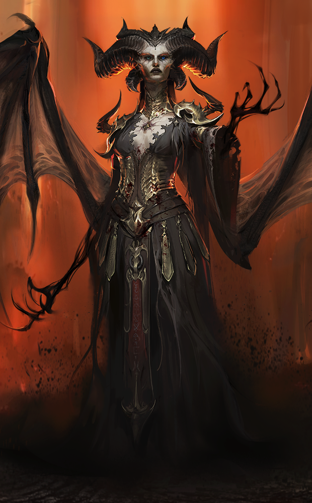
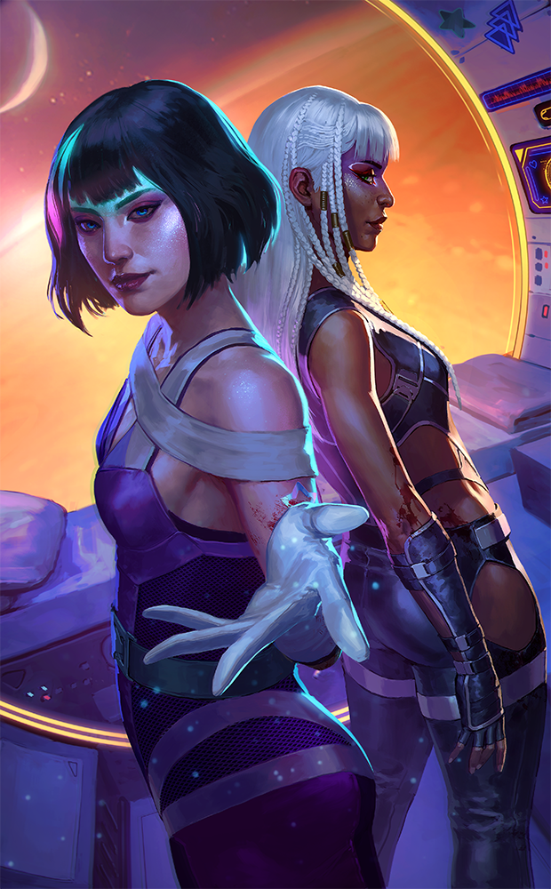
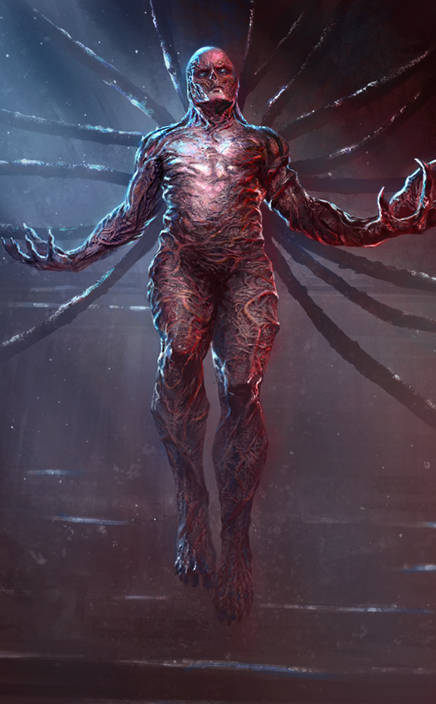
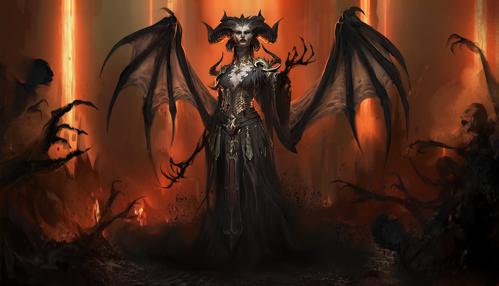
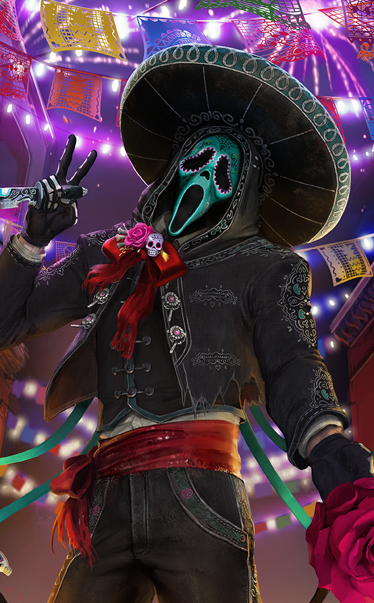

# live · 10.2.2_3883120live

| | |
|---|---|
| Build date | 2026-10-13 20:09 UTC |
| CDN version | `10.2.2_3883120live-1791922199` |
| Key | `10.2.2_live` |
| Compared with | [10.2.0_3882834live](../10.2.0_3882834live/CHANGES.md) (2026-10-13 17:45 UTC) |

## Summary

**8** added · **22** modified · **3** removed · 188 unchanged

## New or updated images

<a href="images/T_UI_CollectionBanner_Diablo.png"></a>
<a href="images/T_UI_CollectionBanner_Godmode.png"></a>
<a href="images/T_UI_CollectionBanner_StrangerThings_Vecna.png"></a>
<a href="images/T_UI_SpecialPack_Diablo.png"></a>
<a href="images/T_UI_SpecialPack_Godmode.png"></a>
<a href="images/T_UI_SpecialPack_NovemberDays_Ghostface.png"></a>
<a href="images/T_UI_SpecialPack_StrangerThings_Vecna.png"></a>
<a href="images/T_UI__CollectionBanner_NovemberDays_Ghostface.png"></a>

## Removed files

- `images/T_UI_CollectionBanner_NieR.png`
- `images/T_UI_SpecialPack_NieR.png`
- `images/T_UI_SpecialPack_Rift7.png`

## Modified files

### [`catalog.json`](catalog.json)

[Full line-by-line diff](diffs/catalog.json.diff)

```diff
+ $[id=DK_Head033]
+ $[id=DK_Legs033]
+ $[id=DK_Torso033]
+ $[id=K26_Body022]
+ $[id=K26_Head022]
+ $[id=K26_W022]
+ $[id=K28_Body024]
+ $[id=K28_Head024]
+ $[id=K28_W024]
+ $[id=K42_Body008]
+ $[id=K42_Head008]
+ $[id=K42_W008]
+ $[id=OK_Body018]
+ $[id=OK_Mask018]
+ $[id=OK_W018]
+ $[id=QF_Head012]
+ $[id=QF_Legs012]
+ $[id=QF_Torso012]
+ $[id=QM_Head011]
+ $[id=QM_Legs011]
+ $[id=QM_Torso011]
+ $[id=S24_Head029]
+ $[id=S24_Legs029]
+ $[id=S24_Torso029]
+ $[id=S25_Head034]
+ $[id=S25_Legs034]
+ $[id=S25_Torso034]
+ $[id=S45_Head017]
+ $[id=S45_Legs017]
+ $[id=S45_Torso017]
+ $[id=S46_Head017]
+ $[id=S46_Legs017]
+ $[id=S46_Torso017]
+ $[id=S52_Head010]
+ $[id=S52_Legs010]
+ $[id=S52_Torso010]
+ $[id=TN_Body028]
+ $[id=TN_Head028]
+ $[id=TN_W028]
+ $[id=US_Head034]
+ $[id=US_Legs034]
+ $[id=US_Torso034]
+ $[id=VAN_018]
+ $[id=VAN_019]
+ $[id=VAN_BDG_01]
+ $[id=VAN_BDG_20]
+ $[id=VAN_BDG_21]
+ $[id=VAN_BDG_22]
+ $[id=VAN_BNR_19]
+ $[id=VAN_BNR_20]
+ $[id=VAN_BNR_21]
+ $[id=VAN_BNR_22]
+ $[id=DK_outfit_033]
+ $[id=K26_outfit_022]
+ $[id=K28_outfit_024]
+ $[id=K42_outfit_008]
+ $[id=OK_outfit_018]
+ $[id=QF_outfit_012]
+ $[id=QM_Outfit_011]
+ $[id=S24_outfit_029]
+ $[id=S25_outfit_034]
+ $[id=S45_outfit_017]
+ $[id=S46_outfit_017]
+ $[id=S52_outfit_010]
+ $[id=TN_Outfit_028]
+ $[id=US_Outfit_034]
+ $[id=Recurring_Dev_Bundle_260929]
+ $[id=Recurring_Dev_Bundle_261006]
+ $[id=10.2.2_Diablo_collection_item]
+ $[id=10.2.2_Godmode_collection_item]
+ $[id=10.2.2_NovemberDays_collection_item]
+ $[id=10.2.2_StrangerThings_collection_item]
+ $[id=10.2.2_CozyBreak_collection_item]
+ $[id=PL_054].metaData.eventID: "DbdDay2025"
+ $[id=XR_054].metaData.eventID: "DbdDay2025"
- $[id=10.1.2_Autumn_Fashion].metaData.sortOrder: 0
+ $[id=10.1.2_Autumn_Fashion].metaData.sortOrder: 1999
- $[id=10.1.2_Blighted_Bundle].metaData.sortOrder: 0
+ $[id=10.1.2_Blighted_Bundle].metaData.sortOrder: 2002
- $[id=SAW_Bundle].metaData.sortOrder: 1001
+ $[id=SAW_Bundle].metaData.sortOrder: 2001
- $[id=Tome_8_Bundle].metaData.sortOrder: 1000
+ $[id=Tome_8_Bundle].metaData.sortOrder: 1998
- $[id=From_The_Rift_Bundle_260929].consumptionReward[id=S29_Head009_01]
- $[id=From_The_Rift_Bundle_260929].consumptionReward[id=S29_Torso008_01]
- $[id=From_The_Rift_Bundle_260929].consumptionReward[id=S29_Legs008_01]
+ $[id=From_The_Rift_Bundle_260929].consumptionReward[id=K21_Head010_01]
+ $[id=From_The_Rift_Bundle_260929].consumptionReward[id=K21_Body010_01]
+ $[id=From_The_Rift_Bundle_260929].consumptionReward[id=K21_W010_01]
- $[id=From_The_Rift_Bundle_261006].consumptionReward[id=TW_Head007_01]
- $[id=From_The_Rift_Bundle_261006].consumptionReward[id=TW_Body02_01]
- $[id=From_The_Rift_Bundle_261006].consumptionReward[id=TW_W03_03]
+ $[id=From_The_Rift_Bundle_261006].consumptionReward[id=MT_Head012_01]
+ $[id=From_The_Rift_Bundle_261006].consumptionReward[id=MT_Torso012_01]
+ $[id=From_The_Rift_Bundle_261006].consumptionReward[id=MT_Legs015_01]
```

### [`challengeLocs/challengeText_de.json`](challengeLocs/challengeText_de.json)

[Full line-by-line diff](diffs/challengeLocs/challengeText_de.json.diff)

```diff
- $.locText[472].text: "Jahr des Pferds"
+ $.locText[472].text: "Licht aus"
- $.locText[472].textId: "CHALLENGESET_LNYPoutine_TITLE"
+ $.locText[472].textId: "CHALLENGESET_LIGHTSOUTVANILLA_TITLE"
- $.locText[473].text: "@#CHALLENGESET_LNYPoutine_INFO"
+ $.locText[473].text: "@#CHALLENGESET_LIGHTSOUTVANILLA_INFO"
- $.locText[473].textId: "CHALLENGESET_LNYPoutine_INFO"
+ $.locText[473].textId: "CHALLENGESET_LIGHTSOUTVANILLA_INFO"
- $.locText[474].text: "Jahr des Pferds - Abschlussquests"
+ $.locText[474].text: "„Licht aus “-Abschlussquests"
- $.locText[474].textId: "LNYPoutine_Overarching_Title"
+ $.locText[474].textId: "LIST_LightsoutVanilla_Overarching_1"
- $.locText[475].text: "Jahr des Pferds – Teil 1"
+ $.locText[475].text: "„Licht aus“-Quests"
- $.locText[475].textId: "LNYPoutine_QuestList_1_Title"
+ $.locText[475].textId: "LIST_LightsoutVanilla_TITLE_1"
- $.locText[476].text: "Jahr des Pferds – Teil 2"
+ $.locText[476].text: "Jahr des Pferds"
- $.locText[476].textId: "LNYPoutine_QuestList_2_Title"
+ $.locText[476].textId: "CHALLENGESET_LNYPoutine_TITLE"
- $.locText[477].text: "Meilenstein"
+ $.locText[477].text: "@#CHALLENGESET_LNYPoutine_INFO"
- $.locText[477].textId: "CHALLENGESET_Milestone_TITLE"
+ $.locText[477].textId: "CHALLENGESET_LNYPoutine_INFO"
- $.locText[478].text: "@#CHALLENGESET_Milestone_INFO"
+ $.locText[478].text: "Jahr des Pferds - Abschlussquests"
- $.locText[478].textId: "CHALLENGESET_Milestone_INFO"
+ $.locText[478].textId: "LNYPoutine_Overarching_Title"
- $.locText[479].text: "Lebensschenker"
+ $.locText[479].text: "Jahr des Pferds – Teil 1"
- $.locText[479].textId: "CHALLENGE_Heal_TITLE"
+ $.locText[479].textId: "LNYPoutine_QuestList_1_Title"
- $.locText[480].text: "Heile insgesamt <b>{0} Gesundheitsstatus</b>."
+ $.locText[480].text: "Jahr des Pferds – Teil 2"
- $.locText[480].textId: "CHALLENGE_Heal_DESC"
+ $.locText[480].textId: "LNYPoutine_QuestList_2_Title"
- $.locText[481].text: "Meilenstein-Quests"
+ $.locText[481].text: "Meilenstein"
- $.locText[481].textId: "LIST_Milestone_TITLE"
+ $.locText[481].textId: "CHALLENGESET_Milestone_TITLE"
- $.locText[482].text: "IN DEN NEBEL"
+ $.locText[482].text: "@#CHALLENGESET_Milestone_INFO"
- $.locText[482].textId: "CHALLENGESET_Onboarding_TITLE"
+ $.locText[482].textId: "CHALLENGESET_Milestone_INFO"
- $.locText[483].text: "@#CHALLENGESET_Onboarding_INFO"
+ $.locText[483].text: "Lebensschenker"
- $.locText[483].textId: "CHALLENGESET_Onboarding_INFO"
+ $.locText[483].textId: "CHALLENGE_Heal_TITLE"
- $.locText[484].text: "@#CHALLENGE_PlayTrialWithFourPerks_TITLE"
+ $.locText[484].text: "Heile insgesamt <b>{0} Gesundheitsstatus</b>."
- $.locText[484].textId: "CHALLENGE_PlayTrialWithFourPerks_TITLE"
+ $.locText[484].textId: "CHALLENGE_Heal_DESC"
- $.locText[485].text: "Mit Talenten können Killer und Überlebende Spezialfähigkeiten freischalten."
+ $.locText[485].text: "Meilenstein-Quests"
- $.locText[485].textId: "CHALLENGE_PlayTrialWithFourPerks_DESC"
+ $.locText[485].textId: "LIST_Milestone_TITLE"
- $.locText[486].text: "Schließe {0} Prüfung(en) ab und verwende dabei 4 Talente."
+ $.locText[486].text: "IN DEN NEBEL"
- $.locText[486].textId: "CHALLENGE_PlayTrialWithFourPerks_INFO"
+ $.locText[486].textId: "CHALLENGESET_Onboarding_TITLE"
- $.locText[487].text: "@#CHALLENGE_PlayTrialWithCosmetic_TITLE"
+ $.locText[487].text: "@#CHALLENGESET_Onboarding_INFO"
- $.locText[487].textId: "CHALLENGE_PlayTrialWithCosmetic_TITLE"
+ $.locText[487].textId: "CHALLENGESET_Onboarding_INFO"
- $.locText[488].text: "Mit kosmetischen Gegenständen kannst du das Aussehen von Überlebenden und Killern anpassen. Für den Abschluss des Tutorials bekommst du kostenlose kosmetische …
+ $.locText[488].text: "@#CHALLENGE_PlayTrialWithFourPerks_TITLE"
- $.locText[488].textId: "CHALLENGE_PlayTrialWithCosmetic_DESC"
+ $.locText[488].textId: "CHALLENGE_PlayTrialWithFourPerks_TITLE"
- $.locText[489].text: "Schließe {0} Prüfung(en) ab und verwende dabei einen nicht-standardmäßigen kosmetischen Gegenstand."
+ $.locText[489].text: "Mit Talenten können Killer und Überlebende Spezialfähigkeiten freischalten."
- $.locText[489].textId: "CHALLENGE_PlayTrialWithCosmetic_INFO"
+ $.locText[489].textId: "CHALLENGE_PlayTrialWithFourPerks_DESC"
- $.locText[490].text: "@#CHALLENGE_StoreGetFreeItem_TITLE"
+ $.locText[490].text: "Schließe {0} Prüfung(en) ab und verwende dabei 4 Talente."
- $.locText[490].textId: "CHALLENGE_StoreGetFreeItem_TITLE"
+ $.locText[490].textId: "CHALLENGE_PlayTrialWithFourPerks_INFO"
- $.locText[491].text: "Im Shop kannst du dir jede Woche ein Geschenk abholen."
+ $.locText[491].text: "@#CHALLENGE_PlayTrialWithCosmetic_TITLE"
- $.locText[491].textId: "CHALLENGE_StoreGetFreeItem_DESC"
+ $.locText[491].textId: "CHALLENGE_PlayTrialWithCosmetic_TITLE"
- $.locText[492].text: "Hol dir ein Geschenk im Shop."
+ $.locText[492].text: "Mit kosmetischen Gegenständen kannst du das Aussehen von Überlebenden und Killern anpassen. Für den Abschluss des Tutorials bekommst du kostenlose kosmetische …
- $.locText[492].textId: "CHALLENGE_StoreGetFreeItem_INFO"
+ $.locText[492].textId: "CHALLENGE_PlayTrialWithCosmetic_DESC"
- $.locText[493].text: "@#CHALLENGE_PlayAsKiller_TITLE"
+ $.locText[493].text: "Schließe {0} Prüfung(en) ab und verwende dabei einen nicht-standardmäßigen kosmetischen Gegenstand."
- $.locText[493].textId: "CHALLENGE_PlayAsKiller_TITLE"
+ $.locText[493].textId: "CHALLENGE_PlayTrialWithCosmetic_INFO"
- $.locText[494].text: "Die Jägerin kann Beile werfen, um Überlebende aus der Ferne zu verletzen."
+ $.locText[494].text: "@#CHALLENGE_StoreGetFreeItem_TITLE"
- $.locText[494].textId: "CHALLENGE_PlayAsKiller_DESC"
+ $.locText[494].textId: "CHALLENGE_StoreGetFreeItem_TITLE"
- $.locText[495].text: "@#CHALLENGE_PlayAsKillerUsingPerk_TITLE"
+ $.locText[495].text: "Im Shop kannst du dir jede Woche ein Geschenk abholen."
- $.locText[495].textId: "CHALLENGE_PlayAsKillerUsingPerk_TITLE"
+ $.locText[495].textId: "CHALLENGE_StoreGetFreeItem_DESC"
- $.locText[496].text: "Mit Talenten können Killer Spezialfähigkeiten freischalten."
+ $.locText[496].text: "Hol dir ein Geschenk im Shop."
- $.locText[496].textId: "CHALLENGE_PlayAsKillerUsingPerk_DESC"
+ $.locText[496].textId: "CHALLENGE_StoreGetFreeItem_INFO"
- $.locText[497].text: "Schließe 1 Prüfung als Fallensteller ab und nutze das Talent „Brutale Stärke“."
+ $.locText[497].text: "@#CHALLENGE_PlayAsKiller_TITLE"
- $.locText[497].textId: "CHALLENGE_PlayAsKillerUsingPerk_INFO"
+ $.locText[497].textId: "CHALLENGE_PlayAsKiller_TITLE"
- $.locText[498].text: "@#CHALLENGE_BreakPalletWall_TITLE"
+ $.locText[498].text: "Die Jägerin kann Beile werfen, um Überlebende aus der Ferne zu verletzen."
- $.locText[498].textId: "CHALLENGE_BreakPalletWall_TITLE"
+ $.locText[498].textId: "CHALLENGE_PlayAsKiller_DESC"
- $.locText[499].text: "Hindernisse zu entfernen kann es einfacher machen, Überlebende einzuholen."
+ $.locText[499].text: "@#CHALLENGE_PlayAsKillerUsingPerk_TITLE"
- $.locText[499].textId: "CHALLENGE_BreakPalletWall_DESC"
+ $.locText[499].textId: "CHALLENGE_PlayAsKillerUsingPerk_TITLE"
- $.locText[500].text: "Zerstöre {0} Palette(n) oder Mauer(n)."
+ $.locText[500].text: "Mit Talenten können Killer Spezialfähigkeiten freischalten."
- $.locText[500].textId: "CHALLENGE_BreakPalletsWall_INFO"
+ $.locText[500].textId: "CHALLENGE_PlayAsKillerUsingPerk_DESC"
- $.locText[501].text: "Tödliche Verfolgung"
+ $.locText[501].text: "Schließe 1 Prüfung als Fallensteller ab und nutze das Talent „Brutale Stärke“."
- $.locText[501].textId: "CHALLENGE_Chase_TITLE"
+ $.locText[501].textId: "CHALLENGE_PlayAsKillerUsingPerk_INFO"
- $.locText[502].text: "Folge Kratzspuren, um laufende Überlebende aufzuspüren."
+ $.locText[502].text: "@#CHALLENGE_BreakPalletWall_TITLE"
- $.locText[502].textId: "CHALLENGE_Chase_DESC"
+ $.locText[502].textId: "CHALLENGE_BreakPalletWall_TITLE"
- $.locText[503].text: "@#CHALLENGE_DownDifferentSingleTrial_TITLE"
+ $.locText[503].text: "Hindernisse zu entfernen kann es einfacher machen, Überlebende einzuholen."
- $.locText[503].textId: "CHALLENGE_DownDifferentSingleTrial_TITLE"
+ $.locText[503].textId: "CHALLENGE_BreakPalletWall_DESC"
- $.locText[504].text: "Wenn du Überlebende niederstreckst, verlangsamst du ihr Vorankommen."
+ $.locText[504].text: "Zerstöre {0} Palette(n) oder Mauer(n)."
- $.locText[504].textId: "CHALLENGE_DownDifferentSingleTrial_DESC"
+ $.locText[504].textId: "CHALLENGE_BreakPalletsWall_INFO"
- $.locText[505].text: "Strecke {0} verschiedene Überlebende in einer einzigen Prüfung nieder."
+ $.locText[505].text: "Tödliche Verfolgung"
- $.locText[505].textId: "CHALLENGE_DownDifferentSingleTrial_INFO"
+ $.locText[505].textId: "CHALLENGE_Chase_TITLE"
- $.locText[506].text: "@#CHALLENGE_KillSingleTrial_TITLE"
+ $.locText[506].text: "Folge Kratzspuren, um laufende Überlebende aufzuspüren."
- $.locText[506].textId: "CHALLENGE_KillSingleTrial_TITLE"
+ $.locText[506].textId: "CHALLENGE_Chase_DESC"
- $.locText[507].text: "Ein starker Killer schafft es, mindestens 3 Überlebende in einer Prüfung zu opfern oder zu töten."
+ $.locText[507].text: "@#CHALLENGE_DownDifferentSingleTrial_TITLE"
- $.locText[507].textId: "CHALLENGE_KillSingleTrial_DESC"
+ $.locText[507].textId: "CHALLENGE_DownDifferentSingleTrial_TITLE"
- $.locText[508].text: "Opfere oder töte {0} Überlebende(n) in einer einzigen Prüfung."
+ $.locText[508].text: "Wenn du Überlebende niederstreckst, verlangsamst du ihr Vorankommen."
- $.locText[508].textId: "CHALLENGE_KillSingleTrial_INFO"
+ $.locText[508].textId: "CHALLENGE_DownDifferentSingleTrial_DESC"
- $.locText[509].text: "@#CHALLENGE_Mori_TITLE"
+ $.locText[509].text: "Strecke {0} verschiedene Überlebende in einer einzigen Prüfung nieder."
- $.locText[509].textId: "CHALLENGE_Mori_TITLE"
+ $.locText[509].textId: "CHALLENGE_DownDifferentSingleTrial_INFO"
- $.locText[510].text: "Ist er am Boden, kannst du den letzten Überlebenden in einer Prüfung töten, ohne ihn festhaken zu müssen."
+ $.locText[510].text: "@#CHALLENGE_KillSingleTrial_TITLE"
- $.locText[510].textId: "CHALLENGE_Mori_DESC"
+ $.locText[510].textId: "CHALLENGE_KillSingleTrial_TITLE"
- $.locText[511].text: "@#CHALLENGE_GrabSurvivor_TITLE"
+ $.locText[511].text: "Ein starker Killer schafft es, mindestens 3 Überlebende in einer Prüfung zu opfern oder zu töten."
- $.locText[511].textId: "CHALLENGE_GrabSurvivor_TITLE"
+ $.locText[511].textId: "CHALLENGE_KillSingleTrial_DESC"
- $.locText[512].text: "Du kannst dir einen Überlebenden schnappen, der mit Generatoren oder Totems interagiert oder springt."
+ $.locText[512].text: "Opfere oder töte {0} Überlebende(n) in einer einzigen Prüfung."
- $.locText[512].textId: "CHALLENGE_GrabSurvivor_DESC"
+ $.locText[512].textId: "CHALLENGE_KillSingleTrial_INFO"
- $.locText[513].text: "Störe und ergreife {0} Überlebende(n)."
+ $.locText[513].text: "@#CHALLENGE_Mori_TITLE"
- $.locText[513].textId: "CHALLENGE_GrabSurvivor_INFO"
+ $.locText[513].textId: "CHALLENGE_Mori_TITLE"
- $.locText[514].text: "@#CHALLENGE_CompleteRoleChallengesKiller_TITLE"
+ $.locText[514].text: "Ist er am Boden, kannst du den letzten Überlebenden in einer Prüfung töten, ohne ihn festhaken zu müssen."
- $.locText[514].textId: "CHALLENGE_CompleteRoleChallengesKiller_TITLE"
+ $.locText[514].textId: "CHALLENGE_Mori_DESC"
- $.locText[515].text: "Du bist ein brutaler, blutrünstiger Killer. Der Entitus ist zufrieden."
+ $.locText[515].text: "@#CHALLENGE_GrabSurvivor_TITLE"
- $.locText[515].textId: "CHALLENGE_CompleteRoleChallengesKiller_DESC"
+ $.locText[515].textId: "CHALLENGE_GrabSurvivor_TITLE"
- $.locText[516].text: "Schließe alle Killer-Quests ab."
+ $.locText[516].text: "Du kannst dir einen Überlebenden schnappen, der mit Generatoren oder Totems interagiert oder springt."
- $.locText[516].textId: "CHALLENGE_CompleteRoleChallengesKiller_INFO"
+ $.locText[516].textId: "CHALLENGE_GrabSurvivor_DESC"
- $.locText[517].text: "@#CHALLENGE_PlayAsSurvivor_TITLE"
+ $.locText[517].text: "Störe und ergreife {0} Überlebende(n)."
- $.locText[517].textId: "CHALLENGE_PlayAsSurvivor_TITLE"
+ $.locText[517].textId: "CHALLENGE_GrabSurvivor_INFO"
- $.locText[518].text: "Meg Thomas ist eine flinke Überlebende. Mit ihren Talenten kannst du Killer abschütteln und ihnen ausweichen."
+ $.locText[518].text: "@#CHALLENGE_CompleteRoleChallengesKiller_TITLE"
- $.locText[518].textId: "CHALLENGE_PlayAsSurvivorr_DESC"
+ $.locText[518].textId: "CHALLENGE_CompleteRoleChallengesKiller_TITLE"
- $.locText[519].text: "@#CHALLENGE_PlayAsSurvivorUsingPerk_TITLE"
+ $.locText[519].text: "Du bist ein brutaler, blutrünstiger Killer. Der Entitus ist zufrieden."
- $.locText[519].textId: "CHALLENGE_PlayAsSurvivorUsingPerk_TITLE"
+ $.locText[519].textId: "CHALLENGE_CompleteRoleChallengesKiller_DESC"
- $.locText[520].text: "Mit Talenten können Überlebende Spezialfähigkeiten freischalten."
+ $.locText[520].text: "Schließe alle Killer-Quests ab."
- $.locText[520].textId: "CHALLENGE_PlayAsSurvivorUsingPerk_DESC"
+ $.locText[520].textId: "CHALLENGE_CompleteRoleChallengesKiller_INFO"
- $.locText[521].text: "Schließe 1 Prüfung als Dwight Fairfield ab und nutze das Talent „Bindung“."
+ $.locText[521].text: "@#CHALLENGE_PlayAsSurvivor_TITLE"
- $.locText[521].textId: "CHALLENGE_PlayAsSurvivorUsingPerk_INFO"
+ $.locText[521].textId: "CHALLENGE_PlayAsSurvivor_TITLE"
… 820 more change(s) — see the commit diff for everything
```

### [`challengeLocs/challengeText_en.json`](challengeLocs/challengeText_en.json)

[Full line-by-line diff](diffs/challengeLocs/challengeText_en.json.diff)

```diff
- $.locText[472].text: "Year Of The Horse"
+ $.locText[472].text: "Lights Out"
- $.locText[472].textId: "CHALLENGESET_LNYPoutine_TITLE"
+ $.locText[472].textId: "CHALLENGESET_LIGHTSOUTVANILLA_TITLE"
- $.locText[473].text: "@#CHALLENGESET_LNYPoutine_INFO"
+ $.locText[473].text: "@#CHALLENGESET_LIGHTSOUTVANILLA_INFO"
- $.locText[473].textId: "CHALLENGESET_LNYPoutine_INFO"
+ $.locText[473].textId: "CHALLENGESET_LIGHTSOUTVANILLA_INFO"
- $.locText[474].text: "Year of the horse - Completion Quests"
+ $.locText[474].text: "Lights Out - Completion Quests"
- $.locText[474].textId: "LNYPoutine_Overarching_Title"
+ $.locText[474].textId: "LIST_LightsoutVanilla_Overarching_1"
- $.locText[475].text: "Year of the horse - Part 1"
+ $.locText[475].text: "Lights Out Quests"
- $.locText[475].textId: "LNYPoutine_QuestList_1_Title"
+ $.locText[475].textId: "LIST_LightsoutVanilla_TITLE_1"
- $.locText[476].text: "Year of the horse - Part 2"
+ $.locText[476].text: "Year Of The Horse"
- $.locText[476].textId: "LNYPoutine_QuestList_2_Title"
+ $.locText[476].textId: "CHALLENGESET_LNYPoutine_TITLE"
- $.locText[477].text: "Milestone"
+ $.locText[477].text: "@#CHALLENGESET_LNYPoutine_INFO"
- $.locText[477].textId: "CHALLENGESET_Milestone_TITLE"
+ $.locText[477].textId: "CHALLENGESET_LNYPoutine_INFO"
- $.locText[478].text: "@#CHALLENGESET_Milestone_INFO"
+ $.locText[478].text: "Year of the horse - Completion Quests"
- $.locText[478].textId: "CHALLENGESET_Milestone_INFO"
+ $.locText[478].textId: "LNYPoutine_Overarching_Title"
- $.locText[479].text: "Life Giver"
+ $.locText[479].text: "Year of the horse - Part 1"
- $.locText[479].textId: "CHALLENGE_Heal_TITLE"
+ $.locText[479].textId: "LNYPoutine_QuestList_1_Title"
- $.locText[480].text: "Heal a total of <b>{0} health state(s)</b>"
+ $.locText[480].text: "Year of the horse - Part 2"
- $.locText[480].textId: "CHALLENGE_Heal_DESC"
+ $.locText[480].textId: "LNYPoutine_QuestList_2_Title"
- $.locText[481].text: "Milestone Quests"
+ $.locText[481].text: "Milestone"
- $.locText[481].textId: "LIST_Milestone_TITLE"
+ $.locText[481].textId: "CHALLENGESET_Milestone_TITLE"
- $.locText[482].text: "INTO THE FOG"
+ $.locText[482].text: "@#CHALLENGESET_Milestone_INFO"
- $.locText[482].textId: "CHALLENGESET_Onboarding_TITLE"
+ $.locText[482].textId: "CHALLENGESET_Milestone_INFO"
- $.locText[483].text: "@#CHALLENGESET_Onboarding_INFO"
+ $.locText[483].text: "Life Giver"
- $.locText[483].textId: "CHALLENGESET_Onboarding_INFO"
+ $.locText[483].textId: "CHALLENGE_Heal_TITLE"
- $.locText[484].text: "@#CHALLENGE_PlayTrialWithFourPerks_TITLE"
+ $.locText[484].text: "Heal a total of <b>{0} health state(s)</b>"
- $.locText[484].textId: "CHALLENGE_PlayTrialWithFourPerks_TITLE"
+ $.locText[484].textId: "CHALLENGE_Heal_DESC"
- $.locText[485].text: "Perks allow Killers and Survivors to unlock special abilities."
+ $.locText[485].text: "Milestone Quests"
- $.locText[485].textId: "CHALLENGE_PlayTrialWithFourPerks_DESC"
+ $.locText[485].textId: "LIST_Milestone_TITLE"
- $.locText[486].text: "Complete {0} trial(s) with 4 perks equipped"
+ $.locText[486].text: "INTO THE FOG"
- $.locText[486].textId: "CHALLENGE_PlayTrialWithFourPerks_INFO"
+ $.locText[486].textId: "CHALLENGESET_Onboarding_TITLE"
- $.locText[487].text: "@#CHALLENGE_PlayTrialWithCosmetic_TITLE"
+ $.locText[487].text: "@#CHALLENGESET_Onboarding_INFO"
- $.locText[487].textId: "CHALLENGE_PlayTrialWithCosmetic_TITLE"
+ $.locText[487].textId: "CHALLENGESET_Onboarding_INFO"
- $.locText[488].text: "Customize Survivors' and Killers' appearances with cosmetics. Complete the tutorial for free cosmetics."
+ $.locText[488].text: "@#CHALLENGE_PlayTrialWithFourPerks_TITLE"
- $.locText[488].textId: "CHALLENGE_PlayTrialWithCosmetic_DESC"
+ $.locText[488].textId: "CHALLENGE_PlayTrialWithFourPerks_TITLE"
- $.locText[489].text: "Complete {0} trial(s) with a non-default cosmetic equipped"
+ $.locText[489].text: "Perks allow Killers and Survivors to unlock special abilities."
- $.locText[489].textId: "CHALLENGE_PlayTrialWithCosmetic_INFO"
+ $.locText[489].textId: "CHALLENGE_PlayTrialWithFourPerks_DESC"
- $.locText[490].text: "@#CHALLENGE_StoreGetFreeItem_TITLE"
+ $.locText[490].text: "Complete {0} trial(s) with 4 perks equipped"
- $.locText[490].textId: "CHALLENGE_StoreGetFreeItem_TITLE"
+ $.locText[490].textId: "CHALLENGE_PlayTrialWithFourPerks_INFO"
- $.locText[491].text: "Visit the Store to claim a weekly free gift"
+ $.locText[491].text: "@#CHALLENGE_PlayTrialWithCosmetic_TITLE"
- $.locText[491].textId: "CHALLENGE_StoreGetFreeItem_DESC"
+ $.locText[491].textId: "CHALLENGE_PlayTrialWithCosmetic_TITLE"
- $.locText[492].text: "Collect a free gift from the Store"
+ $.locText[492].text: "Customize Survivors' and Killers' appearances with cosmetics. Complete the tutorial for free cosmetics."
- $.locText[492].textId: "CHALLENGE_StoreGetFreeItem_INFO"
+ $.locText[492].textId: "CHALLENGE_PlayTrialWithCosmetic_DESC"
- $.locText[493].text: "@#CHALLENGE_PlayAsKiller_TITLE"
+ $.locText[493].text: "Complete {0} trial(s) with a non-default cosmetic equipped"
- $.locText[493].textId: "CHALLENGE_PlayAsKiller_TITLE"
+ $.locText[493].textId: "CHALLENGE_PlayTrialWithCosmetic_INFO"
- $.locText[494].text: "The Huntress can throw Hatchets to injure Survivors from a distance."
+ $.locText[494].text: "@#CHALLENGE_StoreGetFreeItem_TITLE"
- $.locText[494].textId: "CHALLENGE_PlayAsKiller_DESC"
+ $.locText[494].textId: "CHALLENGE_StoreGetFreeItem_TITLE"
- $.locText[495].text: "@#CHALLENGE_PlayAsKillerUsingPerk_TITLE"
+ $.locText[495].text: "Visit the Store to claim a weekly free gift"
- $.locText[495].textId: "CHALLENGE_PlayAsKillerUsingPerk_TITLE"
+ $.locText[495].textId: "CHALLENGE_StoreGetFreeItem_DESC"
- $.locText[496].text: "Perks allow Killers to unlock special abilities."
+ $.locText[496].text: "Collect a free gift from the Store"
- $.locText[496].textId: "CHALLENGE_PlayAsKillerUsingPerk_DESC"
+ $.locText[496].textId: "CHALLENGE_StoreGetFreeItem_INFO"
- $.locText[497].text: "Complete 1 Trial as The Trapper using the Brutal Strength perk"
+ $.locText[497].text: "@#CHALLENGE_PlayAsKiller_TITLE"
- $.locText[497].textId: "CHALLENGE_PlayAsKillerUsingPerk_INFO"
+ $.locText[497].textId: "CHALLENGE_PlayAsKiller_TITLE"
- $.locText[498].text: "@#CHALLENGE_BreakPalletWall_TITLE"
+ $.locText[498].text: "The Huntress can throw Hatchets to injure Survivors from a distance."
- $.locText[498].textId: "CHALLENGE_BreakPalletWall_TITLE"
+ $.locText[498].textId: "CHALLENGE_PlayAsKiller_DESC"
- $.locText[499].text: "Clearing obstacles can make it easier to catch up to Survivors."
+ $.locText[499].text: "@#CHALLENGE_PlayAsKillerUsingPerk_TITLE"
- $.locText[499].textId: "CHALLENGE_BreakPalletWall_DESC"
+ $.locText[499].textId: "CHALLENGE_PlayAsKillerUsingPerk_TITLE"
- $.locText[500].text: "Destroy {0} pallet(s) or wall(s)"
+ $.locText[500].text: "Perks allow Killers to unlock special abilities."
- $.locText[500].textId: "CHALLENGE_BreakPalletsWall_INFO"
+ $.locText[500].textId: "CHALLENGE_PlayAsKillerUsingPerk_DESC"
- $.locText[501].text: "Deadly Pursuit"
+ $.locText[501].text: "Complete 1 Trial as The Trapper using the Brutal Strength perk"
- $.locText[501].textId: "CHALLENGE_Chase_TITLE"
+ $.locText[501].textId: "CHALLENGE_PlayAsKillerUsingPerk_INFO"
- $.locText[502].text: "Follow scratch marks to track Survivors that are running."
+ $.locText[502].text: "@#CHALLENGE_BreakPalletWall_TITLE"
- $.locText[502].textId: "CHALLENGE_Chase_DESC"
+ $.locText[502].textId: "CHALLENGE_BreakPalletWall_TITLE"
- $.locText[503].text: "@#CHALLENGE_DownDifferentSingleTrial_TITLE"
+ $.locText[503].text: "Clearing obstacles can make it easier to catch up to Survivors."
- $.locText[503].textId: "CHALLENGE_DownDifferentSingleTrial_TITLE"
+ $.locText[503].textId: "CHALLENGE_BreakPalletWall_DESC"
- $.locText[504].text: "Downing Survivors allows you to slow their progress."
+ $.locText[504].text: "Destroy {0} pallet(s) or wall(s)"
- $.locText[504].textId: "CHALLENGE_DownDifferentSingleTrial_DESC"
+ $.locText[504].textId: "CHALLENGE_BreakPalletsWall_INFO"
- $.locText[505].text: "Down {0} different Survivors in a single trial"
+ $.locText[505].text: "Deadly Pursuit"
- $.locText[505].textId: "CHALLENGE_DownDifferentSingleTrial_INFO"
+ $.locText[505].textId: "CHALLENGE_Chase_TITLE"
- $.locText[506].text: "@#CHALLENGE_KillSingleTrial_TITLE"
+ $.locText[506].text: "Follow scratch marks to track Survivors that are running."
- $.locText[506].textId: "CHALLENGE_KillSingleTrial_TITLE"
+ $.locText[506].textId: "CHALLENGE_Chase_DESC"
- $.locText[507].text: "Sacrificing or killing at least 3 Survivors in a trial is a sign of a strong Killer."
+ $.locText[507].text: "@#CHALLENGE_DownDifferentSingleTrial_TITLE"
- $.locText[507].textId: "CHALLENGE_KillSingleTrial_DESC"
+ $.locText[507].textId: "CHALLENGE_DownDifferentSingleTrial_TITLE"
- $.locText[508].text: "Sacrifice or kill {0} Survivor(s) in a single trial"
+ $.locText[508].text: "Downing Survivors allows you to slow their progress."
- $.locText[508].textId: "CHALLENGE_KillSingleTrial_INFO"
+ $.locText[508].textId: "CHALLENGE_DownDifferentSingleTrial_DESC"
- $.locText[509].text: "@#CHALLENGE_Mori_TITLE"
+ $.locText[509].text: "Down {0} different Survivors in a single trial"
- $.locText[509].textId: "CHALLENGE_Mori_TITLE"
+ $.locText[509].textId: "CHALLENGE_DownDifferentSingleTrial_INFO"
- $.locText[510].text: "Once downed, you can kill the last Survivor in a trial without hooking them."
+ $.locText[510].text: "@#CHALLENGE_KillSingleTrial_TITLE"
- $.locText[510].textId: "CHALLENGE_Mori_DESC"
+ $.locText[510].textId: "CHALLENGE_KillSingleTrial_TITLE"
- $.locText[511].text: "@#CHALLENGE_GrabSurvivor_TITLE"
+ $.locText[511].text: "Sacrificing or killing at least 3 Survivors in a trial is a sign of a strong Killer."
- $.locText[511].textId: "CHALLENGE_GrabSurvivor_TITLE"
+ $.locText[511].textId: "CHALLENGE_KillSingleTrial_DESC"
- $.locText[512].text: "You can grab a Survivor that is interacting with Generators and Totems, or vaulting."
+ $.locText[512].text: "Sacrifice or kill {0} Survivor(s) in a single trial"
- $.locText[512].textId: "CHALLENGE_GrabSurvivor_DESC"
+ $.locText[512].textId: "CHALLENGE_KillSingleTrial_INFO"
- $.locText[513].text: "Interrupt and grab {0} Survivor(s)"
+ $.locText[513].text: "@#CHALLENGE_Mori_TITLE"
- $.locText[513].textId: "CHALLENGE_GrabSurvivor_INFO"
+ $.locText[513].textId: "CHALLENGE_Mori_TITLE"
- $.locText[514].text: "@#CHALLENGE_CompleteRoleChallengesKiller_TITLE"
+ $.locText[514].text: "Once downed, you can kill the last Survivor in a trial without hooking them."
- $.locText[514].textId: "CHALLENGE_CompleteRoleChallengesKiller_TITLE"
+ $.locText[514].textId: "CHALLENGE_Mori_DESC"
- $.locText[515].text: "You're a brutal, bloodthirsty Killer. The Entity is pleased."
+ $.locText[515].text: "@#CHALLENGE_GrabSurvivor_TITLE"
- $.locText[515].textId: "CHALLENGE_CompleteRoleChallengesKiller_DESC"
+ $.locText[515].textId: "CHALLENGE_GrabSurvivor_TITLE"
- $.locText[516].text: "Complete all Killer Quests"
+ $.locText[516].text: "You can grab a Survivor that is interacting with Generators and Totems, or vaulting."
- $.locText[516].textId: "CHALLENGE_CompleteRoleChallengesKiller_INFO"
+ $.locText[516].textId: "CHALLENGE_GrabSurvivor_DESC"
- $.locText[517].text: "@#CHALLENGE_PlayAsSurvivor_TITLE"
+ $.locText[517].text: "Interrupt and grab {0} Survivor(s)"
- $.locText[517].textId: "CHALLENGE_PlayAsSurvivor_TITLE"
+ $.locText[517].textId: "CHALLENGE_GrabSurvivor_INFO"
- $.locText[518].text: "Meg Thomas is a speedy Survivor. Her perks can help you outrun and evade Killers."
+ $.locText[518].text: "@#CHALLENGE_CompleteRoleChallengesKiller_TITLE"
- $.locText[518].textId: "CHALLENGE_PlayAsSurvivorr_DESC"
+ $.locText[518].textId: "CHALLENGE_CompleteRoleChallengesKiller_TITLE"
- $.locText[519].text: "@#CHALLENGE_PlayAsSurvivorUsingPerk_TITLE"
+ $.locText[519].text: "You're a brutal, bloodthirsty Killer. The Entity is pleased."
- $.locText[519].textId: "CHALLENGE_PlayAsSurvivorUsingPerk_TITLE"
+ $.locText[519].textId: "CHALLENGE_CompleteRoleChallengesKiller_DESC"
- $.locText[520].text: "Perks allow Survivors to unlock special abilities."
+ $.locText[520].text: "Complete all Killer Quests"
- $.locText[520].textId: "CHALLENGE_PlayAsSurvivorUsingPerk_DESC"
+ $.locText[520].textId: "CHALLENGE_CompleteRoleChallengesKiller_INFO"
- $.locText[521].text: "Complete 1 Trial as Dwight Fairfield using the Bond perk"
+ $.locText[521].text: "@#CHALLENGE_PlayAsSurvivor_TITLE"
- $.locText[521].textId: "CHALLENGE_PlayAsSurvivorUsingPerk_INFO"
+ $.locText[521].textId: "CHALLENGE_PlayAsSurvivor_TITLE"
… 820 more change(s) — see the commit diff for everything
```

### [`challengeLocs/challengeText_es-MX.json`](challengeLocs/challengeText_es-MX.json)

[Full line-by-line diff](diffs/challengeLocs/challengeText_es-MX.json.diff)

```diff
- $.locText[472].text: "Año del caballo"
+ $.locText[472].text: "Se apagan las luces"
- $.locText[472].textId: "CHALLENGESET_LNYPoutine_TITLE"
+ $.locText[472].textId: "CHALLENGESET_LIGHTSOUTVANILLA_TITLE"
- $.locText[473].text: "@#CHALLENGESET_LNYPoutine_INFO"
+ $.locText[473].text: "@#CHALLENGESET_LIGHTSOUTVANILLA_INFO"
- $.locText[473].textId: "CHALLENGESET_LNYPoutine_INFO"
+ $.locText[473].textId: "CHALLENGESET_LIGHTSOUTVANILLA_INFO"
- $.locText[474].text: "Año del caballo - Misiones de finalización"
+ $.locText[474].text: "Se apagan las luces: Misiones de finalización"
- $.locText[474].textId: "LNYPoutine_Overarching_Title"
+ $.locText[474].textId: "LIST_LightsoutVanilla_Overarching_1"
- $.locText[475].text: "Año del caballo - Parte 1"
+ $.locText[475].text: "Misiones de Se apagan las luces"
- $.locText[475].textId: "LNYPoutine_QuestList_1_Title"
+ $.locText[475].textId: "LIST_LightsoutVanilla_TITLE_1"
- $.locText[476].text: "Año del caballo - Parte 2"
+ $.locText[476].text: "Año del caballo"
- $.locText[476].textId: "LNYPoutine_QuestList_2_Title"
+ $.locText[476].textId: "CHALLENGESET_LNYPoutine_TITLE"
- $.locText[477].text: "Hito"
+ $.locText[477].text: "@#CHALLENGESET_LNYPoutine_INFO"
- $.locText[477].textId: "CHALLENGESET_Milestone_TITLE"
+ $.locText[477].textId: "CHALLENGESET_LNYPoutine_INFO"
- $.locText[478].text: "@#CHALLENGESET_Milestone_INFO"
+ $.locText[478].text: "Año del caballo - Misiones de finalización"
- $.locText[478].textId: "CHALLENGESET_Milestone_INFO"
+ $.locText[478].textId: "LNYPoutine_Overarching_Title"
- $.locText[479].text: "Dador de vida"
+ $.locText[479].text: "Año del caballo - Parte 1"
- $.locText[479].textId: "CHALLENGE_Heal_TITLE"
+ $.locText[479].textId: "LNYPoutine_QuestList_1_Title"
- $.locText[480].text: "Cura un total de <b>{0} estado(s) de salud</b>."
+ $.locText[480].text: "Año del caballo - Parte 2"
- $.locText[480].textId: "CHALLENGE_Heal_DESC"
+ $.locText[480].textId: "LNYPoutine_QuestList_2_Title"
- $.locText[481].text: "Misiones de hito"
+ $.locText[481].text: "Hito"
- $.locText[481].textId: "LIST_Milestone_TITLE"
+ $.locText[481].textId: "CHALLENGESET_Milestone_TITLE"
- $.locText[482].text: "EN LA NIEBLA"
+ $.locText[482].text: "@#CHALLENGESET_Milestone_INFO"
- $.locText[482].textId: "CHALLENGESET_Onboarding_TITLE"
+ $.locText[482].textId: "CHALLENGESET_Milestone_INFO"
- $.locText[483].text: "@#CHALLENGESET_Onboarding_INFO"
+ $.locText[483].text: "Dador de vida"
- $.locText[483].textId: "CHALLENGESET_Onboarding_INFO"
+ $.locText[483].textId: "CHALLENGE_Heal_TITLE"
- $.locText[484].text: "@#CHALLENGE_PlayTrialWithFourPerks_TITLE"
+ $.locText[484].text: "Cura un total de <b>{0} estado(s) de salud</b>."
- $.locText[484].textId: "CHALLENGE_PlayTrialWithFourPerks_TITLE"
+ $.locText[484].textId: "CHALLENGE_Heal_DESC"
- $.locText[485].text: "Las ventajas les permiten a los asesinos y sobrevivientes desbloquear habilidades especiales."
+ $.locText[485].text: "Misiones de hito"
- $.locText[485].textId: "CHALLENGE_PlayTrialWithFourPerks_DESC"
+ $.locText[485].textId: "LIST_Milestone_TITLE"
- $.locText[486].text: "Completa {0} partida(s) con 4 ventajas equipadas."
+ $.locText[486].text: "EN LA NIEBLA"
- $.locText[486].textId: "CHALLENGE_PlayTrialWithFourPerks_INFO"
+ $.locText[486].textId: "CHALLENGESET_Onboarding_TITLE"
- $.locText[487].text: "@#CHALLENGE_PlayTrialWithCosmetic_TITLE"
+ $.locText[487].text: "@#CHALLENGESET_Onboarding_INFO"
- $.locText[487].textId: "CHALLENGE_PlayTrialWithCosmetic_TITLE"
+ $.locText[487].textId: "CHALLENGESET_Onboarding_INFO"
- $.locText[488].text: "Personaliza la apariencia de sobrevivientes y asesinos con objetos cosméticos. Completa el tutorial para recibir objetos cosméticos gratuitos."
+ $.locText[488].text: "@#CHALLENGE_PlayTrialWithFourPerks_TITLE"
- $.locText[488].textId: "CHALLENGE_PlayTrialWithCosmetic_DESC"
+ $.locText[488].textId: "CHALLENGE_PlayTrialWithFourPerks_TITLE"
- $.locText[489].text: "Completa {0} partida(s) con un objeto cosmético no predeterminado equipado."
+ $.locText[489].text: "Las ventajas les permiten a los asesinos y sobrevivientes desbloquear habilidades especiales."
- $.locText[489].textId: "CHALLENGE_PlayTrialWithCosmetic_INFO"
+ $.locText[489].textId: "CHALLENGE_PlayTrialWithFourPerks_DESC"
- $.locText[490].text: "@#CHALLENGE_StoreGetFreeItem_TITLE"
+ $.locText[490].text: "Completa {0} partida(s) con 4 ventajas equipadas."
- $.locText[490].textId: "CHALLENGE_StoreGetFreeItem_TITLE"
+ $.locText[490].textId: "CHALLENGE_PlayTrialWithFourPerks_INFO"
- $.locText[491].text: "Visita la tienda para reclamar un regalo semanal gratis."
+ $.locText[491].text: "@#CHALLENGE_PlayTrialWithCosmetic_TITLE"
- $.locText[491].textId: "CHALLENGE_StoreGetFreeItem_DESC"
+ $.locText[491].textId: "CHALLENGE_PlayTrialWithCosmetic_TITLE"
- $.locText[492].text: "Reclama un regalo gratis en la tienda."
+ $.locText[492].text: "Personaliza la apariencia de sobrevivientes y asesinos con objetos cosméticos. Completa el tutorial para recibir objetos cosméticos gratuitos."
- $.locText[492].textId: "CHALLENGE_StoreGetFreeItem_INFO"
+ $.locText[492].textId: "CHALLENGE_PlayTrialWithCosmetic_DESC"
- $.locText[493].text: "@#CHALLENGE_PlayAsKiller_TITLE"
+ $.locText[493].text: "Completa {0} partida(s) con un objeto cosmético no predeterminado equipado."
- $.locText[493].textId: "CHALLENGE_PlayAsKiller_TITLE"
+ $.locText[493].textId: "CHALLENGE_PlayTrialWithCosmetic_INFO"
- $.locText[494].text: "La Cazadora puede lanzar destrales para herir sobrevivientes a la distancia."
+ $.locText[494].text: "@#CHALLENGE_StoreGetFreeItem_TITLE"
- $.locText[494].textId: "CHALLENGE_PlayAsKiller_DESC"
+ $.locText[494].textId: "CHALLENGE_StoreGetFreeItem_TITLE"
- $.locText[495].text: "@#CHALLENGE_PlayAsKillerUsingPerk_TITLE"
+ $.locText[495].text: "Visita la tienda para reclamar un regalo semanal gratis."
- $.locText[495].textId: "CHALLENGE_PlayAsKillerUsingPerk_TITLE"
+ $.locText[495].textId: "CHALLENGE_StoreGetFreeItem_DESC"
- $.locText[496].text: "Las ventajas permiten a los asesinos desbloquear habilidades especiales."
+ $.locText[496].text: "Reclama un regalo gratis en la tienda."
- $.locText[496].textId: "CHALLENGE_PlayAsKillerUsingPerk_DESC"
+ $.locText[496].textId: "CHALLENGE_StoreGetFreeItem_INFO"
- $.locText[497].text: "Completa 1 partida como el Trampero con la ventaja Fuerza brutal."
+ $.locText[497].text: "@#CHALLENGE_PlayAsKiller_TITLE"
- $.locText[497].textId: "CHALLENGE_PlayAsKillerUsingPerk_INFO"
+ $.locText[497].textId: "CHALLENGE_PlayAsKiller_TITLE"
- $.locText[498].text: "@#CHALLENGE_BreakPalletWall_TITLE"
+ $.locText[498].text: "La Cazadora puede lanzar destrales para herir sobrevivientes a la distancia."
- $.locText[498].textId: "CHALLENGE_BreakPalletWall_TITLE"
+ $.locText[498].textId: "CHALLENGE_PlayAsKiller_DESC"
- $.locText[499].text: "Despejar obstáculos te ayudará a atrapar sobrevivientes."
+ $.locText[499].text: "@#CHALLENGE_PlayAsKillerUsingPerk_TITLE"
- $.locText[499].textId: "CHALLENGE_BreakPalletWall_DESC"
+ $.locText[499].textId: "CHALLENGE_PlayAsKillerUsingPerk_TITLE"
- $.locText[500].text: "Destruye {0} tarima(s) o muro(s)"
+ $.locText[500].text: "Las ventajas permiten a los asesinos desbloquear habilidades especiales."
- $.locText[500].textId: "CHALLENGE_BreakPalletsWall_INFO"
+ $.locText[500].textId: "CHALLENGE_PlayAsKillerUsingPerk_DESC"
- $.locText[501].text: "Persecución mortal"
+ $.locText[501].text: "Completa 1 partida como el Trampero con la ventaja Fuerza brutal."
- $.locText[501].textId: "CHALLENGE_Chase_TITLE"
+ $.locText[501].textId: "CHALLENGE_PlayAsKillerUsingPerk_INFO"
- $.locText[502].text: "Sigue las marcas de arañazos para rastrear a los sobrevivientes que están corriendo."
+ $.locText[502].text: "@#CHALLENGE_BreakPalletWall_TITLE"
- $.locText[502].textId: "CHALLENGE_Chase_DESC"
+ $.locText[502].textId: "CHALLENGE_BreakPalletWall_TITLE"
- $.locText[503].text: "@#CHALLENGE_DownDifferentSingleTrial_TITLE"
+ $.locText[503].text: "Despejar obstáculos te ayudará a atrapar sobrevivientes."
- $.locText[503].textId: "CHALLENGE_DownDifferentSingleTrial_TITLE"
+ $.locText[503].textId: "CHALLENGE_BreakPalletWall_DESC"
- $.locText[504].text: "Derribar sobrevivientes te permite ralentizar su progreso."
+ $.locText[504].text: "Destruye {0} tarima(s) o muro(s)"
- $.locText[504].textId: "CHALLENGE_DownDifferentSingleTrial_DESC"
+ $.locText[504].textId: "CHALLENGE_BreakPalletsWall_INFO"
- $.locText[505].text: "Derriba a {0} sobrevivientes diferentes en una sola partida."
+ $.locText[505].text: "Persecución mortal"
- $.locText[505].textId: "CHALLENGE_DownDifferentSingleTrial_INFO"
+ $.locText[505].textId: "CHALLENGE_Chase_TITLE"
- $.locText[506].text: "@#CHALLENGE_KillSingleTrial_TITLE"
+ $.locText[506].text: "Sigue las marcas de arañazos para rastrear a los sobrevivientes que están corriendo."
- $.locText[506].textId: "CHALLENGE_KillSingleTrial_TITLE"
+ $.locText[506].textId: "CHALLENGE_Chase_DESC"
- $.locText[507].text: "Sacrificar o matar por lo menos a 3 sobrevivientes en una partida indica que eres un asesino fuerte."
+ $.locText[507].text: "@#CHALLENGE_DownDifferentSingleTrial_TITLE"
- $.locText[507].textId: "CHALLENGE_KillSingleTrial_DESC"
+ $.locText[507].textId: "CHALLENGE_DownDifferentSingleTrial_TITLE"
- $.locText[508].text: "Sacrifica o mata a {0} sobreviviente(s) en una sola partida."
+ $.locText[508].text: "Derribar sobrevivientes te permite ralentizar su progreso."
- $.locText[508].textId: "CHALLENGE_KillSingleTrial_INFO"
+ $.locText[508].textId: "CHALLENGE_DownDifferentSingleTrial_DESC"
- $.locText[509].text: "@#CHALLENGE_Mori_TITLE"
+ $.locText[509].text: "Derriba a {0} sobrevivientes diferentes en una sola partida."
- $.locText[509].textId: "CHALLENGE_Mori_TITLE"
+ $.locText[509].textId: "CHALLENGE_DownDifferentSingleTrial_INFO"
- $.locText[510].text: "Una vez que esté en el suelo, podrás matar al último o última sobreviviente de una partida sin tener que colgarlo/a."
+ $.locText[510].text: "@#CHALLENGE_KillSingleTrial_TITLE"
- $.locText[510].textId: "CHALLENGE_Mori_DESC"
+ $.locText[510].textId: "CHALLENGE_KillSingleTrial_TITLE"
- $.locText[511].text: "@#CHALLENGE_GrabSurvivor_TITLE"
+ $.locText[511].text: "Sacrificar o matar por lo menos a 3 sobrevivientes en una partida indica que eres un asesino fuerte."
- $.locText[511].textId: "CHALLENGE_GrabSurvivor_TITLE"
+ $.locText[511].textId: "CHALLENGE_KillSingleTrial_DESC"
- $.locText[512].text: "Puedes agarrar a un o una sobreviviente que esté interactuando con generadores y tótems, o realizando un salto."
+ $.locText[512].text: "Sacrifica o mata a {0} sobreviviente(s) en una sola partida."
- $.locText[512].textId: "CHALLENGE_GrabSurvivor_DESC"
+ $.locText[512].textId: "CHALLENGE_KillSingleTrial_INFO"
- $.locText[513].text: "Interrumpe y atrapa a {0} sobreviviente(s)."
+ $.locText[513].text: "@#CHALLENGE_Mori_TITLE"
- $.locText[513].textId: "CHALLENGE_GrabSurvivor_INFO"
+ $.locText[513].textId: "CHALLENGE_Mori_TITLE"
- $.locText[514].text: "@#CHALLENGE_CompleteRoleChallengesKiller_TITLE"
+ $.locText[514].text: "Una vez que esté en el suelo, podrás matar al último o última sobreviviente de una partida sin tener que colgarlo/a."
- $.locText[514].textId: "CHALLENGE_CompleteRoleChallengesKiller_TITLE"
+ $.locText[514].textId: "CHALLENGE_Mori_DESC"
- $.locText[515].text: "Eres un asesino cruel y sanguinario. El Ente está satisfecho."
+ $.locText[515].text: "@#CHALLENGE_GrabSurvivor_TITLE"
- $.locText[515].textId: "CHALLENGE_CompleteRoleChallengesKiller_DESC"
+ $.locText[515].textId: "CHALLENGE_GrabSurvivor_TITLE"
- $.locText[516].text: "Completa todas las misiones de asesino."
+ $.locText[516].text: "Puedes agarrar a un o una sobreviviente que esté interactuando con generadores y tótems, o realizando un salto."
- $.locText[516].textId: "CHALLENGE_CompleteRoleChallengesKiller_INFO"
+ $.locText[516].textId: "CHALLENGE_GrabSurvivor_DESC"
- $.locText[517].text: "@#CHALLENGE_PlayAsSurvivor_TITLE"
+ $.locText[517].text: "Interrumpe y atrapa a {0} sobreviviente(s)."
- $.locText[517].textId: "CHALLENGE_PlayAsSurvivor_TITLE"
+ $.locText[517].textId: "CHALLENGE_GrabSurvivor_INFO"
- $.locText[518].text: "Meg Thomas es una sobreviviente veloz. Sus ventajas pueden ayudarte a dejar atrás y esquivar asesinos."
+ $.locText[518].text: "@#CHALLENGE_CompleteRoleChallengesKiller_TITLE"
- $.locText[518].textId: "CHALLENGE_PlayAsSurvivorr_DESC"
+ $.locText[518].textId: "CHALLENGE_CompleteRoleChallengesKiller_TITLE"
- $.locText[519].text: "@#CHALLENGE_PlayAsSurvivorUsingPerk_TITLE"
+ $.locText[519].text: "Eres un asesino cruel y sanguinario. El Ente está satisfecho."
- $.locText[519].textId: "CHALLENGE_PlayAsSurvivorUsingPerk_TITLE"
+ $.locText[519].textId: "CHALLENGE_CompleteRoleChallengesKiller_DESC"
- $.locText[520].text: "Las ventajas permiten a los sobrevivientes desbloquear habilidades especiales."
+ $.locText[520].text: "Completa todas las misiones de asesino."
- $.locText[520].textId: "CHALLENGE_PlayAsSurvivorUsingPerk_DESC"
+ $.locText[520].textId: "CHALLENGE_CompleteRoleChallengesKiller_INFO"
- $.locText[521].text: "Completa 1 partida como Dwight Fairfield con la ventaja Vínculo."
+ $.locText[521].text: "@#CHALLENGE_PlayAsSurvivor_TITLE"
- $.locText[521].textId: "CHALLENGE_PlayAsSurvivorUsingPerk_INFO"
+ $.locText[521].textId: "CHALLENGE_PlayAsSurvivor_TITLE"
… 820 more change(s) — see the commit diff for everything
```

### [`challengeLocs/challengeText_es.json`](challengeLocs/challengeText_es.json)

[Full line-by-line diff](diffs/challengeLocs/challengeText_es.json.diff)

```diff
- $.locText[472].text: "Año del caballo"
+ $.locText[472].text: "Fuera Luces"
- $.locText[472].textId: "CHALLENGESET_LNYPoutine_TITLE"
+ $.locText[472].textId: "CHALLENGESET_LIGHTSOUTVANILLA_TITLE"
- $.locText[473].text: "@#CHALLENGESET_LNYPoutine_INFO"
+ $.locText[473].text: "@#CHALLENGESET_LIGHTSOUTVANILLA_INFO"
- $.locText[473].textId: "CHALLENGESET_LNYPoutine_INFO"
+ $.locText[473].textId: "CHALLENGESET_LIGHTSOUTVANILLA_INFO"
- $.locText[474].text: "Misiones de finalización de año del caballo"
+ $.locText[474].text: "Misiones de finalización de Fuera Luces"
- $.locText[474].textId: "LNYPoutine_Overarching_Title"
+ $.locText[474].textId: "LIST_LightsoutVanilla_Overarching_1"
- $.locText[475].text: "Año del caballo: parte 1"
+ $.locText[475].text: "Misiones de Fuera Luces"
- $.locText[475].textId: "LNYPoutine_QuestList_1_Title"
+ $.locText[475].textId: "LIST_LightsoutVanilla_TITLE_1"
- $.locText[476].text: "Año del caballo: parte 2"
+ $.locText[476].text: "Año del caballo"
- $.locText[476].textId: "LNYPoutine_QuestList_2_Title"
+ $.locText[476].textId: "CHALLENGESET_LNYPoutine_TITLE"
- $.locText[477].text: "Hito"
+ $.locText[477].text: "@#CHALLENGESET_LNYPoutine_INFO"
- $.locText[477].textId: "CHALLENGESET_Milestone_TITLE"
+ $.locText[477].textId: "CHALLENGESET_LNYPoutine_INFO"
- $.locText[478].text: "@#CHALLENGESET_Milestone_INFO"
+ $.locText[478].text: "Misiones de finalización de año del caballo"
- $.locText[478].textId: "CHALLENGESET_Milestone_INFO"
+ $.locText[478].textId: "LNYPoutine_Overarching_Title"
- $.locText[479].text: "Insuflar vida"
+ $.locText[479].text: "Año del caballo: parte 1"
- $.locText[479].textId: "CHALLENGE_Heal_TITLE"
+ $.locText[479].textId: "LNYPoutine_QuestList_1_Title"
- $.locText[480].text: "Cura un total de <b>{0} estado(s) de salud</b>."
+ $.locText[480].text: "Año del caballo: parte 2"
- $.locText[480].textId: "CHALLENGE_Heal_DESC"
+ $.locText[480].textId: "LNYPoutine_QuestList_2_Title"
- $.locText[481].text: "Misiones de hito"
+ $.locText[481].text: "Hito"
- $.locText[481].textId: "LIST_Milestone_TITLE"
+ $.locText[481].textId: "CHALLENGESET_Milestone_TITLE"
- $.locText[482].text: "HACIA LA NIEBLA"
+ $.locText[482].text: "@#CHALLENGESET_Milestone_INFO"
- $.locText[482].textId: "CHALLENGESET_Onboarding_TITLE"
+ $.locText[482].textId: "CHALLENGESET_Milestone_INFO"
- $.locText[483].text: "@#CHALLENGESET_Onboarding_INFO"
+ $.locText[483].text: "Insuflar vida"
- $.locText[483].textId: "CHALLENGESET_Onboarding_INFO"
+ $.locText[483].textId: "CHALLENGE_Heal_TITLE"
- $.locText[484].text: "@#CHALLENGE_PlayTrialWithFourPerks_TITLE"
+ $.locText[484].text: "Cura un total de <b>{0} estado(s) de salud</b>."
- $.locText[484].textId: "CHALLENGE_PlayTrialWithFourPerks_TITLE"
+ $.locText[484].textId: "CHALLENGE_Heal_DESC"
- $.locText[485].text: "Las habilidades permiten a asesinos y supervivientes desbloquear habilidades especiales."
+ $.locText[485].text: "Misiones de hito"
- $.locText[485].textId: "CHALLENGE_PlayTrialWithFourPerks_DESC"
+ $.locText[485].textId: "LIST_Milestone_TITLE"
- $.locText[486].text: "Completa {0} partida(s) con 4 habilidades equipadas."
+ $.locText[486].text: "HACIA LA NIEBLA"
- $.locText[486].textId: "CHALLENGE_PlayTrialWithFourPerks_INFO"
+ $.locText[486].textId: "CHALLENGESET_Onboarding_TITLE"
- $.locText[487].text: "@#CHALLENGE_PlayTrialWithCosmetic_TITLE"
+ $.locText[487].text: "@#CHALLENGESET_Onboarding_INFO"
- $.locText[487].textId: "CHALLENGE_PlayTrialWithCosmetic_TITLE"
+ $.locText[487].textId: "CHALLENGESET_Onboarding_INFO"
- $.locText[488].text: "Personaliza la apariencia de supervivientes y asesinos con objetos cosméticos. Completa el tutorial para obtener objetos cosméticos gratis."
+ $.locText[488].text: "@#CHALLENGE_PlayTrialWithFourPerks_TITLE"
- $.locText[488].textId: "CHALLENGE_PlayTrialWithCosmetic_DESC"
+ $.locText[488].textId: "CHALLENGE_PlayTrialWithFourPerks_TITLE"
- $.locText[489].text: "Completa {0} partida(s) con un objeto cosmético no predeterminado equipado."
+ $.locText[489].text: "Las habilidades permiten a asesinos y supervivientes desbloquear habilidades especiales."
- $.locText[489].textId: "CHALLENGE_PlayTrialWithCosmetic_INFO"
+ $.locText[489].textId: "CHALLENGE_PlayTrialWithFourPerks_DESC"
- $.locText[490].text: "@#CHALLENGE_StoreGetFreeItem_TITLE"
+ $.locText[490].text: "Completa {0} partida(s) con 4 habilidades equipadas."
- $.locText[490].textId: "CHALLENGE_StoreGetFreeItem_TITLE"
+ $.locText[490].textId: "CHALLENGE_PlayTrialWithFourPerks_INFO"
- $.locText[491].text: "Visita la tienda para reclamar un regalo semanal."
+ $.locText[491].text: "@#CHALLENGE_PlayTrialWithCosmetic_TITLE"
- $.locText[491].textId: "CHALLENGE_StoreGetFreeItem_DESC"
+ $.locText[491].textId: "CHALLENGE_PlayTrialWithCosmetic_TITLE"
- $.locText[492].text: "Recoge un regalo de la tienda."
+ $.locText[492].text: "Personaliza la apariencia de supervivientes y asesinos con objetos cosméticos. Completa el tutorial para obtener objetos cosméticos gratis."
- $.locText[492].textId: "CHALLENGE_StoreGetFreeItem_INFO"
+ $.locText[492].textId: "CHALLENGE_PlayTrialWithCosmetic_DESC"
- $.locText[493].text: "@#CHALLENGE_PlayAsKiller_TITLE"
+ $.locText[493].text: "Completa {0} partida(s) con un objeto cosmético no predeterminado equipado."
- $.locText[493].textId: "CHALLENGE_PlayAsKiller_TITLE"
+ $.locText[493].textId: "CHALLENGE_PlayTrialWithCosmetic_INFO"
- $.locText[494].text: "La Cazadora puede lanzar destrales para herir a los supervivientes a distancia."
+ $.locText[494].text: "@#CHALLENGE_StoreGetFreeItem_TITLE"
- $.locText[494].textId: "CHALLENGE_PlayAsKiller_DESC"
+ $.locText[494].textId: "CHALLENGE_StoreGetFreeItem_TITLE"
- $.locText[495].text: "@#CHALLENGE_PlayAsKillerUsingPerk_TITLE"
+ $.locText[495].text: "Visita la tienda para reclamar un regalo semanal."
- $.locText[495].textId: "CHALLENGE_PlayAsKillerUsingPerk_TITLE"
+ $.locText[495].textId: "CHALLENGE_StoreGetFreeItem_DESC"
- $.locText[496].text: "Las habilidades permiten que los asesinos desbloqueen habilidades especiales."
+ $.locText[496].text: "Recoge un regalo de la tienda."
- $.locText[496].textId: "CHALLENGE_PlayAsKillerUsingPerk_DESC"
+ $.locText[496].textId: "CHALLENGE_StoreGetFreeItem_INFO"
- $.locText[497].text: "Completa 1 partida con el Trampero mientras tienes equipada la habilidad Fuerza brutal."
+ $.locText[497].text: "@#CHALLENGE_PlayAsKiller_TITLE"
- $.locText[497].textId: "CHALLENGE_PlayAsKillerUsingPerk_INFO"
+ $.locText[497].textId: "CHALLENGE_PlayAsKiller_TITLE"
- $.locText[498].text: "@#CHALLENGE_BreakPalletWall_TITLE"
+ $.locText[498].text: "La Cazadora puede lanzar destrales para herir a los supervivientes a distancia."
- $.locText[498].textId: "CHALLENGE_BreakPalletWall_TITLE"
+ $.locText[498].textId: "CHALLENGE_PlayAsKiller_DESC"
- $.locText[499].text: "Quitar obstáculos hará que sea más fácil alcanzar a los supervivientes."
+ $.locText[499].text: "@#CHALLENGE_PlayAsKillerUsingPerk_TITLE"
- $.locText[499].textId: "CHALLENGE_BreakPalletWall_DESC"
+ $.locText[499].textId: "CHALLENGE_PlayAsKillerUsingPerk_TITLE"
- $.locText[500].text: "Destruye {0} palé(s) o muro(s)."
+ $.locText[500].text: "Las habilidades permiten que los asesinos desbloqueen habilidades especiales."
- $.locText[500].textId: "CHALLENGE_BreakPalletsWall_INFO"
+ $.locText[500].textId: "CHALLENGE_PlayAsKillerUsingPerk_DESC"
- $.locText[501].text: "Persecución mortal"
+ $.locText[501].text: "Completa 1 partida con el Trampero mientras tienes equipada la habilidad Fuerza brutal."
- $.locText[501].textId: "CHALLENGE_Chase_TITLE"
+ $.locText[501].textId: "CHALLENGE_PlayAsKillerUsingPerk_INFO"
- $.locText[502].text: "Sigue las marcas de rasguños para perseguir a los supervivientes que estan huyendo."
+ $.locText[502].text: "@#CHALLENGE_BreakPalletWall_TITLE"
- $.locText[502].textId: "CHALLENGE_Chase_DESC"
+ $.locText[502].textId: "CHALLENGE_BreakPalletWall_TITLE"
- $.locText[503].text: "@#CHALLENGE_DownDifferentSingleTrial_TITLE"
+ $.locText[503].text: "Quitar obstáculos hará que sea más fácil alcanzar a los supervivientes."
- $.locText[503].textId: "CHALLENGE_DownDifferentSingleTrial_TITLE"
+ $.locText[503].textId: "CHALLENGE_BreakPalletWall_DESC"
- $.locText[504].text: "Derribar a los supervivientes te permite ralentizar su progreso."
+ $.locText[504].text: "Destruye {0} palé(s) o muro(s)."
- $.locText[504].textId: "CHALLENGE_DownDifferentSingleTrial_DESC"
+ $.locText[504].textId: "CHALLENGE_BreakPalletsWall_INFO"
- $.locText[505].text: "Derriba a {0} superviviente(s) diferente(s) en una sola partida."
+ $.locText[505].text: "Persecución mortal"
- $.locText[505].textId: "CHALLENGE_DownDifferentSingleTrial_INFO"
+ $.locText[505].textId: "CHALLENGE_Chase_TITLE"
- $.locText[506].text: "@#CHALLENGE_KillSingleTrial_TITLE"
+ $.locText[506].text: "Sigue las marcas de rasguños para perseguir a los supervivientes que estan huyendo."
- $.locText[506].textId: "CHALLENGE_KillSingleTrial_TITLE"
+ $.locText[506].textId: "CHALLENGE_Chase_DESC"
- $.locText[507].text: "Sacrificar o matar a 3 supervivientes como mínimo en una partida es señal de que el asesino es fuerte."
+ $.locText[507].text: "@#CHALLENGE_DownDifferentSingleTrial_TITLE"
- $.locText[507].textId: "CHALLENGE_KillSingleTrial_DESC"
+ $.locText[507].textId: "CHALLENGE_DownDifferentSingleTrial_TITLE"
- $.locText[508].text: "Sacrifica o mata a {0} superviviente(s) en una sola partida."
+ $.locText[508].text: "Derribar a los supervivientes te permite ralentizar su progreso."
- $.locText[508].textId: "CHALLENGE_KillSingleTrial_INFO"
+ $.locText[508].textId: "CHALLENGE_DownDifferentSingleTrial_DESC"
- $.locText[509].text: "@#CHALLENGE_Mori_TITLE"
+ $.locText[509].text: "Derriba a {0} superviviente(s) diferente(s) en una sola partida."
- $.locText[509].textId: "CHALLENGE_Mori_TITLE"
+ $.locText[509].textId: "CHALLENGE_DownDifferentSingleTrial_INFO"
- $.locText[510].text: "Cuando el último superviviente de una partida esté derribado, podrás matarlo sin tener que colgarlo."
+ $.locText[510].text: "@#CHALLENGE_KillSingleTrial_TITLE"
- $.locText[510].textId: "CHALLENGE_Mori_DESC"
+ $.locText[510].textId: "CHALLENGE_KillSingleTrial_TITLE"
- $.locText[511].text: "@#CHALLENGE_GrabSurvivor_TITLE"
+ $.locText[511].text: "Sacrificar o matar a 3 supervivientes como mínimo en una partida es señal de que el asesino es fuerte."
- $.locText[511].textId: "CHALLENGE_GrabSurvivor_TITLE"
+ $.locText[511].textId: "CHALLENGE_KillSingleTrial_DESC"
- $.locText[512].text: "Puedes agarrar a un superviviente que esté saltando o interactuando con generadores y tótems."
+ $.locText[512].text: "Sacrifica o mata a {0} superviviente(s) en una sola partida."
- $.locText[512].textId: "CHALLENGE_GrabSurvivor_DESC"
+ $.locText[512].textId: "CHALLENGE_KillSingleTrial_INFO"
- $.locText[513].text: "Interrumpe y agarra a {0} superviviente(s)."
+ $.locText[513].text: "@#CHALLENGE_Mori_TITLE"
- $.locText[513].textId: "CHALLENGE_GrabSurvivor_INFO"
+ $.locText[513].textId: "CHALLENGE_Mori_TITLE"
- $.locText[514].text: "@#CHALLENGE_CompleteRoleChallengesKiller_TITLE"
+ $.locText[514].text: "Cuando el último superviviente de una partida esté derribado, podrás matarlo sin tener que colgarlo."
- $.locText[514].textId: "CHALLENGE_CompleteRoleChallengesKiller_TITLE"
+ $.locText[514].textId: "CHALLENGE_Mori_DESC"
- $.locText[515].text: "Eres un asesino brutal y sediento de sangre. Eso complace al Ente."
+ $.locText[515].text: "@#CHALLENGE_GrabSurvivor_TITLE"
- $.locText[515].textId: "CHALLENGE_CompleteRoleChallengesKiller_DESC"
+ $.locText[515].textId: "CHALLENGE_GrabSurvivor_TITLE"
- $.locText[516].text: "Completa todas las misiones de asesino."
+ $.locText[516].text: "Puedes agarrar a un superviviente que esté saltando o interactuando con generadores y tótems."
- $.locText[516].textId: "CHALLENGE_CompleteRoleChallengesKiller_INFO"
+ $.locText[516].textId: "CHALLENGE_GrabSurvivor_DESC"
- $.locText[517].text: "@#CHALLENGE_PlayAsSurvivor_TITLE"
+ $.locText[517].text: "Interrumpe y agarra a {0} superviviente(s)."
- $.locText[517].textId: "CHALLENGE_PlayAsSurvivor_TITLE"
+ $.locText[517].textId: "CHALLENGE_GrabSurvivor_INFO"
- $.locText[518].text: "Meg Thomas es una superviviente veloz. Sus habilidades te pueden ayudar a aventajar y esquivar a los asesinos."
+ $.locText[518].text: "@#CHALLENGE_CompleteRoleChallengesKiller_TITLE"
- $.locText[518].textId: "CHALLENGE_PlayAsSurvivorr_DESC"
+ $.locText[518].textId: "CHALLENGE_CompleteRoleChallengesKiller_TITLE"
- $.locText[519].text: "@#CHALLENGE_PlayAsSurvivorUsingPerk_TITLE"
+ $.locText[519].text: "Eres un asesino brutal y sediento de sangre. Eso complace al Ente."
- $.locText[519].textId: "CHALLENGE_PlayAsSurvivorUsingPerk_TITLE"
+ $.locText[519].textId: "CHALLENGE_CompleteRoleChallengesKiller_DESC"
- $.locText[520].text: "Las habilidades permiten que los supervivientes desbloqueen habilidades especiales."
+ $.locText[520].text: "Completa todas las misiones de asesino."
- $.locText[520].textId: "CHALLENGE_PlayAsSurvivorUsingPerk_DESC"
+ $.locText[520].textId: "CHALLENGE_CompleteRoleChallengesKiller_INFO"
- $.locText[521].text: "Completa 1 partida con Dwight Fairfield mientras tienes equipada la habilidad Vínculo."
+ $.locText[521].text: "@#CHALLENGE_PlayAsSurvivor_TITLE"
- $.locText[521].textId: "CHALLENGE_PlayAsSurvivorUsingPerk_INFO"
+ $.locText[521].textId: "CHALLENGE_PlayAsSurvivor_TITLE"
… 820 more change(s) — see the commit diff for everything
```

### [`challengeLocs/challengeText_fr.json`](challengeLocs/challengeText_fr.json)

[Full line-by-line diff](diffs/challengeLocs/challengeText_fr.json.diff)

```diff
- $.locText[472].text: "Année du Cheval"
+ $.locText[472].text: "Extinction des feux"
- $.locText[472].textId: "CHALLENGESET_LNYPoutine_TITLE"
+ $.locText[472].textId: "CHALLENGESET_LIGHTSOUTVANILLA_TITLE"
- $.locText[473].text: "@#CHALLENGESET_LNYPoutine_INFO"
+ $.locText[473].text: "@#CHALLENGESET_LIGHTSOUTVANILLA_INFO"
- $.locText[473].textId: "CHALLENGESET_LNYPoutine_INFO"
+ $.locText[473].textId: "CHALLENGESET_LIGHTSOUTVANILLA_INFO"
- $.locText[474].text: "Année du Cheval — Quêtes d'accomplissement"
+ $.locText[474].text: "Extinction des feux — Quêtes d'accomplissement"
- $.locText[474].textId: "LNYPoutine_Overarching_Title"
+ $.locText[474].textId: "LIST_LightsoutVanilla_Overarching_1"
- $.locText[475].text: "Année du Cheval - Partie 1"
+ $.locText[475].text: "Quêtes d'Extinction des feux"
- $.locText[475].textId: "LNYPoutine_QuestList_1_Title"
+ $.locText[475].textId: "LIST_LightsoutVanilla_TITLE_1"
- $.locText[476].text: "Année du Cheval - Partie 2"
+ $.locText[476].text: "Année du Cheval"
- $.locText[476].textId: "LNYPoutine_QuestList_2_Title"
+ $.locText[476].textId: "CHALLENGESET_LNYPoutine_TITLE"
- $.locText[477].text: "Palier"
+ $.locText[477].text: "@#CHALLENGESET_LNYPoutine_INFO"
- $.locText[477].textId: "CHALLENGESET_Milestone_TITLE"
+ $.locText[477].textId: "CHALLENGESET_LNYPoutine_INFO"
- $.locText[478].text: "@#CHALLENGESET_Milestone_INFO"
+ $.locText[478].text: "Année du Cheval — Quêtes d'accomplissement"
- $.locText[478].textId: "CHALLENGESET_Milestone_INFO"
+ $.locText[478].textId: "LNYPoutine_Overarching_Title"
- $.locText[479].text: "Donneur de vie"
+ $.locText[479].text: "Année du Cheval - Partie 1"
- $.locText[479].textId: "CHALLENGE_Heal_TITLE"
+ $.locText[479].textId: "LNYPoutine_QuestList_1_Title"
- $.locText[480].text: "Soigner un total de <b>{0} état(s) de santé</b>"
+ $.locText[480].text: "Année du Cheval - Partie 2"
- $.locText[480].textId: "CHALLENGE_Heal_DESC"
+ $.locText[480].textId: "LNYPoutine_QuestList_2_Title"
- $.locText[481].text: "Quêtes de palier"
+ $.locText[481].text: "Palier"
- $.locText[481].textId: "LIST_Milestone_TITLE"
+ $.locText[481].textId: "CHALLENGESET_Milestone_TITLE"
- $.locText[482].text: "DANS LE BROUILLARD"
+ $.locText[482].text: "@#CHALLENGESET_Milestone_INFO"
- $.locText[482].textId: "CHALLENGESET_Onboarding_TITLE"
+ $.locText[482].textId: "CHALLENGESET_Milestone_INFO"
- $.locText[483].text: "@#CHALLENGESET_Onboarding_INFO"
+ $.locText[483].text: "Donneur de vie"
- $.locText[483].textId: "CHALLENGESET_Onboarding_INFO"
+ $.locText[483].textId: "CHALLENGE_Heal_TITLE"
- $.locText[484].text: "@#CHALLENGE_PlayTrialWithFourPerks_TITLE"
+ $.locText[484].text: "Soigner un total de <b>{0} état(s) de santé</b>"
- $.locText[484].textId: "CHALLENGE_PlayTrialWithFourPerks_TITLE"
+ $.locText[484].textId: "CHALLENGE_Heal_DESC"
- $.locText[485].text: "Les compétences permettent aux tueurs et aux survivants de déverrouiller des capacités spéciales."
+ $.locText[485].text: "Quêtes de palier"
- $.locText[485].textId: "CHALLENGE_PlayTrialWithFourPerks_DESC"
+ $.locText[485].textId: "LIST_Milestone_TITLE"
- $.locText[486].text: "Accomplir {0} épreuve(s) avec un équipement de 4 compétences"
+ $.locText[486].text: "DANS LE BROUILLARD"
- $.locText[486].textId: "CHALLENGE_PlayTrialWithFourPerks_INFO"
+ $.locText[486].textId: "CHALLENGESET_Onboarding_TITLE"
- $.locText[487].text: "@#CHALLENGE_PlayTrialWithCosmetic_TITLE"
+ $.locText[487].text: "@#CHALLENGESET_Onboarding_INFO"
- $.locText[487].textId: "CHALLENGE_PlayTrialWithCosmetic_TITLE"
+ $.locText[487].textId: "CHALLENGESET_Onboarding_INFO"
- $.locText[488].text: "Personnalisez l'apparence des survivants et des tueurs avec des objets cosmétiques. Complétez le didacticiel pour des objets cosmétiques gratuits."
+ $.locText[488].text: "@#CHALLENGE_PlayTrialWithFourPerks_TITLE"
- $.locText[488].textId: "CHALLENGE_PlayTrialWithCosmetic_DESC"
+ $.locText[488].textId: "CHALLENGE_PlayTrialWithFourPerks_TITLE"
- $.locText[489].text: "Accomplir {0} épreuve(s) en s'équipant d'un objet cosmétique autre que ceux disponibles par défaut"
+ $.locText[489].text: "Les compétences permettent aux tueurs et aux survivants de déverrouiller des capacités spéciales."
- $.locText[489].textId: "CHALLENGE_PlayTrialWithCosmetic_INFO"
+ $.locText[489].textId: "CHALLENGE_PlayTrialWithFourPerks_DESC"
- $.locText[490].text: "@#CHALLENGE_StoreGetFreeItem_TITLE"
+ $.locText[490].text: "Accomplir {0} épreuve(s) avec un équipement de 4 compétences"
- $.locText[490].textId: "CHALLENGE_StoreGetFreeItem_TITLE"
+ $.locText[490].textId: "CHALLENGE_PlayTrialWithFourPerks_INFO"
- $.locText[491].text: "Visitez la boutique pour réclamer un cadeau gratuit hebdomadaire"
+ $.locText[491].text: "@#CHALLENGE_PlayTrialWithCosmetic_TITLE"
- $.locText[491].textId: "CHALLENGE_StoreGetFreeItem_DESC"
+ $.locText[491].textId: "CHALLENGE_PlayTrialWithCosmetic_TITLE"
- $.locText[492].text: "Réclamer un cadeau gratuit à la boutique"
+ $.locText[492].text: "Personnalisez l'apparence des survivants et des tueurs avec des objets cosmétiques. Complétez le didacticiel pour des objets cosmétiques gratuits."
- $.locText[492].textId: "CHALLENGE_StoreGetFreeItem_INFO"
+ $.locText[492].textId: "CHALLENGE_PlayTrialWithCosmetic_DESC"
- $.locText[493].text: "@#CHALLENGE_PlayAsKiller_TITLE"
+ $.locText[493].text: "Accomplir {0} épreuve(s) en s'équipant d'un objet cosmétique autre que ceux disponibles par défaut"
- $.locText[493].textId: "CHALLENGE_PlayAsKiller_TITLE"
+ $.locText[493].textId: "CHALLENGE_PlayTrialWithCosmetic_INFO"
- $.locText[494].text: "La Chasseuse peut lancer des hachettes pour blesser les survivants à distance."
+ $.locText[494].text: "@#CHALLENGE_StoreGetFreeItem_TITLE"
- $.locText[494].textId: "CHALLENGE_PlayAsKiller_DESC"
+ $.locText[494].textId: "CHALLENGE_StoreGetFreeItem_TITLE"
- $.locText[495].text: "@#CHALLENGE_PlayAsKillerUsingPerk_TITLE"
+ $.locText[495].text: "Visitez la boutique pour réclamer un cadeau gratuit hebdomadaire"
- $.locText[495].textId: "CHALLENGE_PlayAsKillerUsingPerk_TITLE"
+ $.locText[495].textId: "CHALLENGE_StoreGetFreeItem_DESC"
- $.locText[496].text: "Les compétences permettent aux tueurs de déverrouiller des capacités spéciales."
+ $.locText[496].text: "Réclamer un cadeau gratuit à la boutique"
- $.locText[496].textId: "CHALLENGE_PlayAsKillerUsingPerk_DESC"
+ $.locText[496].textId: "CHALLENGE_StoreGetFreeItem_INFO"
- $.locText[497].text: "Accomplir 1 Épreuve avec le Piégeur et la compétence Force brute"
+ $.locText[497].text: "@#CHALLENGE_PlayAsKiller_TITLE"
- $.locText[497].textId: "CHALLENGE_PlayAsKillerUsingPerk_INFO"
+ $.locText[497].textId: "CHALLENGE_PlayAsKiller_TITLE"
- $.locText[498].text: "@#CHALLENGE_BreakPalletWall_TITLE"
+ $.locText[498].text: "La Chasseuse peut lancer des hachettes pour blesser les survivants à distance."
- $.locText[498].textId: "CHALLENGE_BreakPalletWall_TITLE"
+ $.locText[498].textId: "CHALLENGE_PlayAsKiller_DESC"
- $.locText[499].text: "Détruire les obstacles peut faciliter la capture des survivants."
+ $.locText[499].text: "@#CHALLENGE_PlayAsKillerUsingPerk_TITLE"
- $.locText[499].textId: "CHALLENGE_BreakPalletWall_DESC"
+ $.locText[499].textId: "CHALLENGE_PlayAsKillerUsingPerk_TITLE"
- $.locText[500].text: "Détruire {0} palette(s) ou {0} mur(s)"
+ $.locText[500].text: "Les compétences permettent aux tueurs de déverrouiller des capacités spéciales."
- $.locText[500].textId: "CHALLENGE_BreakPalletsWall_INFO"
+ $.locText[500].textId: "CHALLENGE_PlayAsKillerUsingPerk_DESC"
- $.locText[501].text: "Poursuite mortelle"
+ $.locText[501].text: "Accomplir 1 Épreuve avec le Piégeur et la compétence Force brute"
- $.locText[501].textId: "CHALLENGE_Chase_TITLE"
+ $.locText[501].textId: "CHALLENGE_PlayAsKillerUsingPerk_INFO"
- $.locText[502].text: "Suivez les marques d'éraflures pour traquer les survivants en train de courir."
+ $.locText[502].text: "@#CHALLENGE_BreakPalletWall_TITLE"
- $.locText[502].textId: "CHALLENGE_Chase_DESC"
+ $.locText[502].textId: "CHALLENGE_BreakPalletWall_TITLE"
- $.locText[503].text: "@#CHALLENGE_DownDifferentSingleTrial_TITLE"
+ $.locText[503].text: "Détruire les obstacles peut faciliter la capture des survivants."
- $.locText[503].textId: "CHALLENGE_DownDifferentSingleTrial_TITLE"
+ $.locText[503].textId: "CHALLENGE_BreakPalletWall_DESC"
- $.locText[504].text: "Terrasser les survivants vous permet de ralentir leurs progrès."
+ $.locText[504].text: "Détruire {0} palette(s) ou {0} mur(s)"
- $.locText[504].textId: "CHALLENGE_DownDifferentSingleTrial_DESC"
+ $.locText[504].textId: "CHALLENGE_BreakPalletsWall_INFO"
- $.locText[505].text: "Terrasser {0} survivants différents en une seule Épreuve"
+ $.locText[505].text: "Poursuite mortelle"
- $.locText[505].textId: "CHALLENGE_DownDifferentSingleTrial_INFO"
+ $.locText[505].textId: "CHALLENGE_Chase_TITLE"
- $.locText[506].text: "@#CHALLENGE_KillSingleTrial_TITLE"
+ $.locText[506].text: "Suivez les marques d'éraflures pour traquer les survivants en train de courir."
- $.locText[506].textId: "CHALLENGE_KillSingleTrial_TITLE"
+ $.locText[506].textId: "CHALLENGE_Chase_DESC"
- $.locText[507].text: "Sacrifier ou tuer au moins 3 survivants en une épreuve est le signe d'un tueur puissant."
+ $.locText[507].text: "@#CHALLENGE_DownDifferentSingleTrial_TITLE"
- $.locText[507].textId: "CHALLENGE_KillSingleTrial_DESC"
+ $.locText[507].textId: "CHALLENGE_DownDifferentSingleTrial_TITLE"
- $.locText[508].text: "Sacrifier ou tuer {0} survivant(s) en une seule épreuve"
+ $.locText[508].text: "Terrasser les survivants vous permet de ralentir leurs progrès."
- $.locText[508].textId: "CHALLENGE_KillSingleTrial_INFO"
+ $.locText[508].textId: "CHALLENGE_DownDifferentSingleTrial_DESC"
- $.locText[509].text: "@#CHALLENGE_Mori_TITLE"
+ $.locText[509].text: "Terrasser {0} survivants différents en une seule Épreuve"
- $.locText[509].textId: "CHALLENGE_Mori_TITLE"
+ $.locText[509].textId: "CHALLENGE_DownDifferentSingleTrial_INFO"
- $.locText[510].text: "Une fois que le dernier survivant d'une épreuve est à terre, vous pouvez le tuer sans l'accrocher."
+ $.locText[510].text: "@#CHALLENGE_KillSingleTrial_TITLE"
- $.locText[510].textId: "CHALLENGE_Mori_DESC"
+ $.locText[510].textId: "CHALLENGE_KillSingleTrial_TITLE"
- $.locText[511].text: "@#CHALLENGE_GrabSurvivor_TITLE"
+ $.locText[511].text: "Sacrifier ou tuer au moins 3 survivants en une épreuve est le signe d'un tueur puissant."
- $.locText[511].textId: "CHALLENGE_GrabSurvivor_TITLE"
+ $.locText[511].textId: "CHALLENGE_KillSingleTrial_DESC"
- $.locText[512].text: "Vous pouvez saisir un survivant en train d'interagir avec un générateur ou un totem, ou qui est en train de sauter."
+ $.locText[512].text: "Sacrifier ou tuer {0} survivant(s) en une seule épreuve"
- $.locText[512].textId: "CHALLENGE_GrabSurvivor_DESC"
+ $.locText[512].textId: "CHALLENGE_KillSingleTrial_INFO"
- $.locText[513].text: "Interrompre et saisir {0} survivant(s)"
+ $.locText[513].text: "@#CHALLENGE_Mori_TITLE"
- $.locText[513].textId: "CHALLENGE_GrabSurvivor_INFO"
+ $.locText[513].textId: "CHALLENGE_Mori_TITLE"
- $.locText[514].text: "@#CHALLENGE_CompleteRoleChallengesKiller_TITLE"
+ $.locText[514].text: "Une fois que le dernier survivant d'une épreuve est à terre, vous pouvez le tuer sans l'accrocher."
- $.locText[514].textId: "CHALLENGE_CompleteRoleChallengesKiller_TITLE"
+ $.locText[514].textId: "CHALLENGE_Mori_DESC"
- $.locText[515].text: "Vous êtes un tueur brutal et assoiffé de sang. L'Entité est satisfaite."
+ $.locText[515].text: "@#CHALLENGE_GrabSurvivor_TITLE"
- $.locText[515].textId: "CHALLENGE_CompleteRoleChallengesKiller_DESC"
+ $.locText[515].textId: "CHALLENGE_GrabSurvivor_TITLE"
- $.locText[516].text: "Accomplir toutes les quêtes de tueur"
+ $.locText[516].text: "Vous pouvez saisir un survivant en train d'interagir avec un générateur ou un totem, ou qui est en train de sauter."
- $.locText[516].textId: "CHALLENGE_CompleteRoleChallengesKiller_INFO"
+ $.locText[516].textId: "CHALLENGE_GrabSurvivor_DESC"
- $.locText[517].text: "@#CHALLENGE_PlayAsSurvivor_TITLE"
+ $.locText[517].text: "Interrompre et saisir {0} survivant(s)"
- $.locText[517].textId: "CHALLENGE_PlayAsSurvivor_TITLE"
+ $.locText[517].textId: "CHALLENGE_GrabSurvivor_INFO"
- $.locText[518].text: "Meg Thomas est une survivante rapide. Ses compétences vous permettent de distancer les tueurs et de leur échapper."
+ $.locText[518].text: "@#CHALLENGE_CompleteRoleChallengesKiller_TITLE"
- $.locText[518].textId: "CHALLENGE_PlayAsSurvivorr_DESC"
+ $.locText[518].textId: "CHALLENGE_CompleteRoleChallengesKiller_TITLE"
- $.locText[519].text: "@#CHALLENGE_PlayAsSurvivorUsingPerk_TITLE"
+ $.locText[519].text: "Vous êtes un tueur brutal et assoiffé de sang. L'Entité est satisfaite."
- $.locText[519].textId: "CHALLENGE_PlayAsSurvivorUsingPerk_TITLE"
+ $.locText[519].textId: "CHALLENGE_CompleteRoleChallengesKiller_DESC"
- $.locText[520].text: "Les compétences permettent aux survivants de déverrouiller des capacités spéciales."
+ $.locText[520].text: "Accomplir toutes les quêtes de tueur"
- $.locText[520].textId: "CHALLENGE_PlayAsSurvivorUsingPerk_DESC"
+ $.locText[520].textId: "CHALLENGE_CompleteRoleChallengesKiller_INFO"
- $.locText[521].text: "Accomplir 1 Épreuve avec Dwight Fairfield et la compétence Lien"
+ $.locText[521].text: "@#CHALLENGE_PlayAsSurvivor_TITLE"
- $.locText[521].textId: "CHALLENGE_PlayAsSurvivorUsingPerk_INFO"
+ $.locText[521].textId: "CHALLENGE_PlayAsSurvivor_TITLE"
… 820 more change(s) — see the commit diff for everything
```

### [`challengeLocs/challengeText_it.json`](challengeLocs/challengeText_it.json)

[Full line-by-line diff](diffs/challengeLocs/challengeText_it.json.diff)

```diff
- $.locText[472].text: "Anno del cavallo"
+ $.locText[472].text: "Via le luci"
- $.locText[472].textId: "CHALLENGESET_LNYPoutine_TITLE"
+ $.locText[472].textId: "CHALLENGESET_LIGHTSOUTVANILLA_TITLE"
- $.locText[473].text: "@#CHALLENGESET_LNYPoutine_INFO"
+ $.locText[473].text: "@#CHALLENGESET_LIGHTSOUTVANILLA_INFO"
- $.locText[473].textId: "CHALLENGESET_LNYPoutine_INFO"
+ $.locText[473].textId: "CHALLENGESET_LIGHTSOUTVANILLA_INFO"
- $.locText[474].text: "Anno del cavallo - Missioni di completamento"
+ $.locText[474].text: "Via le luci - Missioni di completamento"
- $.locText[474].textId: "LNYPoutine_Overarching_Title"
+ $.locText[474].textId: "LIST_LightsoutVanilla_Overarching_1"
- $.locText[475].text: "Anno del cavallo - Parte 1"
+ $.locText[475].text: "Missioni Via le luci"
- $.locText[475].textId: "LNYPoutine_QuestList_1_Title"
+ $.locText[475].textId: "LIST_LightsoutVanilla_TITLE_1"
- $.locText[476].text: "Anno del cavallo - Parte 2"
+ $.locText[476].text: "Anno del cavallo"
- $.locText[476].textId: "LNYPoutine_QuestList_2_Title"
+ $.locText[476].textId: "CHALLENGESET_LNYPoutine_TITLE"
- $.locText[477].text: "Traguardo"
+ $.locText[477].text: "@#CHALLENGESET_LNYPoutine_INFO"
- $.locText[477].textId: "CHALLENGESET_Milestone_TITLE"
+ $.locText[477].textId: "CHALLENGESET_LNYPoutine_INFO"
- $.locText[478].text: "@#CHALLENGESET_Milestone_INFO"
+ $.locText[478].text: "Anno del cavallo - Missioni di completamento"
- $.locText[478].textId: "CHALLENGESET_Milestone_INFO"
+ $.locText[478].textId: "LNYPoutine_Overarching_Title"
- $.locText[479].text: "Redentore"
+ $.locText[479].text: "Anno del cavallo - Parte 1"
- $.locText[479].textId: "CHALLENGE_Heal_TITLE"
+ $.locText[479].textId: "LNYPoutine_QuestList_1_Title"
- $.locText[480].text: "Cura un totale di <b>{0} stato/i di salute</b>."
+ $.locText[480].text: "Anno del cavallo - Parte 2"
- $.locText[480].textId: "CHALLENGE_Heal_DESC"
+ $.locText[480].textId: "LNYPoutine_QuestList_2_Title"
- $.locText[481].text: "Missioni traguardo"
+ $.locText[481].text: "Traguardo"
- $.locText[481].textId: "LIST_Milestone_TITLE"
+ $.locText[481].textId: "CHALLENGESET_Milestone_TITLE"
- $.locText[482].text: "NELLA NEBBIA"
+ $.locText[482].text: "@#CHALLENGESET_Milestone_INFO"
- $.locText[482].textId: "CHALLENGESET_Onboarding_TITLE"
+ $.locText[482].textId: "CHALLENGESET_Milestone_INFO"
- $.locText[483].text: "@#CHALLENGESET_Onboarding_INFO"
+ $.locText[483].text: "Redentore"
- $.locText[483].textId: "CHALLENGESET_Onboarding_INFO"
+ $.locText[483].textId: "CHALLENGE_Heal_TITLE"
- $.locText[484].text: "@#CHALLENGE_PlayTrialWithFourPerks_TITLE"
+ $.locText[484].text: "Cura un totale di <b>{0} stato/i di salute</b>."
- $.locText[484].textId: "CHALLENGE_PlayTrialWithFourPerks_TITLE"
+ $.locText[484].textId: "CHALLENGE_Heal_DESC"
- $.locText[485].text: "Le competenze permettono ai killer e ai sopravvissuti di sbloccare abilità speciali."
+ $.locText[485].text: "Missioni traguardo"
- $.locText[485].textId: "CHALLENGE_PlayTrialWithFourPerks_DESC"
+ $.locText[485].textId: "LIST_Milestone_TITLE"
- $.locText[486].text: "Completa {0} prova/e con 4 competenze assegnate"
+ $.locText[486].text: "NELLA NEBBIA"
- $.locText[486].textId: "CHALLENGE_PlayTrialWithFourPerks_INFO"
+ $.locText[486].textId: "CHALLENGESET_Onboarding_TITLE"
- $.locText[487].text: "@#CHALLENGE_PlayTrialWithCosmetic_TITLE"
+ $.locText[487].text: "@#CHALLENGESET_Onboarding_INFO"
- $.locText[487].textId: "CHALLENGE_PlayTrialWithCosmetic_TITLE"
+ $.locText[487].textId: "CHALLENGESET_Onboarding_INFO"
- $.locText[488].text: "Personalizza l'aspetto dei sopravvissuti e dei killer con gli oggetti estetici. Completa il tutorial per ottenere oggetti estetici gratuiti."
+ $.locText[488].text: "@#CHALLENGE_PlayTrialWithFourPerks_TITLE"
- $.locText[488].textId: "CHALLENGE_PlayTrialWithCosmetic_DESC"
+ $.locText[488].textId: "CHALLENGE_PlayTrialWithFourPerks_TITLE"
- $.locText[489].text: "Completa {0} prova/e equipaggiando un oggetto estetico non predefinito"
+ $.locText[489].text: "Le competenze permettono ai killer e ai sopravvissuti di sbloccare abilità speciali."
- $.locText[489].textId: "CHALLENGE_PlayTrialWithCosmetic_INFO"
+ $.locText[489].textId: "CHALLENGE_PlayTrialWithFourPerks_DESC"
- $.locText[490].text: "@#CHALLENGE_StoreGetFreeItem_TITLE"
+ $.locText[490].text: "Completa {0} prova/e con 4 competenze assegnate"
- $.locText[490].textId: "CHALLENGE_StoreGetFreeItem_TITLE"
+ $.locText[490].textId: "CHALLENGE_PlayTrialWithFourPerks_INFO"
- $.locText[491].text: "Visita il negozio per riscuotere un regalo gratuito settimanale"
+ $.locText[491].text: "@#CHALLENGE_PlayTrialWithCosmetic_TITLE"
- $.locText[491].textId: "CHALLENGE_StoreGetFreeItem_DESC"
+ $.locText[491].textId: "CHALLENGE_PlayTrialWithCosmetic_TITLE"
- $.locText[492].text: "Riscuoti un regalo gratuito dal negozio"
+ $.locText[492].text: "Personalizza l'aspetto dei sopravvissuti e dei killer con gli oggetti estetici. Completa il tutorial per ottenere oggetti estetici gratuiti."
- $.locText[492].textId: "CHALLENGE_StoreGetFreeItem_INFO"
+ $.locText[492].textId: "CHALLENGE_PlayTrialWithCosmetic_DESC"
- $.locText[493].text: "@#CHALLENGE_PlayAsKiller_TITLE"
+ $.locText[493].text: "Completa {0} prova/e equipaggiando un oggetto estetico non predefinito"
- $.locText[493].textId: "CHALLENGE_PlayAsKiller_TITLE"
+ $.locText[493].textId: "CHALLENGE_PlayTrialWithCosmetic_INFO"
- $.locText[494].text: "La Cacciatrice può lanciare delle accette per ferire i sopravvissuti a distanza."
+ $.locText[494].text: "@#CHALLENGE_StoreGetFreeItem_TITLE"
- $.locText[494].textId: "CHALLENGE_PlayAsKiller_DESC"
+ $.locText[494].textId: "CHALLENGE_StoreGetFreeItem_TITLE"
- $.locText[495].text: "@#CHALLENGE_PlayAsKillerUsingPerk_TITLE"
+ $.locText[495].text: "Visita il negozio per riscuotere un regalo gratuito settimanale"
- $.locText[495].textId: "CHALLENGE_PlayAsKillerUsingPerk_TITLE"
+ $.locText[495].textId: "CHALLENGE_StoreGetFreeItem_DESC"
- $.locText[496].text: "Le competenze permettono ai killer di sbloccare abilità speciali."
+ $.locText[496].text: "Riscuoti un regalo gratuito dal negozio"
- $.locText[496].textId: "CHALLENGE_PlayAsKillerUsingPerk_DESC"
+ $.locText[496].textId: "CHALLENGE_StoreGetFreeItem_INFO"
- $.locText[497].text: "Completa 1 prova nei panni del Cacciatore usando la competenza Forza brutale."
+ $.locText[497].text: "@#CHALLENGE_PlayAsKiller_TITLE"
- $.locText[497].textId: "CHALLENGE_PlayAsKillerUsingPerk_INFO"
+ $.locText[497].textId: "CHALLENGE_PlayAsKiller_TITLE"
- $.locText[498].text: "@#CHALLENGE_BreakPalletWall_TITLE"
+ $.locText[498].text: "La Cacciatrice può lanciare delle accette per ferire i sopravvissuti a distanza."
- $.locText[498].textId: "CHALLENGE_BreakPalletWall_TITLE"
+ $.locText[498].textId: "CHALLENGE_PlayAsKiller_DESC"
- $.locText[499].text: "Rimuovere gli ostacoli renderà più semplice raggiungere i sopravvissuti."
+ $.locText[499].text: "@#CHALLENGE_PlayAsKillerUsingPerk_TITLE"
- $.locText[499].textId: "CHALLENGE_BreakPalletWall_DESC"
+ $.locText[499].textId: "CHALLENGE_PlayAsKillerUsingPerk_TITLE"
- $.locText[500].text: "Distruggi {0} bancale/i o muro/i"
+ $.locText[500].text: "Le competenze permettono ai killer di sbloccare abilità speciali."
- $.locText[500].textId: "CHALLENGE_BreakPalletsWall_INFO"
+ $.locText[500].textId: "CHALLENGE_PlayAsKillerUsingPerk_DESC"
- $.locText[501].text: "Inseguimento mortale"
+ $.locText[501].text: "Completa 1 prova nei panni del Cacciatore usando la competenza Forza brutale."
- $.locText[501].textId: "CHALLENGE_Chase_TITLE"
+ $.locText[501].textId: "CHALLENGE_PlayAsKillerUsingPerk_INFO"
- $.locText[502].text: "Segui i seigni di graffi per rintracciare i sopravvissuti che stanno fuggendo."
+ $.locText[502].text: "@#CHALLENGE_BreakPalletWall_TITLE"
- $.locText[502].textId: "CHALLENGE_Chase_DESC"
+ $.locText[502].textId: "CHALLENGE_BreakPalletWall_TITLE"
- $.locText[503].text: "@#CHALLENGE_DownDifferentSingleTrial_TITLE"
+ $.locText[503].text: "Rimuovere gli ostacoli renderà più semplice raggiungere i sopravvissuti."
- $.locText[503].textId: "CHALLENGE_DownDifferentSingleTrial_TITLE"
+ $.locText[503].textId: "CHALLENGE_BreakPalletWall_DESC"
- $.locText[504].text: "Abbattendo i sopravvissuti rallenterai i loro progressi."
+ $.locText[504].text: "Distruggi {0} bancale/i o muro/i"
- $.locText[504].textId: "CHALLENGE_DownDifferentSingleTrial_DESC"
+ $.locText[504].textId: "CHALLENGE_BreakPalletsWall_INFO"
- $.locText[505].text: "Abbatti {0} sopravvissuti diversi in un'unica prova"
+ $.locText[505].text: "Inseguimento mortale"
- $.locText[505].textId: "CHALLENGE_DownDifferentSingleTrial_INFO"
+ $.locText[505].textId: "CHALLENGE_Chase_TITLE"
- $.locText[506].text: "@#CHALLENGE_KillSingleTrial_TITLE"
+ $.locText[506].text: "Segui i seigni di graffi per rintracciare i sopravvissuti che stanno fuggendo."
- $.locText[506].textId: "CHALLENGE_KillSingleTrial_TITLE"
+ $.locText[506].textId: "CHALLENGE_Chase_DESC"
- $.locText[507].text: "Sacrificare o uccidere almeno 3 sopravvissuti durante una prova è indice di ottime abilità da killer"
+ $.locText[507].text: "@#CHALLENGE_DownDifferentSingleTrial_TITLE"
- $.locText[507].textId: "CHALLENGE_KillSingleTrial_DESC"
+ $.locText[507].textId: "CHALLENGE_DownDifferentSingleTrial_TITLE"
- $.locText[508].text: "Sacrifica o uccidi {0} sopravvissuto/i in una sola prova"
+ $.locText[508].text: "Abbattendo i sopravvissuti rallenterai i loro progressi."
- $.locText[508].textId: "CHALLENGE_KillSingleTrial_INFO"
+ $.locText[508].textId: "CHALLENGE_DownDifferentSingleTrial_DESC"
- $.locText[509].text: "@#CHALLENGE_Mori_TITLE"
+ $.locText[509].text: "Abbatti {0} sopravvissuti diversi in un'unica prova"
- $.locText[509].textId: "CHALLENGE_Mori_TITLE"
+ $.locText[509].textId: "CHALLENGE_DownDifferentSingleTrial_INFO"
- $.locText[510].text: "Quando l'ultimo sopravvissuto di una prova viene abbattuto, puoi ucciderlo senza apprenderlo al gancio."
+ $.locText[510].text: "@#CHALLENGE_KillSingleTrial_TITLE"
- $.locText[510].textId: "CHALLENGE_Mori_DESC"
+ $.locText[510].textId: "CHALLENGE_KillSingleTrial_TITLE"
- $.locText[511].text: "@#CHALLENGE_GrabSurvivor_TITLE"
+ $.locText[511].text: "Sacrificare o uccidere almeno 3 sopravvissuti durante una prova è indice di ottime abilità da killer"
- $.locText[511].textId: "CHALLENGE_GrabSurvivor_TITLE"
+ $.locText[511].textId: "CHALLENGE_KillSingleTrial_DESC"
- $.locText[512].text: "Puoi afferrare un sopravvissuto mentre interagisce con generatori e totem, o mentre esegue un salto."
+ $.locText[512].text: "Sacrifica o uccidi {0} sopravvissuto/i in una sola prova"
- $.locText[512].textId: "CHALLENGE_GrabSurvivor_DESC"
+ $.locText[512].textId: "CHALLENGE_KillSingleTrial_INFO"
- $.locText[513].text: "Interrompi e afferra {0} sopravvissuto/i"
+ $.locText[513].text: "@#CHALLENGE_Mori_TITLE"
- $.locText[513].textId: "CHALLENGE_GrabSurvivor_INFO"
+ $.locText[513].textId: "CHALLENGE_Mori_TITLE"
- $.locText[514].text: "@#CHALLENGE_CompleteRoleChallengesKiller_TITLE"
+ $.locText[514].text: "Quando l'ultimo sopravvissuto di una prova viene abbattuto, puoi ucciderlo senza apprenderlo al gancio."
- $.locText[514].textId: "CHALLENGE_CompleteRoleChallengesKiller_TITLE"
+ $.locText[514].textId: "CHALLENGE_Mori_DESC"
- $.locText[515].text: "Sei un killer brutale e assetato di sangue. L'Entità è soddisfatta."
+ $.locText[515].text: "@#CHALLENGE_GrabSurvivor_TITLE"
- $.locText[515].textId: "CHALLENGE_CompleteRoleChallengesKiller_DESC"
+ $.locText[515].textId: "CHALLENGE_GrabSurvivor_TITLE"
- $.locText[516].text: "Completa tutte le missioni del killer"
+ $.locText[516].text: "Puoi afferrare un sopravvissuto mentre interagisce con generatori e totem, o mentre esegue un salto."
- $.locText[516].textId: "CHALLENGE_CompleteRoleChallengesKiller_INFO"
+ $.locText[516].textId: "CHALLENGE_GrabSurvivor_DESC"
- $.locText[517].text: "@#CHALLENGE_PlayAsSurvivor_TITLE"
+ $.locText[517].text: "Interrompi e afferra {0} sopravvissuto/i"
- $.locText[517].textId: "CHALLENGE_PlayAsSurvivor_TITLE"
+ $.locText[517].textId: "CHALLENGE_GrabSurvivor_INFO"
- $.locText[518].text: "Meg Thomas è una sopravvissuta veloce. Le sue competenze possono aiutarti a superare ed eludere i killer."
+ $.locText[518].text: "@#CHALLENGE_CompleteRoleChallengesKiller_TITLE"
- $.locText[518].textId: "CHALLENGE_PlayAsSurvivorr_DESC"
+ $.locText[518].textId: "CHALLENGE_CompleteRoleChallengesKiller_TITLE"
- $.locText[519].text: "@#CHALLENGE_PlayAsSurvivorUsingPerk_TITLE"
+ $.locText[519].text: "Sei un killer brutale e assetato di sangue. L'Entità è soddisfatta."
- $.locText[519].textId: "CHALLENGE_PlayAsSurvivorUsingPerk_TITLE"
+ $.locText[519].textId: "CHALLENGE_CompleteRoleChallengesKiller_DESC"
- $.locText[520].text: "Le competenze permettono ai sopravvissuti di sbloccare abilità speciali."
+ $.locText[520].text: "Completa tutte le missioni del killer"
- $.locText[520].textId: "CHALLENGE_PlayAsSurvivorUsingPerk_DESC"
+ $.locText[520].textId: "CHALLENGE_CompleteRoleChallengesKiller_INFO"
- $.locText[521].text: "Completa 1 prova come Dwight Fairfield usando la competenza Legame"
+ $.locText[521].text: "@#CHALLENGE_PlayAsSurvivor_TITLE"
- $.locText[521].textId: "CHALLENGE_PlayAsSurvivorUsingPerk_INFO"
+ $.locText[521].textId: "CHALLENGE_PlayAsSurvivor_TITLE"
… 820 more change(s) — see the commit diff for everything
```

### [`challengeLocs/challengeText_ja.json`](challengeLocs/challengeText_ja.json)

[Full line-by-line diff](diffs/challengeLocs/challengeText_ja.json.diff)

```diff
- $.locText[472].text: "午年"
+ $.locText[472].text: "消灯"
- $.locText[472].textId: "CHALLENGESET_LNYPoutine_TITLE"
+ $.locText[472].textId: "CHALLENGESET_LIGHTSOUTVANILLA_TITLE"
- $.locText[473].text: "@#CHALLENGESET_LNYPoutine_INFO"
+ $.locText[473].text: "@#CHALLENGESET_LIGHTSOUTVANILLA_INFO"
- $.locText[473].textId: "CHALLENGESET_LNYPoutine_INFO"
+ $.locText[473].textId: "CHALLENGESET_LIGHTSOUTVANILLA_INFO"
- $.locText[474].text: "午年 - 完了クエスト"
+ $.locText[474].text: "消灯 - 完了クエスト"
- $.locText[474].textId: "LNYPoutine_Overarching_Title"
+ $.locText[474].textId: "LIST_LightsoutVanilla_Overarching_1"
- $.locText[475].text: "午年 - パート1"
+ $.locText[475].text: "消灯クエスト"
- $.locText[475].textId: "LNYPoutine_QuestList_1_Title"
+ $.locText[475].textId: "LIST_LightsoutVanilla_TITLE_1"
- $.locText[476].text: "午年 - パート2"
+ $.locText[476].text: "午年"
- $.locText[476].textId: "LNYPoutine_QuestList_2_Title"
+ $.locText[476].textId: "CHALLENGESET_LNYPoutine_TITLE"
- $.locText[477].text: "マイルストーン"
+ $.locText[477].text: "@#CHALLENGESET_LNYPoutine_INFO"
- $.locText[477].textId: "CHALLENGESET_Milestone_TITLE"
+ $.locText[477].textId: "CHALLENGESET_LNYPoutine_INFO"
- $.locText[478].text: "@#CHALLENGESET_Milestone_INFO"
+ $.locText[478].text: "午年 - 完了クエスト"
- $.locText[478].textId: "CHALLENGESET_Milestone_INFO"
+ $.locText[478].textId: "LNYPoutine_Overarching_Title"
- $.locText[479].text: "命を与えるもの"
+ $.locText[479].text: "午年 - パート1"
- $.locText[479].textId: "CHALLENGE_Heal_TITLE"
+ $.locText[479].textId: "LNYPoutine_QuestList_1_Title"
- $.locText[480].text: "健康状態を合計で{0}回分回復する"
+ $.locText[480].text: "午年 - パート2"
- $.locText[480].textId: "CHALLENGE_Heal_DESC"
+ $.locText[480].textId: "LNYPoutine_QuestList_2_Title"
- $.locText[481].text: "マイルストーンクエスト"
+ $.locText[481].text: "マイルストーン"
- $.locText[481].textId: "LIST_Milestone_TITLE"
+ $.locText[481].textId: "CHALLENGESET_Milestone_TITLE"
- $.locText[482].text: "霧の中へ"
+ $.locText[482].text: "@#CHALLENGESET_Milestone_INFO"
- $.locText[482].textId: "CHALLENGESET_Onboarding_TITLE"
+ $.locText[482].textId: "CHALLENGESET_Milestone_INFO"
- $.locText[483].text: "@#CHALLENGESET_Onboarding_INFO"
+ $.locText[483].text: "命を与えるもの"
- $.locText[483].textId: "CHALLENGESET_Onboarding_INFO"
+ $.locText[483].textId: "CHALLENGE_Heal_TITLE"
- $.locText[484].text: "@#CHALLENGE_PlayTrialWithFourPerks_TITLE"
+ $.locText[484].text: "健康状態を合計で{0}回分回復する"
- $.locText[484].textId: "CHALLENGE_PlayTrialWithFourPerks_TITLE"
+ $.locText[484].textId: "CHALLENGE_Heal_DESC"
- $.locText[485].text: "殺人鬼や生存者はパークによって特別な能力を発揮できます。"
+ $.locText[485].text: "マイルストーンクエスト"
- $.locText[485].textId: "CHALLENGE_PlayTrialWithFourPerks_DESC"
+ $.locText[485].textId: "LIST_Milestone_TITLE"
- $.locText[486].text: "4つのパークを装備して{0}回の儀式を完了する"
+ $.locText[486].text: "霧の中へ"
- $.locText[486].textId: "CHALLENGE_PlayTrialWithFourPerks_INFO"
+ $.locText[486].textId: "CHALLENGESET_Onboarding_TITLE"
- $.locText[487].text: "@#CHALLENGE_PlayTrialWithCosmetic_TITLE"
+ $.locText[487].text: "@#CHALLENGESET_Onboarding_INFO"
- $.locText[487].textId: "CHALLENGE_PlayTrialWithCosmetic_TITLE"
+ $.locText[487].textId: "CHALLENGESET_Onboarding_INFO"
- $.locText[488].text: "新しいスキンを装備すると生存者や殺人鬼の外見を変えられます。チュートリアルを完了して無料スキンをゲットしましょう。"
+ $.locText[488].text: "@#CHALLENGE_PlayTrialWithFourPerks_TITLE"
- $.locText[488].textId: "CHALLENGE_PlayTrialWithCosmetic_DESC"
+ $.locText[488].textId: "CHALLENGE_PlayTrialWithFourPerks_TITLE"
- $.locText[489].text: "デフォルトではないスキンを装備して{0}回の儀式を完了する"
+ $.locText[489].text: "殺人鬼や生存者はパークによって特別な能力を発揮できます。"
- $.locText[489].textId: "CHALLENGE_PlayTrialWithCosmetic_INFO"
+ $.locText[489].textId: "CHALLENGE_PlayTrialWithFourPerks_DESC"
- $.locText[490].text: "@#CHALLENGE_StoreGetFreeItem_TITLE"
+ $.locText[490].text: "4つのパークを装備して{0}回の儀式を完了する"
- $.locText[490].textId: "CHALLENGE_StoreGetFreeItem_TITLE"
+ $.locText[490].textId: "CHALLENGE_PlayTrialWithFourPerks_INFO"
- $.locText[491].text: "週に一回、ストアで無料のギフトが回収できます。"
+ $.locText[491].text: "@#CHALLENGE_PlayTrialWithCosmetic_TITLE"
- $.locText[491].textId: "CHALLENGE_StoreGetFreeItem_DESC"
+ $.locText[491].textId: "CHALLENGE_PlayTrialWithCosmetic_TITLE"
- $.locText[492].text: "ストアから無料ギフトを回収する"
+ $.locText[492].text: "新しいスキンを装備すると生存者や殺人鬼の外見を変えられます。チュートリアルを完了して無料スキンをゲットしましょう。"
- $.locText[492].textId: "CHALLENGE_StoreGetFreeItem_INFO"
+ $.locText[492].textId: "CHALLENGE_PlayTrialWithCosmetic_DESC"
- $.locText[493].text: "@#CHALLENGE_PlayAsKiller_TITLE"
+ $.locText[493].text: "デフォルトではないスキンを装備して{0}回の儀式を完了する"
- $.locText[493].textId: "CHALLENGE_PlayAsKiller_TITLE"
+ $.locText[493].textId: "CHALLENGE_PlayTrialWithCosmetic_INFO"
- $.locText[494].text: "ハントレスは手斧を投げて遠くから生存者を負傷させられます。"
+ $.locText[494].text: "@#CHALLENGE_StoreGetFreeItem_TITLE"
- $.locText[494].textId: "CHALLENGE_PlayAsKiller_DESC"
+ $.locText[494].textId: "CHALLENGE_StoreGetFreeItem_TITLE"
- $.locText[495].text: "@#CHALLENGE_PlayAsKillerUsingPerk_TITLE"
+ $.locText[495].text: "週に一回、ストアで無料のギフトが回収できます。"
- $.locText[495].textId: "CHALLENGE_PlayAsKillerUsingPerk_TITLE"
+ $.locText[495].textId: "CHALLENGE_StoreGetFreeItem_DESC"
- $.locText[496].text: "殺人鬼はパークによって特別な能力を発揮できます。"
+ $.locText[496].text: "ストアから無料ギフトを回収する"
- $.locText[496].textId: "CHALLENGE_PlayAsKillerUsingPerk_DESC"
+ $.locText[496].textId: "CHALLENGE_StoreGetFreeItem_INFO"
- $.locText[497].text: "トラッパーとしてパーク「野蛮な力」を使って1回の儀式を完了する"
+ $.locText[497].text: "@#CHALLENGE_PlayAsKiller_TITLE"
- $.locText[497].textId: "CHALLENGE_PlayAsKillerUsingPerk_INFO"
+ $.locText[497].textId: "CHALLENGE_PlayAsKiller_TITLE"
- $.locText[498].text: "@#CHALLENGE_BreakPalletWall_TITLE"
+ $.locText[498].text: "ハントレスは手斧を投げて遠くから生存者を負傷させられます。"
- $.locText[498].textId: "CHALLENGE_BreakPalletWall_TITLE"
+ $.locText[498].textId: "CHALLENGE_PlayAsKiller_DESC"
- $.locText[499].text: "障害物を破壊すると生存者に追いつきやすくなります。"
+ $.locText[499].text: "@#CHALLENGE_PlayAsKillerUsingPerk_TITLE"
- $.locText[499].textId: "CHALLENGE_BreakPalletWall_DESC"
+ $.locText[499].textId: "CHALLENGE_PlayAsKillerUsingPerk_TITLE"
- $.locText[500].text: "{0}枚のパレットまたは壁を破壊する"
+ $.locText[500].text: "殺人鬼はパークによって特別な能力を発揮できます。"
- $.locText[500].textId: "CHALLENGE_BreakPalletsWall_INFO"
+ $.locText[500].textId: "CHALLENGE_PlayAsKillerUsingPerk_DESC"
- $.locText[501].text: "危険な追跡"
+ $.locText[501].text: "トラッパーとしてパーク「野蛮な力」を使って1回の儀式を完了する"
- $.locText[501].textId: "CHALLENGE_Chase_TITLE"
+ $.locText[501].textId: "CHALLENGE_PlayAsKillerUsingPerk_INFO"
- $.locText[502].text: "傷マークを追って、走っている生存者を見つけましょう。"
+ $.locText[502].text: "@#CHALLENGE_BreakPalletWall_TITLE"
- $.locText[502].textId: "CHALLENGE_Chase_DESC"
+ $.locText[502].textId: "CHALLENGE_BreakPalletWall_TITLE"
- $.locText[503].text: "@#CHALLENGE_DownDifferentSingleTrial_TITLE"
+ $.locText[503].text: "障害物を破壊すると生存者に追いつきやすくなります。"
- $.locText[503].textId: "CHALLENGE_DownDifferentSingleTrial_TITLE"
+ $.locText[503].textId: "CHALLENGE_BreakPalletWall_DESC"
- $.locText[504].text: "生存者をダウンさせると生存者の目標達成を遅らせることができます。"
+ $.locText[504].text: "{0}枚のパレットまたは壁を破壊する"
- $.locText[504].textId: "CHALLENGE_DownDifferentSingleTrial_DESC"
+ $.locText[504].textId: "CHALLENGE_BreakPalletsWall_INFO"
- $.locText[505].text: "1回の儀式で異なる生存者{0}人をダウンさせる"
+ $.locText[505].text: "危険な追跡"
- $.locText[505].textId: "CHALLENGE_DownDifferentSingleTrial_INFO"
+ $.locText[505].textId: "CHALLENGE_Chase_TITLE"
- $.locText[506].text: "@#CHALLENGE_KillSingleTrial_TITLE"
+ $.locText[506].text: "傷マークを追って、走っている生存者を見つけましょう。"
- $.locText[506].textId: "CHALLENGE_KillSingleTrial_TITLE"
+ $.locText[506].textId: "CHALLENGE_Chase_DESC"
- $.locText[507].text: "生存者を3人以上処刑したり殺害したりできることは、強い殺人鬼の証しです。"
+ $.locText[507].text: "@#CHALLENGE_DownDifferentSingleTrial_TITLE"
- $.locText[507].textId: "CHALLENGE_KillSingleTrial_DESC"
+ $.locText[507].textId: "CHALLENGE_DownDifferentSingleTrial_TITLE"
- $.locText[508].text: "1回の儀式で生存者{0}人を処刑するか殺害する"
+ $.locText[508].text: "生存者をダウンさせると生存者の目標達成を遅らせることができます。"
- $.locText[508].textId: "CHALLENGE_KillSingleTrial_INFO"
+ $.locText[508].textId: "CHALLENGE_DownDifferentSingleTrial_DESC"
- $.locText[509].text: "@#CHALLENGE_Mori_TITLE"
+ $.locText[509].text: "1回の儀式で異なる生存者{0}人をダウンさせる"
- $.locText[509].textId: "CHALLENGE_Mori_TITLE"
+ $.locText[509].textId: "CHALLENGE_DownDifferentSingleTrial_INFO"
- $.locText[510].text: "最後に残った生存者をダウンさせたら、フックに吊るすことなく殺害できます。"
+ $.locText[510].text: "@#CHALLENGE_KillSingleTrial_TITLE"
- $.locText[510].textId: "CHALLENGE_Mori_DESC"
+ $.locText[510].textId: "CHALLENGE_KillSingleTrial_TITLE"
- $.locText[511].text: "@#CHALLENGE_GrabSurvivor_TITLE"
+ $.locText[511].text: "生存者を3人以上処刑したり殺害したりできることは、強い殺人鬼の証しです。"
- $.locText[511].textId: "CHALLENGE_GrabSurvivor_TITLE"
+ $.locText[511].textId: "CHALLENGE_KillSingleTrial_DESC"
- $.locText[512].text: "殺人鬼は、発電機やトーテムにアクションを行っていたり、障害物を乗り越えていたりする生存者を直接捕まえられます。"
+ $.locText[512].text: "1回の儀式で生存者{0}人を処刑するか殺害する"
- $.locText[512].textId: "CHALLENGE_GrabSurvivor_DESC"
+ $.locText[512].textId: "CHALLENGE_KillSingleTrial_INFO"
- $.locText[513].text: "生存者{0}人を妨害して捕まえる"
+ $.locText[513].text: "@#CHALLENGE_Mori_TITLE"
- $.locText[513].textId: "CHALLENGE_GrabSurvivor_INFO"
+ $.locText[513].textId: "CHALLENGE_Mori_TITLE"
- $.locText[514].text: "@#CHALLENGE_CompleteRoleChallengesKiller_TITLE"
+ $.locText[514].text: "最後に残った生存者をダウンさせたら、フックに吊るすことなく殺害できます。"
- $.locText[514].textId: "CHALLENGE_CompleteRoleChallengesKiller_TITLE"
+ $.locText[514].textId: "CHALLENGE_Mori_DESC"
- $.locText[515].text: "あなたは血に飢えた残忍な殺人鬼。エンティティも喜んでいます。"
+ $.locText[515].text: "@#CHALLENGE_GrabSurvivor_TITLE"
- $.locText[515].textId: "CHALLENGE_CompleteRoleChallengesKiller_DESC"
+ $.locText[515].textId: "CHALLENGE_GrabSurvivor_TITLE"
- $.locText[516].text: "すべての殺人鬼クエストを完了する"
+ $.locText[516].text: "殺人鬼は、発電機やトーテムにアクションを行っていたり、障害物を乗り越えていたりする生存者を直接捕まえられます。"
- $.locText[516].textId: "CHALLENGE_CompleteRoleChallengesKiller_INFO"
+ $.locText[516].textId: "CHALLENGE_GrabSurvivor_DESC"
- $.locText[517].text: "@#CHALLENGE_PlayAsSurvivor_TITLE"
+ $.locText[517].text: "生存者{0}人を妨害して捕まえる"
- $.locText[517].textId: "CHALLENGE_PlayAsSurvivor_TITLE"
+ $.locText[517].textId: "CHALLENGE_GrabSurvivor_INFO"
- $.locText[518].text: "メグ・トーマスは迅速な生存者で、そのパークを使って殺人鬼の追跡から逃れます。"
+ $.locText[518].text: "@#CHALLENGE_CompleteRoleChallengesKiller_TITLE"
- $.locText[518].textId: "CHALLENGE_PlayAsSurvivorr_DESC"
+ $.locText[518].textId: "CHALLENGE_CompleteRoleChallengesKiller_TITLE"
- $.locText[519].text: "@#CHALLENGE_PlayAsSurvivorUsingPerk_TITLE"
+ $.locText[519].text: "あなたは血に飢えた残忍な殺人鬼。エンティティも喜んでいます。"
- $.locText[519].textId: "CHALLENGE_PlayAsSurvivorUsingPerk_TITLE"
+ $.locText[519].textId: "CHALLENGE_CompleteRoleChallengesKiller_DESC"
- $.locText[520].text: "生存者はパークによって特別な能力を発揮できます。"
+ $.locText[520].text: "すべての殺人鬼クエストを完了する"
- $.locText[520].textId: "CHALLENGE_PlayAsSurvivorUsingPerk_DESC"
+ $.locText[520].textId: "CHALLENGE_CompleteRoleChallengesKiller_INFO"
- $.locText[521].text: "ドワイト・フェアフィールドとしてパーク「絆」を使って1回の儀式を完了する"
+ $.locText[521].text: "@#CHALLENGE_PlayAsSurvivor_TITLE"
- $.locText[521].textId: "CHALLENGE_PlayAsSurvivorUsingPerk_INFO"
+ $.locText[521].textId: "CHALLENGE_PlayAsSurvivor_TITLE"
… 820 more change(s) — see the commit diff for everything
```

### [`challengeLocs/challengeText_ko.json`](challengeLocs/challengeText_ko.json)

[Full line-by-line diff](diffs/challengeLocs/challengeText_ko.json.diff)

```diff
- $.locText[472].text: "말의 해"
+ $.locText[472].text: "소등"
- $.locText[472].textId: "CHALLENGESET_LNYPoutine_TITLE"
+ $.locText[472].textId: "CHALLENGESET_LIGHTSOUTVANILLA_TITLE"
- $.locText[473].text: "@#CHALLENGESET_LNYPoutine_INFO"
+ $.locText[473].text: "@#CHALLENGESET_LIGHTSOUTVANILLA_INFO"
- $.locText[473].textId: "CHALLENGESET_LNYPoutine_INFO"
+ $.locText[473].textId: "CHALLENGESET_LIGHTSOUTVANILLA_INFO"
- $.locText[474].text: "말의 해 - 완료 퀘스트"
+ $.locText[474].text: "소등 - 완료 퀘스트"
- $.locText[474].textId: "LNYPoutine_Overarching_Title"
+ $.locText[474].textId: "LIST_LightsoutVanilla_Overarching_1"
- $.locText[475].text: "말의 해 - 파트 1"
+ $.locText[475].text: "소등 퀘스트"
- $.locText[475].textId: "LNYPoutine_QuestList_1_Title"
+ $.locText[475].textId: "LIST_LightsoutVanilla_TITLE_1"
- $.locText[476].text: "말의 해 - 파트 2"
+ $.locText[476].text: "말의 해"
- $.locText[476].textId: "LNYPoutine_QuestList_2_Title"
+ $.locText[476].textId: "CHALLENGESET_LNYPoutine_TITLE"
- $.locText[477].text: "마일스톤"
+ $.locText[477].text: "@#CHALLENGESET_LNYPoutine_INFO"
- $.locText[477].textId: "CHALLENGESET_Milestone_TITLE"
+ $.locText[477].textId: "CHALLENGESET_LNYPoutine_INFO"
- $.locText[478].text: "@#CHALLENGESET_Milestone_INFO"
+ $.locText[478].text: "말의 해 - 완료 퀘스트"
- $.locText[478].textId: "CHALLENGESET_Milestone_INFO"
+ $.locText[478].textId: "LNYPoutine_Overarching_Title"
- $.locText[479].text: "생명의 은인"
+ $.locText[479].text: "말의 해 - 파트 1"
- $.locText[479].textId: "CHALLENGE_Heal_TITLE"
+ $.locText[479].textId: "LNYPoutine_QuestList_1_Title"
- $.locText[480].text: "<b>체력 상태 총 {0}개</b>를 치료하기"
+ $.locText[480].text: "말의 해 - 파트 2"
- $.locText[480].textId: "CHALLENGE_Heal_DESC"
+ $.locText[480].textId: "LNYPoutine_QuestList_2_Title"
- $.locText[481].text: "마일스톤 퀘스트"
+ $.locText[481].text: "마일스톤"
- $.locText[481].textId: "LIST_Milestone_TITLE"
+ $.locText[481].textId: "CHALLENGESET_Milestone_TITLE"
- $.locText[482].text: "안개 속으로"
+ $.locText[482].text: "@#CHALLENGESET_Milestone_INFO"
- $.locText[482].textId: "CHALLENGESET_Onboarding_TITLE"
+ $.locText[482].textId: "CHALLENGESET_Milestone_INFO"
- $.locText[483].text: "@#CHALLENGESET_Onboarding_INFO"
+ $.locText[483].text: "생명의 은인"
- $.locText[483].textId: "CHALLENGESET_Onboarding_INFO"
+ $.locText[483].textId: "CHALLENGE_Heal_TITLE"
- $.locText[484].text: "@#CHALLENGE_PlayTrialWithFourPerks_TITLE"
+ $.locText[484].text: "<b>체력 상태 총 {0}개</b>를 치료하기"
- $.locText[484].textId: "CHALLENGE_PlayTrialWithFourPerks_TITLE"
+ $.locText[484].textId: "CHALLENGE_Heal_DESC"
- $.locText[485].text: "살인마와 생존자는 기술로 특수 능력을 잠금 해제할 수 있습니다."
+ $.locText[485].text: "마일스톤 퀘스트"
- $.locText[485].textId: "CHALLENGE_PlayTrialWithFourPerks_DESC"
+ $.locText[485].textId: "LIST_Milestone_TITLE"
- $.locText[486].text: "기술 4가지를 장착하고 희생제 {0}회 완료하기"
+ $.locText[486].text: "안개 속으로"
- $.locText[486].textId: "CHALLENGE_PlayTrialWithFourPerks_INFO"
+ $.locText[486].textId: "CHALLENGESET_Onboarding_TITLE"
- $.locText[487].text: "@#CHALLENGE_PlayTrialWithCosmetic_TITLE"
+ $.locText[487].text: "@#CHALLENGESET_Onboarding_INFO"
- $.locText[487].textId: "CHALLENGE_PlayTrialWithCosmetic_TITLE"
+ $.locText[487].textId: "CHALLENGESET_Onboarding_INFO"
- $.locText[488].text: "꾸미기 아이템으로 생존자들과 살인마들의 외형을 커스터마이즈하세요. 튜토리얼을 완료하고 무료 꾸미기 아이템을 받으세요."
+ $.locText[488].text: "@#CHALLENGE_PlayTrialWithFourPerks_TITLE"
- $.locText[488].textId: "CHALLENGE_PlayTrialWithCosmetic_DESC"
+ $.locText[488].textId: "CHALLENGE_PlayTrialWithFourPerks_TITLE"
- $.locText[489].text: "장착된 선택값 꾸미기 아이템을 사용해 희생제 {0}회 완료하기"
+ $.locText[489].text: "살인마와 생존자는 기술로 특수 능력을 잠금 해제할 수 있습니다."
- $.locText[489].textId: "CHALLENGE_PlayTrialWithCosmetic_INFO"
+ $.locText[489].textId: "CHALLENGE_PlayTrialWithFourPerks_DESC"
- $.locText[490].text: "@#CHALLENGE_StoreGetFreeItem_TITLE"
+ $.locText[490].text: "기술 4가지를 장착하고 희생제 {0}회 완료하기"
- $.locText[490].textId: "CHALLENGE_StoreGetFreeItem_TITLE"
+ $.locText[490].textId: "CHALLENGE_PlayTrialWithFourPerks_INFO"
- $.locText[491].text: "상점을 방문하고 무료 주간 선물을 수령하세요"
+ $.locText[491].text: "@#CHALLENGE_PlayTrialWithCosmetic_TITLE"
- $.locText[491].textId: "CHALLENGE_StoreGetFreeItem_DESC"
+ $.locText[491].textId: "CHALLENGE_PlayTrialWithCosmetic_TITLE"
- $.locText[492].text: "상점에서 무료 선물을 수집하세요"
+ $.locText[492].text: "꾸미기 아이템으로 생존자들과 살인마들의 외형을 커스터마이즈하세요. 튜토리얼을 완료하고 무료 꾸미기 아이템을 받으세요."
- $.locText[492].textId: "CHALLENGE_StoreGetFreeItem_INFO"
+ $.locText[492].textId: "CHALLENGE_PlayTrialWithCosmetic_DESC"
- $.locText[493].text: "@#CHALLENGE_PlayAsKiller_TITLE"
+ $.locText[493].text: "장착된 선택값 꾸미기 아이템을 사용해 희생제 {0}회 완료하기"
- $.locText[493].textId: "CHALLENGE_PlayAsKiller_TITLE"
+ $.locText[493].textId: "CHALLENGE_PlayTrialWithCosmetic_INFO"
- $.locText[494].text: "헌트리스는 먼 거리에서 손도끼를 투척해 생존자에게 부상을 입힐 수 있습니다."
+ $.locText[494].text: "@#CHALLENGE_StoreGetFreeItem_TITLE"
- $.locText[494].textId: "CHALLENGE_PlayAsKiller_DESC"
+ $.locText[494].textId: "CHALLENGE_StoreGetFreeItem_TITLE"
- $.locText[495].text: "@#CHALLENGE_PlayAsKillerUsingPerk_TITLE"
+ $.locText[495].text: "상점을 방문하고 무료 주간 선물을 수령하세요"
- $.locText[495].textId: "CHALLENGE_PlayAsKillerUsingPerk_TITLE"
+ $.locText[495].textId: "CHALLENGE_StoreGetFreeItem_DESC"
- $.locText[496].text: "살인마는 이 기술로 특수 능력을 잠금 해제할 수 있습니다."
+ $.locText[496].text: "상점에서 무료 선물을 수집하세요"
- $.locText[496].textId: "CHALLENGE_PlayAsKillerUsingPerk_DESC"
+ $.locText[496].textId: "CHALLENGE_StoreGetFreeItem_INFO"
- $.locText[497].text: "트래퍼로 플레이하며, 짐승 같은 힘 기술을 사용하여 희생제 1회 완료하기"
+ $.locText[497].text: "@#CHALLENGE_PlayAsKiller_TITLE"
- $.locText[497].textId: "CHALLENGE_PlayAsKillerUsingPerk_INFO"
+ $.locText[497].textId: "CHALLENGE_PlayAsKiller_TITLE"
- $.locText[498].text: "@#CHALLENGE_BreakPalletWall_TITLE"
+ $.locText[498].text: "헌트리스는 먼 거리에서 손도끼를 투척해 생존자에게 부상을 입힐 수 있습니다."
- $.locText[498].textId: "CHALLENGE_BreakPalletWall_TITLE"
+ $.locText[498].textId: "CHALLENGE_PlayAsKiller_DESC"
- $.locText[499].text: "장애물을 치우면 생존자를 더 쉽게 따라잡을 수 있습니다."
+ $.locText[499].text: "@#CHALLENGE_PlayAsKillerUsingPerk_TITLE"
- $.locText[499].textId: "CHALLENGE_BreakPalletWall_DESC"
+ $.locText[499].textId: "CHALLENGE_PlayAsKillerUsingPerk_TITLE"
- $.locText[500].text: "판자 또는 문 {0}개 파괴하기"
+ $.locText[500].text: "살인마는 이 기술로 특수 능력을 잠금 해제할 수 있습니다."
- $.locText[500].textId: "CHALLENGE_BreakPalletsWall_INFO"
+ $.locText[500].textId: "CHALLENGE_PlayAsKillerUsingPerk_DESC"
- $.locText[501].text: "죽음의 추적"
+ $.locText[501].text: "트래퍼로 플레이하며, 짐승 같은 힘 기술을 사용하여 희생제 1회 완료하기"
- $.locText[501].textId: "CHALLENGE_Chase_TITLE"
+ $.locText[501].textId: "CHALLENGE_PlayAsKillerUsingPerk_INFO"
- $.locText[502].text: "발자국을 따라가 달리는 생존자를 추격하기."
+ $.locText[502].text: "@#CHALLENGE_BreakPalletWall_TITLE"
- $.locText[502].textId: "CHALLENGE_Chase_DESC"
+ $.locText[502].textId: "CHALLENGE_BreakPalletWall_TITLE"
- $.locText[503].text: "@#CHALLENGE_DownDifferentSingleTrial_TITLE"
+ $.locText[503].text: "장애물을 치우면 생존자를 더 쉽게 따라잡을 수 있습니다."
- $.locText[503].textId: "CHALLENGE_DownDifferentSingleTrial_TITLE"
+ $.locText[503].textId: "CHALLENGE_BreakPalletWall_DESC"
- $.locText[504].text: "생존자들을 쓰러뜨리면 생존자의 속도가 느려집니다."
+ $.locText[504].text: "판자 또는 문 {0}개 파괴하기"
- $.locText[504].textId: "CHALLENGE_DownDifferentSingleTrial_DESC"
+ $.locText[504].textId: "CHALLENGE_BreakPalletsWall_INFO"
- $.locText[505].text: "한 번의 희생제에서 다른 생존자 {0}명 쓰러뜨리기"
+ $.locText[505].text: "죽음의 추적"
- $.locText[505].textId: "CHALLENGE_DownDifferentSingleTrial_INFO"
+ $.locText[505].textId: "CHALLENGE_Chase_TITLE"
- $.locText[506].text: "@#CHALLENGE_KillSingleTrial_TITLE"
+ $.locText[506].text: "발자국을 따라가 달리는 생존자를 추격하기."
- $.locText[506].textId: "CHALLENGE_KillSingleTrial_TITLE"
+ $.locText[506].textId: "CHALLENGE_Chase_DESC"
- $.locText[507].text: "희생제에서 최소 3명의 생존자를 희생시키거나 죽이는 것은 강력한 살인마라는 표시입니다."
+ $.locText[507].text: "@#CHALLENGE_DownDifferentSingleTrial_TITLE"
- $.locText[507].textId: "CHALLENGE_KillSingleTrial_DESC"
+ $.locText[507].textId: "CHALLENGE_DownDifferentSingleTrial_TITLE"
- $.locText[508].text: "한 번의 희생제에서 생존자 {0}명을 희생시키거나 살해하기"
+ $.locText[508].text: "생존자들을 쓰러뜨리면 생존자의 속도가 느려집니다."
- $.locText[508].textId: "CHALLENGE_KillSingleTrial_INFO"
+ $.locText[508].textId: "CHALLENGE_DownDifferentSingleTrial_DESC"
- $.locText[509].text: "@#CHALLENGE_Mori_TITLE"
+ $.locText[509].text: "한 번의 희생제에서 다른 생존자 {0}명 쓰러뜨리기"
- $.locText[509].textId: "CHALLENGE_Mori_TITLE"
+ $.locText[509].textId: "CHALLENGE_DownDifferentSingleTrial_INFO"
- $.locText[510].text: "쓰러지면 희생제의 최후의 생존자를 갈고리에 걸지 않고도 살해할 수 있습니다."
+ $.locText[510].text: "@#CHALLENGE_KillSingleTrial_TITLE"
- $.locText[510].textId: "CHALLENGE_Mori_DESC"
+ $.locText[510].textId: "CHALLENGE_KillSingleTrial_TITLE"
- $.locText[511].text: "@#CHALLENGE_GrabSurvivor_TITLE"
+ $.locText[511].text: "희생제에서 최소 3명의 생존자를 희생시키거나 죽이는 것은 강력한 살인마라는 표시입니다."
- $.locText[511].textId: "CHALLENGE_GrabSurvivor_TITLE"
+ $.locText[511].textId: "CHALLENGE_KillSingleTrial_DESC"
- $.locText[512].text: "발전기와 토템과 상호 작용하거나 뛰어넘는 생존자를 붙잡을 수 있습니다."
+ $.locText[512].text: "한 번의 희생제에서 생존자 {0}명을 희생시키거나 살해하기"
- $.locText[512].textId: "CHALLENGE_GrabSurvivor_DESC"
+ $.locText[512].textId: "CHALLENGE_KillSingleTrial_INFO"
- $.locText[513].text: "방해하고 생존자 {0}명 잡기"
+ $.locText[513].text: "@#CHALLENGE_Mori_TITLE"
- $.locText[513].textId: "CHALLENGE_GrabSurvivor_INFO"
+ $.locText[513].textId: "CHALLENGE_Mori_TITLE"
- $.locText[514].text: "@#CHALLENGE_CompleteRoleChallengesKiller_TITLE"
+ $.locText[514].text: "쓰러지면 희생제의 최후의 생존자를 갈고리에 걸지 않고도 살해할 수 있습니다."
- $.locText[514].textId: "CHALLENGE_CompleteRoleChallengesKiller_TITLE"
+ $.locText[514].textId: "CHALLENGE_Mori_DESC"
- $.locText[515].text: "당신은 잔혹하고 피에 굶주린 살인마입니다. 엔티티의 기쁨이죠."
+ $.locText[515].text: "@#CHALLENGE_GrabSurvivor_TITLE"
- $.locText[515].textId: "CHALLENGE_CompleteRoleChallengesKiller_DESC"
+ $.locText[515].textId: "CHALLENGE_GrabSurvivor_TITLE"
- $.locText[516].text: "모든 살인마 퀘스트 완료하기"
+ $.locText[516].text: "발전기와 토템과 상호 작용하거나 뛰어넘는 생존자를 붙잡을 수 있습니다."
- $.locText[516].textId: "CHALLENGE_CompleteRoleChallengesKiller_INFO"
+ $.locText[516].textId: "CHALLENGE_GrabSurvivor_DESC"
- $.locText[517].text: "@#CHALLENGE_PlayAsSurvivor_TITLE"
+ $.locText[517].text: "방해하고 생존자 {0}명 잡기"
- $.locText[517].textId: "CHALLENGE_PlayAsSurvivor_TITLE"
+ $.locText[517].textId: "CHALLENGE_GrabSurvivor_INFO"
- $.locText[518].text: "메그 토마스는 민첩한 생존자입니다. 그녀의 기술로 살인마보다 빠르게 달려 살인마를 회피할 수 있습니다."
+ $.locText[518].text: "@#CHALLENGE_CompleteRoleChallengesKiller_TITLE"
- $.locText[518].textId: "CHALLENGE_PlayAsSurvivorr_DESC"
+ $.locText[518].textId: "CHALLENGE_CompleteRoleChallengesKiller_TITLE"
- $.locText[519].text: "@#CHALLENGE_PlayAsSurvivorUsingPerk_TITLE"
+ $.locText[519].text: "당신은 잔혹하고 피에 굶주린 살인마입니다. 엔티티의 기쁨이죠."
- $.locText[519].textId: "CHALLENGE_PlayAsSurvivorUsingPerk_TITLE"
+ $.locText[519].textId: "CHALLENGE_CompleteRoleChallengesKiller_DESC"
- $.locText[520].text: "생존자는 이 기술로 특수 능력을 잠금 해제할 수 있습니다."
+ $.locText[520].text: "모든 살인마 퀘스트 완료하기"
- $.locText[520].textId: "CHALLENGE_PlayAsSurvivorUsingPerk_DESC"
+ $.locText[520].textId: "CHALLENGE_CompleteRoleChallengesKiller_INFO"
- $.locText[521].text: "드와이트 페어필드로 플레이하며, 유대감 기술을 사용하여 희생제 1회 완료하기"
+ $.locText[521].text: "@#CHALLENGE_PlayAsSurvivor_TITLE"
- $.locText[521].textId: "CHALLENGE_PlayAsSurvivorUsingPerk_INFO"
+ $.locText[521].textId: "CHALLENGE_PlayAsSurvivor_TITLE"
… 820 more change(s) — see the commit diff for everything
```

### [`challengeLocs/challengeText_pl.json`](challengeLocs/challengeText_pl.json)

[Full line-by-line diff](diffs/challengeLocs/challengeText_pl.json.diff)

```diff
- $.locText[472].text: "Rok konia"
+ $.locText[472].text: "Światła zgasną"
- $.locText[472].textId: "CHALLENGESET_LNYPoutine_TITLE"
+ $.locText[472].textId: "CHALLENGESET_LIGHTSOUTVANILLA_TITLE"
- $.locText[473].text: "@#CHALLENGESET_LNYPoutine_INFO"
+ $.locText[473].text: "@#CHALLENGESET_LIGHTSOUTVANILLA_INFO"
- $.locText[473].textId: "CHALLENGESET_LNYPoutine_INFO"
+ $.locText[473].textId: "CHALLENGESET_LIGHTSOUTVANILLA_INFO"
- $.locText[474].text: "Rok konia – zadania końcowe"
+ $.locText[474].text: "Światła zgasną – zadania końcowe "
- $.locText[474].textId: "LNYPoutine_Overarching_Title"
+ $.locText[474].textId: "LIST_LightsoutVanilla_Overarching_1"
- $.locText[475].text: "Rok konia – część 1"
+ $.locText[475].text: "Światła zgasną – zadania"
- $.locText[475].textId: "LNYPoutine_QuestList_1_Title"
+ $.locText[475].textId: "LIST_LightsoutVanilla_TITLE_1"
- $.locText[476].text: "Rok konia – część 2"
+ $.locText[476].text: "Rok konia"
- $.locText[476].textId: "LNYPoutine_QuestList_2_Title"
+ $.locText[476].textId: "CHALLENGESET_LNYPoutine_TITLE"
- $.locText[477].text: "Etap"
+ $.locText[477].text: "@#CHALLENGESET_LNYPoutine_INFO"
- $.locText[477].textId: "CHALLENGESET_Milestone_TITLE"
+ $.locText[477].textId: "CHALLENGESET_LNYPoutine_INFO"
- $.locText[478].text: "@#CHALLENGESET_Milestone_INFO"
+ $.locText[478].text: "Rok konia – zadania końcowe"
- $.locText[478].textId: "CHALLENGESET_Milestone_INFO"
+ $.locText[478].textId: "LNYPoutine_Overarching_Title"
- $.locText[479].text: "Życiodawca"
+ $.locText[479].text: "Rok konia – część 1"
- $.locText[479].textId: "CHALLENGE_Heal_TITLE"
+ $.locText[479].textId: "LNYPoutine_QuestList_1_Title"
- $.locText[480].text: "Ulecz łącznie tyle stanów zdrowia: <b>{0}</b>"
+ $.locText[480].text: "Rok konia – część 2"
- $.locText[480].textId: "CHALLENGE_Heal_DESC"
+ $.locText[480].textId: "LNYPoutine_QuestList_2_Title"
- $.locText[481].text: "Zadania etapów"
+ $.locText[481].text: "Etap"
- $.locText[481].textId: "LIST_Milestone_TITLE"
+ $.locText[481].textId: "CHALLENGESET_Milestone_TITLE"
- $.locText[482].text: "WE MGLE"
+ $.locText[482].text: "@#CHALLENGESET_Milestone_INFO"
- $.locText[482].textId: "CHALLENGESET_Onboarding_TITLE"
+ $.locText[482].textId: "CHALLENGESET_Milestone_INFO"
- $.locText[483].text: "@#CHALLENGESET_Onboarding_INFO"
+ $.locText[483].text: "Życiodawca"
- $.locText[483].textId: "CHALLENGESET_Onboarding_INFO"
+ $.locText[483].textId: "CHALLENGE_Heal_TITLE"
- $.locText[484].text: "@#CHALLENGE_PlayTrialWithFourPerks_TITLE"
+ $.locText[484].text: "Ulecz łącznie tyle stanów zdrowia: <b>{0}</b>"
- $.locText[484].textId: "CHALLENGE_PlayTrialWithFourPerks_TITLE"
+ $.locText[484].textId: "CHALLENGE_Heal_DESC"
- $.locText[485].text: "Dzięki umiejętnościom zabójcy i ocalali mogą odblokować umiejętności specjalne."
+ $.locText[485].text: "Zadania etapów"
- $.locText[485].textId: "CHALLENGE_PlayTrialWithFourPerks_DESC"
+ $.locText[485].textId: "LIST_Milestone_TITLE"
- $.locText[486].text: "Ukończ tyle prób po wyposażeniu w 4 umiejętności: {0}"
+ $.locText[486].text: "WE MGLE"
- $.locText[486].textId: "CHALLENGE_PlayTrialWithFourPerks_INFO"
+ $.locText[486].textId: "CHALLENGESET_Onboarding_TITLE"
- $.locText[487].text: "@#CHALLENGE_PlayTrialWithCosmetic_TITLE"
+ $.locText[487].text: "@#CHALLENGESET_Onboarding_INFO"
- $.locText[487].textId: "CHALLENGE_PlayTrialWithCosmetic_TITLE"
+ $.locText[487].textId: "CHALLENGESET_Onboarding_INFO"
- $.locText[488].text: "Dostosuj wygląd ocalałych i zabojców przy pomocy elementów kosmetycznych. Ukończ samouczek, aby otrzymać darmowe elementy kosmetyczne."
+ $.locText[488].text: "@#CHALLENGE_PlayTrialWithFourPerks_TITLE"
- $.locText[488].textId: "CHALLENGE_PlayTrialWithCosmetic_DESC"
+ $.locText[488].textId: "CHALLENGE_PlayTrialWithFourPerks_TITLE"
- $.locText[489].text: "Ukończ tyle prób po wyposażeniu w niestandardowe elementy kosmetyczne: {0}"
+ $.locText[489].text: "Dzięki umiejętnościom zabójcy i ocalali mogą odblokować umiejętności specjalne."
- $.locText[489].textId: "CHALLENGE_PlayTrialWithCosmetic_INFO"
+ $.locText[489].textId: "CHALLENGE_PlayTrialWithFourPerks_DESC"
- $.locText[490].text: "@#CHALLENGE_StoreGetFreeItem_TITLE"
+ $.locText[490].text: "Ukończ tyle prób po wyposażeniu w 4 umiejętności: {0}"
- $.locText[490].textId: "CHALLENGE_StoreGetFreeItem_TITLE"
+ $.locText[490].textId: "CHALLENGE_PlayTrialWithFourPerks_INFO"
- $.locText[491].text: "Odwiedź sklep, aby odebrać cotygodniowy darmowy prezent"
+ $.locText[491].text: "@#CHALLENGE_PlayTrialWithCosmetic_TITLE"
- $.locText[491].textId: "CHALLENGE_StoreGetFreeItem_DESC"
+ $.locText[491].textId: "CHALLENGE_PlayTrialWithCosmetic_TITLE"
- $.locText[492].text: "Odbierz darmowy prezent ze sklepu"
+ $.locText[492].text: "Dostosuj wygląd ocalałych i zabojców przy pomocy elementów kosmetycznych. Ukończ samouczek, aby otrzymać darmowe elementy kosmetyczne."
- $.locText[492].textId: "CHALLENGE_StoreGetFreeItem_INFO"
+ $.locText[492].textId: "CHALLENGE_PlayTrialWithCosmetic_DESC"
- $.locText[493].text: "@#CHALLENGE_PlayAsKiller_TITLE"
+ $.locText[493].text: "Ukończ tyle prób po wyposażeniu w niestandardowe elementy kosmetyczne: {0}"
- $.locText[493].textId: "CHALLENGE_PlayAsKiller_TITLE"
+ $.locText[493].textId: "CHALLENGE_PlayTrialWithCosmetic_INFO"
- $.locText[494].text: "Łowczyni może rzucać toporkami, aby ranić ocalałych z dystansu."
+ $.locText[494].text: "@#CHALLENGE_StoreGetFreeItem_TITLE"
- $.locText[494].textId: "CHALLENGE_PlayAsKiller_DESC"
+ $.locText[494].textId: "CHALLENGE_StoreGetFreeItem_TITLE"
- $.locText[495].text: "@#CHALLENGE_PlayAsKillerUsingPerk_TITLE"
+ $.locText[495].text: "Odwiedź sklep, aby odebrać cotygodniowy darmowy prezent"
- $.locText[495].textId: "CHALLENGE_PlayAsKillerUsingPerk_TITLE"
+ $.locText[495].textId: "CHALLENGE_StoreGetFreeItem_DESC"
- $.locText[496].text: "Dzięki umiejętnościom zabójcy mogą odblokować umiejętności specjalne."
+ $.locText[496].text: "Odbierz darmowy prezent ze sklepu"
- $.locText[496].textId: "CHALLENGE_PlayAsKillerUsingPerk_DESC"
+ $.locText[496].textId: "CHALLENGE_StoreGetFreeItem_INFO"
- $.locText[497].text: "Ukończ 1 próbę jako Traper, korzystając z umiejętności Brutalna Siła."
+ $.locText[497].text: "@#CHALLENGE_PlayAsKiller_TITLE"
- $.locText[497].textId: "CHALLENGE_PlayAsKillerUsingPerk_INFO"
+ $.locText[497].textId: "CHALLENGE_PlayAsKiller_TITLE"
- $.locText[498].text: "@#CHALLENGE_BreakPalletWall_TITLE"
+ $.locText[498].text: "Łowczyni może rzucać toporkami, aby ranić ocalałych z dystansu."
- $.locText[498].textId: "CHALLENGE_BreakPalletWall_TITLE"
+ $.locText[498].textId: "CHALLENGE_PlayAsKiller_DESC"
- $.locText[499].text: "Usuwanie przeszkód może sprawić, że będzie łatwiej nadążyć za ocalałymi."
+ $.locText[499].text: "@#CHALLENGE_PlayAsKillerUsingPerk_TITLE"
- $.locText[499].textId: "CHALLENGE_BreakPalletWall_DESC"
+ $.locText[499].textId: "CHALLENGE_PlayAsKillerUsingPerk_TITLE"
- $.locText[500].text: "Zniszcz tyle palet lub ścian: {0}"
+ $.locText[500].text: "Dzięki umiejętnościom zabójcy mogą odblokować umiejętności specjalne."
- $.locText[500].textId: "CHALLENGE_BreakPalletsWall_INFO"
+ $.locText[500].textId: "CHALLENGE_PlayAsKillerUsingPerk_DESC"
- $.locText[501].text: "Śmiertelny pościg"
+ $.locText[501].text: "Ukończ 1 próbę jako Traper, korzystając z umiejętności Brutalna Siła."
- $.locText[501].textId: "CHALLENGE_Chase_TITLE"
+ $.locText[501].textId: "CHALLENGE_PlayAsKillerUsingPerk_INFO"
- $.locText[502].text: "Podążaj za czerwonymi zarysowaniami, aby tropić biegnących ocalałych."
+ $.locText[502].text: "@#CHALLENGE_BreakPalletWall_TITLE"
- $.locText[502].textId: "CHALLENGE_Chase_DESC"
+ $.locText[502].textId: "CHALLENGE_BreakPalletWall_TITLE"
- $.locText[503].text: "@#CHALLENGE_DownDifferentSingleTrial_TITLE"
+ $.locText[503].text: "Usuwanie przeszkód może sprawić, że będzie łatwiej nadążyć za ocalałymi."
- $.locText[503].textId: "CHALLENGE_DownDifferentSingleTrial_TITLE"
+ $.locText[503].textId: "CHALLENGE_BreakPalletWall_DESC"
- $.locText[504].text: "Powalanie ocalałych pozwala ci spowolnić ich postępy."
+ $.locText[504].text: "Zniszcz tyle palet lub ścian: {0}"
- $.locText[504].textId: "CHALLENGE_DownDifferentSingleTrial_DESC"
+ $.locText[504].textId: "CHALLENGE_BreakPalletsWall_INFO"
- $.locText[505].text: "Powal tylu różnych ocalałych w jednej próbie: {0}"
+ $.locText[505].text: "Śmiertelny pościg"
- $.locText[505].textId: "CHALLENGE_DownDifferentSingleTrial_INFO"
+ $.locText[505].textId: "CHALLENGE_Chase_TITLE"
- $.locText[506].text: "@#CHALLENGE_KillSingleTrial_TITLE"
+ $.locText[506].text: "Podążaj za czerwonymi zarysowaniami, aby tropić biegnących ocalałych."
- $.locText[506].textId: "CHALLENGE_KillSingleTrial_TITLE"
+ $.locText[506].textId: "CHALLENGE_Chase_DESC"
- $.locText[507].text: "Poświęcenie lub zabicie przynajmniej 3 ocalałych w próbie oznacza silnego zabójcę."
+ $.locText[507].text: "@#CHALLENGE_DownDifferentSingleTrial_TITLE"
- $.locText[507].textId: "CHALLENGE_KillSingleTrial_DESC"
+ $.locText[507].textId: "CHALLENGE_DownDifferentSingleTrial_TITLE"
- $.locText[508].text: "Poświęć lub zabij tylu ocalałych w jednej próbie: {0}"
+ $.locText[508].text: "Powalanie ocalałych pozwala ci spowolnić ich postępy."
- $.locText[508].textId: "CHALLENGE_KillSingleTrial_INFO"
+ $.locText[508].textId: "CHALLENGE_DownDifferentSingleTrial_DESC"
- $.locText[509].text: "@#CHALLENGE_Mori_TITLE"
+ $.locText[509].text: "Powal tylu różnych ocalałych w jednej próbie: {0}"
- $.locText[509].textId: "CHALLENGE_Mori_TITLE"
+ $.locText[509].textId: "CHALLENGE_DownDifferentSingleTrial_INFO"
- $.locText[510].text: "Po powaleniu ostatniego ocalałego w próbie, możesz go zabić bez wieszania na haku."
+ $.locText[510].text: "@#CHALLENGE_KillSingleTrial_TITLE"
- $.locText[510].textId: "CHALLENGE_Mori_DESC"
+ $.locText[510].textId: "CHALLENGE_KillSingleTrial_TITLE"
- $.locText[511].text: "@#CHALLENGE_GrabSurvivor_TITLE"
+ $.locText[511].text: "Poświęcenie lub zabicie przynajmniej 3 ocalałych w próbie oznacza silnego zabójcę."
- $.locText[511].textId: "CHALLENGE_GrabSurvivor_TITLE"
+ $.locText[511].textId: "CHALLENGE_KillSingleTrial_DESC"
- $.locText[512].text: "Możesz złapać ocalałego, który wchodzi w interakcję z generatorem, totemem lub przeskakuje przez przeszkodę."
+ $.locText[512].text: "Poświęć lub zabij tylu ocalałych w jednej próbie: {0}"
- $.locText[512].textId: "CHALLENGE_GrabSurvivor_DESC"
+ $.locText[512].textId: "CHALLENGE_KillSingleTrial_INFO"
- $.locText[513].text: "Przerwij i chwyć tylu ocalałych: {0}"
+ $.locText[513].text: "@#CHALLENGE_Mori_TITLE"
- $.locText[513].textId: "CHALLENGE_GrabSurvivor_INFO"
+ $.locText[513].textId: "CHALLENGE_Mori_TITLE"
- $.locText[514].text: "@#CHALLENGE_CompleteRoleChallengesKiller_TITLE"
+ $.locText[514].text: "Po powaleniu ostatniego ocalałego w próbie, możesz go zabić bez wieszania na haku."
- $.locText[514].textId: "CHALLENGE_CompleteRoleChallengesKiller_TITLE"
+ $.locText[514].textId: "CHALLENGE_Mori_DESC"
- $.locText[515].text: "Jesteś brutalnym, krwiożerczym zabójcą. Byt jest z ciebie zadowolony."
+ $.locText[515].text: "@#CHALLENGE_GrabSurvivor_TITLE"
- $.locText[515].textId: "CHALLENGE_CompleteRoleChallengesKiller_DESC"
+ $.locText[515].textId: "CHALLENGE_GrabSurvivor_TITLE"
- $.locText[516].text: "Ukończ wszystkie zadania zabójcy."
+ $.locText[516].text: "Możesz złapać ocalałego, który wchodzi w interakcję z generatorem, totemem lub przeskakuje przez przeszkodę."
- $.locText[516].textId: "CHALLENGE_CompleteRoleChallengesKiller_INFO"
+ $.locText[516].textId: "CHALLENGE_GrabSurvivor_DESC"
- $.locText[517].text: "@#CHALLENGE_PlayAsSurvivor_TITLE"
+ $.locText[517].text: "Przerwij i chwyć tylu ocalałych: {0}"
- $.locText[517].textId: "CHALLENGE_PlayAsSurvivor_TITLE"
+ $.locText[517].textId: "CHALLENGE_GrabSurvivor_INFO"
- $.locText[518].text: "Meg Thomas to szybka ocalała. Jej umiejętności mogą pomóc ci uciec i zmylić zabójców."
+ $.locText[518].text: "@#CHALLENGE_CompleteRoleChallengesKiller_TITLE"
- $.locText[518].textId: "CHALLENGE_PlayAsSurvivorr_DESC"
+ $.locText[518].textId: "CHALLENGE_CompleteRoleChallengesKiller_TITLE"
- $.locText[519].text: "@#CHALLENGE_PlayAsSurvivorUsingPerk_TITLE"
+ $.locText[519].text: "Jesteś brutalnym, krwiożerczym zabójcą. Byt jest z ciebie zadowolony."
- $.locText[519].textId: "CHALLENGE_PlayAsSurvivorUsingPerk_TITLE"
+ $.locText[519].textId: "CHALLENGE_CompleteRoleChallengesKiller_DESC"
- $.locText[520].text: "Dzięki umiejętnościom ocalali mogą odblokować umiejętności specjalne."
+ $.locText[520].text: "Ukończ wszystkie zadania zabójcy."
- $.locText[520].textId: "CHALLENGE_PlayAsSurvivorUsingPerk_DESC"
+ $.locText[520].textId: "CHALLENGE_CompleteRoleChallengesKiller_INFO"
- $.locText[521].text: "Ukończ 1 próbę jako Dwight Fairfield, korzystając z umiejętności Więź."
+ $.locText[521].text: "@#CHALLENGE_PlayAsSurvivor_TITLE"
- $.locText[521].textId: "CHALLENGE_PlayAsSurvivorUsingPerk_INFO"
+ $.locText[521].textId: "CHALLENGE_PlayAsSurvivor_TITLE"
… 820 more change(s) — see the commit diff for everything
```

### [`challengeLocs/challengeText_pt-BR.json`](challengeLocs/challengeText_pt-BR.json)

[Full line-by-line diff](diffs/challengeLocs/challengeText_pt-BR.json.diff)

```diff
- $.locText[472].text: "Ano do Cavalo"
+ $.locText[472].text: "Apagando as Luzes"
- $.locText[472].textId: "CHALLENGESET_LNYPoutine_TITLE"
+ $.locText[472].textId: "CHALLENGESET_LIGHTSOUTVANILLA_TITLE"
- $.locText[473].text: "@#CHALLENGESET_LNYPoutine_INFO"
+ $.locText[473].text: "@#CHALLENGESET_LIGHTSOUTVANILLA_INFO"
- $.locText[473].textId: "CHALLENGESET_LNYPoutine_INFO"
+ $.locText[473].textId: "CHALLENGESET_LIGHTSOUTVANILLA_INFO"
- $.locText[474].text: "Ano do Cavalo – Missões de Conclusão"
+ $.locText[474].text: "Apagando as Luzes - Missões de Conclusão"
- $.locText[474].textId: "LNYPoutine_Overarching_Title"
+ $.locText[474].textId: "LIST_LightsoutVanilla_Overarching_1"
- $.locText[475].text: "Ano do Cavalo – Parte 1"
+ $.locText[475].text: "Missões de Apagando as Luzes"
- $.locText[475].textId: "LNYPoutine_QuestList_1_Title"
+ $.locText[475].textId: "LIST_LightsoutVanilla_TITLE_1"
- $.locText[476].text: "Ano do Cavalo – Parte 2"
+ $.locText[476].text: "Ano do Cavalo"
- $.locText[476].textId: "LNYPoutine_QuestList_2_Title"
+ $.locText[476].textId: "CHALLENGESET_LNYPoutine_TITLE"
- $.locText[477].text: "Meta"
+ $.locText[477].text: "@#CHALLENGESET_LNYPoutine_INFO"
- $.locText[477].textId: "CHALLENGESET_Milestone_TITLE"
+ $.locText[477].textId: "CHALLENGESET_LNYPoutine_INFO"
- $.locText[478].text: "@#CHALLENGESET_Milestone_INFO"
+ $.locText[478].text: "Ano do Cavalo – Missões de Conclusão"
- $.locText[478].textId: "CHALLENGESET_Milestone_INFO"
+ $.locText[478].textId: "LNYPoutine_Overarching_Title"
- $.locText[479].text: "Vitalizador"
+ $.locText[479].text: "Ano do Cavalo – Parte 1"
- $.locText[479].textId: "CHALLENGE_Heal_TITLE"
+ $.locText[479].textId: "LNYPoutine_QuestList_1_Title"
- $.locText[480].text: "Cure um total de <b>{0} estado(s) de saúde</b>."
+ $.locText[480].text: "Ano do Cavalo – Parte 2"
- $.locText[480].textId: "CHALLENGE_Heal_DESC"
+ $.locText[480].textId: "LNYPoutine_QuestList_2_Title"
- $.locText[481].text: "Missões de Meta"
+ $.locText[481].text: "Meta"
- $.locText[481].textId: "LIST_Milestone_TITLE"
+ $.locText[481].textId: "CHALLENGESET_Milestone_TITLE"
- $.locText[482].text: "ENTRANDO NA NÉVOA"
+ $.locText[482].text: "@#CHALLENGESET_Milestone_INFO"
- $.locText[482].textId: "CHALLENGESET_Onboarding_TITLE"
+ $.locText[482].textId: "CHALLENGESET_Milestone_INFO"
- $.locText[483].text: "@#CHALLENGESET_Onboarding_INFO"
+ $.locText[483].text: "Vitalizador"
- $.locText[483].textId: "CHALLENGESET_Onboarding_INFO"
+ $.locText[483].textId: "CHALLENGE_Heal_TITLE"
- $.locText[484].text: "@#CHALLENGE_PlayTrialWithFourPerks_TITLE"
+ $.locText[484].text: "Cure um total de <b>{0} estado(s) de saúde</b>."
- $.locText[484].textId: "CHALLENGE_PlayTrialWithFourPerks_TITLE"
+ $.locText[484].textId: "CHALLENGE_Heal_DESC"
- $.locText[485].text: "Vantagens permitem que Assassinos e Sobreviventes desbloqueiem habilidades especiais."
+ $.locText[485].text: "Missões de Meta"
- $.locText[485].textId: "CHALLENGE_PlayTrialWithFourPerks_DESC"
+ $.locText[485].textId: "LIST_Milestone_TITLE"
- $.locText[486].text: "Complete {0} partida(s) com quatro vantagens equipadas"
+ $.locText[486].text: "ENTRANDO NA NÉVOA"
- $.locText[486].textId: "CHALLENGE_PlayTrialWithFourPerks_INFO"
+ $.locText[486].textId: "CHALLENGESET_Onboarding_TITLE"
- $.locText[487].text: "@#CHALLENGE_PlayTrialWithCosmetic_TITLE"
+ $.locText[487].text: "@#CHALLENGESET_Onboarding_INFO"
- $.locText[487].textId: "CHALLENGE_PlayTrialWithCosmetic_TITLE"
+ $.locText[487].textId: "CHALLENGESET_Onboarding_INFO"
- $.locText[488].text: "Personalize a aparência de Sobreviventes e Assassinos com cosméticos. Complete o tutorial para receber cosméticos gratuitos."
+ $.locText[488].text: "@#CHALLENGE_PlayTrialWithFourPerks_TITLE"
- $.locText[488].textId: "CHALLENGE_PlayTrialWithCosmetic_DESC"
+ $.locText[488].textId: "CHALLENGE_PlayTrialWithFourPerks_TITLE"
- $.locText[489].text: "Complete {0} partida(s) com um cosmético que não seja o padrão equipado"
+ $.locText[489].text: "Vantagens permitem que Assassinos e Sobreviventes desbloqueiem habilidades especiais."
- $.locText[489].textId: "CHALLENGE_PlayTrialWithCosmetic_INFO"
+ $.locText[489].textId: "CHALLENGE_PlayTrialWithFourPerks_DESC"
- $.locText[490].text: "@#CHALLENGE_StoreGetFreeItem_TITLE"
+ $.locText[490].text: "Complete {0} partida(s) com quatro vantagens equipadas"
- $.locText[490].textId: "CHALLENGE_StoreGetFreeItem_TITLE"
+ $.locText[490].textId: "CHALLENGE_PlayTrialWithFourPerks_INFO"
- $.locText[491].text: "Acesse a Loja para resgatar um presente semanal"
+ $.locText[491].text: "@#CHALLENGE_PlayTrialWithCosmetic_TITLE"
- $.locText[491].textId: "CHALLENGE_StoreGetFreeItem_DESC"
+ $.locText[491].textId: "CHALLENGE_PlayTrialWithCosmetic_TITLE"
- $.locText[492].text: "Colete um presente na Loja"
+ $.locText[492].text: "Personalize a aparência de Sobreviventes e Assassinos com cosméticos. Complete o tutorial para receber cosméticos gratuitos."
- $.locText[492].textId: "CHALLENGE_StoreGetFreeItem_INFO"
+ $.locText[492].textId: "CHALLENGE_PlayTrialWithCosmetic_DESC"
- $.locText[493].text: "@#CHALLENGE_PlayAsKiller_TITLE"
+ $.locText[493].text: "Complete {0} partida(s) com um cosmético que não seja o padrão equipado"
- $.locText[493].textId: "CHALLENGE_PlayAsKiller_TITLE"
+ $.locText[493].textId: "CHALLENGE_PlayTrialWithCosmetic_INFO"
- $.locText[494].text: "A Caçadora pode arremessar Machadinhas para ferir Sobreviventes à distância."
+ $.locText[494].text: "@#CHALLENGE_StoreGetFreeItem_TITLE"
- $.locText[494].textId: "CHALLENGE_PlayAsKiller_DESC"
+ $.locText[494].textId: "CHALLENGE_StoreGetFreeItem_TITLE"
- $.locText[495].text: "@#CHALLENGE_PlayAsKillerUsingPerk_TITLE"
+ $.locText[495].text: "Acesse a Loja para resgatar um presente semanal"
- $.locText[495].textId: "CHALLENGE_PlayAsKillerUsingPerk_TITLE"
+ $.locText[495].textId: "CHALLENGE_StoreGetFreeItem_DESC"
- $.locText[496].text: "Vantagens permitem que os Assassinos desbloqueiem habilidades especiais."
+ $.locText[496].text: "Colete um presente na Loja"
- $.locText[496].textId: "CHALLENGE_PlayAsKillerUsingPerk_DESC"
+ $.locText[496].textId: "CHALLENGE_StoreGetFreeItem_INFO"
- $.locText[497].text: "Complete 1 partida como o Caçador usando a vantagem Força Brutal."
+ $.locText[497].text: "@#CHALLENGE_PlayAsKiller_TITLE"
- $.locText[497].textId: "CHALLENGE_PlayAsKillerUsingPerk_INFO"
+ $.locText[497].textId: "CHALLENGE_PlayAsKiller_TITLE"
- $.locText[498].text: "@#CHALLENGE_BreakPalletWall_TITLE"
+ $.locText[498].text: "A Caçadora pode arremessar Machadinhas para ferir Sobreviventes à distância."
- $.locText[498].textId: "CHALLENGE_BreakPalletWall_TITLE"
+ $.locText[498].textId: "CHALLENGE_PlayAsKiller_DESC"
- $.locText[499].text: "Remover obstáculos pode deixar mais fácil alcançar os Sobreviventes."
+ $.locText[499].text: "@#CHALLENGE_PlayAsKillerUsingPerk_TITLE"
- $.locText[499].textId: "CHALLENGE_BreakPalletWall_DESC"
+ $.locText[499].textId: "CHALLENGE_PlayAsKillerUsingPerk_TITLE"
- $.locText[500].text: "Destrua {0} barricada(s) ou parede(s)"
+ $.locText[500].text: "Vantagens permitem que os Assassinos desbloqueiem habilidades especiais."
- $.locText[500].textId: "CHALLENGE_BreakPalletsWall_INFO"
+ $.locText[500].textId: "CHALLENGE_PlayAsKillerUsingPerk_DESC"
- $.locText[501].text: "Perseguição Letal"
+ $.locText[501].text: "Complete 1 partida como o Caçador usando a vantagem Força Brutal."
- $.locText[501].textId: "CHALLENGE_Chase_TITLE"
+ $.locText[501].textId: "CHALLENGE_PlayAsKillerUsingPerk_INFO"
- $.locText[502].text: "Siga as marcas de arranhões para rastrear os Sobreviventes que estão correndo."
+ $.locText[502].text: "@#CHALLENGE_BreakPalletWall_TITLE"
- $.locText[502].textId: "CHALLENGE_Chase_DESC"
+ $.locText[502].textId: "CHALLENGE_BreakPalletWall_TITLE"
- $.locText[503].text: "@#CHALLENGE_DownDifferentSingleTrial_TITLE"
+ $.locText[503].text: "Remover obstáculos pode deixar mais fácil alcançar os Sobreviventes."
- $.locText[503].textId: "CHALLENGE_DownDifferentSingleTrial_TITLE"
+ $.locText[503].textId: "CHALLENGE_BreakPalletWall_DESC"
- $.locText[504].text: "Derrubar Sobreviventes permite que você atrapalhe seu progresso."
+ $.locText[504].text: "Destrua {0} barricada(s) ou parede(s)"
- $.locText[504].textId: "CHALLENGE_DownDifferentSingleTrial_DESC"
+ $.locText[504].textId: "CHALLENGE_BreakPalletsWall_INFO"
- $.locText[505].text: "Derrube {0} Sobreviventes diferentes numa única partida"
+ $.locText[505].text: "Perseguição Letal"
- $.locText[505].textId: "CHALLENGE_DownDifferentSingleTrial_INFO"
+ $.locText[505].textId: "CHALLENGE_Chase_TITLE"
- $.locText[506].text: "@#CHALLENGE_KillSingleTrial_TITLE"
+ $.locText[506].text: "Siga as marcas de arranhões para rastrear os Sobreviventes que estão correndo."
- $.locText[506].textId: "CHALLENGE_KillSingleTrial_TITLE"
+ $.locText[506].textId: "CHALLENGE_Chase_DESC"
- $.locText[507].text: "Sacrificar ou matar pelo menos três Sobreviventes em uma partida é sinal de um Assassino forte."
+ $.locText[507].text: "@#CHALLENGE_DownDifferentSingleTrial_TITLE"
- $.locText[507].textId: "CHALLENGE_KillSingleTrial_DESC"
+ $.locText[507].textId: "CHALLENGE_DownDifferentSingleTrial_TITLE"
- $.locText[508].text: "Sacrifique ou mate {0} Sobrevivente(s) numa só partida"
+ $.locText[508].text: "Derrubar Sobreviventes permite que você atrapalhe seu progresso."
- $.locText[508].textId: "CHALLENGE_KillSingleTrial_INFO"
+ $.locText[508].textId: "CHALLENGE_DownDifferentSingleTrial_DESC"
- $.locText[509].text: "@#CHALLENGE_Mori_TITLE"
+ $.locText[509].text: "Derrube {0} Sobreviventes diferentes numa única partida"
- $.locText[509].textId: "CHALLENGE_Mori_TITLE"
+ $.locText[509].textId: "CHALLENGE_DownDifferentSingleTrial_INFO"
- $.locText[510].text: "Após ser derrubado, você pode matar o último Sobrevivente em uma partida sem enganchá-lo."
+ $.locText[510].text: "@#CHALLENGE_KillSingleTrial_TITLE"
- $.locText[510].textId: "CHALLENGE_Mori_DESC"
+ $.locText[510].textId: "CHALLENGE_KillSingleTrial_TITLE"
- $.locText[511].text: "@#CHALLENGE_GrabSurvivor_TITLE"
+ $.locText[511].text: "Sacrificar ou matar pelo menos três Sobreviventes em uma partida é sinal de um Assassino forte."
- $.locText[511].textId: "CHALLENGE_GrabSurvivor_TITLE"
+ $.locText[511].textId: "CHALLENGE_KillSingleTrial_DESC"
- $.locText[512].text: "Você pode agarrar um Sobrevivente que estiver interagindo com geradores e totens ou pulando."
+ $.locText[512].text: "Sacrifique ou mate {0} Sobrevivente(s) numa só partida"
- $.locText[512].textId: "CHALLENGE_GrabSurvivor_DESC"
+ $.locText[512].textId: "CHALLENGE_KillSingleTrial_INFO"
- $.locText[513].text: "Interrompa e agarre {0} Sobrevivente(s)"
+ $.locText[513].text: "@#CHALLENGE_Mori_TITLE"
- $.locText[513].textId: "CHALLENGE_GrabSurvivor_INFO"
+ $.locText[513].textId: "CHALLENGE_Mori_TITLE"
- $.locText[514].text: "@#CHALLENGE_CompleteRoleChallengesKiller_TITLE"
+ $.locText[514].text: "Após ser derrubado, você pode matar o último Sobrevivente em uma partida sem enganchá-lo."
- $.locText[514].textId: "CHALLENGE_CompleteRoleChallengesKiller_TITLE"
+ $.locText[514].textId: "CHALLENGE_Mori_DESC"
- $.locText[515].text: "Você é um Assassino brutal e sedento de sangue. A Entidade está satisfeita."
+ $.locText[515].text: "@#CHALLENGE_GrabSurvivor_TITLE"
- $.locText[515].textId: "CHALLENGE_CompleteRoleChallengesKiller_DESC"
+ $.locText[515].textId: "CHALLENGE_GrabSurvivor_TITLE"
- $.locText[516].text: "Complete todas as missões de Assassino"
+ $.locText[516].text: "Você pode agarrar um Sobrevivente que estiver interagindo com geradores e totens ou pulando."
- $.locText[516].textId: "CHALLENGE_CompleteRoleChallengesKiller_INFO"
+ $.locText[516].textId: "CHALLENGE_GrabSurvivor_DESC"
- $.locText[517].text: "@#CHALLENGE_PlayAsSurvivor_TITLE"
+ $.locText[517].text: "Interrompa e agarre {0} Sobrevivente(s)"
- $.locText[517].textId: "CHALLENGE_PlayAsSurvivor_TITLE"
+ $.locText[517].textId: "CHALLENGE_GrabSurvivor_INFO"
- $.locText[518].text: "Meg Thomas é uma Sobrevivente veloz. As vantagens dela ajudam a fugir e escapar de Assassinos."
+ $.locText[518].text: "@#CHALLENGE_CompleteRoleChallengesKiller_TITLE"
- $.locText[518].textId: "CHALLENGE_PlayAsSurvivorr_DESC"
+ $.locText[518].textId: "CHALLENGE_CompleteRoleChallengesKiller_TITLE"
- $.locText[519].text: "@#CHALLENGE_PlayAsSurvivorUsingPerk_TITLE"
+ $.locText[519].text: "Você é um Assassino brutal e sedento de sangue. A Entidade está satisfeita."
- $.locText[519].textId: "CHALLENGE_PlayAsSurvivorUsingPerk_TITLE"
+ $.locText[519].textId: "CHALLENGE_CompleteRoleChallengesKiller_DESC"
- $.locText[520].text: "Vantagens permitem que os Sobreviventes desbloqueiem habilidades especiais."
+ $.locText[520].text: "Complete todas as missões de Assassino"
- $.locText[520].textId: "CHALLENGE_PlayAsSurvivorUsingPerk_DESC"
+ $.locText[520].textId: "CHALLENGE_CompleteRoleChallengesKiller_INFO"
- $.locText[521].text: "Complete 1 partida como Dwight Fairfield usando a vantagem Vínculo"
+ $.locText[521].text: "@#CHALLENGE_PlayAsSurvivor_TITLE"
- $.locText[521].textId: "CHALLENGE_PlayAsSurvivorUsingPerk_INFO"
+ $.locText[521].textId: "CHALLENGE_PlayAsSurvivor_TITLE"
… 820 more change(s) — see the commit diff for everything
```

### [`challengeLocs/challengeText_ru.json`](challengeLocs/challengeText_ru.json)

[Full line-by-line diff](diffs/challengeLocs/challengeText_ru.json.diff)

```diff
- $.locText[472].text: "Год лошади"
+ $.locText[472].text: "Тушите свет"
- $.locText[472].textId: "CHALLENGESET_LNYPoutine_TITLE"
+ $.locText[472].textId: "CHALLENGESET_LIGHTSOUTVANILLA_TITLE"
- $.locText[473].text: "@#CHALLENGESET_LNYPoutine_INFO"
+ $.locText[473].text: "@#CHALLENGESET_LIGHTSOUTVANILLA_INFO"
- $.locText[473].textId: "CHALLENGESET_LNYPoutine_INFO"
+ $.locText[473].textId: "CHALLENGESET_LIGHTSOUTVANILLA_INFO"
- $.locText[474].text: "Год лошади — задания завершения"
+ $.locText[474].text: "«Тушите свет»: задания завершения"
- $.locText[474].textId: "LNYPoutine_Overarching_Title"
+ $.locText[474].textId: "LIST_LightsoutVanilla_Overarching_1"
- $.locText[475].text: "Год лошади — часть 1"
+ $.locText[475].text: "«Тушите свет»: задания"
- $.locText[475].textId: "LNYPoutine_QuestList_1_Title"
+ $.locText[475].textId: "LIST_LightsoutVanilla_TITLE_1"
- $.locText[476].text: "Год лошади — часть 2"
+ $.locText[476].text: "Год лошади"
- $.locText[476].textId: "LNYPoutine_QuestList_2_Title"
+ $.locText[476].textId: "CHALLENGESET_LNYPoutine_TITLE"
- $.locText[477].text: "Этап"
+ $.locText[477].text: "@#CHALLENGESET_LNYPoutine_INFO"
- $.locText[477].textId: "CHALLENGESET_Milestone_TITLE"
+ $.locText[477].textId: "CHALLENGESET_LNYPoutine_INFO"
- $.locText[478].text: "@#CHALLENGESET_Milestone_INFO"
+ $.locText[478].text: "Год лошади — задания завершения"
- $.locText[478].textId: "CHALLENGESET_Milestone_INFO"
+ $.locText[478].textId: "LNYPoutine_Overarching_Title"
- $.locText[479].text: "Жизнь — лучший подарок"
+ $.locText[479].text: "Год лошади — часть 1"
- $.locText[479].textId: "CHALLENGE_Heal_TITLE"
+ $.locText[479].textId: "LNYPoutine_QuestList_1_Title"
- $.locText[480].text: "Суммарно восстановите любому выжившему <b>уровни здоровья: {0} шт.</b>"
+ $.locText[480].text: "Год лошади — часть 2"
- $.locText[480].textId: "CHALLENGE_Heal_DESC"
+ $.locText[480].textId: "LNYPoutine_QuestList_2_Title"
- $.locText[481].text: "Задания этапов"
+ $.locText[481].text: "Этап"
- $.locText[481].textId: "LIST_Milestone_TITLE"
+ $.locText[481].textId: "CHALLENGESET_Milestone_TITLE"
- $.locText[482].text: "В ТУМАН"
+ $.locText[482].text: "@#CHALLENGESET_Milestone_INFO"
- $.locText[482].textId: "CHALLENGESET_Onboarding_TITLE"
+ $.locText[482].textId: "CHALLENGESET_Milestone_INFO"
- $.locText[483].text: "@#CHALLENGESET_Onboarding_INFO"
+ $.locText[483].text: "Жизнь — лучший подарок"
- $.locText[483].textId: "CHALLENGESET_Onboarding_INFO"
+ $.locText[483].textId: "CHALLENGE_Heal_TITLE"
- $.locText[484].text: "@#CHALLENGE_PlayTrialWithFourPerks_TITLE"
+ $.locText[484].text: "Суммарно восстановите любому выжившему <b>уровни здоровья: {0} шт.</b>"
- $.locText[484].textId: "CHALLENGE_PlayTrialWithFourPerks_TITLE"
+ $.locText[484].textId: "CHALLENGE_Heal_DESC"
- $.locText[485].text: "Навыки позволяют убийцам и выжившим открывать особые способности."
+ $.locText[485].text: "Задания этапов"
- $.locText[485].textId: "CHALLENGE_PlayTrialWithFourPerks_DESC"
+ $.locText[485].textId: "LIST_Milestone_TITLE"
- $.locText[486].text: "{0} раз(а) завершите матчи, взяв 4 навыка"
+ $.locText[486].text: "В ТУМАН"
- $.locText[486].textId: "CHALLENGE_PlayTrialWithFourPerks_INFO"
+ $.locText[486].textId: "CHALLENGESET_Onboarding_TITLE"
- $.locText[487].text: "@#CHALLENGE_PlayTrialWithCosmetic_TITLE"
+ $.locText[487].text: "@#CHALLENGESET_Onboarding_INFO"
- $.locText[487].textId: "CHALLENGE_PlayTrialWithCosmetic_TITLE"
+ $.locText[487].textId: "CHALLENGESET_Onboarding_INFO"
- $.locText[488].text: "Изменяйте внешность выживших и убийц с помощью косметических предметов. Пройдя обучение, вы сможете получить несколько бесплатно."
+ $.locText[488].text: "@#CHALLENGE_PlayTrialWithFourPerks_TITLE"
- $.locText[488].textId: "CHALLENGE_PlayTrialWithCosmetic_DESC"
+ $.locText[488].textId: "CHALLENGE_PlayTrialWithFourPerks_TITLE"
- $.locText[489].text: "{0} раз(а) завершите матчи, используя нестандартный косметический предмет"
+ $.locText[489].text: "Навыки позволяют убийцам и выжившим открывать особые способности."
- $.locText[489].textId: "CHALLENGE_PlayTrialWithCosmetic_INFO"
+ $.locText[489].textId: "CHALLENGE_PlayTrialWithFourPerks_DESC"
- $.locText[490].text: "@#CHALLENGE_StoreGetFreeItem_TITLE"
+ $.locText[490].text: "{0} раз(а) завершите матчи, взяв 4 навыка"
- $.locText[490].textId: "CHALLENGE_StoreGetFreeItem_TITLE"
+ $.locText[490].textId: "CHALLENGE_PlayTrialWithFourPerks_INFO"
- $.locText[491].text: "Загляните в магазин за еженедельным подарком"
+ $.locText[491].text: "@#CHALLENGE_PlayTrialWithCosmetic_TITLE"
- $.locText[491].textId: "CHALLENGE_StoreGetFreeItem_DESC"
+ $.locText[491].textId: "CHALLENGE_PlayTrialWithCosmetic_TITLE"
- $.locText[492].text: "Заберите бесплатный подарок из магазина"
+ $.locText[492].text: "Изменяйте внешность выживших и убийц с помощью косметических предметов. Пройдя обучение, вы сможете получить несколько бесплатно."
- $.locText[492].textId: "CHALLENGE_StoreGetFreeItem_INFO"
+ $.locText[492].textId: "CHALLENGE_PlayTrialWithCosmetic_DESC"
- $.locText[493].text: "@#CHALLENGE_PlayAsKiller_TITLE"
+ $.locText[493].text: "{0} раз(а) завершите матчи, используя нестандартный косметический предмет"
- $.locText[493].textId: "CHALLENGE_PlayAsKiller_TITLE"
+ $.locText[493].textId: "CHALLENGE_PlayTrialWithCosmetic_INFO"
- $.locText[494].text: "Охотница может ранить выживших бросками топоров издалека."
+ $.locText[494].text: "@#CHALLENGE_StoreGetFreeItem_TITLE"
- $.locText[494].textId: "CHALLENGE_PlayAsKiller_DESC"
+ $.locText[494].textId: "CHALLENGE_StoreGetFreeItem_TITLE"
- $.locText[495].text: "@#CHALLENGE_PlayAsKillerUsingPerk_TITLE"
+ $.locText[495].text: "Загляните в магазин за еженедельным подарком"
- $.locText[495].textId: "CHALLENGE_PlayAsKillerUsingPerk_TITLE"
+ $.locText[495].textId: "CHALLENGE_StoreGetFreeItem_DESC"
- $.locText[496].text: "Благодаря навыкам, убийцы могут открывать особые способности."
+ $.locText[496].text: "Заберите бесплатный подарок из магазина"
- $.locText[496].textId: "CHALLENGE_PlayAsKillerUsingPerk_DESC"
+ $.locText[496].textId: "CHALLENGE_StoreGetFreeItem_INFO"
- $.locText[497].text: "Завершите матч за Охотника, используя навык «Зверская сила»."
+ $.locText[497].text: "@#CHALLENGE_PlayAsKiller_TITLE"
- $.locText[497].textId: "CHALLENGE_PlayAsKillerUsingPerk_INFO"
+ $.locText[497].textId: "CHALLENGE_PlayAsKiller_TITLE"
- $.locText[498].text: "@#CHALLENGE_BreakPalletWall_TITLE"
+ $.locText[498].text: "Охотница может ранить выживших бросками топоров издалека."
- $.locText[498].textId: "CHALLENGE_BreakPalletWall_TITLE"
+ $.locText[498].textId: "CHALLENGE_PlayAsKiller_DESC"
- $.locText[499].text: "Убирайте препятствия, чтобы проще было ловить выживших."
+ $.locText[499].text: "@#CHALLENGE_PlayAsKillerUsingPerk_TITLE"
- $.locText[499].textId: "CHALLENGE_BreakPalletWall_DESC"
+ $.locText[499].textId: "CHALLENGE_PlayAsKillerUsingPerk_TITLE"
- $.locText[500].text: "{0} раз(а) сломайте доску или стену"
+ $.locText[500].text: "Благодаря навыкам, убийцы могут открывать особые способности."
- $.locText[500].textId: "CHALLENGE_BreakPalletsWall_INFO"
+ $.locText[500].textId: "CHALLENGE_PlayAsKillerUsingPerk_DESC"
- $.locText[501].text: "Опасная погоня"
+ $.locText[501].text: "Завершите матч за Охотника, используя навык «Зверская сила»."
- $.locText[501].textId: "CHALLENGE_Chase_TITLE"
+ $.locText[501].textId: "CHALLENGE_PlayAsKillerUsingPerk_INFO"
- $.locText[502].text: "Выследить убегающих выживших можно по следам-трещинам."
+ $.locText[502].text: "@#CHALLENGE_BreakPalletWall_TITLE"
- $.locText[502].textId: "CHALLENGE_Chase_DESC"
+ $.locText[502].textId: "CHALLENGE_BreakPalletWall_TITLE"
- $.locText[503].text: "@#CHALLENGE_DownDifferentSingleTrial_TITLE"
+ $.locText[503].text: "Убирайте препятствия, чтобы проще было ловить выживших."
- $.locText[503].textId: "CHALLENGE_DownDifferentSingleTrial_TITLE"
+ $.locText[503].textId: "CHALLENGE_BreakPalletWall_DESC"
- $.locText[504].text: "Наносите выжившим смертельные ранения, чтобы помешать им сбежать."
+ $.locText[504].text: "{0} раз(а) сломайте доску или стену"
- $.locText[504].textId: "CHALLENGE_DownDifferentSingleTrial_DESC"
+ $.locText[504].textId: "CHALLENGE_BreakPalletsWall_INFO"
- $.locText[505].text: "В одном матче нанесите смертельные раны разным выжившим: {0} чел."
+ $.locText[505].text: "Опасная погоня"
- $.locText[505].textId: "CHALLENGE_DownDifferentSingleTrial_INFO"
+ $.locText[505].textId: "CHALLENGE_Chase_TITLE"
- $.locText[506].text: "@#CHALLENGE_KillSingleTrial_TITLE"
+ $.locText[506].text: "Выследить убегающих выживших можно по следам-трещинам."
- $.locText[506].textId: "CHALLENGE_KillSingleTrial_TITLE"
+ $.locText[506].textId: "CHALLENGE_Chase_DESC"
- $.locText[507].text: "Признак сильного убийцы — не менее трех принесенных в жертву или убитых выживших за матч."
+ $.locText[507].text: "@#CHALLENGE_DownDifferentSingleTrial_TITLE"
- $.locText[507].textId: "CHALLENGE_KillSingleTrial_DESC"
+ $.locText[507].textId: "CHALLENGE_DownDifferentSingleTrial_TITLE"
- $.locText[508].text: "{0} раз(а) принесите в жертву или убейте выживших за один матч"
+ $.locText[508].text: "Наносите выжившим смертельные ранения, чтобы помешать им сбежать."
- $.locText[508].textId: "CHALLENGE_KillSingleTrial_INFO"
+ $.locText[508].textId: "CHALLENGE_DownDifferentSingleTrial_DESC"
- $.locText[509].text: "@#CHALLENGE_Mori_TITLE"
+ $.locText[509].text: "В одном матче нанесите смертельные раны разным выжившим: {0} чел."
- $.locText[509].textId: "CHALLENGE_Mori_TITLE"
+ $.locText[509].textId: "CHALLENGE_DownDifferentSingleTrial_INFO"
- $.locText[510].text: "Когда вы смертельно раните последнего выжившего, убить его можно без повешения на крюк."
+ $.locText[510].text: "@#CHALLENGE_KillSingleTrial_TITLE"
- $.locText[510].textId: "CHALLENGE_Mori_DESC"
+ $.locText[510].textId: "CHALLENGE_KillSingleTrial_TITLE"
- $.locText[511].text: "@#CHALLENGE_GrabSurvivor_TITLE"
+ $.locText[511].text: "Признак сильного убийцы — не менее трех принесенных в жертву или убитых выживших за матч."
- $.locText[511].textId: "CHALLENGE_GrabSurvivor_TITLE"
+ $.locText[511].textId: "CHALLENGE_KillSingleTrial_DESC"
- $.locText[512].text: "Вы можете схватить выжившего, который прыгает или взаимодействует с генератором или тотемом."
+ $.locText[512].text: "{0} раз(а) принесите в жертву или убейте выживших за один матч"
- $.locText[512].textId: "CHALLENGE_GrabSurvivor_DESC"
+ $.locText[512].textId: "CHALLENGE_KillSingleTrial_INFO"
- $.locText[513].text: "{0} раз(а) прервите действия выживших и схватите их"
+ $.locText[513].text: "@#CHALLENGE_Mori_TITLE"
- $.locText[513].textId: "CHALLENGE_GrabSurvivor_INFO"
+ $.locText[513].textId: "CHALLENGE_Mori_TITLE"
- $.locText[514].text: "@#CHALLENGE_CompleteRoleChallengesKiller_TITLE"
+ $.locText[514].text: "Когда вы смертельно раните последнего выжившего, убить его можно без повешения на крюк."
- $.locText[514].textId: "CHALLENGE_CompleteRoleChallengesKiller_TITLE"
+ $.locText[514].textId: "CHALLENGE_Mori_DESC"
- $.locText[515].text: "Вы жестокий и кровожадный убийца. Сущность довольна вами."
+ $.locText[515].text: "@#CHALLENGE_GrabSurvivor_TITLE"
- $.locText[515].textId: "CHALLENGE_CompleteRoleChallengesKiller_DESC"
+ $.locText[515].textId: "CHALLENGE_GrabSurvivor_TITLE"
- $.locText[516].text: "Выполните все задания убийцы"
+ $.locText[516].text: "Вы можете схватить выжившего, который прыгает или взаимодействует с генератором или тотемом."
- $.locText[516].textId: "CHALLENGE_CompleteRoleChallengesKiller_INFO"
+ $.locText[516].textId: "CHALLENGE_GrabSurvivor_DESC"
- $.locText[517].text: "@#CHALLENGE_PlayAsSurvivor_TITLE"
+ $.locText[517].text: "{0} раз(а) прервите действия выживших и схватите их"
- $.locText[517].textId: "CHALLENGE_PlayAsSurvivor_TITLE"
+ $.locText[517].textId: "CHALLENGE_GrabSurvivor_INFO"
- $.locText[518].text: "Мэг Томас — быстрая выжившая. Ее навыки помогут убегать и ускользать от убийц."
+ $.locText[518].text: "@#CHALLENGE_CompleteRoleChallengesKiller_TITLE"
- $.locText[518].textId: "CHALLENGE_PlayAsSurvivorr_DESC"
+ $.locText[518].textId: "CHALLENGE_CompleteRoleChallengesKiller_TITLE"
- $.locText[519].text: "@#CHALLENGE_PlayAsSurvivorUsingPerk_TITLE"
+ $.locText[519].text: "Вы жестокий и кровожадный убийца. Сущность довольна вами."
- $.locText[519].textId: "CHALLENGE_PlayAsSurvivorUsingPerk_TITLE"
+ $.locText[519].textId: "CHALLENGE_CompleteRoleChallengesKiller_DESC"
- $.locText[520].text: "Благодаря навыкам, выжившие могут открывать особые способности."
+ $.locText[520].text: "Выполните все задания убийцы"
- $.locText[520].textId: "CHALLENGE_PlayAsSurvivorUsingPerk_DESC"
+ $.locText[520].textId: "CHALLENGE_CompleteRoleChallengesKiller_INFO"
- $.locText[521].text: "Завершите матч за Дуайта Фэйрфилда, используя навык «Связь»."
+ $.locText[521].text: "@#CHALLENGE_PlayAsSurvivor_TITLE"
- $.locText[521].textId: "CHALLENGE_PlayAsSurvivorUsingPerk_INFO"
+ $.locText[521].textId: "CHALLENGE_PlayAsSurvivor_TITLE"
… 820 more change(s) — see the commit diff for everything
```

### [`challengeLocs/challengeText_th.json`](challengeLocs/challengeText_th.json)

[Full line-by-line diff](diffs/challengeLocs/challengeText_th.json.diff)

```diff
- $.locText[472].text: "ปีมะเมีย"
+ $.locText[472].text: "สิ้นแสง"
- $.locText[472].textId: "CHALLENGESET_LNYPoutine_TITLE"
+ $.locText[472].textId: "CHALLENGESET_LIGHTSOUTVANILLA_TITLE"
- $.locText[473].text: "@#CHALLENGESET_LNYPoutine_INFO"
+ $.locText[473].text: "@#CHALLENGESET_LIGHTSOUTVANILLA_INFO"
- $.locText[473].textId: "CHALLENGESET_LNYPoutine_INFO"
+ $.locText[473].textId: "CHALLENGESET_LIGHTSOUTVANILLA_INFO"
- $.locText[474].text: "ปีมะเมีย - การพิชิตเควสต์"
+ $.locText[474].text: "สิ้นแสง - การพิชิตเควสต์สิ้นแสง"
- $.locText[474].textId: "LNYPoutine_Overarching_Title"
+ $.locText[474].textId: "LIST_LightsoutVanilla_Overarching_1"
- $.locText[475].text: "ปีมะเมีย - ส่วนที่ 1"
+ $.locText[475].text: "เควสต์สิ้นแสง"
- $.locText[475].textId: "LNYPoutine_QuestList_1_Title"
+ $.locText[475].textId: "LIST_LightsoutVanilla_TITLE_1"
- $.locText[476].text: "ปีมะเมีย - ส่วนที่ 2"
+ $.locText[476].text: "ปีมะเมีย"
- $.locText[476].textId: "LNYPoutine_QuestList_2_Title"
+ $.locText[476].textId: "CHALLENGESET_LNYPoutine_TITLE"
- $.locText[477].text: "หมุดหมาย"
+ $.locText[477].text: "@#CHALLENGESET_LNYPoutine_INFO"
- $.locText[477].textId: "CHALLENGESET_Milestone_TITLE"
+ $.locText[477].textId: "CHALLENGESET_LNYPoutine_INFO"
- $.locText[478].text: "@#CHALLENGESET_Milestone_INFO"
+ $.locText[478].text: "ปีมะเมีย - การพิชิตเควสต์"
- $.locText[478].textId: "CHALLENGESET_Milestone_INFO"
+ $.locText[478].textId: "LNYPoutine_Overarching_Title"
- $.locText[479].text: "ผู้ให้ชีวิต"
+ $.locText[479].text: "ปีมะเมีย - ส่วนที่ 1"
- $.locText[479].textId: "CHALLENGE_Heal_TITLE"
+ $.locText[479].textId: "LNYPoutine_QuestList_1_Title"
- $.locText[480].text: "รักษาสภาวะร่างกายรวม <b>{0} ขั้น</b>"
+ $.locText[480].text: "ปีมะเมีย - ส่วนที่ 2"
- $.locText[480].textId: "CHALLENGE_Heal_DESC"
+ $.locText[480].textId: "LNYPoutine_QuestList_2_Title"
- $.locText[481].text: "เควสต์หมุดหมาย"
+ $.locText[481].text: "หมุดหมาย"
- $.locText[481].textId: "LIST_Milestone_TITLE"
+ $.locText[481].textId: "CHALLENGESET_Milestone_TITLE"
- $.locText[482].text: "ย่างกรายสู่สายหมอก"
+ $.locText[482].text: "@#CHALLENGESET_Milestone_INFO"
- $.locText[482].textId: "CHALLENGESET_Onboarding_TITLE"
+ $.locText[482].textId: "CHALLENGESET_Milestone_INFO"
- $.locText[483].text: "@#CHALLENGESET_Onboarding_INFO"
+ $.locText[483].text: "ผู้ให้ชีวิต"
- $.locText[483].textId: "CHALLENGESET_Onboarding_INFO"
+ $.locText[483].textId: "CHALLENGE_Heal_TITLE"
- $.locText[484].text: "@#CHALLENGE_PlayTrialWithFourPerks_TITLE"
+ $.locText[484].text: "รักษาสภาวะร่างกายรวม <b>{0} ขั้น</b>"
- $.locText[484].textId: "CHALLENGE_PlayTrialWithFourPerks_TITLE"
+ $.locText[484].textId: "CHALLENGE_Heal_DESC"
- $.locText[485].text: "Perk ต่างๆ ทำให้ผู้รอดชีวิตและฆาตกรปลดล็อคความสามารถพิเศษได้"
+ $.locText[485].text: "เควสต์หมุดหมาย"
- $.locText[485].textId: "CHALLENGE_PlayTrialWithFourPerks_DESC"
+ $.locText[485].textId: "LIST_Milestone_TITLE"
- $.locText[486].text: "เล่นจบ {0} เกมโดยติดตั้ง Perk 4 อย่าง"
+ $.locText[486].text: "ย่างกรายสู่สายหมอก"
- $.locText[486].textId: "CHALLENGE_PlayTrialWithFourPerks_INFO"
+ $.locText[486].textId: "CHALLENGESET_Onboarding_TITLE"
- $.locText[487].text: "@#CHALLENGE_PlayTrialWithCosmetic_TITLE"
+ $.locText[487].text: "@#CHALLENGESET_Onboarding_INFO"
- $.locText[487].textId: "CHALLENGE_PlayTrialWithCosmetic_TITLE"
+ $.locText[487].textId: "CHALLENGESET_Onboarding_INFO"
- $.locText[488].text: "ใช้ของตกแต่งต่างๆ มาปรับแต่งรูปลักษณ์ให้ผู้รอดชีวิตและฆาตกร ทำตามสาธิตการใช้ของตกแต่งฟรีให้เสร็จสิ้น"
+ $.locText[488].text: "@#CHALLENGE_PlayTrialWithFourPerks_TITLE"
- $.locText[488].textId: "CHALLENGE_PlayTrialWithCosmetic_DESC"
+ $.locText[488].textId: "CHALLENGE_PlayTrialWithFourPerks_TITLE"
- $.locText[489].text: "เล่นจบ {0} เกมโดยสวมใส่ของตกแต่งที่ไม่ใช่ค่าเริ่มต้นของตัวละคร"
+ $.locText[489].text: "Perk ต่างๆ ทำให้ผู้รอดชีวิตและฆาตกรปลดล็อคความสามารถพิเศษได้"
- $.locText[489].textId: "CHALLENGE_PlayTrialWithCosmetic_INFO"
+ $.locText[489].textId: "CHALLENGE_PlayTrialWithFourPerks_DESC"
- $.locText[490].text: "@#CHALLENGE_StoreGetFreeItem_TITLE"
+ $.locText[490].text: "เล่นจบ {0} เกมโดยติดตั้ง Perk 4 อย่าง"
- $.locText[490].textId: "CHALLENGE_StoreGetFreeItem_TITLE"
+ $.locText[490].textId: "CHALLENGE_PlayTrialWithFourPerks_INFO"
- $.locText[491].text: "ไปที่ร้านค้าเพื่อรับของขวัญประจำสัปดาห์"
+ $.locText[491].text: "@#CHALLENGE_PlayTrialWithCosmetic_TITLE"
- $.locText[491].textId: "CHALLENGE_StoreGetFreeItem_DESC"
+ $.locText[491].textId: "CHALLENGE_PlayTrialWithCosmetic_TITLE"
- $.locText[492].text: "เก็บของขวัญฟรีจากร้านค้า"
+ $.locText[492].text: "ใช้ของตกแต่งต่างๆ มาปรับแต่งรูปลักษณ์ให้ผู้รอดชีวิตและฆาตกร ทำตามสาธิตการใช้ของตกแต่งฟรีให้เสร็จสิ้น"
- $.locText[492].textId: "CHALLENGE_StoreGetFreeItem_INFO"
+ $.locText[492].textId: "CHALLENGE_PlayTrialWithCosmetic_DESC"
- $.locText[493].text: "@#CHALLENGE_PlayAsKiller_TITLE"
+ $.locText[493].text: "เล่นจบ {0} เกมโดยสวมใส่ของตกแต่งที่ไม่ใช่ค่าเริ่มต้นของตัวละคร"
- $.locText[493].textId: "CHALLENGE_PlayAsKiller_TITLE"
+ $.locText[493].textId: "CHALLENGE_PlayTrialWithCosmetic_INFO"
- $.locText[494].text: "เดอะฮันเทรสสามารถปาขวานเล็กไปทำให้ผู้รอดชีวิตบาดเจ็บจากระยะไกลได้"
+ $.locText[494].text: "@#CHALLENGE_StoreGetFreeItem_TITLE"
- $.locText[494].textId: "CHALLENGE_PlayAsKiller_DESC"
+ $.locText[494].textId: "CHALLENGE_StoreGetFreeItem_TITLE"
- $.locText[495].text: "@#CHALLENGE_PlayAsKillerUsingPerk_TITLE"
+ $.locText[495].text: "ไปที่ร้านค้าเพื่อรับของขวัญประจำสัปดาห์"
- $.locText[495].textId: "CHALLENGE_PlayAsKillerUsingPerk_TITLE"
+ $.locText[495].textId: "CHALLENGE_StoreGetFreeItem_DESC"
- $.locText[496].text: "Perk ต่างๆ ทำให้ฆาตกรปลดล็อคความสามารถพิเศษได้"
+ $.locText[496].text: "เก็บของขวัญฟรีจากร้านค้า"
- $.locText[496].textId: "CHALLENGE_PlayAsKillerUsingPerk_DESC"
+ $.locText[496].textId: "CHALLENGE_StoreGetFreeItem_INFO"
- $.locText[497].text: "เล่นเป็นเดอะแทรปเปอร์ให้ผ่าน 1 เกมโดยใช้ Perk พละกำลังอำมหิต"
+ $.locText[497].text: "@#CHALLENGE_PlayAsKiller_TITLE"
- $.locText[497].textId: "CHALLENGE_PlayAsKillerUsingPerk_INFO"
+ $.locText[497].textId: "CHALLENGE_PlayAsKiller_TITLE"
- $.locText[498].text: "@#CHALLENGE_BreakPalletWall_TITLE"
+ $.locText[498].text: "เดอะฮันเทรสสามารถปาขวานเล็กไปทำให้ผู้รอดชีวิตบาดเจ็บจากระยะไกลได้"
- $.locText[498].textId: "CHALLENGE_BreakPalletWall_TITLE"
+ $.locText[498].textId: "CHALLENGE_PlayAsKiller_DESC"
- $.locText[499].text: "การขจัดสิ่งกีดขวางทำให้ตามทันผู้รอดชีวิตได้ง่ายขึ้น"
+ $.locText[499].text: "@#CHALLENGE_PlayAsKillerUsingPerk_TITLE"
- $.locText[499].textId: "CHALLENGE_BreakPalletWall_DESC"
+ $.locText[499].textId: "CHALLENGE_PlayAsKillerUsingPerk_TITLE"
- $.locText[500].text: "ทำลายแท่นไม้หรือกำแพง {0} แห่ง"
+ $.locText[500].text: "Perk ต่างๆ ทำให้ฆาตกรปลดล็อคความสามารถพิเศษได้"
- $.locText[500].textId: "CHALLENGE_BreakPalletsWall_INFO"
+ $.locText[500].textId: "CHALLENGE_PlayAsKillerUsingPerk_DESC"
- $.locText[501].text: "การไล่ล่ามรณะ"
+ $.locText[501].text: "เล่นเป็นเดอะแทรปเปอร์ให้ผ่าน 1 เกมโดยใช้ Perk พละกำลังอำมหิต"
- $.locText[501].textId: "CHALLENGE_Chase_TITLE"
+ $.locText[501].textId: "CHALLENGE_PlayAsKillerUsingPerk_INFO"
- $.locText[502].text: "ตามรอยขีดข่วนเพื่อแกะรอยผู้รอดชีวิตที่วิ่งอยู่"
+ $.locText[502].text: "@#CHALLENGE_BreakPalletWall_TITLE"
- $.locText[502].textId: "CHALLENGE_Chase_DESC"
+ $.locText[502].textId: "CHALLENGE_BreakPalletWall_TITLE"
- $.locText[503].text: "@#CHALLENGE_DownDifferentSingleTrial_TITLE"
+ $.locText[503].text: "การขจัดสิ่งกีดขวางทำให้ตามทันผู้รอดชีวิตได้ง่ายขึ้น"
- $.locText[503].textId: "CHALLENGE_DownDifferentSingleTrial_TITLE"
+ $.locText[503].textId: "CHALLENGE_BreakPalletWall_DESC"
- $.locText[504].text: "การทำให้ผู้รอดชีวิตล้มลงคลานจะทำให้พวกเขาทำอะไรได้ช้าลง"
+ $.locText[504].text: "ทำลายแท่นไม้หรือกำแพง {0} แห่ง"
- $.locText[504].textId: "CHALLENGE_DownDifferentSingleTrial_DESC"
+ $.locText[504].textId: "CHALLENGE_BreakPalletsWall_INFO"
- $.locText[505].text: "ทำให้ผู้รอดชีวิต {0} คนล้มลงคลานในเกมเดียว"
+ $.locText[505].text: "การไล่ล่ามรณะ"
- $.locText[505].textId: "CHALLENGE_DownDifferentSingleTrial_INFO"
+ $.locText[505].textId: "CHALLENGE_Chase_TITLE"
- $.locText[506].text: "@#CHALLENGE_KillSingleTrial_TITLE"
+ $.locText[506].text: "ตามรอยขีดข่วนเพื่อแกะรอยผู้รอดชีวิตที่วิ่งอยู่"
- $.locText[506].textId: "CHALLENGE_KillSingleTrial_TITLE"
+ $.locText[506].textId: "CHALLENGE_Chase_DESC"
- $.locText[507].text: "การสังเวยหรือฆ่าผู้รอดชีวิตได้อย่างน้อย 3 คนในเกมเดียวถือว่ามีแววจะเป็นฆาตกรที่เก่งกาจ"
+ $.locText[507].text: "@#CHALLENGE_DownDifferentSingleTrial_TITLE"
- $.locText[507].textId: "CHALLENGE_KillSingleTrial_DESC"
+ $.locText[507].textId: "CHALLENGE_DownDifferentSingleTrial_TITLE"
- $.locText[508].text: "สังเวยหรือฆ่าผู้รอดชีวิต {0} คนในเกมเดียว"
+ $.locText[508].text: "การทำให้ผู้รอดชีวิตล้มลงคลานจะทำให้พวกเขาทำอะไรได้ช้าลง"
- $.locText[508].textId: "CHALLENGE_KillSingleTrial_INFO"
+ $.locText[508].textId: "CHALLENGE_DownDifferentSingleTrial_DESC"
- $.locText[509].text: "@#CHALLENGE_Mori_TITLE"
+ $.locText[509].text: "ทำให้ผู้รอดชีวิต {0} คนล้มลงคลานในเกมเดียว"
- $.locText[509].textId: "CHALLENGE_Mori_TITLE"
+ $.locText[509].textId: "CHALLENGE_DownDifferentSingleTrial_INFO"
- $.locText[510].text: "เมื่อผู้รอดชีวิตคนสุดท้ายในเกมล้มลงคลาน คุณสามารถฆ่าเขาได้โดยไม่ต้องแขวนตะขอ"
+ $.locText[510].text: "@#CHALLENGE_KillSingleTrial_TITLE"
- $.locText[510].textId: "CHALLENGE_Mori_DESC"
+ $.locText[510].textId: "CHALLENGE_KillSingleTrial_TITLE"
- $.locText[511].text: "@#CHALLENGE_GrabSurvivor_TITLE"
+ $.locText[511].text: "การสังเวยหรือฆ่าผู้รอดชีวิตได้อย่างน้อย 3 คนในเกมเดียวถือว่ามีแววจะเป็นฆาตกรที่เก่งกาจ"
- $.locText[511].textId: "CHALLENGE_GrabSurvivor_TITLE"
+ $.locText[511].textId: "CHALLENGE_KillSingleTrial_DESC"
- $.locText[512].text: "คุณสามารถจับตัวผู้รอดชีวิตที่กำลังตอบโต้อยู่กับเครื่องปั่นไฟและโทเท็ม หรือกำลังกระโดดข้ามได้"
+ $.locText[512].text: "สังเวยหรือฆ่าผู้รอดชีวิต {0} คนในเกมเดียว"
- $.locText[512].textId: "CHALLENGE_GrabSurvivor_DESC"
+ $.locText[512].textId: "CHALLENGE_KillSingleTrial_INFO"
- $.locText[513].text: "ขัดจังหวะแล้วคว้าตัวผู้รอดชีวิต {0} คน"
+ $.locText[513].text: "@#CHALLENGE_Mori_TITLE"
- $.locText[513].textId: "CHALLENGE_GrabSurvivor_INFO"
+ $.locText[513].textId: "CHALLENGE_Mori_TITLE"
- $.locText[514].text: "@#CHALLENGE_CompleteRoleChallengesKiller_TITLE"
+ $.locText[514].text: "เมื่อผู้รอดชีวิตคนสุดท้ายในเกมล้มลงคลาน คุณสามารถฆ่าเขาได้โดยไม่ต้องแขวนตะขอ"
- $.locText[514].textId: "CHALLENGE_CompleteRoleChallengesKiller_TITLE"
+ $.locText[514].textId: "CHALLENGE_Mori_DESC"
- $.locText[515].text: "คุณเป็นฆาตกรผู้อำมหิตและกระหายเลือด เอนทิตีรู้สึกพึงพอใจ"
+ $.locText[515].text: "@#CHALLENGE_GrabSurvivor_TITLE"
- $.locText[515].textId: "CHALLENGE_CompleteRoleChallengesKiller_DESC"
+ $.locText[515].textId: "CHALLENGE_GrabSurvivor_TITLE"
- $.locText[516].text: "ทำเควสต์ฆาตกรให้จบทุกเควสต์"
+ $.locText[516].text: "คุณสามารถจับตัวผู้รอดชีวิตที่กำลังตอบโต้อยู่กับเครื่องปั่นไฟและโทเท็ม หรือกำลังกระโดดข้ามได้"
- $.locText[516].textId: "CHALLENGE_CompleteRoleChallengesKiller_INFO"
+ $.locText[516].textId: "CHALLENGE_GrabSurvivor_DESC"
- $.locText[517].text: "@#CHALLENGE_PlayAsSurvivor_TITLE"
+ $.locText[517].text: "ขัดจังหวะแล้วคว้าตัวผู้รอดชีวิต {0} คน"
- $.locText[517].textId: "CHALLENGE_PlayAsSurvivor_TITLE"
+ $.locText[517].textId: "CHALLENGE_GrabSurvivor_INFO"
- $.locText[518].text: "เม็ก โทมัส เป็นผู้รอดชีวิตที่มีความว่องไว Perk ของเธอช่วยให้คุณวิ่งเร็วกว่าฆาตกรและหลบหลีกได้"
+ $.locText[518].text: "@#CHALLENGE_CompleteRoleChallengesKiller_TITLE"
- $.locText[518].textId: "CHALLENGE_PlayAsSurvivorr_DESC"
+ $.locText[518].textId: "CHALLENGE_CompleteRoleChallengesKiller_TITLE"
- $.locText[519].text: "@#CHALLENGE_PlayAsSurvivorUsingPerk_TITLE"
+ $.locText[519].text: "คุณเป็นฆาตกรผู้อำมหิตและกระหายเลือด เอนทิตีรู้สึกพึงพอใจ"
- $.locText[519].textId: "CHALLENGE_PlayAsSurvivorUsingPerk_TITLE"
+ $.locText[519].textId: "CHALLENGE_CompleteRoleChallengesKiller_DESC"
- $.locText[520].text: "Perk ต่างๆ ทำให้ผู้รอดชีวิตปลดล็อคความสามารถพิเศษได้"
+ $.locText[520].text: "ทำเควสต์ฆาตกรให้จบทุกเควสต์"
- $.locText[520].textId: "CHALLENGE_PlayAsSurvivorUsingPerk_DESC"
+ $.locText[520].textId: "CHALLENGE_CompleteRoleChallengesKiller_INFO"
- $.locText[521].text: "เล่นเป็นดไวท์ แฟร์ฟิลด์ให้ผ่าน 1 เกมโดยใช้ Perk พันธะ"
+ $.locText[521].text: "@#CHALLENGE_PlayAsSurvivor_TITLE"
- $.locText[521].textId: "CHALLENGE_PlayAsSurvivorUsingPerk_INFO"
+ $.locText[521].textId: "CHALLENGE_PlayAsSurvivor_TITLE"
… 820 more change(s) — see the commit diff for everything
```

### [`challengeLocs/challengeText_tr.json`](challengeLocs/challengeText_tr.json)

[Full line-by-line diff](diffs/challengeLocs/challengeText_tr.json.diff)

```diff
- $.locText[472].text: "At Yılı"
+ $.locText[472].text: "Işıklar Söner"
- $.locText[472].textId: "CHALLENGESET_LNYPoutine_TITLE"
+ $.locText[472].textId: "CHALLENGESET_LIGHTSOUTVANILLA_TITLE"
- $.locText[473].text: "@#CHALLENGESET_LNYPoutine_INFO"
+ $.locText[473].text: "@#CHALLENGESET_LIGHTSOUTVANILLA_INFO"
- $.locText[473].textId: "CHALLENGESET_LNYPoutine_INFO"
+ $.locText[473].textId: "CHALLENGESET_LIGHTSOUTVANILLA_INFO"
- $.locText[474].text: "At yılı - Tamamlama Görevleri"
+ $.locText[474].text: "Işıklar Söner - Tamamlama Görevleri"
- $.locText[474].textId: "LNYPoutine_Overarching_Title"
+ $.locText[474].textId: "LIST_LightsoutVanilla_Overarching_1"
- $.locText[475].text: "At yılı - 1. Kısım"
+ $.locText[475].text: "Işıklar Söner Görevleri"
- $.locText[475].textId: "LNYPoutine_QuestList_1_Title"
+ $.locText[475].textId: "LIST_LightsoutVanilla_TITLE_1"
- $.locText[476].text: "At yılı - 2. Kısım"
+ $.locText[476].text: "At Yılı"
- $.locText[476].textId: "LNYPoutine_QuestList_2_Title"
+ $.locText[476].textId: "CHALLENGESET_LNYPoutine_TITLE"
- $.locText[477].text: "Kilometre Taşı"
+ $.locText[477].text: "@#CHALLENGESET_LNYPoutine_INFO"
- $.locText[477].textId: "CHALLENGESET_Milestone_TITLE"
+ $.locText[477].textId: "CHALLENGESET_LNYPoutine_INFO"
- $.locText[478].text: "@#CHALLENGESET_Milestone_INFO"
+ $.locText[478].text: "At yılı - Tamamlama Görevleri"
- $.locText[478].textId: "CHALLENGESET_Milestone_INFO"
+ $.locText[478].textId: "LNYPoutine_Overarching_Title"
- $.locText[479].text: "Cankurtaran"
+ $.locText[479].text: "At yılı - 1. Kısım"
- $.locText[479].textId: "CHALLENGE_Heal_TITLE"
+ $.locText[479].textId: "LNYPoutine_QuestList_1_Title"
- $.locText[480].text: "Toplamda <b>{0} sağlık aşamasını</b> iyileştir."
+ $.locText[480].text: "At yılı - 2. Kısım"
- $.locText[480].textId: "CHALLENGE_Heal_DESC"
+ $.locText[480].textId: "LNYPoutine_QuestList_2_Title"
- $.locText[481].text: "Kilometre Taşı Görevleri"
+ $.locText[481].text: "Kilometre Taşı"
- $.locText[481].textId: "LIST_Milestone_TITLE"
+ $.locText[481].textId: "CHALLENGESET_Milestone_TITLE"
- $.locText[482].text: "SİS'E DOĞRU"
+ $.locText[482].text: "@#CHALLENGESET_Milestone_INFO"
- $.locText[482].textId: "CHALLENGESET_Onboarding_TITLE"
+ $.locText[482].textId: "CHALLENGESET_Milestone_INFO"
- $.locText[483].text: "@#CHALLENGESET_Onboarding_INFO"
+ $.locText[483].text: "Cankurtaran"
- $.locText[483].textId: "CHALLENGESET_Onboarding_INFO"
+ $.locText[483].textId: "CHALLENGE_Heal_TITLE"
- $.locText[484].text: "@#CHALLENGE_PlayTrialWithFourPerks_TITLE"
+ $.locText[484].text: "Toplamda <b>{0} sağlık aşamasını</b> iyileştir."
- $.locText[484].textId: "CHALLENGE_PlayTrialWithFourPerks_TITLE"
+ $.locText[484].textId: "CHALLENGE_Heal_DESC"
- $.locText[485].text: "Katiller ve Kurbanlar, Avantajlar sayesinde özel becerilerin kilidini açar."
+ $.locText[485].text: "Kilometre Taşı Görevleri"
- $.locText[485].textId: "CHALLENGE_PlayTrialWithFourPerks_DESC"
+ $.locText[485].textId: "LIST_Milestone_TITLE"
- $.locText[486].text: "4 avantaj kuşanarak {0} mücadele tamamla."
+ $.locText[486].text: "SİS'E DOĞRU"
- $.locText[486].textId: "CHALLENGE_PlayTrialWithFourPerks_INFO"
+ $.locText[486].textId: "CHALLENGESET_Onboarding_TITLE"
- $.locText[487].text: "@#CHALLENGE_PlayTrialWithCosmetic_TITLE"
+ $.locText[487].text: "@#CHALLENGESET_Onboarding_INFO"
- $.locText[487].textId: "CHALLENGE_PlayTrialWithCosmetic_TITLE"
+ $.locText[487].textId: "CHALLENGESET_Onboarding_INFO"
- $.locText[488].text: "Kozmetik eşyalar ile Kurbanların ve Katillerin görünüşlerini kişiselleştirebilirsin. Ücretsiz kozmetik eşyalar için eğitimi tamamla."
+ $.locText[488].text: "@#CHALLENGE_PlayTrialWithFourPerks_TITLE"
- $.locText[488].textId: "CHALLENGE_PlayTrialWithCosmetic_DESC"
+ $.locText[488].textId: "CHALLENGE_PlayTrialWithFourPerks_TITLE"
- $.locText[489].text: "Varsayılanın dışında bir kozmetik eşya kuşanarak {0} mücadele tamamla."
+ $.locText[489].text: "Katiller ve Kurbanlar, Avantajlar sayesinde özel becerilerin kilidini açar."
- $.locText[489].textId: "CHALLENGE_PlayTrialWithCosmetic_INFO"
+ $.locText[489].textId: "CHALLENGE_PlayTrialWithFourPerks_DESC"
- $.locText[490].text: "@#CHALLENGE_StoreGetFreeItem_TITLE"
+ $.locText[490].text: "4 avantaj kuşanarak {0} mücadele tamamla."
- $.locText[490].textId: "CHALLENGE_StoreGetFreeItem_TITLE"
+ $.locText[490].textId: "CHALLENGE_PlayTrialWithFourPerks_INFO"
- $.locText[491].text: "Haftalık bir ücretsiz hediye almak için Mağaza'yı ziyaret et."
+ $.locText[491].text: "@#CHALLENGE_PlayTrialWithCosmetic_TITLE"
- $.locText[491].textId: "CHALLENGE_StoreGetFreeItem_DESC"
+ $.locText[491].textId: "CHALLENGE_PlayTrialWithCosmetic_TITLE"
- $.locText[492].text: "Mağaza'dan bir ücretsiz hediye al."
+ $.locText[492].text: "Kozmetik eşyalar ile Kurbanların ve Katillerin görünüşlerini kişiselleştirebilirsin. Ücretsiz kozmetik eşyalar için eğitimi tamamla."
- $.locText[492].textId: "CHALLENGE_StoreGetFreeItem_INFO"
+ $.locText[492].textId: "CHALLENGE_PlayTrialWithCosmetic_DESC"
- $.locText[493].text: "@#CHALLENGE_PlayAsKiller_TITLE"
+ $.locText[493].text: "Varsayılanın dışında bir kozmetik eşya kuşanarak {0} mücadele tamamla."
- $.locText[493].textId: "CHALLENGE_PlayAsKiller_TITLE"
+ $.locText[493].textId: "CHALLENGE_PlayTrialWithCosmetic_INFO"
- $.locText[494].text: "Avcı, Kurbanları uzaktan yaralamak için Baltalar fırlatabilir."
+ $.locText[494].text: "@#CHALLENGE_StoreGetFreeItem_TITLE"
- $.locText[494].textId: "CHALLENGE_PlayAsKiller_DESC"
+ $.locText[494].textId: "CHALLENGE_StoreGetFreeItem_TITLE"
- $.locText[495].text: "@#CHALLENGE_PlayAsKillerUsingPerk_TITLE"
+ $.locText[495].text: "Haftalık bir ücretsiz hediye almak için Mağaza'yı ziyaret et."
- $.locText[495].textId: "CHALLENGE_PlayAsKillerUsingPerk_TITLE"
+ $.locText[495].textId: "CHALLENGE_StoreGetFreeItem_DESC"
- $.locText[496].text: "Katiller, avantajlar sayesinde özel becerilerin kilidini açar."
+ $.locText[496].text: "Mağaza'dan bir ücretsiz hediye al."
- $.locText[496].textId: "CHALLENGE_PlayAsKillerUsingPerk_DESC"
+ $.locText[496].textId: "CHALLENGE_StoreGetFreeItem_INFO"
- $.locText[497].text: "Tuzakçı ile Hayvani Güç avantajını kullanarak 1 mücadele tamamla."
+ $.locText[497].text: "@#CHALLENGE_PlayAsKiller_TITLE"
- $.locText[497].textId: "CHALLENGE_PlayAsKillerUsingPerk_INFO"
+ $.locText[497].textId: "CHALLENGE_PlayAsKiller_TITLE"
- $.locText[498].text: "@#CHALLENGE_BreakPalletWall_TITLE"
+ $.locText[498].text: "Avcı, Kurbanları uzaktan yaralamak için Baltalar fırlatabilir."
- $.locText[498].textId: "CHALLENGE_BreakPalletWall_TITLE"
+ $.locText[498].textId: "CHALLENGE_PlayAsKiller_DESC"
- $.locText[499].text: "Etraftaki engelleri temizleyerek Kurbanlara daha kolay yetişebilirsin."
+ $.locText[499].text: "@#CHALLENGE_PlayAsKillerUsingPerk_TITLE"
- $.locText[499].textId: "CHALLENGE_BreakPalletWall_DESC"
+ $.locText[499].textId: "CHALLENGE_PlayAsKillerUsingPerk_TITLE"
- $.locText[500].text: "{0} palet veya duvar kır."
+ $.locText[500].text: "Katiller, avantajlar sayesinde özel becerilerin kilidini açar."
- $.locText[500].textId: "CHALLENGE_BreakPalletsWall_INFO"
+ $.locText[500].textId: "CHALLENGE_PlayAsKillerUsingPerk_DESC"
- $.locText[501].text: "Ölümcül Kovalamaca"
+ $.locText[501].text: "Tuzakçı ile Hayvani Güç avantajını kullanarak 1 mücadele tamamla."
- $.locText[501].textId: "CHALLENGE_Chase_TITLE"
+ $.locText[501].textId: "CHALLENGE_PlayAsKillerUsingPerk_INFO"
- $.locText[502].text: "Koşan Kurbanları bulmak için çizikleri takip et."
+ $.locText[502].text: "@#CHALLENGE_BreakPalletWall_TITLE"
- $.locText[502].textId: "CHALLENGE_Chase_DESC"
+ $.locText[502].textId: "CHALLENGE_BreakPalletWall_TITLE"
- $.locText[503].text: "@#CHALLENGE_DownDifferentSingleTrial_TITLE"
+ $.locText[503].text: "Etraftaki engelleri temizleyerek Kurbanlara daha kolay yetişebilirsin."
- $.locText[503].textId: "CHALLENGE_DownDifferentSingleTrial_TITLE"
+ $.locText[503].textId: "CHALLENGE_BreakPalletWall_DESC"
- $.locText[504].text: "Kurbanları yere düşürmek, ilerlemelerini yavaşlatmanı sağlar."
+ $.locText[504].text: "{0} palet veya duvar kır."
- $.locText[504].textId: "CHALLENGE_DownDifferentSingleTrial_DESC"
+ $.locText[504].textId: "CHALLENGE_BreakPalletsWall_INFO"
- $.locText[505].text: "Tek bir mücadelede {0} farklı Kurban'ı yere düşür."
+ $.locText[505].text: "Ölümcül Kovalamaca"
- $.locText[505].textId: "CHALLENGE_DownDifferentSingleTrial_INFO"
+ $.locText[505].textId: "CHALLENGE_Chase_TITLE"
- $.locText[506].text: "@#CHALLENGE_KillSingleTrial_TITLE"
+ $.locText[506].text: "Koşan Kurbanları bulmak için çizikleri takip et."
- $.locText[506].textId: "CHALLENGE_KillSingleTrial_TITLE"
+ $.locText[506].textId: "CHALLENGE_Chase_DESC"
- $.locText[507].text: "Bir mücadelede en az 3 Kurban öldürmek veya kurban etmek, güçlü bir Katil'in göstergesidir."
+ $.locText[507].text: "@#CHALLENGE_DownDifferentSingleTrial_TITLE"
- $.locText[507].textId: "CHALLENGE_KillSingleTrial_DESC"
+ $.locText[507].textId: "CHALLENGE_DownDifferentSingleTrial_TITLE"
- $.locText[508].text: "Tek bir mücadelede {0} Kurban'ı öldür veya kurban et."
+ $.locText[508].text: "Kurbanları yere düşürmek, ilerlemelerini yavaşlatmanı sağlar."
- $.locText[508].textId: "CHALLENGE_KillSingleTrial_INFO"
+ $.locText[508].textId: "CHALLENGE_DownDifferentSingleTrial_DESC"
- $.locText[509].text: "@#CHALLENGE_Mori_TITLE"
+ $.locText[509].text: "Tek bir mücadelede {0} farklı Kurban'ı yere düşür."
- $.locText[509].textId: "CHALLENGE_Mori_TITLE"
+ $.locText[509].textId: "CHALLENGE_DownDifferentSingleTrial_INFO"
- $.locText[510].text: "Mücadelede kalan son Kurban'ı yere düşürdüğünde, kancaya takmaya gerek kalmadan öldürebilirsin."
+ $.locText[510].text: "@#CHALLENGE_KillSingleTrial_TITLE"
- $.locText[510].textId: "CHALLENGE_Mori_DESC"
+ $.locText[510].textId: "CHALLENGE_KillSingleTrial_TITLE"
- $.locText[511].text: "@#CHALLENGE_GrabSurvivor_TITLE"
+ $.locText[511].text: "Bir mücadelede en az 3 Kurban öldürmek veya kurban etmek, güçlü bir Katil'in göstergesidir."
- $.locText[511].textId: "CHALLENGE_GrabSurvivor_TITLE"
+ $.locText[511].textId: "CHALLENGE_KillSingleTrial_DESC"
- $.locText[512].text: "Jeneratör ve totemlerle etkileşime giren veya atlayan bir Kurban'ı yakalayabilirsin."
+ $.locText[512].text: "Tek bir mücadelede {0} Kurban'ı öldür veya kurban et."
- $.locText[512].textId: "CHALLENGE_GrabSurvivor_DESC"
+ $.locText[512].textId: "CHALLENGE_KillSingleTrial_INFO"
- $.locText[513].text: "{0} Kurban'ı engelle ve yakala"
+ $.locText[513].text: "@#CHALLENGE_Mori_TITLE"
- $.locText[513].textId: "CHALLENGE_GrabSurvivor_INFO"
+ $.locText[513].textId: "CHALLENGE_Mori_TITLE"
- $.locText[514].text: "@#CHALLENGE_CompleteRoleChallengesKiller_TITLE"
+ $.locText[514].text: "Mücadelede kalan son Kurban'ı yere düşürdüğünde, kancaya takmaya gerek kalmadan öldürebilirsin."
- $.locText[514].textId: "CHALLENGE_CompleteRoleChallengesKiller_TITLE"
+ $.locText[514].textId: "CHALLENGE_Mori_DESC"
- $.locText[515].text: "Acımasız, kana susamış bir Katilsin. Mahluk memnun."
+ $.locText[515].text: "@#CHALLENGE_GrabSurvivor_TITLE"
- $.locText[515].textId: "CHALLENGE_CompleteRoleChallengesKiller_DESC"
+ $.locText[515].textId: "CHALLENGE_GrabSurvivor_TITLE"
- $.locText[516].text: "Bütün Katil Görevlerini tamamla."
+ $.locText[516].text: "Jeneratör ve totemlerle etkileşime giren veya atlayan bir Kurban'ı yakalayabilirsin."
- $.locText[516].textId: "CHALLENGE_CompleteRoleChallengesKiller_INFO"
+ $.locText[516].textId: "CHALLENGE_GrabSurvivor_DESC"
- $.locText[517].text: "@#CHALLENGE_PlayAsSurvivor_TITLE"
+ $.locText[517].text: "{0} Kurban'ı engelle ve yakala"
- $.locText[517].textId: "CHALLENGE_PlayAsSurvivor_TITLE"
+ $.locText[517].textId: "CHALLENGE_GrabSurvivor_INFO"
- $.locText[518].text: "Meg Thomas epey hızlı bir Kurban. Avantajları sayesinde Katillerden kaçabilir."
+ $.locText[518].text: "@#CHALLENGE_CompleteRoleChallengesKiller_TITLE"
- $.locText[518].textId: "CHALLENGE_PlayAsSurvivorr_DESC"
+ $.locText[518].textId: "CHALLENGE_CompleteRoleChallengesKiller_TITLE"
- $.locText[519].text: "@#CHALLENGE_PlayAsSurvivorUsingPerk_TITLE"
+ $.locText[519].text: "Acımasız, kana susamış bir Katilsin. Mahluk memnun."
- $.locText[519].textId: "CHALLENGE_PlayAsSurvivorUsingPerk_TITLE"
+ $.locText[519].textId: "CHALLENGE_CompleteRoleChallengesKiller_DESC"
- $.locText[520].text: "Kurbanlar, avantajlar sayesinde özel becerilerin kilidini açar."
+ $.locText[520].text: "Bütün Katil Görevlerini tamamla."
- $.locText[520].textId: "CHALLENGE_PlayAsSurvivorUsingPerk_DESC"
+ $.locText[520].textId: "CHALLENGE_CompleteRoleChallengesKiller_INFO"
- $.locText[521].text: "Dwight Fairfield ile Bağ avantajını kullanarak 1 mücadele tamamla."
+ $.locText[521].text: "@#CHALLENGE_PlayAsSurvivor_TITLE"
- $.locText[521].textId: "CHALLENGE_PlayAsSurvivorUsingPerk_INFO"
+ $.locText[521].textId: "CHALLENGE_PlayAsSurvivor_TITLE"
… 820 more change(s) — see the commit diff for everything
```

### [`challengeLocs/challengeText_zh-Hans.json`](challengeLocs/challengeText_zh-Hans.json)

[Full line-by-line diff](diffs/challengeLocs/challengeText_zh-Hans.json.diff)

```diff
- $.locText[472].text: "马年"
+ $.locText[472].text: "幽暗无光"
- $.locText[472].textId: "CHALLENGESET_LNYPoutine_TITLE"
+ $.locText[472].textId: "CHALLENGESET_LIGHTSOUTVANILLA_TITLE"
- $.locText[473].text: "@#CHALLENGESET_LNYPoutine_INFO"
+ $.locText[473].text: "@#CHALLENGESET_LIGHTSOUTVANILLA_INFO"
- $.locText[473].textId: "CHALLENGESET_LNYPoutine_INFO"
+ $.locText[473].textId: "CHALLENGESET_LIGHTSOUTVANILLA_INFO"
- $.locText[474].text: "马年 - 完成任务"
+ $.locText[474].text: "幽暗无光 - 完成任务"
- $.locText[474].textId: "LNYPoutine_Overarching_Title"
+ $.locText[474].textId: "LIST_LightsoutVanilla_Overarching_1"
- $.locText[475].text: "马年 - 第1部分"
+ $.locText[475].text: "幽暗无光任务"
- $.locText[475].textId: "LNYPoutine_QuestList_1_Title"
+ $.locText[475].textId: "LIST_LightsoutVanilla_TITLE_1"
- $.locText[476].text: "马年 - 第2部分"
+ $.locText[476].text: "马年"
- $.locText[476].textId: "LNYPoutine_QuestList_2_Title"
+ $.locText[476].textId: "CHALLENGESET_LNYPoutine_TITLE"
- $.locText[477].text: "里程碑"
+ $.locText[477].text: "@#CHALLENGESET_LNYPoutine_INFO"
- $.locText[477].textId: "CHALLENGESET_Milestone_TITLE"
+ $.locText[477].textId: "CHALLENGESET_LNYPoutine_INFO"
- $.locText[478].text: "@#CHALLENGESET_Milestone_INFO"
+ $.locText[478].text: "马年 - 完成任务"
- $.locText[478].textId: "CHALLENGESET_Milestone_INFO"
+ $.locText[478].textId: "LNYPoutine_Overarching_Title"
- $.locText[479].text: "生命救星"
+ $.locText[479].text: "马年 - 第1部分"
- $.locText[479].textId: "CHALLENGE_Heal_TITLE"
+ $.locText[479].textId: "LNYPoutine_QuestList_1_Title"
- $.locText[480].text: "累计治疗<b>{0}层健康状态</b>"
+ $.locText[480].text: "马年 - 第2部分"
- $.locText[480].textId: "CHALLENGE_Heal_DESC"
+ $.locText[480].textId: "LNYPoutine_QuestList_2_Title"
- $.locText[481].text: "里程碑任务"
+ $.locText[481].text: "里程碑"
- $.locText[481].textId: "LIST_Milestone_TITLE"
+ $.locText[481].textId: "CHALLENGESET_Milestone_TITLE"
- $.locText[482].text: "渐入迷雾"
+ $.locText[482].text: "@#CHALLENGESET_Milestone_INFO"
- $.locText[482].textId: "CHALLENGESET_Onboarding_TITLE"
+ $.locText[482].textId: "CHALLENGESET_Milestone_INFO"
- $.locText[483].text: "@#CHALLENGESET_Onboarding_INFO"
+ $.locText[483].text: "生命救星"
- $.locText[483].textId: "CHALLENGESET_Onboarding_INFO"
+ $.locText[483].textId: "CHALLENGE_Heal_TITLE"
- $.locText[484].text: "@#CHALLENGE_PlayTrialWithFourPerks_TITLE"
+ $.locText[484].text: "累计治疗<b>{0}层健康状态</b>"
- $.locText[484].textId: "CHALLENGE_PlayTrialWithFourPerks_TITLE"
+ $.locText[484].textId: "CHALLENGE_Heal_DESC"
- $.locText[485].text: "技能允许杀手和逃生者解锁特殊能力。"
+ $.locText[485].text: "里程碑任务"
- $.locText[485].textId: "CHALLENGE_PlayTrialWithFourPerks_DESC"
+ $.locText[485].textId: "LIST_Milestone_TITLE"
- $.locText[486].text: "使用4项技能完成{0}场对局"
+ $.locText[486].text: "渐入迷雾"
- $.locText[486].textId: "CHALLENGE_PlayTrialWithFourPerks_INFO"
+ $.locText[486].textId: "CHALLENGESET_Onboarding_TITLE"
- $.locText[487].text: "@#CHALLENGE_PlayTrialWithCosmetic_TITLE"
+ $.locText[487].text: "@#CHALLENGESET_Onboarding_INFO"
- $.locText[487].textId: "CHALLENGE_PlayTrialWithCosmetic_TITLE"
+ $.locText[487].textId: "CHALLENGESET_Onboarding_INFO"
- $.locText[488].text: "自定义逃生者和杀手的外观物品。完成教程，获得免费外观物品。"
+ $.locText[488].text: "@#CHALLENGE_PlayTrialWithFourPerks_TITLE"
- $.locText[488].textId: "CHALLENGE_PlayTrialWithCosmetic_DESC"
+ $.locText[488].textId: "CHALLENGE_PlayTrialWithFourPerks_TITLE"
- $.locText[489].text: "使用非默认外观物品完成 {0}场对局"
+ $.locText[489].text: "技能允许杀手和逃生者解锁特殊能力。"
- $.locText[489].textId: "CHALLENGE_PlayTrialWithCosmetic_INFO"
+ $.locText[489].textId: "CHALLENGE_PlayTrialWithFourPerks_DESC"
- $.locText[490].text: "@#CHALLENGE_StoreGetFreeItem_TITLE"
+ $.locText[490].text: "使用4项技能完成{0}场对局"
- $.locText[490].textId: "CHALLENGE_StoreGetFreeItem_TITLE"
+ $.locText[490].textId: "CHALLENGE_PlayTrialWithFourPerks_INFO"
- $.locText[491].text: "访问商店领取每周免费赠礼"
+ $.locText[491].text: "@#CHALLENGE_PlayTrialWithCosmetic_TITLE"
- $.locText[491].textId: "CHALLENGE_StoreGetFreeItem_DESC"
+ $.locText[491].textId: "CHALLENGE_PlayTrialWithCosmetic_TITLE"
- $.locText[492].text: "获取商店免费赠礼"
+ $.locText[492].text: "自定义逃生者和杀手的外观物品。完成教程，获得免费外观物品。"
- $.locText[492].textId: "CHALLENGE_StoreGetFreeItem_INFO"
+ $.locText[492].textId: "CHALLENGE_PlayTrialWithCosmetic_DESC"
- $.locText[493].text: "@#CHALLENGE_PlayAsKiller_TITLE"
+ $.locText[493].text: "使用非默认外观物品完成 {0}场对局"
- $.locText[493].textId: "CHALLENGE_PlayAsKiller_TITLE"
+ $.locText[493].textId: "CHALLENGE_PlayTrialWithCosmetic_INFO"
- $.locText[494].text: "女猎手可以远距离投掷飞斧伤害逃生者。"
+ $.locText[494].text: "@#CHALLENGE_StoreGetFreeItem_TITLE"
- $.locText[494].textId: "CHALLENGE_PlayAsKiller_DESC"
+ $.locText[494].textId: "CHALLENGE_StoreGetFreeItem_TITLE"
- $.locText[495].text: "@#CHALLENGE_PlayAsKillerUsingPerk_TITLE"
+ $.locText[495].text: "访问商店领取每周免费赠礼"
- $.locText[495].textId: "CHALLENGE_PlayAsKillerUsingPerk_TITLE"
+ $.locText[495].textId: "CHALLENGE_StoreGetFreeItem_DESC"
- $.locText[496].text: "技能可以让杀手解锁特殊能力。"
+ $.locText[496].text: "获取商店免费赠礼"
- $.locText[496].textId: "CHALLENGE_PlayAsKillerUsingPerk_DESC"
+ $.locText[496].textId: "CHALLENGE_StoreGetFreeItem_INFO"
- $.locText[497].text: "扮演设陷者，使用所向无敌技能，完成1场对局"
+ $.locText[497].text: "@#CHALLENGE_PlayAsKiller_TITLE"
- $.locText[497].textId: "CHALLENGE_PlayAsKillerUsingPerk_INFO"
+ $.locText[497].textId: "CHALLENGE_PlayAsKiller_TITLE"
- $.locText[498].text: "@#CHALLENGE_BreakPalletWall_TITLE"
+ $.locText[498].text: "女猎手可以远距离投掷飞斧伤害逃生者。"
- $.locText[498].textId: "CHALLENGE_BreakPalletWall_TITLE"
+ $.locText[498].textId: "CHALLENGE_PlayAsKiller_DESC"
- $.locText[499].text: "清除障碍物让你可以更轻松地追赶逃生者。"
+ $.locText[499].text: "@#CHALLENGE_PlayAsKillerUsingPerk_TITLE"
- $.locText[499].textId: "CHALLENGE_BreakPalletWall_DESC"
+ $.locText[499].textId: "CHALLENGE_PlayAsKillerUsingPerk_TITLE"
- $.locText[500].text: "破坏木板或墙壁{0}次"
+ $.locText[500].text: "技能可以让杀手解锁特殊能力。"
- $.locText[500].textId: "CHALLENGE_BreakPalletsWall_INFO"
+ $.locText[500].textId: "CHALLENGE_PlayAsKillerUsingPerk_DESC"
- $.locText[501].text: "致命追击"
+ $.locText[501].text: "扮演设陷者，使用所向无敌技能，完成1场对局"
- $.locText[501].textId: "CHALLENGE_Chase_TITLE"
+ $.locText[501].textId: "CHALLENGE_PlayAsKillerUsingPerk_INFO"
- $.locText[502].text: "根据血丝划痕追踪逃生者。"
+ $.locText[502].text: "@#CHALLENGE_BreakPalletWall_TITLE"
- $.locText[502].textId: "CHALLENGE_Chase_DESC"
+ $.locText[502].textId: "CHALLENGE_BreakPalletWall_TITLE"
- $.locText[503].text: "@#CHALLENGE_DownDifferentSingleTrial_TITLE"
+ $.locText[503].text: "清除障碍物让你可以更轻松地追赶逃生者。"
- $.locText[503].textId: "CHALLENGE_DownDifferentSingleTrial_TITLE"
+ $.locText[503].textId: "CHALLENGE_BreakPalletWall_DESC"
- $.locText[504].text: "击倒逃生者能够减慢他们的进度。"
+ $.locText[504].text: "破坏木板或墙壁{0}次"
- $.locText[504].textId: "CHALLENGE_DownDifferentSingleTrial_DESC"
+ $.locText[504].textId: "CHALLENGE_BreakPalletsWall_INFO"
- $.locText[505].text: "在单场对局中，击倒{0}名不同的逃生者"
+ $.locText[505].text: "致命追击"
- $.locText[505].textId: "CHALLENGE_DownDifferentSingleTrial_INFO"
+ $.locText[505].textId: "CHALLENGE_Chase_TITLE"
- $.locText[506].text: "@#CHALLENGE_KillSingleTrial_TITLE"
+ $.locText[506].text: "根据血丝划痕追踪逃生者。"
- $.locText[506].textId: "CHALLENGE_KillSingleTrial_TITLE"
+ $.locText[506].textId: "CHALLENGE_Chase_DESC"
- $.locText[507].text: "在一场对局中献祭或击杀至少3名逃生者是强大杀手的标志。"
+ $.locText[507].text: "@#CHALLENGE_DownDifferentSingleTrial_TITLE"
- $.locText[507].textId: "CHALLENGE_KillSingleTrial_DESC"
+ $.locText[507].textId: "CHALLENGE_DownDifferentSingleTrial_TITLE"
- $.locText[508].text: "单场对局中献祭或击杀{0}名逃生者"
+ $.locText[508].text: "击倒逃生者能够减慢他们的进度。"
- $.locText[508].textId: "CHALLENGE_KillSingleTrial_INFO"
+ $.locText[508].textId: "CHALLENGE_DownDifferentSingleTrial_DESC"
- $.locText[509].text: "@#CHALLENGE_Mori_TITLE"
+ $.locText[509].text: "在单场对局中，击倒{0}名不同的逃生者"
- $.locText[509].textId: "CHALLENGE_Mori_TITLE"
+ $.locText[509].textId: "CHALLENGE_DownDifferentSingleTrial_INFO"
- $.locText[510].text: "最后一名逃生者被击倒后，你无需将其挂上钩子就可以击杀该名逃生者。"
+ $.locText[510].text: "@#CHALLENGE_KillSingleTrial_TITLE"
- $.locText[510].textId: "CHALLENGE_Mori_DESC"
+ $.locText[510].textId: "CHALLENGE_KillSingleTrial_TITLE"
- $.locText[511].text: "@#CHALLENGE_GrabSurvivor_TITLE"
+ $.locText[511].text: "在一场对局中献祭或击杀至少3名逃生者是强大杀手的标志。"
- $.locText[511].textId: "CHALLENGE_GrabSurvivor_TITLE"
+ $.locText[511].textId: "CHALLENGE_KillSingleTrial_DESC"
- $.locText[512].text: "你可以抓住正在与发电机和图腾交互的逃生者，或是正在翻越的逃生者。"
+ $.locText[512].text: "单场对局中献祭或击杀{0}名逃生者"
- $.locText[512].textId: "CHALLENGE_GrabSurvivor_DESC"
+ $.locText[512].textId: "CHALLENGE_KillSingleTrial_INFO"
- $.locText[513].text: "打断并抓住逃生者{0}次"
+ $.locText[513].text: "@#CHALLENGE_Mori_TITLE"
- $.locText[513].textId: "CHALLENGE_GrabSurvivor_INFO"
+ $.locText[513].textId: "CHALLENGE_Mori_TITLE"
- $.locText[514].text: "@#CHALLENGE_CompleteRoleChallengesKiller_TITLE"
+ $.locText[514].text: "最后一名逃生者被击倒后，你无需将其挂上钩子就可以击杀该名逃生者。"
- $.locText[514].textId: "CHALLENGE_CompleteRoleChallengesKiller_TITLE"
+ $.locText[514].textId: "CHALLENGE_Mori_DESC"
- $.locText[515].text: "你是一名暴戾、嗜血的杀手。恶灵很满意。"
+ $.locText[515].text: "@#CHALLENGE_GrabSurvivor_TITLE"
- $.locText[515].textId: "CHALLENGE_CompleteRoleChallengesKiller_DESC"
+ $.locText[515].textId: "CHALLENGE_GrabSurvivor_TITLE"
- $.locText[516].text: "完成所有杀手任务"
+ $.locText[516].text: "你可以抓住正在与发电机和图腾交互的逃生者，或是正在翻越的逃生者。"
- $.locText[516].textId: "CHALLENGE_CompleteRoleChallengesKiller_INFO"
+ $.locText[516].textId: "CHALLENGE_GrabSurvivor_DESC"
- $.locText[517].text: "@#CHALLENGE_PlayAsSurvivor_TITLE"
+ $.locText[517].text: "打断并抓住逃生者{0}次"
- $.locText[517].textId: "CHALLENGE_PlayAsSurvivor_TITLE"
+ $.locText[517].textId: "CHALLENGE_GrabSurvivor_INFO"
- $.locText[518].text: "梅格·托马斯是一位速度型逃生者。她的技能能够帮助你躲避、逃脱杀手的追逐。"
+ $.locText[518].text: "@#CHALLENGE_CompleteRoleChallengesKiller_TITLE"
- $.locText[518].textId: "CHALLENGE_PlayAsSurvivorr_DESC"
+ $.locText[518].textId: "CHALLENGE_CompleteRoleChallengesKiller_TITLE"
- $.locText[519].text: "@#CHALLENGE_PlayAsSurvivorUsingPerk_TITLE"
+ $.locText[519].text: "你是一名暴戾、嗜血的杀手。恶灵很满意。"
- $.locText[519].textId: "CHALLENGE_PlayAsSurvivorUsingPerk_TITLE"
+ $.locText[519].textId: "CHALLENGE_CompleteRoleChallengesKiller_DESC"
- $.locText[520].text: "技能可以让逃生者解锁特殊能力。"
+ $.locText[520].text: "完成所有杀手任务"
- $.locText[520].textId: "CHALLENGE_PlayAsSurvivorUsingPerk_DESC"
+ $.locText[520].textId: "CHALLENGE_CompleteRoleChallengesKiller_INFO"
- $.locText[521].text: "扮演德怀特·费菲尔德，使用携手合作技能，完成1场对局"
+ $.locText[521].text: "@#CHALLENGE_PlayAsSurvivor_TITLE"
- $.locText[521].textId: "CHALLENGE_PlayAsSurvivorUsingPerk_INFO"
+ $.locText[521].textId: "CHALLENGE_PlayAsSurvivor_TITLE"
… 820 more change(s) — see the commit diff for everything
```

### [`challengeLocs/challengeText_zh-Hant.json`](challengeLocs/challengeText_zh-Hant.json)

[Full line-by-line diff](diffs/challengeLocs/challengeText_zh-Hant.json.diff)

```diff
- $.locText[472].text: "馬年"
+ $.locText[472].text: "燈光消逝"
- $.locText[472].textId: "CHALLENGESET_LNYPoutine_TITLE"
+ $.locText[472].textId: "CHALLENGESET_LIGHTSOUTVANILLA_TITLE"
- $.locText[473].text: "@#CHALLENGESET_LNYPoutine_INFO"
+ $.locText[473].text: "@#CHALLENGESET_LIGHTSOUTVANILLA_INFO"
- $.locText[473].textId: "CHALLENGESET_LNYPoutine_INFO"
+ $.locText[473].textId: "CHALLENGESET_LIGHTSOUTVANILLA_INFO"
- $.locText[474].text: "馬年 - 完成任務"
+ $.locText[474].text: "燈光消逝 - 完成任務"
- $.locText[474].textId: "LNYPoutine_Overarching_Title"
+ $.locText[474].textId: "LIST_LightsoutVanilla_Overarching_1"
- $.locText[475].text: "馬年 - 第1部分"
+ $.locText[475].text: "燈光消逝任務"
- $.locText[475].textId: "LNYPoutine_QuestList_1_Title"
+ $.locText[475].textId: "LIST_LightsoutVanilla_TITLE_1"
- $.locText[476].text: "馬年 - 第2部分"
+ $.locText[476].text: "馬年"
- $.locText[476].textId: "LNYPoutine_QuestList_2_Title"
+ $.locText[476].textId: "CHALLENGESET_LNYPoutine_TITLE"
- $.locText[477].text: "里程碑"
+ $.locText[477].text: "@#CHALLENGESET_LNYPoutine_INFO"
- $.locText[477].textId: "CHALLENGESET_Milestone_TITLE"
+ $.locText[477].textId: "CHALLENGESET_LNYPoutine_INFO"
- $.locText[478].text: "@#CHALLENGESET_Milestone_INFO"
+ $.locText[478].text: "馬年 - 完成任務"
- $.locText[478].textId: "CHALLENGESET_Milestone_INFO"
+ $.locText[478].textId: "LNYPoutine_Overarching_Title"
- $.locText[479].text: "救命恩人"
+ $.locText[479].text: "馬年 - 第1部分"
- $.locText[479].textId: "CHALLENGE_Heal_TITLE"
+ $.locText[479].textId: "LNYPoutine_QuestList_1_Title"
- $.locText[480].text: "治療共計<b>{0}個生命值狀態</b>"
+ $.locText[480].text: "馬年 - 第2部分"
- $.locText[480].textId: "CHALLENGE_Heal_DESC"
+ $.locText[480].textId: "LNYPoutine_QuestList_2_Title"
- $.locText[481].text: "里程碑任務"
+ $.locText[481].text: "里程碑"
- $.locText[481].textId: "LIST_Milestone_TITLE"
+ $.locText[481].textId: "CHALLENGESET_Milestone_TITLE"
- $.locText[482].text: "進入迷霧"
+ $.locText[482].text: "@#CHALLENGESET_Milestone_INFO"
- $.locText[482].textId: "CHALLENGESET_Onboarding_TITLE"
+ $.locText[482].textId: "CHALLENGESET_Milestone_INFO"
- $.locText[483].text: "@#CHALLENGESET_Onboarding_INFO"
+ $.locText[483].text: "救命恩人"
- $.locText[483].textId: "CHALLENGESET_Onboarding_INFO"
+ $.locText[483].textId: "CHALLENGE_Heal_TITLE"
- $.locText[484].text: "@#CHALLENGE_PlayTrialWithFourPerks_TITLE"
+ $.locText[484].text: "治療共計<b>{0}個生命值狀態</b>"
- $.locText[484].textId: "CHALLENGE_PlayTrialWithFourPerks_TITLE"
+ $.locText[484].textId: "CHALLENGE_Heal_DESC"
- $.locText[485].text: "技能讓殺手和倖存者能解鎖特殊能力。"
+ $.locText[485].text: "里程碑任務"
- $.locText[485].textId: "CHALLENGE_PlayTrialWithFourPerks_DESC"
+ $.locText[485].textId: "LIST_Milestone_TITLE"
- $.locText[486].text: "裝備4個技能完成{0}場遊戲"
+ $.locText[486].text: "進入迷霧"
- $.locText[486].textId: "CHALLENGE_PlayTrialWithFourPerks_INFO"
+ $.locText[486].textId: "CHALLENGESET_Onboarding_TITLE"
- $.locText[487].text: "@#CHALLENGE_PlayTrialWithCosmetic_TITLE"
+ $.locText[487].text: "@#CHALLENGESET_Onboarding_INFO"
- $.locText[487].textId: "CHALLENGE_PlayTrialWithCosmetic_TITLE"
+ $.locText[487].textId: "CHALLENGESET_Onboarding_INFO"
- $.locText[488].text: "運用外觀道具，自訂倖存者與殺手造型。完成遊戲教學便可免費獲得外觀道具。"
+ $.locText[488].text: "@#CHALLENGE_PlayTrialWithFourPerks_TITLE"
- $.locText[488].textId: "CHALLENGE_PlayTrialWithCosmetic_DESC"
+ $.locText[488].textId: "CHALLENGE_PlayTrialWithFourPerks_TITLE"
- $.locText[489].text: "裝備非預設外觀道具完成{0}場遊戲"
+ $.locText[489].text: "技能讓殺手和倖存者能解鎖特殊能力。"
- $.locText[489].textId: "CHALLENGE_PlayTrialWithCosmetic_INFO"
+ $.locText[489].textId: "CHALLENGE_PlayTrialWithFourPerks_DESC"
- $.locText[490].text: "@#CHALLENGE_StoreGetFreeItem_TITLE"
+ $.locText[490].text: "裝備4個技能完成{0}場遊戲"
- $.locText[490].textId: "CHALLENGE_StoreGetFreeItem_TITLE"
+ $.locText[490].textId: "CHALLENGE_PlayTrialWithFourPerks_INFO"
- $.locText[491].text: "造訪商店領取每週免費禮物"
+ $.locText[491].text: "@#CHALLENGE_PlayTrialWithCosmetic_TITLE"
- $.locText[491].textId: "CHALLENGE_StoreGetFreeItem_DESC"
+ $.locText[491].textId: "CHALLENGE_PlayTrialWithCosmetic_TITLE"
- $.locText[492].text: "從商店領取一份免費禮物"
+ $.locText[492].text: "運用外觀道具，自訂倖存者與殺手造型。完成遊戲教學便可免費獲得外觀道具。"
- $.locText[492].textId: "CHALLENGE_StoreGetFreeItem_INFO"
+ $.locText[492].textId: "CHALLENGE_PlayTrialWithCosmetic_DESC"
- $.locText[493].text: "@#CHALLENGE_PlayAsKiller_TITLE"
+ $.locText[493].text: "裝備非預設外觀道具完成{0}場遊戲"
- $.locText[493].textId: "CHALLENGE_PlayAsKiller_TITLE"
+ $.locText[493].textId: "CHALLENGE_PlayTrialWithCosmetic_INFO"
- $.locText[494].text: "女獵手可以投擲飛斧，從遠處傷害倖存者。"
+ $.locText[494].text: "@#CHALLENGE_StoreGetFreeItem_TITLE"
- $.locText[494].textId: "CHALLENGE_PlayAsKiller_DESC"
+ $.locText[494].textId: "CHALLENGE_StoreGetFreeItem_TITLE"
- $.locText[495].text: "@#CHALLENGE_PlayAsKillerUsingPerk_TITLE"
+ $.locText[495].text: "造訪商店領取每週免費禮物"
- $.locText[495].textId: "CHALLENGE_PlayAsKillerUsingPerk_TITLE"
+ $.locText[495].textId: "CHALLENGE_StoreGetFreeItem_DESC"
- $.locText[496].text: "技能讓殺手能解鎖特殊能力。"
+ $.locText[496].text: "從商店領取一份免費禮物"
- $.locText[496].textId: "CHALLENGE_PlayAsKillerUsingPerk_DESC"
+ $.locText[496].textId: "CHALLENGE_StoreGetFreeItem_INFO"
- $.locText[497].text: "使用陷阱殺手，以「所向無敵」技能完成1場遊戲"
+ $.locText[497].text: "@#CHALLENGE_PlayAsKiller_TITLE"
- $.locText[497].textId: "CHALLENGE_PlayAsKillerUsingPerk_INFO"
+ $.locText[497].textId: "CHALLENGE_PlayAsKiller_TITLE"
- $.locText[498].text: "@#CHALLENGE_BreakPalletWall_TITLE"
+ $.locText[498].text: "女獵手可以投擲飛斧，從遠處傷害倖存者。"
- $.locText[498].textId: "CHALLENGE_BreakPalletWall_TITLE"
+ $.locText[498].textId: "CHALLENGE_PlayAsKiller_DESC"
- $.locText[499].text: "清除障礙物可以讓你更容易地追上倖存者。"
+ $.locText[499].text: "@#CHALLENGE_PlayAsKillerUsingPerk_TITLE"
- $.locText[499].textId: "CHALLENGE_BreakPalletWall_DESC"
+ $.locText[499].textId: "CHALLENGE_PlayAsKillerUsingPerk_TITLE"
- $.locText[500].text: "擊破{0}個木板或牆壁"
+ $.locText[500].text: "技能讓殺手能解鎖特殊能力。"
- $.locText[500].textId: "CHALLENGE_BreakPalletsWall_INFO"
+ $.locText[500].textId: "CHALLENGE_PlayAsKillerUsingPerk_DESC"
- $.locText[501].text: "致命追逐"
+ $.locText[501].text: "使用陷阱殺手，以「所向無敵」技能完成1場遊戲"
- $.locText[501].textId: "CHALLENGE_Chase_TITLE"
+ $.locText[501].textId: "CHALLENGE_PlayAsKillerUsingPerk_INFO"
- $.locText[502].text: "追蹤奔跑的倖存者留下的劃痕。"
+ $.locText[502].text: "@#CHALLENGE_BreakPalletWall_TITLE"
- $.locText[502].textId: "CHALLENGE_Chase_DESC"
+ $.locText[502].textId: "CHALLENGE_BreakPalletWall_TITLE"
- $.locText[503].text: "@#CHALLENGE_DownDifferentSingleTrial_TITLE"
+ $.locText[503].text: "清除障礙物可以讓你更容易地追上倖存者。"
- $.locText[503].textId: "CHALLENGE_DownDifferentSingleTrial_TITLE"
+ $.locText[503].textId: "CHALLENGE_BreakPalletWall_DESC"
- $.locText[504].text: "擊倒倖存者可以減緩對方的進度。"
+ $.locText[504].text: "擊破{0}個木板或牆壁"
- $.locText[504].textId: "CHALLENGE_DownDifferentSingleTrial_DESC"
+ $.locText[504].textId: "CHALLENGE_BreakPalletsWall_INFO"
- $.locText[505].text: "在單場遊戲中擊倒{0}名不同的倖存者"
+ $.locText[505].text: "致命追逐"
- $.locText[505].textId: "CHALLENGE_DownDifferentSingleTrial_INFO"
+ $.locText[505].textId: "CHALLENGE_Chase_TITLE"
- $.locText[506].text: "@#CHALLENGE_KillSingleTrial_TITLE"
+ $.locText[506].text: "追蹤奔跑的倖存者留下的劃痕。"
- $.locText[506].textId: "CHALLENGE_KillSingleTrial_TITLE"
+ $.locText[506].textId: "CHALLENGE_Chase_DESC"
- $.locText[507].text: "在一場遊戲中獻祭或殺死至少3名倖存者是強大殺手的象徵。"
+ $.locText[507].text: "@#CHALLENGE_DownDifferentSingleTrial_TITLE"
- $.locText[507].textId: "CHALLENGE_KillSingleTrial_DESC"
+ $.locText[507].textId: "CHALLENGE_DownDifferentSingleTrial_TITLE"
- $.locText[508].text: "在單場遊戲中獻祭或殺死{0}名倖存者"
+ $.locText[508].text: "擊倒倖存者可以減緩對方的進度。"
- $.locText[508].textId: "CHALLENGE_KillSingleTrial_INFO"
+ $.locText[508].textId: "CHALLENGE_DownDifferentSingleTrial_DESC"
- $.locText[509].text: "@#CHALLENGE_Mori_TITLE"
+ $.locText[509].text: "在單場遊戲中擊倒{0}名不同的倖存者"
- $.locText[509].textId: "CHALLENGE_Mori_TITLE"
+ $.locText[509].textId: "CHALLENGE_DownDifferentSingleTrial_INFO"
- $.locText[510].text: "被擊倒後，你可以在不將最後一名倖存者掛上鉤的情況下殺死對方。"
+ $.locText[510].text: "@#CHALLENGE_KillSingleTrial_TITLE"
- $.locText[510].textId: "CHALLENGE_Mori_DESC"
+ $.locText[510].textId: "CHALLENGE_KillSingleTrial_TITLE"
- $.locText[511].text: "@#CHALLENGE_GrabSurvivor_TITLE"
+ $.locText[511].text: "在一場遊戲中獻祭或殺死至少3名倖存者是強大殺手的象徵。"
- $.locText[511].textId: "CHALLENGE_GrabSurvivor_TITLE"
+ $.locText[511].textId: "CHALLENGE_KillSingleTrial_DESC"
- $.locText[512].text: "你可以抓住正在與發電機和圖騰互動，或正在跨越的倖存者。"
+ $.locText[512].text: "在單場遊戲中獻祭或殺死{0}名倖存者"
- $.locText[512].textId: "CHALLENGE_GrabSurvivor_DESC"
+ $.locText[512].textId: "CHALLENGE_KillSingleTrial_INFO"
- $.locText[513].text: "中斷並抓住{0}位倖存者"
+ $.locText[513].text: "@#CHALLENGE_Mori_TITLE"
- $.locText[513].textId: "CHALLENGE_GrabSurvivor_INFO"
+ $.locText[513].textId: "CHALLENGE_Mori_TITLE"
- $.locText[514].text: "@#CHALLENGE_CompleteRoleChallengesKiller_TITLE"
+ $.locText[514].text: "被擊倒後，你可以在不將最後一名倖存者掛上鉤的情況下殺死對方。"
- $.locText[514].textId: "CHALLENGE_CompleteRoleChallengesKiller_TITLE"
+ $.locText[514].textId: "CHALLENGE_Mori_DESC"
- $.locText[515].text: "你是一個殘酷、嗜血的殺手。惡靈感到高興。"
+ $.locText[515].text: "@#CHALLENGE_GrabSurvivor_TITLE"
- $.locText[515].textId: "CHALLENGE_CompleteRoleChallengesKiller_DESC"
+ $.locText[515].textId: "CHALLENGE_GrabSurvivor_TITLE"
- $.locText[516].text: "完成所有殺手任務"
+ $.locText[516].text: "你可以抓住正在與發電機和圖騰互動，或正在跨越的倖存者。"
- $.locText[516].textId: "CHALLENGE_CompleteRoleChallengesKiller_INFO"
+ $.locText[516].textId: "CHALLENGE_GrabSurvivor_DESC"
- $.locText[517].text: "@#CHALLENGE_PlayAsSurvivor_TITLE"
+ $.locText[517].text: "中斷並抓住{0}位倖存者"
- $.locText[517].textId: "CHALLENGE_PlayAsSurvivor_TITLE"
+ $.locText[517].textId: "CHALLENGE_GrabSurvivor_INFO"
- $.locText[518].text: "梅格‧托馬斯是一位速度快的倖存者。她的技能可以幫助你逃脫並躲避殺手。"
+ $.locText[518].text: "@#CHALLENGE_CompleteRoleChallengesKiller_TITLE"
- $.locText[518].textId: "CHALLENGE_PlayAsSurvivorr_DESC"
+ $.locText[518].textId: "CHALLENGE_CompleteRoleChallengesKiller_TITLE"
- $.locText[519].text: "@#CHALLENGE_PlayAsSurvivorUsingPerk_TITLE"
+ $.locText[519].text: "你是一個殘酷、嗜血的殺手。惡靈感到高興。"
- $.locText[519].textId: "CHALLENGE_PlayAsSurvivorUsingPerk_TITLE"
+ $.locText[519].textId: "CHALLENGE_CompleteRoleChallengesKiller_DESC"
- $.locText[520].text: "技能讓倖存者能夠解鎖特殊能力。"
+ $.locText[520].text: "完成所有殺手任務"
- $.locText[520].textId: "CHALLENGE_PlayAsSurvivorUsingPerk_DESC"
+ $.locText[520].textId: "CHALLENGE_CompleteRoleChallengesKiller_INFO"
- $.locText[521].text: "使用德懷特‧費菲爾德，以「攜手合作」技能完成1場遊戲"
+ $.locText[521].text: "@#CHALLENGE_PlayAsSurvivor_TITLE"
- $.locText[521].textId: "CHALLENGE_PlayAsSurvivorUsingPerk_INFO"
+ $.locText[521].textId: "CHALLENGE_PlayAsSurvivor_TITLE"
… 820 more change(s) — see the commit diff for everything
```

### [`challengeSets.json`](challengeSets.json)

[Full line-by-line diff](diffs/challengeSets.json.diff)

```diff
+ $.LightsoutVanilla
```

### [`collections.json`](collections.json)

[Full line-by-line diff](diffs/collections.json.diff)

```diff
+ $.collections[74].limitedAvailabilityStartDate: "2026-10-20T15:00:00Z"
+ $.collections[74].visibleBeforeStartDate: false
+ $.collections[74].additionalImages[0]
- $.collections[74].collectionId: "MeanStreets"
+ $.collections[74].collectionId: "10.2.2_Diablo"
- $.collections[74].collectionTitle.de: "Gefährliche Straßen"
+ $.collections[74].collectionTitle.de: "Diablo-Sammlung"
- $.collections[74].collectionTitle.en: "Mean Streets"
+ $.collections[74].collectionTitle.en: "Diablo Collection"
- $.collections[74].collectionTitle.es: "Calles peligrosas"
+ $.collections[74].collectionTitle.es: "Colección de Diablo"
- $.collections[74].collectionTitle["es-MX"]: "Calles peligrosas"
+ $.collections[74].collectionTitle["es-MX"]: "Colección Diablo"
- $.collections[74].collectionTitle.fr: "Rues dangereuses"
+ $.collections[74].collectionTitle.fr: "Collection Diablo"
- $.collections[74].collectionTitle.it: "Bassifondi"
+ $.collections[74].collectionTitle.it: "Collezione Diablo"
- $.collections[74].collectionTitle.ja: "意地悪なストリート"
+ $.collections[74].collectionTitle.ja: "ディアブロコレクション"
- $.collections[74].collectionTitle.ko: "비열한 거리"
+ $.collections[74].collectionTitle.ko: "디아블로 컬렉션"
- $.collections[74].collectionTitle.pl: "Podła dzielnica"
+ $.collections[74].collectionTitle.pl: "Kolekcja Diablo"
- $.collections[74].collectionTitle["pt-BR"]: "Ruas Cruéis"
+ $.collections[74].collectionTitle["pt-BR"]: "Coleção Diablo"
- $.collections[74].collectionTitle.ru: "Трущобы"
+ $.collections[74].collectionTitle.ru: "Коллекция Diablo"
- $.collections[74].collectionTitle.th: "ถนนซอมซ่อ"
+ $.collections[74].collectionTitle.th: "ชุดสะสม Diablo"
- $.collections[74].collectionTitle.tr: "Amansız Sokaklar"
+ $.collections[74].collectionTitle.tr: "Diablo Koleksiyonu"
- $.collections[74].collectionTitle["zh-Hans"]: "穷街陋巷"
+ $.collections[74].collectionTitle["zh-Hans"]: "《暗黑破坏神》收藏"
- $.collections[74].collectionTitle["zh-Hant"]: "窮街陋巷"
+ $.collections[74].collectionTitle["zh-Hant"]: "《暗黑破壞神》收藏"
- $.collections[74].heroImage.path: "/Game/UI/UMGAssets/Icons/Banners/CollectionBanners/T_UI_CollectionBanner_MeanStreets.T_UI_CollectionBanner_MeanStreets"
+ $.collections[74].heroImage.path: "/Game/UI/UMGAssets/Icons/Banners/CollectionBanners/Vanilla/T_UI_CollectionBanner_Diablo.T_UI_CollectionBanner_Diablo"
- $.collections[74].inclusionVersion: "7.7.0 PTB"
+ $.collections[74].inclusionVersion: "10.2.2"
- $.collections[74].items[]: "AV_outfit_010"
- $.collections[74].items[]: "Claudette_outfit_009_01"
- $.collections[74].items[]: "DK_outfit_011"
- $.collections[74].items[]: "HS_outfit_009"
- $.collections[74].items[]: "MT_outfit_012"
- $.collections[74].items[]: "Nea_outfit_008_01"
- $.collections[74].items[]: "US_outfit_008"
+ $.collections[74].items[]: "K26_outfit_022"
+ $.collections[74].items[]: "K28_outfit_024"
+ $.collections[74].items[]: "S45_outfit_017"
+ $.collections[74].items[]: "TN_Outfit_028"
- $.collections[74].sortOrder: "-3"
+ $.collections[74].sortOrder: "-255"
- $.collections[74].updatedDate: "2024-02-20T20:35:22Z"
+ $.collections[74].updatedDate: "2026-08-06T12:59:33.543Z"
+ $.collections[75].limitedAvailabilityStartDate: "2026-10-29T15:00:00Z"
+ $.collections[75].visibleBeforeStartDate: false
+ $.collections[75].additionalImages[0]
- $.collections[75].collectionId: "CursedCats"
+ $.collections[75].collectionId: "10.2.2_Godmode"
- $.collections[75].collectionTitle.de: "Verfluchte Katzen"
+ $.collections[75].collectionTitle.de: "„Godmode Beauty“-Sammlung"
- $.collections[75].collectionTitle.en: "Cursed Cats"
+ $.collections[75].collectionTitle.en: "Godmode Beauty Collection"
- $.collections[75].collectionTitle.es: "Gatos malditos"
+ $.collections[75].collectionTitle.es: "Colección de Godmode Beauty"
- $.collections[75].collectionTitle["es-MX"]: "Gatos malditos"
+ $.collections[75].collectionTitle["es-MX"]: "Colección Godmode Beauty"
- $.collections[75].collectionTitle.fr: "Chats maudits"
+ $.collections[75].collectionTitle.fr: "Collection Godmode Beauty"
- $.collections[75].collectionTitle.it: "Gatti maledetti"
+ $.collections[75].collectionTitle.it: "Collezione Godmode Beauty"
- $.collections[75].collectionTitle.ja: "呪われた猫"
+ $.collections[75].collectionTitle.ja: "Godmode Beautyコレクション"
- $.collections[75].collectionTitle.ko: "저주받은 고양이"
+ $.collections[75].collectionTitle.ko: "갓모드 뷰티 컬렉션"
- $.collections[75].collectionTitle.pl: "Przeklęte koty"
+ $.collections[75].collectionTitle.pl: "Kolekcja Godmode Beauty"
- $.collections[75].collectionTitle["pt-BR"]: "Gatos Amaldiçoados"
+ $.collections[75].collectionTitle["pt-BR"]: "Coleção Godmode Beauty"
- $.collections[75].collectionTitle.ru: "Проклятые коты"
+ $.collections[75].collectionTitle.ru: "Коллекция Godmode Beauty"
- $.collections[75].collectionTitle.th: "แมวต้องสาป"
+ $.collections[75].collectionTitle.th: "ชุดสะสม Godmode Beauty"
- $.collections[75].collectionTitle.tr: "Lanetli Kediler"
+ $.collections[75].collectionTitle.tr: "Godmode Beauty Koleksiyonu"
- $.collections[75].collectionTitle["zh-Hans"]: "诅咒之猫"
+ $.collections[75].collectionTitle["zh-Hans"]: "Godmode美妆收藏"
- $.collections[75].collectionTitle["zh-Hant"]: "詛咒之貓"
+ $.collections[75].collectionTitle["zh-Hant"]: "Godmode Beauty 收藏"
- $.collections[75].heroImage.path: "/Game/UI/UMGAssets/Icons/Banners/CollectionBanners/T_UI_CollectionBanner_CursedCats.T_UI_CollectionBanner_CursedCats"
+ $.collections[75].heroImage.path: "/Game/UI/UMGAssets/Icons/Banners/CollectionBanners/Vanilla/T_UI_CollectionBanner_Godmode.T_UI_CollectionBanner_Godmode"
- $.collections[75].inclusionVersion: "7.7.0 PTB"
+ $.collections[75].inclusionVersion: "10.2.2"
- $.collections[75].items[]: "GK_outfit_016"
- $.collections[75].items[]: "K21_outfit_015"
- $.collections[75].items[]: "K23_outfit_017"
- $.collections[75].items[]: "MK_outfit_014"
- $.collections[75].items[]: "TC_outfit_016"
- $.collections[75].items[]: "TW_outfit_017"
+ $.collections[75].items[]: "S24_outfit_029"
+ $.collections[75].items[]: "S25_outfit_034"
- $.collections[75].sortOrder: "-32"
+ $.collections[75].sortOrder: "-256"
- $.collections[75].updatedDate: "0001-01-01T00:00:00Z"
+ $.collections[75].updatedDate: "2026-08-06T13:06:05.658Z"
+ $.collections[76].limitedAvailabilityStartDate: "2026-10-30T15:00:00Z"
+ $.collections[76].visibleBeforeStartDate: false
+ $.collections[76].additionalImages[0]
- $.collections[76].collectionId: "Rainbow6"
+ $.collections[76].collectionId: "10.2.2_NovemberDays"
- $.collections[76].collectionTitle.de: "Rainbow Six Siege"
+ $.collections[76].collectionTitle.de: "Novembertage"
- $.collections[76].collectionTitle.en: "Rainbow Six Siege"
+ $.collections[76].collectionTitle.en: "November Days"
- $.collections[76].collectionTitle.es: "Rainbow Six Siege"
+ $.collections[76].collectionTitle.es: "Días de noviembre"
- $.collections[76].collectionTitle["es-MX"]: "Rainbow Six Siege"
+ $.collections[76].collectionTitle["es-MX"]: "Días de noviembre"
- $.collections[76].collectionTitle.fr: "Rainbow Six Siege"
+ $.collections[76].collectionTitle.fr: "Jours de novembre"
- $.collections[76].collectionTitle.it: "Rainbow Six Siege"
+ $.collections[76].collectionTitle.it: "Giorni di novembre"
- $.collections[76].collectionTitle.ja: "レインボーシックス シージ"
+ $.collections[76].collectionTitle.ja: "11月の日々"
- $.collections[76].collectionTitle.ko: "레인보우 식스 시즈"
+ $.collections[76].collectionTitle.ko: "11월의 날들"
- $.collections[76].collectionTitle.pl: "Rainbow Six Siege"
+ $.collections[76].collectionTitle.pl: "Listopadowe dni"
- $.collections[76].collectionTitle["pt-BR"]: "Rainbow Six Siege"
+ $.collections[76].collectionTitle["pt-BR"]: "Dias de Novembro"
- $.collections[76].collectionTitle.ru: "Rainbow Six Siege"
+ $.collections[76].collectionTitle.ru: "Ноябрьские деньки"
- $.collections[76].collectionTitle.th: "Rainbow Six Siege"
+ $.collections[76].collectionTitle.th: "คืนวันในเดือนพฤศจิกายน"
- $.collections[76].collectionTitle.tr: "Rainbow Six Siege"
+ $.collections[76].collectionTitle.tr: "Kasım Günleri"
- $.collections[76].collectionTitle["zh-Hans"]: "《彩虹六号：围攻》"
+ $.collections[76].collectionTitle["zh-Hans"]: "十一月时光"
- $.collections[76].collectionTitle["zh-Hant"]: "《虹彩六號：圍攻行動》"
+ $.collections[76].collectionTitle["zh-Hant"]: "十一月時光"
- $.collections[76].heroImage.path: "/Game/UI/UMGAssets/Icons/Banners/CollectionBanners/T_UI_CollectionBanner_RainbowSix.T_UI_CollectionBanner_RainbowSix"
+ $.collections[76].heroImage.path: "/Game/UI/UMGAssets/Icons/Banners/CollectionBanners/Vanilla/T_UI__CollectionBanner_NovemberDays_Ghostface.T_UI__CollectionBanner_NovemberDays_Ghostface"
- $.collections[76].inclusionVersion: "7.7.0 PTB"
+ $.collections[76].inclusionVersion: "10.2.2"
- $.collections[76].items[]: "HS_outfit_020"
- $.collections[76].items[]: "S23_outfit_024"
- $.collections[76].items[]: "S36_outfit_013"
+ $.collections[76].items[]: "DK_outfit_009"
+ $.collections[76].items[]: "KK_outfit_010"
+ $.collections[76].items[]: "KK_outfit_011"
+ $.collections[76].items[]: "MS_outfit_009"
+ $.collections[76].items[]: "OK_outfit_018"
+ $.collections[76].items[]: "S35_outfit_011"
+ $.collections[76].items[]: "S36_outfit_011"
- $.collections[76].sortOrder: "-35"
+ $.collections[76].sortOrder: "-257"
- $.collections[76].updatedDate: "0001-01-01T00:00:00Z"
+ $.collections[76].updatedDate: "2026-08-06T13:01:14.149Z"
+ $.collections[77].limitedAvailabilityStartDate: "2026-11-05T15:00:00Z"
+ $.collections[77].visibleBeforeStartDate: false
+ $.collections[77].additionalImages[0]
- $.collections[77].collectionId: "PassionProject"
+ $.collections[77].collectionId: "10.2.2_StrangerThings"
- $.collections[77].collectionTitle.de: "Leidenschaftsprojekt"
+ $.collections[77].collectionTitle.de: "Stranger Things"
- $.collections[77].collectionTitle.en: "Passion Project"
+ $.collections[77].collectionTitle.en: "Stranger Things"
- $.collections[77].collectionTitle.es: "Proyecto Pasión"
+ $.collections[77].collectionTitle.es: "Stranger Things"
- $.collections[77].collectionTitle["es-MX"]: "Proyecto Vocacional"
+ $.collections[77].collectionTitle["es-MX"]: "Stranger Things"
- $.collections[77].collectionTitle.fr: "Projet de rêve"
+ $.collections[77].collectionTitle.fr: "Stranger Things"
- $.collections[77].collectionTitle.it: "Progetto di cuore"
+ $.collections[77].collectionTitle.it: "Stranger Things"
- $.collections[77].collectionTitle.ja: "情熱プロジェクト"
+ $.collections[77].collectionTitle.ja: "ストレンジャー・シングス"
- $.collections[77].collectionTitle.ko: "열정 프로젝트"
+ $.collections[77].collectionTitle.ko: "기묘한 이야기"
- $.collections[77].collectionTitle.pl: "Ukochany projekt"
+ $.collections[77].collectionTitle.pl: "Stranger Things"
- $.collections[77].collectionTitle["pt-BR"]: "Projeto de Paixão"
+ $.collections[77].collectionTitle["pt-BR"]: "Stranger Things"
- $.collections[77].collectionTitle.ru: "Любимый проект"
+ $.collections[77].collectionTitle.ru: "Очень странные дела"
- $.collections[77].collectionTitle.th: "โครงการที่ปรารถนายิ่ง"
+ $.collections[77].collectionTitle.th: "สเตรนเจอร์ ธิงส์"
- $.collections[77].collectionTitle.tr: "Tutku Projesi"
+ $.collections[77].collectionTitle.tr: "Stranger Things"
- $.collections[77].collectionTitle["zh-Hans"]: "各有所好"
+ $.collections[77].collectionTitle["zh-Hans"]: "怪奇物语"
- $.collections[77].collectionTitle["zh-Hant"]: "熱情計畫"
+ $.collections[77].collectionTitle["zh-Hant"]: "《怪奇物語》"
- $.collections[77].heroImage.path: "/Game/UI/UMGAssets/Icons/Banners/CollectionBanners/T_UI_CollectionBanner_PassionProject.T_UI_CollectionBanner_PassionProject"
+ $.collections[77].heroImage.path: "/Game/UI/UMGAssets/Icons/Banners/CollectionBanners/Vanilla/T_UI_CollectionBanner_StrangerThings_Vecna.T_UI_CollectionBanner_StrangerThings_Vecna"
- $.collections[77].inclusionVersion: "7.7.0 PTB"
+ $.collections[77].inclusionVersion: "10.2.2"
- $.collections[77].items[]: "S28_outfit_020"
- $.collections[77].items[]: "S31_outfit_014"
- $.collections[77].items[]: "US_outfit_021"
… 1810 more change(s) — see the commit diff for everything
```

### [`dlcList.json`](dlcList.json)

[Full line-by-line diff](diffs/dlcList.json.diff)

```diff
+ $.dlcList.EpicGoldEdition
+ $.dlcList.EpicJasonEdition
```

### [`dynamicContent/DynamicContent.json`](dynamicContent/DynamicContent.json)

[Full line-by-line diff](diffs/dynamicContent/DynamicContent.json.diff)

```diff
- $.entries[0].contentVersion: "32cc6581b8d75bbbf0fd776c45fe02fe3a96ff2b"
+ $.entries[0].contentVersion: "e3e7927c58645d6f4eb6bef02e7d642cb0800e24"
- $.entries[0].packagedPath: "/Game/UI/UMGAssets/Icons/Banners/BundleBanners/SpecialPack/Vanilla/T_UI_SpecialPack_Rift7.T_UI_SpecialPack_Rift7"
+ $.entries[0].packagedPath: "/Game/UI/UMGAssets/Icons/Banners/CollectionBanners/Vanilla/T_UI_CollectionBanner_Diablo.T_UI_CollectionBanner_Diablo"
- $.entries[0].uri: "images/T_UI_SpecialPack_Rift7.png"
+ $.entries[0].uri: "images/T_UI_CollectionBanner_Diablo.png"
- $.entries[1].contentVersion: "6e0be28f89feec50ef5b63db35cbe4772125c0d1"
+ $.entries[1].contentVersion: "3cbb2410a18e3869d8def3511abd3115d1633dd2"
- $.entries[1].packagedPath: "/Game/UI/UMGAssets/Icons/Banners/CollectionBanners/Vanilla/T_UI_CollectionBanner_NieR.T_UI_CollectionBanner_NieR"
+ $.entries[1].packagedPath: "/Game/UI/UMGAssets/Icons/Banners/BundleBanners/SpecialPack/Vanilla/T_UI_SpecialPack_Diablo.T_UI_SpecialPack_Diablo"
- $.entries[1].uri: "images/T_UI_CollectionBanner_NieR.png"
+ $.entries[1].uri: "images/T_UI_SpecialPack_Diablo.png"
- $.entries[2].contentVersion: "5431a900fa21a3f14d4bd82b8fdaa4ecbb5436b0"
+ $.entries[2].contentVersion: "22fbcd2e5d6056f9a3cf7a18f137fed44861ab02"
- $.entries[2].packagedPath: "/Game/UI/UMGAssets/Icons/Banners/BundleBanners/SpecialPack/Vanilla/T_UI_SpecialPack_NieR.T_UI_SpecialPack_NieR"
+ $.entries[2].packagedPath: "/Game/UI/UMGAssets/Icons/Banners/CollectionBanners/Vanilla/T_UI_CollectionBanner_Godmode.T_UI_CollectionBanner_Godmode"
- $.entries[2].uri: "images/T_UI_SpecialPack_NieR.png"
+ $.entries[2].uri: "images/T_UI_CollectionBanner_Godmode.png"
- $.entries[3].contentVersion: "f7c93776f522193fdbac58c1416ed2bb8ee190ec"
+ $.entries[3].contentVersion: "dd3ed58360735b797a372c156ec7534b9dad8e4b"
- $.entries[3].packagedPath: "/DBDUICore/Assets/HUD/Tutorial/T_UI_Tutorial_ImageBG_GenQuest1.T_UI_Tutorial_ImageBG_GenQuest1"
+ $.entries[3].packagedPath: "/Game/UI/UMGAssets/Icons/Banners/BundleBanners/SpecialPack/Vanilla/T_UI_SpecialPack_Godmode.T_UI_SpecialPack_Godmode"
- $.entries[3].uri: "images/T_UI_Tutorial_ImageBG_GenQuest1.png"
+ $.entries[3].uri: "images/T_UI_SpecialPack_Godmode.png"
- $.entries[4].contentVersion: "4ae305ae1f966db3228ce77826da57e2ece140b4"
+ $.entries[4].contentVersion: "03078d3a323814bfa8ebf18338976278c8c6f3a3"
- $.entries[4].packagedPath: "/DBDUICore/Assets/HUD/Tutorial/T_UI_Tutorial_ImageBG_cosmetic.T_UI_Tutorial_ImageBG_cosmetic"
+ $.entries[4].packagedPath: "/Game/UI/UMGAssets/Icons/Banners/CollectionBanners/Vanilla/T_UI__CollectionBanner_NovemberDays_Ghostface.T_UI__CollectionBanner_NovemberDays_Ghostface"
- $.entries[4].uri: "images/T_UI_Tutorial_ImageBG_cosmetic.png"
+ $.entries[4].uri: "images/T_UI__CollectionBanner_NovemberDays_Ghostface.png"
- $.entries[5].contentVersion: "f8c74b123d0ba3a66d82d9ba6e26486b88797b88"
+ $.entries[5].contentVersion: "4acaa4666340ea11d9a54947b79dcd158decc5e7"
- $.entries[5].packagedPath: "/DBDUICore/Assets/HUD/Tutorial/T_UI_Tutorial_ImageBG_gift.T_UI_Tutorial_ImageBG_gift"
+ $.entries[5].packagedPath: "/Game/UI/UMGAssets/Icons/Banners/BundleBanners/SpecialPack/Vanilla/T_UI_SpecialPack_NovemberDays_Ghostface.T_UI_SpecialPack_NovemberDays_Ghostface"
- $.entries[5].uri: "images/T_UI_Tutorial_ImageBG_gift.png"
+ $.entries[5].uri: "images/T_UI_SpecialPack_NovemberDays_Ghostface.png"
- $.entries[6].contentVersion: "6e0be28f89feec50ef5b63db35cbe4772125c0d1"
+ $.entries[6].contentVersion: "2fb6fb0393c84c836203afd6f6788486aec41f67"
- $.entries[6].packagedPath: "/Game/UI/UMGAssets/Icons/Banners/CollectionBanners/Vanilla/T_UI_CollectionBanner_NieR.T_UI_CollectionBanner_NieR"
+ $.entries[6].packagedPath: "/Game/UI/UMGAssets/Icons/Banners/CollectionBanners/Vanilla/T_UI_CollectionBanner_StrangerThings_Vecna.T_UI_CollectionBanner_StrangerThings_Vecna"
- $.entries[6].uri: "images/T_UI_CollectionBanner_NieR.png"
+ $.entries[6].uri: "images/T_UI_CollectionBanner_StrangerThings_Vecna.png"
- $.entries[7].contentVersion: "5431a900fa21a3f14d4bd82b8fdaa4ecbb5436b0"
+ $.entries[7].contentVersion: "c5133d5babbfee41cabd6215fc138c3109d8798f"
- $.entries[7].packagedPath: "/Game/UI/UMGAssets/Icons/Banners/BundleBanners/SpecialPack/Vanilla/T_UI_SpecialPack_NieR.T_UI_SpecialPack_NieR"
+ $.entries[7].packagedPath: "/Game/UI/UMGAssets/Icons/Banners/BundleBanners/SpecialPack/Vanilla/T_UI_SpecialPack_StrangerThings_Vecna.T_UI_SpecialPack_StrangerThings_Vecna"
- $.entries[7].uri: "images/T_UI_SpecialPack_NieR.png"
+ $.entries[7].uri: "images/T_UI_SpecialPack_StrangerThings_Vecna.png"
- $.entries[8].contentVersion: "bb1e0106d31d2baaa7a081b411111e7b851dd1ce"
+ $.entries[8].contentVersion: "f7c93776f522193fdbac58c1416ed2bb8ee190ec"
- $.entries[8].downloadStrategy: "preferRemote"
+ $.entries[8].downloadStrategy: "preferPackaged"
- $.entries[8].enableChecksum: true
+ $.entries[8].enableChecksum: false
- $.entries[8].packagedPath: ""
+ $.entries[8].packagedPath: "/DBDUICore/Assets/HUD/Tutorial/T_UI_Tutorial_ImageBG_GenQuest1.T_UI_Tutorial_ImageBG_GenQuest1"
- $.entries[8].schema: "s3ver://"
+ $.entries[8].schema: "s3verbin://"
- $.entries[8].uri: "catalog.json"
+ $.entries[8].uri: "images/T_UI_Tutorial_ImageBG_GenQuest1.png"
- $.entries[9].contentVersion: "397dacff22230f3ee3e054623db2b1141ce298ad"
+ $.entries[9].contentVersion: "4ae305ae1f966db3228ce77826da57e2ece140b4"
- $.entries[9].downloadStrategy: "preferRemote"
+ $.entries[9].downloadStrategy: "preferPackaged"
- $.entries[9].enableChecksum: true
+ $.entries[9].enableChecksum: false
- $.entries[9].packagedPath: ""
+ $.entries[9].packagedPath: "/DBDUICore/Assets/HUD/Tutorial/T_UI_Tutorial_ImageBG_cosmetic.T_UI_Tutorial_ImageBG_cosmetic"
- $.entries[9].schema: "s3ver://"
+ $.entries[9].schema: "s3verbin://"
- $.entries[9].uri: "bonusPointEventsContent.json"
+ $.entries[9].uri: "images/T_UI_Tutorial_ImageBG_cosmetic.png"
- $.entries[10].contentVersion: "2b013da0ff81422435027f073c3aecc85f89aac5"
+ $.entries[10].contentVersion: "f8c74b123d0ba3a66d82d9ba6e26486b88797b88"
- $.entries[10].downloadStrategy: "preferRemote"
+ $.entries[10].downloadStrategy: "preferPackaged"
- $.entries[10].enableChecksum: true
+ $.entries[10].enableChecksum: false
- $.entries[10].packagedPath: ""
+ $.entries[10].packagedPath: "/DBDUICore/Assets/HUD/Tutorial/T_UI_Tutorial_ImageBG_gift.T_UI_Tutorial_ImageBG_gift"
- $.entries[10].schema: "s3ver://"
+ $.entries[10].schema: "s3verbin://"
- $.entries[10].uri: "freetoplay/NA/event.json"
+ $.entries[10].uri: "images/T_UI_Tutorial_ImageBG_gift.png"
- $.entries[11].contentVersion: "2b013da0ff81422435027f073c3aecc85f89aac5"
+ $.entries[11].contentVersion: "e3e7927c58645d6f4eb6bef02e7d642cb0800e24"
- $.entries[11].downloadStrategy: "preferRemote"
+ $.entries[11].downloadStrategy: "preferPackaged"
- $.entries[11].enableChecksum: true
+ $.entries[11].enableChecksum: false
- $.entries[11].packagedPath: ""
+ $.entries[11].packagedPath: "/Game/UI/UMGAssets/Icons/Banners/CollectionBanners/Vanilla/T_UI_CollectionBanner_Diablo.T_UI_CollectionBanner_Diablo"
- $.entries[11].schema: "s3ver://"
+ $.entries[11].schema: "s3verbin://"
- $.entries[11].uri: "freetoplay/EU/event.json"
+ $.entries[11].uri: "images/T_UI_CollectionBanner_Diablo.png"
- $.entries[12].contentVersion: "297fb6ef56fef3a886b4bf87ba3ebd9481afccc4"
+ $.entries[12].contentVersion: "3cbb2410a18e3869d8def3511abd3115d1633dd2"
- $.entries[12].downloadStrategy: "preferRemote"
+ $.entries[12].downloadStrategy: "preferPackaged"
- $.entries[12].enableChecksum: true
+ $.entries[12].enableChecksum: false
- $.entries[12].packagedPath: ""
+ $.entries[12].packagedPath: "/Game/UI/UMGAssets/Icons/Banners/BundleBanners/SpecialPack/Vanilla/T_UI_SpecialPack_Diablo.T_UI_SpecialPack_Diablo"
- $.entries[12].schema: "s3ver://"
+ $.entries[12].schema: "s3verbin://"
- $.entries[12].uri: "archiveQuests/Anniversary2022.json"
+ $.entries[12].uri: "images/T_UI_SpecialPack_Diablo.png"
- $.entries[13].contentVersion: "7cd545430cfb015250c184327628c795cca7a12d"
+ $.entries[13].contentVersion: "22fbcd2e5d6056f9a3cf7a18f137fed44861ab02"
- $.entries[13].downloadStrategy: "preferRemote"
+ $.entries[13].downloadStrategy: "preferPackaged"
- $.entries[13].enableChecksum: true
+ $.entries[13].enableChecksum: false
- $.entries[13].packagedPath: ""
+ $.entries[13].packagedPath: "/Game/UI/UMGAssets/Icons/Banners/CollectionBanners/Vanilla/T_UI_CollectionBanner_Godmode.T_UI_CollectionBanner_Godmode"
- $.entries[13].schema: "s3ver://"
+ $.entries[13].schema: "s3verbin://"
- $.entries[13].uri: "archiveQuests/Anniversary2023.json"
+ $.entries[13].uri: "images/T_UI_CollectionBanner_Godmode.png"
- $.entries[14].contentVersion: "c9bfc1daa41e7ad68b4f3ce1a509c5581770fd24"
+ $.entries[14].contentVersion: "dd3ed58360735b797a372c156ec7534b9dad8e4b"
- $.entries[14].downloadStrategy: "preferRemote"
+ $.entries[14].downloadStrategy: "preferPackaged"
- $.entries[14].enableChecksum: true
+ $.entries[14].enableChecksum: false
- $.entries[14].packagedPath: ""
+ $.entries[14].packagedPath: "/Game/UI/UMGAssets/Icons/Banners/BundleBanners/SpecialPack/Vanilla/T_UI_SpecialPack_Godmode.T_UI_SpecialPack_Godmode"
- $.entries[14].schema: "s3ver://"
+ $.entries[14].schema: "s3verbin://"
- $.entries[14].uri: "archiveQuests/Anniversary2024.json"
+ $.entries[14].uri: "images/T_UI_SpecialPack_Godmode.png"
- $.entries[15].contentVersion: "5497b5acab4286641df03e77ea617c68e6a643eb"
+ $.entries[15].contentVersion: "03078d3a323814bfa8ebf18338976278c8c6f3a3"
- $.entries[15].downloadStrategy: "preferRemote"
+ $.entries[15].downloadStrategy: "preferPackaged"
- $.entries[15].enableChecksum: true
+ $.entries[15].enableChecksum: false
- $.entries[15].packagedPath: ""
+ $.entries[15].packagedPath: "/Game/UI/UMGAssets/Icons/Banners/CollectionBanners/Vanilla/T_UI__CollectionBanner_NovemberDays_Ghostface.T_UI__CollectionBanner_NovemberDays_Ghostface"
- $.entries[15].schema: "s3ver://"
+ $.entries[15].schema: "s3verbin://"
- $.entries[15].uri: "archiveQuests/CalamariV1.json"
+ $.entries[15].uri: "images/T_UI__CollectionBanner_NovemberDays_Ghostface.png"
- $.entries[16].contentVersion: "7b9fb6690128ef7d3224e667803f7eca8f205484"
+ $.entries[16].contentVersion: "4acaa4666340ea11d9a54947b79dcd158decc5e7"
- $.entries[16].downloadStrategy: "preferRemote"
+ $.entries[16].downloadStrategy: "preferPackaged"
- $.entries[16].enableChecksum: true
+ $.entries[16].enableChecksum: false
- $.entries[16].packagedPath: ""
+ $.entries[16].packagedPath: "/Game/UI/UMGAssets/Icons/Banners/BundleBanners/SpecialPack/Vanilla/T_UI_SpecialPack_NovemberDays_Ghostface.T_UI_SpecialPack_NovemberDays_Ghostface"
- $.entries[16].schema: "s3ver://"
+ $.entries[16].schema: "s3verbin://"
- $.entries[16].uri: "archiveQuests/CalamariV2.json"
+ $.entries[16].uri: "images/T_UI_SpecialPack_NovemberDays_Ghostface.png"
- $.entries[17].contentVersion: "7594c53cc46047d855f2ed66d0c8dbf60d8be18f"
+ $.entries[17].contentVersion: "2fb6fb0393c84c836203afd6f6788486aec41f67"
- $.entries[17].downloadStrategy: "preferRemote"
+ $.entries[17].downloadStrategy: "preferPackaged"
- $.entries[17].enableChecksum: true
+ $.entries[17].enableChecksum: false
- $.entries[17].packagedPath: ""
+ $.entries[17].packagedPath: "/Game/UI/UMGAssets/Icons/Banners/CollectionBanners/Vanilla/T_UI_CollectionBanner_StrangerThings_Vecna.T_UI_CollectionBanner_StrangerThings_Vecna"
- $.entries[17].schema: "s3ver://"
+ $.entries[17].schema: "s3verbin://"
- $.entries[17].uri: "archiveQuests/CalamariV3.json"
+ $.entries[17].uri: "images/T_UI_CollectionBanner_StrangerThings_Vecna.png"
- $.entries[18].contentVersion: "419e95ee61ce74b08b53cec80a76787da3fa3d56"
+ $.entries[18].contentVersion: "c5133d5babbfee41cabd6215fc138c3109d8798f"
- $.entries[18].downloadStrategy: "preferRemote"
+ $.entries[18].downloadStrategy: "preferPackaged"
- $.entries[18].enableChecksum: true
+ $.entries[18].enableChecksum: false
- $.entries[18].packagedPath: ""
+ $.entries[18].packagedPath: "/Game/UI/UMGAssets/Icons/Banners/BundleBanners/SpecialPack/Vanilla/T_UI_SpecialPack_StrangerThings_Vecna.T_UI_SpecialPack_StrangerThings_Vecna"
- $.entries[18].schema: "s3ver://"
+ $.entries[18].schema: "s3verbin://"
- $.entries[18].uri: "archiveQuests/ChocolateBoxGelato.json"
+ $.entries[18].uri: "images/T_UI_SpecialPack_StrangerThings_Vecna.png"
- $.entries[19].contentVersion: "169d6db6e1b48c8697604d09dbf8d468285cab02"
+ $.entries[19].contentVersion: "205da631821a85064a128e430875436cd4e1d7fb"
- $.entries[19].uri: "archiveQuests/ChocolateBoxV1.json"
+ $.entries[19].uri: "catalog.json"
- $.entries[20].contentVersion: "28ae357545f6f64c44a1f4a0086764324aec2c7d"
+ $.entries[20].contentVersion: "9922085f9ffcc1939bc94dc1f8a893f8f307ae98"
- $.entries[20].uri: "archiveQuests/DreadByDaylightZodiac.json"
+ $.entries[20].uri: "bonusPointEventsContent.json"
- $.entries[21].contentVersion: "344daf4de9ec788e4d24dcdf327a91c89a4b7946"
+ $.entries[21].contentVersion: "90ea382138e37f9eb27665acb3c64ad302fe073f"
- $.entries[21].uri: "archiveQuests/FireflyV1.json"
+ $.entries[21].uri: "freetoplay/NA/event.json"
- $.entries[22].contentVersion: "76ce1f4a5ee03ae2d3ef3baa7991cb1ffee858be"
+ $.entries[22].contentVersion: "90ea382138e37f9eb27665acb3c64ad302fe073f"
- $.entries[22].uri: "archiveQuests/Halloween2021.json"
+ $.entries[22].uri: "freetoplay/EU/event.json"
- $.entries[23].contentVersion: "e1cdc0a906a35e547df8325b32ae4f4a920aa38f"
+ $.entries[23].contentVersion: "41029c90870e4bea15bebae09e7f2d20b7375a8b"
- $.entries[23].uri: "archiveQuests/Halloween2022.json"
+ $.entries[23].uri: "archiveQuests/Anniversary2022.json"
… 845 more change(s) — see the commit diff for everything
```

### [`recommendations.json`](recommendations.json)

[Full line-by-line diff](diffs/recommendations.json.diff)

```diff
- $.featuredCard[id=Udon_W4].entries[0].weight: 14
+ $.featuredCard[id=Udon_W4].entries[0].weight: 15
- $.featuredCard[id=Udon_W4].entries[1].entryId: "Tome_8_Bundle"
+ $.featuredCard[id=Udon_W4].entries[1].entryId: "10.1.2_Autumn_Fashion"
- $.featuredCard[id=Udon_W4].entries[1].weight: 13
+ $.featuredCard[id=Udon_W4].entries[1].weight: 14
- $.featuredCard[id=Udon_W4].entries[2].entryId: "10.1.0_GameplayExpo"
+ $.featuredCard[id=Udon_W4].entries[2].entryId: "Tome_8_Bundle"
- $.featuredCard[id=Udon_W4].entries[2].type: "Collection"
+ $.featuredCard[id=Udon_W4].entries[2].type: "SpecialPack"
- $.featuredCard[id=Udon_W4].entries[2].weight: 12
+ $.featuredCard[id=Udon_W4].entries[2].weight: 13
- $.featuredCard[id=Udon_W4].entries[3].entryId: "10.1.0_Alien_Collection"
+ $.featuredCard[id=Udon_W4].entries[3].entryId: "10.1.0_GameplayExpo"
- $.featuredCard[id=Udon_W4].entries[3].weight: 11
+ $.featuredCard[id=Udon_W4].entries[3].weight: 12
- $.featuredCard[id=Udon_W4_1].entries[0].weight: 15
+ $.featuredCard[id=Udon_W4_1].entries[0].weight: 16
- $.featuredCard[id=Udon_W4_1].entries[1].entryId: "10.1.2_AutumnFashion"
+ $.featuredCard[id=Udon_W4_1].entries[1].entryId: "10.1.2_Autumn_Fashion"
- $.featuredCard[id=Udon_W4_1].entries[1].type: "Collection"
+ $.featuredCard[id=Udon_W4_1].entries[1].type: "SpecialPack"
- $.featuredCard[id=Udon_W4_1].entries[1].weight: 14
+ $.featuredCard[id=Udon_W4_1].entries[1].weight: 15
- $.featuredCard[id=Udon_W4_1].entries[2].entryId: "10.1.0_GameplayExpo"
+ $.featuredCard[id=Udon_W4_1].entries[2].entryId: "10.1.2_AutumnFashion"
- $.featuredCard[id=Udon_W4_1].entries[2].weight: 12
+ $.featuredCard[id=Udon_W4_1].entries[2].weight: 14
- $.featuredCard[id=Udon_W4_1].entries[3].entryId: "10.1.0_Alien_Collection"
+ $.featuredCard[id=Udon_W4_1].entries[3].entryId: "10.1.0_GameplayExpo"
- $.featuredCard[id=Udon_W4_1].entries[3].weight: 11
+ $.featuredCard[id=Udon_W4_1].entries[3].weight: 12
- $.featuredCard[id=Udon_W5].entries[1].entryId: "10.1.2_AutumnFashion"
+ $.featuredCard[id=Udon_W5].entries[1].entryId: "10.1.2_Blighted_Bundle"
- $.featuredCard[id=Udon_W5].entries[1].type: "Collection"
+ $.featuredCard[id=Udon_W5].entries[1].type: "SpecialPack"
- $.featuredCard[id=Udon_W5].entries[2].entryId: "10.1.0_Alien_Collection"
+ $.featuredCard[id=Udon_W5].entries[2].entryId: "10.1.2_AutumnFashion"
+ $.featuredCustomizationRecommendations[id=Udon_W5]
+ $.featuredCustomizationRecommendations[id=Udon_W6]
```

### [`specialEventsContent.json`](specialEventsContent.json)

[Full line-by-line diff](diffs/specialEventsContent.json.diff)

```diff
- $.specialEvents[77].eventId: "DbdDay2026"
+ $.specialEvents[77].eventId: "FireflyV1Vanilla"
- $.specialEvents[77].mainEndTime: "2026-10-20T15:00:00"
+ $.specialEvents[77].mainEndTime: "2026-11-12T16:00:00"
- $.specialEvents[77].postEndTime: "2026-10-20T15:00:00"
+ $.specialEvents[77].postEndTime: "2026-11-12T16:00:00"
- $.specialEvents[77].startTime: "2026-10-06T15:00:00"
+ $.specialEvents[77].startTime: "2026-11-05T16:00:00"
- $.specialEvents[78].eventName
- $.specialEvents[78].eventType: "MapShowcase"
- $.specialEvents[78].eventId: "MapShowcaseQuiche"
+ $.specialEvents[78].eventId: "DbdDay2026"
- $.specialEvents[78].mainEndTime: "2026-03-24T15:00:00"
+ $.specialEvents[78].mainEndTime: "2026-10-20T15:00:00"
- $.specialEvents[78].postEndTime: "2026-03-24T15:00:00"
+ $.specialEvents[78].postEndTime: "2026-10-20T15:00:00"
- $.specialEvents[78].startTime: "2026-03-17T15:00:00"
+ $.specialEvents[78].startTime: "2026-10-06T15:00:00"
- $.specialEvents[78].useCommonData: true
+ $.specialEvents[78].useCommonData: false
- $.specialEvents[79].eventId: "MapShowcaseSushi01"
+ $.specialEvents[79].eventId: "MapShowcaseQuiche"
- $.specialEvents[79].eventName.de: "Sprithimmel"
+ $.specialEvents[79].eventName.de: "Illusion des Tricksters"
- $.specialEvents[79].eventName.en: "Gas Heaven"
+ $.specialEvents[79].eventName.en: "Trickster's Delusion"
- $.specialEvents[79].eventName.es: "Gasolinera"
+ $.specialEvents[79].eventName.es: "Delirio del Traicionero"
- $.specialEvents[79].eventName["es-MX"]: "Gasolinera"
+ $.specialEvents[79].eventName["es-MX"]: "Delirio del Embaucador"
- $.specialEvents[79].eventName.fr: "Gas Heaven"
+ $.specialEvents[79].eventName.fr: "Illusion du Farceur"
- $.specialEvents[79].eventName.it: "Gas Heaven"
+ $.specialEvents[79].eventName.it: "Illusione dell'Ingannatore"
- $.specialEvents[79].eventName.ja: "ガス・ヘヴン"
+ $.specialEvents[79].eventName.ja: "トリックスターの妄想"
- $.specialEvents[79].eventName.ko: "가스 헤븐"
+ $.specialEvents[79].eventName.ko: "트릭스터의 망상"
- $.specialEvents[79].eventName.pl: "Stacja Paliw"
+ $.specialEvents[79].eventName.pl: "Urojenia Magika"
- $.specialEvents[79].eventName["pt-BR"]: "Paraíso do Combustível"
+ $.specialEvents[79].eventName["pt-BR"]: "Desilusão do Trapaça"
- $.specialEvents[79].eventName.ru: "Гэс Хевен"
+ $.specialEvents[79].eventName.ru: "Морок Трюкача"
- $.specialEvents[79].eventName.th: "ร้านแก๊สเฮเว่น"
+ $.specialEvents[79].eventName.th: "ภาพหลอนของทริกสเตอร์"
- $.specialEvents[79].eventName.tr: "Benzin İstasyonu"
+ $.specialEvents[79].eventName.tr: "Dümenci'nin Yanılması"
- $.specialEvents[79].eventName["zh-Hans"]: "汽油天堂"
+ $.specialEvents[79].eventName["zh-Hans"]: "骗术师的妄想"
- $.specialEvents[79].eventName["zh-Hant"]: "廢棄加油站"
+ $.specialEvents[79].eventName["zh-Hant"]: "騙術師的妄想"
- $.specialEvents[79].mainEndTime: "2026-05-26T15:00:00"
+ $.specialEvents[79].mainEndTime: "2026-03-24T15:00:00"
- $.specialEvents[79].postEndTime: "2026-05-26T15:00:00"
+ $.specialEvents[79].postEndTime: "2026-03-24T15:00:00"
- $.specialEvents[79].startTime: "2026-05-25T15:00:00"
+ $.specialEvents[79].startTime: "2026-03-17T15:00:00"
- $.specialEvents[80].eventId: "MapShowcaseSushi02"
+ $.specialEvents[80].eventId: "MapShowcaseSushi01"
- $.specialEvents[80].eventName.de: "Pater Campbells Kapelle"
+ $.specialEvents[80].eventName.de: "Sprithimmel"
- $.specialEvents[80].eventName.en: "Father Campbell's Chapel"
+ $.specialEvents[80].eventName.en: "Gas Heaven"
- $.specialEvents[80].eventName.es: "Capilla del padre Campbell"
+ $.specialEvents[80].eventName.es: "Gasolinera"
- $.specialEvents[80].eventName["es-MX"]: "Capilla del padre Campbell"
+ $.specialEvents[80].eventName["es-MX"]: "Gasolinera"
- $.specialEvents[80].eventName.fr: "Chapelle du père Campbell"
+ $.specialEvents[80].eventName.fr: "Gas Heaven"
- $.specialEvents[80].eventName.it: "Chiesa di Padre Campbell"
+ $.specialEvents[80].eventName.it: "Gas Heaven"
- $.specialEvents[80].eventName.ja: "ファザー・キャンベルズ・チャペル"
+ $.specialEvents[80].eventName.ja: "ガス・ヘヴン"
- $.specialEvents[80].eventName.ko: "캠벨 신부의 예배당"
+ $.specialEvents[80].eventName.ko: "가스 헤븐"
- $.specialEvents[80].eventName.pl: "Kaplica Ojca Campbella"
+ $.specialEvents[80].eventName.pl: "Stacja Paliw"
- $.specialEvents[80].eventName["pt-BR"]: "Capela do Padre Campbell"
+ $.specialEvents[80].eventName["pt-BR"]: "Paraíso do Combustível"
- $.specialEvents[80].eventName.ru: "Часовня Отца Кэмпбелла"
+ $.specialEvents[80].eventName.ru: "Гэс Хевен"
- $.specialEvents[80].eventName.th: "โบสถ์น้อยของบาทหลวงแคมป์เบล"
+ $.specialEvents[80].eventName.th: "ร้านแก๊สเฮเว่น"
- $.specialEvents[80].eventName.tr: "Peder Campbell'in Kilisesi"
+ $.specialEvents[80].eventName.tr: "Benzin İstasyonu"
- $.specialEvents[80].eventName["zh-Hans"]: "坎贝尔神父的教堂"
+ $.specialEvents[80].eventName["zh-Hans"]: "汽油天堂"
- $.specialEvents[80].eventName["zh-Hant"]: "坎貝爾神父的教堂"
+ $.specialEvents[80].eventName["zh-Hant"]: "廢棄加油站"
- $.specialEvents[81].eventId: "MapShowcaseSushi03"
+ $.specialEvents[81].eventId: "MapShowcaseSushi02"
- $.specialEvents[81].eventName.de: "Mutters Behausung"
+ $.specialEvents[81].eventName.de: "Pater Campbells Kapelle"
- $.specialEvents[81].eventName.en: "Mother's Dwelling"
+ $.specialEvents[81].eventName.en: "Father Campbell's Chapel"
- $.specialEvents[81].eventName.es: "Morada maternal"
+ $.specialEvents[81].eventName.es: "Capilla del padre Campbell"
- $.specialEvents[81].eventName["es-MX"]: "Morada maternal"
+ $.specialEvents[81].eventName["es-MX"]: "Capilla del padre Campbell"
- $.specialEvents[81].eventName.fr: "La maison maternelle"
+ $.specialEvents[81].eventName.fr: "Chapelle du père Campbell"
- $.specialEvents[81].eventName.it: "La casetta della mamma"
+ $.specialEvents[81].eventName.it: "Chiesa di Padre Campbell"
- $.specialEvents[81].eventName.ja: "マザーズ・ドゥエリング"
+ $.specialEvents[81].eventName.ja: "ファザー・キャンベルズ・チャペル"
- $.specialEvents[81].eventName.ko: "어머니의 집"
+ $.specialEvents[81].eventName.ko: "캠벨 신부의 예배당"
- $.specialEvents[81].eventName.pl: "Dom Matki"
+ $.specialEvents[81].eventName.pl: "Kaplica Ojca Campbella"
- $.specialEvents[81].eventName["pt-BR"]: "A Casa da Mamãe"
+ $.specialEvents[81].eventName["pt-BR"]: "Capela do Padre Campbell"
- $.specialEvents[81].eventName.ru: "Обитель Матери"
+ $.specialEvents[81].eventName.ru: "Часовня Отца Кэмпбелла"
- $.specialEvents[81].eventName.th: "ที่พำนักของแม่"
+ $.specialEvents[81].eventName.th: "โบสถ์น้อยของบาทหลวงแคมป์เบล"
- $.specialEvents[81].eventName.tr: "Ana Yuvası"
+ $.specialEvents[81].eventName.tr: "Peder Campbell'in Kilisesi"
- $.specialEvents[81].eventName["zh-Hans"]: "母亲的住所"
+ $.specialEvents[81].eventName["zh-Hans"]: "坎贝尔神父的教堂"
- $.specialEvents[81].eventName["zh-Hant"]: "母親的住所"
+ $.specialEvents[81].eventName["zh-Hant"]: "坎貝爾神父的教堂"
- $.specialEvents[82].eventId: "MapShowcaseSushi04"
+ $.specialEvents[82].eventId: "MapShowcaseSushi03"
- $.specialEvents[82].eventName.de: "Skiort am Mount Ormond"
+ $.specialEvents[82].eventName.de: "Mutters Behausung"
- $.specialEvents[82].eventName.en: "Mount Ormond Resort"
+ $.specialEvents[82].eventName.en: "Mother's Dwelling"
- $.specialEvents[82].eventName.es: "Complejo del monte Ormond"
+ $.specialEvents[82].eventName.es: "Morada maternal"
- $.specialEvents[82].eventName["es-MX"]: "Complejo del monte Ormond"
+ $.specialEvents[82].eventName["es-MX"]: "Morada maternal"
- $.specialEvents[82].eventName.fr: "Station du mont Ormond"
+ $.specialEvents[82].eventName.fr: "La maison maternelle"
- $.specialEvents[82].eventName.it: "Resort del Monte Ormond"
+ $.specialEvents[82].eventName.it: "La casetta della mamma"
- $.specialEvents[82].eventName.ja: "オーモンド山のリゾート"
+ $.specialEvents[82].eventName.ja: "マザーズ・ドゥエリング"
- $.specialEvents[82].eventName.ko: "오르몬드 산 리조트"
+ $.specialEvents[82].eventName.ko: "어머니의 집"
- $.specialEvents[82].eventName.pl: "Ośrodek Mount Ormond"
+ $.specialEvents[82].eventName.pl: "Dom Matki"
- $.specialEvents[82].eventName["pt-BR"]: "Resort do Monte Ormond"
+ $.specialEvents[82].eventName["pt-BR"]: "A Casa da Mamãe"
- $.specialEvents[82].eventName.ru: "Курорт «Гора Ормонд»"
+ $.specialEvents[82].eventName.ru: "Обитель Матери"
- $.specialEvents[82].eventName.th: "ที่พักตากอากาศเขาออร์มอนด์"
+ $.specialEvents[82].eventName.th: "ที่พำนักของแม่"
- $.specialEvents[82].eventName.tr: "Ormond Dağı Tatil Yeri"
+ $.specialEvents[82].eventName.tr: "Ana Yuvası"
- $.specialEvents[82].eventName["zh-Hans"]: "奥蒙德山度假村"
+ $.specialEvents[82].eventName["zh-Hans"]: "母亲的住所"
- $.specialEvents[82].eventName["zh-Hant"]: "奧蒙德山度假村"
+ $.specialEvents[82].eventName["zh-Hant"]: "母親的住所"
- $.specialEvents[83].eventId: "MapShowcaseSushi05"
+ $.specialEvents[83].eventId: "MapShowcaseSushi04"
- $.specialEvents[83].eventName.de: "Heiligtum des Zorns"
+ $.specialEvents[83].eventName.de: "Skiort am Mount Ormond"
- $.specialEvents[83].eventName.en: "Sanctum of Wrath"
+ $.specialEvents[83].eventName.en: "Mount Ormond Resort"
- $.specialEvents[83].eventName.es: "Santuario de la cólera"
+ $.specialEvents[83].eventName.es: "Complejo del monte Ormond"
- $.specialEvents[83].eventName["es-MX"]: "Santuario de la ira"
+ $.specialEvents[83].eventName["es-MX"]: "Complejo del monte Ormond"
- $.specialEvents[83].eventName.fr: "Sanctuaire du courroux"
+ $.specialEvents[83].eventName.fr: "Station du mont Ormond"
- $.specialEvents[83].eventName.it: "Sacrario dell'Ira"
+ $.specialEvents[83].eventName.it: "Resort del Monte Ormond"
- $.specialEvents[83].eventName.ja: "怒りの聖所"
+ $.specialEvents[83].eventName.ja: "オーモンド山のリゾート"
- $.specialEvents[83].eventName.ko: "분노의 성소"
+ $.specialEvents[83].eventName.ko: "오르몬드 산 리조트"
- $.specialEvents[83].eventName.pl: "Sanktuarium Gniewu"
+ $.specialEvents[83].eventName.pl: "Ośrodek Mount Ormond"
- $.specialEvents[83].eventName["pt-BR"]: "Santuário da Ira"
+ $.specialEvents[83].eventName["pt-BR"]: "Resort do Monte Ormond"
- $.specialEvents[83].eventName.ru: "Прибежище гнева"
+ $.specialEvents[83].eventName.ru: "Курорт «Гора Ормонд»"
- $.specialEvents[83].eventName.th: "สักการสถานแห่งโทสะ"
+ $.specialEvents[83].eventName.th: "ที่พักตากอากาศเขาออร์มอนด์"
- $.specialEvents[83].eventName.tr: "Hiddet Sunağı"
+ $.specialEvents[83].eventName.tr: "Ormond Dağı Tatil Yeri"
- $.specialEvents[83].eventName["zh-Hans"]: "愤怒圣所"
+ $.specialEvents[83].eventName["zh-Hans"]: "奥蒙德山度假村"
- $.specialEvents[83].eventName["zh-Hant"]: "怒火聖地"
+ $.specialEvents[83].eventName["zh-Hant"]: "奧蒙德山度假村"
- $.specialEvents[84].eventId: "MapShowcaseSushi06"
+ $.specialEvents[84].eventId: "MapShowcaseSushi05"
- $.specialEvents[84].eventName.de: "Dead Dawg Saloon"
+ $.specialEvents[84].eventName.de: "Heiligtum des Zorns"
- $.specialEvents[84].eventName.en: "Dead Dawg Saloon"
+ $.specialEvents[84].eventName.en: "Sanctum of Wrath"
- $.specialEvents[84].eventName.es: "Salón Dead Dawg"
+ $.specialEvents[84].eventName.es: "Santuario de la cólera"
- $.specialEvents[84].eventName["es-MX"]: "Cantina el perro muerto"
+ $.specialEvents[84].eventName["es-MX"]: "Santuario de la ira"
- $.specialEvents[84].eventName.fr: "Saloon de Dead Dawg"
+ $.specialEvents[84].eventName.fr: "Sanctuaire du courroux"
- $.specialEvents[84].eventName.it: "Saloon Dead Dawg"
+ $.specialEvents[84].eventName.it: "Sacrario dell'Ira"
… 347 more change(s) — see the commit diff for everything
```

