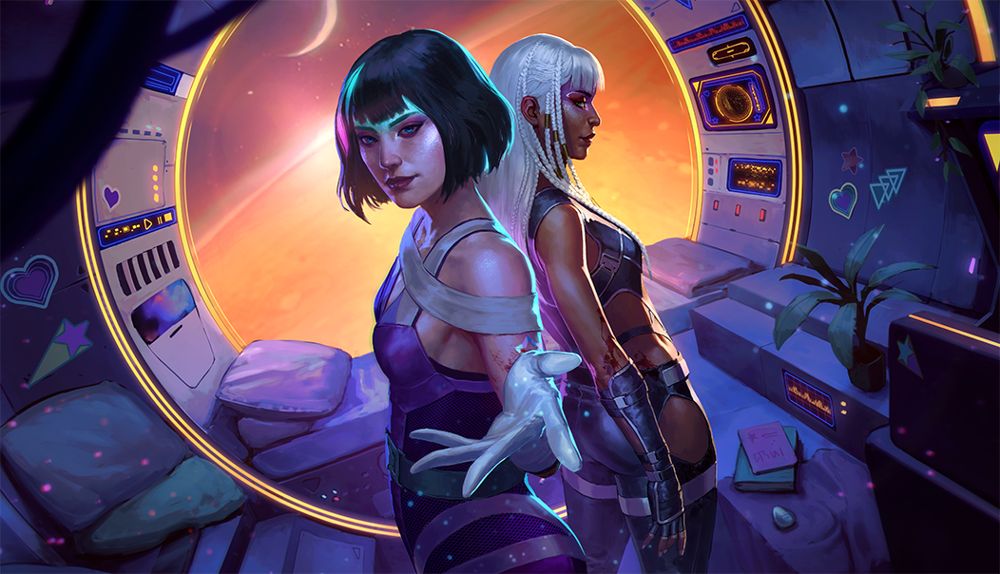
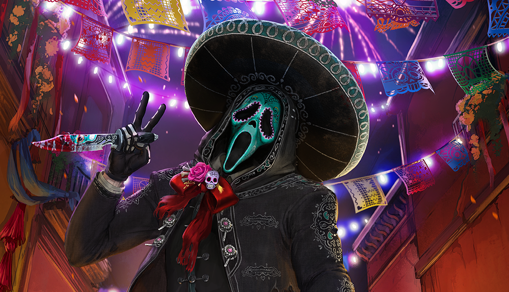
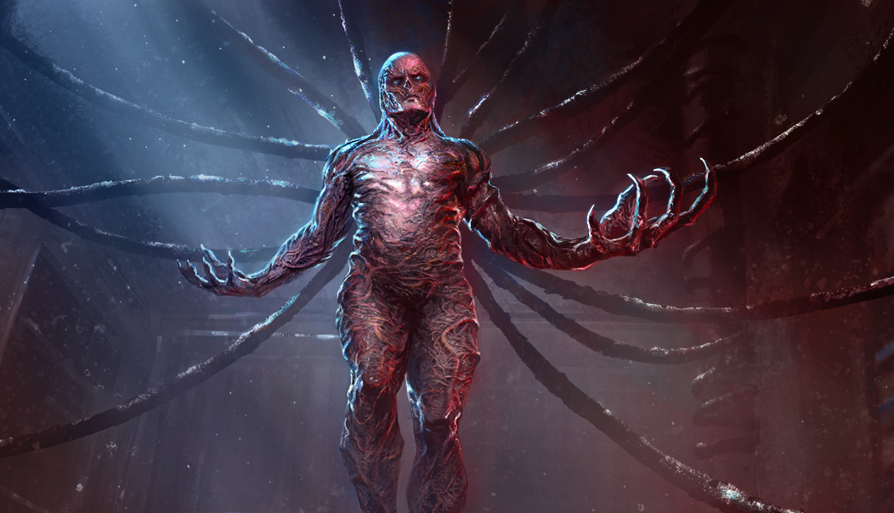

# live · 10.2.2_3896896live

| | |
|---|---|
| Build date | 2026-10-19 19:13 UTC |
| CDN version | `10.2.2_3896896live-1792437213` |
| Key | `10.2.2_live` |
| Compared with | [10.2.0_3896874live](../10.2.0_3896874live/CHANGES.md) (2026-10-19 18:23 UTC) |

## Summary

**8** added · **22** modified · **3** removed · 188 unchanged

## New or updated images

<a href="images/T_UI_CollectionBanner_Diablo.png"></a>
<a href="images/T_UI_CollectionBanner_Godmode.png"></a>
<a href="images/T_UI_CollectionBanner_StrangerThings_Vecna.png"></a>
<a href="images/T_UI_SpecialPack_Diablo.png"></a>
<a href="images/T_UI_SpecialPack_Godmode.png"></a>
<a href="images/T_UI_SpecialPack_NovemberDays_Ghostface.png"></a>
<a href="images/T_UI_SpecialPack_StrangerThings_Vecna.png"></a>
<a href="images/T_UI__CollectionBanner_NovemberDays_Ghostface.png"></a>

## Removed files

- `images/T_UI_CollectionBanner_NieR.png`
- `images/T_UI_SpecialPack_NieR.png`
- `images/T_UI_SpecialPack_Rift7.png`

## Modified files

### [`catalog.json`](catalog.json)

[Full line-by-line diff](diffs/catalog.json.diff)

```diff
+ $[id=DK_Head033]
+ $[id=DK_Legs033]
+ $[id=DK_Torso033]
+ $[id=K26_Body022]
+ $[id=K26_Head022]
+ $[id=K26_W022]
+ $[id=K28_Body024]
+ $[id=K28_Head024]
+ $[id=K28_W024]
+ $[id=K42_Body008]
+ $[id=K42_Head008]
+ $[id=K42_W008]
+ $[id=OK_Body018]
+ $[id=OK_Mask018]
+ $[id=OK_W018]
+ $[id=QF_Head012]
+ $[id=QF_Legs012]
+ $[id=QF_Torso012]
+ $[id=QM_Head011]
+ $[id=QM_Legs011]
+ $[id=QM_Torso011]
+ $[id=S24_Head029]
+ $[id=S24_Legs029]
+ $[id=S24_Torso029]
+ $[id=S25_Head034]
+ $[id=S25_Legs034]
+ $[id=S25_Torso034]
+ $[id=S45_Head017]
+ $[id=S45_Legs017]
+ $[id=S45_Torso017]
+ $[id=S46_Head017]
+ $[id=S46_Legs017]
+ $[id=S46_Torso017]
+ $[id=S52_Head010]
+ $[id=S52_Legs010]
+ $[id=S52_Torso010]
+ $[id=TN_Body028]
+ $[id=TN_Head028]
+ $[id=TN_W028]
+ $[id=US_Head034]
+ $[id=US_Legs034]
+ $[id=US_Torso034]
+ $[id=VAN_018]
+ $[id=VAN_019]
+ $[id=VAN_BDG_01]
+ $[id=VAN_BDG_20]
+ $[id=VAN_BDG_21]
+ $[id=VAN_BDG_22]
+ $[id=VAN_BNR_19]
+ $[id=VAN_BNR_20]
+ $[id=VAN_BNR_21]
+ $[id=VAN_BNR_22]
+ $[id=DK_outfit_033]
+ $[id=K26_outfit_022]
+ $[id=K28_outfit_024]
+ $[id=K42_outfit_008]
+ $[id=OK_outfit_018]
+ $[id=QF_outfit_012]
+ $[id=QM_Outfit_011]
+ $[id=S24_outfit_029]
+ $[id=S25_outfit_034]
+ $[id=S45_outfit_017]
+ $[id=S46_outfit_017]
+ $[id=S52_outfit_010]
+ $[id=TN_Outfit_028]
+ $[id=US_Outfit_034]
+ $[id=Recurring_Dev_Bundle_260929]
+ $[id=Recurring_Dev_Bundle_261006]
+ $[id=10.2.2_Diablo_collection_item]
+ $[id=10.2.2_Godmode_collection_item]
+ $[id=10.2.2_NovemberDays_collection_item]
+ $[id=10.2.2_StrangerThings_collection_item]
+ $[id=10.2.2_CozyBreak_collection_item]
+ $[id=PL_054].metaData.eventID: "DbdDay2025"
+ $[id=XR_054].metaData.eventID: "DbdDay2025"
- $[id=10.1.2_Autumn_Fashion].metaData.sortOrder: 0
+ $[id=10.1.2_Autumn_Fashion].metaData.sortOrder: 1999
- $[id=10.1.2_Blighted_Bundle].metaData.sortOrder: 0
+ $[id=10.1.2_Blighted_Bundle].metaData.sortOrder: 2002
- $[id=SAW_Bundle].metaData.sortOrder: 1001
+ $[id=SAW_Bundle].metaData.sortOrder: 2001
- $[id=Tome_8_Bundle].metaData.sortOrder: 1000
+ $[id=Tome_8_Bundle].metaData.sortOrder: 1998
- $[id=From_The_Rift_Bundle_260929].consumptionReward[id=S29_Head009_01]
- $[id=From_The_Rift_Bundle_260929].consumptionReward[id=S29_Torso008_01]
- $[id=From_The_Rift_Bundle_260929].consumptionReward[id=S29_Legs008_01]
+ $[id=From_The_Rift_Bundle_260929].consumptionReward[id=K21_Head010_01]
+ $[id=From_The_Rift_Bundle_260929].consumptionReward[id=K21_Body010_01]
+ $[id=From_The_Rift_Bundle_260929].consumptionReward[id=K21_W010_01]
- $[id=From_The_Rift_Bundle_261006].consumptionReward[id=TW_Head007_01]
- $[id=From_The_Rift_Bundle_261006].consumptionReward[id=TW_Body02_01]
- $[id=From_The_Rift_Bundle_261006].consumptionReward[id=TW_W03_03]
+ $[id=From_The_Rift_Bundle_261006].consumptionReward[id=MT_Head012_01]
+ $[id=From_The_Rift_Bundle_261006].consumptionReward[id=MT_Torso012_01]
+ $[id=From_The_Rift_Bundle_261006].consumptionReward[id=MT_Legs015_01]
```

### [`challengeLocs/challengeText_de.json`](challengeLocs/challengeText_de.json)

[Full line-by-line diff](diffs/challengeLocs/challengeText_de.json.diff)

```diff
- $.locText[387].text: "Hake <b>{0} Überlebende(n)</b> fest."
+ $.locText[387].text: "Hook <b>{0} Survivor(s)</b> in Haunted by Daylight"
- $.locText[387].textId: "CHALLENGE_Hook_DESC"
+ $.locText[387].textId: "CHALLENGE_EventHook_DESC"
- $.locText[388].text: "Zerschmettere {0} Leerekristalle."
+ $.locText[388].text: "Hook <b>{0} Survivor(s)</b> in Haunted by Daylight"
- $.locText[388].textId: "CHALLENGE_ShatterVoidCrystal_TITLE"
+ $.locText[388].textId: "CHALLENGE_EventHook_INFO"
- $.locText[389].textId: "CHALLENGE_ShatterVoidCrystal_DESC"
+ $.locText[389].textId: "CHALLENGE_ShatterVoidCrystal_TITLE"
- $.locText[390].textId: "CHALLENGE_ShatterVoidCrystal_INFO"
+ $.locText[390].textId: "CHALLENGE_ShatterVoidCrystal_DESC"
- $.locText[391].text: "Führe {0} verstärkte Zerstörungen durch."
+ $.locText[391].text: "Zerschmettere {0} Leerekristalle."
- $.locText[391].textId: "CHALLENGE_EmpoweredBreak_TITLE"
+ $.locText[391].textId: "CHALLENGE_ShatterVoidCrystal_INFO"
- $.locText[392].textId: "CHALLENGE_EmpoweredBreak_DESC"
+ $.locText[392].textId: "CHALLENGE_EmpoweredBreak_TITLE"
- $.locText[393].textId: "CHALLENGE_EmpoweredBreak_INFO"
+ $.locText[393].textId: "CHALLENGE_EmpoweredBreak_DESC"
- $.locText[394].text: "@#CHALLENGE_OpenVoidPortal_TITLE"
+ $.locText[394].text: "Führe {0} verstärkte Zerstörungen durch."
- $.locText[394].textId: "CHALLENGE_OpenVoidPortal_TITLE"
+ $.locText[394].textId: "CHALLENGE_EmpoweredBreak_INFO"
- $.locText[395].text: "@#CHALLENGE_OpenVoidPortal_DESC"
+ $.locText[395].text: "@#CHALLENGE_OpenVoidPortal_TITLE"
- $.locText[395].textId: "CHALLENGE_OpenVoidPortal_DESC"
+ $.locText[395].textId: "CHALLENGE_OpenVoidPortal_TITLE"
- $.locText[396].text: "Öffne {0} Portal(e)."
+ $.locText[396].text: "@#CHALLENGE_OpenVoidPortal_DESC"
- $.locText[396].textId: "CHALLENGE_OpenVoidPortal_INFO"
+ $.locText[396].textId: "CHALLENGE_OpenVoidPortal_DESC"
- $.locText[397].text: "Überrasche {0} Überlebende(n) an Portalen."
+ $.locText[397].text: "Öffne {0} Portal(e)."
- $.locText[397].textId: "CHALLENGE_PortalJumpScare_TITLE"
+ $.locText[397].textId: "CHALLENGE_OpenVoidPortal_INFO"
- $.locText[398].textId: "CHALLENGE_PortalJumpScare_DESC"
+ $.locText[398].textId: "CHALLENGE_PortalJumpScare_TITLE"
- $.locText[399].textId: "CHALLENGE_PortalJumpScare_INFO"
+ $.locText[399].textId: "CHALLENGE_PortalJumpScare_DESC"
- $.locText[400].text: "Sammle {0} Einheiten Leereenergie von Portalen."
+ $.locText[400].text: "Überrasche {0} Überlebende(n) an Portalen."
- $.locText[400].textId: "CHALLENGE_CollectVoidFromPortal_TITLE"
+ $.locText[400].textId: "CHALLENGE_PortalJumpScare_INFO"
- $.locText[401].textId: "CHALLENGE_CollectVoidFromPortal_DESC"
+ $.locText[401].textId: "CHALLENGE_CollectVoidFromPortal_TITLE"
- $.locText[402].textId: "CHALLENGE_CollectVoidFromPortal_INFO"
+ $.locText[402].textId: "CHALLENGE_CollectVoidFromPortal_DESC"
- $.locText[403].text: "Teleportiere dich durch {0} Portale."
+ $.locText[403].text: "Sammle {0} Einheiten Leereenergie von Portalen."
- $.locText[403].textId: "CHALLENGE_PortalTeleport_TITLE"
+ $.locText[403].textId: "CHALLENGE_CollectVoidFromPortal_INFO"
- $.locText[404].textId: "CHALLENGE_PortalTeleport_DESC"
+ $.locText[404].textId: "CHALLENGE_PortalTeleport_TITLE"
- $.locText[405].textId: "CHALLENGE_PortalTeleport_INFO"
+ $.locText[405].textId: "CHALLENGE_PortalTeleport_DESC"
- $.locText[406].text: "@#CHALLENGE_InjureSurvivorWithHaunt_TITLE"
+ $.locText[406].text: "Teleportiere dich durch {0} Portale."
- $.locText[406].textId: "CHALLENGE_InjureSurvivorWithHaunt_TITLE"
+ $.locText[406].textId: "CHALLENGE_PortalTeleport_INFO"
- $.locText[407].text: "@#CHALLENGE_InjureSurvivorWithHaunt_DESC"
+ $.locText[407].text: "@#CHALLENGE_InjureSurvivorWithHaunt_TITLE"
- $.locText[407].textId: "CHALLENGE_InjureSurvivorWithHaunt_DESC"
+ $.locText[407].textId: "CHALLENGE_InjureSurvivorWithHaunt_TITLE"
- $.locText[408].text: "Verletze {0} Überlebende(n) mit einem gefangenen Spuk."
+ $.locText[408].text: "@#CHALLENGE_InjureSurvivorWithHaunt_DESC"
- $.locText[408].textId: "CHALLENGE_InjureSurvivorWithHaunt_INFO"
+ $.locText[408].textId: "CHALLENGE_InjureSurvivorWithHaunt_DESC"
- $.locText[409].text: "Community-Quests"
+ $.locText[409].text: "Verletze {0} Überlebende(n) mit einem gefangenen Spuk."
- $.locText[409].textId: "Halloween_CommunityQuests_Title"
+ $.locText[409].textId: "CHALLENGE_InjureSurvivorWithHaunt_INFO"
- $.locText[410].text: "„Spuk in Dead by Daylight“-Abschlussquests"
+ $.locText[410].text: "Community-Quests"
- $.locText[410].textId: "Halloween_OverarchingQuests_Title"
+ $.locText[410].textId: "Halloween_CommunityQuests_Title"
- $.locText[411].text: "„Spuk in Dead by Daylight“-Meilenstein-Quests"
+ $.locText[411].text: "„Spuk in Dead by Daylight“-Abschlussquests"
- $.locText[411].textId: "Halloween_MilestoneQuests_TITLE"
+ $.locText[411].textId: "Halloween_OverarchingQuests_Title"
- $.locText[412].text: "„Spuk in Dead by Daylight“-Quests – Teil 1"
+ $.locText[412].text: "„Spuk in Dead by Daylight“-Meilenstein-Quests"
- $.locText[412].textId: "Halloween_QuestList_1_Title"
+ $.locText[412].textId: "Halloween_MilestoneQuests_TITLE"
- $.locText[413].text: "„Spuk in Dead by Daylight“-Quests – Teil 2"
+ $.locText[413].text: "„Spuk in Dead by Daylight“-Quests – Teil 1"
- $.locText[413].textId: "Halloween_QuestList_2_Title"
+ $.locText[413].textId: "Halloween_QuestList_1_Title"
- $.locText[414].text: "„Spuk in Dead by Daylight“-Quests – Teil 3"
+ $.locText[414].text: "„Spuk in Dead by Daylight“-Quests – Teil 2"
- $.locText[414].textId: "Halloween_QuestList_3_Title"
+ $.locText[414].textId: "Halloween_QuestList_2_Title"
- $.locText[415].text: "„Spuk in Dead by Daylight“-Quests – Teil 4"
+ $.locText[415].text: "„Spuk in Dead by Daylight“-Quests – Teil 3"
- $.locText[415].textId: "Halloween_QuestList_4_Title"
+ $.locText[415].textId: "Halloween_QuestList_3_Title"
- $.locText[416].text: "Spuk in Dead by Daylight"
+ $.locText[416].text: "„Spuk in Dead by Daylight“-Quests – Teil 4"
- $.locText[416].textId: "CHALLENGESET_Halloween_TITLE"
+ $.locText[416].textId: "Halloween_QuestList_4_Title"
- $.locText[417].text: "@#CHALLENGESET_Halloween_INFO"
+ $.locText[417].text: "Spuk in Dead by Daylight"
- $.locText[417].textId: "CHALLENGESET_Halloween_INFO"
+ $.locText[417].textId: "CHALLENGESET_Halloween_TITLE"
- $.locText[418].text: "Zerstöre {0} Kürbis(se)."
+ $.locText[418].text: "@#CHALLENGESET_Halloween_INFO"
- $.locText[418].textId: "CHALLENGE_SmashPumpkins_INFO"
+ $.locText[418].textId: "CHALLENGESET_Halloween_INFO"
- $.locText[419].text: "@#CHALLENGE_CollectVoidEnergyFromOrb_TITLE"
+ $.locText[419].text: "Zerstöre {0} Kürbis(se)."
- $.locText[419].textId: "CHALLENGE_CollectVoidEnergyFromOrb_TITLE"
+ $.locText[419].textId: "CHALLENGE_SmashPumpkins_INFO"
- $.locText[420].text: "@#CHALLENGE_CollectVoidEnergyFromOrb_DESC"
+ $.locText[420].text: "@#CHALLENGE_CollectVoidEnergyFromOrb_TITLE"
- $.locText[420].textId: "CHALLENGE_CollectVoidEnergyFromOrb_DESC"
+ $.locText[420].textId: "CHALLENGE_CollectVoidEnergyFromOrb_TITLE"
- $.locText[421].text: "Sammle {0}-mal Leereenergie aus einer Leerekugel."
+ $.locText[421].text: "@#CHALLENGE_CollectVoidEnergyFromOrb_DESC"
- $.locText[421].textId: "CHALLENGE_CollectVoidEnergyFromOrb_INFO"
+ $.locText[421].textId: "CHALLENGE_CollectVoidEnergyFromOrb_DESC"
- $.locText[422].text: "@#CHALLENGE_HookInVoidMap_TITLE"
+ $.locText[422].text: "Sammle {0}-mal Leereenergie aus einer Leerekugel."
- $.locText[422].textId: "CHALLENGE_HookInVoidMap_TITLE"
+ $.locText[422].textId: "CHALLENGE_CollectVoidEnergyFromOrb_INFO"
- $.locText[423].text: "@#CHALLENGE_HookInVoidMap_DESC"
+ $.locText[423].text: "@#CHALLENGE_HookInVoidMap_TITLE"
- $.locText[423].textId: "CHALLENGE_HookInVoidMap_DESC"
+ $.locText[423].textId: "CHALLENGE_HookInVoidMap_TITLE"
- $.locText[424].text: "Hake {0} Überlebende(n) in der Leere fest."
+ $.locText[424].text: "@#CHALLENGE_HookInVoidMap_DESC"
- $.locText[424].textId: "CHALLENGE_HookInVoidMap_INFO"
+ $.locText[424].textId: "CHALLENGE_HookInVoidMap_DESC"
- $.locText[425].text: "@#CHALLENGE_CraftVoidCrystal_TITLE"
+ $.locText[425].text: "Hake {0} Überlebende(n) in der Leere fest."
- $.locText[425].textId: "CHALLENGE_CraftVoidCrystal_TITLE"
+ $.locText[425].textId: "CHALLENGE_HookInVoidMap_INFO"
- $.locText[426].text: "@#CHALLENGE_CraftVoidCrystal_DESC"
+ $.locText[426].text: "@#CHALLENGE_CraftVoidCrystal_TITLE"
- $.locText[426].textId: "CHALLENGE_CraftVoidCrystal_DESC"
+ $.locText[426].textId: "CHALLENGE_CraftVoidCrystal_TITLE"
- $.locText[427].text: "Fertige {0} Leerekristall(e)."
+ $.locText[427].text: "@#CHALLENGE_CraftVoidCrystal_DESC"
- $.locText[427].textId: "CHALLENGE_CraftVoidCrystal_INFO"
+ $.locText[427].textId: "CHALLENGE_CraftVoidCrystal_DESC"
- $.locText[428].text: "@#CHALLENGE_DownNearPalletsOrReviveDying_TITLE"
+ $.locText[428].text: "Fertige {0} Leerekristall(e)."
- $.locText[428].textId: "CHALLENGE_DownNearPalletsOrReviveDying_TITLE"
+ $.locText[428].textId: "CHALLENGE_CraftVoidCrystal_INFO"
- $.locText[429].text: "@#CHALLENGE_DownNearPalletsOrReviveDying_DESC"
+ $.locText[429].text: "@#CHALLENGE_DownNearPalletsOrReviveDying_TITLE"
- $.locText[429].textId: "CHALLENGE_DownNearPalletsOrReviveDying_DESC"
+ $.locText[429].textId: "CHALLENGE_DownNearPalletsOrReviveDying_TITLE"
- $.locText[430].text: "Strecke {0} Überlebende(n) in der Nähe einer Palette nieder."
+ $.locText[430].text: "@#CHALLENGE_DownNearPalletsOrReviveDying_DESC"
- $.locText[430].textId: "CHALLENGE_DownNearPallet_INFO"
+ $.locText[430].textId: "CHALLENGE_DownNearPalletsOrReviveDying_DESC"
- $.locText[431].text: "@#CHALLENGE_EscapeChaseWithVoidCrystalIn10Sec_TITLE"
+ $.locText[431].text: "Strecke {0} Überlebende(n) in der Nähe einer Palette nieder."
- $.locText[431].textId: "CHALLENGE_EscapeChaseWithVoidCrystalIn10Sec_TITLE"
+ $.locText[431].textId: "CHALLENGE_DownNearPallet_INFO"
- $.locText[432].text: "@#CHALLENGE_EscapeChaseWithVoidCrystalIn10Sec_DESC"
+ $.locText[432].text: "@#CHALLENGE_EscapeChaseWithVoidCrystalIn10Sec_TITLE"
- $.locText[432].textId: "CHALLENGE_EscapeChaseWithVoidCrystalIn10Sec_DESC"
+ $.locText[432].textId: "CHALLENGE_EscapeChaseWithVoidCrystalIn10Sec_TITLE"
- $.locText[433].text: "Entkomme {0} Jagd(en) innerhalb von 10 Sekunden nach der Verwendung eines Leerekristalls."
+ $.locText[433].text: "@#CHALLENGE_EscapeChaseWithVoidCrystalIn10Sec_DESC"
- $.locText[433].textId: "CHALLENGE_EscapeChaseWithVoidCrystalIn10Sec_INFO"
+ $.locText[433].textId: "CHALLENGE_EscapeChaseWithVoidCrystalIn10Sec_DESC"
- $.locText[434].text: "@#CHALLENGE_HookEsoteric_TITLE"
+ $.locText[434].text: "Entkomme {0} Jagd(en) innerhalb von 10 Sekunden nach der Verwendung eines Leerekristalls."
- $.locText[434].textId: "CHALLENGE_HookEsoteric_TITLE"
+ $.locText[434].textId: "CHALLENGE_EscapeChaseWithVoidCrystalIn10Sec_INFO"
- $.locText[435].text: "@#CHALLENGE_HookEsoteric_DESC"
+ $.locText[435].text: "@#CHALLENGE_HookEsoteric_TITLE"
- $.locText[435].textId: "CHALLENGE_HookEsoteric_DESC"
+ $.locText[435].textId: "CHALLENGE_HookEsoteric_TITLE"
- $.locText[436].text: "Hake {0} Überlebende(n) an esoterischen Haken fest."
+ $.locText[436].text: "@#CHALLENGE_HookEsoteric_DESC"
- $.locText[436].textId: "CHALLENGE_HookEsoteric_INFO"
+ $.locText[436].textId: "CHALLENGE_HookEsoteric_DESC"
- $.locText[437].text: "@#CHALLENGE_RepairEsotericGen_TITLE"
+ $.locText[437].text: "Hake {0} Überlebende(n) an esoterischen Haken fest."
- $.locText[437].textId: "CHALLENGE_RepairEsotericGen_TITLE"
+ $.locText[437].textId: "CHALLENGE_HookEsoteric_INFO"
- $.locText[438].text: "@#CHALLENGE_RepairEsotericGen_DESC"
+ $.locText[438].text: "@#CHALLENGE_RepairEsotericGen_TITLE"
- $.locText[438].textId: "CHALLENGE_RepairEsotericGen_DESC"
+ $.locText[438].textId: "CHALLENGE_RepairEsotericGen_TITLE"
- $.locText[439].text: "Repariere {0} esoterische(n) Generator(en)."
+ $.locText[439].text: "@#CHALLENGE_RepairEsotericGen_DESC"
- $.locText[439].textId: "CHALLENGE_RepairEsotericGen_INFO"
+ $.locText[439].textId: "CHALLENGE_RepairEsotericGen_DESC"
- $.locText[440].text: "SPUK IN DEAD BY DAYLIGHT"
+ $.locText[440].text: "Repariere {0} esoterische(n) Generator(en)."
- $.locText[440].textId: "EVENT_Halloween2025_TITLE"
+ $.locText[440].textId: "CHALLENGE_RepairEsotericGen_INFO"
- $.locText[441].text: "La Fogata"
+ $.locText[441].text: "SPUK IN DEAD BY DAYLIGHT"
- $.locText[441].textId: "CHALLENGESET_LaFogata_TITLE"
+ $.locText[441].textId: "EVENT_Halloween2025_TITLE"
… 1110 more change(s) — see the commit diff for everything
```

### [`challengeLocs/challengeText_en.json`](challengeLocs/challengeText_en.json)

[Full line-by-line diff](diffs/challengeLocs/challengeText_en.json.diff)

```diff
- $.locText[387].text: "Hook <b>{0} Survivor(s)</b>."
+ $.locText[387].text: "Hook <b>{0} Survivor(s)</b> in Haunted by Daylight"
- $.locText[387].textId: "CHALLENGE_Hook_DESC"
+ $.locText[387].textId: "CHALLENGE_EventHook_DESC"
- $.locText[388].text: "Shatter {0} Void Crystals"
+ $.locText[388].text: "Hook <b>{0} Survivor(s)</b> in Haunted by Daylight"
- $.locText[388].textId: "CHALLENGE_ShatterVoidCrystal_TITLE"
+ $.locText[388].textId: "CHALLENGE_EventHook_INFO"
- $.locText[389].textId: "CHALLENGE_ShatterVoidCrystal_DESC"
+ $.locText[389].textId: "CHALLENGE_ShatterVoidCrystal_TITLE"
- $.locText[390].textId: "CHALLENGE_ShatterVoidCrystal_INFO"
+ $.locText[390].textId: "CHALLENGE_ShatterVoidCrystal_DESC"
- $.locText[391].text: "Complete {0} Empowered Breaks"
+ $.locText[391].text: "Shatter {0} Void Crystals"
- $.locText[391].textId: "CHALLENGE_EmpoweredBreak_TITLE"
+ $.locText[391].textId: "CHALLENGE_ShatterVoidCrystal_INFO"
- $.locText[392].textId: "CHALLENGE_EmpoweredBreak_DESC"
+ $.locText[392].textId: "CHALLENGE_EmpoweredBreak_TITLE"
- $.locText[393].textId: "CHALLENGE_EmpoweredBreak_INFO"
+ $.locText[393].textId: "CHALLENGE_EmpoweredBreak_DESC"
- $.locText[394].text: "@#CHALLENGE_OpenVoidPortal_TITLE"
+ $.locText[394].text: "Complete {0} Empowered Breaks"
- $.locText[394].textId: "CHALLENGE_OpenVoidPortal_TITLE"
+ $.locText[394].textId: "CHALLENGE_EmpoweredBreak_INFO"
- $.locText[395].text: "@#CHALLENGE_OpenVoidPortal_DESC"
+ $.locText[395].text: "@#CHALLENGE_OpenVoidPortal_TITLE"
- $.locText[395].textId: "CHALLENGE_OpenVoidPortal_DESC"
+ $.locText[395].textId: "CHALLENGE_OpenVoidPortal_TITLE"
- $.locText[396].text: "Open {0} portal(s)"
+ $.locText[396].text: "@#CHALLENGE_OpenVoidPortal_DESC"
- $.locText[396].textId: "CHALLENGE_OpenVoidPortal_INFO"
+ $.locText[396].textId: "CHALLENGE_OpenVoidPortal_DESC"
- $.locText[397].text: "Surprise {0} Survivor(s) At Portals"
+ $.locText[397].text: "Open {0} portal(s)"
- $.locText[397].textId: "CHALLENGE_PortalJumpScare_TITLE"
+ $.locText[397].textId: "CHALLENGE_OpenVoidPortal_INFO"
- $.locText[398].textId: "CHALLENGE_PortalJumpScare_DESC"
+ $.locText[398].textId: "CHALLENGE_PortalJumpScare_TITLE"
- $.locText[399].textId: "CHALLENGE_PortalJumpScare_INFO"
+ $.locText[399].textId: "CHALLENGE_PortalJumpScare_DESC"
- $.locText[400].text: "Collect {0} Void Energy From Portals"
+ $.locText[400].text: "Surprise {0} Survivor(s) At Portals"
- $.locText[400].textId: "CHALLENGE_CollectVoidFromPortal_TITLE"
+ $.locText[400].textId: "CHALLENGE_PortalJumpScare_INFO"
- $.locText[401].textId: "CHALLENGE_CollectVoidFromPortal_DESC"
+ $.locText[401].textId: "CHALLENGE_CollectVoidFromPortal_TITLE"
- $.locText[402].textId: "CHALLENGE_CollectVoidFromPortal_INFO"
+ $.locText[402].textId: "CHALLENGE_CollectVoidFromPortal_DESC"
- $.locText[403].text: "Teleport Through {0} Portals"
+ $.locText[403].text: "Collect {0} Void Energy From Portals"
- $.locText[403].textId: "CHALLENGE_PortalTeleport_TITLE"
+ $.locText[403].textId: "CHALLENGE_CollectVoidFromPortal_INFO"
- $.locText[404].textId: "CHALLENGE_PortalTeleport_DESC"
+ $.locText[404].textId: "CHALLENGE_PortalTeleport_TITLE"
- $.locText[405].textId: "CHALLENGE_PortalTeleport_INFO"
+ $.locText[405].textId: "CHALLENGE_PortalTeleport_DESC"
- $.locText[406].text: "@#CHALLENGE_InjureSurvivorWithHaunt_TITLE"
+ $.locText[406].text: "Teleport Through {0} Portals"
- $.locText[406].textId: "CHALLENGE_InjureSurvivorWithHaunt_TITLE"
+ $.locText[406].textId: "CHALLENGE_PortalTeleport_INFO"
- $.locText[407].text: "@#CHALLENGE_InjureSurvivorWithHaunt_DESC"
+ $.locText[407].text: "@#CHALLENGE_InjureSurvivorWithHaunt_TITLE"
- $.locText[407].textId: "CHALLENGE_InjureSurvivorWithHaunt_DESC"
+ $.locText[407].textId: "CHALLENGE_InjureSurvivorWithHaunt_TITLE"
- $.locText[408].text: "Injure {0} Survivor(s) with a Captured Haunt"
+ $.locText[408].text: "@#CHALLENGE_InjureSurvivorWithHaunt_DESC"
- $.locText[408].textId: "CHALLENGE_InjureSurvivorWithHaunt_INFO"
+ $.locText[408].textId: "CHALLENGE_InjureSurvivorWithHaunt_DESC"
- $.locText[409].text: "Community Quests"
+ $.locText[409].text: "Injure {0} Survivor(s) with a Captured Haunt"
- $.locText[409].textId: "Halloween_CommunityQuests_Title"
+ $.locText[409].textId: "CHALLENGE_InjureSurvivorWithHaunt_INFO"
- $.locText[410].text: "Haunted by Daylight Completion Quests"
+ $.locText[410].text: "Community Quests"
- $.locText[410].textId: "Halloween_OverarchingQuests_Title"
+ $.locText[410].textId: "Halloween_CommunityQuests_Title"
- $.locText[411].text: "Haunted by Daylight Milestone Quests"
+ $.locText[411].text: "Haunted by Daylight Completion Quests"
- $.locText[411].textId: "Halloween_MilestoneQuests_TITLE"
+ $.locText[411].textId: "Halloween_OverarchingQuests_Title"
- $.locText[412].text: "Haunted by Daylight Quests - Part 1"
+ $.locText[412].text: "Haunted by Daylight Milestone Quests"
- $.locText[412].textId: "Halloween_QuestList_1_Title"
+ $.locText[412].textId: "Halloween_MilestoneQuests_TITLE"
- $.locText[413].text: "Haunted by Daylight Quests - Part 2"
+ $.locText[413].text: "Haunted by Daylight Quests - Part 1"
- $.locText[413].textId: "Halloween_QuestList_2_Title"
+ $.locText[413].textId: "Halloween_QuestList_1_Title"
- $.locText[414].text: "Haunted by Daylight Quests - Part 3"
+ $.locText[414].text: "Haunted by Daylight Quests - Part 2"
- $.locText[414].textId: "Halloween_QuestList_3_Title"
+ $.locText[414].textId: "Halloween_QuestList_2_Title"
- $.locText[415].text: "Haunted by Daylight Quests - Part 4"
+ $.locText[415].text: "Haunted by Daylight Quests - Part 3"
- $.locText[415].textId: "Halloween_QuestList_4_Title"
+ $.locText[415].textId: "Halloween_QuestList_3_Title"
- $.locText[416].text: "Haunted by Daylight"
+ $.locText[416].text: "Haunted by Daylight Quests - Part 4"
- $.locText[416].textId: "CHALLENGESET_Halloween_TITLE"
+ $.locText[416].textId: "Halloween_QuestList_4_Title"
- $.locText[417].text: "@#CHALLENGESET_Halloween_INFO"
+ $.locText[417].text: "Haunted by Daylight"
- $.locText[417].textId: "CHALLENGESET_Halloween_INFO"
+ $.locText[417].textId: "CHALLENGESET_Halloween_TITLE"
- $.locText[418].text: "Smash {0} pumpkin(s)"
+ $.locText[418].text: "@#CHALLENGESET_Halloween_INFO"
- $.locText[418].textId: "CHALLENGE_SmashPumpkins_INFO"
+ $.locText[418].textId: "CHALLENGESET_Halloween_INFO"
- $.locText[419].text: "@#CHALLENGE_CollectVoidEnergyFromOrb_TITLE"
+ $.locText[419].text: "Smash {0} pumpkin(s)"
- $.locText[419].textId: "CHALLENGE_CollectVoidEnergyFromOrb_TITLE"
+ $.locText[419].textId: "CHALLENGE_SmashPumpkins_INFO"
- $.locText[420].text: "@#CHALLENGE_CollectVoidEnergyFromOrb_DESC"
+ $.locText[420].text: "@#CHALLENGE_CollectVoidEnergyFromOrb_TITLE"
- $.locText[420].textId: "CHALLENGE_CollectVoidEnergyFromOrb_DESC"
+ $.locText[420].textId: "CHALLENGE_CollectVoidEnergyFromOrb_TITLE"
- $.locText[421].text: "Collect Void Energy from a Void Orb {0} time(s)"
+ $.locText[421].text: "@#CHALLENGE_CollectVoidEnergyFromOrb_DESC"
- $.locText[421].textId: "CHALLENGE_CollectVoidEnergyFromOrb_INFO"
+ $.locText[421].textId: "CHALLENGE_CollectVoidEnergyFromOrb_DESC"
- $.locText[422].text: "@#CHALLENGE_HookInVoidMap_TITLE"
+ $.locText[422].text: "Collect Void Energy from a Void Orb {0} time(s)"
- $.locText[422].textId: "CHALLENGE_HookInVoidMap_TITLE"
+ $.locText[422].textId: "CHALLENGE_CollectVoidEnergyFromOrb_INFO"
- $.locText[423].text: "@#CHALLENGE_HookInVoidMap_DESC"
+ $.locText[423].text: "@#CHALLENGE_HookInVoidMap_TITLE"
- $.locText[423].textId: "CHALLENGE_HookInVoidMap_DESC"
+ $.locText[423].textId: "CHALLENGE_HookInVoidMap_TITLE"
- $.locText[424].text: "Hook {0} Survivor(s) in the Void"
+ $.locText[424].text: "@#CHALLENGE_HookInVoidMap_DESC"
- $.locText[424].textId: "CHALLENGE_HookInVoidMap_INFO"
+ $.locText[424].textId: "CHALLENGE_HookInVoidMap_DESC"
- $.locText[425].text: "@#CHALLENGE_CraftVoidCrystal_TITLE"
+ $.locText[425].text: "Hook {0} Survivor(s) in the Void"
- $.locText[425].textId: "CHALLENGE_CraftVoidCrystal_TITLE"
+ $.locText[425].textId: "CHALLENGE_HookInVoidMap_INFO"
- $.locText[426].text: "@#CHALLENGE_CraftVoidCrystal_DESC"
+ $.locText[426].text: "@#CHALLENGE_CraftVoidCrystal_TITLE"
- $.locText[426].textId: "CHALLENGE_CraftVoidCrystal_DESC"
+ $.locText[426].textId: "CHALLENGE_CraftVoidCrystal_TITLE"
- $.locText[427].text: "Craft {0} Void Crystal(s)"
+ $.locText[427].text: "@#CHALLENGE_CraftVoidCrystal_DESC"
- $.locText[427].textId: "CHALLENGE_CraftVoidCrystal_INFO"
+ $.locText[427].textId: "CHALLENGE_CraftVoidCrystal_DESC"
- $.locText[428].text: "@#CHALLENGE_DownNearPalletsOrReviveDying_TITLE"
+ $.locText[428].text: "Craft {0} Void Crystal(s)"
- $.locText[428].textId: "CHALLENGE_DownNearPalletsOrReviveDying_TITLE"
+ $.locText[428].textId: "CHALLENGE_CraftVoidCrystal_INFO"
- $.locText[429].text: "@#CHALLENGE_DownNearPalletsOrReviveDying_DESC"
+ $.locText[429].text: "@#CHALLENGE_DownNearPalletsOrReviveDying_TITLE"
- $.locText[429].textId: "CHALLENGE_DownNearPalletsOrReviveDying_DESC"
+ $.locText[429].textId: "CHALLENGE_DownNearPalletsOrReviveDying_TITLE"
- $.locText[430].text: "Down {0} Survivor(s) near a pallet"
+ $.locText[430].text: "@#CHALLENGE_DownNearPalletsOrReviveDying_DESC"
- $.locText[430].textId: "CHALLENGE_DownNearPallet_INFO"
+ $.locText[430].textId: "CHALLENGE_DownNearPalletsOrReviveDying_DESC"
- $.locText[431].text: "@#CHALLENGE_EscapeChaseWithVoidCrystalIn10Sec_TITLE"
+ $.locText[431].text: "Down {0} Survivor(s) near a pallet"
- $.locText[431].textId: "CHALLENGE_EscapeChaseWithVoidCrystalIn10Sec_TITLE"
+ $.locText[431].textId: "CHALLENGE_DownNearPallet_INFO"
- $.locText[432].text: "@#CHALLENGE_EscapeChaseWithVoidCrystalIn10Sec_DESC"
+ $.locText[432].text: "@#CHALLENGE_EscapeChaseWithVoidCrystalIn10Sec_TITLE"
- $.locText[432].textId: "CHALLENGE_EscapeChaseWithVoidCrystalIn10Sec_DESC"
+ $.locText[432].textId: "CHALLENGE_EscapeChaseWithVoidCrystalIn10Sec_TITLE"
- $.locText[433].text: "Escape {0} chase(s) within 10 seconds of using a Void Crystal"
+ $.locText[433].text: "@#CHALLENGE_EscapeChaseWithVoidCrystalIn10Sec_DESC"
- $.locText[433].textId: "CHALLENGE_EscapeChaseWithVoidCrystalIn10Sec_INFO"
+ $.locText[433].textId: "CHALLENGE_EscapeChaseWithVoidCrystalIn10Sec_DESC"
- $.locText[434].text: "@#CHALLENGE_HookEsoteric_TITLE"
+ $.locText[434].text: "Escape {0} chase(s) within 10 seconds of using a Void Crystal"
- $.locText[434].textId: "CHALLENGE_HookEsoteric_TITLE"
+ $.locText[434].textId: "CHALLENGE_EscapeChaseWithVoidCrystalIn10Sec_INFO"
- $.locText[435].text: "@#CHALLENGE_HookEsoteric_DESC"
+ $.locText[435].text: "@#CHALLENGE_HookEsoteric_TITLE"
- $.locText[435].textId: "CHALLENGE_HookEsoteric_DESC"
+ $.locText[435].textId: "CHALLENGE_HookEsoteric_TITLE"
- $.locText[436].text: "Hook {0} Survivor(s) on Esoteric Hooks"
+ $.locText[436].text: "@#CHALLENGE_HookEsoteric_DESC"
- $.locText[436].textId: "CHALLENGE_HookEsoteric_INFO"
+ $.locText[436].textId: "CHALLENGE_HookEsoteric_DESC"
- $.locText[437].text: "@#CHALLENGE_RepairEsotericGen_TITLE"
+ $.locText[437].text: "Hook {0} Survivor(s) on Esoteric Hooks"
- $.locText[437].textId: "CHALLENGE_RepairEsotericGen_TITLE"
+ $.locText[437].textId: "CHALLENGE_HookEsoteric_INFO"
- $.locText[438].text: "@#CHALLENGE_RepairEsotericGen_DESC"
+ $.locText[438].text: "@#CHALLENGE_RepairEsotericGen_TITLE"
- $.locText[438].textId: "CHALLENGE_RepairEsotericGen_DESC"
+ $.locText[438].textId: "CHALLENGE_RepairEsotericGen_TITLE"
- $.locText[439].text: "Repair {0} esoteric generator(s)"
+ $.locText[439].text: "@#CHALLENGE_RepairEsotericGen_DESC"
- $.locText[439].textId: "CHALLENGE_RepairEsotericGen_INFO"
+ $.locText[439].textId: "CHALLENGE_RepairEsotericGen_DESC"
- $.locText[440].text: "HAUNTED BY DAYLIGHT"
+ $.locText[440].text: "Repair {0} esoteric generator(s)"
- $.locText[440].textId: "EVENT_Halloween2025_TITLE"
+ $.locText[440].textId: "CHALLENGE_RepairEsotericGen_INFO"
- $.locText[441].text: "La Fogata"
+ $.locText[441].text: "HAUNTED BY DAYLIGHT"
- $.locText[441].textId: "CHALLENGESET_LaFogata_TITLE"
+ $.locText[441].textId: "EVENT_Halloween2025_TITLE"
… 1110 more change(s) — see the commit diff for everything
```

### [`challengeLocs/challengeText_es-MX.json`](challengeLocs/challengeText_es-MX.json)

[Full line-by-line diff](diffs/challengeLocs/challengeText_es-MX.json.diff)

```diff
- $.locText[387].text: "Cuelga a <b>{0} sobreviviente(s)</b>."
+ $.locText[387].text: "Hook <b>{0} Survivor(s)</b> in Haunted by Daylight"
- $.locText[387].textId: "CHALLENGE_Hook_DESC"
+ $.locText[387].textId: "CHALLENGE_EventHook_DESC"
- $.locText[388].text: "Quiebra {0} cristales del Vacío"
+ $.locText[388].text: "Hook <b>{0} Survivor(s)</b> in Haunted by Daylight"
- $.locText[388].textId: "CHALLENGE_ShatterVoidCrystal_TITLE"
+ $.locText[388].textId: "CHALLENGE_EventHook_INFO"
- $.locText[389].textId: "CHALLENGE_ShatterVoidCrystal_DESC"
+ $.locText[389].textId: "CHALLENGE_ShatterVoidCrystal_TITLE"
- $.locText[390].textId: "CHALLENGE_ShatterVoidCrystal_INFO"
+ $.locText[390].textId: "CHALLENGE_ShatterVoidCrystal_DESC"
- $.locText[391].text: "Completa {0} rupturas potenciadas"
+ $.locText[391].text: "Quiebra {0} cristales del Vacío"
- $.locText[391].textId: "CHALLENGE_EmpoweredBreak_TITLE"
+ $.locText[391].textId: "CHALLENGE_ShatterVoidCrystal_INFO"
- $.locText[392].textId: "CHALLENGE_EmpoweredBreak_DESC"
+ $.locText[392].textId: "CHALLENGE_EmpoweredBreak_TITLE"
- $.locText[393].textId: "CHALLENGE_EmpoweredBreak_INFO"
+ $.locText[393].textId: "CHALLENGE_EmpoweredBreak_DESC"
- $.locText[394].text: "@#CHALLENGE_OpenVoidPortal_TITLE"
+ $.locText[394].text: "Completa {0} rupturas potenciadas"
- $.locText[394].textId: "CHALLENGE_OpenVoidPortal_TITLE"
+ $.locText[394].textId: "CHALLENGE_EmpoweredBreak_INFO"
- $.locText[395].text: "@#CHALLENGE_OpenVoidPortal_DESC"
+ $.locText[395].text: "@#CHALLENGE_OpenVoidPortal_TITLE"
- $.locText[395].textId: "CHALLENGE_OpenVoidPortal_DESC"
+ $.locText[395].textId: "CHALLENGE_OpenVoidPortal_TITLE"
- $.locText[396].text: "Abre {0} portal(es)"
+ $.locText[396].text: "@#CHALLENGE_OpenVoidPortal_DESC"
- $.locText[396].textId: "CHALLENGE_OpenVoidPortal_INFO"
+ $.locText[396].textId: "CHALLENGE_OpenVoidPortal_DESC"
- $.locText[397].text: "Sorprende a {0} sobreviviente(s) en los portales"
+ $.locText[397].text: "Abre {0} portal(es)"
- $.locText[397].textId: "CHALLENGE_PortalJumpScare_TITLE"
+ $.locText[397].textId: "CHALLENGE_OpenVoidPortal_INFO"
- $.locText[398].textId: "CHALLENGE_PortalJumpScare_DESC"
+ $.locText[398].textId: "CHALLENGE_PortalJumpScare_TITLE"
- $.locText[399].textId: "CHALLENGE_PortalJumpScare_INFO"
+ $.locText[399].textId: "CHALLENGE_PortalJumpScare_DESC"
- $.locText[400].text: "Obtén {0} de energía del Vacío de los portales"
+ $.locText[400].text: "Sorprende a {0} sobreviviente(s) en los portales"
- $.locText[400].textId: "CHALLENGE_CollectVoidFromPortal_TITLE"
+ $.locText[400].textId: "CHALLENGE_PortalJumpScare_INFO"
- $.locText[401].textId: "CHALLENGE_CollectVoidFromPortal_DESC"
+ $.locText[401].textId: "CHALLENGE_CollectVoidFromPortal_TITLE"
- $.locText[402].textId: "CHALLENGE_CollectVoidFromPortal_INFO"
+ $.locText[402].textId: "CHALLENGE_CollectVoidFromPortal_DESC"
- $.locText[403].text: "Teletranspórtate a través de {0} portales"
+ $.locText[403].text: "Obtén {0} de energía del Vacío de los portales"
- $.locText[403].textId: "CHALLENGE_PortalTeleport_TITLE"
+ $.locText[403].textId: "CHALLENGE_CollectVoidFromPortal_INFO"
- $.locText[404].textId: "CHALLENGE_PortalTeleport_DESC"
+ $.locText[404].textId: "CHALLENGE_PortalTeleport_TITLE"
- $.locText[405].textId: "CHALLENGE_PortalTeleport_INFO"
+ $.locText[405].textId: "CHALLENGE_PortalTeleport_DESC"
- $.locText[406].text: "@#CHALLENGE_InjureSurvivorWithHaunt_TITLE"
+ $.locText[406].text: "Teletranspórtate a través de {0} portales"
- $.locText[406].textId: "CHALLENGE_InjureSurvivorWithHaunt_TITLE"
+ $.locText[406].textId: "CHALLENGE_PortalTeleport_INFO"
- $.locText[407].text: "@#CHALLENGE_InjureSurvivorWithHaunt_DESC"
+ $.locText[407].text: "@#CHALLENGE_InjureSurvivorWithHaunt_TITLE"
- $.locText[407].textId: "CHALLENGE_InjureSurvivorWithHaunt_DESC"
+ $.locText[407].textId: "CHALLENGE_InjureSurvivorWithHaunt_TITLE"
- $.locText[408].text: "Hiere a {0} sobreviviente(s) con una aparición capturada"
+ $.locText[408].text: "@#CHALLENGE_InjureSurvivorWithHaunt_DESC"
- $.locText[408].textId: "CHALLENGE_InjureSurvivorWithHaunt_INFO"
+ $.locText[408].textId: "CHALLENGE_InjureSurvivorWithHaunt_DESC"
- $.locText[409].text: "Misiones de la comunidad"
+ $.locText[409].text: "Hiere a {0} sobreviviente(s) con una aparición capturada"
- $.locText[409].textId: "Halloween_CommunityQuests_Title"
+ $.locText[409].textId: "CHALLENGE_InjureSurvivorWithHaunt_INFO"
- $.locText[410].text: "Misiones de finalización de Haunted by Daylight"
+ $.locText[410].text: "Misiones de la comunidad"
- $.locText[410].textId: "Halloween_OverarchingQuests_Title"
+ $.locText[410].textId: "Halloween_CommunityQuests_Title"
- $.locText[411].text: "Misiones de hito de Haunted by Daylight"
+ $.locText[411].text: "Misiones de finalización de Haunted by Daylight"
- $.locText[411].textId: "Halloween_MilestoneQuests_TITLE"
+ $.locText[411].textId: "Halloween_OverarchingQuests_Title"
- $.locText[412].text: "Misiones de Haunted by Daylight - Parte 1"
+ $.locText[412].text: "Misiones de hito de Haunted by Daylight"
- $.locText[412].textId: "Halloween_QuestList_1_Title"
+ $.locText[412].textId: "Halloween_MilestoneQuests_TITLE"
- $.locText[413].text: "Misiones de Haunted by Daylight - Parte 2"
+ $.locText[413].text: "Misiones de Haunted by Daylight - Parte 1"
- $.locText[413].textId: "Halloween_QuestList_2_Title"
+ $.locText[413].textId: "Halloween_QuestList_1_Title"
- $.locText[414].text: "Misiones de Haunted by Daylight - Parte 3"
+ $.locText[414].text: "Misiones de Haunted by Daylight - Parte 2"
- $.locText[414].textId: "Halloween_QuestList_3_Title"
+ $.locText[414].textId: "Halloween_QuestList_2_Title"
- $.locText[415].text: "Misiones de Haunted by Daylight - Parte 4"
+ $.locText[415].text: "Misiones de Haunted by Daylight - Parte 3"
- $.locText[415].textId: "Halloween_QuestList_4_Title"
+ $.locText[415].textId: "Halloween_QuestList_3_Title"
- $.locText[416].text: "Haunted By Daylight"
+ $.locText[416].text: "Misiones de Haunted by Daylight - Parte 4"
- $.locText[416].textId: "CHALLENGESET_Halloween_TITLE"
+ $.locText[416].textId: "Halloween_QuestList_4_Title"
- $.locText[417].text: "@#CHALLENGESET_Halloween_INFO"
+ $.locText[417].text: "Haunted By Daylight"
- $.locText[417].textId: "CHALLENGESET_Halloween_INFO"
+ $.locText[417].textId: "CHALLENGESET_Halloween_TITLE"
- $.locText[418].text: "Aplasta {0} calabaza(s)"
+ $.locText[418].text: "@#CHALLENGESET_Halloween_INFO"
- $.locText[418].textId: "CHALLENGE_SmashPumpkins_INFO"
+ $.locText[418].textId: "CHALLENGESET_Halloween_INFO"
- $.locText[419].text: "@#CHALLENGE_CollectVoidEnergyFromOrb_TITLE"
+ $.locText[419].text: "Aplasta {0} calabaza(s)"
- $.locText[419].textId: "CHALLENGE_CollectVoidEnergyFromOrb_TITLE"
+ $.locText[419].textId: "CHALLENGE_SmashPumpkins_INFO"
- $.locText[420].text: "@#CHALLENGE_CollectVoidEnergyFromOrb_DESC"
+ $.locText[420].text: "@#CHALLENGE_CollectVoidEnergyFromOrb_TITLE"
- $.locText[420].textId: "CHALLENGE_CollectVoidEnergyFromOrb_DESC"
+ $.locText[420].textId: "CHALLENGE_CollectVoidEnergyFromOrb_TITLE"
- $.locText[421].text: "Obtén {0} vez/veces energía del Vacío de un orbe del Vacío"
+ $.locText[421].text: "@#CHALLENGE_CollectVoidEnergyFromOrb_DESC"
- $.locText[421].textId: "CHALLENGE_CollectVoidEnergyFromOrb_INFO"
+ $.locText[421].textId: "CHALLENGE_CollectVoidEnergyFromOrb_DESC"
- $.locText[422].text: "@#CHALLENGE_HookInVoidMap_TITLE"
+ $.locText[422].text: "Obtén {0} vez/veces energía del Vacío de un orbe del Vacío"
- $.locText[422].textId: "CHALLENGE_HookInVoidMap_TITLE"
+ $.locText[422].textId: "CHALLENGE_CollectVoidEnergyFromOrb_INFO"
- $.locText[423].text: "@#CHALLENGE_HookInVoidMap_DESC"
+ $.locText[423].text: "@#CHALLENGE_HookInVoidMap_TITLE"
- $.locText[423].textId: "CHALLENGE_HookInVoidMap_DESC"
+ $.locText[423].textId: "CHALLENGE_HookInVoidMap_TITLE"
- $.locText[424].text: "Cuelga a {0} sobreviviente(s) en el Vacío"
+ $.locText[424].text: "@#CHALLENGE_HookInVoidMap_DESC"
- $.locText[424].textId: "CHALLENGE_HookInVoidMap_INFO"
+ $.locText[424].textId: "CHALLENGE_HookInVoidMap_DESC"
- $.locText[425].text: "@#CHALLENGE_CraftVoidCrystal_TITLE"
+ $.locText[425].text: "Cuelga a {0} sobreviviente(s) en el Vacío"
- $.locText[425].textId: "CHALLENGE_CraftVoidCrystal_TITLE"
+ $.locText[425].textId: "CHALLENGE_HookInVoidMap_INFO"
- $.locText[426].text: "@#CHALLENGE_CraftVoidCrystal_DESC"
+ $.locText[426].text: "@#CHALLENGE_CraftVoidCrystal_TITLE"
- $.locText[426].textId: "CHALLENGE_CraftVoidCrystal_DESC"
+ $.locText[426].textId: "CHALLENGE_CraftVoidCrystal_TITLE"
- $.locText[427].text: "Fabrica {0} cristal(es) del Vacío"
+ $.locText[427].text: "@#CHALLENGE_CraftVoidCrystal_DESC"
- $.locText[427].textId: "CHALLENGE_CraftVoidCrystal_INFO"
+ $.locText[427].textId: "CHALLENGE_CraftVoidCrystal_DESC"
- $.locText[428].text: "@#CHALLENGE_DownNearPalletsOrReviveDying_TITLE"
+ $.locText[428].text: "Fabrica {0} cristal(es) del Vacío"
- $.locText[428].textId: "CHALLENGE_DownNearPalletsOrReviveDying_TITLE"
+ $.locText[428].textId: "CHALLENGE_CraftVoidCrystal_INFO"
- $.locText[429].text: "@#CHALLENGE_DownNearPalletsOrReviveDying_DESC"
+ $.locText[429].text: "@#CHALLENGE_DownNearPalletsOrReviveDying_TITLE"
- $.locText[429].textId: "CHALLENGE_DownNearPalletsOrReviveDying_DESC"
+ $.locText[429].textId: "CHALLENGE_DownNearPalletsOrReviveDying_TITLE"
- $.locText[430].text: "Derriba a {0} sobreviviente(s) cerca de una tarima."
+ $.locText[430].text: "@#CHALLENGE_DownNearPalletsOrReviveDying_DESC"
- $.locText[430].textId: "CHALLENGE_DownNearPallet_INFO"
+ $.locText[430].textId: "CHALLENGE_DownNearPalletsOrReviveDying_DESC"
- $.locText[431].text: "@#CHALLENGE_EscapeChaseWithVoidCrystalIn10Sec_TITLE"
+ $.locText[431].text: "Derriba a {0} sobreviviente(s) cerca de una tarima."
- $.locText[431].textId: "CHALLENGE_EscapeChaseWithVoidCrystalIn10Sec_TITLE"
+ $.locText[431].textId: "CHALLENGE_DownNearPallet_INFO"
- $.locText[432].text: "@#CHALLENGE_EscapeChaseWithVoidCrystalIn10Sec_DESC"
+ $.locText[432].text: "@#CHALLENGE_EscapeChaseWithVoidCrystalIn10Sec_TITLE"
- $.locText[432].textId: "CHALLENGE_EscapeChaseWithVoidCrystalIn10Sec_DESC"
+ $.locText[432].textId: "CHALLENGE_EscapeChaseWithVoidCrystalIn10Sec_TITLE"
- $.locText[433].text: "Escapa de {0} persecución/persecuciones dentro de los 10 segundos posteriores a usar un cristal del Vacío."
+ $.locText[433].text: "@#CHALLENGE_EscapeChaseWithVoidCrystalIn10Sec_DESC"
- $.locText[433].textId: "CHALLENGE_EscapeChaseWithVoidCrystalIn10Sec_INFO"
+ $.locText[433].textId: "CHALLENGE_EscapeChaseWithVoidCrystalIn10Sec_DESC"
- $.locText[434].text: "@#CHALLENGE_HookEsoteric_TITLE"
+ $.locText[434].text: "Escapa de {0} persecución/persecuciones dentro de los 10 segundos posteriores a usar un cristal del Vacío."
- $.locText[434].textId: "CHALLENGE_HookEsoteric_TITLE"
+ $.locText[434].textId: "CHALLENGE_EscapeChaseWithVoidCrystalIn10Sec_INFO"
- $.locText[435].text: "@#CHALLENGE_HookEsoteric_DESC"
+ $.locText[435].text: "@#CHALLENGE_HookEsoteric_TITLE"
- $.locText[435].textId: "CHALLENGE_HookEsoteric_DESC"
+ $.locText[435].textId: "CHALLENGE_HookEsoteric_TITLE"
- $.locText[436].text: "Cuelga a {0} sobreviviente(s) en ganchos esotéricos"
+ $.locText[436].text: "@#CHALLENGE_HookEsoteric_DESC"
- $.locText[436].textId: "CHALLENGE_HookEsoteric_INFO"
+ $.locText[436].textId: "CHALLENGE_HookEsoteric_DESC"
- $.locText[437].text: "@#CHALLENGE_RepairEsotericGen_TITLE"
+ $.locText[437].text: "Cuelga a {0} sobreviviente(s) en ganchos esotéricos"
- $.locText[437].textId: "CHALLENGE_RepairEsotericGen_TITLE"
+ $.locText[437].textId: "CHALLENGE_HookEsoteric_INFO"
- $.locText[438].text: "@#CHALLENGE_RepairEsotericGen_DESC"
+ $.locText[438].text: "@#CHALLENGE_RepairEsotericGen_TITLE"
- $.locText[438].textId: "CHALLENGE_RepairEsotericGen_DESC"
+ $.locText[438].textId: "CHALLENGE_RepairEsotericGen_TITLE"
- $.locText[439].text: "Repara {0} generadores esotéricos"
+ $.locText[439].text: "@#CHALLENGE_RepairEsotericGen_DESC"
- $.locText[439].textId: "CHALLENGE_RepairEsotericGen_INFO"
+ $.locText[439].textId: "CHALLENGE_RepairEsotericGen_DESC"
- $.locText[440].text: "HAUNTED BY DAYLIGHT"
+ $.locText[440].text: "Repara {0} generadores esotéricos"
- $.locText[440].textId: "EVENT_Halloween2025_TITLE"
+ $.locText[440].textId: "CHALLENGE_RepairEsotericGen_INFO"
- $.locText[441].text: "La Fogata"
+ $.locText[441].text: "HAUNTED BY DAYLIGHT"
- $.locText[441].textId: "CHALLENGESET_LaFogata_TITLE"
+ $.locText[441].textId: "EVENT_Halloween2025_TITLE"
… 1110 more change(s) — see the commit diff for everything
```

### [`challengeLocs/challengeText_es.json`](challengeLocs/challengeText_es.json)

[Full line-by-line diff](diffs/challengeLocs/challengeText_es.json.diff)

```diff
- $.locText[387].text: "Cuelga a <b>{0} superviviente(s)</b>."
+ $.locText[387].text: "Hook <b>{0} Survivor(s)</b> in Haunted by Daylight"
- $.locText[387].textId: "CHALLENGE_Hook_DESC"
+ $.locText[387].textId: "CHALLENGE_EventHook_DESC"
- $.locText[388].text: "Destruye {0} cristales del vacío."
+ $.locText[388].text: "Hook <b>{0} Survivor(s)</b> in Haunted by Daylight"
- $.locText[388].textId: "CHALLENGE_ShatterVoidCrystal_TITLE"
+ $.locText[388].textId: "CHALLENGE_EventHook_INFO"
- $.locText[389].textId: "CHALLENGE_ShatterVoidCrystal_DESC"
+ $.locText[389].textId: "CHALLENGE_ShatterVoidCrystal_TITLE"
- $.locText[390].textId: "CHALLENGE_ShatterVoidCrystal_INFO"
+ $.locText[390].textId: "CHALLENGE_ShatterVoidCrystal_DESC"
- $.locText[391].text: "Completa {0} acciones de romper potenciadas."
+ $.locText[391].text: "Destruye {0} cristales del vacío."
- $.locText[391].textId: "CHALLENGE_EmpoweredBreak_TITLE"
+ $.locText[391].textId: "CHALLENGE_ShatterVoidCrystal_INFO"
- $.locText[392].textId: "CHALLENGE_EmpoweredBreak_DESC"
+ $.locText[392].textId: "CHALLENGE_EmpoweredBreak_TITLE"
- $.locText[393].textId: "CHALLENGE_EmpoweredBreak_INFO"
+ $.locText[393].textId: "CHALLENGE_EmpoweredBreak_DESC"
- $.locText[394].text: "@#CHALLENGE_OpenVoidPortal_TITLE"
+ $.locText[394].text: "Completa {0} acciones de romper potenciadas."
- $.locText[394].textId: "CHALLENGE_OpenVoidPortal_TITLE"
+ $.locText[394].textId: "CHALLENGE_EmpoweredBreak_INFO"
- $.locText[395].text: "@#CHALLENGE_OpenVoidPortal_DESC"
+ $.locText[395].text: "@#CHALLENGE_OpenVoidPortal_TITLE"
- $.locText[395].textId: "CHALLENGE_OpenVoidPortal_DESC"
+ $.locText[395].textId: "CHALLENGE_OpenVoidPortal_TITLE"
- $.locText[396].text: "Abre {0} portal(es)."
+ $.locText[396].text: "@#CHALLENGE_OpenVoidPortal_DESC"
- $.locText[396].textId: "CHALLENGE_OpenVoidPortal_INFO"
+ $.locText[396].textId: "CHALLENGE_OpenVoidPortal_DESC"
- $.locText[397].text: "Sorprende a {0} superviviente(s) en los portales."
+ $.locText[397].text: "Abre {0} portal(es)."
- $.locText[397].textId: "CHALLENGE_PortalJumpScare_TITLE"
+ $.locText[397].textId: "CHALLENGE_OpenVoidPortal_INFO"
- $.locText[398].textId: "CHALLENGE_PortalJumpScare_DESC"
+ $.locText[398].textId: "CHALLENGE_PortalJumpScare_TITLE"
- $.locText[399].textId: "CHALLENGE_PortalJumpScare_INFO"
+ $.locText[399].textId: "CHALLENGE_PortalJumpScare_DESC"
- $.locText[400].text: "Reúne {0} unidades de energía del vacío en los portales."
+ $.locText[400].text: "Sorprende a {0} superviviente(s) en los portales."
- $.locText[400].textId: "CHALLENGE_CollectVoidFromPortal_TITLE"
+ $.locText[400].textId: "CHALLENGE_PortalJumpScare_INFO"
- $.locText[401].textId: "CHALLENGE_CollectVoidFromPortal_DESC"
+ $.locText[401].textId: "CHALLENGE_CollectVoidFromPortal_TITLE"
- $.locText[402].textId: "CHALLENGE_CollectVoidFromPortal_INFO"
+ $.locText[402].textId: "CHALLENGE_CollectVoidFromPortal_DESC"
- $.locText[403].text: "Teletranspórtate por {0} portales."
+ $.locText[403].text: "Reúne {0} unidades de energía del vacío en los portales."
- $.locText[403].textId: "CHALLENGE_PortalTeleport_TITLE"
+ $.locText[403].textId: "CHALLENGE_CollectVoidFromPortal_INFO"
- $.locText[404].textId: "CHALLENGE_PortalTeleport_DESC"
+ $.locText[404].textId: "CHALLENGE_PortalTeleport_TITLE"
- $.locText[405].textId: "CHALLENGE_PortalTeleport_INFO"
+ $.locText[405].textId: "CHALLENGE_PortalTeleport_DESC"
- $.locText[406].text: "@#CHALLENGE_InjureSurvivorWithHaunt_TITLE"
+ $.locText[406].text: "Teletranspórtate por {0} portales."
- $.locText[406].textId: "CHALLENGE_InjureSurvivorWithHaunt_TITLE"
+ $.locText[406].textId: "CHALLENGE_PortalTeleport_INFO"
- $.locText[407].text: "@#CHALLENGE_InjureSurvivorWithHaunt_DESC"
+ $.locText[407].text: "@#CHALLENGE_InjureSurvivorWithHaunt_TITLE"
- $.locText[407].textId: "CHALLENGE_InjureSurvivorWithHaunt_DESC"
+ $.locText[407].textId: "CHALLENGE_InjureSurvivorWithHaunt_TITLE"
- $.locText[408].text: "Hiere a {0} superviviente(s) con una aparición capturada."
+ $.locText[408].text: "@#CHALLENGE_InjureSurvivorWithHaunt_DESC"
- $.locText[408].textId: "CHALLENGE_InjureSurvivorWithHaunt_INFO"
+ $.locText[408].textId: "CHALLENGE_InjureSurvivorWithHaunt_DESC"
- $.locText[409].text: "Misiones de la comunidad"
+ $.locText[409].text: "Hiere a {0} superviviente(s) con una aparición capturada."
- $.locText[409].textId: "Halloween_CommunityQuests_Title"
+ $.locText[409].textId: "CHALLENGE_InjureSurvivorWithHaunt_INFO"
- $.locText[410].text: "Misiones de finalización de Terror hasta el alba"
+ $.locText[410].text: "Misiones de la comunidad"
- $.locText[410].textId: "Halloween_OverarchingQuests_Title"
+ $.locText[410].textId: "Halloween_CommunityQuests_Title"
- $.locText[411].text: "Misiones de hito de Terror hasta el alba"
+ $.locText[411].text: "Misiones de finalización de Terror hasta el alba"
- $.locText[411].textId: "Halloween_MilestoneQuests_TITLE"
+ $.locText[411].textId: "Halloween_OverarchingQuests_Title"
- $.locText[412].text: "Misiones de Terror hasta el alba - Parte 1"
+ $.locText[412].text: "Misiones de hito de Terror hasta el alba"
- $.locText[412].textId: "Halloween_QuestList_1_Title"
+ $.locText[412].textId: "Halloween_MilestoneQuests_TITLE"
- $.locText[413].text: "Misiones de Terror hasta el alba - Parte 2"
+ $.locText[413].text: "Misiones de Terror hasta el alba - Parte 1"
- $.locText[413].textId: "Halloween_QuestList_2_Title"
+ $.locText[413].textId: "Halloween_QuestList_1_Title"
- $.locText[414].text: "Misiones de Terror hasta el alba - Parte 3"
+ $.locText[414].text: "Misiones de Terror hasta el alba - Parte 2"
- $.locText[414].textId: "Halloween_QuestList_3_Title"
+ $.locText[414].textId: "Halloween_QuestList_2_Title"
- $.locText[415].text: "Misiones de Terror hasta el alba - Parte 4"
+ $.locText[415].text: "Misiones de Terror hasta el alba - Parte 3"
- $.locText[415].textId: "Halloween_QuestList_4_Title"
+ $.locText[415].textId: "Halloween_QuestList_3_Title"
- $.locText[416].text: "Terror hasta el alba"
+ $.locText[416].text: "Misiones de Terror hasta el alba - Parte 4"
- $.locText[416].textId: "CHALLENGESET_Halloween_TITLE"
+ $.locText[416].textId: "Halloween_QuestList_4_Title"
- $.locText[417].text: "@#CHALLENGESET_Halloween_INFO"
+ $.locText[417].text: "Terror hasta el alba"
- $.locText[417].textId: "CHALLENGESET_Halloween_INFO"
+ $.locText[417].textId: "CHALLENGESET_Halloween_TITLE"
- $.locText[418].text: "Aplasta {0} calabaza(s)."
+ $.locText[418].text: "@#CHALLENGESET_Halloween_INFO"
- $.locText[418].textId: "CHALLENGE_SmashPumpkins_INFO"
+ $.locText[418].textId: "CHALLENGESET_Halloween_INFO"
- $.locText[419].text: "@#CHALLENGE_CollectVoidEnergyFromOrb_TITLE"
+ $.locText[419].text: "Aplasta {0} calabaza(s)."
- $.locText[419].textId: "CHALLENGE_CollectVoidEnergyFromOrb_TITLE"
+ $.locText[419].textId: "CHALLENGE_SmashPumpkins_INFO"
- $.locText[420].text: "@#CHALLENGE_CollectVoidEnergyFromOrb_DESC"
+ $.locText[420].text: "@#CHALLENGE_CollectVoidEnergyFromOrb_TITLE"
- $.locText[420].textId: "CHALLENGE_CollectVoidEnergyFromOrb_DESC"
+ $.locText[420].textId: "CHALLENGE_CollectVoidEnergyFromOrb_TITLE"
- $.locText[421].text: "Recoge energía del vacío con un orbe del vacío {0} vez/veces."
+ $.locText[421].text: "@#CHALLENGE_CollectVoidEnergyFromOrb_DESC"
- $.locText[421].textId: "CHALLENGE_CollectVoidEnergyFromOrb_INFO"
+ $.locText[421].textId: "CHALLENGE_CollectVoidEnergyFromOrb_DESC"
- $.locText[422].text: "@#CHALLENGE_HookInVoidMap_TITLE"
+ $.locText[422].text: "Recoge energía del vacío con un orbe del vacío {0} vez/veces."
- $.locText[422].textId: "CHALLENGE_HookInVoidMap_TITLE"
+ $.locText[422].textId: "CHALLENGE_CollectVoidEnergyFromOrb_INFO"
- $.locText[423].text: "@#CHALLENGE_HookInVoidMap_DESC"
+ $.locText[423].text: "@#CHALLENGE_HookInVoidMap_TITLE"
- $.locText[423].textId: "CHALLENGE_HookInVoidMap_DESC"
+ $.locText[423].textId: "CHALLENGE_HookInVoidMap_TITLE"
- $.locText[424].text: "Cuelga a {0} superviviente(s) en el Vacío."
+ $.locText[424].text: "@#CHALLENGE_HookInVoidMap_DESC"
- $.locText[424].textId: "CHALLENGE_HookInVoidMap_INFO"
+ $.locText[424].textId: "CHALLENGE_HookInVoidMap_DESC"
- $.locText[425].text: "@#CHALLENGE_CraftVoidCrystal_TITLE"
+ $.locText[425].text: "Cuelga a {0} superviviente(s) en el Vacío."
- $.locText[425].textId: "CHALLENGE_CraftVoidCrystal_TITLE"
+ $.locText[425].textId: "CHALLENGE_HookInVoidMap_INFO"
- $.locText[426].text: "@#CHALLENGE_CraftVoidCrystal_DESC"
+ $.locText[426].text: "@#CHALLENGE_CraftVoidCrystal_TITLE"
- $.locText[426].textId: "CHALLENGE_CraftVoidCrystal_DESC"
+ $.locText[426].textId: "CHALLENGE_CraftVoidCrystal_TITLE"
- $.locText[427].text: "Fabrica {0} cristal/cristales del vacío."
+ $.locText[427].text: "@#CHALLENGE_CraftVoidCrystal_DESC"
- $.locText[427].textId: "CHALLENGE_CraftVoidCrystal_INFO"
+ $.locText[427].textId: "CHALLENGE_CraftVoidCrystal_DESC"
- $.locText[428].text: "@#CHALLENGE_DownNearPalletsOrReviveDying_TITLE"
+ $.locText[428].text: "Fabrica {0} cristal/cristales del vacío."
- $.locText[428].textId: "CHALLENGE_DownNearPalletsOrReviveDying_TITLE"
+ $.locText[428].textId: "CHALLENGE_CraftVoidCrystal_INFO"
- $.locText[429].text: "@#CHALLENGE_DownNearPalletsOrReviveDying_DESC"
+ $.locText[429].text: "@#CHALLENGE_DownNearPalletsOrReviveDying_TITLE"
- $.locText[429].textId: "CHALLENGE_DownNearPalletsOrReviveDying_DESC"
+ $.locText[429].textId: "CHALLENGE_DownNearPalletsOrReviveDying_TITLE"
- $.locText[430].text: "Derriba a {0} superviviente(s) cerca de un palé."
+ $.locText[430].text: "@#CHALLENGE_DownNearPalletsOrReviveDying_DESC"
- $.locText[430].textId: "CHALLENGE_DownNearPallet_INFO"
+ $.locText[430].textId: "CHALLENGE_DownNearPalletsOrReviveDying_DESC"
- $.locText[431].text: "@#CHALLENGE_EscapeChaseWithVoidCrystalIn10Sec_TITLE"
+ $.locText[431].text: "Derriba a {0} superviviente(s) cerca de un palé."
- $.locText[431].textId: "CHALLENGE_EscapeChaseWithVoidCrystalIn10Sec_TITLE"
+ $.locText[431].textId: "CHALLENGE_DownNearPallet_INFO"
- $.locText[432].text: "@#CHALLENGE_EscapeChaseWithVoidCrystalIn10Sec_DESC"
+ $.locText[432].text: "@#CHALLENGE_EscapeChaseWithVoidCrystalIn10Sec_TITLE"
- $.locText[432].textId: "CHALLENGE_EscapeChaseWithVoidCrystalIn10Sec_DESC"
+ $.locText[432].textId: "CHALLENGE_EscapeChaseWithVoidCrystalIn10Sec_TITLE"
- $.locText[433].text: "Escapa de {0} persecución/persecuciones en 10 segundos tras haber usado un cristal del vacío."
+ $.locText[433].text: "@#CHALLENGE_EscapeChaseWithVoidCrystalIn10Sec_DESC"
- $.locText[433].textId: "CHALLENGE_EscapeChaseWithVoidCrystalIn10Sec_INFO"
+ $.locText[433].textId: "CHALLENGE_EscapeChaseWithVoidCrystalIn10Sec_DESC"
- $.locText[434].text: "@#CHALLENGE_HookEsoteric_TITLE"
+ $.locText[434].text: "Escapa de {0} persecución/persecuciones en 10 segundos tras haber usado un cristal del vacío."
- $.locText[434].textId: "CHALLENGE_HookEsoteric_TITLE"
+ $.locText[434].textId: "CHALLENGE_EscapeChaseWithVoidCrystalIn10Sec_INFO"
- $.locText[435].text: "@#CHALLENGE_HookEsoteric_DESC"
+ $.locText[435].text: "@#CHALLENGE_HookEsoteric_TITLE"
- $.locText[435].textId: "CHALLENGE_HookEsoteric_DESC"
+ $.locText[435].textId: "CHALLENGE_HookEsoteric_TITLE"
- $.locText[436].text: "Cuelga a {0} superviviente(s) en ganchos esotéricos."
+ $.locText[436].text: "@#CHALLENGE_HookEsoteric_DESC"
- $.locText[436].textId: "CHALLENGE_HookEsoteric_INFO"
+ $.locText[436].textId: "CHALLENGE_HookEsoteric_DESC"
- $.locText[437].text: "@#CHALLENGE_RepairEsotericGen_TITLE"
+ $.locText[437].text: "Cuelga a {0} superviviente(s) en ganchos esotéricos."
- $.locText[437].textId: "CHALLENGE_RepairEsotericGen_TITLE"
+ $.locText[437].textId: "CHALLENGE_HookEsoteric_INFO"
- $.locText[438].text: "@#CHALLENGE_RepairEsotericGen_DESC"
+ $.locText[438].text: "@#CHALLENGE_RepairEsotericGen_TITLE"
- $.locText[438].textId: "CHALLENGE_RepairEsotericGen_DESC"
+ $.locText[438].textId: "CHALLENGE_RepairEsotericGen_TITLE"
- $.locText[439].text: "Repara {0} generador(es) esotérico(s)."
+ $.locText[439].text: "@#CHALLENGE_RepairEsotericGen_DESC"
- $.locText[439].textId: "CHALLENGE_RepairEsotericGen_INFO"
+ $.locText[439].textId: "CHALLENGE_RepairEsotericGen_DESC"
- $.locText[440].text: "TERROR HASTA EL ALBA"
+ $.locText[440].text: "Repara {0} generador(es) esotérico(s)."
- $.locText[440].textId: "EVENT_Halloween2025_TITLE"
+ $.locText[440].textId: "CHALLENGE_RepairEsotericGen_INFO"
- $.locText[441].text: "La Fogata"
+ $.locText[441].text: "TERROR HASTA EL ALBA"
- $.locText[441].textId: "CHALLENGESET_LaFogata_TITLE"
+ $.locText[441].textId: "EVENT_Halloween2025_TITLE"
… 1110 more change(s) — see the commit diff for everything
```

### [`challengeLocs/challengeText_fr.json`](challengeLocs/challengeText_fr.json)

[Full line-by-line diff](diffs/challengeLocs/challengeText_fr.json.diff)

```diff
- $.locText[387].text: "Accrochez <b>{0} survivant(s)</b>."
+ $.locText[387].text: "Accrocher <b>{0} survivant(s)</b> dans Hantise en plein jour"
- $.locText[387].textId: "CHALLENGE_Hook_DESC"
+ $.locText[387].textId: "CHALLENGE_EventHook_DESC"
- $.locText[388].text: "Briser {0} Cristaux du Vide"
+ $.locText[388].text: "Accrochez <b>{0} survivant(s)</b> dans Hantise en plein jour"
- $.locText[388].textId: "CHALLENGE_ShatterVoidCrystal_TITLE"
+ $.locText[388].textId: "CHALLENGE_EventHook_INFO"
- $.locText[389].textId: "CHALLENGE_ShatterVoidCrystal_DESC"
+ $.locText[389].textId: "CHALLENGE_ShatterVoidCrystal_TITLE"
- $.locText[390].textId: "CHALLENGE_ShatterVoidCrystal_INFO"
+ $.locText[390].textId: "CHALLENGE_ShatterVoidCrystal_DESC"
- $.locText[391].text: "Effectuer {0} destructions renforcées"
+ $.locText[391].text: "Briser {0} Cristaux du Vide"
- $.locText[391].textId: "CHALLENGE_EmpoweredBreak_TITLE"
+ $.locText[391].textId: "CHALLENGE_ShatterVoidCrystal_INFO"
- $.locText[392].textId: "CHALLENGE_EmpoweredBreak_DESC"
+ $.locText[392].textId: "CHALLENGE_EmpoweredBreak_TITLE"
- $.locText[393].textId: "CHALLENGE_EmpoweredBreak_INFO"
+ $.locText[393].textId: "CHALLENGE_EmpoweredBreak_DESC"
- $.locText[394].text: "@#CHALLENGE_OpenVoidPortal_TITLE"
+ $.locText[394].text: "Effectuer {0} destructions renforcées"
- $.locText[394].textId: "CHALLENGE_OpenVoidPortal_TITLE"
+ $.locText[394].textId: "CHALLENGE_EmpoweredBreak_INFO"
- $.locText[395].text: "@#CHALLENGE_OpenVoidPortal_DESC"
+ $.locText[395].text: "@#CHALLENGE_OpenVoidPortal_TITLE"
- $.locText[395].textId: "CHALLENGE_OpenVoidPortal_DESC"
+ $.locText[395].textId: "CHALLENGE_OpenVoidPortal_TITLE"
- $.locText[396].text: "Ouvrir {0} portail(s)"
+ $.locText[396].text: "@#CHALLENGE_OpenVoidPortal_DESC"
- $.locText[396].textId: "CHALLENGE_OpenVoidPortal_INFO"
+ $.locText[396].textId: "CHALLENGE_OpenVoidPortal_DESC"
- $.locText[397].text: "Surprendre {0} survivant(s) aux portails"
+ $.locText[397].text: "Ouvrir {0} portail(s)"
- $.locText[397].textId: "CHALLENGE_PortalJumpScare_TITLE"
+ $.locText[397].textId: "CHALLENGE_OpenVoidPortal_INFO"
- $.locText[398].textId: "CHALLENGE_PortalJumpScare_DESC"
+ $.locText[398].textId: "CHALLENGE_PortalJumpScare_TITLE"
- $.locText[399].textId: "CHALLENGE_PortalJumpScare_INFO"
+ $.locText[399].textId: "CHALLENGE_PortalJumpScare_DESC"
- $.locText[400].text: "Recueillir {0} unités d'Énergie du Vide depuis les Portails"
+ $.locText[400].text: "Surprendre {0} survivant(s) aux portails"
- $.locText[400].textId: "CHALLENGE_CollectVoidFromPortal_TITLE"
+ $.locText[400].textId: "CHALLENGE_PortalJumpScare_INFO"
- $.locText[401].textId: "CHALLENGE_CollectVoidFromPortal_DESC"
+ $.locText[401].textId: "CHALLENGE_CollectVoidFromPortal_TITLE"
- $.locText[402].textId: "CHALLENGE_CollectVoidFromPortal_INFO"
+ $.locText[402].textId: "CHALLENGE_CollectVoidFromPortal_DESC"
- $.locText[403].text: "Se téléporter à travers {0} portails"
+ $.locText[403].text: "Recueillir {0} unités d'Énergie du Vide depuis les Portails"
- $.locText[403].textId: "CHALLENGE_PortalTeleport_TITLE"
+ $.locText[403].textId: "CHALLENGE_CollectVoidFromPortal_INFO"
- $.locText[404].textId: "CHALLENGE_PortalTeleport_DESC"
+ $.locText[404].textId: "CHALLENGE_PortalTeleport_TITLE"
- $.locText[405].textId: "CHALLENGE_PortalTeleport_INFO"
+ $.locText[405].textId: "CHALLENGE_PortalTeleport_DESC"
- $.locText[406].text: "@#CHALLENGE_InjureSurvivorWithHaunt_TITLE"
+ $.locText[406].text: "Se téléporter à travers {0} portails"
- $.locText[406].textId: "CHALLENGE_InjureSurvivorWithHaunt_TITLE"
+ $.locText[406].textId: "CHALLENGE_PortalTeleport_INFO"
- $.locText[407].text: "@#CHALLENGE_InjureSurvivorWithHaunt_DESC"
+ $.locText[407].text: "@#CHALLENGE_InjureSurvivorWithHaunt_TITLE"
- $.locText[407].textId: "CHALLENGE_InjureSurvivorWithHaunt_DESC"
+ $.locText[407].textId: "CHALLENGE_InjureSurvivorWithHaunt_TITLE"
- $.locText[408].text: "Blesser {0} survivant(s) avec un Fantôme capturé"
+ $.locText[408].text: "@#CHALLENGE_InjureSurvivorWithHaunt_DESC"
- $.locText[408].textId: "CHALLENGE_InjureSurvivorWithHaunt_INFO"
+ $.locText[408].textId: "CHALLENGE_InjureSurvivorWithHaunt_DESC"
- $.locText[409].text: "Quêtes de la communauté"
+ $.locText[409].text: "Blesser {0} survivant(s) avec un Fantôme capturé"
- $.locText[409].textId: "Halloween_CommunityQuests_Title"
+ $.locText[409].textId: "CHALLENGE_InjureSurvivorWithHaunt_INFO"
- $.locText[410].text: "Quêtes d'accomplissement de Hantise en plein jour"
+ $.locText[410].text: "Quêtes de la communauté"
- $.locText[410].textId: "Halloween_OverarchingQuests_Title"
+ $.locText[410].textId: "Halloween_CommunityQuests_Title"
- $.locText[411].text: "Quêtes de palier de Hantise en plein jour"
+ $.locText[411].text: "Quêtes d'accomplissement de Hantise en plein jour"
- $.locText[411].textId: "Halloween_MilestoneQuests_TITLE"
+ $.locText[411].textId: "Halloween_OverarchingQuests_Title"
- $.locText[412].text: "Quêtes de Hantise en plein jour — Partie 1"
+ $.locText[412].text: "Quêtes de palier de Hantise en plein jour"
- $.locText[412].textId: "Halloween_QuestList_1_Title"
+ $.locText[412].textId: "Halloween_MilestoneQuests_TITLE"
- $.locText[413].text: "Quêtes de Hantise en plein jour — Partie 2"
+ $.locText[413].text: "Quêtes de Hantise en plein jour — Partie 1"
- $.locText[413].textId: "Halloween_QuestList_2_Title"
+ $.locText[413].textId: "Halloween_QuestList_1_Title"
- $.locText[414].text: "Quêtes de Hantise en plein jour — Partie 3"
+ $.locText[414].text: "Quêtes de Hantise en plein jour — Partie 2"
- $.locText[414].textId: "Halloween_QuestList_3_Title"
+ $.locText[414].textId: "Halloween_QuestList_2_Title"
- $.locText[415].text: "Quêtes de Hantise en plein jour — Partie 4"
+ $.locText[415].text: "Quêtes de Hantise en plein jour — Partie 3"
- $.locText[415].textId: "Halloween_QuestList_4_Title"
+ $.locText[415].textId: "Halloween_QuestList_3_Title"
- $.locText[416].text: "Hantise en plein jour"
+ $.locText[416].text: "Quêtes de Hantise en plein jour — Partie 4"
- $.locText[416].textId: "CHALLENGESET_Halloween_TITLE"
+ $.locText[416].textId: "Halloween_QuestList_4_Title"
- $.locText[417].text: "@#CHALLENGESET_Halloween_INFO"
+ $.locText[417].text: "Hantise en plein jour"
- $.locText[417].textId: "CHALLENGESET_Halloween_INFO"
+ $.locText[417].textId: "CHALLENGESET_Halloween_TITLE"
- $.locText[418].text: "Écraser {0} citrouille(s)"
+ $.locText[418].text: "@#CHALLENGESET_Halloween_INFO"
- $.locText[418].textId: "CHALLENGE_SmashPumpkins_INFO"
+ $.locText[418].textId: "CHALLENGESET_Halloween_INFO"
- $.locText[419].text: "@#CHALLENGE_CollectVoidEnergyFromOrb_TITLE"
+ $.locText[419].text: "Écraser {0} citrouille(s)"
- $.locText[419].textId: "CHALLENGE_CollectVoidEnergyFromOrb_TITLE"
+ $.locText[419].textId: "CHALLENGE_SmashPumpkins_INFO"
- $.locText[420].text: "@#CHALLENGE_CollectVoidEnergyFromOrb_DESC"
+ $.locText[420].text: "@#CHALLENGE_CollectVoidEnergyFromOrb_TITLE"
- $.locText[420].textId: "CHALLENGE_CollectVoidEnergyFromOrb_DESC"
+ $.locText[420].textId: "CHALLENGE_CollectVoidEnergyFromOrb_TITLE"
- $.locText[421].text: "Récolter de l'Énergie du Vide d'un Orbe du Vide {0} fois"
+ $.locText[421].text: "@#CHALLENGE_CollectVoidEnergyFromOrb_DESC"
- $.locText[421].textId: "CHALLENGE_CollectVoidEnergyFromOrb_INFO"
+ $.locText[421].textId: "CHALLENGE_CollectVoidEnergyFromOrb_DESC"
- $.locText[422].text: "@#CHALLENGE_HookInVoidMap_TITLE"
+ $.locText[422].text: "Récolter de l'Énergie du Vide d'un Orbe du Vide {0} fois"
- $.locText[422].textId: "CHALLENGE_HookInVoidMap_TITLE"
+ $.locText[422].textId: "CHALLENGE_CollectVoidEnergyFromOrb_INFO"
- $.locText[423].text: "@#CHALLENGE_HookInVoidMap_DESC"
+ $.locText[423].text: "@#CHALLENGE_HookInVoidMap_TITLE"
- $.locText[423].textId: "CHALLENGE_HookInVoidMap_DESC"
+ $.locText[423].textId: "CHALLENGE_HookInVoidMap_TITLE"
- $.locText[424].text: "Accrocher {0} survivant(s) dans le Vide"
+ $.locText[424].text: "@#CHALLENGE_HookInVoidMap_DESC"
- $.locText[424].textId: "CHALLENGE_HookInVoidMap_INFO"
+ $.locText[424].textId: "CHALLENGE_HookInVoidMap_DESC"
- $.locText[425].text: "@#CHALLENGE_CraftVoidCrystal_TITLE"
+ $.locText[425].text: "Accrocher {0} survivant(s) dans le Vide"
- $.locText[425].textId: "CHALLENGE_CraftVoidCrystal_TITLE"
+ $.locText[425].textId: "CHALLENGE_HookInVoidMap_INFO"
- $.locText[426].text: "@#CHALLENGE_CraftVoidCrystal_DESC"
+ $.locText[426].text: "@#CHALLENGE_CraftVoidCrystal_TITLE"
- $.locText[426].textId: "CHALLENGE_CraftVoidCrystal_DESC"
+ $.locText[426].textId: "CHALLENGE_CraftVoidCrystal_TITLE"
- $.locText[427].text: "Fabriquer {0} cristal ou cristaux du vide"
+ $.locText[427].text: "@#CHALLENGE_CraftVoidCrystal_DESC"
- $.locText[427].textId: "CHALLENGE_CraftVoidCrystal_INFO"
+ $.locText[427].textId: "CHALLENGE_CraftVoidCrystal_DESC"
- $.locText[428].text: "@#CHALLENGE_DownNearPalletsOrReviveDying_TITLE"
+ $.locText[428].text: "Fabriquer {0} cristal ou cristaux du vide"
- $.locText[428].textId: "CHALLENGE_DownNearPalletsOrReviveDying_TITLE"
+ $.locText[428].textId: "CHALLENGE_CraftVoidCrystal_INFO"
- $.locText[429].text: "@#CHALLENGE_DownNearPalletsOrReviveDying_DESC"
+ $.locText[429].text: "@#CHALLENGE_DownNearPalletsOrReviveDying_TITLE"
- $.locText[429].textId: "CHALLENGE_DownNearPalletsOrReviveDying_DESC"
+ $.locText[429].textId: "CHALLENGE_DownNearPalletsOrReviveDying_TITLE"
- $.locText[430].text: "Mettre à terre {0} survivant(s) près d'une palette"
+ $.locText[430].text: "@#CHALLENGE_DownNearPalletsOrReviveDying_DESC"
- $.locText[430].textId: "CHALLENGE_DownNearPallet_INFO"
+ $.locText[430].textId: "CHALLENGE_DownNearPalletsOrReviveDying_DESC"
- $.locText[431].text: "@#CHALLENGE_EscapeChaseWithVoidCrystalIn10Sec_TITLE"
+ $.locText[431].text: "Mettre à terre {0} survivant(s) près d'une palette"
- $.locText[431].textId: "CHALLENGE_EscapeChaseWithVoidCrystalIn10Sec_TITLE"
+ $.locText[431].textId: "CHALLENGE_DownNearPallet_INFO"
- $.locText[432].text: "@#CHALLENGE_EscapeChaseWithVoidCrystalIn10Sec_DESC"
+ $.locText[432].text: "@#CHALLENGE_EscapeChaseWithVoidCrystalIn10Sec_TITLE"
- $.locText[432].textId: "CHALLENGE_EscapeChaseWithVoidCrystalIn10Sec_DESC"
+ $.locText[432].textId: "CHALLENGE_EscapeChaseWithVoidCrystalIn10Sec_TITLE"
- $.locText[433].text: "Échapper à {0} poursuite(s) dans les 10 secondes suivant l'utilisation d'un Cristal du Vide"
+ $.locText[433].text: "@#CHALLENGE_EscapeChaseWithVoidCrystalIn10Sec_DESC"
- $.locText[433].textId: "CHALLENGE_EscapeChaseWithVoidCrystalIn10Sec_INFO"
+ $.locText[433].textId: "CHALLENGE_EscapeChaseWithVoidCrystalIn10Sec_DESC"
- $.locText[434].text: "@#CHALLENGE_HookEsoteric_TITLE"
+ $.locText[434].text: "Échapper à {0} poursuite(s) dans les 10 secondes suivant l'utilisation d'un Cristal du Vide"
- $.locText[434].textId: "CHALLENGE_HookEsoteric_TITLE"
+ $.locText[434].textId: "CHALLENGE_EscapeChaseWithVoidCrystalIn10Sec_INFO"
- $.locText[435].text: "@#CHALLENGE_HookEsoteric_DESC"
+ $.locText[435].text: "@#CHALLENGE_HookEsoteric_TITLE"
- $.locText[435].textId: "CHALLENGE_HookEsoteric_DESC"
+ $.locText[435].textId: "CHALLENGE_HookEsoteric_TITLE"
- $.locText[436].text: "Suspendre {0} survivant(s) à des crochets ésotériques"
+ $.locText[436].text: "@#CHALLENGE_HookEsoteric_DESC"
- $.locText[436].textId: "CHALLENGE_HookEsoteric_INFO"
+ $.locText[436].textId: "CHALLENGE_HookEsoteric_DESC"
- $.locText[437].text: "@#CHALLENGE_RepairEsotericGen_TITLE"
+ $.locText[437].text: "Suspendre {0} survivant(s) à des crochets ésotériques"
- $.locText[437].textId: "CHALLENGE_RepairEsotericGen_TITLE"
+ $.locText[437].textId: "CHALLENGE_HookEsoteric_INFO"
- $.locText[438].text: "@#CHALLENGE_RepairEsotericGen_DESC"
+ $.locText[438].text: "@#CHALLENGE_RepairEsotericGen_TITLE"
- $.locText[438].textId: "CHALLENGE_RepairEsotericGen_DESC"
+ $.locText[438].textId: "CHALLENGE_RepairEsotericGen_TITLE"
- $.locText[439].text: "Réparer {0} générateur(s) ésotérique(s)"
+ $.locText[439].text: "@#CHALLENGE_RepairEsotericGen_DESC"
- $.locText[439].textId: "CHALLENGE_RepairEsotericGen_INFO"
+ $.locText[439].textId: "CHALLENGE_RepairEsotericGen_DESC"
- $.locText[440].text: "HANTISE EN PLEIN JOUR"
+ $.locText[440].text: "Réparer {0} générateur(s) ésotérique(s)"
- $.locText[440].textId: "EVENT_Halloween2025_TITLE"
+ $.locText[440].textId: "CHALLENGE_RepairEsotericGen_INFO"
- $.locText[441].text: "La Fogata"
+ $.locText[441].text: "HANTISE EN PLEIN JOUR"
- $.locText[441].textId: "CHALLENGESET_LaFogata_TITLE"
+ $.locText[441].textId: "EVENT_Halloween2025_TITLE"
… 1110 more change(s) — see the commit diff for everything
```

### [`challengeLocs/challengeText_it.json`](challengeLocs/challengeText_it.json)

[Full line-by-line diff](diffs/challengeLocs/challengeText_it.json.diff)

```diff
- $.locText[387].text: "Appendi al gancio <b>{0} sopravvissuto/i</b>."
+ $.locText[387].text: "Hook <b>{0} Survivor(s)</b> in Haunted by Daylight"
- $.locText[387].textId: "CHALLENGE_Hook_DESC"
+ $.locText[387].textId: "CHALLENGE_EventHook_DESC"
- $.locText[388].text: "Frantuma {0} cristalli del Vuoto"
+ $.locText[388].text: "Hook <b>{0} Survivor(s)</b> in Haunted by Daylight"
- $.locText[388].textId: "CHALLENGE_ShatterVoidCrystal_TITLE"
+ $.locText[388].textId: "CHALLENGE_EventHook_INFO"
- $.locText[389].textId: "CHALLENGE_ShatterVoidCrystal_DESC"
+ $.locText[389].textId: "CHALLENGE_ShatterVoidCrystal_TITLE"
- $.locText[390].textId: "CHALLENGE_ShatterVoidCrystal_INFO"
+ $.locText[390].textId: "CHALLENGE_ShatterVoidCrystal_DESC"
- $.locText[391].text: "Completa {0} rotture potenziate"
+ $.locText[391].text: "Frantuma {0} cristalli del Vuoto"
- $.locText[391].textId: "CHALLENGE_EmpoweredBreak_TITLE"
+ $.locText[391].textId: "CHALLENGE_ShatterVoidCrystal_INFO"
- $.locText[392].textId: "CHALLENGE_EmpoweredBreak_DESC"
+ $.locText[392].textId: "CHALLENGE_EmpoweredBreak_TITLE"
- $.locText[393].textId: "CHALLENGE_EmpoweredBreak_INFO"
+ $.locText[393].textId: "CHALLENGE_EmpoweredBreak_DESC"
- $.locText[394].text: "@#CHALLENGE_OpenVoidPortal_TITLE"
+ $.locText[394].text: "Completa {0} rotture potenziate"
- $.locText[394].textId: "CHALLENGE_OpenVoidPortal_TITLE"
+ $.locText[394].textId: "CHALLENGE_EmpoweredBreak_INFO"
- $.locText[395].text: "@#CHALLENGE_OpenVoidPortal_DESC"
+ $.locText[395].text: "@#CHALLENGE_OpenVoidPortal_TITLE"
- $.locText[395].textId: "CHALLENGE_OpenVoidPortal_DESC"
+ $.locText[395].textId: "CHALLENGE_OpenVoidPortal_TITLE"
- $.locText[396].text: "Apri {0} portale/i"
+ $.locText[396].text: "@#CHALLENGE_OpenVoidPortal_DESC"
- $.locText[396].textId: "CHALLENGE_OpenVoidPortal_INFO"
+ $.locText[396].textId: "CHALLENGE_OpenVoidPortal_DESC"
- $.locText[397].text: "Sorprendi {0} sopravvissuto/i ai portali"
+ $.locText[397].text: "Apri {0} portale/i"
- $.locText[397].textId: "CHALLENGE_PortalJumpScare_TITLE"
+ $.locText[397].textId: "CHALLENGE_OpenVoidPortal_INFO"
- $.locText[398].textId: "CHALLENGE_PortalJumpScare_DESC"
+ $.locText[398].textId: "CHALLENGE_PortalJumpScare_TITLE"
- $.locText[399].textId: "CHALLENGE_PortalJumpScare_INFO"
+ $.locText[399].textId: "CHALLENGE_PortalJumpScare_DESC"
- $.locText[400].text: "Ottieni {0} energia del Vuoto dai portali"
+ $.locText[400].text: "Sorprendi {0} sopravvissuto/i ai portali"
- $.locText[400].textId: "CHALLENGE_CollectVoidFromPortal_TITLE"
+ $.locText[400].textId: "CHALLENGE_PortalJumpScare_INFO"
- $.locText[401].textId: "CHALLENGE_CollectVoidFromPortal_DESC"
+ $.locText[401].textId: "CHALLENGE_CollectVoidFromPortal_TITLE"
- $.locText[402].textId: "CHALLENGE_CollectVoidFromPortal_INFO"
+ $.locText[402].textId: "CHALLENGE_CollectVoidFromPortal_DESC"
- $.locText[403].text: "Teletrasportati attraverso {0} portali"
+ $.locText[403].text: "Ottieni {0} energia del Vuoto dai portali"
- $.locText[403].textId: "CHALLENGE_PortalTeleport_TITLE"
+ $.locText[403].textId: "CHALLENGE_CollectVoidFromPortal_INFO"
- $.locText[404].textId: "CHALLENGE_PortalTeleport_DESC"
+ $.locText[404].textId: "CHALLENGE_PortalTeleport_TITLE"
- $.locText[405].textId: "CHALLENGE_PortalTeleport_INFO"
+ $.locText[405].textId: "CHALLENGE_PortalTeleport_DESC"
- $.locText[406].text: "@#CHALLENGE_InjureSurvivorWithHaunt_TITLE"
+ $.locText[406].text: "Teletrasportati attraverso {0} portali"
- $.locText[406].textId: "CHALLENGE_InjureSurvivorWithHaunt_TITLE"
+ $.locText[406].textId: "CHALLENGE_PortalTeleport_INFO"
- $.locText[407].text: "@#CHALLENGE_InjureSurvivorWithHaunt_DESC"
+ $.locText[407].text: "@#CHALLENGE_InjureSurvivorWithHaunt_TITLE"
- $.locText[407].textId: "CHALLENGE_InjureSurvivorWithHaunt_DESC"
+ $.locText[407].textId: "CHALLENGE_InjureSurvivorWithHaunt_TITLE"
- $.locText[408].text: "Ferisci {0} sopravvissuto/i con una Persecuzione catturata"
+ $.locText[408].text: "@#CHALLENGE_InjureSurvivorWithHaunt_DESC"
- $.locText[408].textId: "CHALLENGE_InjureSurvivorWithHaunt_INFO"
+ $.locText[408].textId: "CHALLENGE_InjureSurvivorWithHaunt_DESC"
- $.locText[409].text: "Missioni community"
+ $.locText[409].text: "Ferisci {0} sopravvissuto/i con una Persecuzione catturata"
- $.locText[409].textId: "Halloween_CommunityQuests_Title"
+ $.locText[409].textId: "CHALLENGE_InjureSurvivorWithHaunt_INFO"
- $.locText[410].text: "Missioni completamento Persecuzione aurorale"
+ $.locText[410].text: "Missioni community"
- $.locText[410].textId: "Halloween_OverarchingQuests_Title"
+ $.locText[410].textId: "Halloween_CommunityQuests_Title"
- $.locText[411].text: "Missioni traguardo Persecuzione aurorale"
+ $.locText[411].text: "Missioni completamento Persecuzione aurorale"
- $.locText[411].textId: "Halloween_MilestoneQuests_TITLE"
+ $.locText[411].textId: "Halloween_OverarchingQuests_Title"
- $.locText[412].text: "Missioni Persecuzione aurorale: parte 1"
+ $.locText[412].text: "Missioni traguardo Persecuzione aurorale"
- $.locText[412].textId: "Halloween_QuestList_1_Title"
+ $.locText[412].textId: "Halloween_MilestoneQuests_TITLE"
- $.locText[413].text: "Missioni Persecuzione aurorale: parte 2"
+ $.locText[413].text: "Missioni Persecuzione aurorale: parte 1"
- $.locText[413].textId: "Halloween_QuestList_2_Title"
+ $.locText[413].textId: "Halloween_QuestList_1_Title"
- $.locText[414].text: "Missioni Persecuzione aurorale: parte 3"
+ $.locText[414].text: "Missioni Persecuzione aurorale: parte 2"
- $.locText[414].textId: "Halloween_QuestList_3_Title"
+ $.locText[414].textId: "Halloween_QuestList_2_Title"
- $.locText[415].text: "Missioni Persecuzione aurorale: parte 4"
+ $.locText[415].text: "Missioni Persecuzione aurorale: parte 3"
- $.locText[415].textId: "Halloween_QuestList_4_Title"
+ $.locText[415].textId: "Halloween_QuestList_3_Title"
- $.locText[416].text: "Persecuzione aurorale"
+ $.locText[416].text: "Missioni Persecuzione aurorale: parte 4"
- $.locText[416].textId: "CHALLENGESET_Halloween_TITLE"
+ $.locText[416].textId: "Halloween_QuestList_4_Title"
- $.locText[417].text: "@#CHALLENGESET_Halloween_INFO"
+ $.locText[417].text: "Persecuzione aurorale"
- $.locText[417].textId: "CHALLENGESET_Halloween_INFO"
+ $.locText[417].textId: "CHALLENGESET_Halloween_TITLE"
- $.locText[418].text: "Spacca {0} zucca/zucche"
+ $.locText[418].text: "@#CHALLENGESET_Halloween_INFO"
- $.locText[418].textId: "CHALLENGE_SmashPumpkins_INFO"
+ $.locText[418].textId: "CHALLENGESET_Halloween_INFO"
- $.locText[419].text: "@#CHALLENGE_CollectVoidEnergyFromOrb_TITLE"
+ $.locText[419].text: "Spacca {0} zucca/zucche"
- $.locText[419].textId: "CHALLENGE_CollectVoidEnergyFromOrb_TITLE"
+ $.locText[419].textId: "CHALLENGE_SmashPumpkins_INFO"
- $.locText[420].text: "@#CHALLENGE_CollectVoidEnergyFromOrb_DESC"
+ $.locText[420].text: "@#CHALLENGE_CollectVoidEnergyFromOrb_TITLE"
- $.locText[420].textId: "CHALLENGE_CollectVoidEnergyFromOrb_DESC"
+ $.locText[420].textId: "CHALLENGE_CollectVoidEnergyFromOrb_TITLE"
- $.locText[421].text: "Ottieni energia del Vuoto da una sfera del Vuoto {0} volta/e"
+ $.locText[421].text: "@#CHALLENGE_CollectVoidEnergyFromOrb_DESC"
- $.locText[421].textId: "CHALLENGE_CollectVoidEnergyFromOrb_INFO"
+ $.locText[421].textId: "CHALLENGE_CollectVoidEnergyFromOrb_DESC"
- $.locText[422].text: "@#CHALLENGE_HookInVoidMap_TITLE"
+ $.locText[422].text: "Ottieni energia del Vuoto da una sfera del Vuoto {0} volta/e"
- $.locText[422].textId: "CHALLENGE_HookInVoidMap_TITLE"
+ $.locText[422].textId: "CHALLENGE_CollectVoidEnergyFromOrb_INFO"
- $.locText[423].text: "@#CHALLENGE_HookInVoidMap_DESC"
+ $.locText[423].text: "@#CHALLENGE_HookInVoidMap_TITLE"
- $.locText[423].textId: "CHALLENGE_HookInVoidMap_DESC"
+ $.locText[423].textId: "CHALLENGE_HookInVoidMap_TITLE"
- $.locText[424].text: "Appendi {0} sopravvissuto/i nel Vuoto"
+ $.locText[424].text: "@#CHALLENGE_HookInVoidMap_DESC"
- $.locText[424].textId: "CHALLENGE_HookInVoidMap_INFO"
+ $.locText[424].textId: "CHALLENGE_HookInVoidMap_DESC"
- $.locText[425].text: "@#CHALLENGE_CraftVoidCrystal_TITLE"
+ $.locText[425].text: "Appendi {0} sopravvissuto/i nel Vuoto"
- $.locText[425].textId: "CHALLENGE_CraftVoidCrystal_TITLE"
+ $.locText[425].textId: "CHALLENGE_HookInVoidMap_INFO"
- $.locText[426].text: "@#CHALLENGE_CraftVoidCrystal_DESC"
+ $.locText[426].text: "@#CHALLENGE_CraftVoidCrystal_TITLE"
- $.locText[426].textId: "CHALLENGE_CraftVoidCrystal_DESC"
+ $.locText[426].textId: "CHALLENGE_CraftVoidCrystal_TITLE"
- $.locText[427].text: "Crea {0} Cristallo/i del Vuoto"
+ $.locText[427].text: "@#CHALLENGE_CraftVoidCrystal_DESC"
- $.locText[427].textId: "CHALLENGE_CraftVoidCrystal_INFO"
+ $.locText[427].textId: "CHALLENGE_CraftVoidCrystal_DESC"
- $.locText[428].text: "@#CHALLENGE_DownNearPalletsOrReviveDying_TITLE"
+ $.locText[428].text: "Crea {0} Cristallo/i del Vuoto"
- $.locText[428].textId: "CHALLENGE_DownNearPalletsOrReviveDying_TITLE"
+ $.locText[428].textId: "CHALLENGE_CraftVoidCrystal_INFO"
- $.locText[429].text: "@#CHALLENGE_DownNearPalletsOrReviveDying_DESC"
+ $.locText[429].text: "@#CHALLENGE_DownNearPalletsOrReviveDying_TITLE"
- $.locText[429].textId: "CHALLENGE_DownNearPalletsOrReviveDying_DESC"
+ $.locText[429].textId: "CHALLENGE_DownNearPalletsOrReviveDying_TITLE"
- $.locText[430].text: "Abbatti {0} sopravvissuto/i vicino a un bancale"
+ $.locText[430].text: "@#CHALLENGE_DownNearPalletsOrReviveDying_DESC"
- $.locText[430].textId: "CHALLENGE_DownNearPallet_INFO"
+ $.locText[430].textId: "CHALLENGE_DownNearPalletsOrReviveDying_DESC"
- $.locText[431].text: "@#CHALLENGE_EscapeChaseWithVoidCrystalIn10Sec_TITLE"
+ $.locText[431].text: "Abbatti {0} sopravvissuto/i vicino a un bancale"
- $.locText[431].textId: "CHALLENGE_EscapeChaseWithVoidCrystalIn10Sec_TITLE"
+ $.locText[431].textId: "CHALLENGE_DownNearPallet_INFO"
- $.locText[432].text: "@#CHALLENGE_EscapeChaseWithVoidCrystalIn10Sec_DESC"
+ $.locText[432].text: "@#CHALLENGE_EscapeChaseWithVoidCrystalIn10Sec_TITLE"
- $.locText[432].textId: "CHALLENGE_EscapeChaseWithVoidCrystalIn10Sec_DESC"
+ $.locText[432].textId: "CHALLENGE_EscapeChaseWithVoidCrystalIn10Sec_TITLE"
- $.locText[433].text: "Scampa a {0} inseguimento/i entro 10 secondi da quando usi un Cristallo del Vuoto"
+ $.locText[433].text: "@#CHALLENGE_EscapeChaseWithVoidCrystalIn10Sec_DESC"
- $.locText[433].textId: "CHALLENGE_EscapeChaseWithVoidCrystalIn10Sec_INFO"
+ $.locText[433].textId: "CHALLENGE_EscapeChaseWithVoidCrystalIn10Sec_DESC"
- $.locText[434].text: "@#CHALLENGE_HookEsoteric_TITLE"
+ $.locText[434].text: "Scampa a {0} inseguimento/i entro 10 secondi da quando usi un Cristallo del Vuoto"
- $.locText[434].textId: "CHALLENGE_HookEsoteric_TITLE"
+ $.locText[434].textId: "CHALLENGE_EscapeChaseWithVoidCrystalIn10Sec_INFO"
- $.locText[435].text: "@#CHALLENGE_HookEsoteric_DESC"
+ $.locText[435].text: "@#CHALLENGE_HookEsoteric_TITLE"
- $.locText[435].textId: "CHALLENGE_HookEsoteric_DESC"
+ $.locText[435].textId: "CHALLENGE_HookEsoteric_TITLE"
- $.locText[436].text: "Appendi {0} sopravvissuto/i ai ganci esoterici"
+ $.locText[436].text: "@#CHALLENGE_HookEsoteric_DESC"
- $.locText[436].textId: "CHALLENGE_HookEsoteric_INFO"
+ $.locText[436].textId: "CHALLENGE_HookEsoteric_DESC"
- $.locText[437].text: "@#CHALLENGE_RepairEsotericGen_TITLE"
+ $.locText[437].text: "Appendi {0} sopravvissuto/i ai ganci esoterici"
- $.locText[437].textId: "CHALLENGE_RepairEsotericGen_TITLE"
+ $.locText[437].textId: "CHALLENGE_HookEsoteric_INFO"
- $.locText[438].text: "@#CHALLENGE_RepairEsotericGen_DESC"
+ $.locText[438].text: "@#CHALLENGE_RepairEsotericGen_TITLE"
- $.locText[438].textId: "CHALLENGE_RepairEsotericGen_DESC"
+ $.locText[438].textId: "CHALLENGE_RepairEsotericGen_TITLE"
- $.locText[439].text: "Ripara {0} generatore/i esoterico/i."
+ $.locText[439].text: "@#CHALLENGE_RepairEsotericGen_DESC"
- $.locText[439].textId: "CHALLENGE_RepairEsotericGen_INFO"
+ $.locText[439].textId: "CHALLENGE_RepairEsotericGen_DESC"
- $.locText[440].text: "PERSECUZIONE AURORALE"
+ $.locText[440].text: "Ripara {0} generatore/i esoterico/i."
- $.locText[440].textId: "EVENT_Halloween2025_TITLE"
+ $.locText[440].textId: "CHALLENGE_RepairEsotericGen_INFO"
- $.locText[441].text: "La Fogata"
+ $.locText[441].text: "PERSECUZIONE AURORALE"
- $.locText[441].textId: "CHALLENGESET_LaFogata_TITLE"
+ $.locText[441].textId: "EVENT_Halloween2025_TITLE"
… 1110 more change(s) — see the commit diff for everything
```

### [`challengeLocs/challengeText_ja.json`](challengeLocs/challengeText_ja.json)

[Full line-by-line diff](diffs/challengeLocs/challengeText_ja.json.diff)

```diff
- $.locText[387].text: "<b>生存者を{0}人</b>をフックに吊るす。"
+ $.locText[387].text: "ホーンテッド・バイ・デイライトで<b>生存者{0}人</b>をフックに吊るす\\n"
- $.locText[387].textId: "CHALLENGE_Hook_DESC"
+ $.locText[387].textId: "CHALLENGE_EventHook_DESC"
- $.locText[388].text: "虚無クリスタルを{0}個砕く"
+ $.locText[388].text: "ホーンテッド・バイ・デイライトで<b>生存者{0}人</b>をフックに吊るす\\n"
- $.locText[388].textId: "CHALLENGE_ShatterVoidCrystal_TITLE"
+ $.locText[388].textId: "CHALLENGE_EventHook_INFO"
- $.locText[389].textId: "CHALLENGE_ShatterVoidCrystal_DESC"
+ $.locText[389].textId: "CHALLENGE_ShatterVoidCrystal_TITLE"
- $.locText[390].textId: "CHALLENGE_ShatterVoidCrystal_INFO"
+ $.locText[390].textId: "CHALLENGE_ShatterVoidCrystal_DESC"
- $.locText[391].text: "強化破壊を{0}回行う"
+ $.locText[391].text: "虚無クリスタルを{0}個砕く"
- $.locText[391].textId: "CHALLENGE_EmpoweredBreak_TITLE"
+ $.locText[391].textId: "CHALLENGE_ShatterVoidCrystal_INFO"
- $.locText[392].textId: "CHALLENGE_EmpoweredBreak_DESC"
+ $.locText[392].textId: "CHALLENGE_EmpoweredBreak_TITLE"
- $.locText[393].textId: "CHALLENGE_EmpoweredBreak_INFO"
+ $.locText[393].textId: "CHALLENGE_EmpoweredBreak_DESC"
- $.locText[394].text: "@#CHALLENGE_OpenVoidPortal_TITLE"
+ $.locText[394].text: "強化破壊を{0}回行う"
- $.locText[394].textId: "CHALLENGE_OpenVoidPortal_TITLE"
+ $.locText[394].textId: "CHALLENGE_EmpoweredBreak_INFO"
- $.locText[395].text: "@#CHALLENGE_OpenVoidPortal_DESC"
+ $.locText[395].text: "@#CHALLENGE_OpenVoidPortal_TITLE"
- $.locText[395].textId: "CHALLENGE_OpenVoidPortal_DESC"
+ $.locText[395].textId: "CHALLENGE_OpenVoidPortal_TITLE"
- $.locText[396].text: "{0}個のポータルを開ける"
+ $.locText[396].text: "@#CHALLENGE_OpenVoidPortal_DESC"
- $.locText[396].textId: "CHALLENGE_OpenVoidPortal_INFO"
+ $.locText[396].textId: "CHALLENGE_OpenVoidPortal_DESC"
- $.locText[397].text: "ポータルで生存者を{0}人驚かせる"
+ $.locText[397].text: "{0}個のポータルを開ける"
- $.locText[397].textId: "CHALLENGE_PortalJumpScare_TITLE"
+ $.locText[397].textId: "CHALLENGE_OpenVoidPortal_INFO"
- $.locText[398].textId: "CHALLENGE_PortalJumpScare_DESC"
+ $.locText[398].textId: "CHALLENGE_PortalJumpScare_TITLE"
- $.locText[399].textId: "CHALLENGE_PortalJumpScare_INFO"
+ $.locText[399].textId: "CHALLENGE_PortalJumpScare_DESC"
- $.locText[400].text: "ポータルから虚無エネルギーを{0}集める"
+ $.locText[400].text: "ポータルで生存者を{0}人驚かせる"
- $.locText[400].textId: "CHALLENGE_CollectVoidFromPortal_TITLE"
+ $.locText[400].textId: "CHALLENGE_PortalJumpScare_INFO"
- $.locText[401].textId: "CHALLENGE_CollectVoidFromPortal_DESC"
+ $.locText[401].textId: "CHALLENGE_CollectVoidFromPortal_TITLE"
- $.locText[402].textId: "CHALLENGE_CollectVoidFromPortal_INFO"
+ $.locText[402].textId: "CHALLENGE_CollectVoidFromPortal_DESC"
- $.locText[403].text: "ポータル間を{0}回テレポートする"
+ $.locText[403].text: "ポータルから虚無エネルギーを{0}集める"
- $.locText[403].textId: "CHALLENGE_PortalTeleport_TITLE"
+ $.locText[403].textId: "CHALLENGE_CollectVoidFromPortal_INFO"
- $.locText[404].textId: "CHALLENGE_PortalTeleport_DESC"
+ $.locText[404].textId: "CHALLENGE_PortalTeleport_TITLE"
- $.locText[405].textId: "CHALLENGE_PortalTeleport_INFO"
+ $.locText[405].textId: "CHALLENGE_PortalTeleport_DESC"
- $.locText[406].text: "@#CHALLENGE_InjureSurvivorWithHaunt_TITLE"
+ $.locText[406].text: "ポータル間を{0}回テレポートする"
- $.locText[406].textId: "CHALLENGE_InjureSurvivorWithHaunt_TITLE"
+ $.locText[406].textId: "CHALLENGE_PortalTeleport_INFO"
- $.locText[407].text: "@#CHALLENGE_InjureSurvivorWithHaunt_DESC"
+ $.locText[407].text: "@#CHALLENGE_InjureSurvivorWithHaunt_TITLE"
- $.locText[407].textId: "CHALLENGE_InjureSurvivorWithHaunt_DESC"
+ $.locText[407].textId: "CHALLENGE_InjureSurvivorWithHaunt_TITLE"
- $.locText[408].text: "囚われの残霊で生存者{0}人を負傷させる"
+ $.locText[408].text: "@#CHALLENGE_InjureSurvivorWithHaunt_DESC"
- $.locText[408].textId: "CHALLENGE_InjureSurvivorWithHaunt_INFO"
+ $.locText[408].textId: "CHALLENGE_InjureSurvivorWithHaunt_DESC"
- $.locText[409].text: "コミュニティクエスト"
+ $.locText[409].text: "囚われの残霊で生存者{0}人を負傷させる"
- $.locText[409].textId: "Halloween_CommunityQuests_Title"
+ $.locText[409].textId: "CHALLENGE_InjureSurvivorWithHaunt_INFO"
- $.locText[410].text: "ホーンテッド・バイ・デイライト 完了クエスト"
+ $.locText[410].text: "コミュニティクエスト"
- $.locText[410].textId: "Halloween_OverarchingQuests_Title"
+ $.locText[410].textId: "Halloween_CommunityQuests_Title"
- $.locText[411].text: "ホーンテッド・バイ・デイライト - 目標クエスト"
+ $.locText[411].text: "ホーンテッド・バイ・デイライト 完了クエスト"
- $.locText[411].textId: "Halloween_MilestoneQuests_TITLE"
+ $.locText[411].textId: "Halloween_OverarchingQuests_Title"
- $.locText[412].text: "ホーンテッド・バイ・デイライトクエスト - パート1"
+ $.locText[412].text: "ホーンテッド・バイ・デイライト - 目標クエスト"
- $.locText[412].textId: "Halloween_QuestList_1_Title"
+ $.locText[412].textId: "Halloween_MilestoneQuests_TITLE"
- $.locText[413].text: "ホーンテッド・バイ・デイライトクエスト - パート2"
+ $.locText[413].text: "ホーンテッド・バイ・デイライトクエスト - パート1"
- $.locText[413].textId: "Halloween_QuestList_2_Title"
+ $.locText[413].textId: "Halloween_QuestList_1_Title"
- $.locText[414].text: "ホーンテッド・バイ・デイライトクエスト - パート3"
+ $.locText[414].text: "ホーンテッド・バイ・デイライトクエスト - パート2"
- $.locText[414].textId: "Halloween_QuestList_3_Title"
+ $.locText[414].textId: "Halloween_QuestList_2_Title"
- $.locText[415].text: "ホーンテッド・バイ・デイライトクエスト - パート4"
+ $.locText[415].text: "ホーンテッド・バイ・デイライトクエスト - パート3"
- $.locText[415].textId: "Halloween_QuestList_4_Title"
+ $.locText[415].textId: "Halloween_QuestList_3_Title"
- $.locText[416].text: "ホーンテッド・バイ・デイライト"
+ $.locText[416].text: "ホーンテッド・バイ・デイライトクエスト - パート4"
- $.locText[416].textId: "CHALLENGESET_Halloween_TITLE"
+ $.locText[416].textId: "Halloween_QuestList_4_Title"
- $.locText[417].text: "@#CHALLENGESET_Halloween_INFO"
+ $.locText[417].text: "ホーンテッド・バイ・デイライト"
- $.locText[417].textId: "CHALLENGESET_Halloween_INFO"
+ $.locText[417].textId: "CHALLENGESET_Halloween_TITLE"
- $.locText[418].text: "カボチャを{0}個たたき割る"
+ $.locText[418].text: "@#CHALLENGESET_Halloween_INFO"
- $.locText[418].textId: "CHALLENGE_SmashPumpkins_INFO"
+ $.locText[418].textId: "CHALLENGESET_Halloween_INFO"
- $.locText[419].text: "@#CHALLENGE_CollectVoidEnergyFromOrb_TITLE"
+ $.locText[419].text: "カボチャを{0}個たたき割る"
- $.locText[419].textId: "CHALLENGE_CollectVoidEnergyFromOrb_TITLE"
+ $.locText[419].textId: "CHALLENGE_SmashPumpkins_INFO"
- $.locText[420].text: "@#CHALLENGE_CollectVoidEnergyFromOrb_DESC"
+ $.locText[420].text: "@#CHALLENGE_CollectVoidEnergyFromOrb_TITLE"
- $.locText[420].textId: "CHALLENGE_CollectVoidEnergyFromOrb_DESC"
+ $.locText[420].textId: "CHALLENGE_CollectVoidEnergyFromOrb_TITLE"
- $.locText[421].text: "虚無の玉から虚無エネルギーを{0}回集める"
+ $.locText[421].text: "@#CHALLENGE_CollectVoidEnergyFromOrb_DESC"
- $.locText[421].textId: "CHALLENGE_CollectVoidEnergyFromOrb_INFO"
+ $.locText[421].textId: "CHALLENGE_CollectVoidEnergyFromOrb_DESC"
- $.locText[422].text: "@#CHALLENGE_HookInVoidMap_TITLE"
+ $.locText[422].text: "虚無の玉から虚無エネルギーを{0}回集める"
- $.locText[422].textId: "CHALLENGE_HookInVoidMap_TITLE"
+ $.locText[422].textId: "CHALLENGE_CollectVoidEnergyFromOrb_INFO"
- $.locText[423].text: "@#CHALLENGE_HookInVoidMap_DESC"
+ $.locText[423].text: "@#CHALLENGE_HookInVoidMap_TITLE"
- $.locText[423].textId: "CHALLENGE_HookInVoidMap_DESC"
+ $.locText[423].textId: "CHALLENGE_HookInVoidMap_TITLE"
- $.locText[424].text: "虚無で生存者{0}人をフックに吊るす"
+ $.locText[424].text: "@#CHALLENGE_HookInVoidMap_DESC"
- $.locText[424].textId: "CHALLENGE_HookInVoidMap_INFO"
+ $.locText[424].textId: "CHALLENGE_HookInVoidMap_DESC"
- $.locText[425].text: "@#CHALLENGE_CraftVoidCrystal_TITLE"
+ $.locText[425].text: "虚無で生存者{0}人をフックに吊るす"
- $.locText[425].textId: "CHALLENGE_CraftVoidCrystal_TITLE"
+ $.locText[425].textId: "CHALLENGE_HookInVoidMap_INFO"
- $.locText[426].text: "@#CHALLENGE_CraftVoidCrystal_DESC"
+ $.locText[426].text: "@#CHALLENGE_CraftVoidCrystal_TITLE"
- $.locText[426].textId: "CHALLENGE_CraftVoidCrystal_DESC"
+ $.locText[426].textId: "CHALLENGE_CraftVoidCrystal_TITLE"
- $.locText[427].text: "虚無クリスタルを{0}個作る"
+ $.locText[427].text: "@#CHALLENGE_CraftVoidCrystal_DESC"
- $.locText[427].textId: "CHALLENGE_CraftVoidCrystal_INFO"
+ $.locText[427].textId: "CHALLENGE_CraftVoidCrystal_DESC"
- $.locText[428].text: "@#CHALLENGE_DownNearPalletsOrReviveDying_TITLE"
+ $.locText[428].text: "虚無クリスタルを{0}個作る"
- $.locText[428].textId: "CHALLENGE_DownNearPalletsOrReviveDying_TITLE"
+ $.locText[428].textId: "CHALLENGE_CraftVoidCrystal_INFO"
- $.locText[429].text: "@#CHALLENGE_DownNearPalletsOrReviveDying_DESC"
+ $.locText[429].text: "@#CHALLENGE_DownNearPalletsOrReviveDying_TITLE"
- $.locText[429].textId: "CHALLENGE_DownNearPalletsOrReviveDying_DESC"
+ $.locText[429].textId: "CHALLENGE_DownNearPalletsOrReviveDying_TITLE"
- $.locText[430].text: "1枚のパレットの近くで生存者{0}人をダウンさせる"
+ $.locText[430].text: "@#CHALLENGE_DownNearPalletsOrReviveDying_DESC"
- $.locText[430].textId: "CHALLENGE_DownNearPallet_INFO"
+ $.locText[430].textId: "CHALLENGE_DownNearPalletsOrReviveDying_DESC"
- $.locText[431].text: "@#CHALLENGE_EscapeChaseWithVoidCrystalIn10Sec_TITLE"
+ $.locText[431].text: "1枚のパレットの近くで生存者{0}人をダウンさせる"
- $.locText[431].textId: "CHALLENGE_EscapeChaseWithVoidCrystalIn10Sec_TITLE"
+ $.locText[431].textId: "CHALLENGE_DownNearPallet_INFO"
- $.locText[432].text: "@#CHALLENGE_EscapeChaseWithVoidCrystalIn10Sec_DESC"
+ $.locText[432].text: "@#CHALLENGE_EscapeChaseWithVoidCrystalIn10Sec_TITLE"
- $.locText[432].textId: "CHALLENGE_EscapeChaseWithVoidCrystalIn10Sec_DESC"
+ $.locText[432].textId: "CHALLENGE_EscapeChaseWithVoidCrystalIn10Sec_TITLE"
- $.locText[433].text: "虚無クリスタルを使ってから10秒以内に追跡から{0}回逃れる"
+ $.locText[433].text: "@#CHALLENGE_EscapeChaseWithVoidCrystalIn10Sec_DESC"
- $.locText[433].textId: "CHALLENGE_EscapeChaseWithVoidCrystalIn10Sec_INFO"
+ $.locText[433].textId: "CHALLENGE_EscapeChaseWithVoidCrystalIn10Sec_DESC"
- $.locText[434].text: "@#CHALLENGE_HookEsoteric_TITLE"
+ $.locText[434].text: "虚無クリスタルを使ってから10秒以内に追跡から{0}回逃れる"
- $.locText[434].textId: "CHALLENGE_HookEsoteric_TITLE"
+ $.locText[434].textId: "CHALLENGE_EscapeChaseWithVoidCrystalIn10Sec_INFO"
- $.locText[435].text: "@#CHALLENGE_HookEsoteric_DESC"
+ $.locText[435].text: "@#CHALLENGE_HookEsoteric_TITLE"
- $.locText[435].textId: "CHALLENGE_HookEsoteric_DESC"
+ $.locText[435].textId: "CHALLENGE_HookEsoteric_TITLE"
- $.locText[436].text: "生存者{0}人を神秘のフックに吊るす"
+ $.locText[436].text: "@#CHALLENGE_HookEsoteric_DESC"
- $.locText[436].textId: "CHALLENGE_HookEsoteric_INFO"
+ $.locText[436].textId: "CHALLENGE_HookEsoteric_DESC"
- $.locText[437].text: "@#CHALLENGE_RepairEsotericGen_TITLE"
+ $.locText[437].text: "生存者{0}人を神秘のフックに吊るす"
- $.locText[437].textId: "CHALLENGE_RepairEsotericGen_TITLE"
+ $.locText[437].textId: "CHALLENGE_HookEsoteric_INFO"
- $.locText[438].text: "@#CHALLENGE_RepairEsotericGen_DESC"
+ $.locText[438].text: "@#CHALLENGE_RepairEsotericGen_TITLE"
- $.locText[438].textId: "CHALLENGE_RepairEsotericGen_DESC"
+ $.locText[438].textId: "CHALLENGE_RepairEsotericGen_TITLE"
- $.locText[439].text: "神秘の発電機を{0}台修理する"
+ $.locText[439].text: "@#CHALLENGE_RepairEsotericGen_DESC"
- $.locText[439].textId: "CHALLENGE_RepairEsotericGen_INFO"
+ $.locText[439].textId: "CHALLENGE_RepairEsotericGen_DESC"
- $.locText[440].text: "ホーンテッド・バイ・デイライト"
+ $.locText[440].text: "神秘の発電機を{0}台修理する"
- $.locText[440].textId: "EVENT_Halloween2025_TITLE"
+ $.locText[440].textId: "CHALLENGE_RepairEsotericGen_INFO"
- $.locText[441].text: "ラ・フォガタ"
+ $.locText[441].text: "ホーンテッド・バイ・デイライト"
- $.locText[441].textId: "CHALLENGESET_LaFogata_TITLE"
+ $.locText[441].textId: "EVENT_Halloween2025_TITLE"
… 1110 more change(s) — see the commit diff for everything
```

### [`challengeLocs/challengeText_ko.json`](challengeLocs/challengeText_ko.json)

[Full line-by-line diff](diffs/challengeLocs/challengeText_ko.json.diff)

```diff
- $.locText[387].text: "갈고리에 생존자 <b>{0}명</b> 걸기."
+ $.locText[387].text: "Hook <b>{0} Survivor(s)</b> in Haunted by Daylight"
- $.locText[387].textId: "CHALLENGE_Hook_DESC"
+ $.locText[387].textId: "CHALLENGE_EventHook_DESC"
- $.locText[388].text: "공허 크리스탈 {0}개 산산조각내기"
+ $.locText[388].text: "Hook <b>{0} Survivor(s)</b> in Haunted by Daylight"
- $.locText[388].textId: "CHALLENGE_ShatterVoidCrystal_TITLE"
+ $.locText[388].textId: "CHALLENGE_EventHook_INFO"
- $.locText[389].textId: "CHALLENGE_ShatterVoidCrystal_DESC"
+ $.locText[389].textId: "CHALLENGE_ShatterVoidCrystal_TITLE"
- $.locText[390].textId: "CHALLENGE_ShatterVoidCrystal_INFO"
+ $.locText[390].textId: "CHALLENGE_ShatterVoidCrystal_DESC"
- $.locText[391].text: "강화된 파괴 동작 {0}회 완료하기"
+ $.locText[391].text: "공허 크리스탈 {0}개 산산조각내기"
- $.locText[391].textId: "CHALLENGE_EmpoweredBreak_TITLE"
+ $.locText[391].textId: "CHALLENGE_ShatterVoidCrystal_INFO"
- $.locText[392].textId: "CHALLENGE_EmpoweredBreak_DESC"
+ $.locText[392].textId: "CHALLENGE_EmpoweredBreak_TITLE"
- $.locText[393].textId: "CHALLENGE_EmpoweredBreak_INFO"
+ $.locText[393].textId: "CHALLENGE_EmpoweredBreak_DESC"
- $.locText[394].text: "@#CHALLENGE_OpenVoidPortal_TITLE"
+ $.locText[394].text: "강화된 파괴 동작 {0}회 완료하기"
- $.locText[394].textId: "CHALLENGE_OpenVoidPortal_TITLE"
+ $.locText[394].textId: "CHALLENGE_EmpoweredBreak_INFO"
- $.locText[395].text: "@#CHALLENGE_OpenVoidPortal_DESC"
+ $.locText[395].text: "@#CHALLENGE_OpenVoidPortal_TITLE"
- $.locText[395].textId: "CHALLENGE_OpenVoidPortal_DESC"
+ $.locText[395].textId: "CHALLENGE_OpenVoidPortal_TITLE"
- $.locText[396].text: "포털 {0}회 열기"
+ $.locText[396].text: "@#CHALLENGE_OpenVoidPortal_DESC"
- $.locText[396].textId: "CHALLENGE_OpenVoidPortal_INFO"
+ $.locText[396].textId: "CHALLENGE_OpenVoidPortal_DESC"
- $.locText[397].text: "포탈에서 생존자 {0}명 놀래키기"
+ $.locText[397].text: "포털 {0}회 열기"
- $.locText[397].textId: "CHALLENGE_PortalJumpScare_TITLE"
+ $.locText[397].textId: "CHALLENGE_OpenVoidPortal_INFO"
- $.locText[398].textId: "CHALLENGE_PortalJumpScare_DESC"
+ $.locText[398].textId: "CHALLENGE_PortalJumpScare_TITLE"
- $.locText[399].textId: "CHALLENGE_PortalJumpScare_INFO"
+ $.locText[399].textId: "CHALLENGE_PortalJumpScare_DESC"
- $.locText[400].text: "포탈에서 공허 에너지 {0}개 수집하기"
+ $.locText[400].text: "포탈에서 생존자 {0}명 놀래키기"
- $.locText[400].textId: "CHALLENGE_CollectVoidFromPortal_TITLE"
+ $.locText[400].textId: "CHALLENGE_PortalJumpScare_INFO"
- $.locText[401].textId: "CHALLENGE_CollectVoidFromPortal_DESC"
+ $.locText[401].textId: "CHALLENGE_CollectVoidFromPortal_TITLE"
- $.locText[402].textId: "CHALLENGE_CollectVoidFromPortal_INFO"
+ $.locText[402].textId: "CHALLENGE_CollectVoidFromPortal_DESC"
- $.locText[403].text: "포탈 {0}개를 통해 순간 이동하기"
+ $.locText[403].text: "포탈에서 공허 에너지 {0}개 수집하기"
- $.locText[403].textId: "CHALLENGE_PortalTeleport_TITLE"
+ $.locText[403].textId: "CHALLENGE_CollectVoidFromPortal_INFO"
- $.locText[404].textId: "CHALLENGE_PortalTeleport_DESC"
+ $.locText[404].textId: "CHALLENGE_PortalTeleport_TITLE"
- $.locText[405].textId: "CHALLENGE_PortalTeleport_INFO"
+ $.locText[405].textId: "CHALLENGE_PortalTeleport_DESC"
- $.locText[406].text: "@#CHALLENGE_InjureSurvivorWithHaunt_TITLE"
+ $.locText[406].text: "포탈 {0}개를 통해 순간 이동하기"
- $.locText[406].textId: "CHALLENGE_InjureSurvivorWithHaunt_TITLE"
+ $.locText[406].textId: "CHALLENGE_PortalTeleport_INFO"
- $.locText[407].text: "@#CHALLENGE_InjureSurvivorWithHaunt_DESC"
+ $.locText[407].text: "@#CHALLENGE_InjureSurvivorWithHaunt_TITLE"
- $.locText[407].textId: "CHALLENGE_InjureSurvivorWithHaunt_DESC"
+ $.locText[407].textId: "CHALLENGE_InjureSurvivorWithHaunt_TITLE"
- $.locText[408].text: "포획된 유령으로 생존자 {0}명에게 부상 입히기"
+ $.locText[408].text: "@#CHALLENGE_InjureSurvivorWithHaunt_DESC"
- $.locText[408].textId: "CHALLENGE_InjureSurvivorWithHaunt_INFO"
+ $.locText[408].textId: "CHALLENGE_InjureSurvivorWithHaunt_DESC"
- $.locText[409].text: "커뮤니티 퀘스트"
+ $.locText[409].text: "포획된 유령으로 생존자 {0}명에게 부상 입히기"
- $.locText[409].textId: "Halloween_CommunityQuests_Title"
+ $.locText[409].textId: "CHALLENGE_InjureSurvivorWithHaunt_INFO"
- $.locText[410].text: "데이라이트의 출몰 완료 퀘스트"
+ $.locText[410].text: "커뮤니티 퀘스트"
- $.locText[410].textId: "Halloween_OverarchingQuests_Title"
+ $.locText[410].textId: "Halloween_CommunityQuests_Title"
- $.locText[411].text: "데이라이트의 출몰 마일스톤 퀘스트"
+ $.locText[411].text: "데이라이트의 출몰 완료 퀘스트"
- $.locText[411].textId: "Halloween_MilestoneQuests_TITLE"
+ $.locText[411].textId: "Halloween_OverarchingQuests_Title"
- $.locText[412].text: "데이라이트의 출몰 퀘스트 - 파트 1"
+ $.locText[412].text: "데이라이트의 출몰 마일스톤 퀘스트"
- $.locText[412].textId: "Halloween_QuestList_1_Title"
+ $.locText[412].textId: "Halloween_MilestoneQuests_TITLE"
- $.locText[413].text: "데이라이트의 출몰 퀘스트 - 파트 2"
+ $.locText[413].text: "데이라이트의 출몰 퀘스트 - 파트 1"
- $.locText[413].textId: "Halloween_QuestList_2_Title"
+ $.locText[413].textId: "Halloween_QuestList_1_Title"
- $.locText[414].text: "데이라이트의 출몰 퀘스트 - 파트 3"
+ $.locText[414].text: "데이라이트의 출몰 퀘스트 - 파트 2"
- $.locText[414].textId: "Halloween_QuestList_3_Title"
+ $.locText[414].textId: "Halloween_QuestList_2_Title"
- $.locText[415].text: "데이라이트의 출몰 퀘스트 - 파트 4"
+ $.locText[415].text: "데이라이트의 출몰 퀘스트 - 파트 3"
- $.locText[415].textId: "Halloween_QuestList_4_Title"
+ $.locText[415].textId: "Halloween_QuestList_3_Title"
- $.locText[416].text: "데이라이트의 출몰"
+ $.locText[416].text: "데이라이트의 출몰 퀘스트 - 파트 4"
- $.locText[416].textId: "CHALLENGESET_Halloween_TITLE"
+ $.locText[416].textId: "Halloween_QuestList_4_Title"
- $.locText[417].text: "@#CHALLENGESET_Halloween_INFO"
+ $.locText[417].text: "데이라이트의 출몰"
- $.locText[417].textId: "CHALLENGESET_Halloween_INFO"
+ $.locText[417].textId: "CHALLENGESET_Halloween_TITLE"
- $.locText[418].text: "호박 {0}개 박살 내기"
+ $.locText[418].text: "@#CHALLENGESET_Halloween_INFO"
- $.locText[418].textId: "CHALLENGE_SmashPumpkins_INFO"
+ $.locText[418].textId: "CHALLENGESET_Halloween_INFO"
- $.locText[419].text: "@#CHALLENGE_CollectVoidEnergyFromOrb_TITLE"
+ $.locText[419].text: "호박 {0}개 박살 내기"
- $.locText[419].textId: "CHALLENGE_CollectVoidEnergyFromOrb_TITLE"
+ $.locText[419].textId: "CHALLENGE_SmashPumpkins_INFO"
- $.locText[420].text: "@#CHALLENGE_CollectVoidEnergyFromOrb_DESC"
+ $.locText[420].text: "@#CHALLENGE_CollectVoidEnergyFromOrb_TITLE"
- $.locText[420].textId: "CHALLENGE_CollectVoidEnergyFromOrb_DESC"
+ $.locText[420].textId: "CHALLENGE_CollectVoidEnergyFromOrb_TITLE"
- $.locText[421].text: "공허한 구체에서 공허한 에너지 {0}회 수집하기"
+ $.locText[421].text: "@#CHALLENGE_CollectVoidEnergyFromOrb_DESC"
- $.locText[421].textId: "CHALLENGE_CollectVoidEnergyFromOrb_INFO"
+ $.locText[421].textId: "CHALLENGE_CollectVoidEnergyFromOrb_DESC"
- $.locText[422].text: "@#CHALLENGE_HookInVoidMap_TITLE"
+ $.locText[422].text: "공허한 구체에서 공허한 에너지 {0}회 수집하기"
- $.locText[422].textId: "CHALLENGE_HookInVoidMap_TITLE"
+ $.locText[422].textId: "CHALLENGE_CollectVoidEnergyFromOrb_INFO"
- $.locText[423].text: "@#CHALLENGE_HookInVoidMap_DESC"
+ $.locText[423].text: "@#CHALLENGE_HookInVoidMap_TITLE"
- $.locText[423].textId: "CHALLENGE_HookInVoidMap_DESC"
+ $.locText[423].textId: "CHALLENGE_HookInVoidMap_TITLE"
- $.locText[424].text: "공허에서 생존자 {0}명 걸기"
+ $.locText[424].text: "@#CHALLENGE_HookInVoidMap_DESC"
- $.locText[424].textId: "CHALLENGE_HookInVoidMap_INFO"
+ $.locText[424].textId: "CHALLENGE_HookInVoidMap_DESC"
- $.locText[425].text: "@#CHALLENGE_CraftVoidCrystal_TITLE"
+ $.locText[425].text: "공허에서 생존자 {0}명 걸기"
- $.locText[425].textId: "CHALLENGE_CraftVoidCrystal_TITLE"
+ $.locText[425].textId: "CHALLENGE_HookInVoidMap_INFO"
- $.locText[426].text: "@#CHALLENGE_CraftVoidCrystal_DESC"
+ $.locText[426].text: "@#CHALLENGE_CraftVoidCrystal_TITLE"
- $.locText[426].textId: "CHALLENGE_CraftVoidCrystal_DESC"
+ $.locText[426].textId: "CHALLENGE_CraftVoidCrystal_TITLE"
- $.locText[427].text: "공허한 크리스탈 {0}개 제작하기"
+ $.locText[427].text: "@#CHALLENGE_CraftVoidCrystal_DESC"
- $.locText[427].textId: "CHALLENGE_CraftVoidCrystal_INFO"
+ $.locText[427].textId: "CHALLENGE_CraftVoidCrystal_DESC"
- $.locText[428].text: "@#CHALLENGE_DownNearPalletsOrReviveDying_TITLE"
+ $.locText[428].text: "공허한 크리스탈 {0}개 제작하기"
- $.locText[428].textId: "CHALLENGE_DownNearPalletsOrReviveDying_TITLE"
+ $.locText[428].textId: "CHALLENGE_CraftVoidCrystal_INFO"
- $.locText[429].text: "@#CHALLENGE_DownNearPalletsOrReviveDying_DESC"
+ $.locText[429].text: "@#CHALLENGE_DownNearPalletsOrReviveDying_TITLE"
- $.locText[429].textId: "CHALLENGE_DownNearPalletsOrReviveDying_DESC"
+ $.locText[429].textId: "CHALLENGE_DownNearPalletsOrReviveDying_TITLE"
- $.locText[430].text: "판자 근처에 있는 생존자 {0}명 쓰러뜨리기"
+ $.locText[430].text: "@#CHALLENGE_DownNearPalletsOrReviveDying_DESC"
- $.locText[430].textId: "CHALLENGE_DownNearPallet_INFO"
+ $.locText[430].textId: "CHALLENGE_DownNearPalletsOrReviveDying_DESC"
- $.locText[431].text: "@#CHALLENGE_EscapeChaseWithVoidCrystalIn10Sec_TITLE"
+ $.locText[431].text: "판자 근처에 있는 생존자 {0}명 쓰러뜨리기"
- $.locText[431].textId: "CHALLENGE_EscapeChaseWithVoidCrystalIn10Sec_TITLE"
+ $.locText[431].textId: "CHALLENGE_DownNearPallet_INFO"
- $.locText[432].text: "@#CHALLENGE_EscapeChaseWithVoidCrystalIn10Sec_DESC"
+ $.locText[432].text: "@#CHALLENGE_EscapeChaseWithVoidCrystalIn10Sec_TITLE"
- $.locText[432].textId: "CHALLENGE_EscapeChaseWithVoidCrystalIn10Sec_DESC"
+ $.locText[432].textId: "CHALLENGE_EscapeChaseWithVoidCrystalIn10Sec_TITLE"
- $.locText[433].text: "공허한 크리스탈을 사용한 후 10초 내에 추격에서 {0}회 탈출하기"
+ $.locText[433].text: "@#CHALLENGE_EscapeChaseWithVoidCrystalIn10Sec_DESC"
- $.locText[433].textId: "CHALLENGE_EscapeChaseWithVoidCrystalIn10Sec_INFO"
+ $.locText[433].textId: "CHALLENGE_EscapeChaseWithVoidCrystalIn10Sec_DESC"
- $.locText[434].text: "@#CHALLENGE_HookEsoteric_TITLE"
+ $.locText[434].text: "공허한 크리스탈을 사용한 후 10초 내에 추격에서 {0}회 탈출하기"
- $.locText[434].textId: "CHALLENGE_HookEsoteric_TITLE"
+ $.locText[434].textId: "CHALLENGE_EscapeChaseWithVoidCrystalIn10Sec_INFO"
- $.locText[435].text: "@#CHALLENGE_HookEsoteric_DESC"
+ $.locText[435].text: "@#CHALLENGE_HookEsoteric_TITLE"
- $.locText[435].textId: "CHALLENGE_HookEsoteric_DESC"
+ $.locText[435].textId: "CHALLENGE_HookEsoteric_TITLE"
- $.locText[436].text: "심오한 갈고리에 생존자 {0}명 걸기"
+ $.locText[436].text: "@#CHALLENGE_HookEsoteric_DESC"
- $.locText[436].textId: "CHALLENGE_HookEsoteric_INFO"
+ $.locText[436].textId: "CHALLENGE_HookEsoteric_DESC"
- $.locText[437].text: "@#CHALLENGE_RepairEsotericGen_TITLE"
+ $.locText[437].text: "심오한 갈고리에 생존자 {0}명 걸기"
- $.locText[437].textId: "CHALLENGE_RepairEsotericGen_TITLE"
+ $.locText[437].textId: "CHALLENGE_HookEsoteric_INFO"
- $.locText[438].text: "@#CHALLENGE_RepairEsotericGen_DESC"
+ $.locText[438].text: "@#CHALLENGE_RepairEsotericGen_TITLE"
- $.locText[438].textId: "CHALLENGE_RepairEsotericGen_DESC"
+ $.locText[438].textId: "CHALLENGE_RepairEsotericGen_TITLE"
- $.locText[439].text: "심오한 발전기 {0}개 수리하기"
+ $.locText[439].text: "@#CHALLENGE_RepairEsotericGen_DESC"
- $.locText[439].textId: "CHALLENGE_RepairEsotericGen_INFO"
+ $.locText[439].textId: "CHALLENGE_RepairEsotericGen_DESC"
- $.locText[440].text: "데이라이트의 출몰"
+ $.locText[440].text: "심오한 발전기 {0}개 수리하기"
- $.locText[440].textId: "EVENT_Halloween2025_TITLE"
+ $.locText[440].textId: "CHALLENGE_RepairEsotericGen_INFO"
- $.locText[441].text: "라 포카타"
+ $.locText[441].text: "데이라이트의 출몰"
- $.locText[441].textId: "CHALLENGESET_LaFogata_TITLE"
+ $.locText[441].textId: "EVENT_Halloween2025_TITLE"
… 1110 more change(s) — see the commit diff for everything
```

### [`challengeLocs/challengeText_pl.json`](challengeLocs/challengeText_pl.json)

[Full line-by-line diff](diffs/challengeLocs/challengeText_pl.json.diff)

```diff
- $.locText[387].text: "Powieś na haku tylu ocalałych: <b>{0}</b>."
+ $.locText[387].text: "Hook <b>{0} Survivor(s)</b> in Haunted by Daylight"
- $.locText[387].textId: "CHALLENGE_Hook_DESC"
+ $.locText[387].textId: "CHALLENGE_EventHook_DESC"
- $.locText[388].text: "Roztrzaskaj tyle kryształów Pustki: {0}"
+ $.locText[388].text: "Hook <b>{0} Survivor(s)</b> in Haunted by Daylight"
- $.locText[388].textId: "CHALLENGE_ShatterVoidCrystal_TITLE"
+ $.locText[388].textId: "CHALLENGE_EventHook_INFO"
- $.locText[389].textId: "CHALLENGE_ShatterVoidCrystal_DESC"
+ $.locText[389].textId: "CHALLENGE_ShatterVoidCrystal_TITLE"
- $.locText[390].textId: "CHALLENGE_ShatterVoidCrystal_INFO"
+ $.locText[390].textId: "CHALLENGE_ShatterVoidCrystal_DESC"
- $.locText[391].text: "Ukończ tyle Wzmocnionych Niszczeń: {0}"
+ $.locText[391].text: "Roztrzaskaj tyle kryształów Pustki: {0}"
- $.locText[391].textId: "CHALLENGE_EmpoweredBreak_TITLE"
+ $.locText[391].textId: "CHALLENGE_ShatterVoidCrystal_INFO"
- $.locText[392].textId: "CHALLENGE_EmpoweredBreak_DESC"
+ $.locText[392].textId: "CHALLENGE_EmpoweredBreak_TITLE"
- $.locText[393].textId: "CHALLENGE_EmpoweredBreak_INFO"
+ $.locText[393].textId: "CHALLENGE_EmpoweredBreak_DESC"
- $.locText[394].text: "@#CHALLENGE_OpenVoidPortal_TITLE"
+ $.locText[394].text: "Ukończ tyle Wzmocnionych Niszczeń: {0}"
- $.locText[394].textId: "CHALLENGE_OpenVoidPortal_TITLE"
+ $.locText[394].textId: "CHALLENGE_EmpoweredBreak_INFO"
- $.locText[395].text: "@#CHALLENGE_OpenVoidPortal_DESC"
+ $.locText[395].text: "@#CHALLENGE_OpenVoidPortal_TITLE"
- $.locText[395].textId: "CHALLENGE_OpenVoidPortal_DESC"
+ $.locText[395].textId: "CHALLENGE_OpenVoidPortal_TITLE"
- $.locText[396].text: "Otwórz tyle portali: {0}"
+ $.locText[396].text: "@#CHALLENGE_OpenVoidPortal_DESC"
- $.locText[396].textId: "CHALLENGE_OpenVoidPortal_INFO"
+ $.locText[396].textId: "CHALLENGE_OpenVoidPortal_DESC"
- $.locText[397].text: "Zaskocz tylu ocalałych przy portalach: {0}"
+ $.locText[397].text: "Otwórz tyle portali: {0}"
- $.locText[397].textId: "CHALLENGE_PortalJumpScare_TITLE"
+ $.locText[397].textId: "CHALLENGE_OpenVoidPortal_INFO"
- $.locText[398].textId: "CHALLENGE_PortalJumpScare_DESC"
+ $.locText[398].textId: "CHALLENGE_PortalJumpScare_TITLE"
- $.locText[399].textId: "CHALLENGE_PortalJumpScare_INFO"
+ $.locText[399].textId: "CHALLENGE_PortalJumpScare_DESC"
- $.locText[400].text: "Zbierz tyle energii Pustki z portali: {0}"
+ $.locText[400].text: "Zaskocz tylu ocalałych przy portalach: {0}"
- $.locText[400].textId: "CHALLENGE_CollectVoidFromPortal_TITLE"
+ $.locText[400].textId: "CHALLENGE_PortalJumpScare_INFO"
- $.locText[401].textId: "CHALLENGE_CollectVoidFromPortal_DESC"
+ $.locText[401].textId: "CHALLENGE_CollectVoidFromPortal_TITLE"
- $.locText[402].textId: "CHALLENGE_CollectVoidFromPortal_INFO"
+ $.locText[402].textId: "CHALLENGE_CollectVoidFromPortal_DESC"
- $.locText[403].text: "Teleportuj się przez tyle portali: {0}"
+ $.locText[403].text: "Zbierz tyle energii Pustki z portali: {0}"
- $.locText[403].textId: "CHALLENGE_PortalTeleport_TITLE"
+ $.locText[403].textId: "CHALLENGE_CollectVoidFromPortal_INFO"
- $.locText[404].textId: "CHALLENGE_PortalTeleport_DESC"
+ $.locText[404].textId: "CHALLENGE_PortalTeleport_TITLE"
- $.locText[405].textId: "CHALLENGE_PortalTeleport_INFO"
+ $.locText[405].textId: "CHALLENGE_PortalTeleport_DESC"
- $.locText[406].text: "@#CHALLENGE_InjureSurvivorWithHaunt_TITLE"
+ $.locText[406].text: "Teleportuj się przez tyle portali: {0}"
- $.locText[406].textId: "CHALLENGE_InjureSurvivorWithHaunt_TITLE"
+ $.locText[406].textId: "CHALLENGE_PortalTeleport_INFO"
- $.locText[407].text: "@#CHALLENGE_InjureSurvivorWithHaunt_DESC"
+ $.locText[407].text: "@#CHALLENGE_InjureSurvivorWithHaunt_TITLE"
- $.locText[407].textId: "CHALLENGE_InjureSurvivorWithHaunt_DESC"
+ $.locText[407].textId: "CHALLENGE_InjureSurvivorWithHaunt_TITLE"
- $.locText[408].text: "Zadaj obrażenia tylu ocalałym schwytanym Nawiedzeniem: {0}"
+ $.locText[408].text: "@#CHALLENGE_InjureSurvivorWithHaunt_DESC"
- $.locText[408].textId: "CHALLENGE_InjureSurvivorWithHaunt_INFO"
+ $.locText[408].textId: "CHALLENGE_InjureSurvivorWithHaunt_DESC"
- $.locText[409].text: "Zadania społeczności"
+ $.locText[409].text: "Zadaj obrażenia tylu ocalałym schwytanym Nawiedzeniem: {0}"
- $.locText[409].textId: "Halloween_CommunityQuests_Title"
+ $.locText[409].textId: "CHALLENGE_InjureSurvivorWithHaunt_INFO"
- $.locText[410].text: "Zadania końcowe Haunted By Daylight"
+ $.locText[410].text: "Zadania społeczności"
- $.locText[410].textId: "Halloween_OverarchingQuests_Title"
+ $.locText[410].textId: "Halloween_CommunityQuests_Title"
- $.locText[411].text: "Haunted by Daylight – zadania etapów"
+ $.locText[411].text: "Zadania końcowe Haunted By Daylight"
- $.locText[411].textId: "Halloween_MilestoneQuests_TITLE"
+ $.locText[411].textId: "Halloween_OverarchingQuests_Title"
- $.locText[412].text: "Zadania Haunted By Daylight – część 1"
+ $.locText[412].text: "Haunted by Daylight – zadania etapów"
- $.locText[412].textId: "Halloween_QuestList_1_Title"
+ $.locText[412].textId: "Halloween_MilestoneQuests_TITLE"
- $.locText[413].text: "Zadania Haunted By Daylight – część 2"
+ $.locText[413].text: "Zadania Haunted By Daylight – część 1"
- $.locText[413].textId: "Halloween_QuestList_2_Title"
+ $.locText[413].textId: "Halloween_QuestList_1_Title"
- $.locText[414].text: "Zadania Haunted By Daylight – część 3"
+ $.locText[414].text: "Zadania Haunted By Daylight – część 2"
- $.locText[414].textId: "Halloween_QuestList_3_Title"
+ $.locText[414].textId: "Halloween_QuestList_2_Title"
- $.locText[415].text: "Zadania Haunted By Daylight – część 4"
+ $.locText[415].text: "Zadania Haunted By Daylight – część 3"
- $.locText[415].textId: "Halloween_QuestList_4_Title"
+ $.locText[415].textId: "Halloween_QuestList_3_Title"
- $.locText[416].text: "Haunted By Daylight"
+ $.locText[416].text: "Zadania Haunted By Daylight – część 4"
- $.locText[416].textId: "CHALLENGESET_Halloween_TITLE"
+ $.locText[416].textId: "Halloween_QuestList_4_Title"
- $.locText[417].text: "@#CHALLENGESET_Halloween_INFO"
+ $.locText[417].text: "Haunted By Daylight"
- $.locText[417].textId: "CHALLENGESET_Halloween_INFO"
+ $.locText[417].textId: "CHALLENGESET_Halloween_TITLE"
- $.locText[418].text: "Zniszcz tyle dyń: {0}"
+ $.locText[418].text: "@#CHALLENGESET_Halloween_INFO"
- $.locText[418].textId: "CHALLENGE_SmashPumpkins_INFO"
+ $.locText[418].textId: "CHALLENGESET_Halloween_INFO"
- $.locText[419].text: "@#CHALLENGE_CollectVoidEnergyFromOrb_TITLE"
+ $.locText[419].text: "Zniszcz tyle dyń: {0}"
- $.locText[419].textId: "CHALLENGE_CollectVoidEnergyFromOrb_TITLE"
+ $.locText[419].textId: "CHALLENGE_SmashPumpkins_INFO"
- $.locText[420].text: "@#CHALLENGE_CollectVoidEnergyFromOrb_DESC"
+ $.locText[420].text: "@#CHALLENGE_CollectVoidEnergyFromOrb_TITLE"
- $.locText[420].textId: "CHALLENGE_CollectVoidEnergyFromOrb_DESC"
+ $.locText[420].textId: "CHALLENGE_CollectVoidEnergyFromOrb_TITLE"
- $.locText[421].text: "Zbierz energię pustki z kuli pustki tyle razy: {0}"
+ $.locText[421].text: "@#CHALLENGE_CollectVoidEnergyFromOrb_DESC"
- $.locText[421].textId: "CHALLENGE_CollectVoidEnergyFromOrb_INFO"
+ $.locText[421].textId: "CHALLENGE_CollectVoidEnergyFromOrb_DESC"
- $.locText[422].text: "@#CHALLENGE_HookInVoidMap_TITLE"
+ $.locText[422].text: "Zbierz energię pustki z kuli pustki tyle razy: {0}"
- $.locText[422].textId: "CHALLENGE_HookInVoidMap_TITLE"
+ $.locText[422].textId: "CHALLENGE_CollectVoidEnergyFromOrb_INFO"
- $.locText[423].text: "@#CHALLENGE_HookInVoidMap_DESC"
+ $.locText[423].text: "@#CHALLENGE_HookInVoidMap_TITLE"
- $.locText[423].textId: "CHALLENGE_HookInVoidMap_DESC"
+ $.locText[423].textId: "CHALLENGE_HookInVoidMap_TITLE"
- $.locText[424].text: "Powieś tylu ocalałych na haku w pustce: {0}"
+ $.locText[424].text: "@#CHALLENGE_HookInVoidMap_DESC"
- $.locText[424].textId: "CHALLENGE_HookInVoidMap_INFO"
+ $.locText[424].textId: "CHALLENGE_HookInVoidMap_DESC"
- $.locText[425].text: "@#CHALLENGE_CraftVoidCrystal_TITLE"
+ $.locText[425].text: "Powieś tylu ocalałych na haku w pustce: {0}"
- $.locText[425].textId: "CHALLENGE_CraftVoidCrystal_TITLE"
+ $.locText[425].textId: "CHALLENGE_HookInVoidMap_INFO"
- $.locText[426].text: "@#CHALLENGE_CraftVoidCrystal_DESC"
+ $.locText[426].text: "@#CHALLENGE_CraftVoidCrystal_TITLE"
- $.locText[426].textId: "CHALLENGE_CraftVoidCrystal_DESC"
+ $.locText[426].textId: "CHALLENGE_CraftVoidCrystal_TITLE"
- $.locText[427].text: "Stwórz tyle kryształów pustki: {0}"
+ $.locText[427].text: "@#CHALLENGE_CraftVoidCrystal_DESC"
- $.locText[427].textId: "CHALLENGE_CraftVoidCrystal_INFO"
+ $.locText[427].textId: "CHALLENGE_CraftVoidCrystal_DESC"
- $.locText[428].text: "@#CHALLENGE_DownNearPalletsOrReviveDying_TITLE"
+ $.locText[428].text: "Stwórz tyle kryształów pustki: {0}"
- $.locText[428].textId: "CHALLENGE_DownNearPalletsOrReviveDying_TITLE"
+ $.locText[428].textId: "CHALLENGE_CraftVoidCrystal_INFO"
- $.locText[429].text: "@#CHALLENGE_DownNearPalletsOrReviveDying_DESC"
+ $.locText[429].text: "@#CHALLENGE_DownNearPalletsOrReviveDying_TITLE"
- $.locText[429].textId: "CHALLENGE_DownNearPalletsOrReviveDying_DESC"
+ $.locText[429].textId: "CHALLENGE_DownNearPalletsOrReviveDying_TITLE"
- $.locText[430].text: "Powal tylu ocalałych w pobliżu palety: {0}"
+ $.locText[430].text: "@#CHALLENGE_DownNearPalletsOrReviveDying_DESC"
- $.locText[430].textId: "CHALLENGE_DownNearPallet_INFO"
+ $.locText[430].textId: "CHALLENGE_DownNearPalletsOrReviveDying_DESC"
- $.locText[431].text: "@#CHALLENGE_EscapeChaseWithVoidCrystalIn10Sec_TITLE"
+ $.locText[431].text: "Powal tylu ocalałych w pobliżu palety: {0}"
- $.locText[431].textId: "CHALLENGE_EscapeChaseWithVoidCrystalIn10Sec_TITLE"
+ $.locText[431].textId: "CHALLENGE_DownNearPallet_INFO"
- $.locText[432].text: "@#CHALLENGE_EscapeChaseWithVoidCrystalIn10Sec_DESC"
+ $.locText[432].text: "@#CHALLENGE_EscapeChaseWithVoidCrystalIn10Sec_TITLE"
- $.locText[432].textId: "CHALLENGE_EscapeChaseWithVoidCrystalIn10Sec_DESC"
+ $.locText[432].textId: "CHALLENGE_EscapeChaseWithVoidCrystalIn10Sec_TITLE"
- $.locText[433].text: "Ucieknij z tylu pościgów w ciągu 10 s za pomocą kryształu pustki: {0}"
+ $.locText[433].text: "@#CHALLENGE_EscapeChaseWithVoidCrystalIn10Sec_DESC"
- $.locText[433].textId: "CHALLENGE_EscapeChaseWithVoidCrystalIn10Sec_INFO"
+ $.locText[433].textId: "CHALLENGE_EscapeChaseWithVoidCrystalIn10Sec_DESC"
- $.locText[434].text: "@#CHALLENGE_HookEsoteric_TITLE"
+ $.locText[434].text: "Ucieknij z tylu pościgów w ciągu 10 s za pomocą kryształu pustki: {0}"
- $.locText[434].textId: "CHALLENGE_HookEsoteric_TITLE"
+ $.locText[434].textId: "CHALLENGE_EscapeChaseWithVoidCrystalIn10Sec_INFO"
- $.locText[435].text: "@#CHALLENGE_HookEsoteric_DESC"
+ $.locText[435].text: "@#CHALLENGE_HookEsoteric_TITLE"
- $.locText[435].textId: "CHALLENGE_HookEsoteric_DESC"
+ $.locText[435].textId: "CHALLENGE_HookEsoteric_TITLE"
- $.locText[436].text: "Powieś tylu ocalałych na ezoterycznych hakach: {0}"
+ $.locText[436].text: "@#CHALLENGE_HookEsoteric_DESC"
- $.locText[436].textId: "CHALLENGE_HookEsoteric_INFO"
+ $.locText[436].textId: "CHALLENGE_HookEsoteric_DESC"
- $.locText[437].text: "@#CHALLENGE_RepairEsotericGen_TITLE"
+ $.locText[437].text: "Powieś tylu ocalałych na ezoterycznych hakach: {0}"
- $.locText[437].textId: "CHALLENGE_RepairEsotericGen_TITLE"
+ $.locText[437].textId: "CHALLENGE_HookEsoteric_INFO"
- $.locText[438].text: "@#CHALLENGE_RepairEsotericGen_DESC"
+ $.locText[438].text: "@#CHALLENGE_RepairEsotericGen_TITLE"
- $.locText[438].textId: "CHALLENGE_RepairEsotericGen_DESC"
+ $.locText[438].textId: "CHALLENGE_RepairEsotericGen_TITLE"
- $.locText[439].text: "Napraw tyle ezoterycznych generatorów: {0}"
+ $.locText[439].text: "@#CHALLENGE_RepairEsotericGen_DESC"
- $.locText[439].textId: "CHALLENGE_RepairEsotericGen_INFO"
+ $.locText[439].textId: "CHALLENGE_RepairEsotericGen_DESC"
- $.locText[440].text: "HAUNTED BY DAYLIGHT"
+ $.locText[440].text: "Napraw tyle ezoterycznych generatorów: {0}"
- $.locText[440].textId: "EVENT_Halloween2025_TITLE"
+ $.locText[440].textId: "CHALLENGE_RepairEsotericGen_INFO"
- $.locText[441].text: "La Fogata"
+ $.locText[441].text: "HAUNTED BY DAYLIGHT"
- $.locText[441].textId: "CHALLENGESET_LaFogata_TITLE"
+ $.locText[441].textId: "EVENT_Halloween2025_TITLE"
… 1110 more change(s) — see the commit diff for everything
```

### [`challengeLocs/challengeText_pt-BR.json`](challengeLocs/challengeText_pt-BR.json)

[Full line-by-line diff](diffs/challengeLocs/challengeText_pt-BR.json.diff)

```diff
- $.locText[387].text: "Enganche <b>{0} Sobrevivente(s)</b>."
+ $.locText[387].text: "Hook <b>{0} Survivor(s)</b> in Haunted by Daylight"
- $.locText[387].textId: "CHALLENGE_Hook_DESC"
+ $.locText[387].textId: "CHALLENGE_EventHook_DESC"
- $.locText[388].text: "Estilhace {0} Cristais do Vácuo"
+ $.locText[388].text: "Hook <b>{0} Survivor(s)</b> in Haunted by Daylight"
- $.locText[388].textId: "CHALLENGE_ShatterVoidCrystal_TITLE"
+ $.locText[388].textId: "CHALLENGE_EventHook_INFO"
- $.locText[389].textId: "CHALLENGE_ShatterVoidCrystal_DESC"
+ $.locText[389].textId: "CHALLENGE_ShatterVoidCrystal_TITLE"
- $.locText[390].textId: "CHALLENGE_ShatterVoidCrystal_INFO"
+ $.locText[390].textId: "CHALLENGE_ShatterVoidCrystal_DESC"
- $.locText[391].text: "Complete {0} Quebras Fortalecidas"
+ $.locText[391].text: "Estilhace {0} Cristais do Vácuo"
- $.locText[391].textId: "CHALLENGE_EmpoweredBreak_TITLE"
+ $.locText[391].textId: "CHALLENGE_ShatterVoidCrystal_INFO"
- $.locText[392].textId: "CHALLENGE_EmpoweredBreak_DESC"
+ $.locText[392].textId: "CHALLENGE_EmpoweredBreak_TITLE"
- $.locText[393].textId: "CHALLENGE_EmpoweredBreak_INFO"
+ $.locText[393].textId: "CHALLENGE_EmpoweredBreak_DESC"
- $.locText[394].text: "@#CHALLENGE_OpenVoidPortal_TITLE"
+ $.locText[394].text: "Complete {0} Quebras Fortalecidas"
- $.locText[394].textId: "CHALLENGE_OpenVoidPortal_TITLE"
+ $.locText[394].textId: "CHALLENGE_EmpoweredBreak_INFO"
- $.locText[395].text: "@#CHALLENGE_OpenVoidPortal_DESC"
+ $.locText[395].text: "@#CHALLENGE_OpenVoidPortal_TITLE"
- $.locText[395].textId: "CHALLENGE_OpenVoidPortal_DESC"
+ $.locText[395].textId: "CHALLENGE_OpenVoidPortal_TITLE"
- $.locText[396].text: "Abra {0} portal(is)"
+ $.locText[396].text: "@#CHALLENGE_OpenVoidPortal_DESC"
- $.locText[396].textId: "CHALLENGE_OpenVoidPortal_INFO"
+ $.locText[396].textId: "CHALLENGE_OpenVoidPortal_DESC"
- $.locText[397].text: "Surpreenda {0} Sobrevivente(s) em Portais"
+ $.locText[397].text: "Abra {0} portal(is)"
- $.locText[397].textId: "CHALLENGE_PortalJumpScare_TITLE"
+ $.locText[397].textId: "CHALLENGE_OpenVoidPortal_INFO"
- $.locText[398].textId: "CHALLENGE_PortalJumpScare_DESC"
+ $.locText[398].textId: "CHALLENGE_PortalJumpScare_TITLE"
- $.locText[399].textId: "CHALLENGE_PortalJumpScare_INFO"
+ $.locText[399].textId: "CHALLENGE_PortalJumpScare_DESC"
- $.locText[400].text: "Colete {0} de Energia do Vácuo de Portais"
+ $.locText[400].text: "Surpreenda {0} Sobrevivente(s) em Portais"
- $.locText[400].textId: "CHALLENGE_CollectVoidFromPortal_TITLE"
+ $.locText[400].textId: "CHALLENGE_PortalJumpScare_INFO"
- $.locText[401].textId: "CHALLENGE_CollectVoidFromPortal_DESC"
+ $.locText[401].textId: "CHALLENGE_CollectVoidFromPortal_TITLE"
- $.locText[402].textId: "CHALLENGE_CollectVoidFromPortal_INFO"
+ $.locText[402].textId: "CHALLENGE_CollectVoidFromPortal_DESC"
- $.locText[403].text: "Teletransporte-se por {0} Portais"
+ $.locText[403].text: "Colete {0} de Energia do Vácuo de Portais"
- $.locText[403].textId: "CHALLENGE_PortalTeleport_TITLE"
+ $.locText[403].textId: "CHALLENGE_CollectVoidFromPortal_INFO"
- $.locText[404].textId: "CHALLENGE_PortalTeleport_DESC"
+ $.locText[404].textId: "CHALLENGE_PortalTeleport_TITLE"
- $.locText[405].textId: "CHALLENGE_PortalTeleport_INFO"
+ $.locText[405].textId: "CHALLENGE_PortalTeleport_DESC"
- $.locText[406].text: "@#CHALLENGE_InjureSurvivorWithHaunt_TITLE"
+ $.locText[406].text: "Teletransporte-se por {0} Portais"
- $.locText[406].textId: "CHALLENGE_InjureSurvivorWithHaunt_TITLE"
+ $.locText[406].textId: "CHALLENGE_PortalTeleport_INFO"
- $.locText[407].text: "@#CHALLENGE_InjureSurvivorWithHaunt_DESC"
+ $.locText[407].text: "@#CHALLENGE_InjureSurvivorWithHaunt_TITLE"
- $.locText[407].textId: "CHALLENGE_InjureSurvivorWithHaunt_DESC"
+ $.locText[407].textId: "CHALLENGE_InjureSurvivorWithHaunt_TITLE"
- $.locText[408].text: "Deixe {0} Sobrevivente(s) ferido(s) com uma Assombração Capturada"
+ $.locText[408].text: "@#CHALLENGE_InjureSurvivorWithHaunt_DESC"
- $.locText[408].textId: "CHALLENGE_InjureSurvivorWithHaunt_INFO"
+ $.locText[408].textId: "CHALLENGE_InjureSurvivorWithHaunt_DESC"
- $.locText[409].text: "Missões da Comunidade"
+ $.locText[409].text: "Deixe {0} Sobrevivente(s) ferido(s) com uma Assombração Capturada"
- $.locText[409].textId: "Halloween_CommunityQuests_Title"
+ $.locText[409].textId: "CHALLENGE_InjureSurvivorWithHaunt_INFO"
- $.locText[410].text: "Missões de Conclusão de Assombrados até a Aurora"
+ $.locText[410].text: "Missões da Comunidade"
- $.locText[410].textId: "Halloween_OverarchingQuests_Title"
+ $.locText[410].textId: "Halloween_CommunityQuests_Title"
- $.locText[411].text: "Missões de Meta de Assombrados até a Aurora"
+ $.locText[411].text: "Missões de Conclusão de Assombrados até a Aurora"
- $.locText[411].textId: "Halloween_MilestoneQuests_TITLE"
+ $.locText[411].textId: "Halloween_OverarchingQuests_Title"
- $.locText[412].text: "Missões de Assombrados até a Aurora - Parte 1"
+ $.locText[412].text: "Missões de Meta de Assombrados até a Aurora"
- $.locText[412].textId: "Halloween_QuestList_1_Title"
+ $.locText[412].textId: "Halloween_MilestoneQuests_TITLE"
- $.locText[413].text: "Missões de Assombrados até a Aurora - Parte 2"
+ $.locText[413].text: "Missões de Assombrados até a Aurora - Parte 1"
- $.locText[413].textId: "Halloween_QuestList_2_Title"
+ $.locText[413].textId: "Halloween_QuestList_1_Title"
- $.locText[414].text: "Missões de Assombrados até a Aurora - Parte 3"
+ $.locText[414].text: "Missões de Assombrados até a Aurora - Parte 2"
- $.locText[414].textId: "Halloween_QuestList_3_Title"
+ $.locText[414].textId: "Halloween_QuestList_2_Title"
- $.locText[415].text: "Missões de Assombrados até a Aurora - Parte 4"
+ $.locText[415].text: "Missões de Assombrados até a Aurora - Parte 3"
- $.locText[415].textId: "Halloween_QuestList_4_Title"
+ $.locText[415].textId: "Halloween_QuestList_3_Title"
- $.locText[416].text: "Assombrados até a Aurora"
+ $.locText[416].text: "Missões de Assombrados até a Aurora - Parte 4"
- $.locText[416].textId: "CHALLENGESET_Halloween_TITLE"
+ $.locText[416].textId: "Halloween_QuestList_4_Title"
- $.locText[417].text: "@#CHALLENGESET_Halloween_INFO"
+ $.locText[417].text: "Assombrados até a Aurora"
- $.locText[417].textId: "CHALLENGESET_Halloween_INFO"
+ $.locText[417].textId: "CHALLENGESET_Halloween_TITLE"
- $.locText[418].text: "Destrua {0} abóbora(s)"
+ $.locText[418].text: "@#CHALLENGESET_Halloween_INFO"
- $.locText[418].textId: "CHALLENGE_SmashPumpkins_INFO"
+ $.locText[418].textId: "CHALLENGESET_Halloween_INFO"
- $.locText[419].text: "@#CHALLENGE_CollectVoidEnergyFromOrb_TITLE"
+ $.locText[419].text: "Destrua {0} abóbora(s)"
- $.locText[419].textId: "CHALLENGE_CollectVoidEnergyFromOrb_TITLE"
+ $.locText[419].textId: "CHALLENGE_SmashPumpkins_INFO"
- $.locText[420].text: "@#CHALLENGE_CollectVoidEnergyFromOrb_DESC"
+ $.locText[420].text: "@#CHALLENGE_CollectVoidEnergyFromOrb_TITLE"
- $.locText[420].textId: "CHALLENGE_CollectVoidEnergyFromOrb_DESC"
+ $.locText[420].textId: "CHALLENGE_CollectVoidEnergyFromOrb_TITLE"
- $.locText[421].text: "Colete Energia do Vácuo de um Orbe do Vácuo {0} vez(es)"
+ $.locText[421].text: "@#CHALLENGE_CollectVoidEnergyFromOrb_DESC"
- $.locText[421].textId: "CHALLENGE_CollectVoidEnergyFromOrb_INFO"
+ $.locText[421].textId: "CHALLENGE_CollectVoidEnergyFromOrb_DESC"
- $.locText[422].text: "@#CHALLENGE_HookInVoidMap_TITLE"
+ $.locText[422].text: "Colete Energia do Vácuo de um Orbe do Vácuo {0} vez(es)"
- $.locText[422].textId: "CHALLENGE_HookInVoidMap_TITLE"
+ $.locText[422].textId: "CHALLENGE_CollectVoidEnergyFromOrb_INFO"
- $.locText[423].text: "@#CHALLENGE_HookInVoidMap_DESC"
+ $.locText[423].text: "@#CHALLENGE_HookInVoidMap_TITLE"
- $.locText[423].textId: "CHALLENGE_HookInVoidMap_DESC"
+ $.locText[423].textId: "CHALLENGE_HookInVoidMap_TITLE"
- $.locText[424].text: "Enganche {0} Sobrevivente(s) no Vácuo"
+ $.locText[424].text: "@#CHALLENGE_HookInVoidMap_DESC"
- $.locText[424].textId: "CHALLENGE_HookInVoidMap_INFO"
+ $.locText[424].textId: "CHALLENGE_HookInVoidMap_DESC"
- $.locText[425].text: "@#CHALLENGE_CraftVoidCrystal_TITLE"
+ $.locText[425].text: "Enganche {0} Sobrevivente(s) no Vácuo"
- $.locText[425].textId: "CHALLENGE_CraftVoidCrystal_TITLE"
+ $.locText[425].textId: "CHALLENGE_HookInVoidMap_INFO"
- $.locText[426].text: "@#CHALLENGE_CraftVoidCrystal_DESC"
+ $.locText[426].text: "@#CHALLENGE_CraftVoidCrystal_TITLE"
- $.locText[426].textId: "CHALLENGE_CraftVoidCrystal_DESC"
+ $.locText[426].textId: "CHALLENGE_CraftVoidCrystal_TITLE"
- $.locText[427].text: "Crie {0} Cristal(is) do Vácuo"
+ $.locText[427].text: "@#CHALLENGE_CraftVoidCrystal_DESC"
- $.locText[427].textId: "CHALLENGE_CraftVoidCrystal_INFO"
+ $.locText[427].textId: "CHALLENGE_CraftVoidCrystal_DESC"
- $.locText[428].text: "@#CHALLENGE_DownNearPalletsOrReviveDying_TITLE"
+ $.locText[428].text: "Crie {0} Cristal(is) do Vácuo"
- $.locText[428].textId: "CHALLENGE_DownNearPalletsOrReviveDying_TITLE"
+ $.locText[428].textId: "CHALLENGE_CraftVoidCrystal_INFO"
- $.locText[429].text: "@#CHALLENGE_DownNearPalletsOrReviveDying_DESC"
+ $.locText[429].text: "@#CHALLENGE_DownNearPalletsOrReviveDying_TITLE"
- $.locText[429].textId: "CHALLENGE_DownNearPalletsOrReviveDying_DESC"
+ $.locText[429].textId: "CHALLENGE_DownNearPalletsOrReviveDying_TITLE"
- $.locText[430].text: "Derrube {0} Sobrevivente(s) perto de uma barricada"
+ $.locText[430].text: "@#CHALLENGE_DownNearPalletsOrReviveDying_DESC"
- $.locText[430].textId: "CHALLENGE_DownNearPallet_INFO"
+ $.locText[430].textId: "CHALLENGE_DownNearPalletsOrReviveDying_DESC"
- $.locText[431].text: "@#CHALLENGE_EscapeChaseWithVoidCrystalIn10Sec_TITLE"
+ $.locText[431].text: "Derrube {0} Sobrevivente(s) perto de uma barricada"
- $.locText[431].textId: "CHALLENGE_EscapeChaseWithVoidCrystalIn10Sec_TITLE"
+ $.locText[431].textId: "CHALLENGE_DownNearPallet_INFO"
- $.locText[432].text: "@#CHALLENGE_EscapeChaseWithVoidCrystalIn10Sec_DESC"
+ $.locText[432].text: "@#CHALLENGE_EscapeChaseWithVoidCrystalIn10Sec_TITLE"
- $.locText[432].textId: "CHALLENGE_EscapeChaseWithVoidCrystalIn10Sec_DESC"
+ $.locText[432].textId: "CHALLENGE_EscapeChaseWithVoidCrystalIn10Sec_TITLE"
- $.locText[433].text: "Fuja de {0} perseguição(ões) em até 10 s após usar um Cristal de Vácuo"
+ $.locText[433].text: "@#CHALLENGE_EscapeChaseWithVoidCrystalIn10Sec_DESC"
- $.locText[433].textId: "CHALLENGE_EscapeChaseWithVoidCrystalIn10Sec_INFO"
+ $.locText[433].textId: "CHALLENGE_EscapeChaseWithVoidCrystalIn10Sec_DESC"
- $.locText[434].text: "@#CHALLENGE_HookEsoteric_TITLE"
+ $.locText[434].text: "Fuja de {0} perseguição(ões) em até 10 s após usar um Cristal de Vácuo"
- $.locText[434].textId: "CHALLENGE_HookEsoteric_TITLE"
+ $.locText[434].textId: "CHALLENGE_EscapeChaseWithVoidCrystalIn10Sec_INFO"
- $.locText[435].text: "@#CHALLENGE_HookEsoteric_DESC"
+ $.locText[435].text: "@#CHALLENGE_HookEsoteric_TITLE"
- $.locText[435].textId: "CHALLENGE_HookEsoteric_DESC"
+ $.locText[435].textId: "CHALLENGE_HookEsoteric_TITLE"
- $.locText[436].text: "Enganche {0} Sobrevivente(s) com ganchos Esotéricos"
+ $.locText[436].text: "@#CHALLENGE_HookEsoteric_DESC"
- $.locText[436].textId: "CHALLENGE_HookEsoteric_INFO"
+ $.locText[436].textId: "CHALLENGE_HookEsoteric_DESC"
- $.locText[437].text: "@#CHALLENGE_RepairEsotericGen_TITLE"
+ $.locText[437].text: "Enganche {0} Sobrevivente(s) com ganchos Esotéricos"
- $.locText[437].textId: "CHALLENGE_RepairEsotericGen_TITLE"
+ $.locText[437].textId: "CHALLENGE_HookEsoteric_INFO"
- $.locText[438].text: "@#CHALLENGE_RepairEsotericGen_DESC"
+ $.locText[438].text: "@#CHALLENGE_RepairEsotericGen_TITLE"
- $.locText[438].textId: "CHALLENGE_RepairEsotericGen_DESC"
+ $.locText[438].textId: "CHALLENGE_RepairEsotericGen_TITLE"
- $.locText[439].text: "Repare {0} gerador(es) esotérico(s)"
+ $.locText[439].text: "@#CHALLENGE_RepairEsotericGen_DESC"
- $.locText[439].textId: "CHALLENGE_RepairEsotericGen_INFO"
+ $.locText[439].textId: "CHALLENGE_RepairEsotericGen_DESC"
- $.locText[440].text: "ASSOMBRADOS ATÉ A AURORA"
+ $.locText[440].text: "Repare {0} gerador(es) esotérico(s)"
- $.locText[440].textId: "EVENT_Halloween2025_TITLE"
+ $.locText[440].textId: "CHALLENGE_RepairEsotericGen_INFO"
- $.locText[441].text: "La Fogata"
+ $.locText[441].text: "ASSOMBRADOS ATÉ A AURORA"
- $.locText[441].textId: "CHALLENGESET_LaFogata_TITLE"
+ $.locText[441].textId: "EVENT_Halloween2025_TITLE"
… 1110 more change(s) — see the commit diff for everything
```

### [`challengeLocs/challengeText_ru.json`](challengeLocs/challengeText_ru.json)

[Full line-by-line diff](diffs/challengeLocs/challengeText_ru.json.diff)

```diff
- $.locText[387].text: "Повесьте на крюк <b>выживших: {0} чел.</b>"
+ $.locText[387].text: "Hook <b>{0} Survivor(s)</b> in Haunted by Daylight"
- $.locText[387].textId: "CHALLENGE_Hook_DESC"
+ $.locText[387].textId: "CHALLENGE_EventHook_DESC"
- $.locText[388].text: "Разбейте кристалл Пустоты {0} раз(а)"
+ $.locText[388].text: "Hook <b>{0} Survivor(s)</b> in Haunted by Daylight"
- $.locText[388].textId: "CHALLENGE_ShatterVoidCrystal_TITLE"
+ $.locText[388].textId: "CHALLENGE_EventHook_INFO"
- $.locText[389].textId: "CHALLENGE_ShatterVoidCrystal_DESC"
+ $.locText[389].textId: "CHALLENGE_ShatterVoidCrystal_TITLE"
- $.locText[390].textId: "CHALLENGE_ShatterVoidCrystal_INFO"
+ $.locText[390].textId: "CHALLENGE_ShatterVoidCrystal_DESC"
- $.locText[391].text: "Совершите «Усиленное ломание» {0} раз(а)"
+ $.locText[391].text: "Разбейте кристалл Пустоты {0} раз(а)"
- $.locText[391].textId: "CHALLENGE_EmpoweredBreak_TITLE"
+ $.locText[391].textId: "CHALLENGE_ShatterVoidCrystal_INFO"
- $.locText[392].textId: "CHALLENGE_EmpoweredBreak_DESC"
+ $.locText[392].textId: "CHALLENGE_EmpoweredBreak_TITLE"
- $.locText[393].textId: "CHALLENGE_EmpoweredBreak_INFO"
+ $.locText[393].textId: "CHALLENGE_EmpoweredBreak_DESC"
- $.locText[394].text: "@#CHALLENGE_OpenVoidPortal_TITLE"
+ $.locText[394].text: "Совершите «Усиленное ломание» {0} раз(а)"
- $.locText[394].textId: "CHALLENGE_OpenVoidPortal_TITLE"
+ $.locText[394].textId: "CHALLENGE_EmpoweredBreak_INFO"
- $.locText[395].text: "@#CHALLENGE_OpenVoidPortal_DESC"
+ $.locText[395].text: "@#CHALLENGE_OpenVoidPortal_TITLE"
- $.locText[395].textId: "CHALLENGE_OpenVoidPortal_DESC"
+ $.locText[395].textId: "CHALLENGE_OpenVoidPortal_TITLE"
- $.locText[396].text: "Откройте портал {0} раз(а)"
+ $.locText[396].text: "@#CHALLENGE_OpenVoidPortal_DESC"
- $.locText[396].textId: "CHALLENGE_OpenVoidPortal_INFO"
+ $.locText[396].textId: "CHALLENGE_OpenVoidPortal_DESC"
- $.locText[397].text: "{0} раз(а) подловите выживших у портала"
+ $.locText[397].text: "Откройте портал {0} раз(а)"
- $.locText[397].textId: "CHALLENGE_PortalJumpScare_TITLE"
+ $.locText[397].textId: "CHALLENGE_OpenVoidPortal_INFO"
- $.locText[398].textId: "CHALLENGE_PortalJumpScare_DESC"
+ $.locText[398].textId: "CHALLENGE_PortalJumpScare_TITLE"
- $.locText[399].textId: "CHALLENGE_PortalJumpScare_INFO"
+ $.locText[399].textId: "CHALLENGE_PortalJumpScare_DESC"
- $.locText[400].text: "Соберите {0} ед. пустотной энергии из порталов"
+ $.locText[400].text: "{0} раз(а) подловите выживших у портала"
- $.locText[400].textId: "CHALLENGE_CollectVoidFromPortal_TITLE"
+ $.locText[400].textId: "CHALLENGE_PortalJumpScare_INFO"
- $.locText[401].textId: "CHALLENGE_CollectVoidFromPortal_DESC"
+ $.locText[401].textId: "CHALLENGE_CollectVoidFromPortal_TITLE"
- $.locText[402].textId: "CHALLENGE_CollectVoidFromPortal_INFO"
+ $.locText[402].textId: "CHALLENGE_CollectVoidFromPortal_DESC"
- $.locText[403].text: "Телепортируйтесь через портал {0} раз(а)"
+ $.locText[403].text: "Соберите {0} ед. пустотной энергии из порталов"
- $.locText[403].textId: "CHALLENGE_PortalTeleport_TITLE"
+ $.locText[403].textId: "CHALLENGE_CollectVoidFromPortal_INFO"
- $.locText[404].textId: "CHALLENGE_PortalTeleport_DESC"
+ $.locText[404].textId: "CHALLENGE_PortalTeleport_TITLE"
- $.locText[405].textId: "CHALLENGE_PortalTeleport_INFO"
+ $.locText[405].textId: "CHALLENGE_PortalTeleport_DESC"
- $.locText[406].text: "@#CHALLENGE_InjureSurvivorWithHaunt_TITLE"
+ $.locText[406].text: "Телепортируйтесь через портал {0} раз(а)"
- $.locText[406].textId: "CHALLENGE_InjureSurvivorWithHaunt_TITLE"
+ $.locText[406].textId: "CHALLENGE_PortalTeleport_INFO"
- $.locText[407].text: "@#CHALLENGE_InjureSurvivorWithHaunt_DESC"
+ $.locText[407].text: "@#CHALLENGE_InjureSurvivorWithHaunt_TITLE"
- $.locText[407].textId: "CHALLENGE_InjureSurvivorWithHaunt_DESC"
+ $.locText[407].textId: "CHALLENGE_InjureSurvivorWithHaunt_TITLE"
- $.locText[408].text: "Раньте выжившего пойманным отголоском {0} раз(а)"
+ $.locText[408].text: "@#CHALLENGE_InjureSurvivorWithHaunt_DESC"
- $.locText[408].textId: "CHALLENGE_InjureSurvivorWithHaunt_INFO"
+ $.locText[408].textId: "CHALLENGE_InjureSurvivorWithHaunt_DESC"
- $.locText[409].text: "Задания сообщества"
+ $.locText[409].text: "Раньте выжившего пойманным отголоском {0} раз(а)"
- $.locText[409].textId: "Halloween_CommunityQuests_Title"
+ $.locText[409].textId: "CHALLENGE_InjureSurvivorWithHaunt_INFO"
- $.locText[410].text: "Задания завершения события «Haunted by Daylight»"
+ $.locText[410].text: "Задания сообщества"
- $.locText[410].textId: "Halloween_OverarchingQuests_Title"
+ $.locText[410].textId: "Halloween_CommunityQuests_Title"
- $.locText[411].text: "Задания этапов Haunted by Daylight"
+ $.locText[411].text: "Задания завершения события «Haunted by Daylight»"
- $.locText[411].textId: "Halloween_MilestoneQuests_TITLE"
+ $.locText[411].textId: "Halloween_OverarchingQuests_Title"
- $.locText[412].text: "Задания «Haunted by Daylight» — часть 1"
+ $.locText[412].text: "Задания этапов Haunted by Daylight"
- $.locText[412].textId: "Halloween_QuestList_1_Title"
+ $.locText[412].textId: "Halloween_MilestoneQuests_TITLE"
- $.locText[413].text: "Задания «Haunted by Daylight» — часть 2"
+ $.locText[413].text: "Задания «Haunted by Daylight» — часть 1"
- $.locText[413].textId: "Halloween_QuestList_2_Title"
+ $.locText[413].textId: "Halloween_QuestList_1_Title"
- $.locText[414].text: "Задания «Haunted by Daylight» — часть 3"
+ $.locText[414].text: "Задания «Haunted by Daylight» — часть 2"
- $.locText[414].textId: "Halloween_QuestList_3_Title"
+ $.locText[414].textId: "Halloween_QuestList_2_Title"
- $.locText[415].text: "Задания «Haunted by Daylight» — часть 4"
+ $.locText[415].text: "Задания «Haunted by Daylight» — часть 3"
- $.locText[415].textId: "Halloween_QuestList_4_Title"
+ $.locText[415].textId: "Halloween_QuestList_3_Title"
- $.locText[416].text: "Haunted by Daylight"
+ $.locText[416].text: "Задания «Haunted by Daylight» — часть 4"
- $.locText[416].textId: "CHALLENGESET_Halloween_TITLE"
+ $.locText[416].textId: "Halloween_QuestList_4_Title"
- $.locText[417].text: "@#CHALLENGESET_Halloween_INFO"
+ $.locText[417].text: "Haunted by Daylight"
- $.locText[417].textId: "CHALLENGESET_Halloween_INFO"
+ $.locText[417].textId: "CHALLENGESET_Halloween_TITLE"
- $.locText[418].text: "Раздавите тыквы ({0} шт.)"
+ $.locText[418].text: "@#CHALLENGESET_Halloween_INFO"
- $.locText[418].textId: "CHALLENGE_SmashPumpkins_INFO"
+ $.locText[418].textId: "CHALLENGESET_Halloween_INFO"
- $.locText[419].text: "@#CHALLENGE_CollectVoidEnergyFromOrb_TITLE"
+ $.locText[419].text: "Раздавите тыквы ({0} шт.)"
- $.locText[419].textId: "CHALLENGE_CollectVoidEnergyFromOrb_TITLE"
+ $.locText[419].textId: "CHALLENGE_SmashPumpkins_INFO"
- $.locText[420].text: "@#CHALLENGE_CollectVoidEnergyFromOrb_DESC"
+ $.locText[420].text: "@#CHALLENGE_CollectVoidEnergyFromOrb_TITLE"
- $.locText[420].textId: "CHALLENGE_CollectVoidEnergyFromOrb_DESC"
+ $.locText[420].textId: "CHALLENGE_CollectVoidEnergyFromOrb_TITLE"
- $.locText[421].text: "{0} раз(а) заберите пустотную энергию из сферы Пустоты"
+ $.locText[421].text: "@#CHALLENGE_CollectVoidEnergyFromOrb_DESC"
- $.locText[421].textId: "CHALLENGE_CollectVoidEnergyFromOrb_INFO"
+ $.locText[421].textId: "CHALLENGE_CollectVoidEnergyFromOrb_DESC"
- $.locText[422].text: "@#CHALLENGE_HookInVoidMap_TITLE"
+ $.locText[422].text: "{0} раз(а) заберите пустотную энергию из сферы Пустоты"
- $.locText[422].textId: "CHALLENGE_HookInVoidMap_TITLE"
+ $.locText[422].textId: "CHALLENGE_CollectVoidEnergyFromOrb_INFO"
- $.locText[423].text: "@#CHALLENGE_HookInVoidMap_DESC"
+ $.locText[423].text: "@#CHALLENGE_HookInVoidMap_TITLE"
- $.locText[423].textId: "CHALLENGE_HookInVoidMap_DESC"
+ $.locText[423].textId: "CHALLENGE_HookInVoidMap_TITLE"
- $.locText[424].text: "Повесьте выживших ({0} чел.) на крюки в Пустоте"
+ $.locText[424].text: "@#CHALLENGE_HookInVoidMap_DESC"
- $.locText[424].textId: "CHALLENGE_HookInVoidMap_INFO"
+ $.locText[424].textId: "CHALLENGE_HookInVoidMap_DESC"
- $.locText[425].text: "@#CHALLENGE_CraftVoidCrystal_TITLE"
+ $.locText[425].text: "Повесьте выживших ({0} чел.) на крюки в Пустоте"
- $.locText[425].textId: "CHALLENGE_CraftVoidCrystal_TITLE"
+ $.locText[425].textId: "CHALLENGE_HookInVoidMap_INFO"
- $.locText[426].text: "@#CHALLENGE_CraftVoidCrystal_DESC"
+ $.locText[426].text: "@#CHALLENGE_CraftVoidCrystal_TITLE"
- $.locText[426].textId: "CHALLENGE_CraftVoidCrystal_DESC"
+ $.locText[426].textId: "CHALLENGE_CraftVoidCrystal_TITLE"
- $.locText[427].text: "Создайте кристалл Пустоты {0} раз(а)"
+ $.locText[427].text: "@#CHALLENGE_CraftVoidCrystal_DESC"
- $.locText[427].textId: "CHALLENGE_CraftVoidCrystal_INFO"
+ $.locText[427].textId: "CHALLENGE_CraftVoidCrystal_DESC"
- $.locText[428].text: "@#CHALLENGE_DownNearPalletsOrReviveDying_TITLE"
+ $.locText[428].text: "Создайте кристалл Пустоты {0} раз(а)"
- $.locText[428].textId: "CHALLENGE_DownNearPalletsOrReviveDying_TITLE"
+ $.locText[428].textId: "CHALLENGE_CraftVoidCrystal_INFO"
- $.locText[429].text: "@#CHALLENGE_DownNearPalletsOrReviveDying_DESC"
+ $.locText[429].text: "@#CHALLENGE_DownNearPalletsOrReviveDying_TITLE"
- $.locText[429].textId: "CHALLENGE_DownNearPalletsOrReviveDying_DESC"
+ $.locText[429].textId: "CHALLENGE_DownNearPalletsOrReviveDying_TITLE"
- $.locText[430].text: "{0} раз(а) смертельно раньте выжившего возле досок"
+ $.locText[430].text: "@#CHALLENGE_DownNearPalletsOrReviveDying_DESC"
- $.locText[430].textId: "CHALLENGE_DownNearPallet_INFO"
+ $.locText[430].textId: "CHALLENGE_DownNearPalletsOrReviveDying_DESC"
- $.locText[431].text: "@#CHALLENGE_EscapeChaseWithVoidCrystalIn10Sec_TITLE"
+ $.locText[431].text: "{0} раз(а) смертельно раньте выжившего возле досок"
- $.locText[431].textId: "CHALLENGE_EscapeChaseWithVoidCrystalIn10Sec_TITLE"
+ $.locText[431].textId: "CHALLENGE_DownNearPallet_INFO"
- $.locText[432].text: "@#CHALLENGE_EscapeChaseWithVoidCrystalIn10Sec_DESC"
+ $.locText[432].text: "@#CHALLENGE_EscapeChaseWithVoidCrystalIn10Sec_TITLE"
- $.locText[432].textId: "CHALLENGE_EscapeChaseWithVoidCrystalIn10Sec_DESC"
+ $.locText[432].textId: "CHALLENGE_EscapeChaseWithVoidCrystalIn10Sec_TITLE"
- $.locText[433].text: "Уйдите от погони {0} раз(а) в течение 10 сек. после использования кристалла Пустоты"
+ $.locText[433].text: "@#CHALLENGE_EscapeChaseWithVoidCrystalIn10Sec_DESC"
- $.locText[433].textId: "CHALLENGE_EscapeChaseWithVoidCrystalIn10Sec_INFO"
+ $.locText[433].textId: "CHALLENGE_EscapeChaseWithVoidCrystalIn10Sec_DESC"
- $.locText[434].text: "@#CHALLENGE_HookEsoteric_TITLE"
+ $.locText[434].text: "Уйдите от погони {0} раз(а) в течение 10 сек. после использования кристалла Пустоты"
- $.locText[434].textId: "CHALLENGE_HookEsoteric_TITLE"
+ $.locText[434].textId: "CHALLENGE_EscapeChaseWithVoidCrystalIn10Sec_INFO"
- $.locText[435].text: "@#CHALLENGE_HookEsoteric_DESC"
+ $.locText[435].text: "@#CHALLENGE_HookEsoteric_TITLE"
- $.locText[435].textId: "CHALLENGE_HookEsoteric_DESC"
+ $.locText[435].textId: "CHALLENGE_HookEsoteric_TITLE"
- $.locText[436].text: "Насадите выживших ({0} чел.) на эзотерические крюки"
+ $.locText[436].text: "@#CHALLENGE_HookEsoteric_DESC"
- $.locText[436].textId: "CHALLENGE_HookEsoteric_INFO"
+ $.locText[436].textId: "CHALLENGE_HookEsoteric_DESC"
- $.locText[437].text: "@#CHALLENGE_RepairEsotericGen_TITLE"
+ $.locText[437].text: "Насадите выживших ({0} чел.) на эзотерические крюки"
- $.locText[437].textId: "CHALLENGE_RepairEsotericGen_TITLE"
+ $.locText[437].textId: "CHALLENGE_HookEsoteric_INFO"
- $.locText[438].text: "@#CHALLENGE_RepairEsotericGen_DESC"
+ $.locText[438].text: "@#CHALLENGE_RepairEsotericGen_TITLE"
- $.locText[438].textId: "CHALLENGE_RepairEsotericGen_DESC"
+ $.locText[438].textId: "CHALLENGE_RepairEsotericGen_TITLE"
- $.locText[439].text: "Почините эзотерический генератор {0} раз(а)"
+ $.locText[439].text: "@#CHALLENGE_RepairEsotericGen_DESC"
- $.locText[439].textId: "CHALLENGE_RepairEsotericGen_INFO"
+ $.locText[439].textId: "CHALLENGE_RepairEsotericGen_DESC"
- $.locText[440].text: "HAUNTED BY DAYLIGHT"
+ $.locText[440].text: "Почините эзотерический генератор {0} раз(а)"
- $.locText[440].textId: "EVENT_Halloween2025_TITLE"
+ $.locText[440].textId: "CHALLENGE_RepairEsotericGen_INFO"
- $.locText[441].text: "La Fogata"
+ $.locText[441].text: "HAUNTED BY DAYLIGHT"
- $.locText[441].textId: "CHALLENGESET_LaFogata_TITLE"
+ $.locText[441].textId: "EVENT_Halloween2025_TITLE"
… 1110 more change(s) — see the commit diff for everything
```

### [`challengeLocs/challengeText_th.json`](challengeLocs/challengeText_th.json)

[Full line-by-line diff](diffs/challengeLocs/challengeText_th.json.diff)

```diff
- $.locText[387].text: "จับผู้รอดชีวิตแขวนบนตะขอ <b>{0} คน</b>"
+ $.locText[387].text: "Hook <b>{0} Survivor(s)</b> in Haunted by Daylight"
- $.locText[387].textId: "CHALLENGE_Hook_DESC"
+ $.locText[387].textId: "CHALLENGE_EventHook_DESC"
- $.locText[388].text: "ทำลายคริสตัลความว่างเปล่า {0} ชิ้น"
+ $.locText[388].text: "Hook <b>{0} Survivor(s)</b> in Haunted by Daylight"
- $.locText[388].textId: "CHALLENGE_ShatterVoidCrystal_TITLE"
+ $.locText[388].textId: "CHALLENGE_EventHook_INFO"
- $.locText[389].textId: "CHALLENGE_ShatterVoidCrystal_DESC"
+ $.locText[389].textId: "CHALLENGE_ShatterVoidCrystal_TITLE"
- $.locText[390].textId: "CHALLENGE_ShatterVoidCrystal_INFO"
+ $.locText[390].textId: "CHALLENGE_ShatterVoidCrystal_DESC"
- $.locText[391].text: "ใช้การทำลายเสริมพลังสำเร็จ {0} ครั้ง"
+ $.locText[391].text: "ทำลายคริสตัลความว่างเปล่า {0} ชิ้น"
- $.locText[391].textId: "CHALLENGE_EmpoweredBreak_TITLE"
+ $.locText[391].textId: "CHALLENGE_ShatterVoidCrystal_INFO"
- $.locText[392].textId: "CHALLENGE_EmpoweredBreak_DESC"
+ $.locText[392].textId: "CHALLENGE_EmpoweredBreak_TITLE"
- $.locText[393].textId: "CHALLENGE_EmpoweredBreak_INFO"
+ $.locText[393].textId: "CHALLENGE_EmpoweredBreak_DESC"
- $.locText[394].text: "@#CHALLENGE_OpenVoidPortal_TITLE"
+ $.locText[394].text: "ใช้การทำลายเสริมพลังสำเร็จ {0} ครั้ง"
- $.locText[394].textId: "CHALLENGE_OpenVoidPortal_TITLE"
+ $.locText[394].textId: "CHALLENGE_EmpoweredBreak_INFO"
- $.locText[395].text: "@#CHALLENGE_OpenVoidPortal_DESC"
+ $.locText[395].text: "@#CHALLENGE_OpenVoidPortal_TITLE"
- $.locText[395].textId: "CHALLENGE_OpenVoidPortal_DESC"
+ $.locText[395].textId: "CHALLENGE_OpenVoidPortal_TITLE"
- $.locText[396].text: "เปิดประตูมิติ {0} บาน"
+ $.locText[396].text: "@#CHALLENGE_OpenVoidPortal_DESC"
- $.locText[396].textId: "CHALLENGE_OpenVoidPortal_INFO"
+ $.locText[396].textId: "CHALLENGE_OpenVoidPortal_DESC"
- $.locText[397].text: "เซอร์ไพรส์ผู้รอดชีวิตที่ประตูมิติ {0} คน"
+ $.locText[397].text: "เปิดประตูมิติ {0} บาน"
- $.locText[397].textId: "CHALLENGE_PortalJumpScare_TITLE"
+ $.locText[397].textId: "CHALLENGE_OpenVoidPortal_INFO"
- $.locText[398].textId: "CHALLENGE_PortalJumpScare_DESC"
+ $.locText[398].textId: "CHALLENGE_PortalJumpScare_TITLE"
- $.locText[399].textId: "CHALLENGE_PortalJumpScare_INFO"
+ $.locText[399].textId: "CHALLENGE_PortalJumpScare_DESC"
- $.locText[400].text: "รวบรวมพลังงานความว่างเปล่า {0} หน่วยจากประตูมิติ"
+ $.locText[400].text: "เซอร์ไพรส์ผู้รอดชีวิตที่ประตูมิติ {0} คน"
- $.locText[400].textId: "CHALLENGE_CollectVoidFromPortal_TITLE"
+ $.locText[400].textId: "CHALLENGE_PortalJumpScare_INFO"
- $.locText[401].textId: "CHALLENGE_CollectVoidFromPortal_DESC"
+ $.locText[401].textId: "CHALLENGE_CollectVoidFromPortal_TITLE"
- $.locText[402].textId: "CHALLENGE_CollectVoidFromPortal_INFO"
+ $.locText[402].textId: "CHALLENGE_CollectVoidFromPortal_DESC"
- $.locText[403].text: "เทเลพอร์ตผ่านประตูมิติ {0} ครั้ง"
+ $.locText[403].text: "รวบรวมพลังงานความว่างเปล่า {0} หน่วยจากประตูมิติ"
- $.locText[403].textId: "CHALLENGE_PortalTeleport_TITLE"
+ $.locText[403].textId: "CHALLENGE_CollectVoidFromPortal_INFO"
- $.locText[404].textId: "CHALLENGE_PortalTeleport_DESC"
+ $.locText[404].textId: "CHALLENGE_PortalTeleport_TITLE"
- $.locText[405].textId: "CHALLENGE_PortalTeleport_INFO"
+ $.locText[405].textId: "CHALLENGE_PortalTeleport_DESC"
- $.locText[406].text: "@#CHALLENGE_InjureSurvivorWithHaunt_TITLE"
+ $.locText[406].text: "เทเลพอร์ตผ่านประตูมิติ {0} ครั้ง"
- $.locText[406].textId: "CHALLENGE_InjureSurvivorWithHaunt_TITLE"
+ $.locText[406].textId: "CHALLENGE_PortalTeleport_INFO"
- $.locText[407].text: "@#CHALLENGE_InjureSurvivorWithHaunt_DESC"
+ $.locText[407].text: "@#CHALLENGE_InjureSurvivorWithHaunt_TITLE"
- $.locText[407].textId: "CHALLENGE_InjureSurvivorWithHaunt_DESC"
+ $.locText[407].textId: "CHALLENGE_InjureSurvivorWithHaunt_TITLE"
- $.locText[408].text: "ทำผู้รอดชีวิตบาดเจ็บ {0} คนด้วยสะกดหลอน"
+ $.locText[408].text: "@#CHALLENGE_InjureSurvivorWithHaunt_DESC"
- $.locText[408].textId: "CHALLENGE_InjureSurvivorWithHaunt_INFO"
+ $.locText[408].textId: "CHALLENGE_InjureSurvivorWithHaunt_DESC"
- $.locText[409].text: "เควสต์ชุมชน"
+ $.locText[409].text: "ทำผู้รอดชีวิตบาดเจ็บ {0} คนด้วยสะกดหลอน"
- $.locText[409].textId: "Halloween_CommunityQuests_Title"
+ $.locText[409].textId: "CHALLENGE_InjureSurvivorWithHaunt_INFO"
- $.locText[410].text: "การทำเควสต์ทิวาหลอนเสร็จสิ้น"
+ $.locText[410].text: "เควสต์ชุมชน"
- $.locText[410].textId: "Halloween_OverarchingQuests_Title"
+ $.locText[410].textId: "Halloween_CommunityQuests_Title"
- $.locText[411].text: "เควสต์หมุดหมายทิวาหลอน"
+ $.locText[411].text: "การทำเควสต์ทิวาหลอนเสร็จสิ้น"
- $.locText[411].textId: "Halloween_MilestoneQuests_TITLE"
+ $.locText[411].textId: "Halloween_OverarchingQuests_Title"
- $.locText[412].text: "เควสต์ทิวาหลอน - ส่วนที่ 1"
+ $.locText[412].text: "เควสต์หมุดหมายทิวาหลอน"
- $.locText[412].textId: "Halloween_QuestList_1_Title"
+ $.locText[412].textId: "Halloween_MilestoneQuests_TITLE"
- $.locText[413].text: "เควสต์ทิวาหลอน - ส่วนที่ 2"
+ $.locText[413].text: "เควสต์ทิวาหลอน - ส่วนที่ 1"
- $.locText[413].textId: "Halloween_QuestList_2_Title"
+ $.locText[413].textId: "Halloween_QuestList_1_Title"
- $.locText[414].text: "เควสต์ทิวาหลอน - ส่วนที่ 3"
+ $.locText[414].text: "เควสต์ทิวาหลอน - ส่วนที่ 2"
- $.locText[414].textId: "Halloween_QuestList_3_Title"
+ $.locText[414].textId: "Halloween_QuestList_2_Title"
- $.locText[415].text: "เควสต์ทิวาหลอน - ส่วนที่ 4"
+ $.locText[415].text: "เควสต์ทิวาหลอน - ส่วนที่ 3"
- $.locText[415].textId: "Halloween_QuestList_4_Title"
+ $.locText[415].textId: "Halloween_QuestList_3_Title"
- $.locText[416].text: "ทิวาหลอน"
+ $.locText[416].text: "เควสต์ทิวาหลอน - ส่วนที่ 4"
- $.locText[416].textId: "CHALLENGESET_Halloween_TITLE"
+ $.locText[416].textId: "Halloween_QuestList_4_Title"
- $.locText[417].text: "@#CHALLENGESET_Halloween_INFO"
+ $.locText[417].text: "ทิวาหลอน"
- $.locText[417].textId: "CHALLENGESET_Halloween_INFO"
+ $.locText[417].textId: "CHALLENGESET_Halloween_TITLE"
- $.locText[418].text: "ทุบฟักทอง {0} ลูก"
+ $.locText[418].text: "@#CHALLENGESET_Halloween_INFO"
- $.locText[418].textId: "CHALLENGE_SmashPumpkins_INFO"
+ $.locText[418].textId: "CHALLENGESET_Halloween_INFO"
- $.locText[419].text: "@#CHALLENGE_CollectVoidEnergyFromOrb_TITLE"
+ $.locText[419].text: "ทุบฟักทอง {0} ลูก"
- $.locText[419].textId: "CHALLENGE_CollectVoidEnergyFromOrb_TITLE"
+ $.locText[419].textId: "CHALLENGE_SmashPumpkins_INFO"
- $.locText[420].text: "@#CHALLENGE_CollectVoidEnergyFromOrb_DESC"
+ $.locText[420].text: "@#CHALLENGE_CollectVoidEnergyFromOrb_TITLE"
- $.locText[420].textId: "CHALLENGE_CollectVoidEnergyFromOrb_DESC"
+ $.locText[420].textId: "CHALLENGE_CollectVoidEnergyFromOrb_TITLE"
- $.locText[421].text: "เก็บพลังงานความว่างเปล่าจากลูกแก้วว่างเปล่า {0} ครั้ง"
+ $.locText[421].text: "@#CHALLENGE_CollectVoidEnergyFromOrb_DESC"
- $.locText[421].textId: "CHALLENGE_CollectVoidEnergyFromOrb_INFO"
+ $.locText[421].textId: "CHALLENGE_CollectVoidEnergyFromOrb_DESC"
- $.locText[422].text: "@#CHALLENGE_HookInVoidMap_TITLE"
+ $.locText[422].text: "เก็บพลังงานความว่างเปล่าจากลูกแก้วว่างเปล่า {0} ครั้ง"
- $.locText[422].textId: "CHALLENGE_HookInVoidMap_TITLE"
+ $.locText[422].textId: "CHALLENGE_CollectVoidEnergyFromOrb_INFO"
- $.locText[423].text: "@#CHALLENGE_HookInVoidMap_DESC"
+ $.locText[423].text: "@#CHALLENGE_HookInVoidMap_TITLE"
- $.locText[423].textId: "CHALLENGE_HookInVoidMap_DESC"
+ $.locText[423].textId: "CHALLENGE_HookInVoidMap_TITLE"
- $.locText[424].text: "จับผู้รอดชีวิตแขวนบนตะขอในความว่างเปล่า {0} คน"
+ $.locText[424].text: "@#CHALLENGE_HookInVoidMap_DESC"
- $.locText[424].textId: "CHALLENGE_HookInVoidMap_INFO"
+ $.locText[424].textId: "CHALLENGE_HookInVoidMap_DESC"
- $.locText[425].text: "@#CHALLENGE_CraftVoidCrystal_TITLE"
+ $.locText[425].text: "จับผู้รอดชีวิตแขวนบนตะขอในความว่างเปล่า {0} คน"
- $.locText[425].textId: "CHALLENGE_CraftVoidCrystal_TITLE"
+ $.locText[425].textId: "CHALLENGE_HookInVoidMap_INFO"
- $.locText[426].text: "@#CHALLENGE_CraftVoidCrystal_DESC"
+ $.locText[426].text: "@#CHALLENGE_CraftVoidCrystal_TITLE"
- $.locText[426].textId: "CHALLENGE_CraftVoidCrystal_DESC"
+ $.locText[426].textId: "CHALLENGE_CraftVoidCrystal_TITLE"
- $.locText[427].text: "สร้างคริสตัลความว่างเปล่า {0} ชิ้น"
+ $.locText[427].text: "@#CHALLENGE_CraftVoidCrystal_DESC"
- $.locText[427].textId: "CHALLENGE_CraftVoidCrystal_INFO"
+ $.locText[427].textId: "CHALLENGE_CraftVoidCrystal_DESC"
- $.locText[428].text: "@#CHALLENGE_DownNearPalletsOrReviveDying_TITLE"
+ $.locText[428].text: "สร้างคริสตัลความว่างเปล่า {0} ชิ้น"
- $.locText[428].textId: "CHALLENGE_DownNearPalletsOrReviveDying_TITLE"
+ $.locText[428].textId: "CHALLENGE_CraftVoidCrystal_INFO"
- $.locText[429].text: "@#CHALLENGE_DownNearPalletsOrReviveDying_DESC"
+ $.locText[429].text: "@#CHALLENGE_DownNearPalletsOrReviveDying_TITLE"
- $.locText[429].textId: "CHALLENGE_DownNearPalletsOrReviveDying_DESC"
+ $.locText[429].textId: "CHALLENGE_DownNearPalletsOrReviveDying_TITLE"
- $.locText[430].text: "ทำให้ผู้รอดชีวิต {0} คนล้มลงคลานใกล้แท่นไม้"
+ $.locText[430].text: "@#CHALLENGE_DownNearPalletsOrReviveDying_DESC"
- $.locText[430].textId: "CHALLENGE_DownNearPallet_INFO"
+ $.locText[430].textId: "CHALLENGE_DownNearPalletsOrReviveDying_DESC"
- $.locText[431].text: "@#CHALLENGE_EscapeChaseWithVoidCrystalIn10Sec_TITLE"
+ $.locText[431].text: "ทำให้ผู้รอดชีวิต {0} คนล้มลงคลานใกล้แท่นไม้"
- $.locText[431].textId: "CHALLENGE_EscapeChaseWithVoidCrystalIn10Sec_TITLE"
+ $.locText[431].textId: "CHALLENGE_DownNearPallet_INFO"
- $.locText[432].text: "@#CHALLENGE_EscapeChaseWithVoidCrystalIn10Sec_DESC"
+ $.locText[432].text: "@#CHALLENGE_EscapeChaseWithVoidCrystalIn10Sec_TITLE"
- $.locText[432].textId: "CHALLENGE_EscapeChaseWithVoidCrystalIn10Sec_DESC"
+ $.locText[432].textId: "CHALLENGE_EscapeChaseWithVoidCrystalIn10Sec_TITLE"
- $.locText[433].text: "หลบหนีการไล่ล่า {0} ครั้งภายใน 10 วินาทีที่ใช้คริสตัลแห่งความว่างเปล่า"
+ $.locText[433].text: "@#CHALLENGE_EscapeChaseWithVoidCrystalIn10Sec_DESC"
- $.locText[433].textId: "CHALLENGE_EscapeChaseWithVoidCrystalIn10Sec_INFO"
+ $.locText[433].textId: "CHALLENGE_EscapeChaseWithVoidCrystalIn10Sec_DESC"
- $.locText[434].text: "@#CHALLENGE_HookEsoteric_TITLE"
+ $.locText[434].text: "หลบหนีการไล่ล่า {0} ครั้งภายใน 10 วินาทีที่ใช้คริสตัลแห่งความว่างเปล่า"
- $.locText[434].textId: "CHALLENGE_HookEsoteric_TITLE"
+ $.locText[434].textId: "CHALLENGE_EscapeChaseWithVoidCrystalIn10Sec_INFO"
- $.locText[435].text: "@#CHALLENGE_HookEsoteric_DESC"
+ $.locText[435].text: "@#CHALLENGE_HookEsoteric_TITLE"
- $.locText[435].textId: "CHALLENGE_HookEsoteric_DESC"
+ $.locText[435].textId: "CHALLENGE_HookEsoteric_TITLE"
- $.locText[436].text: "จับผู้รอดชีวิต {0} คนแขวนบนตะขอลึกลับ"
+ $.locText[436].text: "@#CHALLENGE_HookEsoteric_DESC"
- $.locText[436].textId: "CHALLENGE_HookEsoteric_INFO"
+ $.locText[436].textId: "CHALLENGE_HookEsoteric_DESC"
- $.locText[437].text: "@#CHALLENGE_RepairEsotericGen_TITLE"
+ $.locText[437].text: "จับผู้รอดชีวิต {0} คนแขวนบนตะขอลึกลับ"
- $.locText[437].textId: "CHALLENGE_RepairEsotericGen_TITLE"
+ $.locText[437].textId: "CHALLENGE_HookEsoteric_INFO"
- $.locText[438].text: "@#CHALLENGE_RepairEsotericGen_DESC"
+ $.locText[438].text: "@#CHALLENGE_RepairEsotericGen_TITLE"
- $.locText[438].textId: "CHALLENGE_RepairEsotericGen_DESC"
+ $.locText[438].textId: "CHALLENGE_RepairEsotericGen_TITLE"
- $.locText[439].text: "ซ่อมเครื่องปั่นไฟลึกลับ {0} เครื่อง"
+ $.locText[439].text: "@#CHALLENGE_RepairEsotericGen_DESC"
- $.locText[439].textId: "CHALLENGE_RepairEsotericGen_INFO"
+ $.locText[439].textId: "CHALLENGE_RepairEsotericGen_DESC"
- $.locText[440].text: "ทิวาหลอน"
+ $.locText[440].text: "ซ่อมเครื่องปั่นไฟลึกลับ {0} เครื่อง"
- $.locText[440].textId: "EVENT_Halloween2025_TITLE"
+ $.locText[440].textId: "CHALLENGE_RepairEsotericGen_INFO"
- $.locText[441].text: "กองไฟ"
+ $.locText[441].text: "ทิวาหลอน"
- $.locText[441].textId: "CHALLENGESET_LaFogata_TITLE"
+ $.locText[441].textId: "EVENT_Halloween2025_TITLE"
… 1110 more change(s) — see the commit diff for everything
```

### [`challengeLocs/challengeText_tr.json`](challengeLocs/challengeText_tr.json)

[Full line-by-line diff](diffs/challengeLocs/challengeText_tr.json.diff)

```diff
- $.locText[387].text: "<b>{0} Kurban'ı</b> kancaya as."
+ $.locText[387].text: "Hook <b>{0} Survivor(s)</b> in Haunted by Daylight"
- $.locText[387].textId: "CHALLENGE_Hook_DESC"
+ $.locText[387].textId: "CHALLENGE_EventHook_DESC"
- $.locText[388].text: "{0} Hiçlik Kristali parçala"
+ $.locText[388].text: "Hook <b>{0} Survivor(s)</b> in Haunted by Daylight"
- $.locText[388].textId: "CHALLENGE_ShatterVoidCrystal_TITLE"
+ $.locText[388].textId: "CHALLENGE_EventHook_INFO"
- $.locText[389].textId: "CHALLENGE_ShatterVoidCrystal_DESC"
+ $.locText[389].textId: "CHALLENGE_ShatterVoidCrystal_TITLE"
- $.locText[390].textId: "CHALLENGE_ShatterVoidCrystal_INFO"
+ $.locText[390].textId: "CHALLENGE_ShatterVoidCrystal_DESC"
- $.locText[391].text: "{0} Güçlendirilmiş Kırma tamamla"
+ $.locText[391].text: "{0} Hiçlik Kristali parçala"
- $.locText[391].textId: "CHALLENGE_EmpoweredBreak_TITLE"
+ $.locText[391].textId: "CHALLENGE_ShatterVoidCrystal_INFO"
- $.locText[392].textId: "CHALLENGE_EmpoweredBreak_DESC"
+ $.locText[392].textId: "CHALLENGE_EmpoweredBreak_TITLE"
- $.locText[393].textId: "CHALLENGE_EmpoweredBreak_INFO"
+ $.locText[393].textId: "CHALLENGE_EmpoweredBreak_DESC"
- $.locText[394].text: "@#CHALLENGE_OpenVoidPortal_TITLE"
+ $.locText[394].text: "{0} Güçlendirilmiş Kırma tamamla"
- $.locText[394].textId: "CHALLENGE_OpenVoidPortal_TITLE"
+ $.locText[394].textId: "CHALLENGE_EmpoweredBreak_INFO"
- $.locText[395].text: "@#CHALLENGE_OpenVoidPortal_DESC"
+ $.locText[395].text: "@#CHALLENGE_OpenVoidPortal_TITLE"
- $.locText[395].textId: "CHALLENGE_OpenVoidPortal_DESC"
+ $.locText[395].textId: "CHALLENGE_OpenVoidPortal_TITLE"
- $.locText[396].text: "{0} geçit aç."
+ $.locText[396].text: "@#CHALLENGE_OpenVoidPortal_DESC"
- $.locText[396].textId: "CHALLENGE_OpenVoidPortal_INFO"
+ $.locText[396].textId: "CHALLENGE_OpenVoidPortal_DESC"
- $.locText[397].text: "Geçitlerde {0} Kurban'ı gafil avla"
+ $.locText[397].text: "{0} geçit aç."
- $.locText[397].textId: "CHALLENGE_PortalJumpScare_TITLE"
+ $.locText[397].textId: "CHALLENGE_OpenVoidPortal_INFO"
- $.locText[398].textId: "CHALLENGE_PortalJumpScare_DESC"
+ $.locText[398].textId: "CHALLENGE_PortalJumpScare_TITLE"
- $.locText[399].textId: "CHALLENGE_PortalJumpScare_INFO"
+ $.locText[399].textId: "CHALLENGE_PortalJumpScare_DESC"
- $.locText[400].text: "Geçitlerden {0} Hiçlik Enerjisi topla"
+ $.locText[400].text: "Geçitlerde {0} Kurban'ı gafil avla"
- $.locText[400].textId: "CHALLENGE_CollectVoidFromPortal_TITLE"
+ $.locText[400].textId: "CHALLENGE_PortalJumpScare_INFO"
- $.locText[401].textId: "CHALLENGE_CollectVoidFromPortal_DESC"
+ $.locText[401].textId: "CHALLENGE_CollectVoidFromPortal_TITLE"
- $.locText[402].textId: "CHALLENGE_CollectVoidFromPortal_INFO"
+ $.locText[402].textId: "CHALLENGE_CollectVoidFromPortal_DESC"
- $.locText[403].text: "{0} Geçitten ışınlan"
+ $.locText[403].text: "Geçitlerden {0} Hiçlik Enerjisi topla"
- $.locText[403].textId: "CHALLENGE_PortalTeleport_TITLE"
+ $.locText[403].textId: "CHALLENGE_CollectVoidFromPortal_INFO"
- $.locText[404].textId: "CHALLENGE_PortalTeleport_DESC"
+ $.locText[404].textId: "CHALLENGE_PortalTeleport_TITLE"
- $.locText[405].textId: "CHALLENGE_PortalTeleport_INFO"
+ $.locText[405].textId: "CHALLENGE_PortalTeleport_DESC"
- $.locText[406].text: "@#CHALLENGE_InjureSurvivorWithHaunt_TITLE"
+ $.locText[406].text: "{0} Geçitten ışınlan"
- $.locText[406].textId: "CHALLENGE_InjureSurvivorWithHaunt_TITLE"
+ $.locText[406].textId: "CHALLENGE_PortalTeleport_INFO"
- $.locText[407].text: "@#CHALLENGE_InjureSurvivorWithHaunt_DESC"
+ $.locText[407].text: "@#CHALLENGE_InjureSurvivorWithHaunt_TITLE"
- $.locText[407].textId: "CHALLENGE_InjureSurvivorWithHaunt_DESC"
+ $.locText[407].textId: "CHALLENGE_InjureSurvivorWithHaunt_TITLE"
- $.locText[408].text: "Bir Yakalanmış Lanetli Anı ile {0} Kurban yarala."
+ $.locText[408].text: "@#CHALLENGE_InjureSurvivorWithHaunt_DESC"
- $.locText[408].textId: "CHALLENGE_InjureSurvivorWithHaunt_INFO"
+ $.locText[408].textId: "CHALLENGE_InjureSurvivorWithHaunt_DESC"
- $.locText[409].text: "Topluluk Görevleri"
+ $.locText[409].text: "Bir Yakalanmış Lanetli Anı ile {0} Kurban yarala."
- $.locText[409].textId: "Halloween_CommunityQuests_Title"
+ $.locText[409].textId: "CHALLENGE_InjureSurvivorWithHaunt_INFO"
- $.locText[410].text: "Haunted By Daylight Tamamlama Görevleri"
+ $.locText[410].text: "Topluluk Görevleri"
- $.locText[410].textId: "Halloween_OverarchingQuests_Title"
+ $.locText[410].textId: "Halloween_CommunityQuests_Title"
- $.locText[411].text: "Haunted by Daylight Kilometre Taşı Görevleri"
+ $.locText[411].text: "Haunted By Daylight Tamamlama Görevleri"
- $.locText[411].textId: "Halloween_MilestoneQuests_TITLE"
+ $.locText[411].textId: "Halloween_OverarchingQuests_Title"
- $.locText[412].text: "Haunted by Daylight Görevleri - 1. Kısım"
+ $.locText[412].text: "Haunted by Daylight Kilometre Taşı Görevleri"
- $.locText[412].textId: "Halloween_QuestList_1_Title"
+ $.locText[412].textId: "Halloween_MilestoneQuests_TITLE"
- $.locText[413].text: "Haunted by Daylight Görevleri - 2. Kısım"
+ $.locText[413].text: "Haunted by Daylight Görevleri - 1. Kısım"
- $.locText[413].textId: "Halloween_QuestList_2_Title"
+ $.locText[413].textId: "Halloween_QuestList_1_Title"
- $.locText[414].text: "Haunted by Daylight Görevleri - 3. Kısım"
+ $.locText[414].text: "Haunted by Daylight Görevleri - 2. Kısım"
- $.locText[414].textId: "Halloween_QuestList_3_Title"
+ $.locText[414].textId: "Halloween_QuestList_2_Title"
- $.locText[415].text: "Haunted by Daylight Görevleri - 4. Kısım"
+ $.locText[415].text: "Haunted by Daylight Görevleri - 3. Kısım"
- $.locText[415].textId: "Halloween_QuestList_4_Title"
+ $.locText[415].textId: "Halloween_QuestList_3_Title"
- $.locText[416].text: "Haunted By Daylight"
+ $.locText[416].text: "Haunted by Daylight Görevleri - 4. Kısım"
- $.locText[416].textId: "CHALLENGESET_Halloween_TITLE"
+ $.locText[416].textId: "Halloween_QuestList_4_Title"
- $.locText[417].text: "@#CHALLENGESET_Halloween_INFO"
+ $.locText[417].text: "Haunted By Daylight"
- $.locText[417].textId: "CHALLENGESET_Halloween_INFO"
+ $.locText[417].textId: "CHALLENGESET_Halloween_TITLE"
- $.locText[418].text: "{0} balkabağı ez."
+ $.locText[418].text: "@#CHALLENGESET_Halloween_INFO"
- $.locText[418].textId: "CHALLENGE_SmashPumpkins_INFO"
+ $.locText[418].textId: "CHALLENGESET_Halloween_INFO"
- $.locText[419].text: "@#CHALLENGE_CollectVoidEnergyFromOrb_TITLE"
+ $.locText[419].text: "{0} balkabağı ez."
- $.locText[419].textId: "CHALLENGE_CollectVoidEnergyFromOrb_TITLE"
+ $.locText[419].textId: "CHALLENGE_SmashPumpkins_INFO"
- $.locText[420].text: "@#CHALLENGE_CollectVoidEnergyFromOrb_DESC"
+ $.locText[420].text: "@#CHALLENGE_CollectVoidEnergyFromOrb_TITLE"
- $.locText[420].textId: "CHALLENGE_CollectVoidEnergyFromOrb_DESC"
+ $.locText[420].textId: "CHALLENGE_CollectVoidEnergyFromOrb_TITLE"
- $.locText[421].text: "Bir Hiçlik Küresinden {0} kez Hiçlik Enerjisi topla."
+ $.locText[421].text: "@#CHALLENGE_CollectVoidEnergyFromOrb_DESC"
- $.locText[421].textId: "CHALLENGE_CollectVoidEnergyFromOrb_INFO"
+ $.locText[421].textId: "CHALLENGE_CollectVoidEnergyFromOrb_DESC"
- $.locText[422].text: "@#CHALLENGE_HookInVoidMap_TITLE"
+ $.locText[422].text: "Bir Hiçlik Küresinden {0} kez Hiçlik Enerjisi topla."
- $.locText[422].textId: "CHALLENGE_HookInVoidMap_TITLE"
+ $.locText[422].textId: "CHALLENGE_CollectVoidEnergyFromOrb_INFO"
- $.locText[423].text: "@#CHALLENGE_HookInVoidMap_DESC"
+ $.locText[423].text: "@#CHALLENGE_HookInVoidMap_TITLE"
- $.locText[423].textId: "CHALLENGE_HookInVoidMap_DESC"
+ $.locText[423].textId: "CHALLENGE_HookInVoidMap_TITLE"
- $.locText[424].text: "{0} Kurban'ı Hiçlik'te kancaya as."
+ $.locText[424].text: "@#CHALLENGE_HookInVoidMap_DESC"
- $.locText[424].textId: "CHALLENGE_HookInVoidMap_INFO"
+ $.locText[424].textId: "CHALLENGE_HookInVoidMap_DESC"
- $.locText[425].text: "@#CHALLENGE_CraftVoidCrystal_TITLE"
+ $.locText[425].text: "{0} Kurban'ı Hiçlik'te kancaya as."
- $.locText[425].textId: "CHALLENGE_CraftVoidCrystal_TITLE"
+ $.locText[425].textId: "CHALLENGE_HookInVoidMap_INFO"
- $.locText[426].text: "@#CHALLENGE_CraftVoidCrystal_DESC"
+ $.locText[426].text: "@#CHALLENGE_CraftVoidCrystal_TITLE"
- $.locText[426].textId: "CHALLENGE_CraftVoidCrystal_DESC"
+ $.locText[426].textId: "CHALLENGE_CraftVoidCrystal_TITLE"
- $.locText[427].text: "{0} Hiçlik Kristali üret."
+ $.locText[427].text: "@#CHALLENGE_CraftVoidCrystal_DESC"
- $.locText[427].textId: "CHALLENGE_CraftVoidCrystal_INFO"
+ $.locText[427].textId: "CHALLENGE_CraftVoidCrystal_DESC"
- $.locText[428].text: "@#CHALLENGE_DownNearPalletsOrReviveDying_TITLE"
+ $.locText[428].text: "{0} Hiçlik Kristali üret."
- $.locText[428].textId: "CHALLENGE_DownNearPalletsOrReviveDying_TITLE"
+ $.locText[428].textId: "CHALLENGE_CraftVoidCrystal_INFO"
- $.locText[429].text: "@#CHALLENGE_DownNearPalletsOrReviveDying_DESC"
+ $.locText[429].text: "@#CHALLENGE_DownNearPalletsOrReviveDying_TITLE"
- $.locText[429].textId: "CHALLENGE_DownNearPalletsOrReviveDying_DESC"
+ $.locText[429].textId: "CHALLENGE_DownNearPalletsOrReviveDying_TITLE"
- $.locText[430].text: "{0} Kurban'ı bir paletin yakınında yere düşür"
+ $.locText[430].text: "@#CHALLENGE_DownNearPalletsOrReviveDying_DESC"
- $.locText[430].textId: "CHALLENGE_DownNearPallet_INFO"
+ $.locText[430].textId: "CHALLENGE_DownNearPalletsOrReviveDying_DESC"
- $.locText[431].text: "@#CHALLENGE_EscapeChaseWithVoidCrystalIn10Sec_TITLE"
+ $.locText[431].text: "{0} Kurban'ı bir paletin yakınında yere düşür"
- $.locText[431].textId: "CHALLENGE_EscapeChaseWithVoidCrystalIn10Sec_TITLE"
+ $.locText[431].textId: "CHALLENGE_DownNearPallet_INFO"
- $.locText[432].text: "@#CHALLENGE_EscapeChaseWithVoidCrystalIn10Sec_DESC"
+ $.locText[432].text: "@#CHALLENGE_EscapeChaseWithVoidCrystalIn10Sec_TITLE"
- $.locText[432].textId: "CHALLENGE_EscapeChaseWithVoidCrystalIn10Sec_DESC"
+ $.locText[432].textId: "CHALLENGE_EscapeChaseWithVoidCrystalIn10Sec_TITLE"
- $.locText[433].text: "Bir Hiçlik Kristali kullandıktan sonra 10 saniye içinde {0} kovalamadan kaç."
+ $.locText[433].text: "@#CHALLENGE_EscapeChaseWithVoidCrystalIn10Sec_DESC"
- $.locText[433].textId: "CHALLENGE_EscapeChaseWithVoidCrystalIn10Sec_INFO"
+ $.locText[433].textId: "CHALLENGE_EscapeChaseWithVoidCrystalIn10Sec_DESC"
- $.locText[434].text: "@#CHALLENGE_HookEsoteric_TITLE"
+ $.locText[434].text: "Bir Hiçlik Kristali kullandıktan sonra 10 saniye içinde {0} kovalamadan kaç."
- $.locText[434].textId: "CHALLENGE_HookEsoteric_TITLE"
+ $.locText[434].textId: "CHALLENGE_EscapeChaseWithVoidCrystalIn10Sec_INFO"
- $.locText[435].text: "@#CHALLENGE_HookEsoteric_DESC"
+ $.locText[435].text: "@#CHALLENGE_HookEsoteric_TITLE"
- $.locText[435].textId: "CHALLENGE_HookEsoteric_DESC"
+ $.locText[435].textId: "CHALLENGE_HookEsoteric_TITLE"
- $.locText[436].text: "{0} Kurban'ı İçrek Kancalara as."
+ $.locText[436].text: "@#CHALLENGE_HookEsoteric_DESC"
- $.locText[436].textId: "CHALLENGE_HookEsoteric_INFO"
+ $.locText[436].textId: "CHALLENGE_HookEsoteric_DESC"
- $.locText[437].text: "@#CHALLENGE_RepairEsotericGen_TITLE"
+ $.locText[437].text: "{0} Kurban'ı İçrek Kancalara as."
- $.locText[437].textId: "CHALLENGE_RepairEsotericGen_TITLE"
+ $.locText[437].textId: "CHALLENGE_HookEsoteric_INFO"
- $.locText[438].text: "@#CHALLENGE_RepairEsotericGen_DESC"
+ $.locText[438].text: "@#CHALLENGE_RepairEsotericGen_TITLE"
- $.locText[438].textId: "CHALLENGE_RepairEsotericGen_DESC"
+ $.locText[438].textId: "CHALLENGE_RepairEsotericGen_TITLE"
- $.locText[439].text: "{0} içrek jeneratörü tamir et"
+ $.locText[439].text: "@#CHALLENGE_RepairEsotericGen_DESC"
- $.locText[439].textId: "CHALLENGE_RepairEsotericGen_INFO"
+ $.locText[439].textId: "CHALLENGE_RepairEsotericGen_DESC"
- $.locText[440].text: "HAUNTED BY DAYLIGHT"
+ $.locText[440].text: "{0} içrek jeneratörü tamir et"
- $.locText[440].textId: "EVENT_Halloween2025_TITLE"
+ $.locText[440].textId: "CHALLENGE_RepairEsotericGen_INFO"
- $.locText[441].text: "La Fogata"
+ $.locText[441].text: "HAUNTED BY DAYLIGHT"
- $.locText[441].textId: "CHALLENGESET_LaFogata_TITLE"
+ $.locText[441].textId: "EVENT_Halloween2025_TITLE"
… 1110 more change(s) — see the commit diff for everything
```

### [`challengeLocs/challengeText_zh-Hans.json`](challengeLocs/challengeText_zh-Hans.json)

[Full line-by-line diff](diffs/challengeLocs/challengeText_zh-Hans.json.diff)

```diff
- $.locText[387].text: "钩住<b>{0}名逃生者</b>。"
+ $.locText[387].text: "黎明鬼祟活动中钩住<b>{0}名逃生者</b>"
- $.locText[387].textId: "CHALLENGE_Hook_DESC"
+ $.locText[387].textId: "CHALLENGE_EventHook_DESC"
- $.locText[388].text: "打碎{0}个虚空水晶"
+ $.locText[388].text: "黎明鬼祟活动中钩住<b>{0}名逃生者</b>"
- $.locText[388].textId: "CHALLENGE_ShatterVoidCrystal_TITLE"
+ $.locText[388].textId: "CHALLENGE_EventHook_INFO"
- $.locText[389].textId: "CHALLENGE_ShatterVoidCrystal_DESC"
+ $.locText[389].textId: "CHALLENGE_ShatterVoidCrystal_TITLE"
- $.locText[390].textId: "CHALLENGE_ShatterVoidCrystal_INFO"
+ $.locText[390].textId: "CHALLENGE_ShatterVoidCrystal_DESC"
- $.locText[391].text: "完成{0}次增强破坏"
+ $.locText[391].text: "打碎{0}个虚空水晶"
- $.locText[391].textId: "CHALLENGE_EmpoweredBreak_TITLE"
+ $.locText[391].textId: "CHALLENGE_ShatterVoidCrystal_INFO"
- $.locText[392].textId: "CHALLENGE_EmpoweredBreak_DESC"
+ $.locText[392].textId: "CHALLENGE_EmpoweredBreak_TITLE"
- $.locText[393].textId: "CHALLENGE_EmpoweredBreak_INFO"
+ $.locText[393].textId: "CHALLENGE_EmpoweredBreak_DESC"
- $.locText[394].text: "@#CHALLENGE_OpenVoidPortal_TITLE"
+ $.locText[394].text: "完成{0}次增强破坏"
- $.locText[394].textId: "CHALLENGE_OpenVoidPortal_TITLE"
+ $.locText[394].textId: "CHALLENGE_EmpoweredBreak_INFO"
- $.locText[395].text: "@#CHALLENGE_OpenVoidPortal_DESC"
+ $.locText[395].text: "@#CHALLENGE_OpenVoidPortal_TITLE"
- $.locText[395].textId: "CHALLENGE_OpenVoidPortal_DESC"
+ $.locText[395].textId: "CHALLENGE_OpenVoidPortal_TITLE"
- $.locText[396].text: "开启{0}个传送门"
+ $.locText[396].text: "@#CHALLENGE_OpenVoidPortal_DESC"
- $.locText[396].textId: "CHALLENGE_OpenVoidPortal_INFO"
+ $.locText[396].textId: "CHALLENGE_OpenVoidPortal_DESC"
- $.locText[397].text: "惊吓传送门处的逃生者{0}次"
+ $.locText[397].text: "开启{0}个传送门"
- $.locText[397].textId: "CHALLENGE_PortalJumpScare_TITLE"
+ $.locText[397].textId: "CHALLENGE_OpenVoidPortal_INFO"
- $.locText[398].textId: "CHALLENGE_PortalJumpScare_DESC"
+ $.locText[398].textId: "CHALLENGE_PortalJumpScare_TITLE"
- $.locText[399].textId: "CHALLENGE_PortalJumpScare_INFO"
+ $.locText[399].textId: "CHALLENGE_PortalJumpScare_DESC"
- $.locText[400].text: "从传送门收集{0}虚空能量"
+ $.locText[400].text: "惊吓传送门处的逃生者{0}次"
- $.locText[400].textId: "CHALLENGE_CollectVoidFromPortal_TITLE"
+ $.locText[400].textId: "CHALLENGE_PortalJumpScare_INFO"
- $.locText[401].textId: "CHALLENGE_CollectVoidFromPortal_DESC"
+ $.locText[401].textId: "CHALLENGE_CollectVoidFromPortal_TITLE"
- $.locText[402].textId: "CHALLENGE_CollectVoidFromPortal_INFO"
+ $.locText[402].textId: "CHALLENGE_CollectVoidFromPortal_DESC"
- $.locText[403].text: "通过{0}扇传送门传送"
+ $.locText[403].text: "从传送门收集{0}虚空能量"
- $.locText[403].textId: "CHALLENGE_PortalTeleport_TITLE"
+ $.locText[403].textId: "CHALLENGE_CollectVoidFromPortal_INFO"
- $.locText[404].textId: "CHALLENGE_PortalTeleport_DESC"
+ $.locText[404].textId: "CHALLENGE_PortalTeleport_TITLE"
- $.locText[405].textId: "CHALLENGE_PortalTeleport_INFO"
+ $.locText[405].textId: "CHALLENGE_PortalTeleport_DESC"
- $.locText[406].text: "@#CHALLENGE_InjureSurvivorWithHaunt_TITLE"
+ $.locText[406].text: "通过{0}扇传送门传送"
- $.locText[406].textId: "CHALLENGE_InjureSurvivorWithHaunt_TITLE"
+ $.locText[406].textId: "CHALLENGE_PortalTeleport_INFO"
- $.locText[407].text: "@#CHALLENGE_InjureSurvivorWithHaunt_DESC"
+ $.locText[407].text: "@#CHALLENGE_InjureSurvivorWithHaunt_TITLE"
- $.locText[407].textId: "CHALLENGE_InjureSurvivorWithHaunt_DESC"
+ $.locText[407].textId: "CHALLENGE_InjureSurvivorWithHaunt_TITLE"
- $.locText[408].text: "使用俘获魂灵伤害逃生者，累计{0}次"
+ $.locText[408].text: "@#CHALLENGE_InjureSurvivorWithHaunt_DESC"
- $.locText[408].textId: "CHALLENGE_InjureSurvivorWithHaunt_INFO"
+ $.locText[408].textId: "CHALLENGE_InjureSurvivorWithHaunt_DESC"
- $.locText[409].text: "社区任务"
+ $.locText[409].text: "使用俘获魂灵伤害逃生者，累计{0}次"
- $.locText[409].textId: "Halloween_CommunityQuests_Title"
+ $.locText[409].textId: "CHALLENGE_InjureSurvivorWithHaunt_INFO"
- $.locText[410].text: "黎明鬼祟完成度任务"
+ $.locText[410].text: "社区任务"
- $.locText[410].textId: "Halloween_OverarchingQuests_Title"
+ $.locText[410].textId: "Halloween_CommunityQuests_Title"
- $.locText[411].text: "黎明鬼祟里程碑任务"
+ $.locText[411].text: "黎明鬼祟完成度任务"
- $.locText[411].textId: "Halloween_MilestoneQuests_TITLE"
+ $.locText[411].textId: "Halloween_OverarchingQuests_Title"
- $.locText[412].text: "黎明鬼祟任务 - 第1部分"
+ $.locText[412].text: "黎明鬼祟里程碑任务"
- $.locText[412].textId: "Halloween_QuestList_1_Title"
+ $.locText[412].textId: "Halloween_MilestoneQuests_TITLE"
- $.locText[413].text: "黎明鬼祟任务 - 第2部分"
+ $.locText[413].text: "黎明鬼祟任务 - 第1部分"
- $.locText[413].textId: "Halloween_QuestList_2_Title"
+ $.locText[413].textId: "Halloween_QuestList_1_Title"
- $.locText[414].text: "黎明鬼祟任务 - 第3部分"
+ $.locText[414].text: "黎明鬼祟任务 - 第2部分"
- $.locText[414].textId: "Halloween_QuestList_3_Title"
+ $.locText[414].textId: "Halloween_QuestList_2_Title"
- $.locText[415].text: "黎明鬼祟任务 - 第4部分"
+ $.locText[415].text: "黎明鬼祟任务 - 第3部分"
- $.locText[415].textId: "Halloween_QuestList_4_Title"
+ $.locText[415].textId: "Halloween_QuestList_3_Title"
- $.locText[416].text: "黎明鬼祟"
+ $.locText[416].text: "黎明鬼祟任务 - 第4部分"
- $.locText[416].textId: "CHALLENGESET_Halloween_TITLE"
+ $.locText[416].textId: "Halloween_QuestList_4_Title"
- $.locText[417].text: "@#CHALLENGESET_Halloween_INFO"
+ $.locText[417].text: "黎明鬼祟"
- $.locText[417].textId: "CHALLENGESET_Halloween_INFO"
+ $.locText[417].textId: "CHALLENGESET_Halloween_TITLE"
- $.locText[418].text: "砸烂{0}个南瓜"
+ $.locText[418].text: "@#CHALLENGESET_Halloween_INFO"
- $.locText[418].textId: "CHALLENGE_SmashPumpkins_INFO"
+ $.locText[418].textId: "CHALLENGESET_Halloween_INFO"
- $.locText[419].text: "@#CHALLENGE_CollectVoidEnergyFromOrb_TITLE"
+ $.locText[419].text: "砸烂{0}个南瓜"
- $.locText[419].textId: "CHALLENGE_CollectVoidEnergyFromOrb_TITLE"
+ $.locText[419].textId: "CHALLENGE_SmashPumpkins_INFO"
- $.locText[420].text: "@#CHALLENGE_CollectVoidEnergyFromOrb_DESC"
+ $.locText[420].text: "@#CHALLENGE_CollectVoidEnergyFromOrb_TITLE"
- $.locText[420].textId: "CHALLENGE_CollectVoidEnergyFromOrb_DESC"
+ $.locText[420].textId: "CHALLENGE_CollectVoidEnergyFromOrb_TITLE"
- $.locText[421].text: "从虚空能量球中收集虚空能量{0}次"
+ $.locText[421].text: "@#CHALLENGE_CollectVoidEnergyFromOrb_DESC"
- $.locText[421].textId: "CHALLENGE_CollectVoidEnergyFromOrb_INFO"
+ $.locText[421].textId: "CHALLENGE_CollectVoidEnergyFromOrb_DESC"
- $.locText[422].text: "@#CHALLENGE_HookInVoidMap_TITLE"
+ $.locText[422].text: "从虚空能量球中收集虚空能量{0}次"
- $.locText[422].textId: "CHALLENGE_HookInVoidMap_TITLE"
+ $.locText[422].textId: "CHALLENGE_CollectVoidEnergyFromOrb_INFO"
- $.locText[423].text: "@#CHALLENGE_HookInVoidMap_DESC"
+ $.locText[423].text: "@#CHALLENGE_HookInVoidMap_TITLE"
- $.locText[423].textId: "CHALLENGE_HookInVoidMap_DESC"
+ $.locText[423].textId: "CHALLENGE_HookInVoidMap_TITLE"
- $.locText[424].text: "在虚空钩住{0}名逃生者"
+ $.locText[424].text: "@#CHALLENGE_HookInVoidMap_DESC"
- $.locText[424].textId: "CHALLENGE_HookInVoidMap_INFO"
+ $.locText[424].textId: "CHALLENGE_HookInVoidMap_DESC"
- $.locText[425].text: "@#CHALLENGE_CraftVoidCrystal_TITLE"
+ $.locText[425].text: "在虚空钩住{0}名逃生者"
- $.locText[425].textId: "CHALLENGE_CraftVoidCrystal_TITLE"
+ $.locText[425].textId: "CHALLENGE_HookInVoidMap_INFO"
- $.locText[426].text: "@#CHALLENGE_CraftVoidCrystal_DESC"
+ $.locText[426].text: "@#CHALLENGE_CraftVoidCrystal_TITLE"
- $.locText[426].textId: "CHALLENGE_CraftVoidCrystal_DESC"
+ $.locText[426].textId: "CHALLENGE_CraftVoidCrystal_TITLE"
- $.locText[427].text: "制作{0}块虚空水晶"
+ $.locText[427].text: "@#CHALLENGE_CraftVoidCrystal_DESC"
- $.locText[427].textId: "CHALLENGE_CraftVoidCrystal_INFO"
+ $.locText[427].textId: "CHALLENGE_CraftVoidCrystal_DESC"
- $.locText[428].text: "@#CHALLENGE_DownNearPalletsOrReviveDying_TITLE"
+ $.locText[428].text: "制作{0}块虚空水晶"
- $.locText[428].textId: "CHALLENGE_DownNearPalletsOrReviveDying_TITLE"
+ $.locText[428].textId: "CHALLENGE_CraftVoidCrystal_INFO"
- $.locText[429].text: "@#CHALLENGE_DownNearPalletsOrReviveDying_DESC"
+ $.locText[429].text: "@#CHALLENGE_DownNearPalletsOrReviveDying_TITLE"
- $.locText[429].textId: "CHALLENGE_DownNearPalletsOrReviveDying_DESC"
+ $.locText[429].textId: "CHALLENGE_DownNearPalletsOrReviveDying_TITLE"
- $.locText[430].text: "在木板附近击倒{0}名逃生者"
+ $.locText[430].text: "@#CHALLENGE_DownNearPalletsOrReviveDying_DESC"
- $.locText[430].textId: "CHALLENGE_DownNearPallet_INFO"
+ $.locText[430].textId: "CHALLENGE_DownNearPalletsOrReviveDying_DESC"
- $.locText[431].text: "@#CHALLENGE_EscapeChaseWithVoidCrystalIn10Sec_TITLE"
+ $.locText[431].text: "在木板附近击倒{0}名逃生者"
- $.locText[431].textId: "CHALLENGE_EscapeChaseWithVoidCrystalIn10Sec_TITLE"
+ $.locText[431].textId: "CHALLENGE_DownNearPallet_INFO"
- $.locText[432].text: "@#CHALLENGE_EscapeChaseWithVoidCrystalIn10Sec_DESC"
+ $.locText[432].text: "@#CHALLENGE_EscapeChaseWithVoidCrystalIn10Sec_TITLE"
- $.locText[432].textId: "CHALLENGE_EscapeChaseWithVoidCrystalIn10Sec_DESC"
+ $.locText[432].textId: "CHALLENGE_EscapeChaseWithVoidCrystalIn10Sec_TITLE"
- $.locText[433].text: "使用虛空水晶后10秒内逃脱追逐，累计{0}次"
+ $.locText[433].text: "@#CHALLENGE_EscapeChaseWithVoidCrystalIn10Sec_DESC"
- $.locText[433].textId: "CHALLENGE_EscapeChaseWithVoidCrystalIn10Sec_INFO"
+ $.locText[433].textId: "CHALLENGE_EscapeChaseWithVoidCrystalIn10Sec_DESC"
- $.locText[434].text: "@#CHALLENGE_HookEsoteric_TITLE"
+ $.locText[434].text: "使用虛空水晶后10秒内逃脱追逐，累计{0}次"
- $.locText[434].textId: "CHALLENGE_HookEsoteric_TITLE"
+ $.locText[434].textId: "CHALLENGE_EscapeChaseWithVoidCrystalIn10Sec_INFO"
- $.locText[435].text: "@#CHALLENGE_HookEsoteric_DESC"
+ $.locText[435].text: "@#CHALLENGE_HookEsoteric_TITLE"
- $.locText[435].textId: "CHALLENGE_HookEsoteric_DESC"
+ $.locText[435].textId: "CHALLENGE_HookEsoteric_TITLE"
- $.locText[436].text: "将{0}名逃生者钩在神秘的钩子上"
+ $.locText[436].text: "@#CHALLENGE_HookEsoteric_DESC"
- $.locText[436].textId: "CHALLENGE_HookEsoteric_INFO"
+ $.locText[436].textId: "CHALLENGE_HookEsoteric_DESC"
- $.locText[437].text: "@#CHALLENGE_RepairEsotericGen_TITLE"
+ $.locText[437].text: "将{0}名逃生者钩在神秘的钩子上"
- $.locText[437].textId: "CHALLENGE_RepairEsotericGen_TITLE"
+ $.locText[437].textId: "CHALLENGE_HookEsoteric_INFO"
- $.locText[438].text: "@#CHALLENGE_RepairEsotericGen_DESC"
+ $.locText[438].text: "@#CHALLENGE_RepairEsotericGen_TITLE"
- $.locText[438].textId: "CHALLENGE_RepairEsotericGen_DESC"
+ $.locText[438].textId: "CHALLENGE_RepairEsotericGen_TITLE"
- $.locText[439].text: "修理{0}台神秘发电机"
+ $.locText[439].text: "@#CHALLENGE_RepairEsotericGen_DESC"
- $.locText[439].textId: "CHALLENGE_RepairEsotericGen_INFO"
+ $.locText[439].textId: "CHALLENGE_RepairEsotericGen_DESC"
- $.locText[440].text: "黎明鬼祟"
+ $.locText[440].text: "修理{0}台神秘发电机"
- $.locText[440].textId: "EVENT_Halloween2025_TITLE"
+ $.locText[440].textId: "CHALLENGE_RepairEsotericGen_INFO"
- $.locText[441].text: "篝火"
+ $.locText[441].text: "黎明鬼祟"
- $.locText[441].textId: "CHALLENGESET_LaFogata_TITLE"
+ $.locText[441].textId: "EVENT_Halloween2025_TITLE"
… 1110 more change(s) — see the commit diff for everything
```

### [`challengeLocs/challengeText_zh-Hant.json`](challengeLocs/challengeText_zh-Hant.json)

[Full line-by-line diff](diffs/challengeLocs/challengeText_zh-Hant.json.diff)

```diff
- $.locText[387].text: "將<b>{0}名倖存</b>者掛上鉤。"
+ $.locText[387].text: "Hook <b>{0} Survivor(s)</b> in Haunted by Daylight"
- $.locText[387].textId: "CHALLENGE_Hook_DESC"
+ $.locText[387].textId: "CHALLENGE_EventHook_DESC"
- $.locText[388].text: "粉碎{0}個虛空水晶"
+ $.locText[388].text: "Hook <b>{0} Survivor(s)</b> in Haunted by Daylight"
- $.locText[388].textId: "CHALLENGE_ShatterVoidCrystal_TITLE"
+ $.locText[388].textId: "CHALLENGE_EventHook_INFO"
- $.locText[389].textId: "CHALLENGE_ShatterVoidCrystal_DESC"
+ $.locText[389].textId: "CHALLENGE_ShatterVoidCrystal_TITLE"
- $.locText[390].textId: "CHALLENGE_ShatterVoidCrystal_INFO"
+ $.locText[390].textId: "CHALLENGE_ShatterVoidCrystal_DESC"
- $.locText[391].text: "完成{0}次強化破壞"
+ $.locText[391].text: "粉碎{0}個虛空水晶"
- $.locText[391].textId: "CHALLENGE_EmpoweredBreak_TITLE"
+ $.locText[391].textId: "CHALLENGE_ShatterVoidCrystal_INFO"
- $.locText[392].textId: "CHALLENGE_EmpoweredBreak_DESC"
+ $.locText[392].textId: "CHALLENGE_EmpoweredBreak_TITLE"
- $.locText[393].textId: "CHALLENGE_EmpoweredBreak_INFO"
+ $.locText[393].textId: "CHALLENGE_EmpoweredBreak_DESC"
- $.locText[394].text: "@#CHALLENGE_OpenVoidPortal_TITLE"
+ $.locText[394].text: "完成{0}次強化破壞"
- $.locText[394].textId: "CHALLENGE_OpenVoidPortal_TITLE"
+ $.locText[394].textId: "CHALLENGE_EmpoweredBreak_INFO"
- $.locText[395].text: "@#CHALLENGE_OpenVoidPortal_DESC"
+ $.locText[395].text: "@#CHALLENGE_OpenVoidPortal_TITLE"
- $.locText[395].textId: "CHALLENGE_OpenVoidPortal_DESC"
+ $.locText[395].textId: "CHALLENGE_OpenVoidPortal_TITLE"
- $.locText[396].text: "打開{0}扇傳送門"
+ $.locText[396].text: "@#CHALLENGE_OpenVoidPortal_DESC"
- $.locText[396].textId: "CHALLENGE_OpenVoidPortal_INFO"
+ $.locText[396].textId: "CHALLENGE_OpenVoidPortal_DESC"
- $.locText[397].text: "在傳送門突襲{0}名倖存者"
+ $.locText[397].text: "打開{0}扇傳送門"
- $.locText[397].textId: "CHALLENGE_PortalJumpScare_TITLE"
+ $.locText[397].textId: "CHALLENGE_OpenVoidPortal_INFO"
- $.locText[398].textId: "CHALLENGE_PortalJumpScare_DESC"
+ $.locText[398].textId: "CHALLENGE_PortalJumpScare_TITLE"
- $.locText[399].textId: "CHALLENGE_PortalJumpScare_INFO"
+ $.locText[399].textId: "CHALLENGE_PortalJumpScare_DESC"
- $.locText[400].text: "從傳送門收集{0}個虛空能量"
+ $.locText[400].text: "在傳送門突襲{0}名倖存者"
- $.locText[400].textId: "CHALLENGE_CollectVoidFromPortal_TITLE"
+ $.locText[400].textId: "CHALLENGE_PortalJumpScare_INFO"
- $.locText[401].textId: "CHALLENGE_CollectVoidFromPortal_DESC"
+ $.locText[401].textId: "CHALLENGE_CollectVoidFromPortal_TITLE"
- $.locText[402].textId: "CHALLENGE_CollectVoidFromPortal_INFO"
+ $.locText[402].textId: "CHALLENGE_CollectVoidFromPortal_DESC"
- $.locText[403].text: "使用{0}道傳送門進行傳送"
+ $.locText[403].text: "從傳送門收集{0}個虛空能量"
- $.locText[403].textId: "CHALLENGE_PortalTeleport_TITLE"
+ $.locText[403].textId: "CHALLENGE_CollectVoidFromPortal_INFO"
- $.locText[404].textId: "CHALLENGE_PortalTeleport_DESC"
+ $.locText[404].textId: "CHALLENGE_PortalTeleport_TITLE"
- $.locText[405].textId: "CHALLENGE_PortalTeleport_INFO"
+ $.locText[405].textId: "CHALLENGE_PortalTeleport_DESC"
- $.locText[406].text: "@#CHALLENGE_InjureSurvivorWithHaunt_TITLE"
+ $.locText[406].text: "使用{0}道傳送門進行傳送"
- $.locText[406].textId: "CHALLENGE_InjureSurvivorWithHaunt_TITLE"
+ $.locText[406].textId: "CHALLENGE_PortalTeleport_INFO"
- $.locText[407].text: "@#CHALLENGE_InjureSurvivorWithHaunt_DESC"
+ $.locText[407].text: "@#CHALLENGE_InjureSurvivorWithHaunt_TITLE"
- $.locText[407].textId: "CHALLENGE_InjureSurvivorWithHaunt_DESC"
+ $.locText[407].textId: "CHALLENGE_InjureSurvivorWithHaunt_TITLE"
- $.locText[408].text: "使用擄獲鬼魂使{0}名倖存者受傷。"
+ $.locText[408].text: "@#CHALLENGE_InjureSurvivorWithHaunt_DESC"
- $.locText[408].textId: "CHALLENGE_InjureSurvivorWithHaunt_INFO"
+ $.locText[408].textId: "CHALLENGE_InjureSurvivorWithHaunt_DESC"
- $.locText[409].text: "社群任務"
+ $.locText[409].text: "使用擄獲鬼魂使{0}名倖存者受傷。"
- $.locText[409].textId: "Halloween_CommunityQuests_Title"
+ $.locText[409].textId: "CHALLENGE_InjureSurvivorWithHaunt_INFO"
- $.locText[410].text: "黎明鬧鬼完成任務"
+ $.locText[410].text: "社群任務"
- $.locText[410].textId: "Halloween_OverarchingQuests_Title"
+ $.locText[410].textId: "Halloween_CommunityQuests_Title"
- $.locText[411].text: "黎明鬧鬼里程碑任務"
+ $.locText[411].text: "黎明鬧鬼完成任務"
- $.locText[411].textId: "Halloween_MilestoneQuests_TITLE"
+ $.locText[411].textId: "Halloween_OverarchingQuests_Title"
- $.locText[412].text: "黎明鬧鬼任務 - 第1部分"
+ $.locText[412].text: "黎明鬧鬼里程碑任務"
- $.locText[412].textId: "Halloween_QuestList_1_Title"
+ $.locText[412].textId: "Halloween_MilestoneQuests_TITLE"
- $.locText[413].text: "黎明鬧鬼任務 - 第2部分"
+ $.locText[413].text: "黎明鬧鬼任務 - 第1部分"
- $.locText[413].textId: "Halloween_QuestList_2_Title"
+ $.locText[413].textId: "Halloween_QuestList_1_Title"
- $.locText[414].text: "黎明鬧鬼任務 - 第3部分"
+ $.locText[414].text: "黎明鬧鬼任務 - 第2部分"
- $.locText[414].textId: "Halloween_QuestList_3_Title"
+ $.locText[414].textId: "Halloween_QuestList_2_Title"
- $.locText[415].text: "黎明鬧鬼任務 - 第4部分"
+ $.locText[415].text: "黎明鬧鬼任務 - 第3部分"
- $.locText[415].textId: "Halloween_QuestList_4_Title"
+ $.locText[415].textId: "Halloween_QuestList_3_Title"
- $.locText[416].text: "黎明鬧鬼"
+ $.locText[416].text: "黎明鬧鬼任務 - 第4部分"
- $.locText[416].textId: "CHALLENGESET_Halloween_TITLE"
+ $.locText[416].textId: "Halloween_QuestList_4_Title"
- $.locText[417].text: "@#CHALLENGESET_Halloween_INFO"
+ $.locText[417].text: "黎明鬧鬼"
- $.locText[417].textId: "CHALLENGESET_Halloween_INFO"
+ $.locText[417].textId: "CHALLENGESET_Halloween_TITLE"
- $.locText[418].text: "敲碎{0}個南瓜"
+ $.locText[418].text: "@#CHALLENGESET_Halloween_INFO"
- $.locText[418].textId: "CHALLENGE_SmashPumpkins_INFO"
+ $.locText[418].textId: "CHALLENGESET_Halloween_INFO"
- $.locText[419].text: "@#CHALLENGE_CollectVoidEnergyFromOrb_TITLE"
+ $.locText[419].text: "敲碎{0}個南瓜"
- $.locText[419].textId: "CHALLENGE_CollectVoidEnergyFromOrb_TITLE"
+ $.locText[419].textId: "CHALLENGE_SmashPumpkins_INFO"
- $.locText[420].text: "@#CHALLENGE_CollectVoidEnergyFromOrb_DESC"
+ $.locText[420].text: "@#CHALLENGE_CollectVoidEnergyFromOrb_TITLE"
- $.locText[420].textId: "CHALLENGE_CollectVoidEnergyFromOrb_DESC"
+ $.locText[420].textId: "CHALLENGE_CollectVoidEnergyFromOrb_TITLE"
- $.locText[421].text: "從虛空靈球蒐集虛空能量{0}次"
+ $.locText[421].text: "@#CHALLENGE_CollectVoidEnergyFromOrb_DESC"
- $.locText[421].textId: "CHALLENGE_CollectVoidEnergyFromOrb_INFO"
+ $.locText[421].textId: "CHALLENGE_CollectVoidEnergyFromOrb_DESC"
- $.locText[422].text: "@#CHALLENGE_HookInVoidMap_TITLE"
+ $.locText[422].text: "從虛空靈球蒐集虛空能量{0}次"
- $.locText[422].textId: "CHALLENGE_HookInVoidMap_TITLE"
+ $.locText[422].textId: "CHALLENGE_CollectVoidEnergyFromOrb_INFO"
- $.locText[423].text: "@#CHALLENGE_HookInVoidMap_DESC"
+ $.locText[423].text: "@#CHALLENGE_HookInVoidMap_TITLE"
- $.locText[423].textId: "CHALLENGE_HookInVoidMap_DESC"
+ $.locText[423].textId: "CHALLENGE_HookInVoidMap_TITLE"
- $.locText[424].text: "在虛空內把{0}個倖存者掛上鉤子"
+ $.locText[424].text: "@#CHALLENGE_HookInVoidMap_DESC"
- $.locText[424].textId: "CHALLENGE_HookInVoidMap_INFO"
+ $.locText[424].textId: "CHALLENGE_HookInVoidMap_DESC"
- $.locText[425].text: "@#CHALLENGE_CraftVoidCrystal_TITLE"
+ $.locText[425].text: "在虛空內把{0}個倖存者掛上鉤子"
- $.locText[425].textId: "CHALLENGE_CraftVoidCrystal_TITLE"
+ $.locText[425].textId: "CHALLENGE_HookInVoidMap_INFO"
- $.locText[426].text: "@#CHALLENGE_CraftVoidCrystal_DESC"
+ $.locText[426].text: "@#CHALLENGE_CraftVoidCrystal_TITLE"
- $.locText[426].textId: "CHALLENGE_CraftVoidCrystal_DESC"
+ $.locText[426].textId: "CHALLENGE_CraftVoidCrystal_TITLE"
- $.locText[427].text: "製作{0}個虛空水晶"
+ $.locText[427].text: "@#CHALLENGE_CraftVoidCrystal_DESC"
- $.locText[427].textId: "CHALLENGE_CraftVoidCrystal_INFO"
+ $.locText[427].textId: "CHALLENGE_CraftVoidCrystal_DESC"
- $.locText[428].text: "@#CHALLENGE_DownNearPalletsOrReviveDying_TITLE"
+ $.locText[428].text: "製作{0}個虛空水晶"
- $.locText[428].textId: "CHALLENGE_DownNearPalletsOrReviveDying_TITLE"
+ $.locText[428].textId: "CHALLENGE_CraftVoidCrystal_INFO"
- $.locText[429].text: "@#CHALLENGE_DownNearPalletsOrReviveDying_DESC"
+ $.locText[429].text: "@#CHALLENGE_DownNearPalletsOrReviveDying_TITLE"
- $.locText[429].textId: "CHALLENGE_DownNearPalletsOrReviveDying_DESC"
+ $.locText[429].textId: "CHALLENGE_DownNearPalletsOrReviveDying_TITLE"
- $.locText[430].text: "在木板附近擊倒{0}位倖存者。"
+ $.locText[430].text: "@#CHALLENGE_DownNearPalletsOrReviveDying_DESC"
- $.locText[430].textId: "CHALLENGE_DownNearPallet_INFO"
+ $.locText[430].textId: "CHALLENGE_DownNearPalletsOrReviveDying_DESC"
- $.locText[431].text: "@#CHALLENGE_EscapeChaseWithVoidCrystalIn10Sec_TITLE"
+ $.locText[431].text: "在木板附近擊倒{0}位倖存者。"
- $.locText[431].textId: "CHALLENGE_EscapeChaseWithVoidCrystalIn10Sec_TITLE"
+ $.locText[431].textId: "CHALLENGE_DownNearPallet_INFO"
- $.locText[432].text: "@#CHALLENGE_EscapeChaseWithVoidCrystalIn10Sec_DESC"
+ $.locText[432].text: "@#CHALLENGE_EscapeChaseWithVoidCrystalIn10Sec_TITLE"
- $.locText[432].textId: "CHALLENGE_EscapeChaseWithVoidCrystalIn10Sec_DESC"
+ $.locText[432].textId: "CHALLENGE_EscapeChaseWithVoidCrystalIn10Sec_TITLE"
- $.locText[433].text: "使用虛空水晶在10秒內逃離{0}次追殺。"
+ $.locText[433].text: "@#CHALLENGE_EscapeChaseWithVoidCrystalIn10Sec_DESC"
- $.locText[433].textId: "CHALLENGE_EscapeChaseWithVoidCrystalIn10Sec_INFO"
+ $.locText[433].textId: "CHALLENGE_EscapeChaseWithVoidCrystalIn10Sec_DESC"
- $.locText[434].text: "@#CHALLENGE_HookEsoteric_TITLE"
+ $.locText[434].text: "使用虛空水晶在10秒內逃離{0}次追殺。"
- $.locText[434].textId: "CHALLENGE_HookEsoteric_TITLE"
+ $.locText[434].textId: "CHALLENGE_EscapeChaseWithVoidCrystalIn10Sec_INFO"
- $.locText[435].text: "@#CHALLENGE_HookEsoteric_DESC"
+ $.locText[435].text: "@#CHALLENGE_HookEsoteric_TITLE"
- $.locText[435].textId: "CHALLENGE_HookEsoteric_DESC"
+ $.locText[435].textId: "CHALLENGE_HookEsoteric_TITLE"
- $.locText[436].text: "把{0}名倖存者掛上古怪鉤子。"
+ $.locText[436].text: "@#CHALLENGE_HookEsoteric_DESC"
- $.locText[436].textId: "CHALLENGE_HookEsoteric_INFO"
+ $.locText[436].textId: "CHALLENGE_HookEsoteric_DESC"
- $.locText[437].text: "@#CHALLENGE_RepairEsotericGen_TITLE"
+ $.locText[437].text: "把{0}名倖存者掛上古怪鉤子。"
- $.locText[437].textId: "CHALLENGE_RepairEsotericGen_TITLE"
+ $.locText[437].textId: "CHALLENGE_HookEsoteric_INFO"
- $.locText[438].text: "@#CHALLENGE_RepairEsotericGen_DESC"
+ $.locText[438].text: "@#CHALLENGE_RepairEsotericGen_TITLE"
- $.locText[438].textId: "CHALLENGE_RepairEsotericGen_DESC"
+ $.locText[438].textId: "CHALLENGE_RepairEsotericGen_TITLE"
- $.locText[439].text: "修理{0}台古怪發電機"
+ $.locText[439].text: "@#CHALLENGE_RepairEsotericGen_DESC"
- $.locText[439].textId: "CHALLENGE_RepairEsotericGen_INFO"
+ $.locText[439].textId: "CHALLENGE_RepairEsotericGen_DESC"
- $.locText[440].text: "黎明鬧鬼"
+ $.locText[440].text: "修理{0}台古怪發電機"
- $.locText[440].textId: "EVENT_Halloween2025_TITLE"
+ $.locText[440].textId: "CHALLENGE_RepairEsotericGen_INFO"
- $.locText[441].text: "迷霧嘉年華"
+ $.locText[441].text: "黎明鬧鬼"
- $.locText[441].textId: "CHALLENGESET_LaFogata_TITLE"
+ $.locText[441].textId: "EVENT_Halloween2025_TITLE"
… 1110 more change(s) — see the commit diff for everything
```

### [`challengeSets.json`](challengeSets.json)

[Full line-by-line diff](diffs/challengeSets.json.diff)

```diff
+ $.LightsoutVanilla
- $.Halloween2026.challengeList[2].challenges[id=Halloween2026-Halloween_MilestoneQuests-EM_Hook].descriptionStringId: "CHALLENGE_Hook_DESC"
+ $.Halloween2026.challengeList[2].challenges[id=Halloween2026-Halloween_MilestoneQuests-EM_Hook].descriptionStringId: "CHALLENGE_EventHook_DESC"
- $.Halloween2026.challengeList[2].challenges[id=Halloween2026-Halloween_MilestoneQuests-EM_Hook].objectives.Hook.objectiveInfo: "CHALLENGE_Hook_INFO"
+ $.Halloween2026.challengeList[2].challenges[id=Halloween2026-Halloween_MilestoneQuests-EM_Hook].objectives.Hook.objectiveInfo: "CHALLENGE_EventHook_INFO"
```

### [`collections.json`](collections.json)

[Full line-by-line diff](diffs/collections.json.diff)

```diff
+ $.collections[74].limitedAvailabilityStartDate: "2026-10-20T15:00:00Z"
+ $.collections[74].visibleBeforeStartDate: false
+ $.collections[74].additionalImages[0]
- $.collections[74].collectionId: "MeanStreets"
+ $.collections[74].collectionId: "10.2.2_Diablo"
- $.collections[74].collectionTitle.de: "Gefährliche Straßen"
+ $.collections[74].collectionTitle.de: "Diablo"
- $.collections[74].collectionTitle.en: "Mean Streets"
+ $.collections[74].collectionTitle.en: "Diablo"
- $.collections[74].collectionTitle.es: "Calles peligrosas"
+ $.collections[74].collectionTitle.es: "Diablo"
- $.collections[74].collectionTitle["es-MX"]: "Calles peligrosas"
+ $.collections[74].collectionTitle["es-MX"]: "Diablo"
- $.collections[74].collectionTitle.fr: "Rues dangereuses"
+ $.collections[74].collectionTitle.fr: "Diablo"
- $.collections[74].collectionTitle.it: "Bassifondi"
+ $.collections[74].collectionTitle.it: "Diablo"
- $.collections[74].collectionTitle.ja: "意地悪なストリート"
+ $.collections[74].collectionTitle.ja: "ディアブロ"
- $.collections[74].collectionTitle.ko: "비열한 거리"
+ $.collections[74].collectionTitle.ko: "디아블로"
- $.collections[74].collectionTitle.pl: "Podła dzielnica"
+ $.collections[74].collectionTitle.pl: "Diablo"
- $.collections[74].collectionTitle["pt-BR"]: "Ruas Cruéis"
+ $.collections[74].collectionTitle["pt-BR"]: "Diablo"
- $.collections[74].collectionTitle.ru: "Трущобы"
+ $.collections[74].collectionTitle.ru: "Diablo"
- $.collections[74].collectionTitle.th: "ถนนซอมซ่อ"
+ $.collections[74].collectionTitle.th: "Diablo"
- $.collections[74].collectionTitle.tr: "Amansız Sokaklar"
+ $.collections[74].collectionTitle.tr: "Diablo"
- $.collections[74].collectionTitle["zh-Hans"]: "穷街陋巷"
+ $.collections[74].collectionTitle["zh-Hans"]: "《暗黑破坏神》"
- $.collections[74].collectionTitle["zh-Hant"]: "窮街陋巷"
+ $.collections[74].collectionTitle["zh-Hant"]: "《暗黑破壞神》"
- $.collections[74].heroImage.path: "/Game/UI/UMGAssets/Icons/Banners/CollectionBanners/T_UI_CollectionBanner_MeanStreets.T_UI_CollectionBanner_MeanStreets"
+ $.collections[74].heroImage.path: "/Game/UI/UMGAssets/Icons/Banners/CollectionBanners/Vanilla/T_UI_CollectionBanner_Diablo.T_UI_CollectionBanner_Diablo"
- $.collections[74].inclusionVersion: "7.7.0 PTB"
+ $.collections[74].inclusionVersion: "10.2.2"
- $.collections[74].items[]: "AV_outfit_010"
- $.collections[74].items[]: "Claudette_outfit_009_01"
- $.collections[74].items[]: "DK_outfit_011"
- $.collections[74].items[]: "HS_outfit_009"
- $.collections[74].items[]: "MT_outfit_012"
- $.collections[74].items[]: "Nea_outfit_008_01"
- $.collections[74].items[]: "US_outfit_008"
+ $.collections[74].items[]: "DK_outfit_033"
+ $.collections[74].items[]: "K26_outfit_022"
+ $.collections[74].items[]: "K28_outfit_024"
+ $.collections[74].items[]: "S45_outfit_017"
+ $.collections[74].items[]: "TN_Outfit_028"
+ $.collections[74].items[]: "US_Outfit_034"
- $.collections[74].sortOrder: "-3"
+ $.collections[74].sortOrder: "-255"
- $.collections[74].updatedDate: "2024-02-20T20:35:22Z"
+ $.collections[74].updatedDate: "2026-10-13T17:41:58.628Z"
+ $.collections[75].limitedAvailabilityStartDate: "2026-10-29T15:00:00Z"
+ $.collections[75].visibleBeforeStartDate: false
+ $.collections[75].additionalImages[0]
- $.collections[75].collectionId: "CursedCats"
+ $.collections[75].collectionId: "10.2.2_Godmode"
- $.collections[75].collectionTitle.de: "Verfluchte Katzen"
+ $.collections[75].collectionTitle.de: "Godmode Beauty"
- $.collections[75].collectionTitle.en: "Cursed Cats"
+ $.collections[75].collectionTitle.en: "Godmode Beauty"
- $.collections[75].collectionTitle.es: "Gatos malditos"
+ $.collections[75].collectionTitle.es: "Godmode Beauty"
- $.collections[75].collectionTitle["es-MX"]: "Gatos malditos"
+ $.collections[75].collectionTitle["es-MX"]: "Godmode Beauty"
- $.collections[75].collectionTitle.fr: "Chats maudits"
+ $.collections[75].collectionTitle.fr: "Godmode Beauty"
- $.collections[75].collectionTitle.it: "Gatti maledetti"
+ $.collections[75].collectionTitle.it: "Godmode Beauty"
- $.collections[75].collectionTitle.ja: "呪われた猫"
+ $.collections[75].collectionTitle.ja: "Godmode Beauty"
- $.collections[75].collectionTitle.ko: "저주받은 고양이"
+ $.collections[75].collectionTitle.ko: "갓모드 뷰티"
- $.collections[75].collectionTitle.pl: "Przeklęte koty"
+ $.collections[75].collectionTitle.pl: "Godmode Beauty"
- $.collections[75].collectionTitle["pt-BR"]: "Gatos Amaldiçoados"
+ $.collections[75].collectionTitle["pt-BR"]: "Godmode Beauty"
- $.collections[75].collectionTitle.ru: "Проклятые коты"
+ $.collections[75].collectionTitle.ru: "Godmode Beauty"
- $.collections[75].collectionTitle.th: "แมวต้องสาป"
+ $.collections[75].collectionTitle.th: "Godmode Beauty"
- $.collections[75].collectionTitle.tr: "Lanetli Kediler"
+ $.collections[75].collectionTitle.tr: "Godmode Beauty"
- $.collections[75].collectionTitle["zh-Hans"]: "诅咒之猫"
+ $.collections[75].collectionTitle["zh-Hans"]: "Godmode美妆"
- $.collections[75].collectionTitle["zh-Hant"]: "詛咒之貓"
+ $.collections[75].collectionTitle["zh-Hant"]: "Godmode Beauty"
- $.collections[75].heroImage.path: "/Game/UI/UMGAssets/Icons/Banners/CollectionBanners/T_UI_CollectionBanner_CursedCats.T_UI_CollectionBanner_CursedCats"
+ $.collections[75].heroImage.path: "/Game/UI/UMGAssets/Icons/Banners/CollectionBanners/Vanilla/T_UI_CollectionBanner_Godmode.T_UI_CollectionBanner_Godmode"
- $.collections[75].inclusionVersion: "7.7.0 PTB"
+ $.collections[75].inclusionVersion: "10.2.2"
- $.collections[75].items[]: "GK_outfit_016"
- $.collections[75].items[]: "K21_outfit_015"
- $.collections[75].items[]: "K23_outfit_017"
- $.collections[75].items[]: "MK_outfit_014"
- $.collections[75].items[]: "TC_outfit_016"
- $.collections[75].items[]: "TW_outfit_017"
+ $.collections[75].items[]: "S24_outfit_029"
+ $.collections[75].items[]: "S25_outfit_034"
- $.collections[75].sortOrder: "-32"
+ $.collections[75].sortOrder: "-256"
- $.collections[75].updatedDate: "0001-01-01T00:00:00Z"
+ $.collections[75].updatedDate: "2026-08-06T13:06:05.658Z"
+ $.collections[76].limitedAvailabilityStartDate: "2026-10-30T15:00:00Z"
+ $.collections[76].visibleBeforeStartDate: false
+ $.collections[76].additionalImages[0]
- $.collections[76].collectionId: "Rainbow6"
+ $.collections[76].collectionId: "10.2.2_NovemberDays"
- $.collections[76].collectionTitle.de: "Rainbow Six Siege"
+ $.collections[76].collectionTitle.de: "Novembertage"
- $.collections[76].collectionTitle.en: "Rainbow Six Siege"
+ $.collections[76].collectionTitle.en: "November Days"
- $.collections[76].collectionTitle.es: "Rainbow Six Siege"
+ $.collections[76].collectionTitle.es: "Días de noviembre"
- $.collections[76].collectionTitle["es-MX"]: "Rainbow Six Siege"
+ $.collections[76].collectionTitle["es-MX"]: "Días de noviembre"
- $.collections[76].collectionTitle.fr: "Rainbow Six Siege"
+ $.collections[76].collectionTitle.fr: "Jours de novembre"
- $.collections[76].collectionTitle.it: "Rainbow Six Siege"
+ $.collections[76].collectionTitle.it: "Giorni di novembre"
- $.collections[76].collectionTitle.ja: "レインボーシックス シージ"
+ $.collections[76].collectionTitle.ja: "11月の日々"
- $.collections[76].collectionTitle.ko: "레인보우 식스 시즈"
+ $.collections[76].collectionTitle.ko: "11월의 날들"
- $.collections[76].collectionTitle.pl: "Rainbow Six Siege"
+ $.collections[76].collectionTitle.pl: "Listopadowe dni"
- $.collections[76].collectionTitle["pt-BR"]: "Rainbow Six Siege"
+ $.collections[76].collectionTitle["pt-BR"]: "Dias de Novembro"
- $.collections[76].collectionTitle.ru: "Rainbow Six Siege"
+ $.collections[76].collectionTitle.ru: "Ноябрьские деньки"
- $.collections[76].collectionTitle.th: "Rainbow Six Siege"
+ $.collections[76].collectionTitle.th: "คืนวันในเดือนพฤศจิกายน"
- $.collections[76].collectionTitle.tr: "Rainbow Six Siege"
+ $.collections[76].collectionTitle.tr: "Kasım Günleri"
- $.collections[76].collectionTitle["zh-Hans"]: "《彩虹六号：围攻》"
+ $.collections[76].collectionTitle["zh-Hans"]: "十一月时光"
- $.collections[76].collectionTitle["zh-Hant"]: "《虹彩六號：圍攻行動》"
+ $.collections[76].collectionTitle["zh-Hant"]: "十一月時光"
- $.collections[76].heroImage.path: "/Game/UI/UMGAssets/Icons/Banners/CollectionBanners/T_UI_CollectionBanner_RainbowSix.T_UI_CollectionBanner_RainbowSix"
+ $.collections[76].heroImage.path: "/Game/UI/UMGAssets/Icons/Banners/CollectionBanners/Vanilla/T_UI__CollectionBanner_NovemberDays_Ghostface.T_UI__CollectionBanner_NovemberDays_Ghostface"
- $.collections[76].inclusionVersion: "7.7.0 PTB"
+ $.collections[76].inclusionVersion: "10.2.2"
- $.collections[76].items[]: "HS_outfit_020"
- $.collections[76].items[]: "S23_outfit_024"
- $.collections[76].items[]: "S36_outfit_013"
+ $.collections[76].items[]: "DK_outfit_009"
+ $.collections[76].items[]: "KK_outfit_010"
+ $.collections[76].items[]: "KK_outfit_011"
+ $.collections[76].items[]: "MS_outfit_009"
+ $.collections[76].items[]: "OK_outfit_018"
+ $.collections[76].items[]: "S35_outfit_011"
+ $.collections[76].items[]: "S36_outfit_011"
- $.collections[76].sortOrder: "-35"
+ $.collections[76].sortOrder: "-257"
- $.collections[76].updatedDate: "0001-01-01T00:00:00Z"
+ $.collections[76].updatedDate: "2026-08-06T13:01:14.149Z"
+ $.collections[77].limitedAvailabilityStartDate: "2026-11-05T15:00:00Z"
+ $.collections[77].visibleBeforeStartDate: false
+ $.collections[77].additionalImages[0]
- $.collections[77].collectionId: "PassionProject"
+ $.collections[77].collectionId: "10.2.2_StrangerThings"
- $.collections[77].collectionTitle.de: "Leidenschaftsprojekt"
+ $.collections[77].collectionTitle.de: "Stranger Things"
- $.collections[77].collectionTitle.en: "Passion Project"
+ $.collections[77].collectionTitle.en: "Stranger Things"
- $.collections[77].collectionTitle.es: "Proyecto Pasión"
+ $.collections[77].collectionTitle.es: "Stranger Things"
- $.collections[77].collectionTitle["es-MX"]: "Proyecto Vocacional"
+ $.collections[77].collectionTitle["es-MX"]: "Stranger Things"
- $.collections[77].collectionTitle.fr: "Projet de rêve"
+ $.collections[77].collectionTitle.fr: "Stranger Things"
- $.collections[77].collectionTitle.it: "Progetto di cuore"
+ $.collections[77].collectionTitle.it: "Stranger Things"
- $.collections[77].collectionTitle.ja: "情熱プロジェクト"
+ $.collections[77].collectionTitle.ja: "ストレンジャー・シングス"
- $.collections[77].collectionTitle.ko: "열정 프로젝트"
+ $.collections[77].collectionTitle.ko: "기묘한 이야기"
- $.collections[77].collectionTitle.pl: "Ukochany projekt"
+ $.collections[77].collectionTitle.pl: "Stranger Things"
- $.collections[77].collectionTitle["pt-BR"]: "Projeto de Paixão"
+ $.collections[77].collectionTitle["pt-BR"]: "Stranger Things"
- $.collections[77].collectionTitle.ru: "Любимый проект"
+ $.collections[77].collectionTitle.ru: "Очень странные дела"
- $.collections[77].collectionTitle.th: "โครงการที่ปรารถนายิ่ง"
+ $.collections[77].collectionTitle.th: "สเตรนเจอร์ ธิงส์"
- $.collections[77].collectionTitle.tr: "Tutku Projesi"
+ $.collections[77].collectionTitle.tr: "Stranger Things"
- $.collections[77].collectionTitle["zh-Hans"]: "各有所好"
+ $.collections[77].collectionTitle["zh-Hans"]: "怪奇物语"
- $.collections[77].collectionTitle["zh-Hant"]: "熱情計畫"
+ $.collections[77].collectionTitle["zh-Hant"]: "《怪奇物語》"
- $.collections[77].heroImage.path: "/Game/UI/UMGAssets/Icons/Banners/CollectionBanners/T_UI_CollectionBanner_PassionProject.T_UI_CollectionBanner_PassionProject"
+ $.collections[77].heroImage.path: "/Game/UI/UMGAssets/Icons/Banners/CollectionBanners/Vanilla/T_UI_CollectionBanner_StrangerThings_Vecna.T_UI_CollectionBanner_StrangerThings_Vecna"
- $.collections[77].inclusionVersion: "7.7.0 PTB"
+ $.collections[77].inclusionVersion: "10.2.2"
- $.collections[77].items[]: "S28_outfit_020"
… 1812 more change(s) — see the commit diff for everything
```

### [`dlcList.json`](dlcList.json)

[Full line-by-line diff](diffs/dlcList.json.diff)

```diff
+ $.dlcList.EpicGoldEdition
+ $.dlcList.EpicJasonEdition
- $.dlcList.VanillaCharity.title: "DLC_VanillaCharity_SHORT_NAME"
+ $.dlcList.VanillaCharity.title: "@#DLC_VanillaCharity_SHORT_NAME"
```

### [`dynamicContent/DynamicContent.json`](dynamicContent/DynamicContent.json)

[Full line-by-line diff](diffs/dynamicContent/DynamicContent.json.diff)

```diff
- $.entries[0].contentVersion: "32cc6581b8d75bbbf0fd776c45fe02fe3a96ff2b"
+ $.entries[0].contentVersion: "e3e7927c58645d6f4eb6bef02e7d642cb0800e24"
- $.entries[0].packagedPath: "/Game/UI/UMGAssets/Icons/Banners/BundleBanners/SpecialPack/Vanilla/T_UI_SpecialPack_Rift7.T_UI_SpecialPack_Rift7"
+ $.entries[0].packagedPath: "/Game/UI/UMGAssets/Icons/Banners/CollectionBanners/Vanilla/T_UI_CollectionBanner_Diablo.T_UI_CollectionBanner_Diablo"
- $.entries[0].uri: "images/T_UI_SpecialPack_Rift7.png"
+ $.entries[0].uri: "images/T_UI_CollectionBanner_Diablo.png"
- $.entries[1].contentVersion: "6e0be28f89feec50ef5b63db35cbe4772125c0d1"
+ $.entries[1].contentVersion: "3cbb2410a18e3869d8def3511abd3115d1633dd2"
- $.entries[1].packagedPath: "/Game/UI/UMGAssets/Icons/Banners/CollectionBanners/Vanilla/T_UI_CollectionBanner_NieR.T_UI_CollectionBanner_NieR"
+ $.entries[1].packagedPath: "/Game/UI/UMGAssets/Icons/Banners/BundleBanners/SpecialPack/Vanilla/T_UI_SpecialPack_Diablo.T_UI_SpecialPack_Diablo"
- $.entries[1].uri: "images/T_UI_CollectionBanner_NieR.png"
+ $.entries[1].uri: "images/T_UI_SpecialPack_Diablo.png"
- $.entries[2].contentVersion: "5431a900fa21a3f14d4bd82b8fdaa4ecbb5436b0"
+ $.entries[2].contentVersion: "22fbcd2e5d6056f9a3cf7a18f137fed44861ab02"
- $.entries[2].packagedPath: "/Game/UI/UMGAssets/Icons/Banners/BundleBanners/SpecialPack/Vanilla/T_UI_SpecialPack_NieR.T_UI_SpecialPack_NieR"
+ $.entries[2].packagedPath: "/Game/UI/UMGAssets/Icons/Banners/CollectionBanners/Vanilla/T_UI_CollectionBanner_Godmode.T_UI_CollectionBanner_Godmode"
- $.entries[2].uri: "images/T_UI_SpecialPack_NieR.png"
+ $.entries[2].uri: "images/T_UI_CollectionBanner_Godmode.png"
- $.entries[3].contentVersion: "f7c93776f522193fdbac58c1416ed2bb8ee190ec"
+ $.entries[3].contentVersion: "dd3ed58360735b797a372c156ec7534b9dad8e4b"
- $.entries[3].packagedPath: "/DBDUICore/Assets/HUD/Tutorial/T_UI_Tutorial_ImageBG_GenQuest1.T_UI_Tutorial_ImageBG_GenQuest1"
+ $.entries[3].packagedPath: "/Game/UI/UMGAssets/Icons/Banners/BundleBanners/SpecialPack/Vanilla/T_UI_SpecialPack_Godmode.T_UI_SpecialPack_Godmode"
- $.entries[3].uri: "images/T_UI_Tutorial_ImageBG_GenQuest1.png"
+ $.entries[3].uri: "images/T_UI_SpecialPack_Godmode.png"
- $.entries[4].contentVersion: "4ae305ae1f966db3228ce77826da57e2ece140b4"
+ $.entries[4].contentVersion: "03078d3a323814bfa8ebf18338976278c8c6f3a3"
- $.entries[4].packagedPath: "/DBDUICore/Assets/HUD/Tutorial/T_UI_Tutorial_ImageBG_cosmetic.T_UI_Tutorial_ImageBG_cosmetic"
+ $.entries[4].packagedPath: "/Game/UI/UMGAssets/Icons/Banners/CollectionBanners/Vanilla/T_UI__CollectionBanner_NovemberDays_Ghostface.T_UI__CollectionBanner_NovemberDays_Ghostface"
- $.entries[4].uri: "images/T_UI_Tutorial_ImageBG_cosmetic.png"
+ $.entries[4].uri: "images/T_UI__CollectionBanner_NovemberDays_Ghostface.png"
- $.entries[5].contentVersion: "f8c74b123d0ba3a66d82d9ba6e26486b88797b88"
+ $.entries[5].contentVersion: "4acaa4666340ea11d9a54947b79dcd158decc5e7"
- $.entries[5].packagedPath: "/DBDUICore/Assets/HUD/Tutorial/T_UI_Tutorial_ImageBG_gift.T_UI_Tutorial_ImageBG_gift"
+ $.entries[5].packagedPath: "/Game/UI/UMGAssets/Icons/Banners/BundleBanners/SpecialPack/Vanilla/T_UI_SpecialPack_NovemberDays_Ghostface.T_UI_SpecialPack_NovemberDays_Ghostface"
- $.entries[5].uri: "images/T_UI_Tutorial_ImageBG_gift.png"
+ $.entries[5].uri: "images/T_UI_SpecialPack_NovemberDays_Ghostface.png"
- $.entries[6].contentVersion: "6e0be28f89feec50ef5b63db35cbe4772125c0d1"
+ $.entries[6].contentVersion: "2fb6fb0393c84c836203afd6f6788486aec41f67"
- $.entries[6].packagedPath: "/Game/UI/UMGAssets/Icons/Banners/CollectionBanners/Vanilla/T_UI_CollectionBanner_NieR.T_UI_CollectionBanner_NieR"
+ $.entries[6].packagedPath: "/Game/UI/UMGAssets/Icons/Banners/CollectionBanners/Vanilla/T_UI_CollectionBanner_StrangerThings_Vecna.T_UI_CollectionBanner_StrangerThings_Vecna"
- $.entries[6].uri: "images/T_UI_CollectionBanner_NieR.png"
+ $.entries[6].uri: "images/T_UI_CollectionBanner_StrangerThings_Vecna.png"
- $.entries[7].contentVersion: "5431a900fa21a3f14d4bd82b8fdaa4ecbb5436b0"
+ $.entries[7].contentVersion: "c5133d5babbfee41cabd6215fc138c3109d8798f"
- $.entries[7].packagedPath: "/Game/UI/UMGAssets/Icons/Banners/BundleBanners/SpecialPack/Vanilla/T_UI_SpecialPack_NieR.T_UI_SpecialPack_NieR"
+ $.entries[7].packagedPath: "/Game/UI/UMGAssets/Icons/Banners/BundleBanners/SpecialPack/Vanilla/T_UI_SpecialPack_StrangerThings_Vecna.T_UI_SpecialPack_StrangerThings_Vecna"
- $.entries[7].uri: "images/T_UI_SpecialPack_NieR.png"
+ $.entries[7].uri: "images/T_UI_SpecialPack_StrangerThings_Vecna.png"
- $.entries[8].contentVersion: "f6539d8469bb8717052eacb739d7f11afd263b00"
+ $.entries[8].contentVersion: "f7c93776f522193fdbac58c1416ed2bb8ee190ec"
- $.entries[8].downloadStrategy: "preferRemote"
+ $.entries[8].downloadStrategy: "preferPackaged"
- $.entries[8].enableChecksum: true
+ $.entries[8].enableChecksum: false
- $.entries[8].packagedPath: ""
+ $.entries[8].packagedPath: "/DBDUICore/Assets/HUD/Tutorial/T_UI_Tutorial_ImageBG_GenQuest1.T_UI_Tutorial_ImageBG_GenQuest1"
- $.entries[8].schema: "s3ver://"
+ $.entries[8].schema: "s3verbin://"
- $.entries[8].uri: "catalog.json"
+ $.entries[8].uri: "images/T_UI_Tutorial_ImageBG_GenQuest1.png"
- $.entries[9].contentVersion: "397dacff22230f3ee3e054623db2b1141ce298ad"
+ $.entries[9].contentVersion: "4ae305ae1f966db3228ce77826da57e2ece140b4"
- $.entries[9].downloadStrategy: "preferRemote"
+ $.entries[9].downloadStrategy: "preferPackaged"
- $.entries[9].enableChecksum: true
+ $.entries[9].enableChecksum: false
- $.entries[9].packagedPath: ""
+ $.entries[9].packagedPath: "/DBDUICore/Assets/HUD/Tutorial/T_UI_Tutorial_ImageBG_cosmetic.T_UI_Tutorial_ImageBG_cosmetic"
- $.entries[9].schema: "s3ver://"
+ $.entries[9].schema: "s3verbin://"
- $.entries[9].uri: "bonusPointEventsContent.json"
+ $.entries[9].uri: "images/T_UI_Tutorial_ImageBG_cosmetic.png"
- $.entries[10].contentVersion: "2b013da0ff81422435027f073c3aecc85f89aac5"
+ $.entries[10].contentVersion: "f8c74b123d0ba3a66d82d9ba6e26486b88797b88"
- $.entries[10].downloadStrategy: "preferRemote"
+ $.entries[10].downloadStrategy: "preferPackaged"
- $.entries[10].enableChecksum: true
+ $.entries[10].enableChecksum: false
- $.entries[10].packagedPath: ""
+ $.entries[10].packagedPath: "/DBDUICore/Assets/HUD/Tutorial/T_UI_Tutorial_ImageBG_gift.T_UI_Tutorial_ImageBG_gift"
- $.entries[10].schema: "s3ver://"
+ $.entries[10].schema: "s3verbin://"
- $.entries[10].uri: "freetoplay/NA/event.json"
+ $.entries[10].uri: "images/T_UI_Tutorial_ImageBG_gift.png"
- $.entries[11].contentVersion: "2b013da0ff81422435027f073c3aecc85f89aac5"
+ $.entries[11].contentVersion: "e3e7927c58645d6f4eb6bef02e7d642cb0800e24"
- $.entries[11].downloadStrategy: "preferRemote"
+ $.entries[11].downloadStrategy: "preferPackaged"
- $.entries[11].enableChecksum: true
+ $.entries[11].enableChecksum: false
- $.entries[11].packagedPath: ""
+ $.entries[11].packagedPath: "/Game/UI/UMGAssets/Icons/Banners/CollectionBanners/Vanilla/T_UI_CollectionBanner_Diablo.T_UI_CollectionBanner_Diablo"
- $.entries[11].schema: "s3ver://"
+ $.entries[11].schema: "s3verbin://"
- $.entries[11].uri: "freetoplay/EU/event.json"
+ $.entries[11].uri: "images/T_UI_CollectionBanner_Diablo.png"
- $.entries[12].contentVersion: "297fb6ef56fef3a886b4bf87ba3ebd9481afccc4"
+ $.entries[12].contentVersion: "3cbb2410a18e3869d8def3511abd3115d1633dd2"
- $.entries[12].downloadStrategy: "preferRemote"
+ $.entries[12].downloadStrategy: "preferPackaged"
- $.entries[12].enableChecksum: true
+ $.entries[12].enableChecksum: false
- $.entries[12].packagedPath: ""
+ $.entries[12].packagedPath: "/Game/UI/UMGAssets/Icons/Banners/BundleBanners/SpecialPack/Vanilla/T_UI_SpecialPack_Diablo.T_UI_SpecialPack_Diablo"
- $.entries[12].schema: "s3ver://"
+ $.entries[12].schema: "s3verbin://"
- $.entries[12].uri: "archiveQuests/Anniversary2022.json"
+ $.entries[12].uri: "images/T_UI_SpecialPack_Diablo.png"
- $.entries[13].contentVersion: "7cd545430cfb015250c184327628c795cca7a12d"
+ $.entries[13].contentVersion: "22fbcd2e5d6056f9a3cf7a18f137fed44861ab02"
- $.entries[13].downloadStrategy: "preferRemote"
+ $.entries[13].downloadStrategy: "preferPackaged"
- $.entries[13].enableChecksum: true
+ $.entries[13].enableChecksum: false
- $.entries[13].packagedPath: ""
+ $.entries[13].packagedPath: "/Game/UI/UMGAssets/Icons/Banners/CollectionBanners/Vanilla/T_UI_CollectionBanner_Godmode.T_UI_CollectionBanner_Godmode"
- $.entries[13].schema: "s3ver://"
+ $.entries[13].schema: "s3verbin://"
- $.entries[13].uri: "archiveQuests/Anniversary2023.json"
+ $.entries[13].uri: "images/T_UI_CollectionBanner_Godmode.png"
- $.entries[14].contentVersion: "c9bfc1daa41e7ad68b4f3ce1a509c5581770fd24"
+ $.entries[14].contentVersion: "dd3ed58360735b797a372c156ec7534b9dad8e4b"
- $.entries[14].downloadStrategy: "preferRemote"
+ $.entries[14].downloadStrategy: "preferPackaged"
- $.entries[14].enableChecksum: true
+ $.entries[14].enableChecksum: false
- $.entries[14].packagedPath: ""
+ $.entries[14].packagedPath: "/Game/UI/UMGAssets/Icons/Banners/BundleBanners/SpecialPack/Vanilla/T_UI_SpecialPack_Godmode.T_UI_SpecialPack_Godmode"
- $.entries[14].schema: "s3ver://"
+ $.entries[14].schema: "s3verbin://"
- $.entries[14].uri: "archiveQuests/Anniversary2024.json"
+ $.entries[14].uri: "images/T_UI_SpecialPack_Godmode.png"
- $.entries[15].contentVersion: "5497b5acab4286641df03e77ea617c68e6a643eb"
+ $.entries[15].contentVersion: "03078d3a323814bfa8ebf18338976278c8c6f3a3"
- $.entries[15].downloadStrategy: "preferRemote"
+ $.entries[15].downloadStrategy: "preferPackaged"
- $.entries[15].enableChecksum: true
+ $.entries[15].enableChecksum: false
- $.entries[15].packagedPath: ""
+ $.entries[15].packagedPath: "/Game/UI/UMGAssets/Icons/Banners/CollectionBanners/Vanilla/T_UI__CollectionBanner_NovemberDays_Ghostface.T_UI__CollectionBanner_NovemberDays_Ghostface"
- $.entries[15].schema: "s3ver://"
+ $.entries[15].schema: "s3verbin://"
- $.entries[15].uri: "archiveQuests/CalamariV1.json"
+ $.entries[15].uri: "images/T_UI__CollectionBanner_NovemberDays_Ghostface.png"
- $.entries[16].contentVersion: "7b9fb6690128ef7d3224e667803f7eca8f205484"
+ $.entries[16].contentVersion: "4acaa4666340ea11d9a54947b79dcd158decc5e7"
- $.entries[16].downloadStrategy: "preferRemote"
+ $.entries[16].downloadStrategy: "preferPackaged"
- $.entries[16].enableChecksum: true
+ $.entries[16].enableChecksum: false
- $.entries[16].packagedPath: ""
+ $.entries[16].packagedPath: "/Game/UI/UMGAssets/Icons/Banners/BundleBanners/SpecialPack/Vanilla/T_UI_SpecialPack_NovemberDays_Ghostface.T_UI_SpecialPack_NovemberDays_Ghostface"
- $.entries[16].schema: "s3ver://"
+ $.entries[16].schema: "s3verbin://"
- $.entries[16].uri: "archiveQuests/CalamariV2.json"
+ $.entries[16].uri: "images/T_UI_SpecialPack_NovemberDays_Ghostface.png"
- $.entries[17].contentVersion: "7594c53cc46047d855f2ed66d0c8dbf60d8be18f"
+ $.entries[17].contentVersion: "2fb6fb0393c84c836203afd6f6788486aec41f67"
- $.entries[17].downloadStrategy: "preferRemote"
+ $.entries[17].downloadStrategy: "preferPackaged"
- $.entries[17].enableChecksum: true
+ $.entries[17].enableChecksum: false
- $.entries[17].packagedPath: ""
+ $.entries[17].packagedPath: "/Game/UI/UMGAssets/Icons/Banners/CollectionBanners/Vanilla/T_UI_CollectionBanner_StrangerThings_Vecna.T_UI_CollectionBanner_StrangerThings_Vecna"
- $.entries[17].schema: "s3ver://"
+ $.entries[17].schema: "s3verbin://"
- $.entries[17].uri: "archiveQuests/CalamariV3.json"
+ $.entries[17].uri: "images/T_UI_CollectionBanner_StrangerThings_Vecna.png"
- $.entries[18].contentVersion: "419e95ee61ce74b08b53cec80a76787da3fa3d56"
+ $.entries[18].contentVersion: "c5133d5babbfee41cabd6215fc138c3109d8798f"
- $.entries[18].downloadStrategy: "preferRemote"
+ $.entries[18].downloadStrategy: "preferPackaged"
- $.entries[18].enableChecksum: true
+ $.entries[18].enableChecksum: false
- $.entries[18].packagedPath: ""
+ $.entries[18].packagedPath: "/Game/UI/UMGAssets/Icons/Banners/BundleBanners/SpecialPack/Vanilla/T_UI_SpecialPack_StrangerThings_Vecna.T_UI_SpecialPack_StrangerThings_Vecna"
- $.entries[18].schema: "s3ver://"
+ $.entries[18].schema: "s3verbin://"
- $.entries[18].uri: "archiveQuests/ChocolateBoxGelato.json"
+ $.entries[18].uri: "images/T_UI_SpecialPack_StrangerThings_Vecna.png"
- $.entries[19].contentVersion: "169d6db6e1b48c8697604d09dbf8d468285cab02"
+ $.entries[19].contentVersion: "6262075b8e53fd2c453711190ec3f2f2bbbec8db"
- $.entries[19].uri: "archiveQuests/ChocolateBoxV1.json"
+ $.entries[19].uri: "catalog.json"
- $.entries[20].contentVersion: "28ae357545f6f64c44a1f4a0086764324aec2c7d"
+ $.entries[20].contentVersion: "9922085f9ffcc1939bc94dc1f8a893f8f307ae98"
- $.entries[20].uri: "archiveQuests/DreadByDaylightZodiac.json"
+ $.entries[20].uri: "bonusPointEventsContent.json"
- $.entries[21].contentVersion: "344daf4de9ec788e4d24dcdf327a91c89a4b7946"
+ $.entries[21].contentVersion: "90ea382138e37f9eb27665acb3c64ad302fe073f"
- $.entries[21].uri: "archiveQuests/FireflyV1.json"
+ $.entries[21].uri: "freetoplay/NA/event.json"
- $.entries[22].contentVersion: "76ce1f4a5ee03ae2d3ef3baa7991cb1ffee858be"
+ $.entries[22].contentVersion: "90ea382138e37f9eb27665acb3c64ad302fe073f"
- $.entries[22].uri: "archiveQuests/Halloween2021.json"
+ $.entries[22].uri: "freetoplay/EU/event.json"
- $.entries[23].contentVersion: "e1cdc0a906a35e547df8325b32ae4f4a920aa38f"
+ $.entries[23].contentVersion: "41029c90870e4bea15bebae09e7f2d20b7375a8b"
- $.entries[23].uri: "archiveQuests/Halloween2022.json"
+ $.entries[23].uri: "archiveQuests/Anniversary2022.json"
… 845 more change(s) — see the commit diff for everything
```

### [`recommendations.json`](recommendations.json)

[Full line-by-line diff](diffs/recommendations.json.diff)

```diff
- $.featuredCard[id=Udon_W4].entries[0].weight: 14
+ $.featuredCard[id=Udon_W4].entries[0].weight: 15
- $.featuredCard[id=Udon_W4].entries[1].entryId: "Tome_8_Bundle"
+ $.featuredCard[id=Udon_W4].entries[1].entryId: "10.1.2_Autumn_Fashion"
- $.featuredCard[id=Udon_W4].entries[1].weight: 13
+ $.featuredCard[id=Udon_W4].entries[1].weight: 14
- $.featuredCard[id=Udon_W4].entries[2].entryId: "10.1.0_GameplayExpo"
+ $.featuredCard[id=Udon_W4].entries[2].entryId: "Tome_8_Bundle"
- $.featuredCard[id=Udon_W4].entries[2].type: "Collection"
+ $.featuredCard[id=Udon_W4].entries[2].type: "SpecialPack"
- $.featuredCard[id=Udon_W4].entries[2].weight: 12
+ $.featuredCard[id=Udon_W4].entries[2].weight: 13
- $.featuredCard[id=Udon_W4].entries[3].entryId: "10.1.0_Alien_Collection"
+ $.featuredCard[id=Udon_W4].entries[3].entryId: "10.1.0_GameplayExpo"
- $.featuredCard[id=Udon_W4].entries[3].weight: 11
+ $.featuredCard[id=Udon_W4].entries[3].weight: 12
- $.featuredCard[id=Udon_W4_1].entries[0].weight: 15
+ $.featuredCard[id=Udon_W4_1].entries[0].weight: 16
- $.featuredCard[id=Udon_W4_1].entries[1].entryId: "10.1.2_AutumnFashion"
+ $.featuredCard[id=Udon_W4_1].entries[1].entryId: "10.1.2_Autumn_Fashion"
- $.featuredCard[id=Udon_W4_1].entries[1].type: "Collection"
+ $.featuredCard[id=Udon_W4_1].entries[1].type: "SpecialPack"
- $.featuredCard[id=Udon_W4_1].entries[1].weight: 14
+ $.featuredCard[id=Udon_W4_1].entries[1].weight: 15
- $.featuredCard[id=Udon_W4_1].entries[2].entryId: "10.1.0_GameplayExpo"
+ $.featuredCard[id=Udon_W4_1].entries[2].entryId: "10.1.2_AutumnFashion"
- $.featuredCard[id=Udon_W4_1].entries[2].weight: 12
+ $.featuredCard[id=Udon_W4_1].entries[2].weight: 14
- $.featuredCard[id=Udon_W4_1].entries[3].entryId: "10.1.0_Alien_Collection"
+ $.featuredCard[id=Udon_W4_1].entries[3].entryId: "10.1.0_GameplayExpo"
- $.featuredCard[id=Udon_W4_1].entries[3].weight: 11
+ $.featuredCard[id=Udon_W4_1].entries[3].weight: 12
- $.featuredCard[id=Udon_W5].entries[1].entryId: "10.1.2_AutumnFashion"
+ $.featuredCard[id=Udon_W5].entries[1].entryId: "10.1.2_Blighted_Bundle"
- $.featuredCard[id=Udon_W5].entries[1].type: "Collection"
+ $.featuredCard[id=Udon_W5].entries[1].type: "SpecialPack"
- $.featuredCard[id=Udon_W5].entries[2].entryId: "10.1.0_Alien_Collection"
+ $.featuredCard[id=Udon_W5].entries[2].entryId: "10.1.2_AutumnFashion"
+ $.featuredCustomizationRecommendations[id=Udon_W5]
+ $.featuredCustomizationRecommendations[id=Udon_W6]
```

### [`specialEventsContent.json`](specialEventsContent.json)

[Full line-by-line diff](diffs/specialEventsContent.json.diff)

```diff
- $.specialEvents[77].eventId: "DbdDay2026"
+ $.specialEvents[77].eventId: "FireflyV1Vanilla"
- $.specialEvents[77].mainEndTime: "2026-10-26T15:00:00"
+ $.specialEvents[77].mainEndTime: "2026-11-12T16:00:00"
- $.specialEvents[77].postEndTime: "2026-10-26T15:00:00"
+ $.specialEvents[77].postEndTime: "2026-11-12T16:00:00"
- $.specialEvents[77].startTime: "2026-10-06T15:00:00"
+ $.specialEvents[77].startTime: "2026-11-05T16:00:00"
- $.specialEvents[78].eventName
- $.specialEvents[78].eventType: "MapShowcase"
- $.specialEvents[78].eventId: "MapShowcaseQuiche"
+ $.specialEvents[78].eventId: "DbdDay2026"
- $.specialEvents[78].mainEndTime: "2026-03-24T15:00:00"
+ $.specialEvents[78].mainEndTime: "2026-10-26T15:00:00"
- $.specialEvents[78].postEndTime: "2026-03-24T15:00:00"
+ $.specialEvents[78].postEndTime: "2026-10-26T15:00:00"
- $.specialEvents[78].startTime: "2026-03-17T15:00:00"
+ $.specialEvents[78].startTime: "2026-10-06T15:00:00"
- $.specialEvents[78].useCommonData: true
+ $.specialEvents[78].useCommonData: false
- $.specialEvents[79].eventId: "MapShowcaseSushi01"
+ $.specialEvents[79].eventId: "MapShowcaseQuiche"
- $.specialEvents[79].eventName.de: "Sprithimmel"
+ $.specialEvents[79].eventName.de: "Illusion des Tricksters"
- $.specialEvents[79].eventName.en: "Gas Heaven"
+ $.specialEvents[79].eventName.en: "Trickster's Delusion"
- $.specialEvents[79].eventName.es: "Gasolinera"
+ $.specialEvents[79].eventName.es: "Delirio del Traicionero"
- $.specialEvents[79].eventName["es-MX"]: "Gasolinera"
+ $.specialEvents[79].eventName["es-MX"]: "Delirio del Embaucador"
- $.specialEvents[79].eventName.fr: "Gas Heaven"
+ $.specialEvents[79].eventName.fr: "Illusion du Farceur"
- $.specialEvents[79].eventName.it: "Gas Heaven"
+ $.specialEvents[79].eventName.it: "Illusione dell'Ingannatore"
- $.specialEvents[79].eventName.ja: "ガス・ヘヴン"
+ $.specialEvents[79].eventName.ja: "トリックスターの妄想"
- $.specialEvents[79].eventName.ko: "가스 헤븐"
+ $.specialEvents[79].eventName.ko: "트릭스터의 망상"
- $.specialEvents[79].eventName.pl: "Stacja Paliw"
+ $.specialEvents[79].eventName.pl: "Urojenia Magika"
- $.specialEvents[79].eventName["pt-BR"]: "Paraíso do Combustível"
+ $.specialEvents[79].eventName["pt-BR"]: "Desilusão do Trapaça"
- $.specialEvents[79].eventName.ru: "Гэс Хевен"
+ $.specialEvents[79].eventName.ru: "Морок Трюкача"
- $.specialEvents[79].eventName.th: "ร้านแก๊สเฮเว่น"
+ $.specialEvents[79].eventName.th: "ภาพหลอนของทริกสเตอร์"
- $.specialEvents[79].eventName.tr: "Benzin İstasyonu"
+ $.specialEvents[79].eventName.tr: "Dümenci'nin Yanılması"
- $.specialEvents[79].eventName["zh-Hans"]: "汽油天堂"
+ $.specialEvents[79].eventName["zh-Hans"]: "骗术师的妄想"
- $.specialEvents[79].eventName["zh-Hant"]: "廢棄加油站"
+ $.specialEvents[79].eventName["zh-Hant"]: "騙術師的妄想"
- $.specialEvents[79].mainEndTime: "2026-05-26T15:00:00"
+ $.specialEvents[79].mainEndTime: "2026-03-24T15:00:00"
- $.specialEvents[79].postEndTime: "2026-05-26T15:00:00"
+ $.specialEvents[79].postEndTime: "2026-03-24T15:00:00"
- $.specialEvents[79].startTime: "2026-05-25T15:00:00"
+ $.specialEvents[79].startTime: "2026-03-17T15:00:00"
- $.specialEvents[80].eventId: "MapShowcaseSushi02"
+ $.specialEvents[80].eventId: "MapShowcaseSushi01"
- $.specialEvents[80].eventName.de: "Pater Campbells Kapelle"
+ $.specialEvents[80].eventName.de: "Sprithimmel"
- $.specialEvents[80].eventName.en: "Father Campbell's Chapel"
+ $.specialEvents[80].eventName.en: "Gas Heaven"
- $.specialEvents[80].eventName.es: "Capilla del padre Campbell"
+ $.specialEvents[80].eventName.es: "Gasolinera"
- $.specialEvents[80].eventName["es-MX"]: "Capilla del padre Campbell"
+ $.specialEvents[80].eventName["es-MX"]: "Gasolinera"
- $.specialEvents[80].eventName.fr: "Chapelle du père Campbell"
+ $.specialEvents[80].eventName.fr: "Gas Heaven"
- $.specialEvents[80].eventName.it: "Chiesa di Padre Campbell"
+ $.specialEvents[80].eventName.it: "Gas Heaven"
- $.specialEvents[80].eventName.ja: "ファザー・キャンベルズ・チャペル"
+ $.specialEvents[80].eventName.ja: "ガス・ヘヴン"
- $.specialEvents[80].eventName.ko: "캠벨 신부의 예배당"
+ $.specialEvents[80].eventName.ko: "가스 헤븐"
- $.specialEvents[80].eventName.pl: "Kaplica Ojca Campbella"
+ $.specialEvents[80].eventName.pl: "Stacja Paliw"
- $.specialEvents[80].eventName["pt-BR"]: "Capela do Padre Campbell"
+ $.specialEvents[80].eventName["pt-BR"]: "Paraíso do Combustível"
- $.specialEvents[80].eventName.ru: "Часовня Отца Кэмпбелла"
+ $.specialEvents[80].eventName.ru: "Гэс Хевен"
- $.specialEvents[80].eventName.th: "โบสถ์น้อยของบาทหลวงแคมป์เบล"
+ $.specialEvents[80].eventName.th: "ร้านแก๊สเฮเว่น"
- $.specialEvents[80].eventName.tr: "Peder Campbell'in Kilisesi"
+ $.specialEvents[80].eventName.tr: "Benzin İstasyonu"
- $.specialEvents[80].eventName["zh-Hans"]: "坎贝尔神父的教堂"
+ $.specialEvents[80].eventName["zh-Hans"]: "汽油天堂"
- $.specialEvents[80].eventName["zh-Hant"]: "坎貝爾神父的教堂"
+ $.specialEvents[80].eventName["zh-Hant"]: "廢棄加油站"
- $.specialEvents[81].eventId: "MapShowcaseSushi03"
+ $.specialEvents[81].eventId: "MapShowcaseSushi02"
- $.specialEvents[81].eventName.de: "Mutters Behausung"
+ $.specialEvents[81].eventName.de: "Pater Campbells Kapelle"
- $.specialEvents[81].eventName.en: "Mother's Dwelling"
+ $.specialEvents[81].eventName.en: "Father Campbell's Chapel"
- $.specialEvents[81].eventName.es: "Morada maternal"
+ $.specialEvents[81].eventName.es: "Capilla del padre Campbell"
- $.specialEvents[81].eventName["es-MX"]: "Morada maternal"
+ $.specialEvents[81].eventName["es-MX"]: "Capilla del padre Campbell"
- $.specialEvents[81].eventName.fr: "La maison maternelle"
+ $.specialEvents[81].eventName.fr: "Chapelle du père Campbell"
- $.specialEvents[81].eventName.it: "La casetta della mamma"
+ $.specialEvents[81].eventName.it: "Chiesa di Padre Campbell"
- $.specialEvents[81].eventName.ja: "マザーズ・ドゥエリング"
+ $.specialEvents[81].eventName.ja: "ファザー・キャンベルズ・チャペル"
- $.specialEvents[81].eventName.ko: "어머니의 집"
+ $.specialEvents[81].eventName.ko: "캠벨 신부의 예배당"
- $.specialEvents[81].eventName.pl: "Dom Matki"
+ $.specialEvents[81].eventName.pl: "Kaplica Ojca Campbella"
- $.specialEvents[81].eventName["pt-BR"]: "A Casa da Mamãe"
+ $.specialEvents[81].eventName["pt-BR"]: "Capela do Padre Campbell"
- $.specialEvents[81].eventName.ru: "Обитель Матери"
+ $.specialEvents[81].eventName.ru: "Часовня Отца Кэмпбелла"
- $.specialEvents[81].eventName.th: "ที่พำนักของแม่"
+ $.specialEvents[81].eventName.th: "โบสถ์น้อยของบาทหลวงแคมป์เบล"
- $.specialEvents[81].eventName.tr: "Ana Yuvası"
+ $.specialEvents[81].eventName.tr: "Peder Campbell'in Kilisesi"
- $.specialEvents[81].eventName["zh-Hans"]: "母亲的住所"
+ $.specialEvents[81].eventName["zh-Hans"]: "坎贝尔神父的教堂"
- $.specialEvents[81].eventName["zh-Hant"]: "母親的住所"
+ $.specialEvents[81].eventName["zh-Hant"]: "坎貝爾神父的教堂"
- $.specialEvents[82].eventId: "MapShowcaseSushi04"
+ $.specialEvents[82].eventId: "MapShowcaseSushi03"
- $.specialEvents[82].eventName.de: "Skiort am Mount Ormond"
+ $.specialEvents[82].eventName.de: "Mutters Behausung"
- $.specialEvents[82].eventName.en: "Mount Ormond Resort"
+ $.specialEvents[82].eventName.en: "Mother's Dwelling"
- $.specialEvents[82].eventName.es: "Complejo del monte Ormond"
+ $.specialEvents[82].eventName.es: "Morada maternal"
- $.specialEvents[82].eventName["es-MX"]: "Complejo del monte Ormond"
+ $.specialEvents[82].eventName["es-MX"]: "Morada maternal"
- $.specialEvents[82].eventName.fr: "Station du mont Ormond"
+ $.specialEvents[82].eventName.fr: "La maison maternelle"
- $.specialEvents[82].eventName.it: "Resort del Monte Ormond"
+ $.specialEvents[82].eventName.it: "La casetta della mamma"
- $.specialEvents[82].eventName.ja: "オーモンド山のリゾート"
+ $.specialEvents[82].eventName.ja: "マザーズ・ドゥエリング"
- $.specialEvents[82].eventName.ko: "오르몬드 산 리조트"
+ $.specialEvents[82].eventName.ko: "어머니의 집"
- $.specialEvents[82].eventName.pl: "Ośrodek Mount Ormond"
+ $.specialEvents[82].eventName.pl: "Dom Matki"
- $.specialEvents[82].eventName["pt-BR"]: "Resort do Monte Ormond"
+ $.specialEvents[82].eventName["pt-BR"]: "A Casa da Mamãe"
- $.specialEvents[82].eventName.ru: "Курорт «Гора Ормонд»"
+ $.specialEvents[82].eventName.ru: "Обитель Матери"
- $.specialEvents[82].eventName.th: "ที่พักตากอากาศเขาออร์มอนด์"
+ $.specialEvents[82].eventName.th: "ที่พำนักของแม่"
- $.specialEvents[82].eventName.tr: "Ormond Dağı Tatil Yeri"
+ $.specialEvents[82].eventName.tr: "Ana Yuvası"
- $.specialEvents[82].eventName["zh-Hans"]: "奥蒙德山度假村"
+ $.specialEvents[82].eventName["zh-Hans"]: "母亲的住所"
- $.specialEvents[82].eventName["zh-Hant"]: "奧蒙德山度假村"
+ $.specialEvents[82].eventName["zh-Hant"]: "母親的住所"
- $.specialEvents[83].eventId: "MapShowcaseSushi05"
+ $.specialEvents[83].eventId: "MapShowcaseSushi04"
- $.specialEvents[83].eventName.de: "Heiligtum des Zorns"
+ $.specialEvents[83].eventName.de: "Skiort am Mount Ormond"
- $.specialEvents[83].eventName.en: "Sanctum of Wrath"
+ $.specialEvents[83].eventName.en: "Mount Ormond Resort"
- $.specialEvents[83].eventName.es: "Santuario de la cólera"
+ $.specialEvents[83].eventName.es: "Complejo del monte Ormond"
- $.specialEvents[83].eventName["es-MX"]: "Santuario de la ira"
+ $.specialEvents[83].eventName["es-MX"]: "Complejo del monte Ormond"
- $.specialEvents[83].eventName.fr: "Sanctuaire du courroux"
+ $.specialEvents[83].eventName.fr: "Station du mont Ormond"
- $.specialEvents[83].eventName.it: "Sacrario dell'Ira"
+ $.specialEvents[83].eventName.it: "Resort del Monte Ormond"
- $.specialEvents[83].eventName.ja: "怒りの聖所"
+ $.specialEvents[83].eventName.ja: "オーモンド山のリゾート"
- $.specialEvents[83].eventName.ko: "분노의 성소"
+ $.specialEvents[83].eventName.ko: "오르몬드 산 리조트"
- $.specialEvents[83].eventName.pl: "Sanktuarium Gniewu"
+ $.specialEvents[83].eventName.pl: "Ośrodek Mount Ormond"
- $.specialEvents[83].eventName["pt-BR"]: "Santuário da Ira"
+ $.specialEvents[83].eventName["pt-BR"]: "Resort do Monte Ormond"
- $.specialEvents[83].eventName.ru: "Прибежище гнева"
+ $.specialEvents[83].eventName.ru: "Курорт «Гора Ормонд»"
- $.specialEvents[83].eventName.th: "สักการสถานแห่งโทสะ"
+ $.specialEvents[83].eventName.th: "ที่พักตากอากาศเขาออร์มอนด์"
- $.specialEvents[83].eventName.tr: "Hiddet Sunağı"
+ $.specialEvents[83].eventName.tr: "Ormond Dağı Tatil Yeri"
- $.specialEvents[83].eventName["zh-Hans"]: "愤怒圣所"
+ $.specialEvents[83].eventName["zh-Hans"]: "奥蒙德山度假村"
- $.specialEvents[83].eventName["zh-Hant"]: "怒火聖地"
+ $.specialEvents[83].eventName["zh-Hant"]: "奧蒙德山度假村"
- $.specialEvents[84].eventId: "MapShowcaseSushi06"
+ $.specialEvents[84].eventId: "MapShowcaseSushi05"
- $.specialEvents[84].eventName.de: "Dead Dawg Saloon"
+ $.specialEvents[84].eventName.de: "Heiligtum des Zorns"
- $.specialEvents[84].eventName.en: "Dead Dawg Saloon"
+ $.specialEvents[84].eventName.en: "Sanctum of Wrath"
- $.specialEvents[84].eventName.es: "Salón Dead Dawg"
+ $.specialEvents[84].eventName.es: "Santuario de la cólera"
- $.specialEvents[84].eventName["es-MX"]: "Cantina el perro muerto"
+ $.specialEvents[84].eventName["es-MX"]: "Santuario de la ira"
- $.specialEvents[84].eventName.fr: "Saloon de Dead Dawg"
+ $.specialEvents[84].eventName.fr: "Sanctuaire du courroux"
- $.specialEvents[84].eventName.it: "Saloon Dead Dawg"
+ $.specialEvents[84].eventName.it: "Sacrario dell'Ira"
… 347 more change(s) — see the commit diff for everything
```

