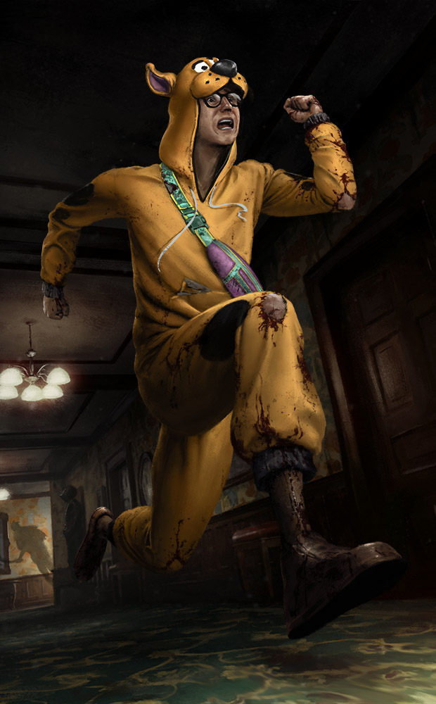
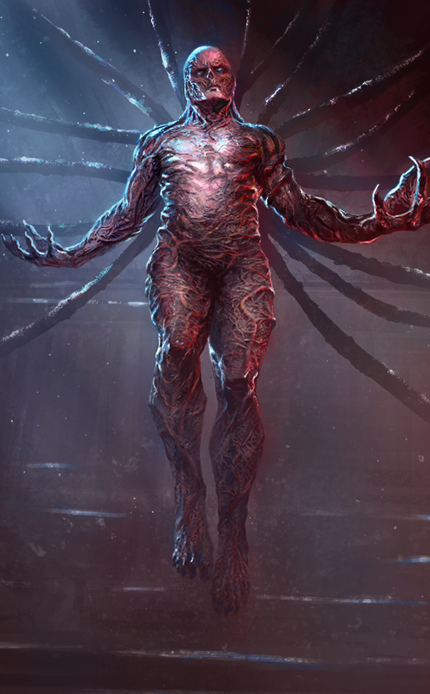
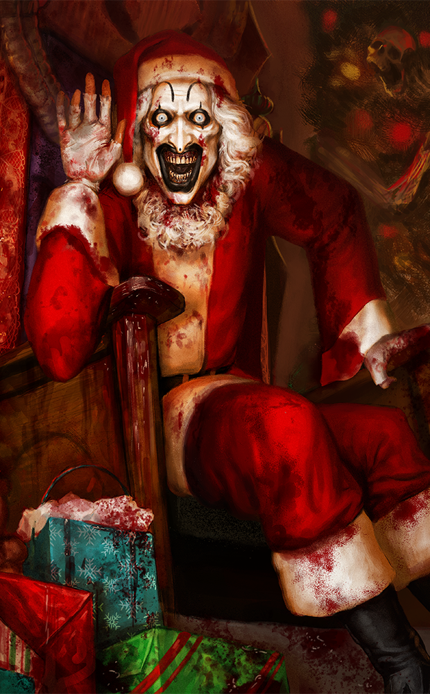
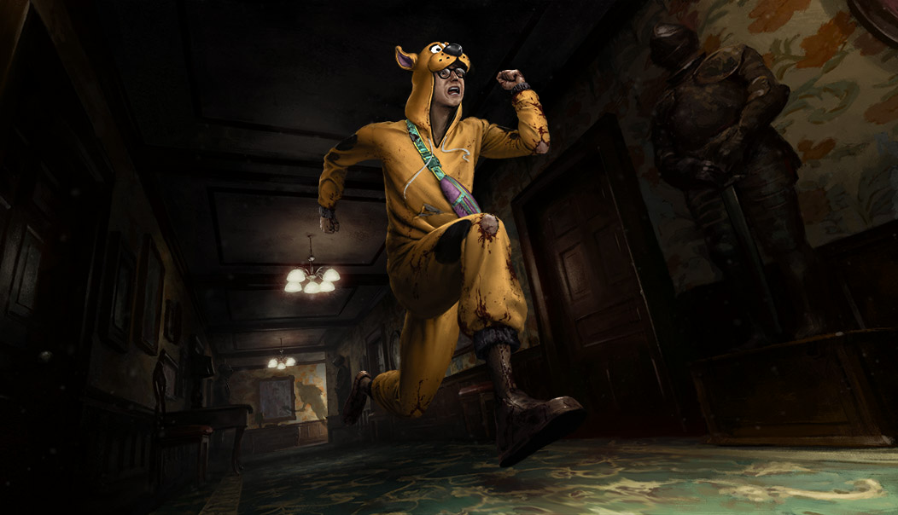
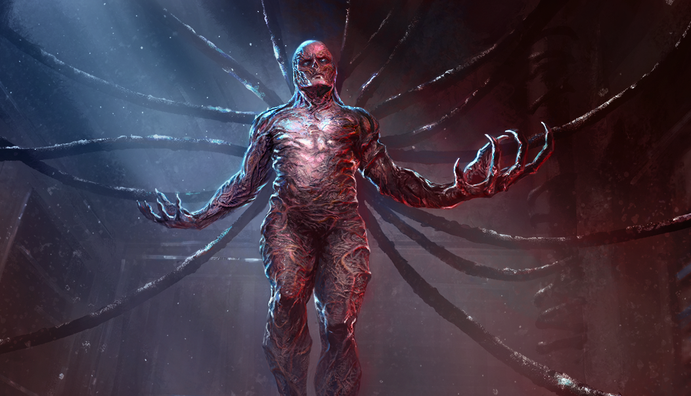
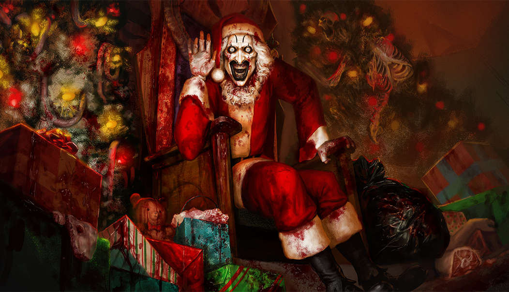

# live · 10.3.0_3895940live

| | |
|---|---|
| Build date | 2026-10-19 14:34 UTC |
| CDN version | `10.3.0_3895940live-1792420446` |
| Key | `10.3.0_live` |
| Compared with | [10.2.0_3892916live](../10.2.0_3892916live/CHANGES.md) (2026-10-16 18:58 UTC) |

## Summary

**6** added · **26** modified · **3** removed · 184 unchanged

## New or updated images

<a href="images/T_UI_CollectionBanner_Scooby_Doo.png"></a>
<a href="images/T_UI_CollectionBanner_StrangerThings_Vecna.png"></a>
<a href="images/T_UI_CollectionBanner_Terrifier.png"></a>
<a href="images/T_UI_SpecialPack_Scooby_Doo.png"></a>
<a href="images/T_UI_SpecialPack_StrangerThings_Vecna.png"></a>
<a href="images/T_UI_SpecialPack_Terrifier.png"></a>

## Removed files

- `images/T_UI_CollectionBanner_NieR.png`
- `images/T_UI_SpecialPack_NieR.png`
- `images/T_UI_SpecialPack_Rift7.png`

## Modified files

### [`GameConfigs.json`](GameConfigs.json)

[Full line-by-line diff](diffs/GameConfigs.json.diff)

```diff
- $.matchmakingIncentiveConfig
+ $.enableLightGoreFeature: true
+ $.movementTimeDiscrepancyDriftAllowanceOverride: 0.09
- $.enableStreamVideo: false
+ $.enableStreamVideo: true
- $.readOnlyConfigs.readonlyConfigs[]: "MATCHMAKING_INCENTIVE_CONFIG"
```

### [`catalog.json`](catalog.json)

[Full line-by-line diff](diffs/catalog.json.diff)

```diff
- $[id=PartyGoneWrong_collection_item]
- $[id=BoneChill_collection_item]
- $[id=Chucky_collection_item]
+ $[id=S55]
+ $[id=K45]
+ $[id=CM_Torso038]
+ $[id=DF_Head041]
+ $[id=DF_Legs041]
+ $[id=DF_Torso041]
+ $[id=DK_Head033]
+ $[id=DK_Legs033]
+ $[id=DK_Torso033]
+ $[id=FM_Head007_01]
+ $[id=FM_Head007_02]
+ $[id=FM_Head007_03]
+ $[id=FM_Head046]
+ $[id=FM_Legs007_01]
+ $[id=FM_Legs007_02]
+ $[id=FM_Legs007_03]
+ $[id=FM_Legs046]
+ $[id=FM_Torso007_01]
+ $[id=FM_Torso007_02]
+ $[id=FM_Torso007_03]
+ $[id=FM_Torso046]
+ $[id=GS_Head043]
+ $[id=GS_Legs043]
+ $[id=GS_Torso043]
+ $[id=HK_W029]
+ $[id=K044_W007]
+ $[id=K14_02_BDG_P100]
+ $[id=K14_02_BDG_P25]
+ $[id=K14_02_BDG_P50]
+ $[id=K14_02_BDG_P75]
+ $[id=K14_03_BDG_P100]
+ $[id=K14_03_BDG_P25]
+ $[id=K14_03_BDG_P50]
+ $[id=K14_03_BDG_P75]
+ $[id=K14_04_BDG_P100]
+ $[id=K14_04_BDG_P25]
+ $[id=K14_04_BDG_P50]
+ $[id=K14_04_BDG_P75]
+ $[id=K26_Body022]
+ $[id=K26_Head022]
+ $[id=K26_W022]
+ $[id=K28_Body024]
+ $[id=K28_Head024]
+ $[id=K28_W024]
+ $[id=K30_Body023]
+ $[id=K30_Head023]
+ $[id=K30_W023]
+ $[id=K35_Body021]
+ $[id=K35_Head021]
+ $[id=K35_W021]
+ $[id=K42_Body008]
+ $[id=K42_Head008]
+ $[id=K42_W008]
+ $[id=K44_Head01_WinterEvent2024]
+ $[id=K45_BDG_P100]
+ $[id=K45_BDG_P25]
+ $[id=K45_BDG_P50]
+ $[id=K45_BDG_P75]
+ $[id=K45_Body01]
+ $[id=K45_Body010]
+ $[id=K45_Body01_P01]
+ $[id=K45_Head007]
+ $[id=K45_Head008]
+ $[id=K45_Head009]
+ $[id=K45_Head01]
+ $[id=K45_Head010]
+ $[id=K45_Head010_01]
+ $[id=K45_Head01_P01]
+ $[id=K45_PCharm001]
+ $[id=K45_PCharm002]
+ $[id=K45_PCharm003]
+ $[id=K45_Torso006]
+ $[id=K45_W010]
+ $[id=K45_W01_P01]
+ $[id=K45_Weapon01]
+ $[id=OK_Body018]
+ $[id=OK_Mask018]
+ $[id=OK_W018]
+ $[id=QF_Head012]
+ $[id=QF_Legs012]
+ $[id=QF_Torso012]
+ $[id=QM_Head011]
+ $[id=QM_Legs011]
+ $[id=QM_Torso011]
+ $[id=S054_Torso008]
+ $[id=S23_Head035]
+ $[id=S23_Legs035]
+ $[id=S23_Torso035]
+ $[id=S24_Head029]
+ $[id=S24_Legs029]
+ $[id=S24_Torso029]
+ $[id=S25_Head034]
+ $[id=S25_Legs034]
+ $[id=S25_Torso034]
+ $[id=S25_Torso035]
+ $[id=S28_Head036]
+ $[id=S28_Legs036]
+ $[id=S28_Torso036]
+ $[id=S29_Torso025]
+ $[id=S31_Head026]
+ $[id=S31_Legs026]
+ $[id=S31_Torso026]
+ $[id=S34_Head028]
+ $[id=S34_Legs028]
+ $[id=S34_Torso028]
+ $[id=S36_Head028]
+ $[id=S36_Legs028]
+ $[id=S36_Torso028]
+ $[id=S42_02_BDG_P100]
+ $[id=S42_02_BDG_P25]
+ $[id=S42_02_BDG_P50]
+ $[id=S42_02_BDG_P75]
+ $[id=S45_Head017]
+ $[id=S45_Legs017]
+ $[id=S45_Torso017]
+ $[id=S46_Head017]
+ $[id=S46_Legs017]
+ $[id=S46_Torso017]
+ $[id=S49_Head014]
+ $[id=S49_Legs014]
+ $[id=S49_Torso014]
+ $[id=S50_Torso008]
+ $[id=S51_Torso007]
+ $[id=S52_Head010]
+ $[id=S52_Legs010]
+ $[id=S52_Torso010]
+ $[id=S52_Torso011]
+ $[id=S53_Torso009]
+ $[id=S55_BDG_P100]
+ $[id=S55_BDG_P25]
+ $[id=S55_BDG_P50]
+ $[id=S55_BDG_P75]
+ $[id=S55_Head006]
+ $[id=S55_Head01]
+ $[id=S55_Head01_P01]
+ $[id=S55_Legs006]
+ $[id=S55_Legs01]
+ $[id=S55_Legs01_P01]
+ $[id=S55_PCharm001]
+ $[id=S55_PCharm002]
+ $[id=S55_PCharm003]
+ $[id=S55_Torso006]
+ $[id=S55_Torso007]
+ $[id=S55_Torso01]
+ $[id=S55_Torso01_P01]
+ $[id=TN_Body028]
+ $[id=TN_Head028]
+ $[id=TN_W028]
+ $[id=TW_W026]
+ $[id=UDO_005]
+ $[id=UDO_BDG_15]
+ $[id=UDO_BNR_09]
+ $[id=US_Head034]
+ $[id=US_Legs034]
+ $[id=US_Torso034]
+ $[id=VAN_015]
+ $[id=VAN_018]
+ $[id=VAN_019]
+ $[id=VAN_BDG_01]
+ $[id=VAN_BDG_06]
+ $[id=VAN_BDG_20]
+ $[id=VAN_BDG_21]
+ $[id=VAN_BDG_22]
+ $[id=VAN_BNR_04]
+ $[id=VAN_BNR_19]
+ $[id=VAN_BNR_20]
+ $[id=VAN_BNR_21]
+ $[id=VAN_BNR_22]
+ $[id=WAF_001]
+ $[id=WAF_002]
+ $[id=WAF_003]
+ $[id=WAF_004]
+ $[id=WAF_005]
+ $[id=WAF_006]
+ $[id=WAF_007]
+ $[id=WAF_008]
+ $[id=WAF_011]
+ $[id=WAF_BDG_01]
+ $[id=WAF_BDG_02]
+ $[id=WAF_BDG_03]
+ $[id=WAF_BDG_04]
+ $[id=WAF_BDG_05]
+ $[id=WAF_BDG_06]
+ $[id=WAF_BDG_07]
+ $[id=WAF_BDG_10]
+ $[id=WAF_BDG_11]
+ $[id=WAF_BDG_12]
+ $[id=WAF_BDG_13]
+ $[id=WAF_BDG_14]
+ $[id=WAF_BDG_15]
+ $[id=WAF_BDG_16]
+ $[id=WAF_BDG_17]
+ $[id=WAF_BDG_18]
+ $[id=WAF_BDG_19]
+ $[id=WAF_BDG_20]
+ $[id=WAF_BDG_21]
+ $[id=WAF_BDG_22]
… 2401 more change(s) — see the commit diff for everything
```

### [`challengeLocs/challengeText_de.json`](challengeLocs/challengeText_de.json)

[Full line-by-line diff](diffs/challengeLocs/challengeText_de.json.diff)

```diff
- $.locText[162].text: "2 gegen 8"
+ $.locText[162].text: "Kalt bis auf die Knochen"
- $.locText[162].textId: "CHALLENGESET_CalamariJerky_TITLE"
+ $.locText[162].textId: "CHALLENGESET_Winter_TITLE"
- $.locText[163].text: "Quests müssen in 2 gegen 8 abgeschlossen werden"
+ $.locText[163].text: "@#CHALLENGESET_Winter_INFO"
- $.locText[163].textId: "CHALLENGESET_CalamariJerky_INFO"
+ $.locText[163].textId: "CHALLENGESET_Winter_INFO"
- $.locText[164].text: "@#CHALLENGE_CompleteCalamariQuests1_TITLE"
+ $.locText[164].text: "@#CHALLENGE_HitWithSnowSkull_TITLE"
- $.locText[164].textId: "CHALLENGE_CompleteCalamariQuests1_TITLE"
+ $.locText[164].textId: "CHALLENGE_HitWithSnowSkull_TITLE"
- $.locText[165].text: "@#CHALLENGE_CompleteCalamariQuests1_DESC"
+ $.locText[165].text: "@#CHALLENGE_HitWithSnowSkull_DESC"
- $.locText[165].textId: "CHALLENGE_CompleteCalamariQuests1_DESC"
+ $.locText[165].textId: "CHALLENGE_HitWithSnowSkull_DESC"
- $.locText[166].text: "Schließe {0} Quest(s) in 2 gegen 8 ab."
+ $.locText[166].text: "Triff andere Spieler mit Schneeschädeln."
- $.locText[166].textId: "CHALLENGE_CompleteCalamariQuests1_INFO"
+ $.locText[166].textId: "CHALLENGE_HitWithSnowSkull_INFO"
- $.locText[167].text: "@#CHALLENGE_CompleteCalamariQuests2_TITLE"
+ $.locText[167].text: "Ekelig"
- $.locText[167].textId: "CHALLENGE_CompleteCalamariQuests2_TITLE"
+ $.locText[167].textId: "CHALLENGE_Hook_TITLE"
- $.locText[168].text: "@#CHALLENGE_CompleteCalamariQuests2_DESC"
+ $.locText[168].text: "Hook <b>{0} Survivor(s)</b> in Haunted by Daylight"
- $.locText[168].textId: "CHALLENGE_CompleteCalamariQuests2_DESC"
+ $.locText[168].textId: "CHALLENGE_EventHook_DESC"
- $.locText[169].text: "Schließe {0} Quest(s) in 2 gegen 8 ab."
+ $.locText[169].text: "Hook <b>{0} Survivor(s)</b> in Haunted by Daylight"
- $.locText[169].textId: "CHALLENGE_CompleteCalamariQuests2_INFO"
+ $.locText[169].textId: "CHALLENGE_EventHook_INFO"
- $.locText[170].text: "@#CHALLENGE_CompleteCalamariQuests3_TITLE"
+ $.locText[170].text: "@#CHALLENGE_PlayAsKillerOrAnyKiller_TITLE"
- $.locText[170].textId: "CHALLENGE_CompleteCalamariQuests3_TITLE"
+ $.locText[170].textId: "CHALLENGE_PlayAsKillerOrAnyKiller_TITLE"
- $.locText[171].text: "@#CHALLENGE_CompleteCalamariQuests3_DESC"
+ $.locText[171].text: "@#CHALLENGE_PlayAsKillerOrAnyKiller_DESC"
- $.locText[171].textId: "CHALLENGE_CompleteCalamariQuests3_DESC"
+ $.locText[171].textId: "CHALLENGE_PlayAsKillerOrAnyKiller_DESC"
- $.locText[172].text: "Schließe {0} Quest(s) in 2 gegen 8 ab."
+ $.locText[172].text: "Schließe {0} Prüfung(en) als {1} ab."
- $.locText[172].textId: "CHALLENGE_CompleteCalamariQuests3_INFO"
+ $.locText[172].textId: "CHALLENGE_PlayAsKiller_INFO"
- $.locText[173].text: "@#CHALLENGE_PlayAsCharacterOrClass_TITLE"
+ $.locText[173].text: "Schließe {0} Prüfung(en) als ein beliebiger Killer ab."
- $.locText[173].textId: "CHALLENGE_PlayAsCharacterOrClass_TITLE"
+ $.locText[173].textId: "CHALLENGE_PlayAnyKiller_INFO"
- $.locText[174].text: "@#CHALLENGE_PlayAsCharacterOrClass_"
+ $.locText[174].text: "@#CHALLENGE_EscapeChase_TITLE"
- $.locText[174].textId: "CHALLENGE_PlayAsCharacterOrClass_"
+ $.locText[174].textId: "CHALLENGE_EscapeChase_TITLE"
- $.locText[175].text: "Schließe {0} Prüfung(en) als {1} ab."
+ $.locText[175].text: "@#CHALLENGE_EscapeChase_DESC"
- $.locText[175].textId: "CHALLENGE_PlayAsCharacter_INFO"
+ $.locText[175].textId: "CHALLENGE_EscapeChase_DESC"
- $.locText[176].text: "Schließe {0} Prüfung(en) als {1} ab."
+ $.locText[176].text: "Ausgeschaltet"
- $.locText[176].textId: "CHALLENGE_PlayAsClass_INFO"
+ $.locText[176].textId: "CHALLENGE_Down_TITLE"
- $.locText[177].text: "@#CHALLENGE_Crow_TITLE"
+ $.locText[177].text: "Strecke <b>{0} Überlebende(n)</b> nieder."
- $.locText[177].textId: "CHALLENGE_Crow_TITLE"
+ $.locText[177].textId: "CHALLENGE_Down_DESC"
- $.locText[178].text: "@#CHALLENGE_Crow_DESC"
+ $.locText[178].text: "@#CHALLENGE_CloseHatch_TITLE"
- $.locText[178].textId: "CHALLENGE_Crow_DESC"
+ $.locText[178].textId: "CHALLENGE_CloseHatch_TITLE"
- $.locText[179].text: "Störe {0} Krähe(n)."
+ $.locText[179].text: "Der letzte lebende Überlebende kann durch eine Bodenluke auf der Karte entwischen. Schließe sie, um ihn auszubremsen."
- $.locText[179].textId: "CHALLENGE_Crow_INFO"
+ $.locText[179].textId: "CHALLENGE_CloseHatch_DESC"
- $.locText[180].text: "Blutige Belohnungen"
+ $.locText[180].text: "Schließe die Bodenluke {0}-mal."
- $.locText[180].textId: "CHALLENGE_EarnBloodpoints_TITLE"
+ $.locText[180].textId: "CHALLENGE_CloseHatch_INFO"
- $.locText[181].text: "Blutpunkte erhältst du für viele unterschiedliche Aktionen, zum Beispiel, wenn du mit anderen Überlebenden zusammenarbeitest und deine Killer-Stärken einsetzt.…
+ $.locText[181].text: "„Kalt bis auf die Knochen“-Community-Quests"
- $.locText[181].textId: "CHALENGE_EarnBloodpoints_DESC"
+ $.locText[181].textId: "Winter_CommunityQuests_Title"
- $.locText[182].text: "Verdiene {0} Blutpunkte."
+ $.locText[182].text: "„Kalt bis auf die Knochen“-Abschlussquests"
- $.locText[182].textId: "CHALENGE_EarnBloodpoints_INFO"
+ $.locText[182].textId: "Winter_OverarchingQuests_Title"
- $.locText[183].text: "@#CHALLENGE_KillSurvivorOrRepairGens_TITLE"
+ $.locText[183].text: "@#Winter_MilestoneQuests_Title"
- $.locText[183].textId: "CHALLENGE_KillSurvivorOrRepairGens_TITLE"
+ $.locText[183].textId: "Winter_MilestoneQuests_Title"
- $.locText[184].text: "@#CHALLENGE_KillSurvivorOrRepairGens_DESC"
+ $.locText[184].text: "„Kalt bis auf die Knochen“-Quests – Teil 1"
- $.locText[184].textId: "CHALLENGE_KillSurvivorOrRepairGens_DESC"
+ $.locText[184].textId: "Winter_QuestList_1_Title"
- $.locText[185].text: "Töte {0} Überlebende(n)."
+ $.locText[185].text: "„Kalt bis auf die Knochen“-Quests – Teil 2"
- $.locText[185].textId: "CHALLENGE_Kill_INFO"
+ $.locText[185].textId: "Winter_QuestList_2_Title"
- $.locText[186].text: "Repariere insgesamt {0} Generator(en)."
+ $.locText[186].text: "„Kalt bis auf die Knochen“-Quests – Teil 3"
- $.locText[186].textId: "CHALLENGE_Repair_INFO"
+ $.locText[186].textId: "Winter_QuestList_3_Title"
- $.locText[187].text: "@#CHALLENGE_ChaseOrPlayAsClass_TITLE"
+ $.locText[187].text: "„Kalt bis auf die Knochen“-Quests – Teil 4"
- $.locText[187].textId: "CHALLENGE_ChaseOrPlayAsClass_TITLE"
+ $.locText[187].textId: "Winter_QuestList_4_Title"
- $.locText[188].text: "@#CHALLENGE_ChaseOrPlayAsClass_DESC"
+ $.locText[188].text: "2 gegen 8"
- $.locText[188].textId: "CHALLENGE_ChaseOrPlayAsClass_DESC"
+ $.locText[188].textId: "CHALLENGESET_CalamariJerky_TITLE"
- $.locText[189].text: "„2 gegen 8“-Abschlussquests"
+ $.locText[189].text: "Quests müssen in 2 gegen 8 abgeschlossen werden"
- $.locText[189].textId: "LIST_Calamari_TITLE_1"
+ $.locText[189].textId: "CHALLENGESET_CalamariJerky_INFO"
- $.locText[190].text: "„2 gegen 8“-Quests – Teil 1"
+ $.locText[190].text: "@#CHALLENGE_CompleteCalamariQuests1_TITLE"
- $.locText[190].textId: "LIST_Calamari_TITLE_2"
+ $.locText[190].textId: "CHALLENGE_CompleteCalamariQuests1_TITLE"
- $.locText[191].text: "„2 gegen 8“-Quests – Teil 2"
+ $.locText[191].text: "@#CHALLENGE_CompleteCalamariQuests1_DESC"
- $.locText[191].textId: "LIST_Calamari_TITLE_3"
+ $.locText[191].textId: "CHALLENGE_CompleteCalamariQuests1_DESC"
- $.locText[192].text: "„2 gegen 8“-Quests – Teil 3"
+ $.locText[192].text: "Schließe {0} Quest(s) in 2 gegen 8 ab."
- $.locText[192].textId: "LIST_Calamari_TITLE_4"
+ $.locText[192].textId: "CHALLENGE_CompleteCalamariQuests1_INFO"
- $.locText[193].text: "2V8"
+ $.locText[193].text: "@#CHALLENGE_CompleteCalamariQuests2_TITLE"
- $.locText[193].textId: "CHALLENGESET_CalamariLasagna_TITLE"
+ $.locText[193].textId: "CHALLENGE_CompleteCalamariQuests2_TITLE"
- $.locText[194].text: "@#CHALLENGESET_CalamariLasagna_INFO"
+ $.locText[194].text: "@#CHALLENGE_CompleteCalamariQuests2_DESC"
- $.locText[194].textId: "CHALLENGESET_CalamariLasagna_INFO"
+ $.locText[194].textId: "CHALLENGE_CompleteCalamariQuests2_DESC"
- $.locText[195].text: "@#CHALLENGE_PlayAsKillerClassOrSurvivorClass_TITLE"
+ $.locText[195].text: "Schließe {0} Quest(s) in 2 gegen 8 ab."
- $.locText[195].textId: "CHALLENGE_PlayAsKillerClassOrSurvivorClass_TITLE"
+ $.locText[195].textId: "CHALLENGE_CompleteCalamariQuests2_INFO"
- $.locText[196].text: "@#CHALLENGE_PlayAsKillerClassOrSurvivorClass_DESC"
+ $.locText[196].text: "@#CHALLENGE_CompleteCalamariQuests3_TITLE"
- $.locText[196].textId: "CHALLENGE_PlayAsKillerClassOrSurvivorClass_DESC"
+ $.locText[196].textId: "CHALLENGE_CompleteCalamariQuests3_TITLE"
- $.locText[197].text: "@#CHALLENGE_EarnModeBloodpointsOrEarnBloodpoints_TITLE"
+ $.locText[197].text: "@#CHALLENGE_CompleteCalamariQuests3_DESC"
- $.locText[197].textId: "CHALLENGE_EarnModeBloodpointsOrEarnBloodpoints_TITLE"
+ $.locText[197].textId: "CHALLENGE_CompleteCalamariQuests3_DESC"
- $.locText[198].text: "@#CHALLENGE_EarnModeBloodpointsOrEarnBloodpoints_DESC"
+ $.locText[198].text: "Schließe {0} Quest(s) in 2 gegen 8 ab."
- $.locText[198].textId: "CHALLENGE_EarnModeBloodpointsOrEarnBloodpoints_DESC"
+ $.locText[198].textId: "CHALLENGE_CompleteCalamariQuests3_INFO"
- $.locText[199].text: "Verdiene {0} Blutpunkte in „{1}“."
+ $.locText[199].text: "@#CHALLENGE_PlayAsCharacterOrClass_TITLE"
- $.locText[199].textId: "CHALLENGE_EarnModeBloodpoints_INFO"
+ $.locText[199].textId: "CHALLENGE_PlayAsCharacterOrClass_TITLE"
- $.locText[200].text: "@#CHALLENGE_ScareModeCrowOrScareCrow_TITLE"
+ $.locText[200].text: "@#CHALLENGE_PlayAsCharacterOrClass_"
- $.locText[200].textId: "CHALLENGE_ScareModeCrowOrScareCrow_TITLE"
+ $.locText[200].textId: "CHALLENGE_PlayAsCharacterOrClass_"
- $.locText[201].text: "@#CHALLENGE_ScareModeCrowOrScareCrow_DESC"
+ $.locText[201].text: "Schließe {0} Prüfung(en) als {1} ab."
- $.locText[201].textId: "CHALLENGE_ScareModeCrowOrScareCrow_DESC"
+ $.locText[201].textId: "CHALLENGE_PlayAsCharacter_INFO"
- $.locText[202].text: "Störe {0} Krähe(n) in „{1}“."
+ $.locText[202].text: "Schließe {0} Prüfung(en) als {1} ab."
- $.locText[202].textId: "CHALLENGE_ScareModeCrow_INFO"
+ $.locText[202].textId: "CHALLENGE_PlayAsClass_INFO"
- $.locText[203].text: "@#CHALLENGE_CompleteModeTrialOrTrial_TITLE"
+ $.locText[203].text: "@#CHALLENGE_Crow_TITLE"
- $.locText[203].textId: "CHALLENGE_CompleteModeTrialOrTrial_TITLE"
+ $.locText[203].textId: "CHALLENGE_Crow_TITLE"
- $.locText[204].text: "@#CHALLENGE_CompleteModeTrialOrTrial_DESC"
+ $.locText[204].text: "@#CHALLENGE_Crow_DESC"
- $.locText[204].textId: "CHALLENGE_CompleteModeTrialOrTrial_DESC"
+ $.locText[204].textId: "CHALLENGE_Crow_DESC"
- $.locText[205].text: "@#CHALLENGE_MoriOrEscape_TITLE"
+ $.locText[205].text: "Störe {0} Krähe(n)."
- $.locText[205].textId: "CHALLENGE_MoriOrEscape_TITLE"
+ $.locText[205].textId: "CHALLENGE_Crow_INFO"
- $.locText[206].text: "@#CHALLENGE_MoriOrEscape_DESC"
+ $.locText[206].text: "Blutige Belohnungen"
- $.locText[206].textId: "CHALLENGE_MoriOrEscape_DESC"
+ $.locText[206].textId: "CHALLENGE_EarnBloodpoints_TITLE"
- $.locText[207].text: "2V8"
+ $.locText[207].text: "Blutpunkte erhältst du für viele unterschiedliche Aktionen, zum Beispiel, wenn du mit anderen Überlebenden zusammenarbeitest und deine Killer-Stärken einsetzt.…
- $.locText[207].textId: "CHALLENGESET_CalamariPoutine_TITLE"
+ $.locText[207].textId: "CHALENGE_EarnBloodpoints_DESC"
- $.locText[208].text: "@#CHALLENGESET_CalamariPoutine_INFO"
+ $.locText[208].text: "Verdiene {0} Blutpunkte."
- $.locText[208].textId: "CHALLENGESET_CalamariPoutine_INFO"
+ $.locText[208].textId: "CHALENGE_EarnBloodpoints_INFO"
- $.locText[209].text: "@#CHALLENGE_HitOrRevealKillerTime_TITLE"
+ $.locText[209].text: "@#CHALLENGE_KillSurvivorOrRepairGens_TITLE"
- $.locText[209].textId: "CHALLENGE_HitOrRevealKillerTime_TITLE"
+ $.locText[209].textId: "CHALLENGE_KillSurvivorOrRepairGens_TITLE"
- $.locText[210].text: "@#CHALLENGE_HitOrRevealKillerTime_DESC"
+ $.locText[210].text: "@#CHALLENGE_KillSurvivorOrRepairGens_DESC"
- $.locText[210].textId: "CHALLENGE_HitOrRevealKillerTime_DESC"
+ $.locText[210].textId: "CHALLENGE_KillSurvivorOrRepairGens_DESC"
- $.locText[211].text: "Enthülle die Aura des Killers für {0} Sekunden."
+ $.locText[211].text: "Töte {0} Überlebende(n)."
- $.locText[211].textId: "CHALLENGE_RevealKillerTime_INFO"
+ $.locText[211].textId: "CHALLENGE_Kill_INFO"
… 2037 more change(s) — see the commit diff for everything
```

### [`challengeLocs/challengeText_en.json`](challengeLocs/challengeText_en.json)

[Full line-by-line diff](diffs/challengeLocs/challengeText_en.json.diff)

```diff
- $.locText[162].text: "2V8"
+ $.locText[162].text: "Bone Chill"
- $.locText[162].textId: "CHALLENGESET_CalamariJerky_TITLE"
+ $.locText[162].textId: "CHALLENGESET_Winter_TITLE"
- $.locText[163].text: "Quests must be completed in 2v8"
+ $.locText[163].text: "@#CHALLENGESET_Winter_INFO"
- $.locText[163].textId: "CHALLENGESET_CalamariJerky_INFO"
+ $.locText[163].textId: "CHALLENGESET_Winter_INFO"
- $.locText[164].text: "@#CHALLENGE_CompleteCalamariQuests1_TITLE"
+ $.locText[164].text: "@#CHALLENGE_HitWithSnowSkull_TITLE"
- $.locText[164].textId: "CHALLENGE_CompleteCalamariQuests1_TITLE"
+ $.locText[164].textId: "CHALLENGE_HitWithSnowSkull_TITLE"
- $.locText[165].text: "@#CHALLENGE_CompleteCalamariQuests1_DESC"
+ $.locText[165].text: "@#CHALLENGE_HitWithSnowSkull_DESC"
- $.locText[165].textId: "CHALLENGE_CompleteCalamariQuests1_DESC"
+ $.locText[165].textId: "CHALLENGE_HitWithSnowSkull_DESC"
- $.locText[166].text: "Complete {0} 2v8 quest(s)"
+ $.locText[166].text: "Hit other players with Snowskulls"
- $.locText[166].textId: "CHALLENGE_CompleteCalamariQuests1_INFO"
+ $.locText[166].textId: "CHALLENGE_HitWithSnowSkull_INFO"
- $.locText[167].text: "@#CHALLENGE_CompleteCalamariQuests2_TITLE"
+ $.locText[167].text: "Gruesome"
- $.locText[167].textId: "CHALLENGE_CompleteCalamariQuests2_TITLE"
+ $.locText[167].textId: "CHALLENGE_Hook_TITLE"
- $.locText[168].text: "@#CHALLENGE_CompleteCalamariQuests2_DESC"
+ $.locText[168].text: "Hook <b>{0} Survivor(s)</b> in Haunted by Daylight"
- $.locText[168].textId: "CHALLENGE_CompleteCalamariQuests2_DESC"
+ $.locText[168].textId: "CHALLENGE_EventHook_DESC"
- $.locText[169].text: "Complete {0} 2v8 quest(s)"
+ $.locText[169].text: "Hook <b>{0} Survivor(s)</b> in Haunted by Daylight"
- $.locText[169].textId: "CHALLENGE_CompleteCalamariQuests2_INFO"
+ $.locText[169].textId: "CHALLENGE_EventHook_INFO"
- $.locText[170].text: "@#CHALLENGE_CompleteCalamariQuests3_TITLE"
+ $.locText[170].text: "@#CHALLENGE_PlayAsKillerOrAnyKiller_TITLE"
- $.locText[170].textId: "CHALLENGE_CompleteCalamariQuests3_TITLE"
+ $.locText[170].textId: "CHALLENGE_PlayAsKillerOrAnyKiller_TITLE"
- $.locText[171].text: "@#CHALLENGE_CompleteCalamariQuests3_DESC"
+ $.locText[171].text: "@#CHALLENGE_PlayAsKillerOrAnyKiller_DESC"
- $.locText[171].textId: "CHALLENGE_CompleteCalamariQuests3_DESC"
+ $.locText[171].textId: "CHALLENGE_PlayAsKillerOrAnyKiller_DESC"
- $.locText[172].text: "Complete {0} 2v8 quest(s)"
+ $.locText[172].text: "Complete {0} Trial(s) as {1}"
- $.locText[172].textId: "CHALLENGE_CompleteCalamariQuests3_INFO"
+ $.locText[172].textId: "CHALLENGE_PlayAsKiller_INFO"
- $.locText[173].text: "@#CHALLENGE_PlayAsCharacterOrClass_TITLE"
+ $.locText[173].text: "Complete {0} trial(s) as any Killer"
- $.locText[173].textId: "CHALLENGE_PlayAsCharacterOrClass_TITLE"
+ $.locText[173].textId: "CHALLENGE_PlayAnyKiller_INFO"
- $.locText[174].text: "@#CHALLENGE_PlayAsCharacterOrClass_"
+ $.locText[174].text: "@#CHALLENGE_EscapeChase_TITLE"
- $.locText[174].textId: "CHALLENGE_PlayAsCharacterOrClass_"
+ $.locText[174].textId: "CHALLENGE_EscapeChase_TITLE"
- $.locText[175].text: "Complete {0} trial(s) as {1}"
+ $.locText[175].text: "@#CHALLENGE_EscapeChase_DESC"
- $.locText[175].textId: "CHALLENGE_PlayAsCharacter_INFO"
+ $.locText[175].textId: "CHALLENGE_EscapeChase_DESC"
- $.locText[176].text: "Complete {0} trial(s) as {1}"
+ $.locText[176].text: "Knockout"
- $.locText[176].textId: "CHALLENGE_PlayAsClass_INFO"
+ $.locText[176].textId: "CHALLENGE_Down_TITLE"
- $.locText[177].text: "@#CHALLENGE_Crow_TITLE"
+ $.locText[177].text: "Knock down <b>{0} Survivor(s)</b>."
- $.locText[177].textId: "CHALLENGE_Crow_TITLE"
+ $.locText[177].textId: "CHALLENGE_Down_DESC"
- $.locText[178].text: "@#CHALLENGE_Crow_DESC"
+ $.locText[178].text: "@#CHALLENGE_CloseHatch_TITLE"
- $.locText[178].textId: "CHALLENGE_Crow_DESC"
+ $.locText[178].textId: "CHALLENGE_CloseHatch_TITLE"
- $.locText[179].text: "Disturb {0} crow(s)"
+ $.locText[179].text: "The last Survivor alive can escape through a Hatch hidden on the map. Close it to slow them down."
- $.locText[179].textId: "CHALLENGE_Crow_INFO"
+ $.locText[179].textId: "CHALLENGE_CloseHatch_DESC"
- $.locText[180].text: "Bloody Rewards"
+ $.locText[180].text: "Close the hatch {0} time(s)"
- $.locText[180].textId: "CHALLENGE_EarnBloodpoints_TITLE"
+ $.locText[180].textId: "CHALLENGE_CloseHatch_INFO"
- $.locText[181].text: "Many actions reward you with Bloodpoints, such as cooperating with other Survivors and using your Killer powers."
+ $.locText[181].text: "Bone Chill Community Quests"
- $.locText[181].textId: "CHALENGE_EarnBloodpoints_DESC"
+ $.locText[181].textId: "Winter_CommunityQuests_Title"
- $.locText[182].text: "Earn {0} Bloodpoints"
+ $.locText[182].text: "Bone Chill Completion Quests"
- $.locText[182].textId: "CHALENGE_EarnBloodpoints_INFO"
+ $.locText[182].textId: "Winter_OverarchingQuests_Title"
- $.locText[183].text: "@#CHALLENGE_KillSurvivorOrRepairGens_TITLE"
+ $.locText[183].text: "@#Winter_MilestoneQuests_Title"
- $.locText[183].textId: "CHALLENGE_KillSurvivorOrRepairGens_TITLE"
+ $.locText[183].textId: "Winter_MilestoneQuests_Title"
- $.locText[184].text: "@#CHALLENGE_KillSurvivorOrRepairGens_DESC"
+ $.locText[184].text: "Bone Chill Quests - Part 1"
- $.locText[184].textId: "CHALLENGE_KillSurvivorOrRepairGens_DESC"
+ $.locText[184].textId: "Winter_QuestList_1_Title"
- $.locText[185].text: "Sacrifice or kill {0} Survivor(s)"
+ $.locText[185].text: "Bone Chill Quests - Part 2"
- $.locText[185].textId: "CHALLENGE_Kill_INFO"
+ $.locText[185].textId: "Winter_QuestList_2_Title"
- $.locText[186].text: "Repair a total of {0} generator(s)"
+ $.locText[186].text: "Bone Chill Quests - Part 3"
- $.locText[186].textId: "CHALLENGE_Repair_INFO"
+ $.locText[186].textId: "Winter_QuestList_3_Title"
- $.locText[187].text: "@#CHALLENGE_ChaseOrPlayAsClass_TITLE"
+ $.locText[187].text: "Bone Chill Quests - Part 4"
- $.locText[187].textId: "CHALLENGE_ChaseOrPlayAsClass_TITLE"
+ $.locText[187].textId: "Winter_QuestList_4_Title"
- $.locText[188].text: "@#CHALLENGE_ChaseOrPlayAsClass_DESC"
+ $.locText[188].text: "2V8"
- $.locText[188].textId: "CHALLENGE_ChaseOrPlayAsClass_DESC"
+ $.locText[188].textId: "CHALLENGESET_CalamariJerky_TITLE"
- $.locText[189].text: "2V8 Completion Quests"
+ $.locText[189].text: "Quests must be completed in 2v8"
- $.locText[189].textId: "LIST_Calamari_TITLE_1"
+ $.locText[189].textId: "CHALLENGESET_CalamariJerky_INFO"
- $.locText[190].text: "2V8 Quests - Part 1"
+ $.locText[190].text: "@#CHALLENGE_CompleteCalamariQuests1_TITLE"
- $.locText[190].textId: "LIST_Calamari_TITLE_2"
+ $.locText[190].textId: "CHALLENGE_CompleteCalamariQuests1_TITLE"
- $.locText[191].text: "2V8 Quests - Part 2"
+ $.locText[191].text: "@#CHALLENGE_CompleteCalamariQuests1_DESC"
- $.locText[191].textId: "LIST_Calamari_TITLE_3"
+ $.locText[191].textId: "CHALLENGE_CompleteCalamariQuests1_DESC"
- $.locText[192].text: "2V8 Quests - Part 3"
+ $.locText[192].text: "Complete {0} 2v8 quest(s)"
- $.locText[192].textId: "LIST_Calamari_TITLE_4"
+ $.locText[192].textId: "CHALLENGE_CompleteCalamariQuests1_INFO"
- $.locText[193].text: "2V8"
+ $.locText[193].text: "@#CHALLENGE_CompleteCalamariQuests2_TITLE"
- $.locText[193].textId: "CHALLENGESET_CalamariLasagna_TITLE"
+ $.locText[193].textId: "CHALLENGE_CompleteCalamariQuests2_TITLE"
- $.locText[194].text: "@#CHALLENGESET_CalamariLasagna_INFO"
+ $.locText[194].text: "@#CHALLENGE_CompleteCalamariQuests2_DESC"
- $.locText[194].textId: "CHALLENGESET_CalamariLasagna_INFO"
+ $.locText[194].textId: "CHALLENGE_CompleteCalamariQuests2_DESC"
- $.locText[195].text: "@#CHALLENGE_PlayAsKillerClassOrSurvivorClass_TITLE"
+ $.locText[195].text: "Complete {0} 2v8 quest(s)"
- $.locText[195].textId: "CHALLENGE_PlayAsKillerClassOrSurvivorClass_TITLE"
+ $.locText[195].textId: "CHALLENGE_CompleteCalamariQuests2_INFO"
- $.locText[196].text: "@#CHALLENGE_PlayAsKillerClassOrSurvivorClass_DESC"
+ $.locText[196].text: "@#CHALLENGE_CompleteCalamariQuests3_TITLE"
- $.locText[196].textId: "CHALLENGE_PlayAsKillerClassOrSurvivorClass_DESC"
+ $.locText[196].textId: "CHALLENGE_CompleteCalamariQuests3_TITLE"
- $.locText[197].text: "@#CHALLENGE_EarnModeBloodpointsOrEarnBloodpoints_TITLE"
+ $.locText[197].text: "@#CHALLENGE_CompleteCalamariQuests3_DESC"
- $.locText[197].textId: "CHALLENGE_EarnModeBloodpointsOrEarnBloodpoints_TITLE"
+ $.locText[197].textId: "CHALLENGE_CompleteCalamariQuests3_DESC"
- $.locText[198].text: "@#CHALLENGE_EarnModeBloodpointsOrEarnBloodpoints_DESC"
+ $.locText[198].text: "Complete {0} 2v8 quest(s)"
- $.locText[198].textId: "CHALLENGE_EarnModeBloodpointsOrEarnBloodpoints_DESC"
+ $.locText[198].textId: "CHALLENGE_CompleteCalamariQuests3_INFO"
- $.locText[199].text: "Earn {0} Bloodpoints in {1}"
+ $.locText[199].text: "@#CHALLENGE_PlayAsCharacterOrClass_TITLE"
- $.locText[199].textId: "CHALLENGE_EarnModeBloodpoints_INFO"
+ $.locText[199].textId: "CHALLENGE_PlayAsCharacterOrClass_TITLE"
- $.locText[200].text: "@#CHALLENGE_ScareModeCrowOrScareCrow_TITLE"
+ $.locText[200].text: "@#CHALLENGE_PlayAsCharacterOrClass_"
- $.locText[200].textId: "CHALLENGE_ScareModeCrowOrScareCrow_TITLE"
+ $.locText[200].textId: "CHALLENGE_PlayAsCharacterOrClass_"
- $.locText[201].text: "@#CHALLENGE_ScareModeCrowOrScareCrow_DESC"
+ $.locText[201].text: "Complete {0} trial(s) as {1}"
- $.locText[201].textId: "CHALLENGE_ScareModeCrowOrScareCrow_DESC"
+ $.locText[201].textId: "CHALLENGE_PlayAsCharacter_INFO"
- $.locText[202].text: "Disturb {0} crow(s) in {1}"
+ $.locText[202].text: "Complete {0} trial(s) as {1}"
- $.locText[202].textId: "CHALLENGE_ScareModeCrow_INFO"
+ $.locText[202].textId: "CHALLENGE_PlayAsClass_INFO"
- $.locText[203].text: "@#CHALLENGE_CompleteModeTrialOrTrial_TITLE"
+ $.locText[203].text: "@#CHALLENGE_Crow_TITLE"
- $.locText[203].textId: "CHALLENGE_CompleteModeTrialOrTrial_TITLE"
+ $.locText[203].textId: "CHALLENGE_Crow_TITLE"
- $.locText[204].text: "@#CHALLENGE_CompleteModeTrialOrTrial_DESC"
+ $.locText[204].text: "@#CHALLENGE_Crow_DESC"
- $.locText[204].textId: "CHALLENGE_CompleteModeTrialOrTrial_DESC"
+ $.locText[204].textId: "CHALLENGE_Crow_DESC"
- $.locText[205].text: "@#CHALLENGE_MoriOrEscape_TITLE"
+ $.locText[205].text: "Disturb {0} crow(s)"
- $.locText[205].textId: "CHALLENGE_MoriOrEscape_TITLE"
+ $.locText[205].textId: "CHALLENGE_Crow_INFO"
- $.locText[206].text: "@#CHALLENGE_MoriOrEscape_DESC"
+ $.locText[206].text: "Bloody Rewards"
- $.locText[206].textId: "CHALLENGE_MoriOrEscape_DESC"
+ $.locText[206].textId: "CHALLENGE_EarnBloodpoints_TITLE"
- $.locText[207].text: "2V8"
+ $.locText[207].text: "Many actions reward you with Bloodpoints, such as cooperating with other Survivors and using your Killer powers."
- $.locText[207].textId: "CHALLENGESET_CalamariPoutine_TITLE"
+ $.locText[207].textId: "CHALENGE_EarnBloodpoints_DESC"
- $.locText[208].text: "@#CHALLENGESET_CalamariPoutine_INFO"
+ $.locText[208].text: "Earn {0} Bloodpoints"
- $.locText[208].textId: "CHALLENGESET_CalamariPoutine_INFO"
+ $.locText[208].textId: "CHALENGE_EarnBloodpoints_INFO"
- $.locText[209].text: "@#CHALLENGE_HitOrRevealKillerTime_TITLE"
+ $.locText[209].text: "@#CHALLENGE_KillSurvivorOrRepairGens_TITLE"
- $.locText[209].textId: "CHALLENGE_HitOrRevealKillerTime_TITLE"
+ $.locText[209].textId: "CHALLENGE_KillSurvivorOrRepairGens_TITLE"
- $.locText[210].text: "@#CHALLENGE_HitOrRevealKillerTime_DESC"
+ $.locText[210].text: "@#CHALLENGE_KillSurvivorOrRepairGens_DESC"
- $.locText[210].textId: "CHALLENGE_HitOrRevealKillerTime_DESC"
+ $.locText[210].textId: "CHALLENGE_KillSurvivorOrRepairGens_DESC"
- $.locText[211].text: "Reveal the Killer's Aura for {0} seconds"
+ $.locText[211].text: "Sacrifice or kill {0} Survivor(s)"
- $.locText[211].textId: "CHALLENGE_RevealKillerTime_INFO"
+ $.locText[211].textId: "CHALLENGE_Kill_INFO"
… 2037 more change(s) — see the commit diff for everything
```

### [`challengeLocs/challengeText_es-MX.json`](challengeLocs/challengeText_es-MX.json)

[Full line-by-line diff](diffs/challengeLocs/challengeText_es-MX.json.diff)

```diff
- $.locText[162].text: "2v8"
+ $.locText[162].text: "Frío en los huesos"
- $.locText[162].textId: "CHALLENGESET_CalamariJerky_TITLE"
+ $.locText[162].textId: "CHALLENGESET_Winter_TITLE"
- $.locText[163].text: "Las misiones deben completarse en 2v8"
+ $.locText[163].text: "@#CHALLENGESET_Winter_INFO"
- $.locText[163].textId: "CHALLENGESET_CalamariJerky_INFO"
+ $.locText[163].textId: "CHALLENGESET_Winter_INFO"
- $.locText[164].text: "@#CHALLENGE_CompleteCalamariQuests1_TITLE"
+ $.locText[164].text: "@#CHALLENGE_HitWithSnowSkull_TITLE"
- $.locText[164].textId: "CHALLENGE_CompleteCalamariQuests1_TITLE"
+ $.locText[164].textId: "CHALLENGE_HitWithSnowSkull_TITLE"
- $.locText[165].text: "@#CHALLENGE_CompleteCalamariQuests1_DESC"
+ $.locText[165].text: "@#CHALLENGE_HitWithSnowSkull_DESC"
- $.locText[165].textId: "CHALLENGE_CompleteCalamariQuests1_DESC"
+ $.locText[165].textId: "CHALLENGE_HitWithSnowSkull_DESC"
- $.locText[166].text: "Completa {0} misión/misiones de 2v8."
+ $.locText[166].text: "Golpea a otros jugadores con cráneos de nieve"
- $.locText[166].textId: "CHALLENGE_CompleteCalamariQuests1_INFO"
+ $.locText[166].textId: "CHALLENGE_HitWithSnowSkull_INFO"
- $.locText[167].text: "@#CHALLENGE_CompleteCalamariQuests2_TITLE"
+ $.locText[167].text: "Horripilante"
- $.locText[167].textId: "CHALLENGE_CompleteCalamariQuests2_TITLE"
+ $.locText[167].textId: "CHALLENGE_Hook_TITLE"
- $.locText[168].text: "@#CHALLENGE_CompleteCalamariQuests2_DESC"
+ $.locText[168].text: "Hook <b>{0} Survivor(s)</b> in Haunted by Daylight"
- $.locText[168].textId: "CHALLENGE_CompleteCalamariQuests2_DESC"
+ $.locText[168].textId: "CHALLENGE_EventHook_DESC"
- $.locText[169].text: "Completa {0} misión/misiones de 2v8."
+ $.locText[169].text: "Hook <b>{0} Survivor(s)</b> in Haunted by Daylight"
- $.locText[169].textId: "CHALLENGE_CompleteCalamariQuests2_INFO"
+ $.locText[169].textId: "CHALLENGE_EventHook_INFO"
- $.locText[170].text: "@#CHALLENGE_CompleteCalamariQuests3_TITLE"
+ $.locText[170].text: "@#CHALLENGE_PlayAsKillerOrAnyKiller_TITLE"
- $.locText[170].textId: "CHALLENGE_CompleteCalamariQuests3_TITLE"
+ $.locText[170].textId: "CHALLENGE_PlayAsKillerOrAnyKiller_TITLE"
- $.locText[171].text: "@#CHALLENGE_CompleteCalamariQuests3_DESC"
+ $.locText[171].text: "@#CHALLENGE_PlayAsKillerOrAnyKiller_DESC"
- $.locText[171].textId: "CHALLENGE_CompleteCalamariQuests3_DESC"
+ $.locText[171].textId: "CHALLENGE_PlayAsKillerOrAnyKiller_DESC"
- $.locText[172].text: "Completa {0} misión/misiones de 2v8."
+ $.locText[172].text: "Como {1}, completa {0} partida(s)."
- $.locText[172].textId: "CHALLENGE_CompleteCalamariQuests3_INFO"
+ $.locText[172].textId: "CHALLENGE_PlayAsKiller_INFO"
- $.locText[173].text: "@#CHALLENGE_PlayAsCharacterOrClass_TITLE"
+ $.locText[173].text: "Como cualquier asesino, completa {0} partida(s)."
- $.locText[173].textId: "CHALLENGE_PlayAsCharacterOrClass_TITLE"
+ $.locText[173].textId: "CHALLENGE_PlayAnyKiller_INFO"
- $.locText[174].text: "@#CHALLENGE_PlayAsCharacterOrClass_"
+ $.locText[174].text: "@#CHALLENGE_EscapeChase_TITLE"
- $.locText[174].textId: "CHALLENGE_PlayAsCharacterOrClass_"
+ $.locText[174].textId: "CHALLENGE_EscapeChase_TITLE"
- $.locText[175].text: "Como {1}, completa {0} partida(s)."
+ $.locText[175].text: "@#CHALLENGE_EscapeChase_DESC"
- $.locText[175].textId: "CHALLENGE_PlayAsCharacter_INFO"
+ $.locText[175].textId: "CHALLENGE_EscapeChase_DESC"
- $.locText[176].text: "Como {1}, completa {0} partida(s)."
+ $.locText[176].text: "Fuera de combate"
- $.locText[176].textId: "CHALLENGE_PlayAsClass_INFO"
+ $.locText[176].textId: "CHALLENGE_Down_TITLE"
- $.locText[177].text: "@#CHALLENGE_Crow_TITLE"
+ $.locText[177].text: "Noquea a <b>{0} sobreviviente(s)</b>."
- $.locText[177].textId: "CHALLENGE_Crow_TITLE"
+ $.locText[177].textId: "CHALLENGE_Down_DESC"
- $.locText[178].text: "@#CHALLENGE_Crow_DESC"
+ $.locText[178].text: "@#CHALLENGE_CloseHatch_TITLE"
- $.locText[178].textId: "CHALLENGE_Crow_DESC"
+ $.locText[178].textId: "CHALLENGE_CloseHatch_TITLE"
- $.locText[179].text: "Molesta a {0} cuervo(s)."
+ $.locText[179].text: "El o la sobreviviente que quede con vida al final podrá escapar a través de una trampilla oculta en el mapa. Ciérrala para ralentizar su escape."
- $.locText[179].textId: "CHALLENGE_Crow_INFO"
+ $.locText[179].textId: "CHALLENGE_CloseHatch_DESC"
- $.locText[180].text: "Recompensas ensangrentadas"
+ $.locText[180].text: "Cierra la trampilla {0} vez/veces."
- $.locText[180].textId: "CHALLENGE_EarnBloodpoints_TITLE"
+ $.locText[180].textId: "CHALLENGE_CloseHatch_INFO"
- $.locText[181].text: "Muchas acciones te recompensan con puntos de sangre, como cooperar con otros sobrevivientes y usar tus poderes de asesino."
+ $.locText[181].text: "Misiones de la comunidad de Frío en los huesos"
- $.locText[181].textId: "CHALENGE_EarnBloodpoints_DESC"
+ $.locText[181].textId: "Winter_CommunityQuests_Title"
- $.locText[182].text: "Gana {0} puntos de sangre."
+ $.locText[182].text: "Misiones de finalización de Frío en los huesos"
- $.locText[182].textId: "CHALENGE_EarnBloodpoints_INFO"
+ $.locText[182].textId: "Winter_OverarchingQuests_Title"
- $.locText[183].text: "@#CHALLENGE_KillSurvivorOrRepairGens_TITLE"
+ $.locText[183].text: "@#Winter_MilestoneQuests_Title"
- $.locText[183].textId: "CHALLENGE_KillSurvivorOrRepairGens_TITLE"
+ $.locText[183].textId: "Winter_MilestoneQuests_Title"
- $.locText[184].text: "@#CHALLENGE_KillSurvivorOrRepairGens_DESC"
+ $.locText[184].text: "Misiones de Frío en los huesos - Parte 1"
- $.locText[184].textId: "CHALLENGE_KillSurvivorOrRepairGens_DESC"
+ $.locText[184].textId: "Winter_QuestList_1_Title"
- $.locText[185].text: "Mata a {0} sobreviviente(s)."
+ $.locText[185].text: "Misiones de Frío en los huesos - Parte 2"
- $.locText[185].textId: "CHALLENGE_Kill_INFO"
+ $.locText[185].textId: "Winter_QuestList_2_Title"
- $.locText[186].text: "Repara un total de {0} generador(es)."
+ $.locText[186].text: "Misiones de Frío en los huesos - Parte 3"
- $.locText[186].textId: "CHALLENGE_Repair_INFO"
+ $.locText[186].textId: "Winter_QuestList_3_Title"
- $.locText[187].text: "@#CHALLENGE_ChaseOrPlayAsClass_TITLE"
+ $.locText[187].text: "Misiones de Frío en los huesos - Parte 4"
- $.locText[187].textId: "CHALLENGE_ChaseOrPlayAsClass_TITLE"
+ $.locText[187].textId: "Winter_QuestList_4_Title"
- $.locText[188].text: "@#CHALLENGE_ChaseOrPlayAsClass_DESC"
+ $.locText[188].text: "2v8"
- $.locText[188].textId: "CHALLENGE_ChaseOrPlayAsClass_DESC"
+ $.locText[188].textId: "CHALLENGESET_CalamariJerky_TITLE"
- $.locText[189].text: "Misiones de finalización de 2v8"
+ $.locText[189].text: "Las misiones deben completarse en 2v8"
- $.locText[189].textId: "LIST_Calamari_TITLE_1"
+ $.locText[189].textId: "CHALLENGESET_CalamariJerky_INFO"
- $.locText[190].text: "Misiones de 2v8 - Parte 1"
+ $.locText[190].text: "@#CHALLENGE_CompleteCalamariQuests1_TITLE"
- $.locText[190].textId: "LIST_Calamari_TITLE_2"
+ $.locText[190].textId: "CHALLENGE_CompleteCalamariQuests1_TITLE"
- $.locText[191].text: "Misiones de 2v8 - Parte 2"
+ $.locText[191].text: "@#CHALLENGE_CompleteCalamariQuests1_DESC"
- $.locText[191].textId: "LIST_Calamari_TITLE_3"
+ $.locText[191].textId: "CHALLENGE_CompleteCalamariQuests1_DESC"
- $.locText[192].text: "Misiones de 2v8 - Parte 3"
+ $.locText[192].text: "Completa {0} misión/misiones de 2v8."
- $.locText[192].textId: "LIST_Calamari_TITLE_4"
+ $.locText[192].textId: "CHALLENGE_CompleteCalamariQuests1_INFO"
- $.locText[193].text: "2V8"
+ $.locText[193].text: "@#CHALLENGE_CompleteCalamariQuests2_TITLE"
- $.locText[193].textId: "CHALLENGESET_CalamariLasagna_TITLE"
+ $.locText[193].textId: "CHALLENGE_CompleteCalamariQuests2_TITLE"
- $.locText[194].text: "@#CHALLENGESET_CalamariLasagna_INFO"
+ $.locText[194].text: "@#CHALLENGE_CompleteCalamariQuests2_DESC"
- $.locText[194].textId: "CHALLENGESET_CalamariLasagna_INFO"
+ $.locText[194].textId: "CHALLENGE_CompleteCalamariQuests2_DESC"
- $.locText[195].text: "@#CHALLENGE_PlayAsKillerClassOrSurvivorClass_TITLE"
+ $.locText[195].text: "Completa {0} misión/misiones de 2v8."
- $.locText[195].textId: "CHALLENGE_PlayAsKillerClassOrSurvivorClass_TITLE"
+ $.locText[195].textId: "CHALLENGE_CompleteCalamariQuests2_INFO"
- $.locText[196].text: "@#CHALLENGE_PlayAsKillerClassOrSurvivorClass_DESC"
+ $.locText[196].text: "@#CHALLENGE_CompleteCalamariQuests3_TITLE"
- $.locText[196].textId: "CHALLENGE_PlayAsKillerClassOrSurvivorClass_DESC"
+ $.locText[196].textId: "CHALLENGE_CompleteCalamariQuests3_TITLE"
- $.locText[197].text: "@#CHALLENGE_EarnModeBloodpointsOrEarnBloodpoints_TITLE"
+ $.locText[197].text: "@#CHALLENGE_CompleteCalamariQuests3_DESC"
- $.locText[197].textId: "CHALLENGE_EarnModeBloodpointsOrEarnBloodpoints_TITLE"
+ $.locText[197].textId: "CHALLENGE_CompleteCalamariQuests3_DESC"
- $.locText[198].text: "@#CHALLENGE_EarnModeBloodpointsOrEarnBloodpoints_DESC"
+ $.locText[198].text: "Completa {0} misión/misiones de 2v8."
- $.locText[198].textId: "CHALLENGE_EarnModeBloodpointsOrEarnBloodpoints_DESC"
+ $.locText[198].textId: "CHALLENGE_CompleteCalamariQuests3_INFO"
- $.locText[199].text: "Gana {0} puntos de sangre en {1}"
+ $.locText[199].text: "@#CHALLENGE_PlayAsCharacterOrClass_TITLE"
- $.locText[199].textId: "CHALLENGE_EarnModeBloodpoints_INFO"
+ $.locText[199].textId: "CHALLENGE_PlayAsCharacterOrClass_TITLE"
- $.locText[200].text: "@#CHALLENGE_ScareModeCrowOrScareCrow_TITLE"
+ $.locText[200].text: "@#CHALLENGE_PlayAsCharacterOrClass_"
- $.locText[200].textId: "CHALLENGE_ScareModeCrowOrScareCrow_TITLE"
+ $.locText[200].textId: "CHALLENGE_PlayAsCharacterOrClass_"
- $.locText[201].text: "@#CHALLENGE_ScareModeCrowOrScareCrow_DESC"
+ $.locText[201].text: "Como {1}, completa {0} partida(s)."
- $.locText[201].textId: "CHALLENGE_ScareModeCrowOrScareCrow_DESC"
+ $.locText[201].textId: "CHALLENGE_PlayAsCharacter_INFO"
- $.locText[202].text: "Molesta a {0} cuervo(s) en {1}"
+ $.locText[202].text: "Como {1}, completa {0} partida(s)."
- $.locText[202].textId: "CHALLENGE_ScareModeCrow_INFO"
+ $.locText[202].textId: "CHALLENGE_PlayAsClass_INFO"
- $.locText[203].text: "@#CHALLENGE_CompleteModeTrialOrTrial_TITLE"
+ $.locText[203].text: "@#CHALLENGE_Crow_TITLE"
- $.locText[203].textId: "CHALLENGE_CompleteModeTrialOrTrial_TITLE"
+ $.locText[203].textId: "CHALLENGE_Crow_TITLE"
- $.locText[204].text: "@#CHALLENGE_CompleteModeTrialOrTrial_DESC"
+ $.locText[204].text: "@#CHALLENGE_Crow_DESC"
- $.locText[204].textId: "CHALLENGE_CompleteModeTrialOrTrial_DESC"
+ $.locText[204].textId: "CHALLENGE_Crow_DESC"
- $.locText[205].text: "@#CHALLENGE_MoriOrEscape_TITLE"
+ $.locText[205].text: "Molesta a {0} cuervo(s)."
- $.locText[205].textId: "CHALLENGE_MoriOrEscape_TITLE"
+ $.locText[205].textId: "CHALLENGE_Crow_INFO"
- $.locText[206].text: "@#CHALLENGE_MoriOrEscape_DESC"
+ $.locText[206].text: "Recompensas ensangrentadas"
- $.locText[206].textId: "CHALLENGE_MoriOrEscape_DESC"
+ $.locText[206].textId: "CHALLENGE_EarnBloodpoints_TITLE"
- $.locText[207].text: "2V8"
+ $.locText[207].text: "Muchas acciones te recompensan con puntos de sangre, como cooperar con otros sobrevivientes y usar tus poderes de asesino."
- $.locText[207].textId: "CHALLENGESET_CalamariPoutine_TITLE"
+ $.locText[207].textId: "CHALENGE_EarnBloodpoints_DESC"
- $.locText[208].text: "@#CHALLENGESET_CalamariPoutine_INFO"
+ $.locText[208].text: "Gana {0} puntos de sangre."
- $.locText[208].textId: "CHALLENGESET_CalamariPoutine_INFO"
+ $.locText[208].textId: "CHALENGE_EarnBloodpoints_INFO"
- $.locText[209].text: "@#CHALLENGE_HitOrRevealKillerTime_TITLE"
+ $.locText[209].text: "@#CHALLENGE_KillSurvivorOrRepairGens_TITLE"
- $.locText[209].textId: "CHALLENGE_HitOrRevealKillerTime_TITLE"
+ $.locText[209].textId: "CHALLENGE_KillSurvivorOrRepairGens_TITLE"
- $.locText[210].text: "@#CHALLENGE_HitOrRevealKillerTime_DESC"
+ $.locText[210].text: "@#CHALLENGE_KillSurvivorOrRepairGens_DESC"
- $.locText[210].textId: "CHALLENGE_HitOrRevealKillerTime_DESC"
+ $.locText[210].textId: "CHALLENGE_KillSurvivorOrRepairGens_DESC"
- $.locText[211].text: "Revela el aura del asesino durante {0} segundos."
+ $.locText[211].text: "Mata a {0} sobreviviente(s)."
- $.locText[211].textId: "CHALLENGE_RevealKillerTime_INFO"
+ $.locText[211].textId: "CHALLENGE_Kill_INFO"
… 2037 more change(s) — see the commit diff for everything
```

### [`challengeLocs/challengeText_es.json`](challengeLocs/challengeText_es.json)

[Full line-by-line diff](diffs/challengeLocs/challengeText_es.json.diff)

```diff
- $.locText[162].text: "2c8"
+ $.locText[162].text: "Frío en los huesos"
- $.locText[162].textId: "CHALLENGESET_CalamariJerky_TITLE"
+ $.locText[162].textId: "CHALLENGESET_Winter_TITLE"
- $.locText[163].text: "Las misiones deben completarse en 2c8."
+ $.locText[163].text: "@#CHALLENGESET_Winter_INFO"
- $.locText[163].textId: "CHALLENGESET_CalamariJerky_INFO"
+ $.locText[163].textId: "CHALLENGESET_Winter_INFO"
- $.locText[164].text: "@#CHALLENGE_CompleteCalamariQuests1_TITLE"
+ $.locText[164].text: "@#CHALLENGE_HitWithSnowSkull_TITLE"
- $.locText[164].textId: "CHALLENGE_CompleteCalamariQuests1_TITLE"
+ $.locText[164].textId: "CHALLENGE_HitWithSnowSkull_TITLE"
- $.locText[165].text: "@#CHALLENGE_CompleteCalamariQuests1_DESC"
+ $.locText[165].text: "@#CHALLENGE_HitWithSnowSkull_DESC"
- $.locText[165].textId: "CHALLENGE_CompleteCalamariQuests1_DESC"
+ $.locText[165].textId: "CHALLENGE_HitWithSnowSkull_DESC"
- $.locText[166].text: "Completa {0} misión/misiones de 2c8."
+ $.locText[166].text: "Golpea a otros jugadores con bolas de nieve de calavera."
- $.locText[166].textId: "CHALLENGE_CompleteCalamariQuests1_INFO"
+ $.locText[166].textId: "CHALLENGE_HitWithSnowSkull_INFO"
- $.locText[167].text: "@#CHALLENGE_CompleteCalamariQuests2_TITLE"
+ $.locText[167].text: "Horripilante"
- $.locText[167].textId: "CHALLENGE_CompleteCalamariQuests2_TITLE"
+ $.locText[167].textId: "CHALLENGE_Hook_TITLE"
- $.locText[168].text: "@#CHALLENGE_CompleteCalamariQuests2_DESC"
+ $.locText[168].text: "Hook <b>{0} Survivor(s)</b> in Haunted by Daylight"
- $.locText[168].textId: "CHALLENGE_CompleteCalamariQuests2_DESC"
+ $.locText[168].textId: "CHALLENGE_EventHook_DESC"
- $.locText[169].text: "Completa {0} misión/misiones de 2c8."
+ $.locText[169].text: "Hook <b>{0} Survivor(s)</b> in Haunted by Daylight"
- $.locText[169].textId: "CHALLENGE_CompleteCalamariQuests2_INFO"
+ $.locText[169].textId: "CHALLENGE_EventHook_INFO"
- $.locText[170].text: "@#CHALLENGE_CompleteCalamariQuests3_TITLE"
+ $.locText[170].text: "@#CHALLENGE_PlayAsKillerOrAnyKiller_TITLE"
- $.locText[170].textId: "CHALLENGE_CompleteCalamariQuests3_TITLE"
+ $.locText[170].textId: "CHALLENGE_PlayAsKillerOrAnyKiller_TITLE"
- $.locText[171].text: "@#CHALLENGE_CompleteCalamariQuests3_DESC"
+ $.locText[171].text: "@#CHALLENGE_PlayAsKillerOrAnyKiller_DESC"
- $.locText[171].textId: "CHALLENGE_CompleteCalamariQuests3_DESC"
+ $.locText[171].textId: "CHALLENGE_PlayAsKillerOrAnyKiller_DESC"
- $.locText[172].text: "Completa {0} misión/misiones de 2c8."
+ $.locText[172].text: "Completa {0} partida(s) con {1}."
- $.locText[172].textId: "CHALLENGE_CompleteCalamariQuests3_INFO"
+ $.locText[172].textId: "CHALLENGE_PlayAsKiller_INFO"
- $.locText[173].text: "@#CHALLENGE_PlayAsCharacterOrClass_TITLE"
+ $.locText[173].text: "Completa {0} partida(s) con cualquier asesino."
- $.locText[173].textId: "CHALLENGE_PlayAsCharacterOrClass_TITLE"
+ $.locText[173].textId: "CHALLENGE_PlayAnyKiller_INFO"
- $.locText[174].text: "@#CHALLENGE_PlayAsCharacterOrClass_"
+ $.locText[174].text: "@#CHALLENGE_EscapeChase_TITLE"
- $.locText[174].textId: "CHALLENGE_PlayAsCharacterOrClass_"
+ $.locText[174].textId: "CHALLENGE_EscapeChase_TITLE"
- $.locText[175].text: "Completa {0} partida(s) con {1}."
+ $.locText[175].text: "@#CHALLENGE_EscapeChase_DESC"
- $.locText[175].textId: "CHALLENGE_PlayAsCharacter_INFO"
+ $.locText[175].textId: "CHALLENGE_EscapeChase_DESC"
- $.locText[176].text: "Completa {0} partida(s) con {1}."
+ $.locText[176].text: "Fuera de combate"
- $.locText[176].textId: "CHALLENGE_PlayAsClass_INFO"
+ $.locText[176].textId: "CHALLENGE_Down_TITLE"
- $.locText[177].text: "@#CHALLENGE_Crow_TITLE"
+ $.locText[177].text: "Derriba a <b>{0} superviviente(s)</b>."
- $.locText[177].textId: "CHALLENGE_Crow_TITLE"
+ $.locText[177].textId: "CHALLENGE_Down_DESC"
- $.locText[178].text: "@#CHALLENGE_Crow_DESC"
+ $.locText[178].text: "@#CHALLENGE_CloseHatch_TITLE"
- $.locText[178].textId: "CHALLENGE_Crow_DESC"
+ $.locText[178].textId: "CHALLENGE_CloseHatch_TITLE"
- $.locText[179].text: "Molesta a {0} cuervo(s)."
+ $.locText[179].text: "El último superviviente con vida podrá escapar por una trampilla oculta en el mapa. Ciérrala para ralentizarlo."
- $.locText[179].textId: "CHALLENGE_Crow_INFO"
+ $.locText[179].textId: "CHALLENGE_CloseHatch_DESC"
- $.locText[180].text: "Recompensas ensangrentadas"
+ $.locText[180].text: "Cierra la trampilla {0} vez/veces."
- $.locText[180].textId: "CHALLENGE_EarnBloodpoints_TITLE"
+ $.locText[180].textId: "CHALLENGE_CloseHatch_INFO"
- $.locText[181].text: "Varias acciones te recompensan con Puntos de sangre, tales como cooperar con otros supervivientes o utilizar tus poderes de asesino,"
+ $.locText[181].text: "Misiones de la comunidad de Frío en los huesos"
- $.locText[181].textId: "CHALENGE_EarnBloodpoints_DESC"
+ $.locText[181].textId: "Winter_CommunityQuests_Title"
- $.locText[182].text: "Consigue {0} puntos de sangre."
+ $.locText[182].text: "Misiones de finalización de Frío en los huesos"
- $.locText[182].textId: "CHALENGE_EarnBloodpoints_INFO"
+ $.locText[182].textId: "Winter_OverarchingQuests_Title"
- $.locText[183].text: "@#CHALLENGE_KillSurvivorOrRepairGens_TITLE"
+ $.locText[183].text: "@#Winter_MilestoneQuests_Title"
- $.locText[183].textId: "CHALLENGE_KillSurvivorOrRepairGens_TITLE"
+ $.locText[183].textId: "Winter_MilestoneQuests_Title"
- $.locText[184].text: "@#CHALLENGE_KillSurvivorOrRepairGens_DESC"
+ $.locText[184].text: "Misiones de Frío en los huesos: parte 1"
- $.locText[184].textId: "CHALLENGE_KillSurvivorOrRepairGens_DESC"
+ $.locText[184].textId: "Winter_QuestList_1_Title"
- $.locText[185].text: "Mata a {0} superviviente(s)."
+ $.locText[185].text: "Misiones de Frío en los huesos: parte 2"
- $.locText[185].textId: "CHALLENGE_Kill_INFO"
+ $.locText[185].textId: "Winter_QuestList_2_Title"
- $.locText[186].text: "Repara un total de {0} generador(es)."
+ $.locText[186].text: "Misiones de Frío en los huesos: parte 3"
- $.locText[186].textId: "CHALLENGE_Repair_INFO"
+ $.locText[186].textId: "Winter_QuestList_3_Title"
- $.locText[187].text: "@#CHALLENGE_ChaseOrPlayAsClass_TITLE"
+ $.locText[187].text: "Misiones de Frío en los huesos: parte 4"
- $.locText[187].textId: "CHALLENGE_ChaseOrPlayAsClass_TITLE"
+ $.locText[187].textId: "Winter_QuestList_4_Title"
- $.locText[188].text: "@#CHALLENGE_ChaseOrPlayAsClass_DESC"
+ $.locText[188].text: "2c8"
- $.locText[188].textId: "CHALLENGE_ChaseOrPlayAsClass_DESC"
+ $.locText[188].textId: "CHALLENGESET_CalamariJerky_TITLE"
- $.locText[189].text: "Misiones de finalización de 2c8"
+ $.locText[189].text: "Las misiones deben completarse en 2c8."
- $.locText[189].textId: "LIST_Calamari_TITLE_1"
+ $.locText[189].textId: "CHALLENGESET_CalamariJerky_INFO"
- $.locText[190].text: "Misiones de 2c8: parte 1"
+ $.locText[190].text: "@#CHALLENGE_CompleteCalamariQuests1_TITLE"
- $.locText[190].textId: "LIST_Calamari_TITLE_2"
+ $.locText[190].textId: "CHALLENGE_CompleteCalamariQuests1_TITLE"
- $.locText[191].text: "Misiones de 2c8: parte 2"
+ $.locText[191].text: "@#CHALLENGE_CompleteCalamariQuests1_DESC"
- $.locText[191].textId: "LIST_Calamari_TITLE_3"
+ $.locText[191].textId: "CHALLENGE_CompleteCalamariQuests1_DESC"
- $.locText[192].text: "Misiones de 2c8: parte 3"
+ $.locText[192].text: "Completa {0} misión/misiones de 2c8."
- $.locText[192].textId: "LIST_Calamari_TITLE_4"
+ $.locText[192].textId: "CHALLENGE_CompleteCalamariQuests1_INFO"
- $.locText[193].text: "2c8"
+ $.locText[193].text: "@#CHALLENGE_CompleteCalamariQuests2_TITLE"
- $.locText[193].textId: "CHALLENGESET_CalamariLasagna_TITLE"
+ $.locText[193].textId: "CHALLENGE_CompleteCalamariQuests2_TITLE"
- $.locText[194].text: "@#CHALLENGESET_CalamariLasagna_INFO"
+ $.locText[194].text: "@#CHALLENGE_CompleteCalamariQuests2_DESC"
- $.locText[194].textId: "CHALLENGESET_CalamariLasagna_INFO"
+ $.locText[194].textId: "CHALLENGE_CompleteCalamariQuests2_DESC"
- $.locText[195].text: "@#CHALLENGE_PlayAsKillerClassOrSurvivorClass_TITLE"
+ $.locText[195].text: "Completa {0} misión/misiones de 2c8."
- $.locText[195].textId: "CHALLENGE_PlayAsKillerClassOrSurvivorClass_TITLE"
+ $.locText[195].textId: "CHALLENGE_CompleteCalamariQuests2_INFO"
- $.locText[196].text: "@#CHALLENGE_PlayAsKillerClassOrSurvivorClass_DESC"
+ $.locText[196].text: "@#CHALLENGE_CompleteCalamariQuests3_TITLE"
- $.locText[196].textId: "CHALLENGE_PlayAsKillerClassOrSurvivorClass_DESC"
+ $.locText[196].textId: "CHALLENGE_CompleteCalamariQuests3_TITLE"
- $.locText[197].text: "@#CHALLENGE_EarnModeBloodpointsOrEarnBloodpoints_TITLE"
+ $.locText[197].text: "@#CHALLENGE_CompleteCalamariQuests3_DESC"
- $.locText[197].textId: "CHALLENGE_EarnModeBloodpointsOrEarnBloodpoints_TITLE"
+ $.locText[197].textId: "CHALLENGE_CompleteCalamariQuests3_DESC"
- $.locText[198].text: "@#CHALLENGE_EarnModeBloodpointsOrEarnBloodpoints_DESC"
+ $.locText[198].text: "Completa {0} misión/misiones de 2c8."
- $.locText[198].textId: "CHALLENGE_EarnModeBloodpointsOrEarnBloodpoints_DESC"
+ $.locText[198].textId: "CHALLENGE_CompleteCalamariQuests3_INFO"
- $.locText[199].text: "Consigue {0} puntos de sangre en {1}."
+ $.locText[199].text: "@#CHALLENGE_PlayAsCharacterOrClass_TITLE"
- $.locText[199].textId: "CHALLENGE_EarnModeBloodpoints_INFO"
+ $.locText[199].textId: "CHALLENGE_PlayAsCharacterOrClass_TITLE"
- $.locText[200].text: "@#CHALLENGE_ScareModeCrowOrScareCrow_TITLE"
+ $.locText[200].text: "@#CHALLENGE_PlayAsCharacterOrClass_"
- $.locText[200].textId: "CHALLENGE_ScareModeCrowOrScareCrow_TITLE"
+ $.locText[200].textId: "CHALLENGE_PlayAsCharacterOrClass_"
- $.locText[201].text: "@#CHALLENGE_ScareModeCrowOrScareCrow_DESC"
+ $.locText[201].text: "Completa {0} partida(s) con {1}."
- $.locText[201].textId: "CHALLENGE_ScareModeCrowOrScareCrow_DESC"
+ $.locText[201].textId: "CHALLENGE_PlayAsCharacter_INFO"
- $.locText[202].text: "Molesta a {0} cuervo(s) en {1}."
+ $.locText[202].text: "Completa {0} partida(s) con {1}."
- $.locText[202].textId: "CHALLENGE_ScareModeCrow_INFO"
+ $.locText[202].textId: "CHALLENGE_PlayAsClass_INFO"
- $.locText[203].text: "@#CHALLENGE_CompleteModeTrialOrTrial_TITLE"
+ $.locText[203].text: "@#CHALLENGE_Crow_TITLE"
- $.locText[203].textId: "CHALLENGE_CompleteModeTrialOrTrial_TITLE"
+ $.locText[203].textId: "CHALLENGE_Crow_TITLE"
- $.locText[204].text: "@#CHALLENGE_CompleteModeTrialOrTrial_DESC"
+ $.locText[204].text: "@#CHALLENGE_Crow_DESC"
- $.locText[204].textId: "CHALLENGE_CompleteModeTrialOrTrial_DESC"
+ $.locText[204].textId: "CHALLENGE_Crow_DESC"
- $.locText[205].text: "@#CHALLENGE_MoriOrEscape_TITLE"
+ $.locText[205].text: "Molesta a {0} cuervo(s)."
- $.locText[205].textId: "CHALLENGE_MoriOrEscape_TITLE"
+ $.locText[205].textId: "CHALLENGE_Crow_INFO"
- $.locText[206].text: "@#CHALLENGE_MoriOrEscape_DESC"
+ $.locText[206].text: "Recompensas ensangrentadas"
- $.locText[206].textId: "CHALLENGE_MoriOrEscape_DESC"
+ $.locText[206].textId: "CHALLENGE_EarnBloodpoints_TITLE"
- $.locText[207].text: "2c8"
+ $.locText[207].text: "Varias acciones te recompensan con Puntos de sangre, tales como cooperar con otros supervivientes o utilizar tus poderes de asesino,"
- $.locText[207].textId: "CHALLENGESET_CalamariPoutine_TITLE"
+ $.locText[207].textId: "CHALENGE_EarnBloodpoints_DESC"
- $.locText[208].text: "@#CHALLENGESET_CalamariPoutine_INFO"
+ $.locText[208].text: "Consigue {0} puntos de sangre."
- $.locText[208].textId: "CHALLENGESET_CalamariPoutine_INFO"
+ $.locText[208].textId: "CHALENGE_EarnBloodpoints_INFO"
- $.locText[209].text: "@#CHALLENGE_HitOrRevealKillerTime_TITLE"
+ $.locText[209].text: "@#CHALLENGE_KillSurvivorOrRepairGens_TITLE"
- $.locText[209].textId: "CHALLENGE_HitOrRevealKillerTime_TITLE"
+ $.locText[209].textId: "CHALLENGE_KillSurvivorOrRepairGens_TITLE"
- $.locText[210].text: "@#CHALLENGE_HitOrRevealKillerTime_DESC"
+ $.locText[210].text: "@#CHALLENGE_KillSurvivorOrRepairGens_DESC"
- $.locText[210].textId: "CHALLENGE_HitOrRevealKillerTime_DESC"
+ $.locText[210].textId: "CHALLENGE_KillSurvivorOrRepairGens_DESC"
- $.locText[211].text: "Revela el aura del asesino durante {0} segundos."
+ $.locText[211].text: "Mata a {0} superviviente(s)."
- $.locText[211].textId: "CHALLENGE_RevealKillerTime_INFO"
+ $.locText[211].textId: "CHALLENGE_Kill_INFO"
… 2037 more change(s) — see the commit diff for everything
```

### [`challengeLocs/challengeText_fr.json`](challengeLocs/challengeText_fr.json)

[Full line-by-line diff](diffs/challengeLocs/challengeText_fr.json.diff)

```diff
- $.locText[162].text: "2V8"
+ $.locText[162].text: "Frisson osseux"
- $.locText[162].textId: "CHALLENGESET_CalamariJerky_TITLE"
+ $.locText[162].textId: "CHALLENGESET_Winter_TITLE"
- $.locText[163].text: "Les quêtes doivent être accomplies en 2v8"
+ $.locText[163].text: "@#CHALLENGESET_Winter_INFO"
- $.locText[163].textId: "CHALLENGESET_CalamariJerky_INFO"
+ $.locText[163].textId: "CHALLENGESET_Winter_INFO"
- $.locText[164].text: "@#CHALLENGE_CompleteCalamariQuests1_TITLE"
+ $.locText[164].text: "@#CHALLENGE_HitWithSnowSkull_TITLE"
- $.locText[164].textId: "CHALLENGE_CompleteCalamariQuests1_TITLE"
+ $.locText[164].textId: "CHALLENGE_HitWithSnowSkull_TITLE"
- $.locText[165].text: "@#CHALLENGE_CompleteCalamariQuests1_DESC"
+ $.locText[165].text: "@#CHALLENGE_HitWithSnowSkull_DESC"
- $.locText[165].textId: "CHALLENGE_CompleteCalamariQuests1_DESC"
+ $.locText[165].textId: "CHALLENGE_HitWithSnowSkull_DESC"
- $.locText[166].text: "Accomplir {0} quête(s) du 2v8"
+ $.locText[166].text: "Frapper d'autres joueurs avec des Crânes de neige"
- $.locText[166].textId: "CHALLENGE_CompleteCalamariQuests1_INFO"
+ $.locText[166].textId: "CHALLENGE_HitWithSnowSkull_INFO"
- $.locText[167].text: "@#CHALLENGE_CompleteCalamariQuests2_TITLE"
+ $.locText[167].text: "Repoussant"
- $.locText[167].textId: "CHALLENGE_CompleteCalamariQuests2_TITLE"
+ $.locText[167].textId: "CHALLENGE_Hook_TITLE"
- $.locText[168].text: "@#CHALLENGE_CompleteCalamariQuests2_DESC"
+ $.locText[168].text: "Accrochez <b>{0} survivant(s)</b> dans Hantise en plein jour."
- $.locText[168].textId: "CHALLENGE_CompleteCalamariQuests2_DESC"
+ $.locText[168].textId: "CHALLENGE_EventHook_DESC"
- $.locText[169].text: "Accomplir {0} quête(s) du 2v8"
+ $.locText[169].text: "Accrochez <b>{0} survivant(s)</b> dans Hantise en plein jour"
- $.locText[169].textId: "CHALLENGE_CompleteCalamariQuests2_INFO"
+ $.locText[169].textId: "CHALLENGE_EventHook_INFO"
- $.locText[170].text: "@#CHALLENGE_CompleteCalamariQuests3_TITLE"
+ $.locText[170].text: "@#CHALLENGE_PlayAsKillerOrAnyKiller_TITLE"
- $.locText[170].textId: "CHALLENGE_CompleteCalamariQuests3_TITLE"
+ $.locText[170].textId: "CHALLENGE_PlayAsKillerOrAnyKiller_TITLE"
- $.locText[171].text: "@#CHALLENGE_CompleteCalamariQuests3_DESC"
+ $.locText[171].text: "@#CHALLENGE_PlayAsKillerOrAnyKiller_DESC"
- $.locText[171].textId: "CHALLENGE_CompleteCalamariQuests3_DESC"
+ $.locText[171].textId: "CHALLENGE_PlayAsKillerOrAnyKiller_DESC"
- $.locText[172].text: "Accomplir {0} quête(s) du 2v8"
+ $.locText[172].text: "Accomplir {0} épreuve(s) avec : {1}"
- $.locText[172].textId: "CHALLENGE_CompleteCalamariQuests3_INFO"
+ $.locText[172].textId: "CHALLENGE_PlayAsKiller_INFO"
- $.locText[173].text: "@#CHALLENGE_PlayAsCharacterOrClass_TITLE"
+ $.locText[173].text: "Accomplir {0} Épreuve(s) avec n’importe quel tueur"
- $.locText[173].textId: "CHALLENGE_PlayAsCharacterOrClass_TITLE"
+ $.locText[173].textId: "CHALLENGE_PlayAnyKiller_INFO"
- $.locText[174].text: "@#CHALLENGE_PlayAsCharacterOrClass_"
+ $.locText[174].text: "@#CHALLENGE_EscapeChase_TITLE"
- $.locText[174].textId: "CHALLENGE_PlayAsCharacterOrClass_"
+ $.locText[174].textId: "CHALLENGE_EscapeChase_TITLE"
- $.locText[175].text: "Accomplir {0} Épreuve(s) avec {1}"
+ $.locText[175].text: "@#CHALLENGE_EscapeChase_DESC"
- $.locText[175].textId: "CHALLENGE_PlayAsCharacter_INFO"
+ $.locText[175].textId: "CHALLENGE_EscapeChase_DESC"
- $.locText[176].text: "Accomplir {0} Épreuve(s) avec {1}"
+ $.locText[176].text: "K.-O."
- $.locText[176].textId: "CHALLENGE_PlayAsClass_INFO"
+ $.locText[176].textId: "CHALLENGE_Down_TITLE"
- $.locText[177].text: "@#CHALLENGE_Crow_TITLE"
+ $.locText[177].text: "Terrassez <b>{0} survivant(s)</b>."
- $.locText[177].textId: "CHALLENGE_Crow_TITLE"
+ $.locText[177].textId: "CHALLENGE_Down_DESC"
- $.locText[178].text: "@#CHALLENGE_Crow_DESC"
+ $.locText[178].text: "@#CHALLENGE_CloseHatch_TITLE"
- $.locText[178].textId: "CHALLENGE_Crow_DESC"
+ $.locText[178].textId: "CHALLENGE_CloseHatch_TITLE"
- $.locText[179].text: "Déranger {0} corbeau(x)"
+ $.locText[179].text: "Le dernier survivant en vie peut s'échapper par une trappe cachée dans la carte. Fermez-la pour les ralentir."
- $.locText[179].textId: "CHALLENGE_Crow_INFO"
+ $.locText[179].textId: "CHALLENGE_CloseHatch_DESC"
- $.locText[180].text: "Récompenses sanglantes"
+ $.locText[180].text: "Fermer la trappe {0} fois"
- $.locText[180].textId: "CHALLENGE_EarnBloodpoints_TITLE"
+ $.locText[180].textId: "CHALLENGE_CloseHatch_INFO"
- $.locText[181].text: "De nombreuses actions vous donnent des points de sang en récompense, comme coopérer avec d'autres survivants et utiliser vos pouvoirs de tueur."
+ $.locText[181].text: "Quêtes de la communauté du Frisson osseux"
- $.locText[181].textId: "CHALENGE_EarnBloodpoints_DESC"
+ $.locText[181].textId: "Winter_CommunityQuests_Title"
- $.locText[182].text: "Gagner {0} points de sang"
+ $.locText[182].text: "Quêtes d'accomplissement du Frisson osseux"
- $.locText[182].textId: "CHALENGE_EarnBloodpoints_INFO"
+ $.locText[182].textId: "Winter_OverarchingQuests_Title"
- $.locText[183].text: "@#CHALLENGE_KillSurvivorOrRepairGens_TITLE"
+ $.locText[183].text: "@#Winter_MilestoneQuests_Title"
- $.locText[183].textId: "CHALLENGE_KillSurvivorOrRepairGens_TITLE"
+ $.locText[183].textId: "Winter_MilestoneQuests_Title"
- $.locText[184].text: "@#CHALLENGE_KillSurvivorOrRepairGens_DESC"
+ $.locText[184].text: "Quêtes du Frisson osseux — Partie 1"
- $.locText[184].textId: "CHALLENGE_KillSurvivorOrRepairGens_DESC"
+ $.locText[184].textId: "Winter_QuestList_1_Title"
- $.locText[185].text: "Sacrifier ou tuer {0} survivant(s)"
+ $.locText[185].text: "Quêtes du Frisson osseux — Partie 2"
- $.locText[185].textId: "CHALLENGE_Kill_INFO"
+ $.locText[185].textId: "Winter_QuestList_2_Title"
- $.locText[186].text: "Réparer {0} générateur(s) au total"
+ $.locText[186].text: "Quêtes du Frisson osseux — Partie 3"
- $.locText[186].textId: "CHALLENGE_Repair_INFO"
+ $.locText[186].textId: "Winter_QuestList_3_Title"
- $.locText[187].text: "@#CHALLENGE_ChaseOrPlayAsClass_TITLE"
+ $.locText[187].text: "Quêtes du Frisson osseux — Partie 4"
- $.locText[187].textId: "CHALLENGE_ChaseOrPlayAsClass_TITLE"
+ $.locText[187].textId: "Winter_QuestList_4_Title"
- $.locText[188].text: "@#CHALLENGE_ChaseOrPlayAsClass_DESC"
+ $.locText[188].text: "2V8"
- $.locText[188].textId: "CHALLENGE_ChaseOrPlayAsClass_DESC"
+ $.locText[188].textId: "CHALLENGESET_CalamariJerky_TITLE"
- $.locText[189].text: "Quêtes d'accomplissement de 2v8"
+ $.locText[189].text: "Les quêtes doivent être accomplies en 2v8"
- $.locText[189].textId: "LIST_Calamari_TITLE_1"
+ $.locText[189].textId: "CHALLENGESET_CalamariJerky_INFO"
- $.locText[190].text: "Quêtes de 2V8 - Partie 1"
+ $.locText[190].text: "@#CHALLENGE_CompleteCalamariQuests1_TITLE"
- $.locText[190].textId: "LIST_Calamari_TITLE_2"
+ $.locText[190].textId: "CHALLENGE_CompleteCalamariQuests1_TITLE"
- $.locText[191].text: "Quêtes de 2V8 - Partie 2"
+ $.locText[191].text: "@#CHALLENGE_CompleteCalamariQuests1_DESC"
- $.locText[191].textId: "LIST_Calamari_TITLE_3"
+ $.locText[191].textId: "CHALLENGE_CompleteCalamariQuests1_DESC"
- $.locText[192].text: "Quêtes de 2V8 - Partie 3"
+ $.locText[192].text: "Accomplir {0} quête(s) du 2v8"
- $.locText[192].textId: "LIST_Calamari_TITLE_4"
+ $.locText[192].textId: "CHALLENGE_CompleteCalamariQuests1_INFO"
- $.locText[193].text: "2V8"
+ $.locText[193].text: "@#CHALLENGE_CompleteCalamariQuests2_TITLE"
- $.locText[193].textId: "CHALLENGESET_CalamariLasagna_TITLE"
+ $.locText[193].textId: "CHALLENGE_CompleteCalamariQuests2_TITLE"
- $.locText[194].text: "@#CHALLENGESET_CalamariLasagna_INFO"
+ $.locText[194].text: "@#CHALLENGE_CompleteCalamariQuests2_DESC"
- $.locText[194].textId: "CHALLENGESET_CalamariLasagna_INFO"
+ $.locText[194].textId: "CHALLENGE_CompleteCalamariQuests2_DESC"
- $.locText[195].text: "@#CHALLENGE_PlayAsKillerClassOrSurvivorClass_TITLE"
+ $.locText[195].text: "Accomplir {0} quête(s) du 2v8"
- $.locText[195].textId: "CHALLENGE_PlayAsKillerClassOrSurvivorClass_TITLE"
+ $.locText[195].textId: "CHALLENGE_CompleteCalamariQuests2_INFO"
- $.locText[196].text: "@#CHALLENGE_PlayAsKillerClassOrSurvivorClass_DESC"
+ $.locText[196].text: "@#CHALLENGE_CompleteCalamariQuests3_TITLE"
- $.locText[196].textId: "CHALLENGE_PlayAsKillerClassOrSurvivorClass_DESC"
+ $.locText[196].textId: "CHALLENGE_CompleteCalamariQuests3_TITLE"
- $.locText[197].text: "@#CHALLENGE_EarnModeBloodpointsOrEarnBloodpoints_TITLE"
+ $.locText[197].text: "@#CHALLENGE_CompleteCalamariQuests3_DESC"
- $.locText[197].textId: "CHALLENGE_EarnModeBloodpointsOrEarnBloodpoints_TITLE"
+ $.locText[197].textId: "CHALLENGE_CompleteCalamariQuests3_DESC"
- $.locText[198].text: "@#CHALLENGE_EarnModeBloodpointsOrEarnBloodpoints_DESC"
+ $.locText[198].text: "Accomplir {0} quête(s) du 2v8"
- $.locText[198].textId: "CHALLENGE_EarnModeBloodpointsOrEarnBloodpoints_DESC"
+ $.locText[198].textId: "CHALLENGE_CompleteCalamariQuests3_INFO"
- $.locText[199].text: "Gagner {0} points de sang en {1}"
+ $.locText[199].text: "@#CHALLENGE_PlayAsCharacterOrClass_TITLE"
- $.locText[199].textId: "CHALLENGE_EarnModeBloodpoints_INFO"
+ $.locText[199].textId: "CHALLENGE_PlayAsCharacterOrClass_TITLE"
- $.locText[200].text: "@#CHALLENGE_ScareModeCrowOrScareCrow_TITLE"
+ $.locText[200].text: "@#CHALLENGE_PlayAsCharacterOrClass_"
- $.locText[200].textId: "CHALLENGE_ScareModeCrowOrScareCrow_TITLE"
+ $.locText[200].textId: "CHALLENGE_PlayAsCharacterOrClass_"
- $.locText[201].text: "@#CHALLENGE_ScareModeCrowOrScareCrow_DESC"
+ $.locText[201].text: "Accomplir {0} Épreuve(s) avec {1}"
- $.locText[201].textId: "CHALLENGE_ScareModeCrowOrScareCrow_DESC"
+ $.locText[201].textId: "CHALLENGE_PlayAsCharacter_INFO"
- $.locText[202].text: "Déranger {0} corbeau(x) en {1}"
+ $.locText[202].text: "Accomplir {0} Épreuve(s) avec {1}"
- $.locText[202].textId: "CHALLENGE_ScareModeCrow_INFO"
+ $.locText[202].textId: "CHALLENGE_PlayAsClass_INFO"
- $.locText[203].text: "@#CHALLENGE_CompleteModeTrialOrTrial_TITLE"
+ $.locText[203].text: "@#CHALLENGE_Crow_TITLE"
- $.locText[203].textId: "CHALLENGE_CompleteModeTrialOrTrial_TITLE"
+ $.locText[203].textId: "CHALLENGE_Crow_TITLE"
- $.locText[204].text: "@#CHALLENGE_CompleteModeTrialOrTrial_DESC"
+ $.locText[204].text: "@#CHALLENGE_Crow_DESC"
- $.locText[204].textId: "CHALLENGE_CompleteModeTrialOrTrial_DESC"
+ $.locText[204].textId: "CHALLENGE_Crow_DESC"
- $.locText[205].text: "@#CHALLENGE_MoriOrEscape_TITLE"
+ $.locText[205].text: "Déranger {0} corbeau(x)"
- $.locText[205].textId: "CHALLENGE_MoriOrEscape_TITLE"
+ $.locText[205].textId: "CHALLENGE_Crow_INFO"
- $.locText[206].text: "@#CHALLENGE_MoriOrEscape_DESC"
+ $.locText[206].text: "Récompenses sanglantes"
- $.locText[206].textId: "CHALLENGE_MoriOrEscape_DESC"
+ $.locText[206].textId: "CHALLENGE_EarnBloodpoints_TITLE"
- $.locText[207].text: "2V8"
+ $.locText[207].text: "De nombreuses actions vous donnent des points de sang en récompense, comme coopérer avec d'autres survivants et utiliser vos pouvoirs de tueur."
- $.locText[207].textId: "CHALLENGESET_CalamariPoutine_TITLE"
+ $.locText[207].textId: "CHALENGE_EarnBloodpoints_DESC"
- $.locText[208].text: "@#CHALLENGESET_CalamariPoutine_INFO"
+ $.locText[208].text: "Gagner {0} points de sang"
- $.locText[208].textId: "CHALLENGESET_CalamariPoutine_INFO"
+ $.locText[208].textId: "CHALENGE_EarnBloodpoints_INFO"
- $.locText[209].text: "@#CHALLENGE_HitOrRevealKillerTime_TITLE"
+ $.locText[209].text: "@#CHALLENGE_KillSurvivorOrRepairGens_TITLE"
- $.locText[209].textId: "CHALLENGE_HitOrRevealKillerTime_TITLE"
+ $.locText[209].textId: "CHALLENGE_KillSurvivorOrRepairGens_TITLE"
- $.locText[210].text: "@#CHALLENGE_HitOrRevealKillerTime_DESC"
+ $.locText[210].text: "@#CHALLENGE_KillSurvivorOrRepairGens_DESC"
- $.locText[210].textId: "CHALLENGE_HitOrRevealKillerTime_DESC"
+ $.locText[210].textId: "CHALLENGE_KillSurvivorOrRepairGens_DESC"
- $.locText[211].text: "Révéler l'aura du tueur pendant {0} secondes"
+ $.locText[211].text: "Sacrifier ou tuer {0} survivant(s)"
- $.locText[211].textId: "CHALLENGE_RevealKillerTime_INFO"
+ $.locText[211].textId: "CHALLENGE_Kill_INFO"
… 2037 more change(s) — see the commit diff for everything
```

### [`challengeLocs/challengeText_it.json`](challengeLocs/challengeText_it.json)

[Full line-by-line diff](diffs/challengeLocs/challengeText_it.json.diff)

```diff
- $.locText[162].text: "2v8"
+ $.locText[162].text: "Ossa congelate"
- $.locText[162].textId: "CHALLENGESET_CalamariJerky_TITLE"
+ $.locText[162].textId: "CHALLENGESET_Winter_TITLE"
- $.locText[163].text: "Le missioni devono essere completate in 2v8"
+ $.locText[163].text: "@#CHALLENGESET_Winter_INFO"
- $.locText[163].textId: "CHALLENGESET_CalamariJerky_INFO"
+ $.locText[163].textId: "CHALLENGESET_Winter_INFO"
- $.locText[164].text: "@#CHALLENGE_CompleteCalamariQuests1_TITLE"
+ $.locText[164].text: "@#CHALLENGE_HitWithSnowSkull_TITLE"
- $.locText[164].textId: "CHALLENGE_CompleteCalamariQuests1_TITLE"
+ $.locText[164].textId: "CHALLENGE_HitWithSnowSkull_TITLE"
- $.locText[165].text: "@#CHALLENGE_CompleteCalamariQuests1_DESC"
+ $.locText[165].text: "@#CHALLENGE_HitWithSnowSkull_DESC"
- $.locText[165].textId: "CHALLENGE_CompleteCalamariQuests1_DESC"
+ $.locText[165].textId: "CHALLENGE_HitWithSnowSkull_DESC"
- $.locText[166].text: "Completa {0} missione/i 2v8"
+ $.locText[166].text: "Colpisci altri giocatori con teschi di neve"
- $.locText[166].textId: "CHALLENGE_CompleteCalamariQuests1_INFO"
+ $.locText[166].textId: "CHALLENGE_HitWithSnowSkull_INFO"
- $.locText[167].text: "@#CHALLENGE_CompleteCalamariQuests2_TITLE"
+ $.locText[167].text: "Raccapriccio"
- $.locText[167].textId: "CHALLENGE_CompleteCalamariQuests2_TITLE"
+ $.locText[167].textId: "CHALLENGE_Hook_TITLE"
- $.locText[168].text: "@#CHALLENGE_CompleteCalamariQuests2_DESC"
+ $.locText[168].text: "Hook <b>{0} Survivor(s)</b> in Haunted by Daylight"
- $.locText[168].textId: "CHALLENGE_CompleteCalamariQuests2_DESC"
+ $.locText[168].textId: "CHALLENGE_EventHook_DESC"
- $.locText[169].text: "Completa {0} missione/i 2v8"
+ $.locText[169].text: "Hook <b>{0} Survivor(s)</b> in Haunted by Daylight"
- $.locText[169].textId: "CHALLENGE_CompleteCalamariQuests2_INFO"
+ $.locText[169].textId: "CHALLENGE_EventHook_INFO"
- $.locText[170].text: "@#CHALLENGE_CompleteCalamariQuests3_TITLE"
+ $.locText[170].text: "@#CHALLENGE_PlayAsKillerOrAnyKiller_TITLE"
- $.locText[170].textId: "CHALLENGE_CompleteCalamariQuests3_TITLE"
+ $.locText[170].textId: "CHALLENGE_PlayAsKillerOrAnyKiller_TITLE"
- $.locText[171].text: "@#CHALLENGE_CompleteCalamariQuests3_DESC"
+ $.locText[171].text: "@#CHALLENGE_PlayAsKillerOrAnyKiller_DESC"
- $.locText[171].textId: "CHALLENGE_CompleteCalamariQuests3_DESC"
+ $.locText[171].textId: "CHALLENGE_PlayAsKillerOrAnyKiller_DESC"
- $.locText[172].text: "Completa {0} missione/i 2v8"
+ $.locText[172].text: "Completa {0} prova/e con {1}"
- $.locText[172].textId: "CHALLENGE_CompleteCalamariQuests3_INFO"
+ $.locText[172].textId: "CHALLENGE_PlayAsKiller_INFO"
- $.locText[173].text: "@#CHALLENGE_PlayAsCharacterOrClass_TITLE"
+ $.locText[173].text: "Completa {0} prova/e con qualunque killer"
- $.locText[173].textId: "CHALLENGE_PlayAsCharacterOrClass_TITLE"
+ $.locText[173].textId: "CHALLENGE_PlayAnyKiller_INFO"
- $.locText[174].text: "@#CHALLENGE_PlayAsCharacterOrClass_"
+ $.locText[174].text: "@#CHALLENGE_EscapeChase_TITLE"
- $.locText[174].textId: "CHALLENGE_PlayAsCharacterOrClass_"
+ $.locText[174].textId: "CHALLENGE_EscapeChase_TITLE"
- $.locText[175].text: "Completa {0} prova/e con {1}"
+ $.locText[175].text: "@#CHALLENGE_EscapeChase_DESC"
- $.locText[175].textId: "CHALLENGE_PlayAsCharacter_INFO"
+ $.locText[175].textId: "CHALLENGE_EscapeChase_DESC"
- $.locText[176].text: "Completa {0} prova/e con {1}"
+ $.locText[176].text: "KO"
- $.locText[176].textId: "CHALLENGE_PlayAsClass_INFO"
+ $.locText[176].textId: "CHALLENGE_Down_TITLE"
- $.locText[177].text: "@#CHALLENGE_Crow_TITLE"
+ $.locText[177].text: "Abbatti <b>{0} sopravvissuto/i</b>."
- $.locText[177].textId: "CHALLENGE_Crow_TITLE"
+ $.locText[177].textId: "CHALLENGE_Down_DESC"
- $.locText[178].text: "@#CHALLENGE_Crow_DESC"
+ $.locText[178].text: "@#CHALLENGE_CloseHatch_TITLE"
- $.locText[178].textId: "CHALLENGE_Crow_DESC"
+ $.locText[178].textId: "CHALLENGE_CloseHatch_TITLE"
- $.locText[179].text: "Disturba {0} corvo/i"
+ $.locText[179].text: "L'ultimo sopravvissuto rimasto in vita può fuggire attraverso una botola oscura nascosta nella mappa. Chiudila per rallentare la sua fuga."
- $.locText[179].textId: "CHALLENGE_Crow_INFO"
+ $.locText[179].textId: "CHALLENGE_CloseHatch_DESC"
- $.locText[180].text: "Ricompense insanguinate"
+ $.locText[180].text: "Chiudi la botola oscura {0} volta/e"
- $.locText[180].textId: "CHALLENGE_EarnBloodpoints_TITLE"
+ $.locText[180].textId: "CHALLENGE_CloseHatch_INFO"
- $.locText[181].text: "Ci sono molte azioni per le quali si può venire ricompensati con Punti Sangue; ad esempio, cooperare con altri sopravvissuti o usare i tuoi poteri giocando com…
+ $.locText[181].text: "Missioni community Ossa congelate"
- $.locText[181].textId: "CHALENGE_EarnBloodpoints_DESC"
+ $.locText[181].textId: "Winter_CommunityQuests_Title"
- $.locText[182].text: "Ottieni {0} Punti Sangue"
+ $.locText[182].text: "Missioni di completamento Ossa congelate"
- $.locText[182].textId: "CHALENGE_EarnBloodpoints_INFO"
+ $.locText[182].textId: "Winter_OverarchingQuests_Title"
- $.locText[183].text: "@#CHALLENGE_KillSurvivorOrRepairGens_TITLE"
+ $.locText[183].text: "@#Winter_MilestoneQuests_Title"
- $.locText[183].textId: "CHALLENGE_KillSurvivorOrRepairGens_TITLE"
+ $.locText[183].textId: "Winter_MilestoneQuests_Title"
- $.locText[184].text: "@#CHALLENGE_KillSurvivorOrRepairGens_DESC"
+ $.locText[184].text: "Missioni Ossa congelate - Parte 1"
- $.locText[184].textId: "CHALLENGE_KillSurvivorOrRepairGens_DESC"
+ $.locText[184].textId: "Winter_QuestList_1_Title"
- $.locText[185].text: "Uccidi {0} sopravvissuto/i"
+ $.locText[185].text: "Missioni Ossa congelate - Parte 2"
- $.locText[185].textId: "CHALLENGE_Kill_INFO"
+ $.locText[185].textId: "Winter_QuestList_2_Title"
- $.locText[186].text: "Ripara un totale di {0} generatore/i"
+ $.locText[186].text: "Missioni Ossa congelate - Parte 3"
- $.locText[186].textId: "CHALLENGE_Repair_INFO"
+ $.locText[186].textId: "Winter_QuestList_3_Title"
- $.locText[187].text: "@#CHALLENGE_ChaseOrPlayAsClass_TITLE"
+ $.locText[187].text: "Missioni Ossa congelate - Parte 4"
- $.locText[187].textId: "CHALLENGE_ChaseOrPlayAsClass_TITLE"
+ $.locText[187].textId: "Winter_QuestList_4_Title"
- $.locText[188].text: "@#CHALLENGE_ChaseOrPlayAsClass_DESC"
+ $.locText[188].text: "2v8"
- $.locText[188].textId: "CHALLENGE_ChaseOrPlayAsClass_DESC"
+ $.locText[188].textId: "CHALLENGESET_CalamariJerky_TITLE"
- $.locText[189].text: "Missioni di completamento 2v8"
+ $.locText[189].text: "Le missioni devono essere completate in 2v8"
- $.locText[189].textId: "LIST_Calamari_TITLE_1"
+ $.locText[189].textId: "CHALLENGESET_CalamariJerky_INFO"
- $.locText[190].text: "Missioni 2v8: parte 1"
+ $.locText[190].text: "@#CHALLENGE_CompleteCalamariQuests1_TITLE"
- $.locText[190].textId: "LIST_Calamari_TITLE_2"
+ $.locText[190].textId: "CHALLENGE_CompleteCalamariQuests1_TITLE"
- $.locText[191].text: "Missioni 2v8: parte 2"
+ $.locText[191].text: "@#CHALLENGE_CompleteCalamariQuests1_DESC"
- $.locText[191].textId: "LIST_Calamari_TITLE_3"
+ $.locText[191].textId: "CHALLENGE_CompleteCalamariQuests1_DESC"
- $.locText[192].text: "Missioni 2v8: parte 3"
+ $.locText[192].text: "Completa {0} missione/i 2v8"
- $.locText[192].textId: "LIST_Calamari_TITLE_4"
+ $.locText[192].textId: "CHALLENGE_CompleteCalamariQuests1_INFO"
- $.locText[193].text: "2v8"
+ $.locText[193].text: "@#CHALLENGE_CompleteCalamariQuests2_TITLE"
- $.locText[193].textId: "CHALLENGESET_CalamariLasagna_TITLE"
+ $.locText[193].textId: "CHALLENGE_CompleteCalamariQuests2_TITLE"
- $.locText[194].text: "@#CHALLENGESET_CalamariLasagna_INFO"
+ $.locText[194].text: "@#CHALLENGE_CompleteCalamariQuests2_DESC"
- $.locText[194].textId: "CHALLENGESET_CalamariLasagna_INFO"
+ $.locText[194].textId: "CHALLENGE_CompleteCalamariQuests2_DESC"
- $.locText[195].text: "@#CHALLENGE_PlayAsKillerClassOrSurvivorClass_TITLE"
+ $.locText[195].text: "Completa {0} missione/i 2v8"
- $.locText[195].textId: "CHALLENGE_PlayAsKillerClassOrSurvivorClass_TITLE"
+ $.locText[195].textId: "CHALLENGE_CompleteCalamariQuests2_INFO"
- $.locText[196].text: "@#CHALLENGE_PlayAsKillerClassOrSurvivorClass_DESC"
+ $.locText[196].text: "@#CHALLENGE_CompleteCalamariQuests3_TITLE"
- $.locText[196].textId: "CHALLENGE_PlayAsKillerClassOrSurvivorClass_DESC"
+ $.locText[196].textId: "CHALLENGE_CompleteCalamariQuests3_TITLE"
- $.locText[197].text: "@#CHALLENGE_EarnModeBloodpointsOrEarnBloodpoints_TITLE"
+ $.locText[197].text: "@#CHALLENGE_CompleteCalamariQuests3_DESC"
- $.locText[197].textId: "CHALLENGE_EarnModeBloodpointsOrEarnBloodpoints_TITLE"
+ $.locText[197].textId: "CHALLENGE_CompleteCalamariQuests3_DESC"
- $.locText[198].text: "@#CHALLENGE_EarnModeBloodpointsOrEarnBloodpoints_DESC"
+ $.locText[198].text: "Completa {0} missione/i 2v8"
- $.locText[198].textId: "CHALLENGE_EarnModeBloodpointsOrEarnBloodpoints_DESC"
+ $.locText[198].textId: "CHALLENGE_CompleteCalamariQuests3_INFO"
- $.locText[199].text: "Ottieni {0} Punti Sangue in {1}"
+ $.locText[199].text: "@#CHALLENGE_PlayAsCharacterOrClass_TITLE"
- $.locText[199].textId: "CHALLENGE_EarnModeBloodpoints_INFO"
+ $.locText[199].textId: "CHALLENGE_PlayAsCharacterOrClass_TITLE"
- $.locText[200].text: "@#CHALLENGE_ScareModeCrowOrScareCrow_TITLE"
+ $.locText[200].text: "@#CHALLENGE_PlayAsCharacterOrClass_"
- $.locText[200].textId: "CHALLENGE_ScareModeCrowOrScareCrow_TITLE"
+ $.locText[200].textId: "CHALLENGE_PlayAsCharacterOrClass_"
- $.locText[201].text: "@#CHALLENGE_ScareModeCrowOrScareCrow_DESC"
+ $.locText[201].text: "Completa {0} prova/e con {1}"
- $.locText[201].textId: "CHALLENGE_ScareModeCrowOrScareCrow_DESC"
+ $.locText[201].textId: "CHALLENGE_PlayAsCharacter_INFO"
- $.locText[202].text: "Disturba {0} corvo/i in {1}"
+ $.locText[202].text: "Completa {0} prova/e con {1}"
- $.locText[202].textId: "CHALLENGE_ScareModeCrow_INFO"
+ $.locText[202].textId: "CHALLENGE_PlayAsClass_INFO"
- $.locText[203].text: "@#CHALLENGE_CompleteModeTrialOrTrial_TITLE"
+ $.locText[203].text: "@#CHALLENGE_Crow_TITLE"
- $.locText[203].textId: "CHALLENGE_CompleteModeTrialOrTrial_TITLE"
+ $.locText[203].textId: "CHALLENGE_Crow_TITLE"
- $.locText[204].text: "@#CHALLENGE_CompleteModeTrialOrTrial_DESC"
+ $.locText[204].text: "@#CHALLENGE_Crow_DESC"
- $.locText[204].textId: "CHALLENGE_CompleteModeTrialOrTrial_DESC"
+ $.locText[204].textId: "CHALLENGE_Crow_DESC"
- $.locText[205].text: "@#CHALLENGE_MoriOrEscape_TITLE"
+ $.locText[205].text: "Disturba {0} corvo/i"
- $.locText[205].textId: "CHALLENGE_MoriOrEscape_TITLE"
+ $.locText[205].textId: "CHALLENGE_Crow_INFO"
- $.locText[206].text: "@#CHALLENGE_MoriOrEscape_DESC"
+ $.locText[206].text: "Ricompense insanguinate"
- $.locText[206].textId: "CHALLENGE_MoriOrEscape_DESC"
+ $.locText[206].textId: "CHALLENGE_EarnBloodpoints_TITLE"
- $.locText[207].text: "2v8"
+ $.locText[207].text: "Ci sono molte azioni per le quali si può venire ricompensati con Punti Sangue; ad esempio, cooperare con altri sopravvissuti o usare i tuoi poteri giocando com…
- $.locText[207].textId: "CHALLENGESET_CalamariPoutine_TITLE"
+ $.locText[207].textId: "CHALENGE_EarnBloodpoints_DESC"
- $.locText[208].text: "@#CHALLENGESET_CalamariPoutine_INFO"
+ $.locText[208].text: "Ottieni {0} Punti Sangue"
- $.locText[208].textId: "CHALLENGESET_CalamariPoutine_INFO"
+ $.locText[208].textId: "CHALENGE_EarnBloodpoints_INFO"
- $.locText[209].text: "@#CHALLENGE_HitOrRevealKillerTime_TITLE"
+ $.locText[209].text: "@#CHALLENGE_KillSurvivorOrRepairGens_TITLE"
- $.locText[209].textId: "CHALLENGE_HitOrRevealKillerTime_TITLE"
+ $.locText[209].textId: "CHALLENGE_KillSurvivorOrRepairGens_TITLE"
- $.locText[210].text: "@#CHALLENGE_HitOrRevealKillerTime_DESC"
+ $.locText[210].text: "@#CHALLENGE_KillSurvivorOrRepairGens_DESC"
- $.locText[210].textId: "CHALLENGE_HitOrRevealKillerTime_DESC"
+ $.locText[210].textId: "CHALLENGE_KillSurvivorOrRepairGens_DESC"
- $.locText[211].text: "Rivela l'aura del killer per {0} secondi"
+ $.locText[211].text: "Uccidi {0} sopravvissuto/i"
- $.locText[211].textId: "CHALLENGE_RevealKillerTime_INFO"
+ $.locText[211].textId: "CHALLENGE_Kill_INFO"
… 2037 more change(s) — see the commit diff for everything
```

### [`challengeLocs/challengeText_ja.json`](challengeLocs/challengeText_ja.json)

[Full line-by-line diff](diffs/challengeLocs/challengeText_ja.json.diff)

```diff
- $.locText[162].text: "2対8"
+ $.locText[162].text: "極寒"
- $.locText[162].textId: "CHALLENGESET_CalamariJerky_TITLE"
+ $.locText[162].textId: "CHALLENGESET_Winter_TITLE"
- $.locText[163].text: "クエストは2対8で完了する必要があります"
+ $.locText[163].text: "@#CHALLENGESET_Winter_INFO"
- $.locText[163].textId: "CHALLENGESET_CalamariJerky_INFO"
+ $.locText[163].textId: "CHALLENGESET_Winter_INFO"
- $.locText[164].text: "@#CHALLENGE_CompleteCalamariQuests1_TITLE"
+ $.locText[164].text: "@#CHALLENGE_HitWithSnowSkull_TITLE"
- $.locText[164].textId: "CHALLENGE_CompleteCalamariQuests1_TITLE"
+ $.locText[164].textId: "CHALLENGE_HitWithSnowSkull_TITLE"
- $.locText[165].text: "@#CHALLENGE_CompleteCalamariQuests1_DESC"
+ $.locText[165].text: "@#CHALLENGE_HitWithSnowSkull_DESC"
- $.locText[165].textId: "CHALLENGE_CompleteCalamariQuests1_DESC"
+ $.locText[165].textId: "CHALLENGE_HitWithSnowSkull_DESC"
- $.locText[166].text: "2対8クエストを{0}個完了する"
+ $.locText[166].text: "スノースカルを他のプレイヤーに当てる"
- $.locText[166].textId: "CHALLENGE_CompleteCalamariQuests1_INFO"
+ $.locText[166].textId: "CHALLENGE_HitWithSnowSkull_INFO"
- $.locText[167].text: "@#CHALLENGE_CompleteCalamariQuests2_TITLE"
+ $.locText[167].text: "身の毛もよだつ"
- $.locText[167].textId: "CHALLENGE_CompleteCalamariQuests2_TITLE"
+ $.locText[167].textId: "CHALLENGE_Hook_TITLE"
- $.locText[168].text: "@#CHALLENGE_CompleteCalamariQuests2_DESC"
+ $.locText[168].text: "ホーンテッド・バイ・デイライトで<b>生存者{0}人</b>をフックに吊るす\\n"
- $.locText[168].textId: "CHALLENGE_CompleteCalamariQuests2_DESC"
+ $.locText[168].textId: "CHALLENGE_EventHook_DESC"
- $.locText[169].text: "2対8クエストを{0}個完了する"
+ $.locText[169].text: "ホーンテッド・バイ・デイライトで<b>生存者{0}人</b>をフックに吊るす\\n"
- $.locText[169].textId: "CHALLENGE_CompleteCalamariQuests2_INFO"
+ $.locText[169].textId: "CHALLENGE_EventHook_INFO"
- $.locText[170].text: "@#CHALLENGE_CompleteCalamariQuests3_TITLE"
+ $.locText[170].text: "@#CHALLENGE_PlayAsKillerOrAnyKiller_TITLE"
- $.locText[170].textId: "CHALLENGE_CompleteCalamariQuests3_TITLE"
+ $.locText[170].textId: "CHALLENGE_PlayAsKillerOrAnyKiller_TITLE"
- $.locText[171].text: "@#CHALLENGE_CompleteCalamariQuests3_DESC"
+ $.locText[171].text: "@#CHALLENGE_PlayAsKillerOrAnyKiller_DESC"
- $.locText[171].textId: "CHALLENGE_CompleteCalamariQuests3_DESC"
+ $.locText[171].textId: "CHALLENGE_PlayAsKillerOrAnyKiller_DESC"
- $.locText[172].text: "2対8クエストを{0}個完了する"
+ $.locText[172].text: "{1}として{0}回の儀式を完了する"
- $.locText[172].textId: "CHALLENGE_CompleteCalamariQuests3_INFO"
+ $.locText[172].textId: "CHALLENGE_PlayAsKiller_INFO"
- $.locText[173].text: "@#CHALLENGE_PlayAsCharacterOrClass_TITLE"
+ $.locText[173].text: "いずれかの殺人鬼で儀式を{0}回完了する"
- $.locText[173].textId: "CHALLENGE_PlayAsCharacterOrClass_TITLE"
+ $.locText[173].textId: "CHALLENGE_PlayAnyKiller_INFO"
- $.locText[174].text: "@#CHALLENGE_PlayAsCharacterOrClass_"
+ $.locText[174].text: "@#CHALLENGE_EscapeChase_TITLE"
- $.locText[174].textId: "CHALLENGE_PlayAsCharacterOrClass_"
+ $.locText[174].textId: "CHALLENGE_EscapeChase_TITLE"
- $.locText[175].text: "{1}として{0}回の儀式を完了する"
+ $.locText[175].text: "@#CHALLENGE_EscapeChase_DESC"
- $.locText[175].textId: "CHALLENGE_PlayAsCharacter_INFO"
+ $.locText[175].textId: "CHALLENGE_EscapeChase_DESC"
- $.locText[176].text: "{1}として{0}回の儀式を完了する"
+ $.locText[176].text: "ノックアウト"
- $.locText[176].textId: "CHALLENGE_PlayAsClass_INFO"
+ $.locText[176].textId: "CHALLENGE_Down_TITLE"
- $.locText[177].text: "@#CHALLENGE_Crow_TITLE"
+ $.locText[177].text: "<b>生存者{0}人</b>をダウンさせる。"
- $.locText[177].textId: "CHALLENGE_Crow_TITLE"
+ $.locText[177].textId: "CHALLENGE_Down_DESC"
- $.locText[178].text: "@#CHALLENGE_Crow_DESC"
+ $.locText[178].text: "@#CHALLENGE_CloseHatch_TITLE"
- $.locText[178].textId: "CHALLENGE_Crow_DESC"
+ $.locText[178].textId: "CHALLENGE_CloseHatch_TITLE"
- $.locText[179].text: "カラスを{0}羽騒がせる"
+ $.locText[179].text: "生き残った最後の生存者は、マップのどこかに出現するハッチから脱出できます。ハッチを閉じて、脱出手段を減らしましょう。"
- $.locText[179].textId: "CHALLENGE_Crow_INFO"
+ $.locText[179].textId: "CHALLENGE_CloseHatch_DESC"
- $.locText[180].text: "血の報酬"
+ $.locText[180].text: "ハッチを{0}回閉じる"
- $.locText[180].textId: "CHALLENGE_EarnBloodpoints_TITLE"
+ $.locText[180].textId: "CHALLENGE_CloseHatch_INFO"
- $.locText[181].text: "他の生存者と協力したり殺人鬼の特殊能力を使うことなど、様々なアクションを行うことでブラッドポイントを獲得できます。"
+ $.locText[181].text: "極寒 コミュニティクエスト"
- $.locText[181].textId: "CHALENGE_EarnBloodpoints_DESC"
+ $.locText[181].textId: "Winter_CommunityQuests_Title"
- $.locText[182].text: "{0}ブラッドポイントを獲得する"
+ $.locText[182].text: "極寒 完了クエスト"
- $.locText[182].textId: "CHALENGE_EarnBloodpoints_INFO"
+ $.locText[182].textId: "Winter_OverarchingQuests_Title"
- $.locText[183].text: "@#CHALLENGE_KillSurvivorOrRepairGens_TITLE"
+ $.locText[183].text: "@#Winter_MilestoneQuests_Title"
- $.locText[183].textId: "CHALLENGE_KillSurvivorOrRepairGens_TITLE"
+ $.locText[183].textId: "Winter_MilestoneQuests_Title"
- $.locText[184].text: "@#CHALLENGE_KillSurvivorOrRepairGens_DESC"
+ $.locText[184].text: "極寒クエスト - パート1"
- $.locText[184].textId: "CHALLENGE_KillSurvivorOrRepairGens_DESC"
+ $.locText[184].textId: "Winter_QuestList_1_Title"
- $.locText[185].text: "生存者{0}人を処刑するか殺害する"
+ $.locText[185].text: "極寒クエスト - パート2"
- $.locText[185].textId: "CHALLENGE_Kill_INFO"
+ $.locText[185].textId: "Winter_QuestList_2_Title"
- $.locText[186].text: "発電機を合計{0}台修理する"
+ $.locText[186].text: "極寒クエスト - パート3"
- $.locText[186].textId: "CHALLENGE_Repair_INFO"
+ $.locText[186].textId: "Winter_QuestList_3_Title"
- $.locText[187].text: "@#CHALLENGE_ChaseOrPlayAsClass_TITLE"
+ $.locText[187].text: "極寒クエスト - パート4"
- $.locText[187].textId: "CHALLENGE_ChaseOrPlayAsClass_TITLE"
+ $.locText[187].textId: "Winter_QuestList_4_Title"
- $.locText[188].text: "@#CHALLENGE_ChaseOrPlayAsClass_DESC"
+ $.locText[188].text: "2対8"
- $.locText[188].textId: "CHALLENGE_ChaseOrPlayAsClass_DESC"
+ $.locText[188].textId: "CHALLENGESET_CalamariJerky_TITLE"
- $.locText[189].text: "2対8 完了クエスト"
+ $.locText[189].text: "クエストは2対8で完了する必要があります"
- $.locText[189].textId: "LIST_Calamari_TITLE_1"
+ $.locText[189].textId: "CHALLENGESET_CalamariJerky_INFO"
- $.locText[190].text: "2対8クエスト - パート1"
+ $.locText[190].text: "@#CHALLENGE_CompleteCalamariQuests1_TITLE"
- $.locText[190].textId: "LIST_Calamari_TITLE_2"
+ $.locText[190].textId: "CHALLENGE_CompleteCalamariQuests1_TITLE"
- $.locText[191].text: "2対8クエスト - パート2"
+ $.locText[191].text: "@#CHALLENGE_CompleteCalamariQuests1_DESC"
- $.locText[191].textId: "LIST_Calamari_TITLE_3"
+ $.locText[191].textId: "CHALLENGE_CompleteCalamariQuests1_DESC"
- $.locText[192].text: "2対8クエスト - パート3"
+ $.locText[192].text: "2対8クエストを{0}個完了する"
- $.locText[192].textId: "LIST_Calamari_TITLE_4"
+ $.locText[192].textId: "CHALLENGE_CompleteCalamariQuests1_INFO"
- $.locText[193].text: "2対8"
+ $.locText[193].text: "@#CHALLENGE_CompleteCalamariQuests2_TITLE"
- $.locText[193].textId: "CHALLENGESET_CalamariLasagna_TITLE"
+ $.locText[193].textId: "CHALLENGE_CompleteCalamariQuests2_TITLE"
- $.locText[194].text: "@#CHALLENGESET_CalamariLasagna_INFO"
+ $.locText[194].text: "@#CHALLENGE_CompleteCalamariQuests2_DESC"
- $.locText[194].textId: "CHALLENGESET_CalamariLasagna_INFO"
+ $.locText[194].textId: "CHALLENGE_CompleteCalamariQuests2_DESC"
- $.locText[195].text: "@#CHALLENGE_PlayAsKillerClassOrSurvivorClass_TITLE"
+ $.locText[195].text: "2対8クエストを{0}個完了する"
- $.locText[195].textId: "CHALLENGE_PlayAsKillerClassOrSurvivorClass_TITLE"
+ $.locText[195].textId: "CHALLENGE_CompleteCalamariQuests2_INFO"
- $.locText[196].text: "@#CHALLENGE_PlayAsKillerClassOrSurvivorClass_DESC"
+ $.locText[196].text: "@#CHALLENGE_CompleteCalamariQuests3_TITLE"
- $.locText[196].textId: "CHALLENGE_PlayAsKillerClassOrSurvivorClass_DESC"
+ $.locText[196].textId: "CHALLENGE_CompleteCalamariQuests3_TITLE"
- $.locText[197].text: "@#CHALLENGE_EarnModeBloodpointsOrEarnBloodpoints_TITLE"
+ $.locText[197].text: "@#CHALLENGE_CompleteCalamariQuests3_DESC"
- $.locText[197].textId: "CHALLENGE_EarnModeBloodpointsOrEarnBloodpoints_TITLE"
+ $.locText[197].textId: "CHALLENGE_CompleteCalamariQuests3_DESC"
- $.locText[198].text: "@#CHALLENGE_EarnModeBloodpointsOrEarnBloodpoints_DESC"
+ $.locText[198].text: "2対8クエストを{0}個完了する"
- $.locText[198].textId: "CHALLENGE_EarnModeBloodpointsOrEarnBloodpoints_DESC"
+ $.locText[198].textId: "CHALLENGE_CompleteCalamariQuests3_INFO"
- $.locText[199].text: "{1}で{0}ブラッドポイントを獲得する"
+ $.locText[199].text: "@#CHALLENGE_PlayAsCharacterOrClass_TITLE"
- $.locText[199].textId: "CHALLENGE_EarnModeBloodpoints_INFO"
+ $.locText[199].textId: "CHALLENGE_PlayAsCharacterOrClass_TITLE"
- $.locText[200].text: "@#CHALLENGE_ScareModeCrowOrScareCrow_TITLE"
+ $.locText[200].text: "@#CHALLENGE_PlayAsCharacterOrClass_"
- $.locText[200].textId: "CHALLENGE_ScareModeCrowOrScareCrow_TITLE"
+ $.locText[200].textId: "CHALLENGE_PlayAsCharacterOrClass_"
- $.locText[201].text: "@#CHALLENGE_ScareModeCrowOrScareCrow_DESC"
+ $.locText[201].text: "{1}として{0}回の儀式を完了する"
- $.locText[201].textId: "CHALLENGE_ScareModeCrowOrScareCrow_DESC"
+ $.locText[201].textId: "CHALLENGE_PlayAsCharacter_INFO"
- $.locText[202].text: "{1}でカラスを{0}羽騒がせる"
+ $.locText[202].text: "{1}として{0}回の儀式を完了する"
- $.locText[202].textId: "CHALLENGE_ScareModeCrow_INFO"
+ $.locText[202].textId: "CHALLENGE_PlayAsClass_INFO"
- $.locText[203].text: "@#CHALLENGE_CompleteModeTrialOrTrial_TITLE"
+ $.locText[203].text: "@#CHALLENGE_Crow_TITLE"
- $.locText[203].textId: "CHALLENGE_CompleteModeTrialOrTrial_TITLE"
+ $.locText[203].textId: "CHALLENGE_Crow_TITLE"
- $.locText[204].text: "@#CHALLENGE_CompleteModeTrialOrTrial_DESC"
+ $.locText[204].text: "@#CHALLENGE_Crow_DESC"
- $.locText[204].textId: "CHALLENGE_CompleteModeTrialOrTrial_DESC"
+ $.locText[204].textId: "CHALLENGE_Crow_DESC"
- $.locText[205].text: "@#CHALLENGE_MoriOrEscape_TITLE"
+ $.locText[205].text: "カラスを{0}羽騒がせる"
- $.locText[205].textId: "CHALLENGE_MoriOrEscape_TITLE"
+ $.locText[205].textId: "CHALLENGE_Crow_INFO"
- $.locText[206].text: "@#CHALLENGE_MoriOrEscape_DESC"
+ $.locText[206].text: "血の報酬"
- $.locText[206].textId: "CHALLENGE_MoriOrEscape_DESC"
+ $.locText[206].textId: "CHALLENGE_EarnBloodpoints_TITLE"
- $.locText[207].text: "2対8"
+ $.locText[207].text: "他の生存者と協力したり殺人鬼の特殊能力を使うことなど、様々なアクションを行うことでブラッドポイントを獲得できます。"
- $.locText[207].textId: "CHALLENGESET_CalamariPoutine_TITLE"
+ $.locText[207].textId: "CHALENGE_EarnBloodpoints_DESC"
- $.locText[208].text: "@#CHALLENGESET_CalamariPoutine_INFO"
+ $.locText[208].text: "{0}ブラッドポイントを獲得する"
- $.locText[208].textId: "CHALLENGESET_CalamariPoutine_INFO"
+ $.locText[208].textId: "CHALENGE_EarnBloodpoints_INFO"
- $.locText[209].text: "@#CHALLENGE_HitOrRevealKillerTime_TITLE"
+ $.locText[209].text: "@#CHALLENGE_KillSurvivorOrRepairGens_TITLE"
- $.locText[209].textId: "CHALLENGE_HitOrRevealKillerTime_TITLE"
+ $.locText[209].textId: "CHALLENGE_KillSurvivorOrRepairGens_TITLE"
- $.locText[210].text: "@#CHALLENGE_HitOrRevealKillerTime_DESC"
+ $.locText[210].text: "@#CHALLENGE_KillSurvivorOrRepairGens_DESC"
- $.locText[210].textId: "CHALLENGE_HitOrRevealKillerTime_DESC"
+ $.locText[210].textId: "CHALLENGE_KillSurvivorOrRepairGens_DESC"
- $.locText[211].text: "殺人鬼のオーラを{0}秒間、可視化する"
+ $.locText[211].text: "生存者{0}人を処刑するか殺害する"
- $.locText[211].textId: "CHALLENGE_RevealKillerTime_INFO"
+ $.locText[211].textId: "CHALLENGE_Kill_INFO"
… 2037 more change(s) — see the commit diff for everything
```

### [`challengeLocs/challengeText_ko.json`](challengeLocs/challengeText_ko.json)

[Full line-by-line diff](diffs/challengeLocs/challengeText_ko.json.diff)

```diff
- $.locText[162].text: "2V8"
+ $.locText[162].text: "매서운 추위"
- $.locText[162].textId: "CHALLENGESET_CalamariJerky_TITLE"
+ $.locText[162].textId: "CHALLENGESET_Winter_TITLE"
- $.locText[163].text: "퀘스트는 2V8에서 완료해야 합니다"
+ $.locText[163].text: "@#CHALLENGESET_Winter_INFO"
- $.locText[163].textId: "CHALLENGESET_CalamariJerky_INFO"
+ $.locText[163].textId: "CHALLENGESET_Winter_INFO"
- $.locText[164].text: "@#CHALLENGE_CompleteCalamariQuests1_TITLE"
+ $.locText[164].text: "@#CHALLENGE_HitWithSnowSkull_TITLE"
- $.locText[164].textId: "CHALLENGE_CompleteCalamariQuests1_TITLE"
+ $.locText[164].textId: "CHALLENGE_HitWithSnowSkull_TITLE"
- $.locText[165].text: "@#CHALLENGE_CompleteCalamariQuests1_DESC"
+ $.locText[165].text: "@#CHALLENGE_HitWithSnowSkull_DESC"
- $.locText[165].textId: "CHALLENGE_CompleteCalamariQuests1_DESC"
+ $.locText[165].textId: "CHALLENGE_HitWithSnowSkull_DESC"
- $.locText[166].text: "2v8 퀘스트 {0}개 완료하기"
+ $.locText[166].text: "눈 덮인 두개골로 다른 플레이어 타격하기"
- $.locText[166].textId: "CHALLENGE_CompleteCalamariQuests1_INFO"
+ $.locText[166].textId: "CHALLENGE_HitWithSnowSkull_INFO"
- $.locText[167].text: "@#CHALLENGE_CompleteCalamariQuests2_TITLE"
+ $.locText[167].text: "소름"
- $.locText[167].textId: "CHALLENGE_CompleteCalamariQuests2_TITLE"
+ $.locText[167].textId: "CHALLENGE_Hook_TITLE"
- $.locText[168].text: "@#CHALLENGE_CompleteCalamariQuests2_DESC"
+ $.locText[168].text: "Hook <b>{0} Survivor(s)</b> in Haunted by Daylight"
- $.locText[168].textId: "CHALLENGE_CompleteCalamariQuests2_DESC"
+ $.locText[168].textId: "CHALLENGE_EventHook_DESC"
- $.locText[169].text: "2v8 퀘스트 {0}개 완료하기"
+ $.locText[169].text: "Hook <b>{0} Survivor(s)</b> in Haunted by Daylight"
- $.locText[169].textId: "CHALLENGE_CompleteCalamariQuests2_INFO"
+ $.locText[169].textId: "CHALLENGE_EventHook_INFO"
- $.locText[170].text: "@#CHALLENGE_CompleteCalamariQuests3_TITLE"
+ $.locText[170].text: "@#CHALLENGE_PlayAsKillerOrAnyKiller_TITLE"
- $.locText[170].textId: "CHALLENGE_CompleteCalamariQuests3_TITLE"
+ $.locText[170].textId: "CHALLENGE_PlayAsKillerOrAnyKiller_TITLE"
- $.locText[171].text: "@#CHALLENGE_CompleteCalamariQuests3_DESC"
+ $.locText[171].text: "@#CHALLENGE_PlayAsKillerOrAnyKiller_DESC"
- $.locText[171].textId: "CHALLENGE_CompleteCalamariQuests3_DESC"
+ $.locText[171].textId: "CHALLENGE_PlayAsKillerOrAnyKiller_DESC"
- $.locText[172].text: "2v8 퀘스트 {0}개 완료하기"
+ $.locText[172].text: "{1}(으)로 희생제 {0}회 완료하기"
- $.locText[172].textId: "CHALLENGE_CompleteCalamariQuests3_INFO"
+ $.locText[172].textId: "CHALLENGE_PlayAsKiller_INFO"
- $.locText[173].text: "@#CHALLENGE_PlayAsCharacterOrClass_TITLE"
+ $.locText[173].text: "아무 살인마로 플레이하며 희생제 {0}회 완료하기"
- $.locText[173].textId: "CHALLENGE_PlayAsCharacterOrClass_TITLE"
+ $.locText[173].textId: "CHALLENGE_PlayAnyKiller_INFO"
- $.locText[174].text: "@#CHALLENGE_PlayAsCharacterOrClass_"
+ $.locText[174].text: "@#CHALLENGE_EscapeChase_TITLE"
- $.locText[174].textId: "CHALLENGE_PlayAsCharacterOrClass_"
+ $.locText[174].textId: "CHALLENGE_EscapeChase_TITLE"
- $.locText[175].text: "{1}(으)로 희생제 {0}회 완료하기"
+ $.locText[175].text: "@#CHALLENGE_EscapeChase_DESC"
- $.locText[175].textId: "CHALLENGE_PlayAsCharacter_INFO"
+ $.locText[175].textId: "CHALLENGE_EscapeChase_DESC"
- $.locText[176].text: "{1}(으)로 희생제 {0}회 완료하기"
+ $.locText[176].text: "빈사 상태"
- $.locText[176].textId: "CHALLENGE_PlayAsClass_INFO"
+ $.locText[176].textId: "CHALLENGE_Down_TITLE"
- $.locText[177].text: "@#CHALLENGE_Crow_TITLE"
+ $.locText[177].text: "<b>생존자 {0}명</b> 쓰러뜨리기."
- $.locText[177].textId: "CHALLENGE_Crow_TITLE"
+ $.locText[177].textId: "CHALLENGE_Down_DESC"
- $.locText[178].text: "@#CHALLENGE_Crow_DESC"
+ $.locText[178].text: "@#CHALLENGE_CloseHatch_TITLE"
- $.locText[178].textId: "CHALLENGE_Crow_DESC"
+ $.locText[178].textId: "CHALLENGE_CloseHatch_TITLE"
- $.locText[179].text: "까마귀 {0}마리 방해하기"
+ $.locText[179].text: "생존한 마지막 생존자는 지도에 숨겨진 비상탈출구를 통해 탈출할 수 있습니다. 비상탈출구를 닫아 생존자의 속도를 늦추세요."
- $.locText[179].textId: "CHALLENGE_Crow_INFO"
+ $.locText[179].textId: "CHALLENGE_CloseHatch_DESC"
- $.locText[180].text: "부잣집 아이"
+ $.locText[180].text: "비상탈출구를 {0}회 닫기"
- $.locText[180].textId: "CHALLENGE_EarnBloodpoints_TITLE"
+ $.locText[180].textId: "CHALLENGE_CloseHatch_INFO"
- $.locText[181].text: "다른 생존자와 협력하거나 살인마 능력을 사용하는 등 많은 행동을 통해 블러드포인트를 보상으로 받을 수 있습니다."
+ $.locText[181].text: "매서운 추위 커뮤니티 퀘스트"
- $.locText[181].textId: "CHALENGE_EarnBloodpoints_DESC"
+ $.locText[181].textId: "Winter_CommunityQuests_Title"
- $.locText[182].text: "{0} 블러드포인트 획득하기"
+ $.locText[182].text: "매서운 추위 완료 퀘스트"
- $.locText[182].textId: "CHALENGE_EarnBloodpoints_INFO"
+ $.locText[182].textId: "Winter_OverarchingQuests_Title"
- $.locText[183].text: "@#CHALLENGE_KillSurvivorOrRepairGens_TITLE"
+ $.locText[183].text: "@#Winter_MilestoneQuests_Title"
- $.locText[183].textId: "CHALLENGE_KillSurvivorOrRepairGens_TITLE"
+ $.locText[183].textId: "Winter_MilestoneQuests_Title"
- $.locText[184].text: "@#CHALLENGE_KillSurvivorOrRepairGens_DESC"
+ $.locText[184].text: "매서운 추위 퀘스트 - 파트 1"
- $.locText[184].textId: "CHALLENGE_KillSurvivorOrRepairGens_DESC"
+ $.locText[184].textId: "Winter_QuestList_1_Title"
- $.locText[185].text: "생존자 {0}명을 희생하거나 살해하기"
+ $.locText[185].text: "매서운 추위 퀘스트 - 파트 2"
- $.locText[185].textId: "CHALLENGE_Kill_INFO"
+ $.locText[185].textId: "Winter_QuestList_2_Title"
- $.locText[186].text: "총 {0}개의 발전기 수리하기"
+ $.locText[186].text: "매서운 추위 퀘스트 - 파트 3"
- $.locText[186].textId: "CHALLENGE_Repair_INFO"
+ $.locText[186].textId: "Winter_QuestList_3_Title"
- $.locText[187].text: "@#CHALLENGE_ChaseOrPlayAsClass_TITLE"
+ $.locText[187].text: "매서운 추위 퀘스트 - 파트 4"
- $.locText[187].textId: "CHALLENGE_ChaseOrPlayAsClass_TITLE"
+ $.locText[187].textId: "Winter_QuestList_4_Title"
- $.locText[188].text: "@#CHALLENGE_ChaseOrPlayAsClass_DESC"
+ $.locText[188].text: "2V8"
- $.locText[188].textId: "CHALLENGE_ChaseOrPlayAsClass_DESC"
+ $.locText[188].textId: "CHALLENGESET_CalamariJerky_TITLE"
- $.locText[189].text: "2V8 완료 퀘스트"
+ $.locText[189].text: "퀘스트는 2V8에서 완료해야 합니다"
- $.locText[189].textId: "LIST_Calamari_TITLE_1"
+ $.locText[189].textId: "CHALLENGESET_CalamariJerky_INFO"
- $.locText[190].text: "2V8 퀘스트 - 파트 1"
+ $.locText[190].text: "@#CHALLENGE_CompleteCalamariQuests1_TITLE"
- $.locText[190].textId: "LIST_Calamari_TITLE_2"
+ $.locText[190].textId: "CHALLENGE_CompleteCalamariQuests1_TITLE"
- $.locText[191].text: "2V8 퀘스트 - 파트 2"
+ $.locText[191].text: "@#CHALLENGE_CompleteCalamariQuests1_DESC"
- $.locText[191].textId: "LIST_Calamari_TITLE_3"
+ $.locText[191].textId: "CHALLENGE_CompleteCalamariQuests1_DESC"
- $.locText[192].text: "2V8 퀘스트 - 파트 3"
+ $.locText[192].text: "2v8 퀘스트 {0}개 완료하기"
- $.locText[192].textId: "LIST_Calamari_TITLE_4"
+ $.locText[192].textId: "CHALLENGE_CompleteCalamariQuests1_INFO"
- $.locText[193].text: "2V8"
+ $.locText[193].text: "@#CHALLENGE_CompleteCalamariQuests2_TITLE"
- $.locText[193].textId: "CHALLENGESET_CalamariLasagna_TITLE"
+ $.locText[193].textId: "CHALLENGE_CompleteCalamariQuests2_TITLE"
- $.locText[194].text: "@#CHALLENGESET_CalamariLasagna_INFO"
+ $.locText[194].text: "@#CHALLENGE_CompleteCalamariQuests2_DESC"
- $.locText[194].textId: "CHALLENGESET_CalamariLasagna_INFO"
+ $.locText[194].textId: "CHALLENGE_CompleteCalamariQuests2_DESC"
- $.locText[195].text: "@#CHALLENGE_PlayAsKillerClassOrSurvivorClass_TITLE"
+ $.locText[195].text: "2v8 퀘스트 {0}개 완료하기"
- $.locText[195].textId: "CHALLENGE_PlayAsKillerClassOrSurvivorClass_TITLE"
+ $.locText[195].textId: "CHALLENGE_CompleteCalamariQuests2_INFO"
- $.locText[196].text: "@#CHALLENGE_PlayAsKillerClassOrSurvivorClass_DESC"
+ $.locText[196].text: "@#CHALLENGE_CompleteCalamariQuests3_TITLE"
- $.locText[196].textId: "CHALLENGE_PlayAsKillerClassOrSurvivorClass_DESC"
+ $.locText[196].textId: "CHALLENGE_CompleteCalamariQuests3_TITLE"
- $.locText[197].text: "@#CHALLENGE_EarnModeBloodpointsOrEarnBloodpoints_TITLE"
+ $.locText[197].text: "@#CHALLENGE_CompleteCalamariQuests3_DESC"
- $.locText[197].textId: "CHALLENGE_EarnModeBloodpointsOrEarnBloodpoints_TITLE"
+ $.locText[197].textId: "CHALLENGE_CompleteCalamariQuests3_DESC"
- $.locText[198].text: "@#CHALLENGE_EarnModeBloodpointsOrEarnBloodpoints_DESC"
+ $.locText[198].text: "2v8 퀘스트 {0}개 완료하기"
- $.locText[198].textId: "CHALLENGE_EarnModeBloodpointsOrEarnBloodpoints_DESC"
+ $.locText[198].textId: "CHALLENGE_CompleteCalamariQuests3_INFO"
- $.locText[199].text: "{1}에서 {0} 블러드포인트 획득하기"
+ $.locText[199].text: "@#CHALLENGE_PlayAsCharacterOrClass_TITLE"
- $.locText[199].textId: "CHALLENGE_EarnModeBloodpoints_INFO"
+ $.locText[199].textId: "CHALLENGE_PlayAsCharacterOrClass_TITLE"
- $.locText[200].text: "@#CHALLENGE_ScareModeCrowOrScareCrow_TITLE"
+ $.locText[200].text: "@#CHALLENGE_PlayAsCharacterOrClass_"
- $.locText[200].textId: "CHALLENGE_ScareModeCrowOrScareCrow_TITLE"
+ $.locText[200].textId: "CHALLENGE_PlayAsCharacterOrClass_"
- $.locText[201].text: "@#CHALLENGE_ScareModeCrowOrScareCrow_DESC"
+ $.locText[201].text: "{1}(으)로 희생제 {0}회 완료하기"
- $.locText[201].textId: "CHALLENGE_ScareModeCrowOrScareCrow_DESC"
+ $.locText[201].textId: "CHALLENGE_PlayAsCharacter_INFO"
- $.locText[202].text: "{1}에서 까마귀 {0}마리 방해하기"
+ $.locText[202].text: "{1}(으)로 희생제 {0}회 완료하기"
- $.locText[202].textId: "CHALLENGE_ScareModeCrow_INFO"
+ $.locText[202].textId: "CHALLENGE_PlayAsClass_INFO"
- $.locText[203].text: "@#CHALLENGE_CompleteModeTrialOrTrial_TITLE"
+ $.locText[203].text: "@#CHALLENGE_Crow_TITLE"
- $.locText[203].textId: "CHALLENGE_CompleteModeTrialOrTrial_TITLE"
+ $.locText[203].textId: "CHALLENGE_Crow_TITLE"
- $.locText[204].text: "@#CHALLENGE_CompleteModeTrialOrTrial_DESC"
+ $.locText[204].text: "@#CHALLENGE_Crow_DESC"
- $.locText[204].textId: "CHALLENGE_CompleteModeTrialOrTrial_DESC"
+ $.locText[204].textId: "CHALLENGE_Crow_DESC"
- $.locText[205].text: "@#CHALLENGE_MoriOrEscape_TITLE"
+ $.locText[205].text: "까마귀 {0}마리 방해하기"
- $.locText[205].textId: "CHALLENGE_MoriOrEscape_TITLE"
+ $.locText[205].textId: "CHALLENGE_Crow_INFO"
- $.locText[206].text: "@#CHALLENGE_MoriOrEscape_DESC"
+ $.locText[206].text: "부잣집 아이"
- $.locText[206].textId: "CHALLENGE_MoriOrEscape_DESC"
+ $.locText[206].textId: "CHALLENGE_EarnBloodpoints_TITLE"
- $.locText[207].text: "2V8"
+ $.locText[207].text: "다른 생존자와 협력하거나 살인마 능력을 사용하는 등 많은 행동을 통해 블러드포인트를 보상으로 받을 수 있습니다."
- $.locText[207].textId: "CHALLENGESET_CalamariPoutine_TITLE"
+ $.locText[207].textId: "CHALENGE_EarnBloodpoints_DESC"
- $.locText[208].text: "@#CHALLENGESET_CalamariPoutine_INFO"
+ $.locText[208].text: "{0} 블러드포인트 획득하기"
- $.locText[208].textId: "CHALLENGESET_CalamariPoutine_INFO"
+ $.locText[208].textId: "CHALENGE_EarnBloodpoints_INFO"
- $.locText[209].text: "@#CHALLENGE_HitOrRevealKillerTime_TITLE"
+ $.locText[209].text: "@#CHALLENGE_KillSurvivorOrRepairGens_TITLE"
- $.locText[209].textId: "CHALLENGE_HitOrRevealKillerTime_TITLE"
+ $.locText[209].textId: "CHALLENGE_KillSurvivorOrRepairGens_TITLE"
- $.locText[210].text: "@#CHALLENGE_HitOrRevealKillerTime_DESC"
+ $.locText[210].text: "@#CHALLENGE_KillSurvivorOrRepairGens_DESC"
- $.locText[210].textId: "CHALLENGE_HitOrRevealKillerTime_DESC"
+ $.locText[210].textId: "CHALLENGE_KillSurvivorOrRepairGens_DESC"
- $.locText[211].text: "{0}초 동안 살인마의 오라 드러내기."
+ $.locText[211].text: "생존자 {0}명을 희생하거나 살해하기"
- $.locText[211].textId: "CHALLENGE_RevealKillerTime_INFO"
+ $.locText[211].textId: "CHALLENGE_Kill_INFO"
… 2037 more change(s) — see the commit diff for everything
```

### [`challengeLocs/challengeText_pl.json`](challengeLocs/challengeText_pl.json)

[Full line-by-line diff](diffs/challengeLocs/challengeText_pl.json.diff)

```diff
- $.locText[162].text: "2 na 8"
+ $.locText[162].text: "Do szpiku kości"
- $.locText[162].textId: "CHALLENGESET_CalamariJerky_TITLE"
+ $.locText[162].textId: "CHALLENGESET_Winter_TITLE"
- $.locText[163].text: "Zadania należy ukończyć w trybie 2 na 8"
+ $.locText[163].text: "@#CHALLENGESET_Winter_INFO"
- $.locText[163].textId: "CHALLENGESET_CalamariJerky_INFO"
+ $.locText[163].textId: "CHALLENGESET_Winter_INFO"
- $.locText[164].text: "@#CHALLENGE_CompleteCalamariQuests1_TITLE"
+ $.locText[164].text: "@#CHALLENGE_HitWithSnowSkull_TITLE"
- $.locText[164].textId: "CHALLENGE_CompleteCalamariQuests1_TITLE"
+ $.locText[164].textId: "CHALLENGE_HitWithSnowSkull_TITLE"
- $.locText[165].text: "@#CHALLENGE_CompleteCalamariQuests1_DESC"
+ $.locText[165].text: "@#CHALLENGE_HitWithSnowSkull_DESC"
- $.locText[165].textId: "CHALLENGE_CompleteCalamariQuests1_DESC"
+ $.locText[165].textId: "CHALLENGE_HitWithSnowSkull_DESC"
- $.locText[166].text: "Ukończ tyle zadań 2 na 8: {0}"
+ $.locText[166].text: "Traf innych graczy śnieżnymi czaszkami"
- $.locText[166].textId: "CHALLENGE_CompleteCalamariQuests1_INFO"
+ $.locText[166].textId: "CHALLENGE_HitWithSnowSkull_INFO"
- $.locText[167].text: "@#CHALLENGE_CompleteCalamariQuests2_TITLE"
+ $.locText[167].text: "Makabryczny"
- $.locText[167].textId: "CHALLENGE_CompleteCalamariQuests2_TITLE"
+ $.locText[167].textId: "CHALLENGE_Hook_TITLE"
- $.locText[168].text: "@#CHALLENGE_CompleteCalamariQuests2_DESC"
+ $.locText[168].text: "Hook <b>{0} Survivor(s)</b> in Haunted by Daylight"
- $.locText[168].textId: "CHALLENGE_CompleteCalamariQuests2_DESC"
+ $.locText[168].textId: "CHALLENGE_EventHook_DESC"
- $.locText[169].text: "Ukończ tyle zadań 2 na 8: {0}"
+ $.locText[169].text: "Hook <b>{0} Survivor(s)</b> in Haunted by Daylight"
- $.locText[169].textId: "CHALLENGE_CompleteCalamariQuests2_INFO"
+ $.locText[169].textId: "CHALLENGE_EventHook_INFO"
- $.locText[170].text: "@#CHALLENGE_CompleteCalamariQuests3_TITLE"
+ $.locText[170].text: "@#CHALLENGE_PlayAsKillerOrAnyKiller_TITLE"
- $.locText[170].textId: "CHALLENGE_CompleteCalamariQuests3_TITLE"
+ $.locText[170].textId: "CHALLENGE_PlayAsKillerOrAnyKiller_TITLE"
- $.locText[171].text: "@#CHALLENGE_CompleteCalamariQuests3_DESC"
+ $.locText[171].text: "@#CHALLENGE_PlayAsKillerOrAnyKiller_DESC"
- $.locText[171].textId: "CHALLENGE_CompleteCalamariQuests3_DESC"
+ $.locText[171].textId: "CHALLENGE_PlayAsKillerOrAnyKiller_DESC"
- $.locText[172].text: "Ukończ tyle zadań 2 na 8: {0}"
+ $.locText[172].text: "Ukończ tyle prób jako {1}: {0}"
- $.locText[172].textId: "CHALLENGE_CompleteCalamariQuests3_INFO"
+ $.locText[172].textId: "CHALLENGE_PlayAsKiller_INFO"
- $.locText[173].text: "@#CHALLENGE_PlayAsCharacterOrClass_TITLE"
+ $.locText[173].text: "Jako dowolny zabójca ukończ tyle prób: {0}"
- $.locText[173].textId: "CHALLENGE_PlayAsCharacterOrClass_TITLE"
+ $.locText[173].textId: "CHALLENGE_PlayAnyKiller_INFO"
- $.locText[174].text: "@#CHALLENGE_PlayAsCharacterOrClass_"
+ $.locText[174].text: "@#CHALLENGE_EscapeChase_TITLE"
- $.locText[174].textId: "CHALLENGE_PlayAsCharacterOrClass_"
+ $.locText[174].textId: "CHALLENGE_EscapeChase_TITLE"
- $.locText[175].text: "Ukończ tyle prób jako {1}: {0}"
+ $.locText[175].text: "@#CHALLENGE_EscapeChase_DESC"
- $.locText[175].textId: "CHALLENGE_PlayAsCharacter_INFO"
+ $.locText[175].textId: "CHALLENGE_EscapeChase_DESC"
- $.locText[176].text: "Ukończ tyle prób jako {1}: {0}"
+ $.locText[176].text: "Nokaut"
- $.locText[176].textId: "CHALLENGE_PlayAsClass_INFO"
+ $.locText[176].textId: "CHALLENGE_Down_TITLE"
- $.locText[177].text: "@#CHALLENGE_Crow_TITLE"
+ $.locText[177].text: "Powal tylu ocalałych: <b>{0}</b>."
- $.locText[177].textId: "CHALLENGE_Crow_TITLE"
+ $.locText[177].textId: "CHALLENGE_Down_DESC"
- $.locText[178].text: "@#CHALLENGE_Crow_DESC"
+ $.locText[178].text: "@#CHALLENGE_CloseHatch_TITLE"
- $.locText[178].textId: "CHALLENGE_Crow_DESC"
+ $.locText[178].textId: "CHALLENGE_CloseHatch_TITLE"
- $.locText[179].text: "Wystrasz tyle wron: {0}"
+ $.locText[179].text: "Ostatni żywy ocalały może uciec przez właz ukryty na mapie. Zamknij go, aby spowolnić ucieczkę."
- $.locText[179].textId: "CHALLENGE_Crow_INFO"
+ $.locText[179].textId: "CHALLENGE_CloseHatch_DESC"
- $.locText[180].text: "Krwawe nagrody"
+ $.locText[180].text: "Zamknij właz tyle razy: {0}"
- $.locText[180].textId: "CHALLENGE_EarnBloodpoints_TITLE"
+ $.locText[180].textId: "CHALLENGE_CloseHatch_INFO"
- $.locText[181].text: "Wiele działań nagradza cię punktami krwi — na przykład współpraca z innymi ocalałymi lub korzystanie z mocy zabójcy."
+ $.locText[181].text: "Zadania społeczności Do szpiku kości"
- $.locText[181].textId: "CHALENGE_EarnBloodpoints_DESC"
+ $.locText[181].textId: "Winter_CommunityQuests_Title"
- $.locText[182].text: "Zdobądź tyle Punktów Krwi: {0}"
+ $.locText[182].text: "Zadania końcowe Do szpiku kości"
- $.locText[182].textId: "CHALENGE_EarnBloodpoints_INFO"
+ $.locText[182].textId: "Winter_OverarchingQuests_Title"
- $.locText[183].text: "@#CHALLENGE_KillSurvivorOrRepairGens_TITLE"
+ $.locText[183].text: "@#Winter_MilestoneQuests_Title"
- $.locText[183].textId: "CHALLENGE_KillSurvivorOrRepairGens_TITLE"
+ $.locText[183].textId: "Winter_MilestoneQuests_Title"
- $.locText[184].text: "@#CHALLENGE_KillSurvivorOrRepairGens_DESC"
+ $.locText[184].text: "Zadania Do szpiku kości – część 1"
- $.locText[184].textId: "CHALLENGE_KillSurvivorOrRepairGens_DESC"
+ $.locText[184].textId: "Winter_QuestList_1_Title"
- $.locText[185].text: "Poświęć lub zabij tylu ocalałych: {0}"
+ $.locText[185].text: "Zadania Do szpiku kości – część 2"
- $.locText[185].textId: "CHALLENGE_Kill_INFO"
+ $.locText[185].textId: "Winter_QuestList_2_Title"
- $.locText[186].text: "Napraw łącznie tyle generatorów: {0}"
+ $.locText[186].text: "Zadania Do szpiku kości – część 3"
- $.locText[186].textId: "CHALLENGE_Repair_INFO"
+ $.locText[186].textId: "Winter_QuestList_3_Title"
- $.locText[187].text: "@#CHALLENGE_ChaseOrPlayAsClass_TITLE"
+ $.locText[187].text: "Zadania Do szpiku kości – część 4"
- $.locText[187].textId: "CHALLENGE_ChaseOrPlayAsClass_TITLE"
+ $.locText[187].textId: "Winter_QuestList_4_Title"
- $.locText[188].text: "@#CHALLENGE_ChaseOrPlayAsClass_DESC"
+ $.locText[188].text: "2 na 8"
- $.locText[188].textId: "CHALLENGE_ChaseOrPlayAsClass_DESC"
+ $.locText[188].textId: "CHALLENGESET_CalamariJerky_TITLE"
- $.locText[189].text: "Nagrody za ukończenie trybu 2 na 8"
+ $.locText[189].text: "Zadania należy ukończyć w trybie 2 na 8"
- $.locText[189].textId: "LIST_Calamari_TITLE_1"
+ $.locText[189].textId: "CHALLENGESET_CalamariJerky_INFO"
- $.locText[190].text: "Zadania trybu 2 na 8 – część 1"
+ $.locText[190].text: "@#CHALLENGE_CompleteCalamariQuests1_TITLE"
- $.locText[190].textId: "LIST_Calamari_TITLE_2"
+ $.locText[190].textId: "CHALLENGE_CompleteCalamariQuests1_TITLE"
- $.locText[191].text: "Zadania trybu 2 na 8 – część 2"
+ $.locText[191].text: "@#CHALLENGE_CompleteCalamariQuests1_DESC"
- $.locText[191].textId: "LIST_Calamari_TITLE_3"
+ $.locText[191].textId: "CHALLENGE_CompleteCalamariQuests1_DESC"
- $.locText[192].text: "Zadania trybu 2 na 8 – część 3"
+ $.locText[192].text: "Ukończ tyle zadań 2 na 8: {0}"
- $.locText[192].textId: "LIST_Calamari_TITLE_4"
+ $.locText[192].textId: "CHALLENGE_CompleteCalamariQuests1_INFO"
- $.locText[193].text: "2 na 8"
+ $.locText[193].text: "@#CHALLENGE_CompleteCalamariQuests2_TITLE"
- $.locText[193].textId: "CHALLENGESET_CalamariLasagna_TITLE"
+ $.locText[193].textId: "CHALLENGE_CompleteCalamariQuests2_TITLE"
- $.locText[194].text: "@#CHALLENGESET_CalamariLasagna_INFO"
+ $.locText[194].text: "@#CHALLENGE_CompleteCalamariQuests2_DESC"
- $.locText[194].textId: "CHALLENGESET_CalamariLasagna_INFO"
+ $.locText[194].textId: "CHALLENGE_CompleteCalamariQuests2_DESC"
- $.locText[195].text: "@#CHALLENGE_PlayAsKillerClassOrSurvivorClass_TITLE"
+ $.locText[195].text: "Ukończ tyle zadań 2 na 8: {0}"
- $.locText[195].textId: "CHALLENGE_PlayAsKillerClassOrSurvivorClass_TITLE"
+ $.locText[195].textId: "CHALLENGE_CompleteCalamariQuests2_INFO"
- $.locText[196].text: "@#CHALLENGE_PlayAsKillerClassOrSurvivorClass_DESC"
+ $.locText[196].text: "@#CHALLENGE_CompleteCalamariQuests3_TITLE"
- $.locText[196].textId: "CHALLENGE_PlayAsKillerClassOrSurvivorClass_DESC"
+ $.locText[196].textId: "CHALLENGE_CompleteCalamariQuests3_TITLE"
- $.locText[197].text: "@#CHALLENGE_EarnModeBloodpointsOrEarnBloodpoints_TITLE"
+ $.locText[197].text: "@#CHALLENGE_CompleteCalamariQuests3_DESC"
- $.locText[197].textId: "CHALLENGE_EarnModeBloodpointsOrEarnBloodpoints_TITLE"
+ $.locText[197].textId: "CHALLENGE_CompleteCalamariQuests3_DESC"
- $.locText[198].text: "@#CHALLENGE_EarnModeBloodpointsOrEarnBloodpoints_DESC"
+ $.locText[198].text: "Ukończ tyle zadań 2 na 8: {0}"
- $.locText[198].textId: "CHALLENGE_EarnModeBloodpointsOrEarnBloodpoints_DESC"
+ $.locText[198].textId: "CHALLENGE_CompleteCalamariQuests3_INFO"
- $.locText[199].text: "Zdobądź tyle Punktów Krwi w {1}: {0}"
+ $.locText[199].text: "@#CHALLENGE_PlayAsCharacterOrClass_TITLE"
- $.locText[199].textId: "CHALLENGE_EarnModeBloodpoints_INFO"
+ $.locText[199].textId: "CHALLENGE_PlayAsCharacterOrClass_TITLE"
- $.locText[200].text: "@#CHALLENGE_ScareModeCrowOrScareCrow_TITLE"
+ $.locText[200].text: "@#CHALLENGE_PlayAsCharacterOrClass_"
- $.locText[200].textId: "CHALLENGE_ScareModeCrowOrScareCrow_TITLE"
+ $.locText[200].textId: "CHALLENGE_PlayAsCharacterOrClass_"
- $.locText[201].text: "@#CHALLENGE_ScareModeCrowOrScareCrow_DESC"
+ $.locText[201].text: "Ukończ tyle prób jako {1}: {0}"
- $.locText[201].textId: "CHALLENGE_ScareModeCrowOrScareCrow_DESC"
+ $.locText[201].textId: "CHALLENGE_PlayAsCharacter_INFO"
- $.locText[202].text: "Wystrasz tyle wron w {1}: {0}"
+ $.locText[202].text: "Ukończ tyle prób jako {1}: {0}"
- $.locText[202].textId: "CHALLENGE_ScareModeCrow_INFO"
+ $.locText[202].textId: "CHALLENGE_PlayAsClass_INFO"
- $.locText[203].text: "@#CHALLENGE_CompleteModeTrialOrTrial_TITLE"
+ $.locText[203].text: "@#CHALLENGE_Crow_TITLE"
- $.locText[203].textId: "CHALLENGE_CompleteModeTrialOrTrial_TITLE"
+ $.locText[203].textId: "CHALLENGE_Crow_TITLE"
- $.locText[204].text: "@#CHALLENGE_CompleteModeTrialOrTrial_DESC"
+ $.locText[204].text: "@#CHALLENGE_Crow_DESC"
- $.locText[204].textId: "CHALLENGE_CompleteModeTrialOrTrial_DESC"
+ $.locText[204].textId: "CHALLENGE_Crow_DESC"
- $.locText[205].text: "@#CHALLENGE_MoriOrEscape_TITLE"
+ $.locText[205].text: "Wystrasz tyle wron: {0}"
- $.locText[205].textId: "CHALLENGE_MoriOrEscape_TITLE"
+ $.locText[205].textId: "CHALLENGE_Crow_INFO"
- $.locText[206].text: "@#CHALLENGE_MoriOrEscape_DESC"
+ $.locText[206].text: "Krwawe nagrody"
- $.locText[206].textId: "CHALLENGE_MoriOrEscape_DESC"
+ $.locText[206].textId: "CHALLENGE_EarnBloodpoints_TITLE"
- $.locText[207].text: "2 na 8"
+ $.locText[207].text: "Wiele działań nagradza cię punktami krwi — na przykład współpraca z innymi ocalałymi lub korzystanie z mocy zabójcy."
- $.locText[207].textId: "CHALLENGESET_CalamariPoutine_TITLE"
+ $.locText[207].textId: "CHALENGE_EarnBloodpoints_DESC"
- $.locText[208].text: "@#CHALLENGESET_CalamariPoutine_INFO"
+ $.locText[208].text: "Zdobądź tyle Punktów Krwi: {0}"
- $.locText[208].textId: "CHALLENGESET_CalamariPoutine_INFO"
+ $.locText[208].textId: "CHALENGE_EarnBloodpoints_INFO"
- $.locText[209].text: "@#CHALLENGE_HitOrRevealKillerTime_TITLE"
+ $.locText[209].text: "@#CHALLENGE_KillSurvivorOrRepairGens_TITLE"
- $.locText[209].textId: "CHALLENGE_HitOrRevealKillerTime_TITLE"
+ $.locText[209].textId: "CHALLENGE_KillSurvivorOrRepairGens_TITLE"
- $.locText[210].text: "@#CHALLENGE_HitOrRevealKillerTime_DESC"
+ $.locText[210].text: "@#CHALLENGE_KillSurvivorOrRepairGens_DESC"
- $.locText[210].textId: "CHALLENGE_HitOrRevealKillerTime_DESC"
+ $.locText[210].textId: "CHALLENGE_KillSurvivorOrRepairGens_DESC"
- $.locText[211].text: "Odkryj aurę zabójcy na {0} s."
+ $.locText[211].text: "Poświęć lub zabij tylu ocalałych: {0}"
- $.locText[211].textId: "CHALLENGE_RevealKillerTime_INFO"
+ $.locText[211].textId: "CHALLENGE_Kill_INFO"
… 2037 more change(s) — see the commit diff for everything
```

### [`challengeLocs/challengeText_pt-BR.json`](challengeLocs/challengeText_pt-BR.json)

[Full line-by-line diff](diffs/challengeLocs/challengeText_pt-BR.json.diff)

```diff
- $.locText[162].text: "Modo 2V8"
+ $.locText[162].text: "Frio de Matar"
- $.locText[162].textId: "CHALLENGESET_CalamariJerky_TITLE"
+ $.locText[162].textId: "CHALLENGESET_Winter_TITLE"
- $.locText[163].text: "Missões devem ser concluídas no Modo 2V8"
+ $.locText[163].text: "@#CHALLENGESET_Winter_INFO"
- $.locText[163].textId: "CHALLENGESET_CalamariJerky_INFO"
+ $.locText[163].textId: "CHALLENGESET_Winter_INFO"
- $.locText[164].text: "@#CHALLENGE_CompleteCalamariQuests1_TITLE"
+ $.locText[164].text: "@#CHALLENGE_HitWithSnowSkull_TITLE"
- $.locText[164].textId: "CHALLENGE_CompleteCalamariQuests1_TITLE"
+ $.locText[164].textId: "CHALLENGE_HitWithSnowSkull_TITLE"
- $.locText[165].text: "@#CHALLENGE_CompleteCalamariQuests1_DESC"
+ $.locText[165].text: "@#CHALLENGE_HitWithSnowSkull_DESC"
- $.locText[165].textId: "CHALLENGE_CompleteCalamariQuests1_DESC"
+ $.locText[165].textId: "CHALLENGE_HitWithSnowSkull_DESC"
- $.locText[166].text: "Complete {0} missão(ões) do Modo 2V8"
+ $.locText[166].text: "Acerte outros jogadores com Crânios de Neve"
- $.locText[166].textId: "CHALLENGE_CompleteCalamariQuests1_INFO"
+ $.locText[166].textId: "CHALLENGE_HitWithSnowSkull_INFO"
- $.locText[167].text: "@#CHALLENGE_CompleteCalamariQuests2_TITLE"
+ $.locText[167].text: "Macabro"
- $.locText[167].textId: "CHALLENGE_CompleteCalamariQuests2_TITLE"
+ $.locText[167].textId: "CHALLENGE_Hook_TITLE"
- $.locText[168].text: "@#CHALLENGE_CompleteCalamariQuests2_DESC"
+ $.locText[168].text: "Hook <b>{0} Survivor(s)</b> in Haunted by Daylight"
- $.locText[168].textId: "CHALLENGE_CompleteCalamariQuests2_DESC"
+ $.locText[168].textId: "CHALLENGE_EventHook_DESC"
- $.locText[169].text: "Complete {0} missão(ões) do Modo 2V8"
+ $.locText[169].text: "Hook <b>{0} Survivor(s)</b> in Haunted by Daylight"
- $.locText[169].textId: "CHALLENGE_CompleteCalamariQuests2_INFO"
+ $.locText[169].textId: "CHALLENGE_EventHook_INFO"
- $.locText[170].text: "@#CHALLENGE_CompleteCalamariQuests3_TITLE"
+ $.locText[170].text: "@#CHALLENGE_PlayAsKillerOrAnyKiller_TITLE"
- $.locText[170].textId: "CHALLENGE_CompleteCalamariQuests3_TITLE"
+ $.locText[170].textId: "CHALLENGE_PlayAsKillerOrAnyKiller_TITLE"
- $.locText[171].text: "@#CHALLENGE_CompleteCalamariQuests3_DESC"
+ $.locText[171].text: "@#CHALLENGE_PlayAsKillerOrAnyKiller_DESC"
- $.locText[171].textId: "CHALLENGE_CompleteCalamariQuests3_DESC"
+ $.locText[171].textId: "CHALLENGE_PlayAsKillerOrAnyKiller_DESC"
- $.locText[172].text: "Complete {0} missão(ões) do Modo 2V8"
+ $.locText[172].text: "Complete {0} partida(s) como {1}"
- $.locText[172].textId: "CHALLENGE_CompleteCalamariQuests3_INFO"
+ $.locText[172].textId: "CHALLENGE_PlayAsKiller_INFO"
- $.locText[173].text: "@#CHALLENGE_PlayAsCharacterOrClass_TITLE"
+ $.locText[173].text: "Complete {0} partida(s) com qualquer Assassino"
- $.locText[173].textId: "CHALLENGE_PlayAsCharacterOrClass_TITLE"
+ $.locText[173].textId: "CHALLENGE_PlayAnyKiller_INFO"
- $.locText[174].text: "@#CHALLENGE_PlayAsCharacterOrClass_"
+ $.locText[174].text: "@#CHALLENGE_EscapeChase_TITLE"
- $.locText[174].textId: "CHALLENGE_PlayAsCharacterOrClass_"
+ $.locText[174].textId: "CHALLENGE_EscapeChase_TITLE"
- $.locText[175].text: "Complete {0} partida(s) como {1}"
+ $.locText[175].text: "@#CHALLENGE_EscapeChase_DESC"
- $.locText[175].textId: "CHALLENGE_PlayAsCharacter_INFO"
+ $.locText[175].textId: "CHALLENGE_EscapeChase_DESC"
- $.locText[176].text: "Complete {0} partida(s) como {1}"
+ $.locText[176].text: "Nocaute"
- $.locText[176].textId: "CHALLENGE_PlayAsClass_INFO"
+ $.locText[176].textId: "CHALLENGE_Down_TITLE"
- $.locText[177].text: "@#CHALLENGE_Crow_TITLE"
+ $.locText[177].text: "Derrube <b>{0} Sobrevivente(s)</b>."
- $.locText[177].textId: "CHALLENGE_Crow_TITLE"
+ $.locText[177].textId: "CHALLENGE_Down_DESC"
- $.locText[178].text: "@#CHALLENGE_Crow_DESC"
+ $.locText[178].text: "@#CHALLENGE_CloseHatch_TITLE"
- $.locText[178].textId: "CHALLENGE_Crow_DESC"
+ $.locText[178].textId: "CHALLENGE_CloseHatch_TITLE"
- $.locText[179].text: "Perturbe {0} corvo(s)"
+ $.locText[179].text: "O último Sobrevivente vivo pode escapar por uma Escotilha escondida no mapa. Feche-a para dificultar a fuga."
- $.locText[179].textId: "CHALLENGE_Crow_INFO"
+ $.locText[179].textId: "CHALLENGE_CloseHatch_DESC"
- $.locText[180].text: "Recompensas Ensanguentadas"
+ $.locText[180].text: "Feche a Escotilha {0} vez(es)"
- $.locText[180].textId: "CHALLENGE_EarnBloodpoints_TITLE"
+ $.locText[180].textId: "CHALLENGE_CloseHatch_INFO"
- $.locText[181].text: "Muitas ações recompensam você com Pontos de Sangue, como cooperar com outros Sobreviventes e usar seus poderes de Assassino."
+ $.locText[181].text: "Missões Frio de Matar da Comunidade"
- $.locText[181].textId: "CHALENGE_EarnBloodpoints_DESC"
+ $.locText[181].textId: "Winter_CommunityQuests_Title"
- $.locText[182].text: "Obtenha {0} Pontos de Sangue"
+ $.locText[182].text: "Conclusão de Missões Frio de Matar"
- $.locText[182].textId: "CHALENGE_EarnBloodpoints_INFO"
+ $.locText[182].textId: "Winter_OverarchingQuests_Title"
- $.locText[183].text: "@#CHALLENGE_KillSurvivorOrRepairGens_TITLE"
+ $.locText[183].text: "@#Winter_MilestoneQuests_Title"
- $.locText[183].textId: "CHALLENGE_KillSurvivorOrRepairGens_TITLE"
+ $.locText[183].textId: "Winter_MilestoneQuests_Title"
- $.locText[184].text: "@#CHALLENGE_KillSurvivorOrRepairGens_DESC"
+ $.locText[184].text: "Missões Frio de Matar - Parte 1"
- $.locText[184].textId: "CHALLENGE_KillSurvivorOrRepairGens_DESC"
+ $.locText[184].textId: "Winter_QuestList_1_Title"
- $.locText[185].text: "Mate {0} Sobrevivente(s)"
+ $.locText[185].text: "Missões Frio de Matar - Parte 2"
- $.locText[185].textId: "CHALLENGE_Kill_INFO"
+ $.locText[185].textId: "Winter_QuestList_2_Title"
- $.locText[186].text: "Repare um total de {0} gerador(es)"
+ $.locText[186].text: "Missões Frio de Matar - Parte 3"
- $.locText[186].textId: "CHALLENGE_Repair_INFO"
+ $.locText[186].textId: "Winter_QuestList_3_Title"
- $.locText[187].text: "@#CHALLENGE_ChaseOrPlayAsClass_TITLE"
+ $.locText[187].text: "Missões Frio de Matar - Parte 4"
- $.locText[187].textId: "CHALLENGE_ChaseOrPlayAsClass_TITLE"
+ $.locText[187].textId: "Winter_QuestList_4_Title"
- $.locText[188].text: "@#CHALLENGE_ChaseOrPlayAsClass_DESC"
+ $.locText[188].text: "Modo 2V8"
- $.locText[188].textId: "CHALLENGE_ChaseOrPlayAsClass_DESC"
+ $.locText[188].textId: "CHALLENGESET_CalamariJerky_TITLE"
- $.locText[189].text: "Missões de Conclusão do Modo 2V8"
+ $.locText[189].text: "Missões devem ser concluídas no Modo 2V8"
- $.locText[189].textId: "LIST_Calamari_TITLE_1"
+ $.locText[189].textId: "CHALLENGESET_CalamariJerky_INFO"
- $.locText[190].text: "Missões do Modo 2V8 - Parte 1"
+ $.locText[190].text: "@#CHALLENGE_CompleteCalamariQuests1_TITLE"
- $.locText[190].textId: "LIST_Calamari_TITLE_2"
+ $.locText[190].textId: "CHALLENGE_CompleteCalamariQuests1_TITLE"
- $.locText[191].text: "Missões do Modo 2V8 - Parte 2"
+ $.locText[191].text: "@#CHALLENGE_CompleteCalamariQuests1_DESC"
- $.locText[191].textId: "LIST_Calamari_TITLE_3"
+ $.locText[191].textId: "CHALLENGE_CompleteCalamariQuests1_DESC"
- $.locText[192].text: "Missões do Modo 2V8 - Parte 3"
+ $.locText[192].text: "Complete {0} missão(ões) do Modo 2V8"
- $.locText[192].textId: "LIST_Calamari_TITLE_4"
+ $.locText[192].textId: "CHALLENGE_CompleteCalamariQuests1_INFO"
- $.locText[193].text: "2V8"
+ $.locText[193].text: "@#CHALLENGE_CompleteCalamariQuests2_TITLE"
- $.locText[193].textId: "CHALLENGESET_CalamariLasagna_TITLE"
+ $.locText[193].textId: "CHALLENGE_CompleteCalamariQuests2_TITLE"
- $.locText[194].text: "@#CHALLENGESET_CalamariLasagna_INFO"
+ $.locText[194].text: "@#CHALLENGE_CompleteCalamariQuests2_DESC"
- $.locText[194].textId: "CHALLENGESET_CalamariLasagna_INFO"
+ $.locText[194].textId: "CHALLENGE_CompleteCalamariQuests2_DESC"
- $.locText[195].text: "@#CHALLENGE_PlayAsKillerClassOrSurvivorClass_TITLE"
+ $.locText[195].text: "Complete {0} missão(ões) do Modo 2V8"
- $.locText[195].textId: "CHALLENGE_PlayAsKillerClassOrSurvivorClass_TITLE"
+ $.locText[195].textId: "CHALLENGE_CompleteCalamariQuests2_INFO"
- $.locText[196].text: "@#CHALLENGE_PlayAsKillerClassOrSurvivorClass_DESC"
+ $.locText[196].text: "@#CHALLENGE_CompleteCalamariQuests3_TITLE"
- $.locText[196].textId: "CHALLENGE_PlayAsKillerClassOrSurvivorClass_DESC"
+ $.locText[196].textId: "CHALLENGE_CompleteCalamariQuests3_TITLE"
- $.locText[197].text: "@#CHALLENGE_EarnModeBloodpointsOrEarnBloodpoints_TITLE"
+ $.locText[197].text: "@#CHALLENGE_CompleteCalamariQuests3_DESC"
- $.locText[197].textId: "CHALLENGE_EarnModeBloodpointsOrEarnBloodpoints_TITLE"
+ $.locText[197].textId: "CHALLENGE_CompleteCalamariQuests3_DESC"
- $.locText[198].text: "@#CHALLENGE_EarnModeBloodpointsOrEarnBloodpoints_DESC"
+ $.locText[198].text: "Complete {0} missão(ões) do Modo 2V8"
- $.locText[198].textId: "CHALLENGE_EarnModeBloodpointsOrEarnBloodpoints_DESC"
+ $.locText[198].textId: "CHALLENGE_CompleteCalamariQuests3_INFO"
- $.locText[199].text: "Obtenha {0} Pontos de Sangue em {1}."
+ $.locText[199].text: "@#CHALLENGE_PlayAsCharacterOrClass_TITLE"
- $.locText[199].textId: "CHALLENGE_EarnModeBloodpoints_INFO"
+ $.locText[199].textId: "CHALLENGE_PlayAsCharacterOrClass_TITLE"
- $.locText[200].text: "@#CHALLENGE_ScareModeCrowOrScareCrow_TITLE"
+ $.locText[200].text: "@#CHALLENGE_PlayAsCharacterOrClass_"
- $.locText[200].textId: "CHALLENGE_ScareModeCrowOrScareCrow_TITLE"
+ $.locText[200].textId: "CHALLENGE_PlayAsCharacterOrClass_"
- $.locText[201].text: "@#CHALLENGE_ScareModeCrowOrScareCrow_DESC"
+ $.locText[201].text: "Complete {0} partida(s) como {1}"
- $.locText[201].textId: "CHALLENGE_ScareModeCrowOrScareCrow_DESC"
+ $.locText[201].textId: "CHALLENGE_PlayAsCharacter_INFO"
- $.locText[202].text: "Perturbe {0} corvo(s) em {1}."
+ $.locText[202].text: "Complete {0} partida(s) como {1}"
- $.locText[202].textId: "CHALLENGE_ScareModeCrow_INFO"
+ $.locText[202].textId: "CHALLENGE_PlayAsClass_INFO"
- $.locText[203].text: "@#CHALLENGE_CompleteModeTrialOrTrial_TITLE"
+ $.locText[203].text: "@#CHALLENGE_Crow_TITLE"
- $.locText[203].textId: "CHALLENGE_CompleteModeTrialOrTrial_TITLE"
+ $.locText[203].textId: "CHALLENGE_Crow_TITLE"
- $.locText[204].text: "@#CHALLENGE_CompleteModeTrialOrTrial_DESC"
+ $.locText[204].text: "@#CHALLENGE_Crow_DESC"
- $.locText[204].textId: "CHALLENGE_CompleteModeTrialOrTrial_DESC"
+ $.locText[204].textId: "CHALLENGE_Crow_DESC"
- $.locText[205].text: "@#CHALLENGE_MoriOrEscape_TITLE"
+ $.locText[205].text: "Perturbe {0} corvo(s)"
- $.locText[205].textId: "CHALLENGE_MoriOrEscape_TITLE"
+ $.locText[205].textId: "CHALLENGE_Crow_INFO"
- $.locText[206].text: "@#CHALLENGE_MoriOrEscape_DESC"
+ $.locText[206].text: "Recompensas Ensanguentadas"
- $.locText[206].textId: "CHALLENGE_MoriOrEscape_DESC"
+ $.locText[206].textId: "CHALLENGE_EarnBloodpoints_TITLE"
- $.locText[207].text: "2V8"
+ $.locText[207].text: "Muitas ações recompensam você com Pontos de Sangue, como cooperar com outros Sobreviventes e usar seus poderes de Assassino."
- $.locText[207].textId: "CHALLENGESET_CalamariPoutine_TITLE"
+ $.locText[207].textId: "CHALENGE_EarnBloodpoints_DESC"
- $.locText[208].text: "@#CHALLENGESET_CalamariPoutine_INFO"
+ $.locText[208].text: "Obtenha {0} Pontos de Sangue"
- $.locText[208].textId: "CHALLENGESET_CalamariPoutine_INFO"
+ $.locText[208].textId: "CHALENGE_EarnBloodpoints_INFO"
- $.locText[209].text: "@#CHALLENGE_HitOrRevealKillerTime_TITLE"
+ $.locText[209].text: "@#CHALLENGE_KillSurvivorOrRepairGens_TITLE"
- $.locText[209].textId: "CHALLENGE_HitOrRevealKillerTime_TITLE"
+ $.locText[209].textId: "CHALLENGE_KillSurvivorOrRepairGens_TITLE"
- $.locText[210].text: "@#CHALLENGE_HitOrRevealKillerTime_DESC"
+ $.locText[210].text: "@#CHALLENGE_KillSurvivorOrRepairGens_DESC"
- $.locText[210].textId: "CHALLENGE_HitOrRevealKillerTime_DESC"
+ $.locText[210].textId: "CHALLENGE_KillSurvivorOrRepairGens_DESC"
- $.locText[211].text: "Revela a aura do Assassino por {0} s"
+ $.locText[211].text: "Mate {0} Sobrevivente(s)"
- $.locText[211].textId: "CHALLENGE_RevealKillerTime_INFO"
+ $.locText[211].textId: "CHALLENGE_Kill_INFO"
… 2037 more change(s) — see the commit diff for everything
```

### [`challengeLocs/challengeText_ru.json`](challengeLocs/challengeText_ru.json)

[Full line-by-line diff](diffs/challengeLocs/challengeText_ru.json.diff)

```diff
- $.locText[162].text: "2 против 8"
+ $.locText[162].text: "Пробирающий холод"
- $.locText[162].textId: "CHALLENGESET_CalamariJerky_TITLE"
+ $.locText[162].textId: "CHALLENGESET_Winter_TITLE"
- $.locText[163].text: "Задания необходимо выполнить в режиме «2 против 8»"
+ $.locText[163].text: "@#CHALLENGESET_Winter_INFO"
- $.locText[163].textId: "CHALLENGESET_CalamariJerky_INFO"
+ $.locText[163].textId: "CHALLENGESET_Winter_INFO"
- $.locText[164].text: "@#CHALLENGE_CompleteCalamariQuests1_TITLE"
+ $.locText[164].text: "@#CHALLENGE_HitWithSnowSkull_TITLE"
- $.locText[164].textId: "CHALLENGE_CompleteCalamariQuests1_TITLE"
+ $.locText[164].textId: "CHALLENGE_HitWithSnowSkull_TITLE"
- $.locText[165].text: "@#CHALLENGE_CompleteCalamariQuests1_DESC"
+ $.locText[165].text: "@#CHALLENGE_HitWithSnowSkull_DESC"
- $.locText[165].textId: "CHALLENGE_CompleteCalamariQuests1_DESC"
+ $.locText[165].textId: "CHALLENGE_HitWithSnowSkull_DESC"
- $.locText[166].text: "Выполните задания «2 против 8»: {0}"
+ $.locText[166].text: "Попадайте в других игроков снежками-черепами"
- $.locText[166].textId: "CHALLENGE_CompleteCalamariQuests1_INFO"
+ $.locText[166].textId: "CHALLENGE_HitWithSnowSkull_INFO"
- $.locText[167].text: "@#CHALLENGE_CompleteCalamariQuests2_TITLE"
+ $.locText[167].text: "Беспощадность"
- $.locText[167].textId: "CHALLENGE_CompleteCalamariQuests2_TITLE"
+ $.locText[167].textId: "CHALLENGE_Hook_TITLE"
- $.locText[168].text: "@#CHALLENGE_CompleteCalamariQuests2_DESC"
+ $.locText[168].text: "Hook <b>{0} Survivor(s)</b> in Haunted by Daylight"
- $.locText[168].textId: "CHALLENGE_CompleteCalamariQuests2_DESC"
+ $.locText[168].textId: "CHALLENGE_EventHook_DESC"
- $.locText[169].text: "Выполните задания «2 против 8»: {0}"
+ $.locText[169].text: "Hook <b>{0} Survivor(s)</b> in Haunted by Daylight"
- $.locText[169].textId: "CHALLENGE_CompleteCalamariQuests2_INFO"
+ $.locText[169].textId: "CHALLENGE_EventHook_INFO"
- $.locText[170].text: "@#CHALLENGE_CompleteCalamariQuests3_TITLE"
+ $.locText[170].text: "@#CHALLENGE_PlayAsKillerOrAnyKiller_TITLE"
- $.locText[170].textId: "CHALLENGE_CompleteCalamariQuests3_TITLE"
+ $.locText[170].textId: "CHALLENGE_PlayAsKillerOrAnyKiller_TITLE"
- $.locText[171].text: "@#CHALLENGE_CompleteCalamariQuests3_DESC"
+ $.locText[171].text: "@#CHALLENGE_PlayAsKillerOrAnyKiller_DESC"
- $.locText[171].textId: "CHALLENGE_CompleteCalamariQuests3_DESC"
+ $.locText[171].textId: "CHALLENGE_PlayAsKillerOrAnyKiller_DESC"
- $.locText[172].text: "Выполните задания «2 против 8»: {0}"
+ $.locText[172].text: "Завершите матч {0} раз(а), играя за персонажа {1}"
- $.locText[172].textId: "CHALLENGE_CompleteCalamariQuests3_INFO"
+ $.locText[172].textId: "CHALLENGE_PlayAsKiller_INFO"
- $.locText[173].text: "@#CHALLENGE_PlayAsCharacterOrClass_TITLE"
+ $.locText[173].text: "Завершите матч {0} раз(а), играя за любого убийцу"
- $.locText[173].textId: "CHALLENGE_PlayAsCharacterOrClass_TITLE"
+ $.locText[173].textId: "CHALLENGE_PlayAnyKiller_INFO"
- $.locText[174].text: "@#CHALLENGE_PlayAsCharacterOrClass_"
+ $.locText[174].text: "@#CHALLENGE_EscapeChase_TITLE"
- $.locText[174].textId: "CHALLENGE_PlayAsCharacterOrClass_"
+ $.locText[174].textId: "CHALLENGE_EscapeChase_TITLE"
- $.locText[175].text: "Завершите матч {0} раз(а), играя за персонажа по имени {1}"
+ $.locText[175].text: "@#CHALLENGE_EscapeChase_DESC"
- $.locText[175].textId: "CHALLENGE_PlayAsCharacter_INFO"
+ $.locText[175].textId: "CHALLENGE_EscapeChase_DESC"
- $.locText[176].text: "Завершите матч {0} раз(а), играя за персонажа по имени {1}"
+ $.locText[176].text: "Нокаут"
- $.locText[176].textId: "CHALLENGE_PlayAsClass_INFO"
+ $.locText[176].textId: "CHALLENGE_Down_TITLE"
- $.locText[177].text: "@#CHALLENGE_Crow_TITLE"
+ $.locText[177].text: "Сбейте с ног <b>выживших: {0} чел.</b>"
- $.locText[177].textId: "CHALLENGE_Crow_TITLE"
+ $.locText[177].textId: "CHALLENGE_Down_DESC"
- $.locText[178].text: "@#CHALLENGE_Crow_DESC"
+ $.locText[178].text: "@#CHALLENGE_CloseHatch_TITLE"
- $.locText[178].textId: "CHALLENGE_Crow_DESC"
+ $.locText[178].textId: "CHALLENGE_CloseHatch_TITLE"
- $.locText[179].text: "{0} раз(а) потревожьте ворон"
+ $.locText[179].text: "Последний выживший может сбежать через спрятанный на карте люк. Закройте его, чтобы помешать ему сбежать."
- $.locText[179].textId: "CHALLENGE_Crow_INFO"
+ $.locText[179].textId: "CHALLENGE_CloseHatch_DESC"
- $.locText[180].text: "Кровавые награды"
+ $.locText[180].text: "Закройте люк {0} раз(а)."
- $.locText[180].textId: "CHALLENGE_EarnBloodpoints_TITLE"
+ $.locText[180].textId: "CHALLENGE_CloseHatch_INFO"
- $.locText[181].text: "За многие действия вы получаете очки крови. Например, за взаимодействие с другими выжившими или применение сил убийцы."
+ $.locText[181].text: "Задания сообщества для события «Пробирающий холод»"
- $.locText[181].textId: "CHALENGE_EarnBloodpoints_DESC"
+ $.locText[181].textId: "Winter_CommunityQuests_Title"
- $.locText[182].text: "Получите {0} оч. крови"
+ $.locText[182].text: "Задания завершения для события «Пробирающий холод»"
- $.locText[182].textId: "CHALENGE_EarnBloodpoints_INFO"
+ $.locText[182].textId: "Winter_OverarchingQuests_Title"
- $.locText[183].text: "@#CHALLENGE_KillSurvivorOrRepairGens_TITLE"
+ $.locText[183].text: "@#Winter_MilestoneQuests_Title"
- $.locText[183].textId: "CHALLENGE_KillSurvivorOrRepairGens_TITLE"
+ $.locText[183].textId: "Winter_MilestoneQuests_Title"
- $.locText[184].text: "@#CHALLENGE_KillSurvivorOrRepairGens_DESC"
+ $.locText[184].text: "Задания события «Пробирающий холод» — часть 1"
- $.locText[184].textId: "CHALLENGE_KillSurvivorOrRepairGens_DESC"
+ $.locText[184].textId: "Winter_QuestList_1_Title"
- $.locText[185].text: "{0} раз(а) принесите в жертву или убейте выживших"
+ $.locText[185].text: "Задания события «Пробирающий холод» — часть 2"
- $.locText[185].textId: "CHALLENGE_Kill_INFO"
+ $.locText[185].textId: "Winter_QuestList_2_Title"
- $.locText[186].text: "Почините генераторы, в общей сложности {0} шт."
+ $.locText[186].text: "Задания события «Пробирающий холод» — часть 3"
- $.locText[186].textId: "CHALLENGE_Repair_INFO"
+ $.locText[186].textId: "Winter_QuestList_3_Title"
- $.locText[187].text: "@#CHALLENGE_ChaseOrPlayAsClass_TITLE"
+ $.locText[187].text: "Задания события «Пробирающий холод» — часть 4"
- $.locText[187].textId: "CHALLENGE_ChaseOrPlayAsClass_TITLE"
+ $.locText[187].textId: "Winter_QuestList_4_Title"
- $.locText[188].text: "@#CHALLENGE_ChaseOrPlayAsClass_DESC"
+ $.locText[188].text: "2 против 8"
- $.locText[188].textId: "CHALLENGE_ChaseOrPlayAsClass_DESC"
+ $.locText[188].textId: "CHALLENGESET_CalamariJerky_TITLE"
- $.locText[189].text: "Задания завершения «2 против 8»"
+ $.locText[189].text: "Задания необходимо выполнить в режиме «2 против 8»"
- $.locText[189].textId: "LIST_Calamari_TITLE_1"
+ $.locText[189].textId: "CHALLENGESET_CalamariJerky_INFO"
- $.locText[190].text: "Задания «2 против 8» (1-я часть)"
+ $.locText[190].text: "@#CHALLENGE_CompleteCalamariQuests1_TITLE"
- $.locText[190].textId: "LIST_Calamari_TITLE_2"
+ $.locText[190].textId: "CHALLENGE_CompleteCalamariQuests1_TITLE"
- $.locText[191].text: "Задания «2 против 8» (2-я часть)"
+ $.locText[191].text: "@#CHALLENGE_CompleteCalamariQuests1_DESC"
- $.locText[191].textId: "LIST_Calamari_TITLE_3"
+ $.locText[191].textId: "CHALLENGE_CompleteCalamariQuests1_DESC"
- $.locText[192].text: "Задания «2 против 8» (3-я часть)"
+ $.locText[192].text: "Выполните задания «2 против 8»: {0}"
- $.locText[192].textId: "LIST_Calamari_TITLE_4"
+ $.locText[192].textId: "CHALLENGE_CompleteCalamariQuests1_INFO"
- $.locText[193].text: "2 против 8"
+ $.locText[193].text: "@#CHALLENGE_CompleteCalamariQuests2_TITLE"
- $.locText[193].textId: "CHALLENGESET_CalamariLasagna_TITLE"
+ $.locText[193].textId: "CHALLENGE_CompleteCalamariQuests2_TITLE"
- $.locText[194].text: "@#CHALLENGESET_CalamariLasagna_INFO"
+ $.locText[194].text: "@#CHALLENGE_CompleteCalamariQuests2_DESC"
- $.locText[194].textId: "CHALLENGESET_CalamariLasagna_INFO"
+ $.locText[194].textId: "CHALLENGE_CompleteCalamariQuests2_DESC"
- $.locText[195].text: "@#CHALLENGE_PlayAsKillerClassOrSurvivorClass_TITLE"
+ $.locText[195].text: "Выполните задания «2 против 8»: {0}"
- $.locText[195].textId: "CHALLENGE_PlayAsKillerClassOrSurvivorClass_TITLE"
+ $.locText[195].textId: "CHALLENGE_CompleteCalamariQuests2_INFO"
- $.locText[196].text: "@#CHALLENGE_PlayAsKillerClassOrSurvivorClass_DESC"
+ $.locText[196].text: "@#CHALLENGE_CompleteCalamariQuests3_TITLE"
- $.locText[196].textId: "CHALLENGE_PlayAsKillerClassOrSurvivorClass_DESC"
+ $.locText[196].textId: "CHALLENGE_CompleteCalamariQuests3_TITLE"
- $.locText[197].text: "@#CHALLENGE_EarnModeBloodpointsOrEarnBloodpoints_TITLE"
+ $.locText[197].text: "@#CHALLENGE_CompleteCalamariQuests3_DESC"
- $.locText[197].textId: "CHALLENGE_EarnModeBloodpointsOrEarnBloodpoints_TITLE"
+ $.locText[197].textId: "CHALLENGE_CompleteCalamariQuests3_DESC"
- $.locText[198].text: "@#CHALLENGE_EarnModeBloodpointsOrEarnBloodpoints_DESC"
+ $.locText[198].text: "Выполните задания «2 против 8»: {0}"
- $.locText[198].textId: "CHALLENGE_EarnModeBloodpointsOrEarnBloodpoints_DESC"
+ $.locText[198].textId: "CHALLENGE_CompleteCalamariQuests3_INFO"
- $.locText[199].text: "Получите {0} оч. крови в режиме «{1}»"
+ $.locText[199].text: "@#CHALLENGE_PlayAsCharacterOrClass_TITLE"
- $.locText[199].textId: "CHALLENGE_EarnModeBloodpoints_INFO"
+ $.locText[199].textId: "CHALLENGE_PlayAsCharacterOrClass_TITLE"
- $.locText[200].text: "@#CHALLENGE_ScareModeCrowOrScareCrow_TITLE"
+ $.locText[200].text: "@#CHALLENGE_PlayAsCharacterOrClass_"
- $.locText[200].textId: "CHALLENGE_ScareModeCrowOrScareCrow_TITLE"
+ $.locText[200].textId: "CHALLENGE_PlayAsCharacterOrClass_"
- $.locText[201].text: "@#CHALLENGE_ScareModeCrowOrScareCrow_DESC"
+ $.locText[201].text: "Завершите матч {0} раз(а), играя за персонажа по имени {1}"
- $.locText[201].textId: "CHALLENGE_ScareModeCrowOrScareCrow_DESC"
+ $.locText[201].textId: "CHALLENGE_PlayAsCharacter_INFO"
- $.locText[202].text: "{0} раз(а) потревожьте ворон в режиме «{1}»"
+ $.locText[202].text: "Завершите матч {0} раз(а), играя за персонажа по имени {1}"
- $.locText[202].textId: "CHALLENGE_ScareModeCrow_INFO"
+ $.locText[202].textId: "CHALLENGE_PlayAsClass_INFO"
- $.locText[203].text: "@#CHALLENGE_CompleteModeTrialOrTrial_TITLE"
+ $.locText[203].text: "@#CHALLENGE_Crow_TITLE"
- $.locText[203].textId: "CHALLENGE_CompleteModeTrialOrTrial_TITLE"
+ $.locText[203].textId: "CHALLENGE_Crow_TITLE"
- $.locText[204].text: "@#CHALLENGE_CompleteModeTrialOrTrial_DESC"
+ $.locText[204].text: "@#CHALLENGE_Crow_DESC"
- $.locText[204].textId: "CHALLENGE_CompleteModeTrialOrTrial_DESC"
+ $.locText[204].textId: "CHALLENGE_Crow_DESC"
- $.locText[205].text: "@#CHALLENGE_MoriOrEscape_TITLE"
+ $.locText[205].text: "{0} раз(а) потревожьте ворон"
- $.locText[205].textId: "CHALLENGE_MoriOrEscape_TITLE"
+ $.locText[205].textId: "CHALLENGE_Crow_INFO"
- $.locText[206].text: "@#CHALLENGE_MoriOrEscape_DESC"
+ $.locText[206].text: "Кровавые награды"
- $.locText[206].textId: "CHALLENGE_MoriOrEscape_DESC"
+ $.locText[206].textId: "CHALLENGE_EarnBloodpoints_TITLE"
- $.locText[207].text: "2 против 8"
+ $.locText[207].text: "За многие действия вы получаете очки крови. Например, за взаимодействие с другими выжившими или применение сил убийцы."
- $.locText[207].textId: "CHALLENGESET_CalamariPoutine_TITLE"
+ $.locText[207].textId: "CHALENGE_EarnBloodpoints_DESC"
- $.locText[208].text: "@#CHALLENGESET_CalamariPoutine_INFO"
+ $.locText[208].text: "Получите {0} оч. крови"
- $.locText[208].textId: "CHALLENGESET_CalamariPoutine_INFO"
+ $.locText[208].textId: "CHALENGE_EarnBloodpoints_INFO"
- $.locText[209].text: "@#CHALLENGE_HitOrRevealKillerTime_TITLE"
+ $.locText[209].text: "@#CHALLENGE_KillSurvivorOrRepairGens_TITLE"
- $.locText[209].textId: "CHALLENGE_HitOrRevealKillerTime_TITLE"
+ $.locText[209].textId: "CHALLENGE_KillSurvivorOrRepairGens_TITLE"
- $.locText[210].text: "@#CHALLENGE_HitOrRevealKillerTime_DESC"
+ $.locText[210].text: "@#CHALLENGE_KillSurvivorOrRepairGens_DESC"
- $.locText[210].textId: "CHALLENGE_HitOrRevealKillerTime_DESC"
+ $.locText[210].textId: "CHALLENGE_KillSurvivorOrRepairGens_DESC"
- $.locText[211].text: "Показывает ауру убийцы в течение {0} сек."
+ $.locText[211].text: "{0} раз(а) принесите в жертву или убейте выживших"
- $.locText[211].textId: "CHALLENGE_RevealKillerTime_INFO"
+ $.locText[211].textId: "CHALLENGE_Kill_INFO"
… 2037 more change(s) — see the commit diff for everything
```

### [`challengeLocs/challengeText_th.json`](challengeLocs/challengeText_th.json)

[Full line-by-line diff](diffs/challengeLocs/challengeText_th.json.diff)

```diff
- $.locText[162].text: "2V8"
+ $.locText[162].text: "หนาวเสียดกระดูก"
- $.locText[162].textId: "CHALLENGESET_CalamariJerky_TITLE"
+ $.locText[162].textId: "CHALLENGESET_Winter_TITLE"
- $.locText[163].text: "ต้องพิชิตเควสต์ใน 2v8"
+ $.locText[163].text: "@#CHALLENGESET_Winter_INFO"
- $.locText[163].textId: "CHALLENGESET_CalamariJerky_INFO"
+ $.locText[163].textId: "CHALLENGESET_Winter_INFO"
- $.locText[164].text: "@#CHALLENGE_CompleteCalamariQuests1_TITLE"
+ $.locText[164].text: "@#CHALLENGE_HitWithSnowSkull_TITLE"
- $.locText[164].textId: "CHALLENGE_CompleteCalamariQuests1_TITLE"
+ $.locText[164].textId: "CHALLENGE_HitWithSnowSkull_TITLE"
- $.locText[165].text: "@#CHALLENGE_CompleteCalamariQuests1_DESC"
+ $.locText[165].text: "@#CHALLENGE_HitWithSnowSkull_DESC"
- $.locText[165].textId: "CHALLENGE_CompleteCalamariQuests1_DESC"
+ $.locText[165].textId: "CHALLENGE_HitWithSnowSkull_DESC"
- $.locText[166].text: "ผ่านเควสต์ 2v8 {0} เควสต์"
+ $.locText[166].text: "ปากะโหลกหิมะใส่ผู้เล่นคนอื่น"
- $.locText[166].textId: "CHALLENGE_CompleteCalamariQuests1_INFO"
+ $.locText[166].textId: "CHALLENGE_HitWithSnowSkull_INFO"
- $.locText[167].text: "@#CHALLENGE_CompleteCalamariQuests2_TITLE"
+ $.locText[167].text: "ขยะแขยง"
- $.locText[167].textId: "CHALLENGE_CompleteCalamariQuests2_TITLE"
+ $.locText[167].textId: "CHALLENGE_Hook_TITLE"
- $.locText[168].text: "@#CHALLENGE_CompleteCalamariQuests2_DESC"
+ $.locText[168].text: "Hook <b>{0} Survivor(s)</b> in Haunted by Daylight"
- $.locText[168].textId: "CHALLENGE_CompleteCalamariQuests2_DESC"
+ $.locText[168].textId: "CHALLENGE_EventHook_DESC"
- $.locText[169].text: "ผ่านเควสต์ 2v8 {0} เควสต์"
+ $.locText[169].text: "Hook <b>{0} Survivor(s)</b> in Haunted by Daylight"
- $.locText[169].textId: "CHALLENGE_CompleteCalamariQuests2_INFO"
+ $.locText[169].textId: "CHALLENGE_EventHook_INFO"
- $.locText[170].text: "@#CHALLENGE_CompleteCalamariQuests3_TITLE"
+ $.locText[170].text: "@#CHALLENGE_PlayAsKillerOrAnyKiller_TITLE"
- $.locText[170].textId: "CHALLENGE_CompleteCalamariQuests3_TITLE"
+ $.locText[170].textId: "CHALLENGE_PlayAsKillerOrAnyKiller_TITLE"
- $.locText[171].text: "@#CHALLENGE_CompleteCalamariQuests3_DESC"
+ $.locText[171].text: "@#CHALLENGE_PlayAsKillerOrAnyKiller_DESC"
- $.locText[171].textId: "CHALLENGE_CompleteCalamariQuests3_DESC"
+ $.locText[171].textId: "CHALLENGE_PlayAsKillerOrAnyKiller_DESC"
- $.locText[172].text: "ผ่านเควสต์ 2v8 {0} เควสต์"
+ $.locText[172].text: "จบ {0} เกมโดยเล่นเป็น{1}"
- $.locText[172].textId: "CHALLENGE_CompleteCalamariQuests3_INFO"
+ $.locText[172].textId: "CHALLENGE_PlayAsKiller_INFO"
- $.locText[173].text: "@#CHALLENGE_PlayAsCharacterOrClass_TITLE"
+ $.locText[173].text: "จบ {0} เกมโดยเล่นเป็นฆาตกรคนใดก็ได้"
- $.locText[173].textId: "CHALLENGE_PlayAsCharacterOrClass_TITLE"
+ $.locText[173].textId: "CHALLENGE_PlayAnyKiller_INFO"
- $.locText[174].text: "@#CHALLENGE_PlayAsCharacterOrClass_"
+ $.locText[174].text: "@#CHALLENGE_EscapeChase_TITLE"
- $.locText[174].textId: "CHALLENGE_PlayAsCharacterOrClass_"
+ $.locText[174].textId: "CHALLENGE_EscapeChase_TITLE"
- $.locText[175].text: "จบ {0} เกมโดยเล่นเป็น{1}"
+ $.locText[175].text: "@#CHALLENGE_EscapeChase_DESC"
- $.locText[175].textId: "CHALLENGE_PlayAsCharacter_INFO"
+ $.locText[175].textId: "CHALLENGE_EscapeChase_DESC"
- $.locText[176].text: "จบ {0} เกมโดยเล่นเป็น{1}"
+ $.locText[176].text: "โดนน็อก"
- $.locText[176].textId: "CHALLENGE_PlayAsClass_INFO"
+ $.locText[176].textId: "CHALLENGE_Down_TITLE"
- $.locText[177].text: "@#CHALLENGE_Crow_TITLE"
+ $.locText[177].text: "โจมตีผู้รอดชีวิตให้ล้มลงคลาน <b>{0} คน</b>"
- $.locText[177].textId: "CHALLENGE_Crow_TITLE"
+ $.locText[177].textId: "CHALLENGE_Down_DESC"
- $.locText[178].text: "@#CHALLENGE_Crow_DESC"
+ $.locText[178].text: "@#CHALLENGE_CloseHatch_TITLE"
- $.locText[178].textId: "CHALLENGE_Crow_DESC"
+ $.locText[178].textId: "CHALLENGE_CloseHatch_TITLE"
- $.locText[179].text: "รบกวนอีกา {0} ตัว"
+ $.locText[179].text: "ผู้รอดชีวิตที่เหลือรอดอยู่คนเดียวสามารถหนีไปทางช่องทางหนีในแผนที่ได้ ให้ปิดช่องทางหนีเพื่อขัดขวางเสีย"
- $.locText[179].textId: "CHALLENGE_Crow_INFO"
+ $.locText[179].textId: "CHALLENGE_CloseHatch_DESC"
- $.locText[180].text: "รางวัลเปื้อนเลือด"
+ $.locText[180].text: "ปิดช่องทางหนี {0} ครั้ง"
- $.locText[180].textId: "CHALLENGE_EarnBloodpoints_TITLE"
+ $.locText[180].textId: "CHALLENGE_CloseHatch_INFO"
- $.locText[181].text: "การกระทำหลายๆ อย่างจะทำให้ได้รางวัลเป็นแต้มเลือด เช่น การร่วมมือกับผู้รอดชีวิตคนอื่น และการใช้พลังฆาตกรของคุณ"
+ $.locText[181].text: "เควสต์ชุมชนของอีเวนต์หนาวเสียดกระดูก"
- $.locText[181].textId: "CHALENGE_EarnBloodpoints_DESC"
+ $.locText[181].textId: "Winter_CommunityQuests_Title"
- $.locText[182].text: "รับแต้มเลือด {0} แต้ม"
+ $.locText[182].text: "การทำเควสต์สำเร็จในอีเวนต์หนาวเสียดกระดูก"
- $.locText[182].textId: "CHALENGE_EarnBloodpoints_INFO"
+ $.locText[182].textId: "Winter_OverarchingQuests_Title"
- $.locText[183].text: "@#CHALLENGE_KillSurvivorOrRepairGens_TITLE"
+ $.locText[183].text: "@#Winter_MilestoneQuests_Title"
- $.locText[183].textId: "CHALLENGE_KillSurvivorOrRepairGens_TITLE"
+ $.locText[183].textId: "Winter_MilestoneQuests_Title"
- $.locText[184].text: "@#CHALLENGE_KillSurvivorOrRepairGens_DESC"
+ $.locText[184].text: "เควสต์หนาวเสียดกระดูก - ส่วนที่ 1"
- $.locText[184].textId: "CHALLENGE_KillSurvivorOrRepairGens_DESC"
+ $.locText[184].textId: "Winter_QuestList_1_Title"
- $.locText[185].text: "ฆ่าผู้รอดชีวิต {0} คน"
+ $.locText[185].text: "เควสต์หนาวเสียดกระดูก - ส่วนที่ 2"
- $.locText[185].textId: "CHALLENGE_Kill_INFO"
+ $.locText[185].textId: "Winter_QuestList_2_Title"
- $.locText[186].text: "ซ่อมแซมเครื่องปั่นไฟรวม {0} เครื่อง"
+ $.locText[186].text: "เควสต์หนาวเสียดกระดูก - ส่วนที่ 3"
- $.locText[186].textId: "CHALLENGE_Repair_INFO"
+ $.locText[186].textId: "Winter_QuestList_3_Title"
- $.locText[187].text: "@#CHALLENGE_ChaseOrPlayAsClass_TITLE"
+ $.locText[187].text: "เควสต์หนาวเสียดกระดูก - ส่วนที่ 4"
- $.locText[187].textId: "CHALLENGE_ChaseOrPlayAsClass_TITLE"
+ $.locText[187].textId: "Winter_QuestList_4_Title"
- $.locText[188].text: "@#CHALLENGE_ChaseOrPlayAsClass_DESC"
+ $.locText[188].text: "2V8"
- $.locText[188].textId: "CHALLENGE_ChaseOrPlayAsClass_DESC"
+ $.locText[188].textId: "CHALLENGESET_CalamariJerky_TITLE"
- $.locText[189].text: "การพิชิตเควสต์ 2V8"
+ $.locText[189].text: "ต้องพิชิตเควสต์ใน 2v8"
- $.locText[189].textId: "LIST_Calamari_TITLE_1"
+ $.locText[189].textId: "CHALLENGESET_CalamariJerky_INFO"
- $.locText[190].text: "เควสต์ 2V8 - ส่วนที่ 1"
+ $.locText[190].text: "@#CHALLENGE_CompleteCalamariQuests1_TITLE"
- $.locText[190].textId: "LIST_Calamari_TITLE_2"
+ $.locText[190].textId: "CHALLENGE_CompleteCalamariQuests1_TITLE"
- $.locText[191].text: "เควสต์ 2V8 - ส่วนที่ 2"
+ $.locText[191].text: "@#CHALLENGE_CompleteCalamariQuests1_DESC"
- $.locText[191].textId: "LIST_Calamari_TITLE_3"
+ $.locText[191].textId: "CHALLENGE_CompleteCalamariQuests1_DESC"
- $.locText[192].text: "เควสต์ 2V8 - ส่วนที่ 3"
+ $.locText[192].text: "ผ่านเควสต์ 2v8 {0} เควสต์"
- $.locText[192].textId: "LIST_Calamari_TITLE_4"
+ $.locText[192].textId: "CHALLENGE_CompleteCalamariQuests1_INFO"
- $.locText[193].text: "2V8"
+ $.locText[193].text: "@#CHALLENGE_CompleteCalamariQuests2_TITLE"
- $.locText[193].textId: "CHALLENGESET_CalamariLasagna_TITLE"
+ $.locText[193].textId: "CHALLENGE_CompleteCalamariQuests2_TITLE"
- $.locText[194].text: "@#CHALLENGESET_CalamariLasagna_INFO"
+ $.locText[194].text: "@#CHALLENGE_CompleteCalamariQuests2_DESC"
- $.locText[194].textId: "CHALLENGESET_CalamariLasagna_INFO"
+ $.locText[194].textId: "CHALLENGE_CompleteCalamariQuests2_DESC"
- $.locText[195].text: "@#CHALLENGE_PlayAsKillerClassOrSurvivorClass_TITLE"
+ $.locText[195].text: "ผ่านเควสต์ 2v8 {0} เควสต์"
- $.locText[195].textId: "CHALLENGE_PlayAsKillerClassOrSurvivorClass_TITLE"
+ $.locText[195].textId: "CHALLENGE_CompleteCalamariQuests2_INFO"
- $.locText[196].text: "@#CHALLENGE_PlayAsKillerClassOrSurvivorClass_DESC"
+ $.locText[196].text: "@#CHALLENGE_CompleteCalamariQuests3_TITLE"
- $.locText[196].textId: "CHALLENGE_PlayAsKillerClassOrSurvivorClass_DESC"
+ $.locText[196].textId: "CHALLENGE_CompleteCalamariQuests3_TITLE"
- $.locText[197].text: "@#CHALLENGE_EarnModeBloodpointsOrEarnBloodpoints_TITLE"
+ $.locText[197].text: "@#CHALLENGE_CompleteCalamariQuests3_DESC"
- $.locText[197].textId: "CHALLENGE_EarnModeBloodpointsOrEarnBloodpoints_TITLE"
+ $.locText[197].textId: "CHALLENGE_CompleteCalamariQuests3_DESC"
- $.locText[198].text: "@#CHALLENGE_EarnModeBloodpointsOrEarnBloodpoints_DESC"
+ $.locText[198].text: "ผ่านเควสต์ 2v8 {0} เควสต์"
- $.locText[198].textId: "CHALLENGE_EarnModeBloodpointsOrEarnBloodpoints_DESC"
+ $.locText[198].textId: "CHALLENGE_CompleteCalamariQuests3_INFO"
- $.locText[199].text: "ได้รับแต้มเลือด {0} แต้มใน {1}"
+ $.locText[199].text: "@#CHALLENGE_PlayAsCharacterOrClass_TITLE"
- $.locText[199].textId: "CHALLENGE_EarnModeBloodpoints_INFO"
+ $.locText[199].textId: "CHALLENGE_PlayAsCharacterOrClass_TITLE"
- $.locText[200].text: "@#CHALLENGE_ScareModeCrowOrScareCrow_TITLE"
+ $.locText[200].text: "@#CHALLENGE_PlayAsCharacterOrClass_"
- $.locText[200].textId: "CHALLENGE_ScareModeCrowOrScareCrow_TITLE"
+ $.locText[200].textId: "CHALLENGE_PlayAsCharacterOrClass_"
- $.locText[201].text: "@#CHALLENGE_ScareModeCrowOrScareCrow_DESC"
+ $.locText[201].text: "จบ {0} เกมโดยเล่นเป็น{1}"
- $.locText[201].textId: "CHALLENGE_ScareModeCrowOrScareCrow_DESC"
+ $.locText[201].textId: "CHALLENGE_PlayAsCharacter_INFO"
- $.locText[202].text: "รบกวนอีกา {0} ตัวใน {1}"
+ $.locText[202].text: "จบ {0} เกมโดยเล่นเป็น{1}"
- $.locText[202].textId: "CHALLENGE_ScareModeCrow_INFO"
+ $.locText[202].textId: "CHALLENGE_PlayAsClass_INFO"
- $.locText[203].text: "@#CHALLENGE_CompleteModeTrialOrTrial_TITLE"
+ $.locText[203].text: "@#CHALLENGE_Crow_TITLE"
- $.locText[203].textId: "CHALLENGE_CompleteModeTrialOrTrial_TITLE"
+ $.locText[203].textId: "CHALLENGE_Crow_TITLE"
- $.locText[204].text: "@#CHALLENGE_CompleteModeTrialOrTrial_DESC"
+ $.locText[204].text: "@#CHALLENGE_Crow_DESC"
- $.locText[204].textId: "CHALLENGE_CompleteModeTrialOrTrial_DESC"
+ $.locText[204].textId: "CHALLENGE_Crow_DESC"
- $.locText[205].text: "@#CHALLENGE_MoriOrEscape_TITLE"
+ $.locText[205].text: "รบกวนอีกา {0} ตัว"
- $.locText[205].textId: "CHALLENGE_MoriOrEscape_TITLE"
+ $.locText[205].textId: "CHALLENGE_Crow_INFO"
- $.locText[206].text: "@#CHALLENGE_MoriOrEscape_DESC"
+ $.locText[206].text: "รางวัลเปื้อนเลือด"
- $.locText[206].textId: "CHALLENGE_MoriOrEscape_DESC"
+ $.locText[206].textId: "CHALLENGE_EarnBloodpoints_TITLE"
- $.locText[207].text: "2V8"
+ $.locText[207].text: "การกระทำหลายๆ อย่างจะทำให้ได้รางวัลเป็นแต้มเลือด เช่น การร่วมมือกับผู้รอดชีวิตคนอื่น และการใช้พลังฆาตกรของคุณ"
- $.locText[207].textId: "CHALLENGESET_CalamariPoutine_TITLE"
+ $.locText[207].textId: "CHALENGE_EarnBloodpoints_DESC"
- $.locText[208].text: "@#CHALLENGESET_CalamariPoutine_INFO"
+ $.locText[208].text: "รับแต้มเลือด {0} แต้ม"
- $.locText[208].textId: "CHALLENGESET_CalamariPoutine_INFO"
+ $.locText[208].textId: "CHALENGE_EarnBloodpoints_INFO"
- $.locText[209].text: "@#CHALLENGE_HitOrRevealKillerTime_TITLE"
+ $.locText[209].text: "@#CHALLENGE_KillSurvivorOrRepairGens_TITLE"
- $.locText[209].textId: "CHALLENGE_HitOrRevealKillerTime_TITLE"
+ $.locText[209].textId: "CHALLENGE_KillSurvivorOrRepairGens_TITLE"
- $.locText[210].text: "@#CHALLENGE_HitOrRevealKillerTime_DESC"
+ $.locText[210].text: "@#CHALLENGE_KillSurvivorOrRepairGens_DESC"
- $.locText[210].textId: "CHALLENGE_HitOrRevealKillerTime_DESC"
+ $.locText[210].textId: "CHALLENGE_KillSurvivorOrRepairGens_DESC"
- $.locText[211].text: "เผยออร่าของฆาตกรนาน {0} วินาที"
+ $.locText[211].text: "ฆ่าผู้รอดชีวิต {0} คน"
- $.locText[211].textId: "CHALLENGE_RevealKillerTime_INFO"
+ $.locText[211].textId: "CHALLENGE_Kill_INFO"
… 2037 more change(s) — see the commit diff for everything
```

### [`challengeLocs/challengeText_tr.json`](challengeLocs/challengeText_tr.json)

[Full line-by-line diff](diffs/challengeLocs/challengeText_tr.json.diff)

```diff
- $.locText[162].text: "2'ye 8"
+ $.locText[162].text: "Kemik Donduran"
- $.locText[162].textId: "CHALLENGESET_CalamariJerky_TITLE"
+ $.locText[162].textId: "CHALLENGESET_Winter_TITLE"
- $.locText[163].text: "Görevlerin 2'ye 8'de tamamlanması gerekir"
+ $.locText[163].text: "@#CHALLENGESET_Winter_INFO"
- $.locText[163].textId: "CHALLENGESET_CalamariJerky_INFO"
+ $.locText[163].textId: "CHALLENGESET_Winter_INFO"
- $.locText[164].text: "@#CHALLENGE_CompleteCalamariQuests1_TITLE"
+ $.locText[164].text: "@#CHALLENGE_HitWithSnowSkull_TITLE"
- $.locText[164].textId: "CHALLENGE_CompleteCalamariQuests1_TITLE"
+ $.locText[164].textId: "CHALLENGE_HitWithSnowSkull_TITLE"
- $.locText[165].text: "@#CHALLENGE_CompleteCalamariQuests1_DESC"
+ $.locText[165].text: "@#CHALLENGE_HitWithSnowSkull_DESC"
- $.locText[165].textId: "CHALLENGE_CompleteCalamariQuests1_DESC"
+ $.locText[165].textId: "CHALLENGE_HitWithSnowSkull_DESC"
- $.locText[166].text: "{0} 2'ye 8 Görevi tamamla."
+ $.locText[166].text: "Oyuncuları Kartası ile vur."
- $.locText[166].textId: "CHALLENGE_CompleteCalamariQuests1_INFO"
+ $.locText[166].textId: "CHALLENGE_HitWithSnowSkull_INFO"
- $.locText[167].text: "@#CHALLENGE_CompleteCalamariQuests2_TITLE"
+ $.locText[167].text: "Ürkütücü"
- $.locText[167].textId: "CHALLENGE_CompleteCalamariQuests2_TITLE"
+ $.locText[167].textId: "CHALLENGE_Hook_TITLE"
- $.locText[168].text: "@#CHALLENGE_CompleteCalamariQuests2_DESC"
+ $.locText[168].text: "Hook <b>{0} Survivor(s)</b> in Haunted by Daylight"
- $.locText[168].textId: "CHALLENGE_CompleteCalamariQuests2_DESC"
+ $.locText[168].textId: "CHALLENGE_EventHook_DESC"
- $.locText[169].text: "{0} 2'ye 8 Görevi tamamla."
+ $.locText[169].text: "Hook <b>{0} Survivor(s)</b> in Haunted by Daylight"
- $.locText[169].textId: "CHALLENGE_CompleteCalamariQuests2_INFO"
+ $.locText[169].textId: "CHALLENGE_EventHook_INFO"
- $.locText[170].text: "@#CHALLENGE_CompleteCalamariQuests3_TITLE"
+ $.locText[170].text: "@#CHALLENGE_PlayAsKillerOrAnyKiller_TITLE"
- $.locText[170].textId: "CHALLENGE_CompleteCalamariQuests3_TITLE"
+ $.locText[170].textId: "CHALLENGE_PlayAsKillerOrAnyKiller_TITLE"
- $.locText[171].text: "@#CHALLENGE_CompleteCalamariQuests3_DESC"
+ $.locText[171].text: "@#CHALLENGE_PlayAsKillerOrAnyKiller_DESC"
- $.locText[171].textId: "CHALLENGE_CompleteCalamariQuests3_DESC"
+ $.locText[171].textId: "CHALLENGE_PlayAsKillerOrAnyKiller_DESC"
- $.locText[172].text: "{0} 2'ye 8 Görevi tamamla."
+ $.locText[172].text: "{1} olarak {0} Mücadele tamamla."
- $.locText[172].textId: "CHALLENGE_CompleteCalamariQuests3_INFO"
+ $.locText[172].textId: "CHALLENGE_PlayAsKiller_INFO"
- $.locText[173].text: "@#CHALLENGE_PlayAsCharacterOrClass_TITLE"
+ $.locText[173].text: "Herhangi bir Katil olarak {0} mücadele tamamla."
- $.locText[173].textId: "CHALLENGE_PlayAsCharacterOrClass_TITLE"
+ $.locText[173].textId: "CHALLENGE_PlayAnyKiller_INFO"
- $.locText[174].text: "@#CHALLENGE_PlayAsCharacterOrClass_"
+ $.locText[174].text: "@#CHALLENGE_EscapeChase_TITLE"
- $.locText[174].textId: "CHALLENGE_PlayAsCharacterOrClass_"
+ $.locText[174].textId: "CHALLENGE_EscapeChase_TITLE"
- $.locText[175].text: "{1} olarak {0} mücadele tamamla"
+ $.locText[175].text: "@#CHALLENGE_EscapeChase_DESC"
- $.locText[175].textId: "CHALLENGE_PlayAsCharacter_INFO"
+ $.locText[175].textId: "CHALLENGE_EscapeChase_DESC"
- $.locText[176].text: "{1} olarak {0} mücadele tamamla"
+ $.locText[176].text: "Nakavt"
- $.locText[176].textId: "CHALLENGE_PlayAsClass_INFO"
+ $.locText[176].textId: "CHALLENGE_Down_TITLE"
- $.locText[177].text: "@#CHALLENGE_Crow_TITLE"
+ $.locText[177].text: "<b>{0} Kurban</b> indir."
- $.locText[177].textId: "CHALLENGE_Crow_TITLE"
+ $.locText[177].textId: "CHALLENGE_Down_DESC"
- $.locText[178].text: "@#CHALLENGE_Crow_DESC"
+ $.locText[178].text: "@#CHALLENGE_CloseHatch_TITLE"
- $.locText[178].textId: "CHALLENGE_Crow_DESC"
+ $.locText[178].textId: "CHALLENGE_CloseHatch_TITLE"
- $.locText[179].text: "{0} karga ürküt"
+ $.locText[179].text: "Hayatta kalan son Kurban, haritadaki gizli kapaktan geçerek kaçabilir. Onu yavaşlatmak için kapağı kapat."
- $.locText[179].textId: "CHALLENGE_Crow_INFO"
+ $.locText[179].textId: "CHALLENGE_CloseHatch_DESC"
- $.locText[180].text: "Kanlı Ödüller"
+ $.locText[180].text: "Kapağı {0} kez kapat."
- $.locText[180].textId: "CHALLENGE_EarnBloodpoints_TITLE"
+ $.locText[180].textId: "CHALLENGE_CloseHatch_INFO"
- $.locText[181].text: "Diğer Kurbanlarla birlikte çalışmak ve Katil güçlerini kullanmak gibi birçok eylem sana Kan Puanı kazandırır."
+ $.locText[181].text: "Kemik Donduran Topluluk Görevleri"
- $.locText[181].textId: "CHALENGE_EarnBloodpoints_DESC"
+ $.locText[181].textId: "Winter_CommunityQuests_Title"
- $.locText[182].text: "{0} Kan Puanı kazan"
+ $.locText[182].text: "Kemik Donduran Tamamlama Görevleri"
- $.locText[182].textId: "CHALENGE_EarnBloodpoints_INFO"
+ $.locText[182].textId: "Winter_OverarchingQuests_Title"
- $.locText[183].text: "@#CHALLENGE_KillSurvivorOrRepairGens_TITLE"
+ $.locText[183].text: "@#Winter_MilestoneQuests_Title"
- $.locText[183].textId: "CHALLENGE_KillSurvivorOrRepairGens_TITLE"
+ $.locText[183].textId: "Winter_MilestoneQuests_Title"
- $.locText[184].text: "@#CHALLENGE_KillSurvivorOrRepairGens_DESC"
+ $.locText[184].text: "Kemik Donduran Görevleri - 1. Kısım"
- $.locText[184].textId: "CHALLENGE_KillSurvivorOrRepairGens_DESC"
+ $.locText[184].textId: "Winter_QuestList_1_Title"
- $.locText[185].text: "{0} Kurban'ı öldür veya kurban et."
+ $.locText[185].text: "Kemik Donduran Görevleri - 2. Kısım"
- $.locText[185].textId: "CHALLENGE_Kill_INFO"
+ $.locText[185].textId: "Winter_QuestList_2_Title"
- $.locText[186].text: "Toplam {0} jeneratör tamir et"
+ $.locText[186].text: "Kemik Donduran Görevleri - 3. Kısım"
- $.locText[186].textId: "CHALLENGE_Repair_INFO"
+ $.locText[186].textId: "Winter_QuestList_3_Title"
- $.locText[187].text: "@#CHALLENGE_ChaseOrPlayAsClass_TITLE"
+ $.locText[187].text: "Kemik Donduran Görevleri - 4. Kısım"
- $.locText[187].textId: "CHALLENGE_ChaseOrPlayAsClass_TITLE"
+ $.locText[187].textId: "Winter_QuestList_4_Title"
- $.locText[188].text: "@#CHALLENGE_ChaseOrPlayAsClass_DESC"
+ $.locText[188].text: "2'ye 8"
- $.locText[188].textId: "CHALLENGE_ChaseOrPlayAsClass_DESC"
+ $.locText[188].textId: "CHALLENGESET_CalamariJerky_TITLE"
- $.locText[189].text: "2'ye 8 Tamamlama Görevleri"
+ $.locText[189].text: "Görevlerin 2'ye 8'de tamamlanması gerekir"
- $.locText[189].textId: "LIST_Calamari_TITLE_1"
+ $.locText[189].textId: "CHALLENGESET_CalamariJerky_INFO"
- $.locText[190].text: "2'ye 8 Görevleri - 1. Kısım"
+ $.locText[190].text: "@#CHALLENGE_CompleteCalamariQuests1_TITLE"
- $.locText[190].textId: "LIST_Calamari_TITLE_2"
+ $.locText[190].textId: "CHALLENGE_CompleteCalamariQuests1_TITLE"
- $.locText[191].text: "2'ye 8 Görevleri - 2. Kısım"
+ $.locText[191].text: "@#CHALLENGE_CompleteCalamariQuests1_DESC"
- $.locText[191].textId: "LIST_Calamari_TITLE_3"
+ $.locText[191].textId: "CHALLENGE_CompleteCalamariQuests1_DESC"
- $.locText[192].text: "2'ye 8 Görevleri - 3. Kısım"
+ $.locText[192].text: "{0} 2'ye 8 Görevi tamamla."
- $.locText[192].textId: "LIST_Calamari_TITLE_4"
+ $.locText[192].textId: "CHALLENGE_CompleteCalamariQuests1_INFO"
- $.locText[193].text: "2'ye 8"
+ $.locText[193].text: "@#CHALLENGE_CompleteCalamariQuests2_TITLE"
- $.locText[193].textId: "CHALLENGESET_CalamariLasagna_TITLE"
+ $.locText[193].textId: "CHALLENGE_CompleteCalamariQuests2_TITLE"
- $.locText[194].text: "@#CHALLENGESET_CalamariLasagna_INFO"
+ $.locText[194].text: "@#CHALLENGE_CompleteCalamariQuests2_DESC"
- $.locText[194].textId: "CHALLENGESET_CalamariLasagna_INFO"
+ $.locText[194].textId: "CHALLENGE_CompleteCalamariQuests2_DESC"
- $.locText[195].text: "@#CHALLENGE_PlayAsKillerClassOrSurvivorClass_TITLE"
+ $.locText[195].text: "{0} 2'ye 8 Görevi tamamla."
- $.locText[195].textId: "CHALLENGE_PlayAsKillerClassOrSurvivorClass_TITLE"
+ $.locText[195].textId: "CHALLENGE_CompleteCalamariQuests2_INFO"
- $.locText[196].text: "@#CHALLENGE_PlayAsKillerClassOrSurvivorClass_DESC"
+ $.locText[196].text: "@#CHALLENGE_CompleteCalamariQuests3_TITLE"
- $.locText[196].textId: "CHALLENGE_PlayAsKillerClassOrSurvivorClass_DESC"
+ $.locText[196].textId: "CHALLENGE_CompleteCalamariQuests3_TITLE"
- $.locText[197].text: "@#CHALLENGE_EarnModeBloodpointsOrEarnBloodpoints_TITLE"
+ $.locText[197].text: "@#CHALLENGE_CompleteCalamariQuests3_DESC"
- $.locText[197].textId: "CHALLENGE_EarnModeBloodpointsOrEarnBloodpoints_TITLE"
+ $.locText[197].textId: "CHALLENGE_CompleteCalamariQuests3_DESC"
- $.locText[198].text: "@#CHALLENGE_EarnModeBloodpointsOrEarnBloodpoints_DESC"
+ $.locText[198].text: "{0} 2'ye 8 Görevi tamamla."
- $.locText[198].textId: "CHALLENGE_EarnModeBloodpointsOrEarnBloodpoints_DESC"
+ $.locText[198].textId: "CHALLENGE_CompleteCalamariQuests3_INFO"
- $.locText[199].text: "{1} içinde {0} Kan Puanı kazan."
+ $.locText[199].text: "@#CHALLENGE_PlayAsCharacterOrClass_TITLE"
- $.locText[199].textId: "CHALLENGE_EarnModeBloodpoints_INFO"
+ $.locText[199].textId: "CHALLENGE_PlayAsCharacterOrClass_TITLE"
- $.locText[200].text: "@#CHALLENGE_ScareModeCrowOrScareCrow_TITLE"
+ $.locText[200].text: "@#CHALLENGE_PlayAsCharacterOrClass_"
- $.locText[200].textId: "CHALLENGE_ScareModeCrowOrScareCrow_TITLE"
+ $.locText[200].textId: "CHALLENGE_PlayAsCharacterOrClass_"
- $.locText[201].text: "@#CHALLENGE_ScareModeCrowOrScareCrow_DESC"
+ $.locText[201].text: "{1} olarak {0} mücadele tamamla"
- $.locText[201].textId: "CHALLENGE_ScareModeCrowOrScareCrow_DESC"
+ $.locText[201].textId: "CHALLENGE_PlayAsCharacter_INFO"
- $.locText[202].text: "{1} içinde {0} karga ürküt."
+ $.locText[202].text: "{1} olarak {0} mücadele tamamla"
- $.locText[202].textId: "CHALLENGE_ScareModeCrow_INFO"
+ $.locText[202].textId: "CHALLENGE_PlayAsClass_INFO"
- $.locText[203].text: "@#CHALLENGE_CompleteModeTrialOrTrial_TITLE"
+ $.locText[203].text: "@#CHALLENGE_Crow_TITLE"
- $.locText[203].textId: "CHALLENGE_CompleteModeTrialOrTrial_TITLE"
+ $.locText[203].textId: "CHALLENGE_Crow_TITLE"
- $.locText[204].text: "@#CHALLENGE_CompleteModeTrialOrTrial_DESC"
+ $.locText[204].text: "@#CHALLENGE_Crow_DESC"
- $.locText[204].textId: "CHALLENGE_CompleteModeTrialOrTrial_DESC"
+ $.locText[204].textId: "CHALLENGE_Crow_DESC"
- $.locText[205].text: "@#CHALLENGE_MoriOrEscape_TITLE"
+ $.locText[205].text: "{0} karga ürküt"
- $.locText[205].textId: "CHALLENGE_MoriOrEscape_TITLE"
+ $.locText[205].textId: "CHALLENGE_Crow_INFO"
- $.locText[206].text: "@#CHALLENGE_MoriOrEscape_DESC"
+ $.locText[206].text: "Kanlı Ödüller"
- $.locText[206].textId: "CHALLENGE_MoriOrEscape_DESC"
+ $.locText[206].textId: "CHALLENGE_EarnBloodpoints_TITLE"
- $.locText[207].text: "2'ye 8"
+ $.locText[207].text: "Diğer Kurbanlarla birlikte çalışmak ve Katil güçlerini kullanmak gibi birçok eylem sana Kan Puanı kazandırır."
- $.locText[207].textId: "CHALLENGESET_CalamariPoutine_TITLE"
+ $.locText[207].textId: "CHALENGE_EarnBloodpoints_DESC"
- $.locText[208].text: "@#CHALLENGESET_CalamariPoutine_INFO"
+ $.locText[208].text: "{0} Kan Puanı kazan"
- $.locText[208].textId: "CHALLENGESET_CalamariPoutine_INFO"
+ $.locText[208].textId: "CHALENGE_EarnBloodpoints_INFO"
- $.locText[209].text: "@#CHALLENGE_HitOrRevealKillerTime_TITLE"
+ $.locText[209].text: "@#CHALLENGE_KillSurvivorOrRepairGens_TITLE"
- $.locText[209].textId: "CHALLENGE_HitOrRevealKillerTime_TITLE"
+ $.locText[209].textId: "CHALLENGE_KillSurvivorOrRepairGens_TITLE"
- $.locText[210].text: "@#CHALLENGE_HitOrRevealKillerTime_DESC"
+ $.locText[210].text: "@#CHALLENGE_KillSurvivorOrRepairGens_DESC"
- $.locText[210].textId: "CHALLENGE_HitOrRevealKillerTime_DESC"
+ $.locText[210].textId: "CHALLENGE_KillSurvivorOrRepairGens_DESC"
- $.locText[211].text: "Katil'in Haresini {0} saniye açığa çıkar"
+ $.locText[211].text: "{0} Kurban'ı öldür veya kurban et."
- $.locText[211].textId: "CHALLENGE_RevealKillerTime_INFO"
+ $.locText[211].textId: "CHALLENGE_Kill_INFO"
… 2037 more change(s) — see the commit diff for everything
```

### [`challengeLocs/challengeText_zh-Hans.json`](challengeLocs/challengeText_zh-Hans.json)

[Full line-by-line diff](diffs/challengeLocs/challengeText_zh-Hans.json.diff)

```diff
- $.locText[162].text: "2V8"
+ $.locText[162].text: "刺骨严寒 "
- $.locText[162].textId: "CHALLENGESET_CalamariJerky_TITLE"
+ $.locText[162].textId: "CHALLENGESET_Winter_TITLE"
- $.locText[163].text: "任务必须在2V8中完成"
+ $.locText[163].text: "@#CHALLENGESET_Winter_INFO"
- $.locText[163].textId: "CHALLENGESET_CalamariJerky_INFO"
+ $.locText[163].textId: "CHALLENGESET_Winter_INFO"
- $.locText[164].text: "@#CHALLENGE_CompleteCalamariQuests1_TITLE"
+ $.locText[164].text: "@#CHALLENGE_HitWithSnowSkull_TITLE"
- $.locText[164].textId: "CHALLENGE_CompleteCalamariQuests1_TITLE"
+ $.locText[164].textId: "CHALLENGE_HitWithSnowSkull_TITLE"
- $.locText[165].text: "@#CHALLENGE_CompleteCalamariQuests1_DESC"
+ $.locText[165].text: "@#CHALLENGE_HitWithSnowSkull_DESC"
- $.locText[165].textId: "CHALLENGE_CompleteCalamariQuests1_DESC"
+ $.locText[165].textId: "CHALLENGE_HitWithSnowSkull_DESC"
- $.locText[166].text: "完成{0}项2v8任务"
+ $.locText[166].text: "使用骷髅雪球命中其他玩家"
- $.locText[166].textId: "CHALLENGE_CompleteCalamariQuests1_INFO"
+ $.locText[166].textId: "CHALLENGE_HitWithSnowSkull_INFO"
- $.locText[167].text: "@#CHALLENGE_CompleteCalamariQuests2_TITLE"
+ $.locText[167].text: "阴森恐怖"
- $.locText[167].textId: "CHALLENGE_CompleteCalamariQuests2_TITLE"
+ $.locText[167].textId: "CHALLENGE_Hook_TITLE"
- $.locText[168].text: "@#CHALLENGE_CompleteCalamariQuests2_DESC"
+ $.locText[168].text: "黎明鬼祟活动中钩住<b>{0}名逃生者</b>"
- $.locText[168].textId: "CHALLENGE_CompleteCalamariQuests2_DESC"
+ $.locText[168].textId: "CHALLENGE_EventHook_DESC"
- $.locText[169].text: "完成{0}项2v8任务"
+ $.locText[169].text: "黎明鬼祟活动中钩住<b>{0}名逃生者</b>"
- $.locText[169].textId: "CHALLENGE_CompleteCalamariQuests2_INFO"
+ $.locText[169].textId: "CHALLENGE_EventHook_INFO"
- $.locText[170].text: "@#CHALLENGE_CompleteCalamariQuests3_TITLE"
+ $.locText[170].text: "@#CHALLENGE_PlayAsKillerOrAnyKiller_TITLE"
- $.locText[170].textId: "CHALLENGE_CompleteCalamariQuests3_TITLE"
+ $.locText[170].textId: "CHALLENGE_PlayAsKillerOrAnyKiller_TITLE"
- $.locText[171].text: "@#CHALLENGE_CompleteCalamariQuests3_DESC"
+ $.locText[171].text: "@#CHALLENGE_PlayAsKillerOrAnyKiller_DESC"
- $.locText[171].textId: "CHALLENGE_CompleteCalamariQuests3_DESC"
+ $.locText[171].textId: "CHALLENGE_PlayAsKillerOrAnyKiller_DESC"
- $.locText[172].text: "完成{0}项2v8任务"
+ $.locText[172].text: "扮演{1}，完成{0}场对局"
- $.locText[172].textId: "CHALLENGE_CompleteCalamariQuests3_INFO"
+ $.locText[172].textId: "CHALLENGE_PlayAsKiller_INFO"
- $.locText[173].text: "@#CHALLENGE_PlayAsCharacterOrClass_TITLE"
+ $.locText[173].text: "扮演任意杀手，完成{0}场对局"
- $.locText[173].textId: "CHALLENGE_PlayAsCharacterOrClass_TITLE"
+ $.locText[173].textId: "CHALLENGE_PlayAnyKiller_INFO"
- $.locText[174].text: "@#CHALLENGE_PlayAsCharacterOrClass_"
+ $.locText[174].text: "@#CHALLENGE_EscapeChase_TITLE"
- $.locText[174].textId: "CHALLENGE_PlayAsCharacterOrClass_"
+ $.locText[174].textId: "CHALLENGE_EscapeChase_TITLE"
- $.locText[175].text: "扮演{1}，完成{0}场比赛"
+ $.locText[175].text: "@#CHALLENGE_EscapeChase_DESC"
- $.locText[175].textId: "CHALLENGE_PlayAsCharacter_INFO"
+ $.locText[175].textId: "CHALLENGE_EscapeChase_DESC"
- $.locText[176].text: "扮演{1}职能，完成{0}场比赛"
+ $.locText[176].text: "击倒"
- $.locText[176].textId: "CHALLENGE_PlayAsClass_INFO"
+ $.locText[176].textId: "CHALLENGE_Down_TITLE"
- $.locText[177].text: "@#CHALLENGE_Crow_TITLE"
+ $.locText[177].text: "击倒<b>{0}名逃生者</b>。"
- $.locText[177].textId: "CHALLENGE_Crow_TITLE"
+ $.locText[177].textId: "CHALLENGE_Down_DESC"
- $.locText[178].text: "@#CHALLENGE_Crow_DESC"
+ $.locText[178].text: "@#CHALLENGE_CloseHatch_TITLE"
- $.locText[178].textId: "CHALLENGE_Crow_DESC"
+ $.locText[178].textId: "CHALLENGE_CloseHatch_TITLE"
- $.locText[179].text: "惊扰{0}只乌鸦"
+ $.locText[179].text: "当仅剩一名存活的逃生者时，该逃生者可以通过地图上隐藏的地道逃脱。关闭地道，减慢其逃脱速度。"
- $.locText[179].textId: "CHALLENGE_Crow_INFO"
+ $.locText[179].textId: "CHALLENGE_CloseHatch_DESC"
- $.locText[180].text: "血腥奖励"
+ $.locText[180].text: "关闭地道{0}次"
- $.locText[180].textId: "CHALLENGE_EarnBloodpoints_TITLE"
+ $.locText[180].textId: "CHALLENGE_CloseHatch_INFO"
- $.locText[181].text: "很多行为都会奖励血点，比如和其他逃生者合作或使用你的杀手力量。"
+ $.locText[181].text: "刺骨严寒社区任务"
- $.locText[181].textId: "CHALENGE_EarnBloodpoints_DESC"
+ $.locText[181].textId: "Winter_CommunityQuests_Title"
- $.locText[182].text: "获得{0}血点 "
+ $.locText[182].text: "刺骨严寒完成任务"
- $.locText[182].textId: "CHALENGE_EarnBloodpoints_INFO"
+ $.locText[182].textId: "Winter_OverarchingQuests_Title"
- $.locText[183].text: "@#CHALLENGE_KillSurvivorOrRepairGens_TITLE"
+ $.locText[183].text: "@#Winter_MilestoneQuests_Title"
- $.locText[183].textId: "CHALLENGE_KillSurvivorOrRepairGens_TITLE"
+ $.locText[183].textId: "Winter_MilestoneQuests_Title"
- $.locText[184].text: "@#CHALLENGE_KillSurvivorOrRepairGens_DESC"
+ $.locText[184].text: "刺骨严寒任务 - 第1部分"
- $.locText[184].textId: "CHALLENGE_KillSurvivorOrRepairGens_DESC"
+ $.locText[184].textId: "Winter_QuestList_1_Title"
- $.locText[185].text: "献祭或击杀{0}名逃生者"
+ $.locText[185].text: "刺骨严寒任务 - 第2部分"
- $.locText[185].textId: "CHALLENGE_Kill_INFO"
+ $.locText[185].textId: "Winter_QuestList_2_Title"
- $.locText[186].text: "累计修理{0}台发电机"
+ $.locText[186].text: "刺骨严寒任务 - 第3部分"
- $.locText[186].textId: "CHALLENGE_Repair_INFO"
+ $.locText[186].textId: "Winter_QuestList_3_Title"
- $.locText[187].text: "@#CHALLENGE_ChaseOrPlayAsClass_TITLE"
+ $.locText[187].text: "刺骨严寒任务 - 第4部分"
- $.locText[187].textId: "CHALLENGE_ChaseOrPlayAsClass_TITLE"
+ $.locText[187].textId: "Winter_QuestList_4_Title"
- $.locText[188].text: "@#CHALLENGE_ChaseOrPlayAsClass_DESC"
+ $.locText[188].text: "2V8"
- $.locText[188].textId: "CHALLENGE_ChaseOrPlayAsClass_DESC"
+ $.locText[188].textId: "CHALLENGESET_CalamariJerky_TITLE"
- $.locText[189].text: "2V8已完成任务"
+ $.locText[189].text: "任务必须在2V8中完成"
- $.locText[189].textId: "LIST_Calamari_TITLE_1"
+ $.locText[189].textId: "CHALLENGESET_CalamariJerky_INFO"
- $.locText[190].text: "2V8任务 - 第1部分"
+ $.locText[190].text: "@#CHALLENGE_CompleteCalamariQuests1_TITLE"
- $.locText[190].textId: "LIST_Calamari_TITLE_2"
+ $.locText[190].textId: "CHALLENGE_CompleteCalamariQuests1_TITLE"
- $.locText[191].text: "2V8任务 - 第2部分"
+ $.locText[191].text: "@#CHALLENGE_CompleteCalamariQuests1_DESC"
- $.locText[191].textId: "LIST_Calamari_TITLE_3"
+ $.locText[191].textId: "CHALLENGE_CompleteCalamariQuests1_DESC"
- $.locText[192].text: "2V8任务 - 第3部分"
+ $.locText[192].text: "完成{0}项2v8任务"
- $.locText[192].textId: "LIST_Calamari_TITLE_4"
+ $.locText[192].textId: "CHALLENGE_CompleteCalamariQuests1_INFO"
- $.locText[193].text: "2V8"
+ $.locText[193].text: "@#CHALLENGE_CompleteCalamariQuests2_TITLE"
- $.locText[193].textId: "CHALLENGESET_CalamariLasagna_TITLE"
+ $.locText[193].textId: "CHALLENGE_CompleteCalamariQuests2_TITLE"
- $.locText[194].text: "@#CHALLENGESET_CalamariLasagna_INFO"
+ $.locText[194].text: "@#CHALLENGE_CompleteCalamariQuests2_DESC"
- $.locText[194].textId: "CHALLENGESET_CalamariLasagna_INFO"
+ $.locText[194].textId: "CHALLENGE_CompleteCalamariQuests2_DESC"
- $.locText[195].text: "@#CHALLENGE_PlayAsKillerClassOrSurvivorClass_TITLE"
+ $.locText[195].text: "完成{0}项2v8任务"
- $.locText[195].textId: "CHALLENGE_PlayAsKillerClassOrSurvivorClass_TITLE"
+ $.locText[195].textId: "CHALLENGE_CompleteCalamariQuests2_INFO"
- $.locText[196].text: "@#CHALLENGE_PlayAsKillerClassOrSurvivorClass_DESC"
+ $.locText[196].text: "@#CHALLENGE_CompleteCalamariQuests3_TITLE"
- $.locText[196].textId: "CHALLENGE_PlayAsKillerClassOrSurvivorClass_DESC"
+ $.locText[196].textId: "CHALLENGE_CompleteCalamariQuests3_TITLE"
- $.locText[197].text: "@#CHALLENGE_EarnModeBloodpointsOrEarnBloodpoints_TITLE"
+ $.locText[197].text: "@#CHALLENGE_CompleteCalamariQuests3_DESC"
- $.locText[197].textId: "CHALLENGE_EarnModeBloodpointsOrEarnBloodpoints_TITLE"
+ $.locText[197].textId: "CHALLENGE_CompleteCalamariQuests3_DESC"
- $.locText[198].text: "@#CHALLENGE_EarnModeBloodpointsOrEarnBloodpoints_DESC"
+ $.locText[198].text: "完成{0}项2v8任务"
- $.locText[198].textId: "CHALLENGE_EarnModeBloodpointsOrEarnBloodpoints_DESC"
+ $.locText[198].textId: "CHALLENGE_CompleteCalamariQuests3_INFO"
- $.locText[199].text: "在{1}中获得{0}血点"
+ $.locText[199].text: "@#CHALLENGE_PlayAsCharacterOrClass_TITLE"
- $.locText[199].textId: "CHALLENGE_EarnModeBloodpoints_INFO"
+ $.locText[199].textId: "CHALLENGE_PlayAsCharacterOrClass_TITLE"
- $.locText[200].text: "@#CHALLENGE_ScareModeCrowOrScareCrow_TITLE"
+ $.locText[200].text: "@#CHALLENGE_PlayAsCharacterOrClass_"
- $.locText[200].textId: "CHALLENGE_ScareModeCrowOrScareCrow_TITLE"
+ $.locText[200].textId: "CHALLENGE_PlayAsCharacterOrClass_"
- $.locText[201].text: "@#CHALLENGE_ScareModeCrowOrScareCrow_DESC"
+ $.locText[201].text: "扮演{1}，完成{0}场比赛"
- $.locText[201].textId: "CHALLENGE_ScareModeCrowOrScareCrow_DESC"
+ $.locText[201].textId: "CHALLENGE_PlayAsCharacter_INFO"
- $.locText[202].text: "在{1}中惊扰{0}只乌鸦"
+ $.locText[202].text: "扮演{1}职能，完成{0}场比赛"
- $.locText[202].textId: "CHALLENGE_ScareModeCrow_INFO"
+ $.locText[202].textId: "CHALLENGE_PlayAsClass_INFO"
- $.locText[203].text: "@#CHALLENGE_CompleteModeTrialOrTrial_TITLE"
+ $.locText[203].text: "@#CHALLENGE_Crow_TITLE"
- $.locText[203].textId: "CHALLENGE_CompleteModeTrialOrTrial_TITLE"
+ $.locText[203].textId: "CHALLENGE_Crow_TITLE"
- $.locText[204].text: "@#CHALLENGE_CompleteModeTrialOrTrial_DESC"
+ $.locText[204].text: "@#CHALLENGE_Crow_DESC"
- $.locText[204].textId: "CHALLENGE_CompleteModeTrialOrTrial_DESC"
+ $.locText[204].textId: "CHALLENGE_Crow_DESC"
- $.locText[205].text: "@#CHALLENGE_MoriOrEscape_TITLE"
+ $.locText[205].text: "惊扰{0}只乌鸦"
- $.locText[205].textId: "CHALLENGE_MoriOrEscape_TITLE"
+ $.locText[205].textId: "CHALLENGE_Crow_INFO"
- $.locText[206].text: "@#CHALLENGE_MoriOrEscape_DESC"
+ $.locText[206].text: "血腥奖励"
- $.locText[206].textId: "CHALLENGE_MoriOrEscape_DESC"
+ $.locText[206].textId: "CHALLENGE_EarnBloodpoints_TITLE"
- $.locText[207].text: "2V8"
+ $.locText[207].text: "很多行为都会奖励血点，比如和其他逃生者合作或使用你的杀手力量。"
- $.locText[207].textId: "CHALLENGESET_CalamariPoutine_TITLE"
+ $.locText[207].textId: "CHALENGE_EarnBloodpoints_DESC"
- $.locText[208].text: "@#CHALLENGESET_CalamariPoutine_INFO"
+ $.locText[208].text: "获得{0}血点 "
- $.locText[208].textId: "CHALLENGESET_CalamariPoutine_INFO"
+ $.locText[208].textId: "CHALENGE_EarnBloodpoints_INFO"
- $.locText[209].text: "@#CHALLENGE_HitOrRevealKillerTime_TITLE"
+ $.locText[209].text: "@#CHALLENGE_KillSurvivorOrRepairGens_TITLE"
- $.locText[209].textId: "CHALLENGE_HitOrRevealKillerTime_TITLE"
+ $.locText[209].textId: "CHALLENGE_KillSurvivorOrRepairGens_TITLE"
- $.locText[210].text: "@#CHALLENGE_HitOrRevealKillerTime_DESC"
+ $.locText[210].text: "@#CHALLENGE_KillSurvivorOrRepairGens_DESC"
- $.locText[210].textId: "CHALLENGE_HitOrRevealKillerTime_DESC"
+ $.locText[210].textId: "CHALLENGE_KillSurvivorOrRepairGens_DESC"
- $.locText[211].text: "显示杀手气场{0}秒"
+ $.locText[211].text: "献祭或击杀{0}名逃生者"
- $.locText[211].textId: "CHALLENGE_RevealKillerTime_INFO"
+ $.locText[211].textId: "CHALLENGE_Kill_INFO"
… 2037 more change(s) — see the commit diff for everything
```

### [`challengeLocs/challengeText_zh-Hant.json`](challengeLocs/challengeText_zh-Hant.json)

[Full line-by-line diff](diffs/challengeLocs/challengeText_zh-Hant.json.diff)

```diff
- $.locText[162].text: "2v8模式"
+ $.locText[162].text: "刺骨寒慄"
- $.locText[162].textId: "CHALLENGESET_CalamariJerky_TITLE"
+ $.locText[162].textId: "CHALLENGESET_Winter_TITLE"
- $.locText[163].text: "任務必須在2V8中完成"
+ $.locText[163].text: "@#CHALLENGESET_Winter_INFO"
- $.locText[163].textId: "CHALLENGESET_CalamariJerky_INFO"
+ $.locText[163].textId: "CHALLENGESET_Winter_INFO"
- $.locText[164].text: "@#CHALLENGE_CompleteCalamariQuests1_TITLE"
+ $.locText[164].text: "@#CHALLENGE_HitWithSnowSkull_TITLE"
- $.locText[164].textId: "CHALLENGE_CompleteCalamariQuests1_TITLE"
+ $.locText[164].textId: "CHALLENGE_HitWithSnowSkull_TITLE"
- $.locText[165].text: "@#CHALLENGE_CompleteCalamariQuests1_DESC"
+ $.locText[165].text: "@#CHALLENGE_HitWithSnowSkull_DESC"
- $.locText[165].textId: "CHALLENGE_CompleteCalamariQuests1_DESC"
+ $.locText[165].textId: "CHALLENGE_HitWithSnowSkull_DESC"
- $.locText[166].text: "完成{0}個2v8任務"
+ $.locText[166].text: "使用顱骨雪球擊中其他玩家"
- $.locText[166].textId: "CHALLENGE_CompleteCalamariQuests1_INFO"
+ $.locText[166].textId: "CHALLENGE_HitWithSnowSkull_INFO"
- $.locText[167].text: "@#CHALLENGE_CompleteCalamariQuests2_TITLE"
+ $.locText[167].text: "恐怖"
- $.locText[167].textId: "CHALLENGE_CompleteCalamariQuests2_TITLE"
+ $.locText[167].textId: "CHALLENGE_Hook_TITLE"
- $.locText[168].text: "@#CHALLENGE_CompleteCalamariQuests2_DESC"
+ $.locText[168].text: "Hook <b>{0} Survivor(s)</b> in Haunted by Daylight"
- $.locText[168].textId: "CHALLENGE_CompleteCalamariQuests2_DESC"
+ $.locText[168].textId: "CHALLENGE_EventHook_DESC"
- $.locText[169].text: "完成{0}個2v8任務"
+ $.locText[169].text: "Hook <b>{0} Survivor(s)</b> in Haunted by Daylight"
- $.locText[169].textId: "CHALLENGE_CompleteCalamariQuests2_INFO"
+ $.locText[169].textId: "CHALLENGE_EventHook_INFO"
- $.locText[170].text: "@#CHALLENGE_CompleteCalamariQuests3_TITLE"
+ $.locText[170].text: "@#CHALLENGE_PlayAsKillerOrAnyKiller_TITLE"
- $.locText[170].textId: "CHALLENGE_CompleteCalamariQuests3_TITLE"
+ $.locText[170].textId: "CHALLENGE_PlayAsKillerOrAnyKiller_TITLE"
- $.locText[171].text: "@#CHALLENGE_CompleteCalamariQuests3_DESC"
+ $.locText[171].text: "@#CHALLENGE_PlayAsKillerOrAnyKiller_DESC"
- $.locText[171].textId: "CHALLENGE_CompleteCalamariQuests3_DESC"
+ $.locText[171].textId: "CHALLENGE_PlayAsKillerOrAnyKiller_DESC"
- $.locText[172].text: "完成{0}個2v8任務"
+ $.locText[172].text: "扮演{1}完成{0}場審判"
- $.locText[172].textId: "CHALLENGE_CompleteCalamariQuests3_INFO"
+ $.locText[172].textId: "CHALLENGE_PlayAsKiller_INFO"
- $.locText[173].text: "@#CHALLENGE_PlayAsCharacterOrClass_TITLE"
+ $.locText[173].text: "扮演任一殺手，完成{0}場遊戲"
- $.locText[173].textId: "CHALLENGE_PlayAsCharacterOrClass_TITLE"
+ $.locText[173].textId: "CHALLENGE_PlayAnyKiller_INFO"
- $.locText[174].text: "@#CHALLENGE_PlayAsCharacterOrClass_"
+ $.locText[174].text: "@#CHALLENGE_EscapeChase_TITLE"
- $.locText[174].textId: "CHALLENGE_PlayAsCharacterOrClass_"
+ $.locText[174].textId: "CHALLENGE_EscapeChase_TITLE"
- $.locText[175].text: "扮演{1}完成{0}場審判"
+ $.locText[175].text: "@#CHALLENGE_EscapeChase_DESC"
- $.locText[175].textId: "CHALLENGE_PlayAsCharacter_INFO"
+ $.locText[175].textId: "CHALLENGE_EscapeChase_DESC"
- $.locText[176].text: "扮演{1}完成{0}場審判"
+ $.locText[176].text: "擊倒"
- $.locText[176].textId: "CHALLENGE_PlayAsClass_INFO"
+ $.locText[176].textId: "CHALLENGE_Down_TITLE"
- $.locText[177].text: "@#CHALLENGE_Crow_TITLE"
+ $.locText[177].text: "擊倒<b>{0}名倖存者</b>。"
- $.locText[177].textId: "CHALLENGE_Crow_TITLE"
+ $.locText[177].textId: "CHALLENGE_Down_DESC"
- $.locText[178].text: "@#CHALLENGE_Crow_DESC"
+ $.locText[178].text: "@#CHALLENGE_CloseHatch_TITLE"
- $.locText[178].textId: "CHALLENGE_Crow_DESC"
+ $.locText[178].textId: "CHALLENGE_CloseHatch_TITLE"
- $.locText[179].text: "驚動烏鴉{0}次"
+ $.locText[179].text: "最後一名倖存者可以透過地圖中隱藏的地道逃脫，將其關上能減緩其速度。"
- $.locText[179].textId: "CHALLENGE_Crow_INFO"
+ $.locText[179].textId: "CHALLENGE_CloseHatch_DESC"
- $.locText[180].text: "血腥獎勵"
+ $.locText[180].text: "關上地道{0}次。"
- $.locText[180].textId: "CHALLENGE_EarnBloodpoints_TITLE"
+ $.locText[180].textId: "CHALLENGE_CloseHatch_INFO"
- $.locText[181].text: "許多動作都會給你血點獎勵，例如與其他倖存者合作以及使用殺手的力量。"
+ $.locText[181].text: "刺骨寒慄社群任務"
- $.locText[181].textId: "CHALENGE_EarnBloodpoints_DESC"
+ $.locText[181].textId: "Winter_CommunityQuests_Title"
- $.locText[182].text: "獲得{0}血點"
+ $.locText[182].text: "刺骨寒慄完成任務"
- $.locText[182].textId: "CHALENGE_EarnBloodpoints_INFO"
+ $.locText[182].textId: "Winter_OverarchingQuests_Title"
- $.locText[183].text: "@#CHALLENGE_KillSurvivorOrRepairGens_TITLE"
+ $.locText[183].text: "@#Winter_MilestoneQuests_Title"
- $.locText[183].textId: "CHALLENGE_KillSurvivorOrRepairGens_TITLE"
+ $.locText[183].textId: "Winter_MilestoneQuests_Title"
- $.locText[184].text: "@#CHALLENGE_KillSurvivorOrRepairGens_DESC"
+ $.locText[184].text: "刺骨寒慄任務 - 第1部分"
- $.locText[184].textId: "CHALLENGE_KillSurvivorOrRepairGens_DESC"
+ $.locText[184].textId: "Winter_QuestList_1_Title"
- $.locText[185].text: "獻祭或殺死{0}位倖存者"
+ $.locText[185].text: "刺骨寒慄任務 - 第2部分"
- $.locText[185].textId: "CHALLENGE_Kill_INFO"
+ $.locText[185].textId: "Winter_QuestList_2_Title"
- $.locText[186].text: "共修復{0}個發電機"
+ $.locText[186].text: "刺骨寒慄任務 - 第3部分"
- $.locText[186].textId: "CHALLENGE_Repair_INFO"
+ $.locText[186].textId: "Winter_QuestList_3_Title"
- $.locText[187].text: "@#CHALLENGE_ChaseOrPlayAsClass_TITLE"
+ $.locText[187].text: "刺骨寒慄任務 - 第4部分"
- $.locText[187].textId: "CHALLENGE_ChaseOrPlayAsClass_TITLE"
+ $.locText[187].textId: "Winter_QuestList_4_Title"
- $.locText[188].text: "@#CHALLENGE_ChaseOrPlayAsClass_DESC"
+ $.locText[188].text: "2v8模式"
- $.locText[188].textId: "CHALLENGE_ChaseOrPlayAsClass_DESC"
+ $.locText[188].textId: "CHALLENGESET_CalamariJerky_TITLE"
- $.locText[189].text: "2V8完成任務"
+ $.locText[189].text: "任務必須在2V8中完成"
- $.locText[189].textId: "LIST_Calamari_TITLE_1"
+ $.locText[189].textId: "CHALLENGESET_CalamariJerky_INFO"
- $.locText[190].text: "2V8任務- 第1部分"
+ $.locText[190].text: "@#CHALLENGE_CompleteCalamariQuests1_TITLE"
- $.locText[190].textId: "LIST_Calamari_TITLE_2"
+ $.locText[190].textId: "CHALLENGE_CompleteCalamariQuests1_TITLE"
- $.locText[191].text: "2V8任務- 第2部分"
+ $.locText[191].text: "@#CHALLENGE_CompleteCalamariQuests1_DESC"
- $.locText[191].textId: "LIST_Calamari_TITLE_3"
+ $.locText[191].textId: "CHALLENGE_CompleteCalamariQuests1_DESC"
- $.locText[192].text: "2V8任務- 第3部分"
+ $.locText[192].text: "完成{0}個2v8任務"
- $.locText[192].textId: "LIST_Calamari_TITLE_4"
+ $.locText[192].textId: "CHALLENGE_CompleteCalamariQuests1_INFO"
- $.locText[193].text: "2v8模式"
+ $.locText[193].text: "@#CHALLENGE_CompleteCalamariQuests2_TITLE"
- $.locText[193].textId: "CHALLENGESET_CalamariLasagna_TITLE"
+ $.locText[193].textId: "CHALLENGE_CompleteCalamariQuests2_TITLE"
- $.locText[194].text: "@#CHALLENGESET_CalamariLasagna_INFO"
+ $.locText[194].text: "@#CHALLENGE_CompleteCalamariQuests2_DESC"
- $.locText[194].textId: "CHALLENGESET_CalamariLasagna_INFO"
+ $.locText[194].textId: "CHALLENGE_CompleteCalamariQuests2_DESC"
- $.locText[195].text: "@#CHALLENGE_PlayAsKillerClassOrSurvivorClass_TITLE"
+ $.locText[195].text: "完成{0}個2v8任務"
- $.locText[195].textId: "CHALLENGE_PlayAsKillerClassOrSurvivorClass_TITLE"
+ $.locText[195].textId: "CHALLENGE_CompleteCalamariQuests2_INFO"
- $.locText[196].text: "@#CHALLENGE_PlayAsKillerClassOrSurvivorClass_DESC"
+ $.locText[196].text: "@#CHALLENGE_CompleteCalamariQuests3_TITLE"
- $.locText[196].textId: "CHALLENGE_PlayAsKillerClassOrSurvivorClass_DESC"
+ $.locText[196].textId: "CHALLENGE_CompleteCalamariQuests3_TITLE"
- $.locText[197].text: "@#CHALLENGE_EarnModeBloodpointsOrEarnBloodpoints_TITLE"
+ $.locText[197].text: "@#CHALLENGE_CompleteCalamariQuests3_DESC"
- $.locText[197].textId: "CHALLENGE_EarnModeBloodpointsOrEarnBloodpoints_TITLE"
+ $.locText[197].textId: "CHALLENGE_CompleteCalamariQuests3_DESC"
- $.locText[198].text: "@#CHALLENGE_EarnModeBloodpointsOrEarnBloodpoints_DESC"
+ $.locText[198].text: "完成{0}個2v8任務"
- $.locText[198].textId: "CHALLENGE_EarnModeBloodpointsOrEarnBloodpoints_DESC"
+ $.locText[198].textId: "CHALLENGE_CompleteCalamariQuests3_INFO"
- $.locText[199].text: "在{1}獲得{0}血點"
+ $.locText[199].text: "@#CHALLENGE_PlayAsCharacterOrClass_TITLE"
- $.locText[199].textId: "CHALLENGE_EarnModeBloodpoints_INFO"
+ $.locText[199].textId: "CHALLENGE_PlayAsCharacterOrClass_TITLE"
- $.locText[200].text: "@#CHALLENGE_ScareModeCrowOrScareCrow_TITLE"
+ $.locText[200].text: "@#CHALLENGE_PlayAsCharacterOrClass_"
- $.locText[200].textId: "CHALLENGE_ScareModeCrowOrScareCrow_TITLE"
+ $.locText[200].textId: "CHALLENGE_PlayAsCharacterOrClass_"
- $.locText[201].text: "@#CHALLENGE_ScareModeCrowOrScareCrow_DESC"
+ $.locText[201].text: "扮演{1}完成{0}場審判"
- $.locText[201].textId: "CHALLENGE_ScareModeCrowOrScareCrow_DESC"
+ $.locText[201].textId: "CHALLENGE_PlayAsCharacter_INFO"
- $.locText[202].text: "在{1}驚動烏鴉{0}次"
+ $.locText[202].text: "扮演{1}完成{0}場審判"
- $.locText[202].textId: "CHALLENGE_ScareModeCrow_INFO"
+ $.locText[202].textId: "CHALLENGE_PlayAsClass_INFO"
- $.locText[203].text: "@#CHALLENGE_CompleteModeTrialOrTrial_TITLE"
+ $.locText[203].text: "@#CHALLENGE_Crow_TITLE"
- $.locText[203].textId: "CHALLENGE_CompleteModeTrialOrTrial_TITLE"
+ $.locText[203].textId: "CHALLENGE_Crow_TITLE"
- $.locText[204].text: "@#CHALLENGE_CompleteModeTrialOrTrial_DESC"
+ $.locText[204].text: "@#CHALLENGE_Crow_DESC"
- $.locText[204].textId: "CHALLENGE_CompleteModeTrialOrTrial_DESC"
+ $.locText[204].textId: "CHALLENGE_Crow_DESC"
- $.locText[205].text: "@#CHALLENGE_MoriOrEscape_TITLE"
+ $.locText[205].text: "驚動烏鴉{0}次"
- $.locText[205].textId: "CHALLENGE_MoriOrEscape_TITLE"
+ $.locText[205].textId: "CHALLENGE_Crow_INFO"
- $.locText[206].text: "@#CHALLENGE_MoriOrEscape_DESC"
+ $.locText[206].text: "血腥獎勵"
- $.locText[206].textId: "CHALLENGE_MoriOrEscape_DESC"
+ $.locText[206].textId: "CHALLENGE_EarnBloodpoints_TITLE"
- $.locText[207].text: "2V8"
+ $.locText[207].text: "許多動作都會給你血點獎勵，例如與其他倖存者合作以及使用殺手的力量。"
- $.locText[207].textId: "CHALLENGESET_CalamariPoutine_TITLE"
+ $.locText[207].textId: "CHALENGE_EarnBloodpoints_DESC"
- $.locText[208].text: "@#CHALLENGESET_CalamariPoutine_INFO"
+ $.locText[208].text: "獲得{0}血點"
- $.locText[208].textId: "CHALLENGESET_CalamariPoutine_INFO"
+ $.locText[208].textId: "CHALENGE_EarnBloodpoints_INFO"
- $.locText[209].text: "@#CHALLENGE_HitOrRevealKillerTime_TITLE"
+ $.locText[209].text: "@#CHALLENGE_KillSurvivorOrRepairGens_TITLE"
- $.locText[209].textId: "CHALLENGE_HitOrRevealKillerTime_TITLE"
+ $.locText[209].textId: "CHALLENGE_KillSurvivorOrRepairGens_TITLE"
- $.locText[210].text: "@#CHALLENGE_HitOrRevealKillerTime_DESC"
+ $.locText[210].text: "@#CHALLENGE_KillSurvivorOrRepairGens_DESC"
- $.locText[210].textId: "CHALLENGE_HitOrRevealKillerTime_DESC"
+ $.locText[210].textId: "CHALLENGE_KillSurvivorOrRepairGens_DESC"
- $.locText[211].text: "暴露殺手的氣場，持續{0}秒。"
+ $.locText[211].text: "獻祭或殺死{0}位倖存者"
- $.locText[211].textId: "CHALLENGE_RevealKillerTime_INFO"
+ $.locText[211].textId: "CHALLENGE_Kill_INFO"
… 2037 more change(s) — see the commit diff for everything
```

### [`challengeSets.json`](challengeSets.json)

[Full line-by-line diff](diffs/challengeSets.json.diff)

```diff
+ $.BoneChill2026_QuestSet
+ $.LightsoutVanilla
+ $.WaffleMap_QuestSet
- $.Halloween2026.challengeList[2].challenges[id=Halloween2026-Halloween_MilestoneQuests-EM_Hook].descriptionStringId: "CHALLENGE_Hook_DESC"
+ $.Halloween2026.challengeList[2].challenges[id=Halloween2026-Halloween_MilestoneQuests-EM_Hook].descriptionStringId: "CHALLENGE_EventHook_DESC"
- $.Halloween2026.challengeList[2].challenges[id=Halloween2026-Halloween_MilestoneQuests-EM_Hook].objectives.Hook.objectiveInfo: "CHALLENGE_Hook_INFO"
+ $.Halloween2026.challengeList[2].challenges[id=Halloween2026-Halloween_MilestoneQuests-EM_Hook].objectives.Hook.objectiveInfo: "CHALLENGE_EventHook_INFO"
```

### [`collections.json`](collections.json)

[Full line-by-line diff](diffs/collections.json.diff)

```diff
- $.collections[13].limitedAvailabilityStartDate: "2025-08-19T15:00:00Z"
- $.collections[13].visibleBeforeStartDate: false
- $.collections[13].additionalImages[0]
- $.collections[13].collectionId: "PartyGoneWrong"
+ $.collections[13].collectionId: "SpringEnsembles"
- $.collections[13].collectionTitle.de: "Feiern bis zum Umfallen"
+ $.collections[13].collectionTitle.de: "Frühlings-Ensembles"
- $.collections[13].collectionTitle.en: "Party Hard"
+ $.collections[13].collectionTitle.en: "Spring Ensembles"
- $.collections[13].collectionTitle.es: "Fiesta a tope"
+ $.collections[13].collectionTitle.es: "Conjuntos de primavera"
- $.collections[13].collectionTitle["es-MX"]: "Amante de la fiesta"
+ $.collections[13].collectionTitle["es-MX"]: "Conjuntos de primavera"
- $.collections[13].collectionTitle.fr: "Fête d'enfer"
+ $.collections[13].collectionTitle.fr: "Ensembles printaniers"
- $.collections[13].collectionTitle.it: "Party Hard"
+ $.collections[13].collectionTitle.it: "Completi primaverili"
- $.collections[13].collectionTitle.ja: "トコトンパーティー"
+ $.collections[13].collectionTitle.ja: "春のアンサンブル"
- $.collections[13].collectionTitle.ko: "신나는 파티"
+ $.collections[13].collectionTitle.ko: "봄의 조화"
- $.collections[13].collectionTitle.pl: "Szalona impreza"
+ $.collections[13].collectionTitle.pl: "Wiosenne stroje"
- $.collections[13].collectionTitle["pt-BR"]: "Festança"
+ $.collections[13].collectionTitle["pt-BR"]: "Conjuntos de Primavera"
- $.collections[13].collectionTitle.ru: "Полный отрыв"
+ $.collections[13].collectionTitle.ru: "Весенний ансамбль"
- $.collections[13].collectionTitle.th: "ปาร์ตี้หนัก"
+ $.collections[13].collectionTitle.th: "เครื่องแต่งกายฤดูใบไม้ผลิ"
- $.collections[13].collectionTitle.tr: "Çılgın Parti"
+ $.collections[13].collectionTitle.tr: "Bahar Kreasyonu"
- $.collections[13].collectionTitle["zh-Hans"]: "尽兴派对"
+ $.collections[13].collectionTitle["zh-Hans"]: "春日套装"
- $.collections[13].collectionTitle["zh-Hant"]: "狂歡派對"
+ $.collections[13].collectionTitle["zh-Hant"]: "春天靈魂"
- $.collections[13].heroImage.path: "/Game/UI/UMGAssets/Icons/Banners/CollectionBanners/Lasagna/T_UI_CollectionBanner_PartyHard.T_UI_CollectionBanner_PartyHard"
+ $.collections[13].heroImage.path: "/Game/UI/UMGAssets/Icons/Banners/CollectionBanners/T_UI_CollectionBanner_SpringEnsembles.T_UI_CollectionBanner_SpringEnsembles"
- $.collections[13].inclusionVersion: "9.1.2"
+ $.collections[13].inclusionVersion: "7.7.0 PTB"
- $.collections[13].items[]: "CM_outfit_033"
- $.collections[13].items[]: "DF_outfit_038"
- $.collections[13].items[]: "GK_outfit_025"
- $.collections[13].items[]: "K34_outfit_011"
+ $.collections[13].items[]: "Ace_outfit_008_01"
+ $.collections[13].items[]: "FM_outfit_011"
+ $.collections[13].items[]: "FM_outfit_011_01"
+ $.collections[13].items[]: "GK_outfit_013"
+ $.collections[13].items[]: "HillBilly_outfit_008_01"
+ $.collections[13].items[]: "K21_outfit_010"
+ $.collections[13].items[]: "K26_outfit_007"
+ $.collections[13].items[]: "S28_outfit_011"
+ $.collections[13].items[]: "S29_outfit_008"
+ $.collections[13].items[]: "US_outfit_015"
- $.collections[13].sortOrder: "-149"
+ $.collections[13].sortOrder: "-15"
- $.collections[13].updatedDate: "2025-03-14T18:41:35.969Z"
+ $.collections[13].updatedDate: "2024-02-20T17:45:49Z"
- $.collections[14].collectionId: "SpringEnsembles"
+ $.collections[14].collectionId: "Gold&Silk"
- $.collections[14].collectionTitle.de: "Frühlings-Ensembles"
+ $.collections[14].collectionTitle.de: "Gold und Seide"
- $.collections[14].collectionTitle.en: "Spring Ensembles"
+ $.collections[14].collectionTitle.en: "Gold & Silk"
- $.collections[14].collectionTitle.es: "Conjuntos de primavera"
+ $.collections[14].collectionTitle.es: "Oro y seda"
- $.collections[14].collectionTitle["es-MX"]: "Conjuntos de primavera"
+ $.collections[14].collectionTitle["es-MX"]: "Oro y seda"
- $.collections[14].collectionTitle.fr: "Ensembles printaniers"
+ $.collections[14].collectionTitle.fr: "Or et soie"
- $.collections[14].collectionTitle.it: "Completi primaverili"
+ $.collections[14].collectionTitle.it: "Oro e seta"
- $.collections[14].collectionTitle.ja: "春のアンサンブル"
+ $.collections[14].collectionTitle.ja: "黄金と絹"
- $.collections[14].collectionTitle.ko: "봄의 조화"
+ $.collections[14].collectionTitle.ko: "황금 & 실크"
- $.collections[14].collectionTitle.pl: "Wiosenne stroje"
+ $.collections[14].collectionTitle.pl: "Wieczorna elegancja"
- $.collections[14].collectionTitle["pt-BR"]: "Conjuntos de Primavera"
+ $.collections[14].collectionTitle["pt-BR"]: "Ouro e Seda"
- $.collections[14].collectionTitle.ru: "Весенний ансамбль"
+ $.collections[14].collectionTitle.ru: "Золото и шелк"
- $.collections[14].collectionTitle.th: "เครื่องแต่งกายฤดูใบไม้ผลิ"
+ $.collections[14].collectionTitle.th: "ทองกับผ้าไหม"
- $.collections[14].collectionTitle.tr: "Bahar Kreasyonu"
+ $.collections[14].collectionTitle.tr: "Altın ve İpek"
- $.collections[14].collectionTitle["zh-Hans"]: "春日套装"
+ $.collections[14].collectionTitle["zh-Hans"]: "金丝华服"
- $.collections[14].collectionTitle["zh-Hant"]: "春天靈魂"
+ $.collections[14].collectionTitle["zh-Hant"]: "黃金&絲綢"
- $.collections[14].heroImage.path: "/Game/UI/UMGAssets/Icons/Banners/CollectionBanners/T_UI_CollectionBanner_SpringEnsembles.T_UI_CollectionBanner_SpringEnsembles"
+ $.collections[14].heroImage.path: "/Game/UI/UMGAssets/Icons/Banners/CollectionBanners/T_UI_CollectionBanner_GoldAndSilk.T_UI_CollectionBanner_GoldAndSilk"
- $.collections[14].inclusionVersion: "7.7.0 PTB"
+ $.collections[14].inclusionVersion: "8.5.0"
- $.collections[14].items[]: "Ace_outfit_008_01"
- $.collections[14].items[]: "FM_outfit_011"
- $.collections[14].items[]: "FM_outfit_011_01"
- $.collections[14].items[]: "GK_outfit_013"
- $.collections[14].items[]: "HillBilly_outfit_008_01"
- $.collections[14].items[]: "K21_outfit_010"
- $.collections[14].items[]: "K26_outfit_007"
- $.collections[14].items[]: "S28_outfit_011"
- $.collections[14].items[]: "S29_outfit_008"
- $.collections[14].items[]: "US_outfit_015"
+ $.collections[14].items[]: "Claudette_outfit_010_01"
+ $.collections[14].items[]: "CM_outfit_010_01"
+ $.collections[14].items[]: "Jeff_outfit_008"
+ $.collections[14].items[]: "JP_outfit_024"
+ $.collections[14].items[]: "K23_outfit_022"
+ $.collections[14].items[]: "K26_outfit_015"
+ $.collections[14].items[]: "K31_outfit_013"
+ $.collections[14].items[]: "Kate_outfit_009_01"
+ $.collections[14].items[]: "Killer07_outfit_008_01"
+ $.collections[14].items[]: "MT_outfit_013"
+ $.collections[14].items[]: "NK_outfit_030"
+ $.collections[14].items[]: "S23_outfit_012"
+ $.collections[14].items[]: "S24_outfit_011"
+ $.collections[14].items[]: "S28_outfit_024"
+ $.collections[14].items[]: "SwedenSurvivor_outfit_024"
+ $.collections[14].items[]: "TR_outfit_023"
+ $.collections[14].items[]: "US_Outfit_024"
+ $.collections[14].items[]: "Witch_outfit_006_01"
- $.collections[14].sortOrder: "-15"
+ $.collections[14].sortOrder: "-151"
- $.collections[14].updatedDate: "2024-02-20T17:45:49Z"
+ $.collections[14].updatedDate: "2025-09-02T17:21:44.146Z"
+ $.collections[15].additionalImages[0]
- $.collections[15].collectionId: "Gold&Silk"
+ $.collections[15].collectionId: "ModernBaroque"
- $.collections[15].collectionTitle.de: "Gold und Seide"
+ $.collections[15].collectionTitle.de: "Moderner Barock"
- $.collections[15].collectionTitle.en: "Gold & Silk"
+ $.collections[15].collectionTitle.en: "Modern Baroque"
- $.collections[15].collectionTitle.es: "Oro y seda"
+ $.collections[15].collectionTitle.es: "Barroco moderno"
- $.collections[15].collectionTitle["es-MX"]: "Oro y seda"
+ $.collections[15].collectionTitle["es-MX"]: "Barroco moderno"
- $.collections[15].collectionTitle.fr: "Or et soie"
+ $.collections[15].collectionTitle.fr: "Baroque moderne"
- $.collections[15].collectionTitle.it: "Oro e seta"
+ $.collections[15].collectionTitle.it: "Barocco moderno"
- $.collections[15].collectionTitle.ja: "黄金と絹"
+ $.collections[15].collectionTitle.ja: "現代的バロック"
- $.collections[15].collectionTitle.ko: "황금 & 실크"
+ $.collections[15].collectionTitle.ko: "모던 바로크"
- $.collections[15].collectionTitle.pl: "Wieczorna elegancja"
+ $.collections[15].collectionTitle.pl: "Współczesny barok"
- $.collections[15].collectionTitle["pt-BR"]: "Ouro e Seda"
+ $.collections[15].collectionTitle["pt-BR"]: "Barroco Moderno"
- $.collections[15].collectionTitle.ru: "Золото и шелк"
+ $.collections[15].collectionTitle.ru: "Современный барокко"
- $.collections[15].collectionTitle.th: "ทองกับผ้าไหม"
+ $.collections[15].collectionTitle.th: "บาโร้กยุคใหม่"
- $.collections[15].collectionTitle.tr: "Altın ve İpek"
+ $.collections[15].collectionTitle.tr: "Modern Barok"
- $.collections[15].collectionTitle["zh-Hans"]: "金丝华服"
+ $.collections[15].collectionTitle["zh-Hans"]: "现代巴洛克"
- $.collections[15].collectionTitle["zh-Hant"]: "黃金&絲綢"
+ $.collections[15].collectionTitle["zh-Hant"]: "現代巴洛克"
- $.collections[15].heroImage.path: "/Game/UI/UMGAssets/Icons/Banners/CollectionBanners/T_UI_CollectionBanner_GoldAndSilk.T_UI_CollectionBanner_GoldAndSilk"
+ $.collections[15].heroImage.path: "/Game/UI/UMGAssets/Icons/Banners/CollectionBanners/T_UI_CollectionBanner_ModernBaroque.T_UI_CollectionBanner_ModernBaroque"
- $.collections[15].inclusionVersion: "8.5.0"
+ $.collections[15].inclusionVersion: "7.7.0 PTB"
- $.collections[15].items[]: "Claudette_outfit_010_01"
- $.collections[15].items[]: "CM_outfit_010_01"
- $.collections[15].items[]: "Jeff_outfit_008"
- $.collections[15].items[]: "JP_outfit_024"
- $.collections[15].items[]: "K23_outfit_022"
- $.collections[15].items[]: "K26_outfit_015"
- $.collections[15].items[]: "K31_outfit_013"
- $.collections[15].items[]: "Kate_outfit_009_01"
- $.collections[15].items[]: "Killer07_outfit_008_01"
- $.collections[15].items[]: "MT_outfit_013"
- $.collections[15].items[]: "NK_outfit_030"
- $.collections[15].items[]: "S23_outfit_012"
- $.collections[15].items[]: "S24_outfit_011"
- $.collections[15].items[]: "S28_outfit_024"
- $.collections[15].items[]: "SwedenSurvivor_outfit_024"
- $.collections[15].items[]: "TR_outfit_023"
- $.collections[15].items[]: "US_Outfit_024"
- $.collections[15].items[]: "Witch_outfit_006_01"
+ $.collections[15].items[]: "K26_outfit_013"
+ $.collections[15].items[]: "S24_outfit_016"
+ $.collections[15].items[]: "S31_outfit_019"
+ $.collections[15].items[]: "TW_outfit_016"
+ $.collections[15].items[]: "US_outfit_019"
- $.collections[15].sortOrder: "-151"
+ $.collections[15].sortOrder: "-152"
- $.collections[15].updatedDate: "2025-09-02T17:21:44.146Z"
+ $.collections[15].updatedDate: "2025-09-02T17:20:43.888Z"
- $.collections[16].additionalImages[0]
- $.collections[16].collectionId: "ModernBaroque"
+ $.collections[16].collectionId: "Leatherface"
- $.collections[16].collectionTitle.de: "Moderner Barock"
+ $.collections[16].collectionTitle.de: "Leatherface"
- $.collections[16].collectionTitle.en: "Modern Baroque"
+ $.collections[16].collectionTitle.en: "Leatherface"
- $.collections[16].collectionTitle.es: "Barroco moderno"
+ $.collections[16].collectionTitle.es: "Cara de cuero"
- $.collections[16].collectionTitle["es-MX"]: "Barroco moderno"
+ $.collections[16].collectionTitle["es-MX"]: "Cara de cuero"
… 6363 more change(s) — see the commit diff for everything
```

### [`contentSchedule.json`](contentSchedule.json)

[Full line-by-line diff](diffs/contentSchedule.json.diff)

```diff
+ $.schedule[0].MapsWeight.LM_Liminal: "500"
- $.schedule[5].EndDate: "2026-11-24T16:00:00"
- $.schedule[5].StartDate: "2026-10-16T16:00:00"
+ $.schedule[5].LinkedEventId: "MapShowcaseWaffle"
- $.schedule[5].Description: "Killswitch"
+ $.schedule[5].Description: "MapShowcase Map List"
- $.schedule[5].GameModes[]: "Online"
- $.schedule[5].GameModes[]: "KillYourFriends"
- $.schedule[5].GameModes[]: "SecretBotMatch"
- $.schedule[5].GameModes[]: "TutorialBotMatch"
- $.schedule[5].GameModes[]: "ChocolateBox"
- $.schedule[5].GameModes[]: "SeasonalEvent"
- $.schedule[5].GameModes[]: "SeasonalEvent_FuelGenerator"
+ $.schedule[5].GameModes[]: "MapShowcase"
- $.schedule[5].MapsWeight.Swp_GrimPantry: "0"
+ $.schedule[5].MapsWeight.LM_Liminal: "1000"
```

### [`dlcList.json`](dlcList.json)

[Full line-by-line diff](diffs/dlcList.json.diff)

```diff
+ $.dlcList.EpicGoldEdition
+ $.dlcList.EpicJasonEdition
+ $.dlcList.Waffle
- $.dlcList.VanillaCharity.title: "DLC_VanillaCharity_SHORT_NAME"
+ $.dlcList.VanillaCharity.title: "@#DLC_VanillaCharity_SHORT_NAME"
```

### [`dynamicContent/DynamicContent.json`](dynamicContent/DynamicContent.json)

[Full line-by-line diff](diffs/dynamicContent/DynamicContent.json.diff)

```diff
- $.entries[0].contentVersion: "32cc6581b8d75bbbf0fd776c45fe02fe3a96ff2b"
+ $.entries[0].contentVersion: "2fb6fb0393c84c836203afd6f6788486aec41f67"
- $.entries[0].downloadStrategy: "preferPackaged"
+ $.entries[0].downloadStrategy: "preferRemote"
- $.entries[0].packagedPath: "/Game/UI/UMGAssets/Icons/Banners/BundleBanners/SpecialPack/Vanilla/T_UI_SpecialPack_Rift7.T_UI_SpecialPack_Rift7"
+ $.entries[0].packagedPath: "/Game/UI/UMGAssets/Icons/Banners/CollectionBanners/Vanilla/T_UI_CollectionBanner_StrangerThings_Vecna.T_UI_CollectionBanner_StrangerThings_Vecna"
- $.entries[0].uri: "images/T_UI_SpecialPack_Rift7.png"
+ $.entries[0].uri: "images/T_UI_CollectionBanner_StrangerThings_Vecna.png"
- $.entries[1].contentVersion: "6e0be28f89feec50ef5b63db35cbe4772125c0d1"
+ $.entries[1].contentVersion: "c5133d5babbfee41cabd6215fc138c3109d8798f"
- $.entries[1].downloadStrategy: "preferPackaged"
+ $.entries[1].downloadStrategy: "preferRemote"
- $.entries[1].packagedPath: "/Game/UI/UMGAssets/Icons/Banners/CollectionBanners/Vanilla/T_UI_CollectionBanner_NieR.T_UI_CollectionBanner_NieR"
+ $.entries[1].packagedPath: "/Game/UI/UMGAssets/Icons/Banners/BundleBanners/SpecialPack/Vanilla/T_UI_SpecialPack_StrangerThings_Vecna.T_UI_SpecialPack_StrangerThings_Vecna"
- $.entries[1].uri: "images/T_UI_CollectionBanner_NieR.png"
+ $.entries[1].uri: "images/T_UI_SpecialPack_StrangerThings_Vecna.png"
- $.entries[2].contentVersion: "5431a900fa21a3f14d4bd82b8fdaa4ecbb5436b0"
+ $.entries[2].contentVersion: "07c7263f9b26989d803e43fd6bcec9595a455c73"
- $.entries[2].packagedPath: "/Game/UI/UMGAssets/Icons/Banners/BundleBanners/SpecialPack/Vanilla/T_UI_SpecialPack_NieR.T_UI_SpecialPack_NieR"
+ $.entries[2].packagedPath: "/Game/UI/UMGAssets/Icons/Banners/CollectionBanners/Waffle/T_UI_CollectionBanner_Scooby_Doo.T_UI_CollectionBanner_Scooby_Doo"
- $.entries[2].uri: "images/T_UI_SpecialPack_NieR.png"
+ $.entries[2].uri: "images/T_UI_CollectionBanner_Scooby_Doo.png"
- $.entries[3].contentVersion: "f7c93776f522193fdbac58c1416ed2bb8ee190ec"
+ $.entries[3].contentVersion: "a37de56bbf759acee4e1c8a177d7e64c0d5652e8"
- $.entries[3].packagedPath: "/DBDUICore/Assets/HUD/Tutorial/T_UI_Tutorial_ImageBG_GenQuest1.T_UI_Tutorial_ImageBG_GenQuest1"
+ $.entries[3].packagedPath: "/Game/UI/UMGAssets/Icons/Banners/BundleBanners/SpecialPack/Waffle/T_UI_SpecialPack_Scooby_Doo.T_UI_SpecialPack_Scooby_Doo"
- $.entries[3].uri: "images/T_UI_Tutorial_ImageBG_GenQuest1.png"
+ $.entries[3].uri: "images/T_UI_SpecialPack_Scooby_Doo.png"
- $.entries[4].contentVersion: "4ae305ae1f966db3228ce77826da57e2ece140b4"
+ $.entries[4].contentVersion: "6a844573d4f9d84c37d6694d2118687a044d17cb"
- $.entries[4].packagedPath: "/DBDUICore/Assets/HUD/Tutorial/T_UI_Tutorial_ImageBG_cosmetic.T_UI_Tutorial_ImageBG_cosmetic"
+ $.entries[4].packagedPath: "/Game/UI/UMGAssets/Icons/Banners/CollectionBanners/Waffle/T_UI_CollectionBanner_Terrifier.T_UI_CollectionBanner_Terrifier"
- $.entries[4].uri: "images/T_UI_Tutorial_ImageBG_cosmetic.png"
+ $.entries[4].uri: "images/T_UI_CollectionBanner_Terrifier.png"
- $.entries[5].contentVersion: "f8c74b123d0ba3a66d82d9ba6e26486b88797b88"
+ $.entries[5].contentVersion: "87ee7b7298808774a08a92b10c38f3902e8b523b"
- $.entries[5].packagedPath: "/DBDUICore/Assets/HUD/Tutorial/T_UI_Tutorial_ImageBG_gift.T_UI_Tutorial_ImageBG_gift"
+ $.entries[5].packagedPath: "/Game/UI/UMGAssets/Icons/Banners/BundleBanners/SpecialPack/Waffle/T_UI_SpecialPack_Terrifier.T_UI_SpecialPack_Terrifier"
- $.entries[5].uri: "images/T_UI_Tutorial_ImageBG_gift.png"
+ $.entries[5].uri: "images/T_UI_SpecialPack_Terrifier.png"
- $.entries[6].contentVersion: "6e0be28f89feec50ef5b63db35cbe4772125c0d1"
+ $.entries[6].contentVersion: "f7c93776f522193fdbac58c1416ed2bb8ee190ec"
- $.entries[6].packagedPath: "/Game/UI/UMGAssets/Icons/Banners/CollectionBanners/Vanilla/T_UI_CollectionBanner_NieR.T_UI_CollectionBanner_NieR"
+ $.entries[6].packagedPath: "/DBDUICore/Assets/HUD/Tutorial/T_UI_Tutorial_ImageBG_GenQuest1.T_UI_Tutorial_ImageBG_GenQuest1"
- $.entries[6].uri: "images/T_UI_CollectionBanner_NieR.png"
+ $.entries[6].uri: "images/T_UI_Tutorial_ImageBG_GenQuest1.png"
- $.entries[7].contentVersion: "5431a900fa21a3f14d4bd82b8fdaa4ecbb5436b0"
+ $.entries[7].contentVersion: "4ae305ae1f966db3228ce77826da57e2ece140b4"
- $.entries[7].packagedPath: "/Game/UI/UMGAssets/Icons/Banners/BundleBanners/SpecialPack/Vanilla/T_UI_SpecialPack_NieR.T_UI_SpecialPack_NieR"
+ $.entries[7].packagedPath: "/DBDUICore/Assets/HUD/Tutorial/T_UI_Tutorial_ImageBG_cosmetic.T_UI_Tutorial_ImageBG_cosmetic"
- $.entries[7].uri: "images/T_UI_SpecialPack_NieR.png"
+ $.entries[7].uri: "images/T_UI_Tutorial_ImageBG_cosmetic.png"
- $.entries[8].contentVersion: "6eb2d90981fed73f043366546294fd1a7e712851"
+ $.entries[8].contentVersion: "f8c74b123d0ba3a66d82d9ba6e26486b88797b88"
- $.entries[8].downloadStrategy: "preferRemote"
+ $.entries[8].downloadStrategy: "preferPackaged"
- $.entries[8].enableChecksum: true
+ $.entries[8].enableChecksum: false
- $.entries[8].packagedPath: ""
+ $.entries[8].packagedPath: "/DBDUICore/Assets/HUD/Tutorial/T_UI_Tutorial_ImageBG_gift.T_UI_Tutorial_ImageBG_gift"
- $.entries[8].schema: "s3ver://"
+ $.entries[8].schema: "s3verbin://"
- $.entries[8].uri: "catalog.json"
+ $.entries[8].uri: "images/T_UI_Tutorial_ImageBG_gift.png"
- $.entries[9].contentVersion: "397dacff22230f3ee3e054623db2b1141ce298ad"
+ $.entries[9].contentVersion: "2fb6fb0393c84c836203afd6f6788486aec41f67"
- $.entries[9].enableChecksum: true
+ $.entries[9].enableChecksum: false
- $.entries[9].packagedPath: ""
+ $.entries[9].packagedPath: "/Game/UI/UMGAssets/Icons/Banners/CollectionBanners/Vanilla/T_UI_CollectionBanner_StrangerThings_Vecna.T_UI_CollectionBanner_StrangerThings_Vecna"
- $.entries[9].schema: "s3ver://"
+ $.entries[9].schema: "s3verbin://"
- $.entries[9].uri: "bonusPointEventsContent.json"
+ $.entries[9].uri: "images/T_UI_CollectionBanner_StrangerThings_Vecna.png"
- $.entries[10].contentVersion: "2b013da0ff81422435027f073c3aecc85f89aac5"
+ $.entries[10].contentVersion: "c5133d5babbfee41cabd6215fc138c3109d8798f"
- $.entries[10].enableChecksum: true
+ $.entries[10].enableChecksum: false
- $.entries[10].packagedPath: ""
+ $.entries[10].packagedPath: "/Game/UI/UMGAssets/Icons/Banners/BundleBanners/SpecialPack/Vanilla/T_UI_SpecialPack_StrangerThings_Vecna.T_UI_SpecialPack_StrangerThings_Vecna"
- $.entries[10].schema: "s3ver://"
+ $.entries[10].schema: "s3verbin://"
- $.entries[10].uri: "freetoplay/NA/event.json"
+ $.entries[10].uri: "images/T_UI_SpecialPack_StrangerThings_Vecna.png"
- $.entries[11].contentVersion: "2b013da0ff81422435027f073c3aecc85f89aac5"
+ $.entries[11].contentVersion: "07c7263f9b26989d803e43fd6bcec9595a455c73"
- $.entries[11].downloadStrategy: "preferRemote"
+ $.entries[11].downloadStrategy: "preferPackaged"
- $.entries[11].enableChecksum: true
+ $.entries[11].enableChecksum: false
- $.entries[11].packagedPath: ""
+ $.entries[11].packagedPath: "/Game/UI/UMGAssets/Icons/Banners/CollectionBanners/Waffle/T_UI_CollectionBanner_Scooby_Doo.T_UI_CollectionBanner_Scooby_Doo"
- $.entries[11].schema: "s3ver://"
+ $.entries[11].schema: "s3verbin://"
- $.entries[11].uri: "freetoplay/EU/event.json"
+ $.entries[11].uri: "images/T_UI_CollectionBanner_Scooby_Doo.png"
- $.entries[12].contentVersion: "297fb6ef56fef3a886b4bf87ba3ebd9481afccc4"
+ $.entries[12].contentVersion: "a37de56bbf759acee4e1c8a177d7e64c0d5652e8"
- $.entries[12].downloadStrategy: "preferRemote"
+ $.entries[12].downloadStrategy: "preferPackaged"
- $.entries[12].enableChecksum: true
+ $.entries[12].enableChecksum: false
- $.entries[12].packagedPath: ""
+ $.entries[12].packagedPath: "/Game/UI/UMGAssets/Icons/Banners/BundleBanners/SpecialPack/Waffle/T_UI_SpecialPack_Scooby_Doo.T_UI_SpecialPack_Scooby_Doo"
- $.entries[12].schema: "s3ver://"
+ $.entries[12].schema: "s3verbin://"
- $.entries[12].uri: "archiveQuests/Anniversary2022.json"
+ $.entries[12].uri: "images/T_UI_SpecialPack_Scooby_Doo.png"
- $.entries[13].contentVersion: "7cd545430cfb015250c184327628c795cca7a12d"
+ $.entries[13].contentVersion: "6a844573d4f9d84c37d6694d2118687a044d17cb"
- $.entries[13].downloadStrategy: "preferRemote"
+ $.entries[13].downloadStrategy: "preferPackaged"
- $.entries[13].enableChecksum: true
+ $.entries[13].enableChecksum: false
- $.entries[13].packagedPath: ""
+ $.entries[13].packagedPath: "/Game/UI/UMGAssets/Icons/Banners/CollectionBanners/Waffle/T_UI_CollectionBanner_Terrifier.T_UI_CollectionBanner_Terrifier"
- $.entries[13].schema: "s3ver://"
+ $.entries[13].schema: "s3verbin://"
- $.entries[13].uri: "archiveQuests/Anniversary2023.json"
+ $.entries[13].uri: "images/T_UI_CollectionBanner_Terrifier.png"
- $.entries[14].contentVersion: "c9bfc1daa41e7ad68b4f3ce1a509c5581770fd24"
+ $.entries[14].contentVersion: "87ee7b7298808774a08a92b10c38f3902e8b523b"
- $.entries[14].downloadStrategy: "preferRemote"
+ $.entries[14].downloadStrategy: "preferPackaged"
- $.entries[14].enableChecksum: true
+ $.entries[14].enableChecksum: false
- $.entries[14].packagedPath: ""
+ $.entries[14].packagedPath: "/Game/UI/UMGAssets/Icons/Banners/BundleBanners/SpecialPack/Waffle/T_UI_SpecialPack_Terrifier.T_UI_SpecialPack_Terrifier"
- $.entries[14].schema: "s3ver://"
+ $.entries[14].schema: "s3verbin://"
- $.entries[14].uri: "archiveQuests/Anniversary2024.json"
+ $.entries[14].uri: "images/T_UI_SpecialPack_Terrifier.png"
- $.entries[15].contentVersion: "5497b5acab4286641df03e77ea617c68e6a643eb"
+ $.entries[15].contentVersion: "0ad0961b9d565dcb2262d7c81d03a5e27070ebca"
- $.entries[15].uri: "archiveQuests/CalamariV1.json"
+ $.entries[15].uri: "catalog.json"
- $.entries[16].contentVersion: "7b9fb6690128ef7d3224e667803f7eca8f205484"
+ $.entries[16].contentVersion: "d50dee9d4a8b28d816a90f67fea92dd5a238b7de"
- $.entries[16].uri: "archiveQuests/CalamariV2.json"
+ $.entries[16].uri: "bonusPointEventsContent.json"
- $.entries[17].contentVersion: "7594c53cc46047d855f2ed66d0c8dbf60d8be18f"
+ $.entries[17].contentVersion: "246e1d9e76f279f180e15f920320d001aa731417"
- $.entries[17].uri: "archiveQuests/CalamariV3.json"
+ $.entries[17].uri: "freetoplay/NA/event.json"
- $.entries[18].contentVersion: "419e95ee61ce74b08b53cec80a76787da3fa3d56"
+ $.entries[18].contentVersion: "246e1d9e76f279f180e15f920320d001aa731417"
- $.entries[18].uri: "archiveQuests/ChocolateBoxGelato.json"
+ $.entries[18].uri: "freetoplay/EU/event.json"
- $.entries[19].contentVersion: "169d6db6e1b48c8697604d09dbf8d468285cab02"
+ $.entries[19].contentVersion: "3c7d65110a8232370d4cab5c25c4b858b8ed9fa5"
- $.entries[19].uri: "archiveQuests/ChocolateBoxV1.json"
+ $.entries[19].uri: "archiveQuests/Anniversary2022.json"
- $.entries[20].contentVersion: "28ae357545f6f64c44a1f4a0086764324aec2c7d"
+ $.entries[20].contentVersion: "e240bc67d683fbb56922ba012a8d0db282859951"
- $.entries[20].uri: "archiveQuests/DreadByDaylightZodiac.json"
+ $.entries[20].uri: "archiveQuests/Anniversary2023.json"
- $.entries[21].contentVersion: "344daf4de9ec788e4d24dcdf327a91c89a4b7946"
+ $.entries[21].contentVersion: "f6336a3de455de70212cae5eb6c7b4f02c859406"
- $.entries[21].uri: "archiveQuests/FireflyV1.json"
+ $.entries[21].uri: "archiveQuests/Anniversary2024.json"
- $.entries[22].contentVersion: "76ce1f4a5ee03ae2d3ef3baa7991cb1ffee858be"
+ $.entries[22].contentVersion: "0b4b8e9695fc2db9b10d934560cf7edb067ae209"
- $.entries[22].uri: "archiveQuests/Halloween2021.json"
+ $.entries[22].uri: "archiveQuests/CalamariV1.json"
- $.entries[23].contentVersion: "e1cdc0a906a35e547df8325b32ae4f4a920aa38f"
+ $.entries[23].contentVersion: "368501ef908e5eaccfaf26de18fa600082094db7"
- $.entries[23].uri: "archiveQuests/Halloween2022.json"
+ $.entries[23].uri: "archiveQuests/CalamariV2.json"
- $.entries[24].contentVersion: "8ee0e817a8c10bc4a9cc6e004efb65b13d4903fa"
+ $.entries[24].contentVersion: "0e986f6d5c961ef3a32484861b27c950b8e9af26"
- $.entries[24].uri: "archiveQuests/Halloween2023.json"
+ $.entries[24].uri: "archiveQuests/CalamariV3.json"
- $.entries[25].contentVersion: "796b24af030a9deb9fd0f42f46219d66fcb8d599"
+ $.entries[25].contentVersion: "f46b748a97c320ce28769761d166593f04a04ff5"
- $.entries[25].uri: "archiveQuests/Halloween2024.json"
+ $.entries[25].uri: "archiveQuests/ChocolateBoxGelato.json"
- $.entries[26].contentVersion: "10571d92583cb6f8be48c5e2e21023b3670f60a9"
+ $.entries[26].contentVersion: "8c7e1e7efa28a431bf162e676cfea5f27eb29b69"
- $.entries[26].uri: "archiveQuests/Spring2024.json"
+ $.entries[26].uri: "archiveQuests/ChocolateBoxV1.json"
- $.entries[27].contentVersion: "7ccc34ba38fd0fd265575dcac1f5a93054da9594"
+ $.entries[27].contentVersion: "5b4b8b2e3a69dfd1f104ed9915a3872dec136631"
- $.entries[27].uri: "archiveQuests/Spring2025.json"
+ $.entries[27].uri: "archiveQuests/DreadByDaylightZodiac.json"
- $.entries[28].contentVersion: "d9c8da9f550f72e49cdbf0ca888e29fbdff7e63a"
+ $.entries[28].contentVersion: "0d20f4386477b826106c9cb0c5d37e7e850fa3ae"
- $.entries[28].uri: "archiveQuests/Summer2023.json"
+ $.entries[28].uri: "archiveQuests/FireflyV1.json"
- $.entries[29].contentVersion: "37d83aa657b4120fb4194298e0a71819df786a03"
+ $.entries[29].contentVersion: "34b3cde7bdfa777c1f8afddb0b4b1ce31155adae"
- $.entries[29].uri: "archiveQuests/Tome01.json"
+ $.entries[29].uri: "archiveQuests/Halloween2021.json"
- $.entries[30].contentVersion: "bc5aae0e6c79b5808447dc733e56072685a03386"
+ $.entries[30].contentVersion: "8d95ef5b4474fb966325ca4073a4d604a8b01609"
- $.entries[30].uri: "archiveQuests/Tome02.json"
+ $.entries[30].uri: "archiveQuests/Halloween2022.json"
- $.entries[31].contentVersion: "2d7d4be0c15c4727f8ef8b76d8cdaa9bae6b6e74"
+ $.entries[31].contentVersion: "37f923f1f50e531ca177f3f64cbd12de07ef5868"
- $.entries[31].uri: "archiveQuests/Tome03.json"
+ $.entries[31].uri: "archiveQuests/Halloween2023.json"
… 785 more change(s) — see the commit diff for everything
```

### [`narrativeCollections.json`](narrativeCollections.json)

[Full line-by-line diff](diffs/narrativeCollections.json.diff)

```diff
+ $.DefaultChunk.collections[id=COLL_004]
```

### [`prestige/prestige.json`](prestige/prestige.json)

[Full line-by-line diff](diffs/prestige/prestige.json.diff)

```diff
+ $.rewards.K45
+ $.rewards.S55
+ $.rewards.Legion[9].rewards[id=K14_02_BDG_P25]
+ $.rewards.Legion[9].rewards[id=K14_03_BDG_P25]
+ $.rewards.Legion[10].rewards[id=K14_02_BDG_P50]
+ $.rewards.Legion[10].rewards[id=K14_03_BDG_P50]
+ $.rewards.Legion[11].rewards[id=K14_02_BDG_P75]
+ $.rewards.Legion[11].rewards[id=K14_03_BDG_P75]
+ $.rewards.Legion[12].rewards[id=K14_02_BDG_P100]
+ $.rewards.Legion[12].rewards[id=K14_03_BDG_P100]
+ $.rewards.S42[9].rewards[id=S42_02_BDG_P25]
+ $.rewards.S42[10].rewards[id=S42_02_BDG_P50]
+ $.rewards.S42[11].rewards[id=S42_02_BDG_P75]
+ $.rewards.S42[12].rewards[id=S42_02_BDG_P100]
```

### [`recommendations.json`](recommendations.json)

[Full line-by-line diff](diffs/recommendations.json.diff)

```diff
+ $.featuredCard[id=Vanilla_W3]
- $.featuredCard[id=Udon_W4].entries[0].weight: 14
+ $.featuredCard[id=Udon_W4].entries[0].weight: 15
- $.featuredCard[id=Udon_W4].entries[1].entryId: "Tome_8_Bundle"
+ $.featuredCard[id=Udon_W4].entries[1].entryId: "10.1.2_Autumn_Fashion"
- $.featuredCard[id=Udon_W4].entries[1].weight: 13
+ $.featuredCard[id=Udon_W4].entries[1].weight: 14
- $.featuredCard[id=Udon_W4].entries[2].entryId: "10.1.0_GameplayExpo"
+ $.featuredCard[id=Udon_W4].entries[2].entryId: "Tome_8_Bundle"
- $.featuredCard[id=Udon_W4].entries[2].type: "Collection"
+ $.featuredCard[id=Udon_W4].entries[2].type: "SpecialPack"
- $.featuredCard[id=Udon_W4].entries[2].weight: 12
+ $.featuredCard[id=Udon_W4].entries[2].weight: 13
- $.featuredCard[id=Udon_W4].entries[3].entryId: "10.1.0_Alien_Collection"
+ $.featuredCard[id=Udon_W4].entries[3].entryId: "10.1.0_GameplayExpo"
- $.featuredCard[id=Udon_W4].entries[3].weight: 11
+ $.featuredCard[id=Udon_W4].entries[3].weight: 12
- $.featuredCard[id=Udon_W4_1].entries[0].weight: 15
+ $.featuredCard[id=Udon_W4_1].entries[0].weight: 16
- $.featuredCard[id=Udon_W4_1].entries[1].entryId: "10.1.2_AutumnFashion"
+ $.featuredCard[id=Udon_W4_1].entries[1].entryId: "10.1.2_Autumn_Fashion"
- $.featuredCard[id=Udon_W4_1].entries[1].type: "Collection"
+ $.featuredCard[id=Udon_W4_1].entries[1].type: "SpecialPack"
- $.featuredCard[id=Udon_W4_1].entries[1].weight: 14
+ $.featuredCard[id=Udon_W4_1].entries[1].weight: 15
- $.featuredCard[id=Udon_W4_1].entries[2].entryId: "10.1.0_GameplayExpo"
+ $.featuredCard[id=Udon_W4_1].entries[2].entryId: "10.1.2_AutumnFashion"
- $.featuredCard[id=Udon_W4_1].entries[2].weight: 12
+ $.featuredCard[id=Udon_W4_1].entries[2].weight: 14
- $.featuredCard[id=Udon_W4_1].entries[3].entryId: "10.1.0_Alien_Collection"
+ $.featuredCard[id=Udon_W4_1].entries[3].entryId: "10.1.0_GameplayExpo"
- $.featuredCard[id=Udon_W4_1].entries[3].weight: 11
+ $.featuredCard[id=Udon_W4_1].entries[3].weight: 12
- $.featuredCard[id=Udon_W5].entries[1].entryId: "10.1.2_AutumnFashion"
+ $.featuredCard[id=Udon_W5].entries[1].entryId: "10.1.2_Blighted_Bundle"
- $.featuredCard[id=Udon_W5].entries[1].type: "Collection"
+ $.featuredCard[id=Udon_W5].entries[1].type: "SpecialPack"
- $.featuredCard[id=Udon_W5].entries[2].entryId: "10.1.0_Alien_Collection"
+ $.featuredCard[id=Udon_W5].entries[2].entryId: "10.1.2_AutumnFashion"
- $.featuredCharacterRecommendations[id=Featured_Characters].characters[0].characterIndex: "53"
+ $.featuredCharacterRecommendations[id=Featured_Characters].characters[0].characterIndex: "54"
- $.featuredCharacterRecommendations[id=Featured_Characters].characters[0].image.path: "/Game/UI/UMGAssets/Icons/CharPortraits/Udon/T_UI_S54_Aurora_Portrait.T_UI_S54_Aurora_Portrait"
+ $.featuredCharacterRecommendations[id=Featured_Characters].characters[0].image.path: "/Game/UI/UMGAssets/Icons/CharPortraits/Waffle/T_UI_S55_SiennaShaw_Portrait.T_UI_S55_SiennaShaw_Portrait"
- $.featuredCharacterRecommendations[id=Featured_Characters].characters[1].characterIndex: "268435499"
+ $.featuredCharacterRecommendations[id=Featured_Characters].characters[1].characterIndex: "268435500"
- $.featuredCharacterRecommendations[id=Featured_Characters].characters[1].image.path: "/Game/UI/UMGAssets/Icons/CharPortraits/Udon/T_UI_K44_TheJudgment_Portrait.T_UI_K44_TheJudgment_Portrait"
+ $.featuredCharacterRecommendations[id=Featured_Characters].characters[1].image.path: "/Game/UI/UMGAssets/Icons/CharPortraits/Waffle/T_UI_K45_TheTerrifier_Portrait.T_UI_K45_TheTerrifier_Portrait"
- $.featuredCharacterRecommendations[id=Featured_Characters].characters[1].weight: "2"
+ $.featuredCharacterRecommendations[id=Featured_Characters].characters[1].weight: "3"
- $.featuredCharacterRecommendations[id=Featured_Characters].characters[2].characterIndex: "52"
+ $.featuredCharacterRecommendations[id=Featured_Characters].characters[2].characterIndex: "53"
- $.featuredCharacterRecommendations[id=Featured_Characters].characters[2].image.path: "/Game/UI/UMGAssets/Icons/CharPortraits/Sushi/T_UI_S53_ShaneWiigwaas_Portrait.T_UI_S53_ShaneWiigwaas_Portrait"
+ $.featuredCharacterRecommendations[id=Featured_Characters].characters[2].image.path: "/Game/UI/UMGAssets/Icons/CharPortraits/Udon/T_UI_S54_Aurora_Portrait.T_UI_S54_Aurora_Portrait"
- $.featuredCharacterRecommendations[id=Featured_Characters].characters[2].weight: "0"
+ $.featuredCharacterRecommendations[id=Featured_Characters].characters[2].weight: "3"
- $.featuredCharacterRecommendations[id=Featured_Characters].characters[3].characterIndex: "268435498"
+ $.featuredCharacterRecommendations[id=Featured_Characters].characters[3].characterIndex: "268435499"
- $.featuredCharacterRecommendations[id=Featured_Characters].characters[3].image.path: "/Game/UI/UMGAssets/Icons/CharPortraits/Sushi/T_UI_K43_TheSlasher_Portrait.T_UI_K43_TheSlasher_Portrait"
+ $.featuredCharacterRecommendations[id=Featured_Characters].characters[3].image.path: "/Game/UI/UMGAssets/Icons/CharPortraits/Udon/T_UI_K44_TheJudgment_Portrait.T_UI_K44_TheJudgment_Portrait"
- $.featuredCharacterRecommendations[id=Featured_Characters].characters[3].weight: "0"
+ $.featuredCharacterRecommendations[id=Featured_Characters].characters[3].weight: "2"
- $.featuredCharacterRecommendations[id=Featured_Characters].characters[4].characterIndex: "51"
+ $.featuredCharacterRecommendations[id=Featured_Characters].characters[4].characterIndex: "52"
- $.featuredCharacterRecommendations[id=Featured_Characters].characters[4].image.path: "/Game/UI/UMGAssets/Icons/CharPortraits/Quiche/T_UI_S52_KwonTaeYoung_Portrait.T_UI_S52_KwonTaeYoung_Portrait"
+ $.featuredCharacterRecommendations[id=Featured_Characters].characters[4].image.path: "/Game/UI/UMGAssets/Icons/CharPortraits/Sushi/T_UI_S53_ShaneWiigwaas_Portrait.T_UI_S53_ShaneWiigwaas_Portrait"
- $.featuredCharacterRecommendations[id=Featured_Characters].characters[5].characterIndex: "268435478"
+ $.featuredCharacterRecommendations[id=Featured_Characters].characters[5].characterIndex: "268435498"
- $.featuredCharacterRecommendations[id=Featured_Characters].characters[5].image.path: "/Game/UI/UMGAssets/Icons/CharPortraits/Comet/K23_TheTrickster_Portrait.K23_TheTrickster_Portrait"
+ $.featuredCharacterRecommendations[id=Featured_Characters].characters[5].image.path: "/Game/UI/UMGAssets/Icons/CharPortraits/Sushi/T_UI_K43_TheSlasher_Portrait.T_UI_K43_TheSlasher_Portrait"
- $.featuredCharacterRecommendations[id=Featured_Characters].characters[6].characterIndex: "24"
+ $.featuredCharacterRecommendations[id=Featured_Characters].characters[6].characterIndex: "51"
- $.featuredCharacterRecommendations[id=Featured_Characters].characters[6].image.path: "/Game/UI/UMGAssets/Icons/CharPortraits/Comet/S25_YunJinLee_Portrait.S25_YunJinLee_Portrait"
+ $.featuredCharacterRecommendations[id=Featured_Characters].characters[6].image.path: "/Game/UI/UMGAssets/Icons/CharPortraits/Quiche/T_UI_S52_KwonTaeYoung_Portrait.T_UI_S52_KwonTaeYoung_Portrait"
- $.featuredCharacterRecommendations[id=Featured_Characters].characters[7].characterIndex: "268435497"
+ $.featuredCharacterRecommendations[id=Featured_Characters].characters[7].characterIndex: "268435478"
- $.featuredCharacterRecommendations[id=Featured_Characters].characters[7].image.path: "/Game/UI/UMGAssets/Icons/CharPortraits/Poutine/T_UI_K42_TheFirst_Portrait.T_UI_K42_TheFirst_Portrait"
+ $.featuredCharacterRecommendations[id=Featured_Characters].characters[7].image.path: "/Game/UI/UMGAssets/Icons/CharPortraits/Comet/K23_TheTrickster_Portrait.K23_TheTrickster_Portrait"
- $.featuredCharacterRecommendations[id=Featured_Characters].characters[8].characterIndex: "50"
+ $.featuredCharacterRecommendations[id=Featured_Characters].characters[8].characterIndex: "24"
- $.featuredCharacterRecommendations[id=Featured_Characters].characters[8].image.path: "/Game/UI/UMGAssets/Icons/CharPortraits/Poutine/T_UI_S51_Eleven_Portrait.T_UI_S51_Eleven_Portrait"
+ $.featuredCharacterRecommendations[id=Featured_Characters].characters[8].image.path: "/Game/UI/UMGAssets/Icons/CharPortraits/Comet/S25_YunJinLee_Portrait.S25_YunJinLee_Portrait"
- $.featuredCharacterRecommendations[id=Featured_Characters].characters[9].characterIndex: "49"
+ $.featuredCharacterRecommendations[id=Featured_Characters].characters[9].characterIndex: "268435497"
- $.featuredCharacterRecommendations[id=Featured_Characters].characters[9].image.path: "/Game/UI/UMGAssets/Icons/CharPortraits/Poutine/T_UI_S50_DustinHenderson_Portrait.T_UI_S50_DustinHenderson_Portrait"
+ $.featuredCharacterRecommendations[id=Featured_Characters].characters[9].image.path: "/Game/UI/UMGAssets/Icons/CharPortraits/Poutine/T_UI_K42_TheFirst_Portrait.T_UI_K42_TheFirst_Portrait"
- $.featuredCharacterRecommendations[id=Featured_Characters].characters[10].characterIndex: "48"
+ $.featuredCharacterRecommendations[id=Featured_Characters].characters[10].characterIndex: "50"
- $.featuredCharacterRecommendations[id=Featured_Characters].characters[10].image.path: "/Game/UI/UMGAssets/Icons/CharPortraits/Maple/T_UI_S49_VeeBoonyasak_Portrait.T_UI_S49_VeeBoonyasak_Portrait"
+ $.featuredCharacterRecommendations[id=Featured_Characters].characters[10].image.path: "/Game/UI/UMGAssets/Icons/CharPortraits/Poutine/T_UI_S51_Eleven_Portrait.T_UI_S51_Eleven_Portrait"
- $.featuredCharacterRecommendations[id=Featured_Characters].characters[11].characterIndex: "268435496"
+ $.featuredCharacterRecommendations[id=Featured_Characters].characters[11].characterIndex: "49"
- $.featuredCharacterRecommendations[id=Featured_Characters].characters[11].image.path: "/Game/UI/UMGAssets/Icons/CharPortraits/Maple/T_UI_K41_TheKrasue_Portrait.T_UI_K41_TheKrasue_Portrait"
+ $.featuredCharacterRecommendations[id=Featured_Characters].characters[11].image.path: "/Game/UI/UMGAssets/Icons/CharPortraits/Poutine/T_UI_S50_DustinHenderson_Portrait.T_UI_S50_DustinHenderson_Portrait"
- $.featuredCharacterRecommendations[id=Featured_Characters].characters[12].characterIndex: "47"
+ $.featuredCharacterRecommendations[id=Featured_Characters].characters[12].characterIndex: "48"
- $.featuredCharacterRecommendations[id=Featured_Characters].characters[12].image.path: "/Game/UI/UMGAssets/Icons/CharPortraits/Lasagna/S48_MichonneGrimes_Portrait.S48_MichonneGrimes_Portrait"
+ $.featuredCharacterRecommendations[id=Featured_Characters].characters[12].image.path: "/Game/UI/UMGAssets/Icons/CharPortraits/Maple/T_UI_S49_VeeBoonyasak_Portrait.T_UI_S49_VeeBoonyasak_Portrait"
- $.featuredCharacterRecommendations[id=Featured_Characters].characters[13].characterIndex: "46"
+ $.featuredCharacterRecommendations[id=Featured_Characters].characters[13].characterIndex: "268435496"
- $.featuredCharacterRecommendations[id=Featured_Characters].characters[13].image.path: "/Game/UI/UMGAssets/Icons/CharPortraits/Lasagna/S47_RickGrimes_Portrait.S47_RickGrimes_Portrait"
+ $.featuredCharacterRecommendations[id=Featured_Characters].characters[13].image.path: "/Game/UI/UMGAssets/Icons/CharPortraits/Maple/T_UI_K41_TheKrasue_Portrait.T_UI_K41_TheKrasue_Portrait"
- $.featuredCharacterRecommendations[id=Featured_Characters].characters[14].characterIndex: "268435495"
+ $.featuredCharacterRecommendations[id=Featured_Characters].characters[14].characterIndex: "47"
- $.featuredCharacterRecommendations[id=Featured_Characters].characters[14].image.path: "/Game/UI/UMGAssets/Icons/CharPortraits/Ketchup/K40_TheAnimatronic_Portrait.K40_TheAnimatronic_Portrait"
+ $.featuredCharacterRecommendations[id=Featured_Characters].characters[14].image.path: "/Game/UI/UMGAssets/Icons/CharPortraits/Lasagna/S48_MichonneGrimes_Portrait.S48_MichonneGrimes_Portrait"
- $.featuredCharacterRecommendations[id=Featured_Characters].characters[15].characterIndex: "45"
+ $.featuredCharacterRecommendations[id=Featured_Characters].characters[15].characterIndex: "46"
- $.featuredCharacterRecommendations[id=Featured_Characters].characters[15].image.path: "/Game/UI/UMGAssets/Icons/CharPortraits/Jerky/S46_OrelaRose_Portrait.S46_OrelaRose_Portrait"
+ $.featuredCharacterRecommendations[id=Featured_Characters].characters[15].image.path: "/Game/UI/UMGAssets/Icons/CharPortraits/Lasagna/S47_RickGrimes_Portrait.S47_RickGrimes_Portrait"
- $.featuredCharacterRecommendations[id=Featured_Characters].characters[16].characterIndex: "268435494"
+ $.featuredCharacterRecommendations[id=Featured_Characters].characters[16].characterIndex: "268435495"
- $.featuredCharacterRecommendations[id=Featured_Characters].characters[16].image.path: "/Game/UI/UMGAssets/Icons/CharPortraits/Icecream/K39_TheGhoul_Portrait.K39_TheGhoul_Portrait"
+ $.featuredCharacterRecommendations[id=Featured_Characters].characters[16].image.path: "/Game/UI/UMGAssets/Icons/CharPortraits/Ketchup/K40_TheAnimatronic_Portrait.K40_TheAnimatronic_Portrait"
- $.featuredCharacterRecommendations[id=Featured_Characters].characters[17].characterIndex: "268435493"
+ $.featuredCharacterRecommendations[id=Featured_Characters].characters[17].characterIndex: "45"
- $.featuredCharacterRecommendations[id=Featured_Characters].characters[17].image.path: "/Game/UI/UMGAssets/Icons/CharPortraits/Gelato/K38_TheHoundmaster_Portrait.K38_TheHoundmaster_Portrait"
+ $.featuredCharacterRecommendations[id=Featured_Characters].characters[17].image.path: "/Game/UI/UMGAssets/Icons/CharPortraits/Jerky/S46_OrelaRose_Portrait.S46_OrelaRose_Portrait"
- $.featuredCharacterRecommendations[id=Featured_Characters].characters[18].characterIndex: "44"
+ $.featuredCharacterRecommendations[id=Featured_Characters].characters[18].characterIndex: "268435494"
- $.featuredCharacterRecommendations[id=Featured_Characters].characters[18].image.path: "/Game/UI/UMGAssets/Icons/CharPortraits/Gelato/S45_TaurieCain_Portrait.S45_TaurieCain_Portrait"
+ $.featuredCharacterRecommendations[id=Featured_Characters].characters[18].image.path: "/Game/UI/UMGAssets/Icons/CharPortraits/Icecream/K39_TheGhoul_Portrait.K39_TheGhoul_Portrait"
- $.featuredCharacterRecommendations[id=Featured_Characters].characters[19].characterIndex: "268435492"
+ $.featuredCharacterRecommendations[id=Featured_Characters].characters[19].characterIndex: "268435493"
- $.featuredCharacterRecommendations[id=Featured_Characters].characters[19].image.path: "/Game/UI/UMGAssets/Icons/CharPortraits/Eclair/K37_TheDracula_Portrait.K37_TheDracula_Portrait"
+ $.featuredCharacterRecommendations[id=Featured_Characters].characters[19].image.path: "/Game/UI/UMGAssets/Icons/CharPortraits/Gelato/K38_TheHoundmaster_Portrait.K38_TheHoundmaster_Portrait"
- $.featuredCharacterRecommendations[id=Featured_Characters].characters[20].characterIndex: "43"
+ $.featuredCharacterRecommendations[id=Featured_Characters].characters[20].characterIndex: "44"
- $.featuredCharacterRecommendations[id=Featured_Characters].characters[20].image.path: "/Game/UI/UMGAssets/Icons/CharPortraits/Eclair/S44_TrevorBelmont_Portrait.S44_TrevorBelmont_Portrait"
+ $.featuredCharacterRecommendations[id=Featured_Characters].characters[20].image.path: "/Game/UI/UMGAssets/Icons/CharPortraits/Gelato/S45_TaurieCain_Portrait.S45_TaurieCain_Portrait"
+ $.featuredCharacterRecommendations[id=Featured_Characters].characters[21]
+ $.featuredCharacterRecommendations[id=Featured_Characters].characters[22]
+ $.featuredCustomizationRecommendations[id=Udon_W5]
+ $.featuredCustomizationRecommendations[id=Udon_W6]
+ $.featuredCustomizationRecommendations[id=Vanilla_W3]
+ $.specialsRecommendations[id=10.3.0_WATERFRONT_MASSACRE]
+ $.specialsRecommendations[id=10.3.0_BLACK_FRIDAY]
```

### [`specialEventsContent.json`](specialEventsContent.json)

[Full line-by-line diff](diffs/specialEventsContent.json.diff)

```diff
- $.specialEvents[77].eventId: "DbdDay2026"
+ $.specialEvents[77].eventId: "FireflyV1Vanilla"
- $.specialEvents[77].mainEndTime: "2026-10-20T15:00:00"
+ $.specialEvents[77].mainEndTime: "2026-11-12T16:00:00"
- $.specialEvents[77].postEndTime: "2026-10-20T15:00:00"
+ $.specialEvents[77].postEndTime: "2026-11-12T16:00:00"
- $.specialEvents[77].startTime: "2026-10-06T15:00:00"
+ $.specialEvents[77].startTime: "2026-11-05T16:00:00"
- $.specialEvents[78].eventName
- $.specialEvents[78].eventType: "MapShowcase"
- $.specialEvents[78].eventId: "MapShowcaseQuiche"
+ $.specialEvents[78].eventId: "DbdDay2026"
- $.specialEvents[78].mainEndTime: "2026-03-24T15:00:00"
+ $.specialEvents[78].mainEndTime: "2026-10-20T15:00:00"
- $.specialEvents[78].postEndTime: "2026-03-24T15:00:00"
+ $.specialEvents[78].postEndTime: "2026-10-20T15:00:00"
- $.specialEvents[78].startTime: "2026-03-17T15:00:00"
+ $.specialEvents[78].startTime: "2026-10-06T15:00:00"
- $.specialEvents[78].useCommonData: true
+ $.specialEvents[78].useCommonData: false
- $.specialEvents[79].eventName
- $.specialEvents[79].eventType: "MapShowcase"
- $.specialEvents[79].eventId: "MapShowcaseSushi01"
+ $.specialEvents[79].eventId: "Winter2026"
- $.specialEvents[79].mainEndTime: "2026-05-26T15:00:00"
+ $.specialEvents[79].mainEndTime: "2027-01-05T16:00:00"
- $.specialEvents[79].postEndTime: "2026-05-26T15:00:00"
+ $.specialEvents[79].postEndTime: "2027-01-05T16:00:00"
- $.specialEvents[79].startTime: "2026-05-25T15:00:00"
+ $.specialEvents[79].startTime: "2026-12-08T16:00:00"
- $.specialEvents[79].useCommonData: true
+ $.specialEvents[79].useCommonData: false
- $.specialEvents[80].eventName
- $.specialEvents[80].eventType: "MapShowcase"
- $.specialEvents[80].eventId: "MapShowcaseSushi02"
+ $.specialEvents[80].eventId: "Winter2026Regular"
- $.specialEvents[80].mainEndTime: "2026-05-26T15:00:00"
+ $.specialEvents[80].mainEndTime: "2027-01-05T16:00:00"
- $.specialEvents[80].postEndTime: "2026-05-26T15:00:00"
+ $.specialEvents[80].postEndTime: "2027-01-05T16:00:00"
- $.specialEvents[80].startTime: "2026-05-25T15:00:00"
+ $.specialEvents[80].startTime: "2026-12-08T16:00:00"
- $.specialEvents[80].useCommonData: true
+ $.specialEvents[80].useCommonData: false
- $.specialEvents[81].eventName
- $.specialEvents[81].eventType: "MapShowcase"
- $.specialEvents[81].eventId: "MapShowcaseSushi03"
+ $.specialEvents[81].eventId: "ChocolateBoxWaffle"
- $.specialEvents[81].mainEndTime: "2026-05-26T15:00:00"
+ $.specialEvents[81].mainEndTime: "2027-01-19T16:00:00"
- $.specialEvents[81].postEndTime: "2026-05-26T15:00:00"
+ $.specialEvents[81].postEndTime: "2027-01-19T16:00:00"
- $.specialEvents[81].startTime: "2026-05-25T15:00:00"
+ $.specialEvents[81].startTime: "2027-01-12T16:00:00"
- $.specialEvents[81].useCommonData: true
+ $.specialEvents[81].useCommonData: false
- $.specialEvents[82].eventId: "MapShowcaseSushi04"
+ $.specialEvents[82].eventId: "MapShowcaseQuiche"
- $.specialEvents[82].eventName.de: "Skiort am Mount Ormond"
+ $.specialEvents[82].eventName.de: "Illusion des Tricksters"
- $.specialEvents[82].eventName.en: "Mount Ormond Resort"
+ $.specialEvents[82].eventName.en: "Trickster's Delusion"
- $.specialEvents[82].eventName.es: "Complejo del monte Ormond"
+ $.specialEvents[82].eventName.es: "Delirio del Traicionero"
- $.specialEvents[82].eventName["es-MX"]: "Complejo del monte Ormond"
+ $.specialEvents[82].eventName["es-MX"]: "Delirio del Embaucador"
- $.specialEvents[82].eventName.fr: "Station du mont Ormond"
+ $.specialEvents[82].eventName.fr: "Illusion du Farceur"
- $.specialEvents[82].eventName.it: "Resort del Monte Ormond"
+ $.specialEvents[82].eventName.it: "Illusione dell'Ingannatore"
- $.specialEvents[82].eventName.ja: "オーモンド山のリゾート"
+ $.specialEvents[82].eventName.ja: "トリックスターの妄想"
- $.specialEvents[82].eventName.ko: "오르몬드 산 리조트"
+ $.specialEvents[82].eventName.ko: "트릭스터의 망상"
- $.specialEvents[82].eventName.pl: "Ośrodek Mount Ormond"
+ $.specialEvents[82].eventName.pl: "Urojenia Magika"
- $.specialEvents[82].eventName["pt-BR"]: "Resort do Monte Ormond"
+ $.specialEvents[82].eventName["pt-BR"]: "Desilusão do Trapaça"
- $.specialEvents[82].eventName.ru: "Курорт «Гора Ормонд»"
+ $.specialEvents[82].eventName.ru: "Морок Трюкача"
- $.specialEvents[82].eventName.th: "ที่พักตากอากาศเขาออร์มอนด์"
+ $.specialEvents[82].eventName.th: "ภาพหลอนของทริกสเตอร์"
- $.specialEvents[82].eventName.tr: "Ormond Dağı Tatil Yeri"
+ $.specialEvents[82].eventName.tr: "Dümenci'nin Yanılması"
- $.specialEvents[82].eventName["zh-Hans"]: "奥蒙德山度假村"
+ $.specialEvents[82].eventName["zh-Hans"]: "骗术师的妄想"
- $.specialEvents[82].eventName["zh-Hant"]: "奧蒙德山度假村"
+ $.specialEvents[82].eventName["zh-Hant"]: "騙術師的妄想"
- $.specialEvents[82].mainEndTime: "2026-05-26T15:00:00"
+ $.specialEvents[82].mainEndTime: "2026-03-24T15:00:00"
- $.specialEvents[82].postEndTime: "2026-05-26T15:00:00"
+ $.specialEvents[82].postEndTime: "2026-03-24T15:00:00"
- $.specialEvents[82].startTime: "2026-05-25T15:00:00"
+ $.specialEvents[82].startTime: "2026-03-17T15:00:00"
- $.specialEvents[83].eventId: "MapShowcaseSushi05"
+ $.specialEvents[83].eventId: "MapShowcaseSushi01"
- $.specialEvents[83].eventName.de: "Heiligtum des Zorns"
+ $.specialEvents[83].eventName.de: "Sprithimmel"
- $.specialEvents[83].eventName.en: "Sanctum of Wrath"
+ $.specialEvents[83].eventName.en: "Gas Heaven"
- $.specialEvents[83].eventName.es: "Santuario de la cólera"
+ $.specialEvents[83].eventName.es: "Gasolinera"
- $.specialEvents[83].eventName["es-MX"]: "Santuario de la ira"
+ $.specialEvents[83].eventName["es-MX"]: "Gasolinera"
- $.specialEvents[83].eventName.fr: "Sanctuaire du courroux"
+ $.specialEvents[83].eventName.fr: "Gas Heaven"
- $.specialEvents[83].eventName.it: "Sacrario dell'Ira"
+ $.specialEvents[83].eventName.it: "Gas Heaven"
- $.specialEvents[83].eventName.ja: "怒りの聖所"
+ $.specialEvents[83].eventName.ja: "ガス・ヘヴン"
- $.specialEvents[83].eventName.ko: "분노의 성소"
+ $.specialEvents[83].eventName.ko: "가스 헤븐"
- $.specialEvents[83].eventName.pl: "Sanktuarium Gniewu"
+ $.specialEvents[83].eventName.pl: "Stacja Paliw"
- $.specialEvents[83].eventName["pt-BR"]: "Santuário da Ira"
+ $.specialEvents[83].eventName["pt-BR"]: "Paraíso do Combustível"
- $.specialEvents[83].eventName.ru: "Прибежище гнева"
+ $.specialEvents[83].eventName.ru: "Гэс Хевен"
- $.specialEvents[83].eventName.th: "สักการสถานแห่งโทสะ"
+ $.specialEvents[83].eventName.th: "ร้านแก๊สเฮเว่น"
- $.specialEvents[83].eventName.tr: "Hiddet Sunağı"
+ $.specialEvents[83].eventName.tr: "Benzin İstasyonu"
- $.specialEvents[83].eventName["zh-Hans"]: "愤怒圣所"
+ $.specialEvents[83].eventName["zh-Hans"]: "汽油天堂"
- $.specialEvents[83].eventName["zh-Hant"]: "怒火聖地"
+ $.specialEvents[83].eventName["zh-Hant"]: "廢棄加油站"
- $.specialEvents[84].eventId: "MapShowcaseSushi06"
+ $.specialEvents[84].eventId: "MapShowcaseSushi02"
- $.specialEvents[84].eventName.de: "Dead Dawg Saloon"
+ $.specialEvents[84].eventName.de: "Pater Campbells Kapelle"
- $.specialEvents[84].eventName.en: "Dead Dawg Saloon"
+ $.specialEvents[84].eventName.en: "Father Campbell's Chapel"
- $.specialEvents[84].eventName.es: "Salón Dead Dawg"
+ $.specialEvents[84].eventName.es: "Capilla del padre Campbell"
- $.specialEvents[84].eventName["es-MX"]: "Cantina el perro muerto"
+ $.specialEvents[84].eventName["es-MX"]: "Capilla del padre Campbell"
- $.specialEvents[84].eventName.fr: "Saloon de Dead Dawg"
+ $.specialEvents[84].eventName.fr: "Chapelle du père Campbell"
- $.specialEvents[84].eventName.it: "Saloon Dead Dawg"
+ $.specialEvents[84].eventName.it: "Chiesa di Padre Campbell"
- $.specialEvents[84].eventName.ja: "死んだ犬の酒場"
+ $.specialEvents[84].eventName.ja: "ファザー・キャンベルズ・チャペル"
- $.specialEvents[84].eventName.ko: "폐허가 된 술집"
+ $.specialEvents[84].eventName.ko: "캠벨 신부의 예배당"
- $.specialEvents[84].eventName.pl: "Knajpa pod Martwym Ziomkiem"
+ $.specialEvents[84].eventName.pl: "Kaplica Ojca Campbella"
- $.specialEvents[84].eventName["pt-BR"]: "Saloon do Cachorro Morto"
+ $.specialEvents[84].eventName["pt-BR"]: "Capela do Padre Campbell"
- $.specialEvents[84].eventName.ru: "Салун «Мертвяк вусмерть»"
+ $.specialEvents[84].eventName.ru: "Часовня Отца Кэмпбелла"
- $.specialEvents[84].eventName.th: "ร้านเหล้าของเพื่อนที่ตายไปแล้ว"
+ $.specialEvents[84].eventName.th: "โบสถ์น้อยของบาทหลวงแคมป์เบล"
- $.specialEvents[84].eventName.tr: "Ölü İt Barı"
+ $.specialEvents[84].eventName.tr: "Peder Campbell'in Kilisesi"
- $.specialEvents[84].eventName["zh-Hans"]: "死狗酒馆"
+ $.specialEvents[84].eventName["zh-Hans"]: "坎贝尔神父的教堂"
- $.specialEvents[84].eventName["zh-Hant"]: "死狗沙龍"
+ $.specialEvents[84].eventName["zh-Hant"]: "坎貝爾神父的教堂"
- $.specialEvents[85].eventId: "MapShowcaseSushi07"
+ $.specialEvents[85].eventId: "MapShowcaseSushi03"
- $.specialEvents[85].eventName.de: "Ostflügel der Polizeistation von Raccoon City"
+ $.specialEvents[85].eventName.de: "Mutters Behausung"
- $.specialEvents[85].eventName.en: "Raccoon City Police Station East Wing"
+ $.specialEvents[85].eventName.en: "Mother's Dwelling"
- $.specialEvents[85].eventName.es: "Ala este de la comisaría de Raccoon City"
+ $.specialEvents[85].eventName.es: "Morada maternal"
- $.specialEvents[85].eventName["es-MX"]: "Ala este del departamento de policía de Raccoon City"
+ $.specialEvents[85].eventName["es-MX"]: "Morada maternal"
- $.specialEvents[85].eventName.fr: "Aile est du Commissariat de Raccoon City"
+ $.specialEvents[85].eventName.fr: "La maison maternelle"
- $.specialEvents[85].eventName.it: "Ala est della Stazione di polizia di Raccoon City"
+ $.specialEvents[85].eventName.it: "La casetta della mamma"
- $.specialEvents[85].eventName.ja: "ラクーンシティ警察署東棟"
+ $.specialEvents[85].eventName.ja: "マザーズ・ドゥエリング"
- $.specialEvents[85].eventName.ko: "라쿤 시티 경찰서 동쪽 부속 건물"
+ $.specialEvents[85].eventName.ko: "어머니의 집"
- $.specialEvents[85].eventName.pl: "Posterunek policji Raccoon City – wschodnie skrzydło"
+ $.specialEvents[85].eventName.pl: "Dom Matki"
- $.specialEvents[85].eventName["pt-BR"]: "Ala Leste da Delegacia de Raccoon City"
+ $.specialEvents[85].eventName["pt-BR"]: "A Casa da Mamãe"
- $.specialEvents[85].eventName.ru: "Восточное крыло полицейского участка Раккун-Сити"
+ $.specialEvents[85].eventName.ru: "Обитель Матери"
- $.specialEvents[85].eventName.th: "ปีกตะวันออกของสถานีตำรวจเมืองแร็กคูนซิตี้"
+ $.specialEvents[85].eventName.th: "ที่พำนักของแม่"
- $.specialEvents[85].eventName.tr: "Raccoon City Polis Karakolu Doğu Kanadı"
+ $.specialEvents[85].eventName.tr: "Ana Yuvası"
- $.specialEvents[85].eventName["zh-Hans"]: "浣熊市警察局东区"
+ $.specialEvents[85].eventName["zh-Hans"]: "母亲的住所"
- $.specialEvents[85].eventName["zh-Hant"]: "拉昆市警察局東側"
+ $.specialEvents[85].eventName["zh-Hant"]: "母親的住所"
- $.specialEvents[86].eventId: "MapShowcaseSushi08"
+ $.specialEvents[86].eventId: "MapShowcaseSushi04"
- $.specialEvents[86].eventName.de: "Hauptplatz von Greenville"
+ $.specialEvents[86].eventName.de: "Skiort am Mount Ormond"
- $.specialEvents[86].eventName.en: "Greenville Square"
+ $.specialEvents[86].eventName.en: "Mount Ormond Resort"
- $.specialEvents[86].eventName.es: "Plaza de Greenville"
+ $.specialEvents[86].eventName.es: "Complejo del monte Ormond"
- $.specialEvents[86].eventName["es-MX"]: "Plaza de Greenville"
+ $.specialEvents[86].eventName["es-MX"]: "Complejo del monte Ormond"
… 275 more change(s) — see the commit diff for everything
```

