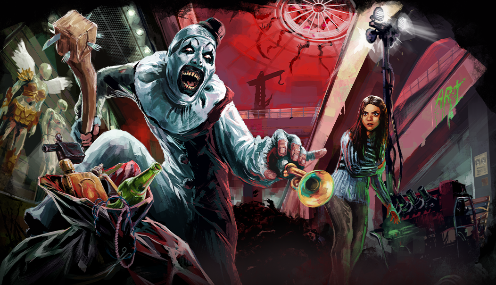
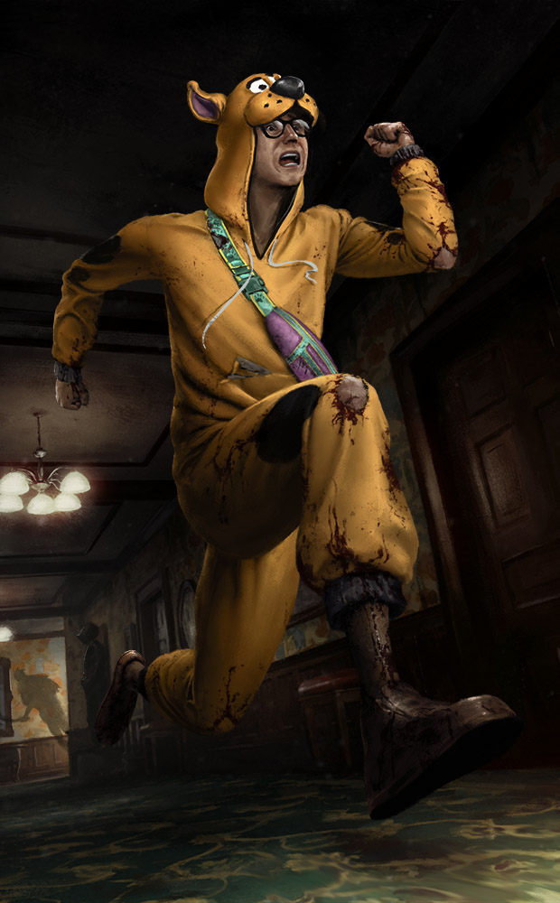
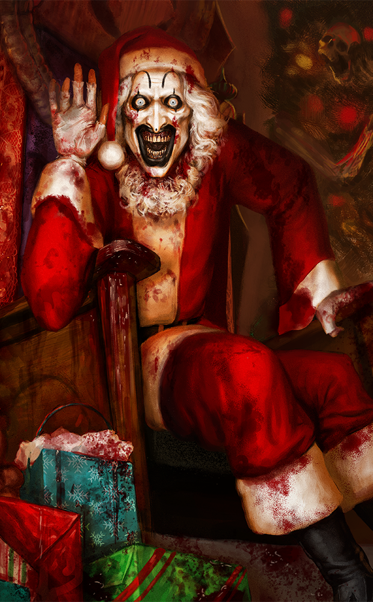
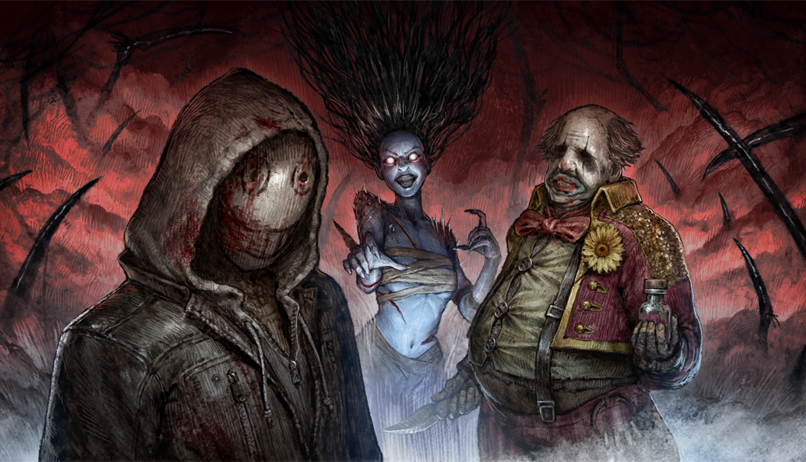
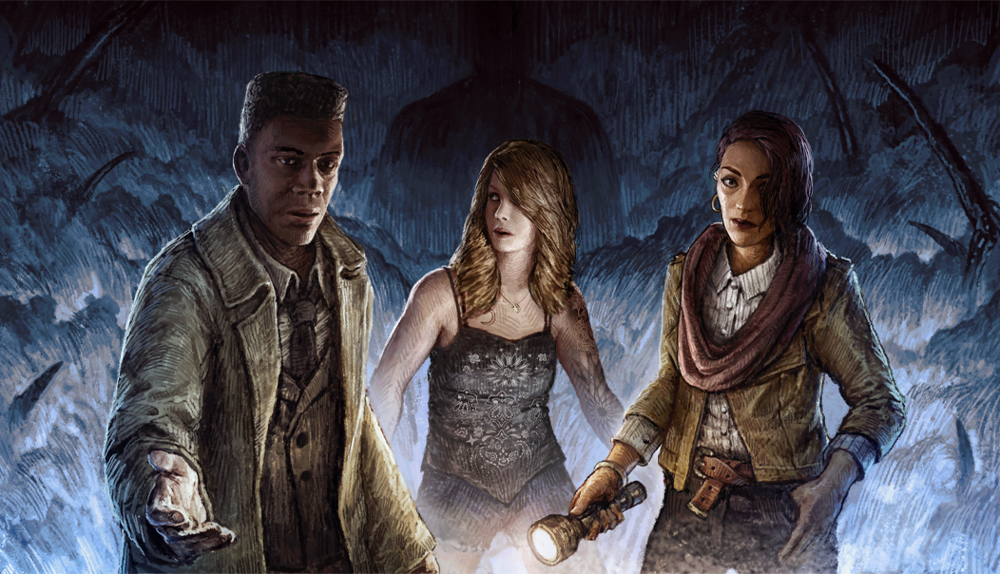
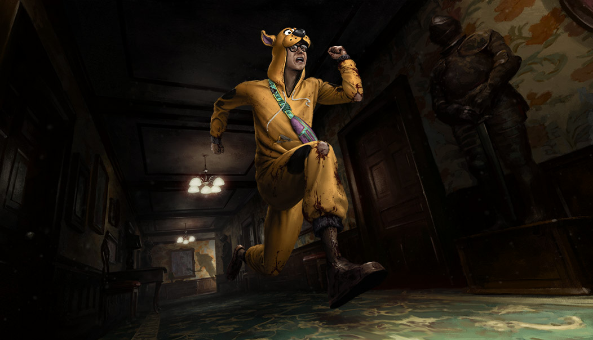
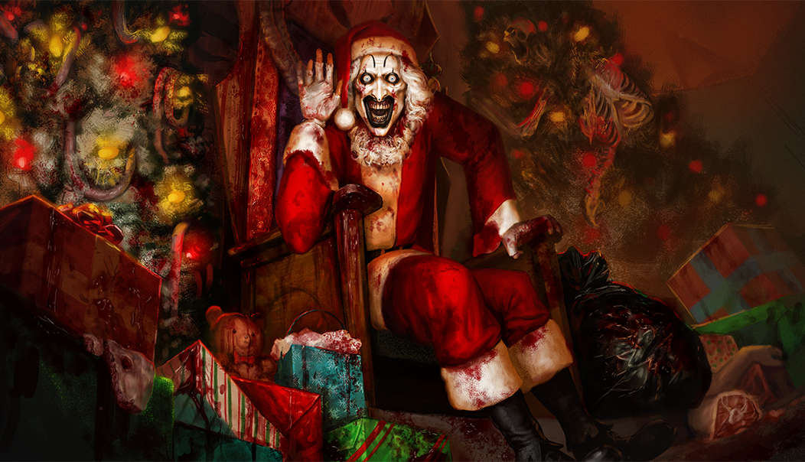

# live · 10.3.0_4009053live

| | |
|---|---|
| Build date | 2026-11-24 17:18 UTC |
| CDN version | `10.3.0_4009053live-1795540716` |
| Key | `10.3.0_live` |
| Compared with | [10.2.2_4008053live](../10.2.2_4008053live/CHANGES.md) (2026-11-24 16:00 UTC) |

## Summary

**8** added · **33** modified · **6** removed · 179 unchanged

## New or updated images

<a href="images/T_UI_ChapterBundle_Terrifier.png"></a>
<a href="images/T_UI_CollectionBanner_Scooby_Doo.png"></a>
<a href="images/T_UI_CollectionBanner_Terrifier.png"></a>
<a href="images/T_UI_SpecialPack_NewPlayer_Killer.png"></a>
<a href="images/T_UI_SpecialPack_NewPlayer_Survivor.png"></a>
<a href="images/T_UI_SpecialPack_Scooby_Doo.png"></a>
<a href="images/T_UI_SpecialPack_Terrifier.png"></a>
<a href="images/T_UI_icon_Event_Map.png"></a>

## Removed files

- `images/T_UI_CollectionBanner_Diablo.png`
- `images/T_UI_CollectionBanner_Godmode.png`
- `images/T_UI_SpecialPack_Diablo.png`
- `images/T_UI_SpecialPack_Godmode.png`
- `images/T_UI_SpecialPack_NovemberDays_Ghostface.png`
- `images/T_UI__CollectionBanner_NovemberDays_Ghostface.png`

## Modified files

### [`GameConfigs.json`](GameConfigs.json)

[Full line-by-line diff](diffs/GameConfigs.json.diff)

```diff
- $.matchmakingIncentiveConfig
+ $.enableLightGoreFeature: true
+ $.movementTimeDiscrepancyDriftAllowanceOverride: 0.09
+ $.analytics.botLogsOnlyAnalytics
+ $.analytics.detailedScoreTypeWhitelist[]: "GameEvent.K45.WeaponSelectionStarted"
+ $.analytics.detailedScoreTypeWhitelist[]: "GameEvent.K45.Tortured.Expired"
+ $.analytics.detailedScoreTypeWhitelist[]: "GameEvent.K45.SurvivorTerrified"
+ $.analytics.detailedScoreTypeWhitelist[]: "GameEvent.K45.Weapon.SadisticActivated.Gun"
+ $.analytics.detailedScoreTypeWhitelist[]: "GameEvent.K45.Weapon.SadisticActivated.Flail"
+ $.analytics.detailedScoreTypeWhitelist[]: "GameEvent.K45.Weapon.SadisticActivated.Bottle"
+ $.analytics.detailedScoreTypeWhitelist[]: "GameEvent.K45.Weapon.SadisticActivated.Flamethrower"
+ $.analytics.detailedScoreTypeWhitelist[]: "GameEvent.K45.Weapon.SadisticActivated.Horn"
+ $.analytics.detailedScoreTypeWhitelist[]: "GameEvent.K45.MiniMori.Gun"
+ $.analytics.detailedScoreTypeWhitelist[]: "GameEvent.K45.MiniMori.Flail"
+ $.analytics.detailedScoreTypeWhitelist[]: "GameEvent.K45.MiniMori.Bottle"
+ $.analytics.detailedScoreTypeWhitelist[]: "GameEvent.K45.MiniMori.Flamethrower"
+ $.analytics.detailedScoreTypeWhitelist[]: "GameEvent.K45.MiniMori.Horn"
+ $.analytics.detailedScoreTypeWhitelist[]: "GameEvent.K45.WeaponSelected.Gun"
+ $.analytics.detailedScoreTypeWhitelist[]: "GameEvent.K45.WeaponSelected.Flail"
+ $.analytics.detailedScoreTypeWhitelist[]: "GameEvent.K45.WeaponSelected.Bottle"
+ $.analytics.detailedScoreTypeWhitelist[]: "GameEvent.K45.WeaponSelected.Flamethrower"
+ $.analytics.detailedScoreTypeWhitelist[]: "GameEvent.K45.WeaponSelected.Horn"
+ $.analytics.detailedScoreTypeWhitelist[]: "GameEvent.K45.Weapon.HitSurvivor.Gun"
+ $.analytics.detailedScoreTypeWhitelist[]: "GameEvent.K45.Weapon.HitSurvivor.Flail"
+ $.analytics.detailedScoreTypeWhitelist[]: "GameEvent.K45.Weapon.HitSurvivor.Bottle"
+ $.analytics.detailedScoreTypeWhitelist[]: "GameEvent.K45.SurvivorAffectedByAcidPuddle"
+ $.analytics.detailedScoreTypeWhitelist[]: "GameEvent.K45.SurvivorAffectedByFlame.Projectile"
+ $.analytics.detailedScoreTypeWhitelist[]: "GameEvent.K45.SurvivorAffectedByFlame.Environment"
+ $.analytics.detailedScoreTypeWhitelist[]: "GameEvent.K45.Weapon.Horn.Hitsurvivor"
+ $.analytics.detailedScoreTypeWhitelist[]: "GameEvent.K45.Tortured.Horn"
+ $.analytics.detailedScoreTypeWhitelist[]: "GameEvent.K45.WeaponTortureDamage.Gun"
+ $.analytics.detailedScoreTypeWhitelist[]: "GameEvent.K45.WeaponTortureDamage.Flail"
+ $.analytics.detailedScoreTypeWhitelist[]: "GameEvent.K45.WeaponTortureDamage.Bottle"
+ $.analytics.detailedScoreTypeWhitelist[]: "GameEvent.K45.WeaponTortureDamage.Flamethrower"
+ $.analytics.detailedScoreTypeWhitelist[]: "GameEvent.K45.Weapon.Horn.GeneratorRepairInterrupted"
+ $.analytics.detailedScoreTypeWhitelist[]: "GameEvent.K45.Weapon.Horn.HealingInterrupted"
- $.readOnlyConfigs.readonlyConfigs[]: "MATCHMAKING_INCENTIVE_CONFIG"
```

### [`archiveJournals/archiveS3Journals.json`](archiveJournals/archiveS3Journals.json)

[Full line-by-line diff](diffs/archiveJournals/archiveS3Journals.json.diff)

```diff
- $.TOME25.vignettes[1].entries[0].startDate: "2026-10-20T15:01:00"
+ $.TOME25.vignettes[1].entries[0].startDate: "2026-12-01T16:00:00"
- $.TOME25.vignettes[1].entries[0].startDateInMs: 1792508460000
+ $.TOME25.vignettes[1].entries[0].startDateInMs: 1796140800000
- $.TOME25.vignettes[1].entries[1].startDate: "2026-10-27T15:00:00"
+ $.TOME25.vignettes[1].entries[1].startDate: "2026-12-08T16:00:00"
- $.TOME25.vignettes[1].entries[1].startDateInMs: 1793113200000
+ $.TOME25.vignettes[1].entries[1].startDateInMs: 1796745600000
- $.TOME25.vignettes[1].entries[2].startDate: "2026-11-03T16:00:00"
+ $.TOME25.vignettes[1].entries[2].startDate: "2026-12-15T16:00:00"
- $.TOME25.vignettes[1].entries[2].startDateInMs: 1793721600000
+ $.TOME25.vignettes[1].entries[2].startDateInMs: 1797350400000
- $.TOME25.vignettes[1].entries[3].startDate: "2026-11-10T16:00:00"
+ $.TOME25.vignettes[1].entries[3].startDate: "2026-12-22T16:00:00"
- $.TOME25.vignettes[1].entries[3].startDateInMs: 1794326400000
+ $.TOME25.vignettes[1].entries[3].startDateInMs: 1797955200000
- $.TOME25.vignettes[1].entries[4].startDate: "2026-11-17T16:00:00"
+ $.TOME25.vignettes[1].entries[4].startDate: "2026-12-29T16:00:00"
- $.TOME25.vignettes[1].entries[4].startDateInMs: 1794931200000
+ $.TOME25.vignettes[1].entries[4].startDateInMs: 1798560000000
- $.TOME25.vignettes[1].entries[5].startDate: "2026-11-24T16:00:00"
+ $.TOME25.vignettes[1].entries[5].startDate: "2027-01-05T16:00:00"
- $.TOME25.vignettes[1].entries[5].startDateInMs: 1795536000000
+ $.TOME25.vignettes[1].entries[5].startDateInMs: 1799164800000
+ $.TOME25.vignettes[1].entries[6]
+ $.TOME25.vignettes[1].entries[7]
+ $.TOME25.vignettes[1].entries[8]
+ $.TOME25.vignettes[1].entries[9]
- $.TOME25.vignettes[1].id: "TOME25_01"
+ $.TOME25.vignettes[1].id: "TOME25_02"
- $.TOME25.vignettes[1].startDate: "2026-10-20T15:01:00"
+ $.TOME25.vignettes[1].startDate: "2026-12-01T16:00:00"
- $.TOME25.vignettes[1].startDateInMs: 1792508460000
+ $.TOME25.vignettes[1].startDateInMs: 1796140800000
```

### [`archiveJournals/storyJournals.json`](archiveJournals/storyJournals.json)

[Full line-by-line diff](diffs/archiveJournals/storyJournals.json.diff)

```diff
+ $.TOME25.TOME25_02
```

### [`bloodwebGenerationRules.json`](bloodwebGenerationRules.json)

[Full line-by-line diff](diffs/bloodwebGenerationRules.json.diff)

```diff
+ $.BulkCost[20]
+ $.EventChestProbability[17]
```

### [`catalog.json`](catalog.json)

[Full line-by-line diff](diffs/catalog.json.diff)

```diff
- $[id=CM_Torso02_04]
- $[id=SteadyPulse_collection_item]
- $[id=MapleCollection_collection_item]
- $[id=BoneChill_collection_item]
- $[id=Chapter39_collection_item]
- $[id=Songkran_collection_item]
- $[id=Chucky_collection_item]
- $[id=ForgottenMemory_collection_item]
- $[id=DoomedCourse_collection_item]
+ $[id=S55]
+ $[id=K45]
+ $[id=CM_Torso038]
+ $[id=DF_Head041]
+ $[id=DF_Legs041]
+ $[id=DF_Torso041]
+ $[id=FM_Head007_01]
+ $[id=FM_Head007_02]
+ $[id=FM_Head007_03]
+ $[id=FM_Head046]
+ $[id=FM_Legs007_01]
+ $[id=FM_Legs007_02]
+ $[id=FM_Legs007_03]
+ $[id=FM_Legs046]
+ $[id=FM_Torso007_01]
+ $[id=FM_Torso007_02]
+ $[id=FM_Torso007_03]
+ $[id=FM_Torso046]
+ $[id=GS_Head043]
+ $[id=GS_Legs043]
+ $[id=GS_Torso043]
+ $[id=HK_W029]
+ $[id=K044_W007]
+ $[id=K14_02_BDG_P100]
+ $[id=K14_02_BDG_P25]
+ $[id=K14_02_BDG_P50]
+ $[id=K14_02_BDG_P75]
+ $[id=K14_03_BDG_P100]
+ $[id=K14_03_BDG_P25]
+ $[id=K14_03_BDG_P50]
+ $[id=K14_03_BDG_P75]
+ $[id=K14_04_BDG_P100]
+ $[id=K14_04_BDG_P25]
+ $[id=K14_04_BDG_P50]
+ $[id=K14_04_BDG_P75]
+ $[id=K30_Body023]
+ $[id=K30_Head023]
+ $[id=K30_W023]
+ $[id=K35_Body021]
+ $[id=K35_Head021]
+ $[id=K35_W021]
+ $[id=K44_Head01_WinterEvent2024]
+ $[id=K45_BDG_P100]
+ $[id=K45_BDG_P25]
+ $[id=K45_BDG_P50]
+ $[id=K45_BDG_P75]
+ $[id=K45_Body01]
+ $[id=K45_Body010]
+ $[id=K45_Body01_P01]
+ $[id=K45_Head007]
+ $[id=K45_Head008]
+ $[id=K45_Head009]
+ $[id=K45_Head01]
+ $[id=K45_Head010]
+ $[id=K45_Head010_01]
+ $[id=K45_Head01_P01]
+ $[id=K45_PCharm001]
+ $[id=K45_PCharm002]
+ $[id=K45_PCharm003]
+ $[id=K45_Torso006]
+ $[id=K45_W010]
+ $[id=K45_W01_P01]
+ $[id=K45_Weapon01]
+ $[id=S054_Torso008]
+ $[id=S23_Head035]
+ $[id=S23_Legs035]
+ $[id=S23_Torso035]
+ $[id=S25_Torso035]
+ $[id=S28_Head036]
+ $[id=S28_Legs036]
+ $[id=S28_Torso036]
+ $[id=S29_Torso025]
+ $[id=S31_Head026]
+ $[id=S31_Legs026]
+ $[id=S31_Torso026]
+ $[id=S34_Head028]
+ $[id=S34_Legs028]
+ $[id=S34_Torso028]
+ $[id=S36_Head028]
+ $[id=S36_Legs028]
+ $[id=S36_Torso028]
+ $[id=S42_02_BDG_P100]
+ $[id=S42_02_BDG_P25]
+ $[id=S42_02_BDG_P50]
+ $[id=S42_02_BDG_P75]
+ $[id=S49_Head014]
+ $[id=S49_Legs014]
+ $[id=S49_Torso014]
+ $[id=S50_Torso008]
+ $[id=S51_Torso007]
+ $[id=S52_Torso011]
+ $[id=S53_Torso009]
+ $[id=S55_BDG_P100]
+ $[id=S55_BDG_P25]
+ $[id=S55_BDG_P50]
+ $[id=S55_BDG_P75]
+ $[id=S55_Head006]
+ $[id=S55_Head01]
+ $[id=S55_Head01_P01]
+ $[id=S55_Legs006]
+ $[id=S55_Legs01]
+ $[id=S55_Legs01_P01]
+ $[id=S55_PCharm001]
+ $[id=S55_PCharm002]
+ $[id=S55_PCharm003]
+ $[id=S55_Torso006]
+ $[id=S55_Torso007]
+ $[id=S55_Torso01]
+ $[id=S55_Torso01_P01]
+ $[id=TW_W026]
+ $[id=UDO_005]
+ $[id=UDO_BDG_15]
+ $[id=UDO_BNR_09]
+ $[id=VAN_015]
+ $[id=VAN_BDG_06]
+ $[id=VAN_BNR_04]
+ $[id=WAF_001]
+ $[id=WAF_002]
+ $[id=WAF_003]
+ $[id=WAF_004]
+ $[id=WAF_005]
+ $[id=WAF_006]
+ $[id=WAF_007]
+ $[id=WAF_008]
+ $[id=WAF_011]
+ $[id=WAF_BDG_01]
+ $[id=WAF_BDG_02]
+ $[id=WAF_BDG_03]
+ $[id=WAF_BDG_04]
+ $[id=WAF_BDG_05]
+ $[id=WAF_BDG_06]
+ $[id=WAF_BDG_07]
+ $[id=WAF_BDG_32]
+ $[id=WAF_BNR_01]
+ $[id=WAF_BNR_02]
+ $[id=WAF_BNR_03]
+ $[id=WAF_BNR_04]
+ $[id=WAF_BNR_05]
+ $[id=WAF_BNR_06]
+ $[id=WAF_BNR_07]
+ $[id=WAF_BNR_08]
+ $[id=WAF_BNR_09]
+ $[id=WAF_BNR_10]
+ $[id=WAF_BNR_13]
+ $[id=DF_outfit_041]
+ $[id=FM_outfit_007_01]
+ $[id=FM_outfit_007_02]
+ $[id=FM_outfit_007_03]
+ $[id=FM_outfit_046]
+ $[id=GS_outfit_043]
+ $[id=K30_outfit_023]
+ $[id=K35_outfit_021]
+ $[id=K45_outfit_01]
+ $[id=K45_outfit_010]
+ $[id=K45_outfit_01_P01]
+ $[id=S23_outfit_035]
+ $[id=S28_outfit_036]
+ $[id=S31_outfit_026]
+ $[id=S34_outfit_028]
+ $[id=S36_outfit_028]
+ $[id=S49_outfit_014]
+ $[id=S55_outfit_006]
+ $[id=S55_outfit_01]
+ $[id=S55_outfit_01_P01]
+ $[id=10.0.0_DECK_THE_TRIALS_Bundle]
+ $[id=10.0.0_HOLIDAY_HORROR_Bundle]
+ $[id=10.0.0_Ugly_Sweater_Bundle]
+ $[id=10.0.0_WINTER_TALES_Bundle]
+ $[id=10.3.0_2025_BONECHILL_Bundle]
+ $[id=10.3.0_2025_BONECHILL_Item_Bundle_0]
+ $[id=10.3.0_SCOOBY_DOO_Bundle]
+ $[id=10.3.0_Terrifier_collection_item]
+ $[id=Bonechill_collection_item]
+ $[id=10.3.0_Scooby_Doo_collection_item]
- $[id=Claudette].metaData.defaultCustomization[]: "CM_Torso02_04"
- $[id=K34].defaultCost
- $[id=K34].eventCostList
- $[id=K34].metaData.hiddenIfNotOwned: false
+ $[id=K34].metaData.hiddenIfNotOwned: true
- $[id=K34].purchasable: true
+ $[id=K34].purchasable: false
- $[id=AV_Head012].metaData.availablePeriods[1].endDate: "2026-01-06T16:00:00"
+ $[id=AV_Head012].metaData.availablePeriods[1].endDate: "2027-01-06T16:00:00"
- $[id=AV_Head012].metaData.availablePeriods[1].endDateInMs: 1767715200000
+ $[id=AV_Head012].metaData.availablePeriods[1].endDateInMs: 1799251200000
- $[id=AV_Head012].metaData.availablePeriods[1].startDate: "2025-12-01T16:00:00"
+ $[id=AV_Head012].metaData.availablePeriods[1].startDate: "2026-12-03T16:00:00"
- $[id=AV_Head012].metaData.availablePeriods[1].startDateInMs: 1764604800000
+ $[id=AV_Head012].metaData.availablePeriods[1].startDateInMs: 1796313600000
- $[id=AV_Head012].metaData.limitedTimeEndDate: "2026-01-06T16:00:00"
+ $[id=AV_Head012].metaData.limitedTimeEndDate: "2027-01-06T16:00:00"
… 2716 more change(s) — see the commit diff for everything
```

### [`challengeLocs/challengeText_de.json`](challengeLocs/challengeText_de.json)

[Full line-by-line diff](diffs/challengeLocs/challengeText_de.json.diff)

```diff
- $.locText[162].text: "2 gegen 8"
+ $.locText[162].text: "Kalt bis auf die Knochen"
- $.locText[162].textId: "CHALLENGESET_CalamariJerky_TITLE"
+ $.locText[162].textId: "CHALLENGESET_Winter_TITLE"
- $.locText[163].text: "Quests müssen in 2 gegen 8 abgeschlossen werden"
+ $.locText[163].text: "@#CHALLENGESET_Winter_INFO"
- $.locText[163].textId: "CHALLENGESET_CalamariJerky_INFO"
+ $.locText[163].textId: "CHALLENGESET_Winter_INFO"
- $.locText[164].text: "@#CHALLENGE_CompleteCalamariQuests1_TITLE"
+ $.locText[164].text: "@#CHALLENGE_HitWithSnowSkull_TITLE"
- $.locText[164].textId: "CHALLENGE_CompleteCalamariQuests1_TITLE"
+ $.locText[164].textId: "CHALLENGE_HitWithSnowSkull_TITLE"
- $.locText[165].text: "@#CHALLENGE_CompleteCalamariQuests1_DESC"
+ $.locText[165].text: "@#CHALLENGE_HitWithSnowSkull_DESC"
- $.locText[165].textId: "CHALLENGE_CompleteCalamariQuests1_DESC"
+ $.locText[165].textId: "CHALLENGE_HitWithSnowSkull_DESC"
- $.locText[166].text: "Schließe {0} Quest(s) in 2 gegen 8 ab."
+ $.locText[166].text: "Triff andere Spieler mit Schneeschädeln."
- $.locText[166].textId: "CHALLENGE_CompleteCalamariQuests1_INFO"
+ $.locText[166].textId: "CHALLENGE_HitWithSnowSkull_INFO"
- $.locText[167].text: "@#CHALLENGE_CompleteCalamariQuests2_TITLE"
+ $.locText[167].text: "@#CHALLENGE_FreezePallet_TITLE"
- $.locText[167].textId: "CHALLENGE_CompleteCalamariQuests2_TITLE"
+ $.locText[167].textId: "CHALLENGE_FreezePallet_TITLE"
- $.locText[168].text: "@#CHALLENGE_CompleteCalamariQuests2_DESC"
+ $.locText[168].text: "@#CHALLENGE_FreezePallet_DESC"
- $.locText[168].textId: "CHALLENGE_CompleteCalamariQuests2_DESC"
+ $.locText[168].textId: "CHALLENGE_FreezePallet_DESC"
- $.locText[169].text: "Schließe {0} Quest(s) in 2 gegen 8 ab."
+ $.locText[169].text: "Friere {0} Palette(n) mit einem eisigen Schneeschädel ein."
- $.locText[169].textId: "CHALLENGE_CompleteCalamariQuests2_INFO"
+ $.locText[169].textId: "CHALLENGE_FreezePallet_INFO"
- $.locText[170].text: "@#CHALLENGE_CompleteCalamariQuests3_TITLE"
+ $.locText[170].text: "@#CHALLENGE_DestroyMimicSnowman_TITLE"
- $.locText[170].textId: "CHALLENGE_CompleteCalamariQuests3_TITLE"
+ $.locText[170].textId: "CHALLENGE_DestroyMimicSnowman_TITLE"
- $.locText[171].text: "@#CHALLENGE_CompleteCalamariQuests3_DESC"
+ $.locText[171].text: "@#CHALLENGE_DestroyMimicSnowman_DESC"
- $.locText[171].textId: "CHALLENGE_CompleteCalamariQuests3_DESC"
+ $.locText[171].textId: "CHALLENGE_DestroyMimicSnowman_DESC"
- $.locText[172].text: "Schließe {0} Quest(s) in 2 gegen 8 ab."
+ $.locText[172].text: "Zerstöre Schneemannimitate {0}-mal mit einem Schneeschädel oder einer Killeraktion."
- $.locText[172].textId: "CHALLENGE_CompleteCalamariQuests3_INFO"
+ $.locText[172].textId: "CHALLENGE_DestroyMimicSnowman_INFO"
- $.locText[173].text: "@#CHALLENGE_PlayAsCharacterOrClass_TITLE"
+ $.locText[173].text: "Eisige Bauarbeiten"
- $.locText[173].textId: "CHALLENGE_PlayAsCharacterOrClass_TITLE"
+ $.locText[173].textId: "CHALLENGE_Winter26ContribueSnowBarricade_TITLE"
- $.locText[174].text: "@#CHALLENGE_PlayAsCharacterOrClass_"
+ $.locText[174].text: "Trage zu {0} Schneebarrikaden bei."
- $.locText[174].textId: "CHALLENGE_PlayAsCharacterOrClass_"
+ $.locText[174].textId: "CHALLENGE_Winter26ContribueSnowBarricade_DESC"
- $.locText[175].text: "Schließe {0} Prüfung(en) als {1} ab."
+ $.locText[175].text: "Trage zu {0} Schneebarrikaden bei."
- $.locText[175].textId: "CHALLENGE_PlayAsCharacter_INFO"
+ $.locText[175].textId: "CHALLENGE_Winter26ContribueSnowBarricade_INFO"
- $.locText[176].text: "Schließe {0} Prüfung(en) als {1} ab."
+ $.locText[176].text: "@#CHALLENGE_FreezeGen_TITLE"
- $.locText[176].textId: "CHALLENGE_PlayAsClass_INFO"
+ $.locText[176].textId: "CHALLENGE_FreezeGen_TITLE"
- $.locText[177].text: "@#CHALLENGE_Crow_TITLE"
+ $.locText[177].text: "@#CHALLENGE_FreezeGen_DESC"
- $.locText[177].textId: "CHALLENGE_Crow_TITLE"
+ $.locText[177].textId: "CHALLENGE_FreezeGen_DESC"
- $.locText[178].text: "@#CHALLENGE_Crow_DESC"
+ $.locText[178].text: "Bedecke {0} Generator(en) mit einem eisigen Schneeschädel mit Schnee."
- $.locText[178].textId: "CHALLENGE_Crow_DESC"
+ $.locText[178].textId: "CHALLENGE_FreezeGen_INFO"
- $.locText[179].text: "Störe {0} Krähe(n)."
+ $.locText[179].text: "Eis mit Eis bekämpfen"
- $.locText[179].textId: "CHALLENGE_Crow_INFO"
+ $.locText[179].textId: "CHALLENGE_Winter26DestroySnowmanWithSnowSkull_TITLE"
- $.locText[180].text: "Blutige Belohnungen"
+ $.locText[180].text: "Zerstöre {0}-mal einen Schneemann mit einem eisigen Schneeschädel."
- $.locText[180].textId: "CHALLENGE_EarnBloodpoints_TITLE"
+ $.locText[180].textId: "CHALLENGE_Winter26DestroySnowmanWithSnowSkull_DESC"
- $.locText[181].text: "Blutpunkte erhältst du für viele unterschiedliche Aktionen, zum Beispiel, wenn du mit anderen Überlebenden zusammenarbeitest und deine Killer-Stärken einsetzt.…
+ $.locText[181].text: "Zerstöre {0}-mal einen Schneemann mit einem eisigen Schneeschädel."
- $.locText[181].textId: "CHALENGE_EarnBloodpoints_DESC"
+ $.locText[181].textId: "CHALLENGE_Winter26DestroySnowmanWithSnowSkull_INFO"
- $.locText[182].text: "Verdiene {0} Blutpunkte."
+ $.locText[182].text: "Schnee, ade"
- $.locText[182].textId: "CHALENGE_EarnBloodpoints_INFO"
+ $.locText[182].textId: "CHALLENGE_Winter26KickSnowBarricade_TITLE"
- $.locText[183].text: "@#CHALLENGE_KillSurvivorOrRepairGens_TITLE"
+ $.locText[183].text: "Tritt gegen {0} Schneebarrikaden."
- $.locText[183].textId: "CHALLENGE_KillSurvivorOrRepairGens_TITLE"
+ $.locText[183].textId: "CHALLENGE_Winter26KickSnowBarricade_DESC"
- $.locText[184].text: "@#CHALLENGE_KillSurvivorOrRepairGens_DESC"
+ $.locText[184].text: "Tritt gegen {0} Schneebarrikaden."
- $.locText[184].textId: "CHALLENGE_KillSurvivorOrRepairGens_DESC"
+ $.locText[184].textId: "CHALLENGE_Winter26KickSnowBarricade_INFO"
- $.locText[185].text: "Töte {0} Überlebende(n)."
+ $.locText[185].text: "@#CHALLENGE_CoopAction_TITLE"
- $.locText[185].textId: "CHALLENGE_Kill_INFO"
+ $.locText[185].textId: "CHALLENGE_CoopAction_TITLE"
- $.locText[186].text: "Repariere insgesamt {0} Generator(en)."
+ $.locText[186].text: "@#CHALLENGE_CoopAction_DESC"
- $.locText[186].textId: "CHALLENGE_Repair_INFO"
+ $.locText[186].textId: "CHALLENGE_CoopAction_DESC"
- $.locText[187].text: "@#CHALLENGE_ChaseOrPlayAsClass_TITLE"
+ $.locText[187].text: "Führe insgesamt {0} Sekunden lang kooperative Aktionen aus."
- $.locText[187].textId: "CHALLENGE_ChaseOrPlayAsClass_TITLE"
+ $.locText[187].textId: "CHALLENGE_CoopAction_INFO"
- $.locText[188].text: "@#CHALLENGE_ChaseOrPlayAsClass_DESC"
+ $.locText[188].text: "@#CHALLENGE_PlayAsKillerOrAnyKiller_TITLE"
- $.locText[188].textId: "CHALLENGE_ChaseOrPlayAsClass_DESC"
+ $.locText[188].textId: "CHALLENGE_PlayAsKillerOrAnyKiller_TITLE"
- $.locText[189].text: "„2 gegen 8“-Abschlussquests"
+ $.locText[189].text: "@#CHALLENGE_PlayAsKillerOrAnyKiller_DESC"
- $.locText[189].textId: "LIST_Calamari_TITLE_1"
+ $.locText[189].textId: "CHALLENGE_PlayAsKillerOrAnyKiller_DESC"
- $.locText[190].text: "„2 gegen 8“-Quests – Teil 1"
+ $.locText[190].text: "Schließe {0} Prüfung(en) als {1} ab."
- $.locText[190].textId: "LIST_Calamari_TITLE_2"
+ $.locText[190].textId: "CHALLENGE_PlayAsKiller_INFO"
- $.locText[191].text: "„2 gegen 8“-Quests – Teil 2"
+ $.locText[191].text: "Schließe {0} Prüfung(en) als ein beliebiger Killer ab."
- $.locText[191].textId: "LIST_Calamari_TITLE_3"
+ $.locText[191].textId: "CHALLENGE_PlayAnyKiller_INFO"
- $.locText[192].text: "„2 gegen 8“-Quests – Teil 3"
+ $.locText[192].text: "@#CHALLENGE_PlayAsSurvivorOrAnySurvivor_TITLE"
- $.locText[192].textId: "LIST_Calamari_TITLE_4"
+ $.locText[192].textId: "CHALLENGE_PlayAsSurvivorOrAnySurvivor_TITLE"
- $.locText[193].text: "2V8"
+ $.locText[193].text: "@#CHALLENGE_PlayAsSurvivorOrAnySurvivor_DESC"
- $.locText[193].textId: "CHALLENGESET_CalamariLasagna_TITLE"
+ $.locText[193].textId: "CHALLENGE_PlayAsSurvivorOrAnySurvivor_DESC"
- $.locText[194].text: "@#CHALLENGESET_CalamariLasagna_INFO"
+ $.locText[194].text: "Schließe {0} Prüfung(en) als {1} ab."
- $.locText[194].textId: "CHALLENGESET_CalamariLasagna_INFO"
+ $.locText[194].textId: "CHALLENGE_PlayAsSurvivor_INFO"
- $.locText[195].text: "@#CHALLENGE_PlayAsKillerClassOrSurvivorClass_TITLE"
+ $.locText[195].text: "Schließe {0} Prüfung(en) als ein beliebiger Überlebender ab."
- $.locText[195].textId: "CHALLENGE_PlayAsKillerClassOrSurvivorClass_TITLE"
+ $.locText[195].textId: "CHALLENGE_PlayAnySurvivor_INFO"
- $.locText[196].text: "@#CHALLENGE_PlayAsKillerClassOrSurvivorClass_DESC"
+ $.locText[196].text: "Schneekünstler"
- $.locText[196].textId: "CHALLENGE_PlayAsKillerClassOrSurvivorClass_DESC"
+ $.locText[196].textId: "CHALLENGE_Winter26CraftSnowman_TITLE"
- $.locText[197].text: "@#CHALLENGE_EarnModeBloodpointsOrEarnBloodpoints_TITLE"
+ $.locText[197].text: "Baue {0}-mal einen Schneemann an einem Schneehaufen."
- $.locText[197].textId: "CHALLENGE_EarnModeBloodpointsOrEarnBloodpoints_TITLE"
+ $.locText[197].textId: "CHALLENGE_Winter26CraftSnowman_DESC"
- $.locText[198].text: "@#CHALLENGE_EarnModeBloodpointsOrEarnBloodpoints_DESC"
+ $.locText[198].text: "Baue {0}-mal einen Schneemann an einem Schneehaufen."
- $.locText[198].textId: "CHALLENGE_EarnModeBloodpointsOrEarnBloodpoints_DESC"
+ $.locText[198].textId: "CHALLENGE_Winter26CraftSnowman_INFO"
- $.locText[199].text: "Verdiene {0} Blutpunkte in „{1}“."
+ $.locText[199].text: "Eiskalter Wurf"
- $.locText[199].textId: "CHALLENGE_EarnModeBloodpoints_INFO"
+ $.locText[199].textId: "CHALLENGE_Winter26SnowskullWithinSnowman_TITLE"
- $.locText[200].text: "@#CHALLENGE_ScareModeCrowOrScareCrow_TITLE"
+ $.locText[200].text: "Wirf {0}-mal Schneeschädel, während du in einem Schneemann steckst."
- $.locText[200].textId: "CHALLENGE_ScareModeCrowOrScareCrow_TITLE"
+ $.locText[200].textId: "CHALLENGE_Winter26SnowskullWithinSnowman_DESC"
- $.locText[201].text: "@#CHALLENGE_ScareModeCrowOrScareCrow_DESC"
+ $.locText[201].text: "Wirf {0}-mal Schneeschädel, während du in einem Schneemann steckst."
- $.locText[201].textId: "CHALLENGE_ScareModeCrowOrScareCrow_DESC"
+ $.locText[201].textId: "CHALLENGE_Winter26SnowskullWithinSnowman_INFO"
- $.locText[202].text: "Störe {0} Krähe(n) in „{1}“."
+ $.locText[202].text: "Ausgeschaltet"
- $.locText[202].textId: "CHALLENGE_ScareModeCrow_INFO"
+ $.locText[202].textId: "CHALLENGE_Down_TITLE"
- $.locText[203].text: "@#CHALLENGE_CompleteModeTrialOrTrial_TITLE"
+ $.locText[203].text: "Strecke <b>{0} Überlebende(n)</b> nieder."
- $.locText[203].textId: "CHALLENGE_CompleteModeTrialOrTrial_TITLE"
+ $.locText[203].textId: "CHALLENGE_Down_DESC"
- $.locText[204].text: "@#CHALLENGE_CompleteModeTrialOrTrial_DESC"
+ $.locText[204].text: "@#CHALLENGE_OpenChests_TITLE"
- $.locText[204].textId: "CHALLENGE_CompleteModeTrialOrTrial_DESC"
+ $.locText[204].textId: "CHALLENGE_OpenChests_TITLE"
- $.locText[205].text: "@#CHALLENGE_MoriOrEscape_TITLE"
+ $.locText[205].text: "Überall auf der Karte gibt es Truhen, die zufällige Gegenstände enthalten, die dein Überleben sichern könnten."
- $.locText[205].textId: "CHALLENGE_MoriOrEscape_TITLE"
+ $.locText[205].textId: "CHALLENGE_OpenChests_DESC"
- $.locText[206].text: "@#CHALLENGE_MoriOrEscape_DESC"
+ $.locText[206].text: "Öffne {0} Truhe(n)."
- $.locText[206].textId: "CHALLENGE_MoriOrEscape_DESC"
+ $.locText[206].textId: "CHALLENGE_OpenChests_INFO"
- $.locText[207].text: "2V8"
+ $.locText[207].text: "Coole Deckung"
- $.locText[207].textId: "CHALLENGESET_CalamariPoutine_TITLE"
+ $.locText[207].textId: "CHALLENGE_Winter26HideInSnowman_TITLE"
- $.locText[208].text: "@#CHALLENGESET_CalamariPoutine_INFO"
+ $.locText[208].text: "Verstecke dich {0}-mal in einem Schneemann."
- $.locText[208].textId: "CHALLENGESET_CalamariPoutine_INFO"
+ $.locText[208].textId: "CHALLENGE_Winter26HideInSnowman_DESC"
- $.locText[209].text: "@#CHALLENGE_HitOrRevealKillerTime_TITLE"
+ $.locText[209].text: "Verstecke dich {0}-mal in einem Schneemann."
- $.locText[209].textId: "CHALLENGE_HitOrRevealKillerTime_TITLE"
+ $.locText[209].textId: "CHALLENGE_Winter26HideInSnowman_INFO"
- $.locText[210].text: "@#CHALLENGE_HitOrRevealKillerTime_DESC"
+ $.locText[210].text: "Wo gehobelt wird, fallen Eissplitter"
- $.locText[210].textId: "CHALLENGE_HitOrRevealKillerTime_DESC"
+ $.locText[210].textId: "CHALLENGE_Winter26SnowskullFightWithMimic_TITLE"
- $.locText[211].text: "Enthülle die Aura des Killers für {0} Sekunden."
+ $.locText[211].text: "Liefere dir {0}-mal eine Schneeschädelschlacht mit einem Schneelauerer."
- $.locText[211].textId: "CHALLENGE_RevealKillerTime_INFO"
+ $.locText[211].textId: "CHALLENGE_Winter26SnowskullFightWithMimic_DESC"
… 2085 more change(s) — see the commit diff for everything
```

### [`challengeLocs/challengeText_en.json`](challengeLocs/challengeText_en.json)

[Full line-by-line diff](diffs/challengeLocs/challengeText_en.json.diff)

```diff
- $.locText[162].text: "2V8"
+ $.locText[162].text: "Bone Chill"
- $.locText[162].textId: "CHALLENGESET_CalamariJerky_TITLE"
+ $.locText[162].textId: "CHALLENGESET_Winter_TITLE"
- $.locText[163].text: "Quests must be completed in 2v8"
+ $.locText[163].text: "@#CHALLENGESET_Winter_INFO"
- $.locText[163].textId: "CHALLENGESET_CalamariJerky_INFO"
+ $.locText[163].textId: "CHALLENGESET_Winter_INFO"
- $.locText[164].text: "@#CHALLENGE_CompleteCalamariQuests1_TITLE"
+ $.locText[164].text: "@#CHALLENGE_HitWithSnowSkull_TITLE"
- $.locText[164].textId: "CHALLENGE_CompleteCalamariQuests1_TITLE"
+ $.locText[164].textId: "CHALLENGE_HitWithSnowSkull_TITLE"
- $.locText[165].text: "@#CHALLENGE_CompleteCalamariQuests1_DESC"
+ $.locText[165].text: "@#CHALLENGE_HitWithSnowSkull_DESC"
- $.locText[165].textId: "CHALLENGE_CompleteCalamariQuests1_DESC"
+ $.locText[165].textId: "CHALLENGE_HitWithSnowSkull_DESC"
- $.locText[166].text: "Complete {0} 2v8 quest(s)"
+ $.locText[166].text: "Hit other players with Snowskulls"
- $.locText[166].textId: "CHALLENGE_CompleteCalamariQuests1_INFO"
+ $.locText[166].textId: "CHALLENGE_HitWithSnowSkull_INFO"
- $.locText[167].text: "@#CHALLENGE_CompleteCalamariQuests2_TITLE"
+ $.locText[167].text: "@#CHALLENGE_FreezePallet_TITLE"
- $.locText[167].textId: "CHALLENGE_CompleteCalamariQuests2_TITLE"
+ $.locText[167].textId: "CHALLENGE_FreezePallet_TITLE"
- $.locText[168].text: "@#CHALLENGE_CompleteCalamariQuests2_DESC"
+ $.locText[168].text: "@#CHALLENGE_FreezePallet_DESC"
- $.locText[168].textId: "CHALLENGE_CompleteCalamariQuests2_DESC"
+ $.locText[168].textId: "CHALLENGE_FreezePallet_DESC"
- $.locText[169].text: "Complete {0} 2v8 quest(s)"
+ $.locText[169].text: "Freeze {0} pallet(s) with an Icy Snowskull"
- $.locText[169].textId: "CHALLENGE_CompleteCalamariQuests2_INFO"
+ $.locText[169].textId: "CHALLENGE_FreezePallet_INFO"
- $.locText[170].text: "@#CHALLENGE_CompleteCalamariQuests3_TITLE"
+ $.locText[170].text: "@#CHALLENGE_DestroyMimicSnowman_TITLE"
- $.locText[170].textId: "CHALLENGE_CompleteCalamariQuests3_TITLE"
+ $.locText[170].textId: "CHALLENGE_DestroyMimicSnowman_TITLE"
- $.locText[171].text: "@#CHALLENGE_CompleteCalamariQuests3_DESC"
+ $.locText[171].text: "@#CHALLENGE_DestroyMimicSnowman_DESC"
- $.locText[171].textId: "CHALLENGE_CompleteCalamariQuests3_DESC"
+ $.locText[171].textId: "CHALLENGE_DestroyMimicSnowman_DESC"
- $.locText[172].text: "Complete {0} 2v8 quest(s)"
+ $.locText[172].text: "Destroy Snow Lurkers {0} time(s) with a Snowskull or Killer action"
- $.locText[172].textId: "CHALLENGE_CompleteCalamariQuests3_INFO"
+ $.locText[172].textId: "CHALLENGE_DestroyMimicSnowman_INFO"
- $.locText[173].text: "@#CHALLENGE_PlayAsCharacterOrClass_TITLE"
+ $.locText[173].text: "Building in the Cold"
- $.locText[173].textId: "CHALLENGE_PlayAsCharacterOrClass_TITLE"
+ $.locText[173].textId: "CHALLENGE_Winter26ContribueSnowBarricade_TITLE"
- $.locText[174].text: "@#CHALLENGE_PlayAsCharacterOrClass_"
+ $.locText[174].text: "Contribute to {0} Snow Barricades."
- $.locText[174].textId: "CHALLENGE_PlayAsCharacterOrClass_"
+ $.locText[174].textId: "CHALLENGE_Winter26ContribueSnowBarricade_DESC"
- $.locText[175].text: "Complete {0} trial(s) as {1}"
+ $.locText[175].text: "Contribute to {0} Snow Barricades."
- $.locText[175].textId: "CHALLENGE_PlayAsCharacter_INFO"
+ $.locText[175].textId: "CHALLENGE_Winter26ContribueSnowBarricade_INFO"
- $.locText[176].text: "Complete {0} trial(s) as {1}"
+ $.locText[176].text: "@#CHALLENGE_FreezeGen_TITLE"
- $.locText[176].textId: "CHALLENGE_PlayAsClass_INFO"
+ $.locText[176].textId: "CHALLENGE_FreezeGen_TITLE"
- $.locText[177].text: "@#CHALLENGE_Crow_TITLE"
+ $.locText[177].text: "@#CHALLENGE_FreezeGen_DESC"
- $.locText[177].textId: "CHALLENGE_Crow_TITLE"
+ $.locText[177].textId: "CHALLENGE_FreezeGen_DESC"
- $.locText[178].text: "@#CHALLENGE_Crow_DESC"
+ $.locText[178].text: "Cover {0} generator(s) in snow with an Icy Snowskull"
- $.locText[178].textId: "CHALLENGE_Crow_DESC"
+ $.locText[178].textId: "CHALLENGE_FreezeGen_INFO"
- $.locText[179].text: "Disturb {0} crow(s)"
+ $.locText[179].text: "Fighting Ice With Ice"
- $.locText[179].textId: "CHALLENGE_Crow_INFO"
+ $.locText[179].textId: "CHALLENGE_Winter26DestroySnowmanWithSnowSkull_TITLE"
- $.locText[180].text: "Bloody Rewards"
+ $.locText[180].text: "Destroy a Snowman with an Icy Snowskull {0} times."
- $.locText[180].textId: "CHALLENGE_EarnBloodpoints_TITLE"
+ $.locText[180].textId: "CHALLENGE_Winter26DestroySnowmanWithSnowSkull_DESC"
- $.locText[181].text: "Many actions reward you with Bloodpoints, such as cooperating with other Survivors and using your Killer powers."
+ $.locText[181].text: "Destroy a Snowman with an Icy Snowskull {0} times."
- $.locText[181].textId: "CHALENGE_EarnBloodpoints_DESC"
+ $.locText[181].textId: "CHALLENGE_Winter26DestroySnowmanWithSnowSkull_INFO"
- $.locText[182].text: "Earn {0} Bloodpoints"
+ $.locText[182].text: "Crush the Slush"
- $.locText[182].textId: "CHALENGE_EarnBloodpoints_INFO"
+ $.locText[182].textId: "CHALLENGE_Winter26KickSnowBarricade_TITLE"
- $.locText[183].text: "@#CHALLENGE_KillSurvivorOrRepairGens_TITLE"
+ $.locText[183].text: "Kick {0} Snow Barricades."
- $.locText[183].textId: "CHALLENGE_KillSurvivorOrRepairGens_TITLE"
+ $.locText[183].textId: "CHALLENGE_Winter26KickSnowBarricade_DESC"
- $.locText[184].text: "@#CHALLENGE_KillSurvivorOrRepairGens_DESC"
+ $.locText[184].text: "Kick {0} Snow Barricades."
- $.locText[184].textId: "CHALLENGE_KillSurvivorOrRepairGens_DESC"
+ $.locText[184].textId: "CHALLENGE_Winter26KickSnowBarricade_INFO"
- $.locText[185].text: "Sacrifice or kill {0} Survivor(s)"
+ $.locText[185].text: "@#CHALLENGE_CoopAction_TITLE"
- $.locText[185].textId: "CHALLENGE_Kill_INFO"
+ $.locText[185].textId: "CHALLENGE_CoopAction_TITLE"
- $.locText[186].text: "Repair a total of {0} generator(s)"
+ $.locText[186].text: "@#CHALLENGE_CoopAction_DESC"
- $.locText[186].textId: "CHALLENGE_Repair_INFO"
+ $.locText[186].textId: "CHALLENGE_CoopAction_DESC"
- $.locText[187].text: "@#CHALLENGE_ChaseOrPlayAsClass_TITLE"
+ $.locText[187].text: "Perform cooperative actions for a total of {0} seconds"
- $.locText[187].textId: "CHALLENGE_ChaseOrPlayAsClass_TITLE"
+ $.locText[187].textId: "CHALLENGE_CoopAction_INFO"
- $.locText[188].text: "@#CHALLENGE_ChaseOrPlayAsClass_DESC"
+ $.locText[188].text: "@#CHALLENGE_PlayAsKillerOrAnyKiller_TITLE"
- $.locText[188].textId: "CHALLENGE_ChaseOrPlayAsClass_DESC"
+ $.locText[188].textId: "CHALLENGE_PlayAsKillerOrAnyKiller_TITLE"
- $.locText[189].text: "2V8 Completion Quests"
+ $.locText[189].text: "@#CHALLENGE_PlayAsKillerOrAnyKiller_DESC"
- $.locText[189].textId: "LIST_Calamari_TITLE_1"
+ $.locText[189].textId: "CHALLENGE_PlayAsKillerOrAnyKiller_DESC"
- $.locText[190].text: "2V8 Quests - Part 1"
+ $.locText[190].text: "Complete {0} Trial(s) as {1}"
- $.locText[190].textId: "LIST_Calamari_TITLE_2"
+ $.locText[190].textId: "CHALLENGE_PlayAsKiller_INFO"
- $.locText[191].text: "2V8 Quests - Part 2"
+ $.locText[191].text: "Complete {0} trial(s) as any Killer"
- $.locText[191].textId: "LIST_Calamari_TITLE_3"
+ $.locText[191].textId: "CHALLENGE_PlayAnyKiller_INFO"
- $.locText[192].text: "2V8 Quests - Part 3"
+ $.locText[192].text: "@#CHALLENGE_PlayAsSurvivorOrAnySurvivor_TITLE"
- $.locText[192].textId: "LIST_Calamari_TITLE_4"
+ $.locText[192].textId: "CHALLENGE_PlayAsSurvivorOrAnySurvivor_TITLE"
- $.locText[193].text: "2V8"
+ $.locText[193].text: "@#CHALLENGE_PlayAsSurvivorOrAnySurvivor_DESC"
- $.locText[193].textId: "CHALLENGESET_CalamariLasagna_TITLE"
+ $.locText[193].textId: "CHALLENGE_PlayAsSurvivorOrAnySurvivor_DESC"
- $.locText[194].text: "@#CHALLENGESET_CalamariLasagna_INFO"
+ $.locText[194].text: "Complete {0} Trial(s) as {1}"
- $.locText[194].textId: "CHALLENGESET_CalamariLasagna_INFO"
+ $.locText[194].textId: "CHALLENGE_PlayAsSurvivor_INFO"
- $.locText[195].text: "@#CHALLENGE_PlayAsKillerClassOrSurvivorClass_TITLE"
+ $.locText[195].text: "Complete {0} trial(s) as any Survivor"
- $.locText[195].textId: "CHALLENGE_PlayAsKillerClassOrSurvivorClass_TITLE"
+ $.locText[195].textId: "CHALLENGE_PlayAnySurvivor_INFO"
- $.locText[196].text: "@#CHALLENGE_PlayAsKillerClassOrSurvivorClass_DESC"
+ $.locText[196].text: "Snowsculptor"
- $.locText[196].textId: "CHALLENGE_PlayAsKillerClassOrSurvivorClass_DESC"
+ $.locText[196].textId: "CHALLENGE_Winter26CraftSnowman_TITLE"
- $.locText[197].text: "@#CHALLENGE_EarnModeBloodpointsOrEarnBloodpoints_TITLE"
+ $.locText[197].text: "Craft a Snowman from a Snow Pile {0} times."
- $.locText[197].textId: "CHALLENGE_EarnModeBloodpointsOrEarnBloodpoints_TITLE"
+ $.locText[197].textId: "CHALLENGE_Winter26CraftSnowman_DESC"
- $.locText[198].text: "@#CHALLENGE_EarnModeBloodpointsOrEarnBloodpoints_DESC"
+ $.locText[198].text: "Craft a Snowman from a Snow Pile {0} times."
- $.locText[198].textId: "CHALLENGE_EarnModeBloodpointsOrEarnBloodpoints_DESC"
+ $.locText[198].textId: "CHALLENGE_Winter26CraftSnowman_INFO"
- $.locText[199].text: "Earn {0} Bloodpoints in {1}"
+ $.locText[199].text: "Chillshot"
- $.locText[199].textId: "CHALLENGE_EarnModeBloodpoints_INFO"
+ $.locText[199].textId: "CHALLENGE_Winter26SnowskullWithinSnowman_TITLE"
- $.locText[200].text: "@#CHALLENGE_ScareModeCrowOrScareCrow_TITLE"
+ $.locText[200].text: "Throw Snowskulls while in a Snowman {0} times."
- $.locText[200].textId: "CHALLENGE_ScareModeCrowOrScareCrow_TITLE"
+ $.locText[200].textId: "CHALLENGE_Winter26SnowskullWithinSnowman_DESC"
- $.locText[201].text: "@#CHALLENGE_ScareModeCrowOrScareCrow_DESC"
+ $.locText[201].text: "Throw Snowskulls while in a Snowman {0} times."
- $.locText[201].textId: "CHALLENGE_ScareModeCrowOrScareCrow_DESC"
+ $.locText[201].textId: "CHALLENGE_Winter26SnowskullWithinSnowman_INFO"
- $.locText[202].text: "Disturb {0} crow(s) in {1}"
+ $.locText[202].text: "Knockout"
- $.locText[202].textId: "CHALLENGE_ScareModeCrow_INFO"
+ $.locText[202].textId: "CHALLENGE_Down_TITLE"
- $.locText[203].text: "@#CHALLENGE_CompleteModeTrialOrTrial_TITLE"
+ $.locText[203].text: "Knock down <b>{0} Survivor(s)</b>."
- $.locText[203].textId: "CHALLENGE_CompleteModeTrialOrTrial_TITLE"
+ $.locText[203].textId: "CHALLENGE_Down_DESC"
- $.locText[204].text: "@#CHALLENGE_CompleteModeTrialOrTrial_DESC"
+ $.locText[204].text: "@#CHALLENGE_OpenChests_TITLE"
- $.locText[204].textId: "CHALLENGE_CompleteModeTrialOrTrial_DESC"
+ $.locText[204].textId: "CHALLENGE_OpenChests_TITLE"
- $.locText[205].text: "@#CHALLENGE_MoriOrEscape_TITLE"
+ $.locText[205].text: "Chests are scattered throughout the map, containing random items that can help you survive."
- $.locText[205].textId: "CHALLENGE_MoriOrEscape_TITLE"
+ $.locText[205].textId: "CHALLENGE_OpenChests_DESC"
- $.locText[206].text: "@#CHALLENGE_MoriOrEscape_DESC"
+ $.locText[206].text: "Open {0} chest(s)"
- $.locText[206].textId: "CHALLENGE_MoriOrEscape_DESC"
+ $.locText[206].textId: "CHALLENGE_OpenChests_INFO"
- $.locText[207].text: "2V8"
+ $.locText[207].text: "Chilling in Cover"
- $.locText[207].textId: "CHALLENGESET_CalamariPoutine_TITLE"
+ $.locText[207].textId: "CHALLENGE_Winter26HideInSnowman_TITLE"
- $.locText[208].text: "@#CHALLENGESET_CalamariPoutine_INFO"
+ $.locText[208].text: "Hide in a Snowman {0} times."
- $.locText[208].textId: "CHALLENGESET_CalamariPoutine_INFO"
+ $.locText[208].textId: "CHALLENGE_Winter26HideInSnowman_DESC"
- $.locText[209].text: "@#CHALLENGE_HitOrRevealKillerTime_TITLE"
+ $.locText[209].text: "Hide in a Snowman {0} times."
- $.locText[209].textId: "CHALLENGE_HitOrRevealKillerTime_TITLE"
+ $.locText[209].textId: "CHALLENGE_Winter26HideInSnowman_INFO"
- $.locText[210].text: "@#CHALLENGE_HitOrRevealKillerTime_DESC"
+ $.locText[210].text: "Coldlateral Damage"
- $.locText[210].textId: "CHALLENGE_HitOrRevealKillerTime_DESC"
+ $.locText[210].textId: "CHALLENGE_Winter26SnowskullFightWithMimic_TITLE"
- $.locText[211].text: "Reveal the Killer's Aura for {0} seconds"
+ $.locText[211].text: "Have a Snowskull fight with a Snow Lurker {0} times."
- $.locText[211].textId: "CHALLENGE_RevealKillerTime_INFO"
+ $.locText[211].textId: "CHALLENGE_Winter26SnowskullFightWithMimic_DESC"
… 2085 more change(s) — see the commit diff for everything
```

### [`challengeLocs/challengeText_es-MX.json`](challengeLocs/challengeText_es-MX.json)

[Full line-by-line diff](diffs/challengeLocs/challengeText_es-MX.json.diff)

```diff
- $.locText[162].text: "2v8"
+ $.locText[162].text: "Frío en los huesos"
- $.locText[162].textId: "CHALLENGESET_CalamariJerky_TITLE"
+ $.locText[162].textId: "CHALLENGESET_Winter_TITLE"
- $.locText[163].text: "Las misiones deben completarse en 2v8"
+ $.locText[163].text: "@#CHALLENGESET_Winter_INFO"
- $.locText[163].textId: "CHALLENGESET_CalamariJerky_INFO"
+ $.locText[163].textId: "CHALLENGESET_Winter_INFO"
- $.locText[164].text: "@#CHALLENGE_CompleteCalamariQuests1_TITLE"
+ $.locText[164].text: "@#CHALLENGE_HitWithSnowSkull_TITLE"
- $.locText[164].textId: "CHALLENGE_CompleteCalamariQuests1_TITLE"
+ $.locText[164].textId: "CHALLENGE_HitWithSnowSkull_TITLE"
- $.locText[165].text: "@#CHALLENGE_CompleteCalamariQuests1_DESC"
+ $.locText[165].text: "@#CHALLENGE_HitWithSnowSkull_DESC"
- $.locText[165].textId: "CHALLENGE_CompleteCalamariQuests1_DESC"
+ $.locText[165].textId: "CHALLENGE_HitWithSnowSkull_DESC"
- $.locText[166].text: "Completa {0} misión/misiones de 2v8."
+ $.locText[166].text: "Golpea a otros jugadores con cráneos de nieve"
- $.locText[166].textId: "CHALLENGE_CompleteCalamariQuests1_INFO"
+ $.locText[166].textId: "CHALLENGE_HitWithSnowSkull_INFO"
- $.locText[167].text: "@#CHALLENGE_CompleteCalamariQuests2_TITLE"
+ $.locText[167].text: "@#CHALLENGE_FreezePallet_TITLE"
- $.locText[167].textId: "CHALLENGE_CompleteCalamariQuests2_TITLE"
+ $.locText[167].textId: "CHALLENGE_FreezePallet_TITLE"
- $.locText[168].text: "@#CHALLENGE_CompleteCalamariQuests2_DESC"
+ $.locText[168].text: "@#CHALLENGE_FreezePallet_DESC"
- $.locText[168].textId: "CHALLENGE_CompleteCalamariQuests2_DESC"
+ $.locText[168].textId: "CHALLENGE_FreezePallet_DESC"
- $.locText[169].text: "Completa {0} misión/misiones de 2v8."
+ $.locText[169].text: "Congela {0} tarima(s) con un cráneo de nieve gélido"
- $.locText[169].textId: "CHALLENGE_CompleteCalamariQuests2_INFO"
+ $.locText[169].textId: "CHALLENGE_FreezePallet_INFO"
- $.locText[170].text: "@#CHALLENGE_CompleteCalamariQuests3_TITLE"
+ $.locText[170].text: "@#CHALLENGE_DestroyMimicSnowman_TITLE"
- $.locText[170].textId: "CHALLENGE_CompleteCalamariQuests3_TITLE"
+ $.locText[170].textId: "CHALLENGE_DestroyMimicSnowman_TITLE"
- $.locText[171].text: "@#CHALLENGE_CompleteCalamariQuests3_DESC"
+ $.locText[171].text: "@#CHALLENGE_DestroyMimicSnowman_DESC"
- $.locText[171].textId: "CHALLENGE_CompleteCalamariQuests3_DESC"
+ $.locText[171].textId: "CHALLENGE_DestroyMimicSnowman_DESC"
- $.locText[172].text: "Completa {0} misión/misiones de 2v8."
+ $.locText[172].text: "Destruye señuelos de muñecos de nieve {0} vez/veces con un cráneo de nieve o una acción de asesino"
- $.locText[172].textId: "CHALLENGE_CompleteCalamariQuests3_INFO"
+ $.locText[172].textId: "CHALLENGE_DestroyMimicSnowman_INFO"
- $.locText[173].text: "@#CHALLENGE_PlayAsCharacterOrClass_TITLE"
+ $.locText[173].text: "Construir en frío"
- $.locText[173].textId: "CHALLENGE_PlayAsCharacterOrClass_TITLE"
+ $.locText[173].textId: "CHALLENGE_Winter26ContribueSnowBarricade_TITLE"
- $.locText[174].text: "@#CHALLENGE_PlayAsCharacterOrClass_"
+ $.locText[174].text: "Ayuda a construir {0} barricadas de nieve."
- $.locText[174].textId: "CHALLENGE_PlayAsCharacterOrClass_"
+ $.locText[174].textId: "CHALLENGE_Winter26ContribueSnowBarricade_DESC"
- $.locText[175].text: "Como {1}, completa {0} partida(s)."
+ $.locText[175].text: "Ayuda a construir {0} barricadas de nieve."
- $.locText[175].textId: "CHALLENGE_PlayAsCharacter_INFO"
+ $.locText[175].textId: "CHALLENGE_Winter26ContribueSnowBarricade_INFO"
- $.locText[176].text: "Como {1}, completa {0} partida(s)."
+ $.locText[176].text: "@#CHALLENGE_FreezeGen_TITLE"
- $.locText[176].textId: "CHALLENGE_PlayAsClass_INFO"
+ $.locText[176].textId: "CHALLENGE_FreezeGen_TITLE"
- $.locText[177].text: "@#CHALLENGE_Crow_TITLE"
+ $.locText[177].text: "@#CHALLENGE_FreezeGen_DESC"
- $.locText[177].textId: "CHALLENGE_Crow_TITLE"
+ $.locText[177].textId: "CHALLENGE_FreezeGen_DESC"
- $.locText[178].text: "@#CHALLENGE_Crow_DESC"
+ $.locText[178].text: "Cubre con nieve {0} generador(es) con un cráneo de nieve gélido"
- $.locText[178].textId: "CHALLENGE_Crow_DESC"
+ $.locText[178].textId: "CHALLENGE_FreezeGen_INFO"
- $.locText[179].text: "Molesta a {0} cuervo(s)."
+ $.locText[179].text: "Hielo contra hielo"
- $.locText[179].textId: "CHALLENGE_Crow_INFO"
+ $.locText[179].textId: "CHALLENGE_Winter26DestroySnowmanWithSnowSkull_TITLE"
- $.locText[180].text: "Recompensas ensangrentadas"
+ $.locText[180].text: "Destruye un muñeco de nieve con un cráneo de nieve gélido {0} veces."
- $.locText[180].textId: "CHALLENGE_EarnBloodpoints_TITLE"
+ $.locText[180].textId: "CHALLENGE_Winter26DestroySnowmanWithSnowSkull_DESC"
- $.locText[181].text: "Muchas acciones te recompensan con puntos de sangre, como cooperar con otros sobrevivientes y usar tus poderes de asesino."
+ $.locText[181].text: "Destruye un muñeco de nieve con un cráneo de nieve gélido {0} veces."
- $.locText[181].textId: "CHALENGE_EarnBloodpoints_DESC"
+ $.locText[181].textId: "CHALLENGE_Winter26DestroySnowmanWithSnowSkull_INFO"
- $.locText[182].text: "Gana {0} puntos de sangre."
+ $.locText[182].text: "¡Hasta nunca, raspado!"
- $.locText[182].textId: "CHALENGE_EarnBloodpoints_INFO"
+ $.locText[182].textId: "CHALLENGE_Winter26KickSnowBarricade_TITLE"
- $.locText[183].text: "@#CHALLENGE_KillSurvivorOrRepairGens_TITLE"
+ $.locText[183].text: "Patea {0} barricadas de nieve."
- $.locText[183].textId: "CHALLENGE_KillSurvivorOrRepairGens_TITLE"
+ $.locText[183].textId: "CHALLENGE_Winter26KickSnowBarricade_DESC"
- $.locText[184].text: "@#CHALLENGE_KillSurvivorOrRepairGens_DESC"
+ $.locText[184].text: "Patea {0} barricadas de nieve."
- $.locText[184].textId: "CHALLENGE_KillSurvivorOrRepairGens_DESC"
+ $.locText[184].textId: "CHALLENGE_Winter26KickSnowBarricade_INFO"
- $.locText[185].text: "Mata a {0} sobreviviente(s)."
+ $.locText[185].text: "@#CHALLENGE_CoopAction_TITLE"
- $.locText[185].textId: "CHALLENGE_Kill_INFO"
+ $.locText[185].textId: "CHALLENGE_CoopAction_TITLE"
- $.locText[186].text: "Repara un total de {0} generador(es)."
+ $.locText[186].text: "@#CHALLENGE_CoopAction_DESC"
- $.locText[186].textId: "CHALLENGE_Repair_INFO"
+ $.locText[186].textId: "CHALLENGE_CoopAction_DESC"
- $.locText[187].text: "@#CHALLENGE_ChaseOrPlayAsClass_TITLE"
+ $.locText[187].text: "Realiza acciones cooperativas durante un total de {0} segundos."
- $.locText[187].textId: "CHALLENGE_ChaseOrPlayAsClass_TITLE"
+ $.locText[187].textId: "CHALLENGE_CoopAction_INFO"
- $.locText[188].text: "@#CHALLENGE_ChaseOrPlayAsClass_DESC"
+ $.locText[188].text: "@#CHALLENGE_PlayAsKillerOrAnyKiller_TITLE"
- $.locText[188].textId: "CHALLENGE_ChaseOrPlayAsClass_DESC"
+ $.locText[188].textId: "CHALLENGE_PlayAsKillerOrAnyKiller_TITLE"
- $.locText[189].text: "Misiones de finalización de 2v8"
+ $.locText[189].text: "@#CHALLENGE_PlayAsKillerOrAnyKiller_DESC"
- $.locText[189].textId: "LIST_Calamari_TITLE_1"
+ $.locText[189].textId: "CHALLENGE_PlayAsKillerOrAnyKiller_DESC"
- $.locText[190].text: "Misiones de 2v8 - Parte 1"
+ $.locText[190].text: "Como {1}, completa {0} partida(s)."
- $.locText[190].textId: "LIST_Calamari_TITLE_2"
+ $.locText[190].textId: "CHALLENGE_PlayAsKiller_INFO"
- $.locText[191].text: "Misiones de 2v8 - Parte 2"
+ $.locText[191].text: "Como cualquier asesino, completa {0} partida(s)."
- $.locText[191].textId: "LIST_Calamari_TITLE_3"
+ $.locText[191].textId: "CHALLENGE_PlayAnyKiller_INFO"
- $.locText[192].text: "Misiones de 2v8 - Parte 3"
+ $.locText[192].text: "@#CHALLENGE_PlayAsSurvivorOrAnySurvivor_TITLE"
- $.locText[192].textId: "LIST_Calamari_TITLE_4"
+ $.locText[192].textId: "CHALLENGE_PlayAsSurvivorOrAnySurvivor_TITLE"
- $.locText[193].text: "2V8"
+ $.locText[193].text: "@#CHALLENGE_PlayAsSurvivorOrAnySurvivor_DESC"
- $.locText[193].textId: "CHALLENGESET_CalamariLasagna_TITLE"
+ $.locText[193].textId: "CHALLENGE_PlayAsSurvivorOrAnySurvivor_DESC"
- $.locText[194].text: "@#CHALLENGESET_CalamariLasagna_INFO"
+ $.locText[194].text: "Como {1}, completa {0} partida(s)."
- $.locText[194].textId: "CHALLENGESET_CalamariLasagna_INFO"
+ $.locText[194].textId: "CHALLENGE_PlayAsSurvivor_INFO"
- $.locText[195].text: "@#CHALLENGE_PlayAsKillerClassOrSurvivorClass_TITLE"
+ $.locText[195].text: "Como cualquier sobreviviente, completa {0} partida(s)."
- $.locText[195].textId: "CHALLENGE_PlayAsKillerClassOrSurvivorClass_TITLE"
+ $.locText[195].textId: "CHALLENGE_PlayAnySurvivor_INFO"
- $.locText[196].text: "@#CHALLENGE_PlayAsKillerClassOrSurvivorClass_DESC"
+ $.locText[196].text: "Escultura en hielo"
- $.locText[196].textId: "CHALLENGE_PlayAsKillerClassOrSurvivorClass_DESC"
+ $.locText[196].textId: "CHALLENGE_Winter26CraftSnowman_TITLE"
- $.locText[197].text: "@#CHALLENGE_EarnModeBloodpointsOrEarnBloodpoints_TITLE"
+ $.locText[197].text: "Fabrica un muñeco de nieve de una pila {0} veces."
- $.locText[197].textId: "CHALLENGE_EarnModeBloodpointsOrEarnBloodpoints_TITLE"
+ $.locText[197].textId: "CHALLENGE_Winter26CraftSnowman_DESC"
- $.locText[198].text: "@#CHALLENGE_EarnModeBloodpointsOrEarnBloodpoints_DESC"
+ $.locText[198].text: "Fabrica un muñeco de nieve de una pila {0} veces."
- $.locText[198].textId: "CHALLENGE_EarnModeBloodpointsOrEarnBloodpoints_DESC"
+ $.locText[198].textId: "CHALLENGE_Winter26CraftSnowman_INFO"
- $.locText[199].text: "Gana {0} puntos de sangre en {1}"
+ $.locText[199].text: "Tiro frío y calculador"
- $.locText[199].textId: "CHALLENGE_EarnModeBloodpoints_INFO"
+ $.locText[199].textId: "CHALLENGE_Winter26SnowskullWithinSnowman_TITLE"
- $.locText[200].text: "@#CHALLENGE_ScareModeCrowOrScareCrow_TITLE"
+ $.locText[200].text: "Lanza cráneos de nieve desde dentro de un muñeco de nieve {0} veces."
- $.locText[200].textId: "CHALLENGE_ScareModeCrowOrScareCrow_TITLE"
+ $.locText[200].textId: "CHALLENGE_Winter26SnowskullWithinSnowman_DESC"
- $.locText[201].text: "@#CHALLENGE_ScareModeCrowOrScareCrow_DESC"
+ $.locText[201].text: "Lanza cráneos de nieve desde dentro de un muñeco de nieve {0} veces."
- $.locText[201].textId: "CHALLENGE_ScareModeCrowOrScareCrow_DESC"
+ $.locText[201].textId: "CHALLENGE_Winter26SnowskullWithinSnowman_INFO"
- $.locText[202].text: "Molesta a {0} cuervo(s) en {1}"
+ $.locText[202].text: "Fuera de combate"
- $.locText[202].textId: "CHALLENGE_ScareModeCrow_INFO"
+ $.locText[202].textId: "CHALLENGE_Down_TITLE"
- $.locText[203].text: "@#CHALLENGE_CompleteModeTrialOrTrial_TITLE"
+ $.locText[203].text: "Noquea a <b>{0} sobreviviente(s)</b>."
- $.locText[203].textId: "CHALLENGE_CompleteModeTrialOrTrial_TITLE"
+ $.locText[203].textId: "CHALLENGE_Down_DESC"
- $.locText[204].text: "@#CHALLENGE_CompleteModeTrialOrTrial_DESC"
+ $.locText[204].text: "@#CHALLENGE_OpenChests_TITLE"
- $.locText[204].textId: "CHALLENGE_CompleteModeTrialOrTrial_DESC"
+ $.locText[204].textId: "CHALLENGE_OpenChests_TITLE"
- $.locText[205].text: "@#CHALLENGE_MoriOrEscape_TITLE"
+ $.locText[205].text: "Hay cofres esparcidos por todo el mapa, los cuales contienen objetos aleatorios que pueden ayudarte a sobrevivir."
- $.locText[205].textId: "CHALLENGE_MoriOrEscape_TITLE"
+ $.locText[205].textId: "CHALLENGE_OpenChests_DESC"
- $.locText[206].text: "@#CHALLENGE_MoriOrEscape_DESC"
+ $.locText[206].text: "Abre {0} cofre(s)."
- $.locText[206].textId: "CHALLENGE_MoriOrEscape_DESC"
+ $.locText[206].textId: "CHALLENGE_OpenChests_INFO"
- $.locText[207].text: "2V8"
+ $.locText[207].text: "Escondite escalofriante"
- $.locText[207].textId: "CHALLENGESET_CalamariPoutine_TITLE"
+ $.locText[207].textId: "CHALLENGE_Winter26HideInSnowman_TITLE"
- $.locText[208].text: "@#CHALLENGESET_CalamariPoutine_INFO"
+ $.locText[208].text: "Escóndete en un muñeco de nieve {0} veces."
- $.locText[208].textId: "CHALLENGESET_CalamariPoutine_INFO"
+ $.locText[208].textId: "CHALLENGE_Winter26HideInSnowman_DESC"
- $.locText[209].text: "@#CHALLENGE_HitOrRevealKillerTime_TITLE"
+ $.locText[209].text: "Escóndete en un muñeco de nieve {0} veces."
- $.locText[209].textId: "CHALLENGE_HitOrRevealKillerTime_TITLE"
+ $.locText[209].textId: "CHALLENGE_Winter26HideInSnowman_INFO"
- $.locText[210].text: "@#CHALLENGE_HitOrRevealKillerTime_DESC"
+ $.locText[210].text: "Congelamiento colateral"
- $.locText[210].textId: "CHALLENGE_HitOrRevealKillerTime_DESC"
+ $.locText[210].textId: "CHALLENGE_Winter26SnowskullFightWithMimic_TITLE"
- $.locText[211].text: "Revela el aura del asesino durante {0} segundos."
+ $.locText[211].text: "Pelea contra un acechador de la nieve con cráneos de nieve {0} veces."
- $.locText[211].textId: "CHALLENGE_RevealKillerTime_INFO"
+ $.locText[211].textId: "CHALLENGE_Winter26SnowskullFightWithMimic_DESC"
… 2085 more change(s) — see the commit diff for everything
```

### [`challengeLocs/challengeText_es.json`](challengeLocs/challengeText_es.json)

[Full line-by-line diff](diffs/challengeLocs/challengeText_es.json.diff)

```diff
- $.locText[162].text: "2c8"
+ $.locText[162].text: "Frío en los huesos"
- $.locText[162].textId: "CHALLENGESET_CalamariJerky_TITLE"
+ $.locText[162].textId: "CHALLENGESET_Winter_TITLE"
- $.locText[163].text: "Las misiones deben completarse en 2c8."
+ $.locText[163].text: "@#CHALLENGESET_Winter_INFO"
- $.locText[163].textId: "CHALLENGESET_CalamariJerky_INFO"
+ $.locText[163].textId: "CHALLENGESET_Winter_INFO"
- $.locText[164].text: "@#CHALLENGE_CompleteCalamariQuests1_TITLE"
+ $.locText[164].text: "@#CHALLENGE_HitWithSnowSkull_TITLE"
- $.locText[164].textId: "CHALLENGE_CompleteCalamariQuests1_TITLE"
+ $.locText[164].textId: "CHALLENGE_HitWithSnowSkull_TITLE"
- $.locText[165].text: "@#CHALLENGE_CompleteCalamariQuests1_DESC"
+ $.locText[165].text: "@#CHALLENGE_HitWithSnowSkull_DESC"
- $.locText[165].textId: "CHALLENGE_CompleteCalamariQuests1_DESC"
+ $.locText[165].textId: "CHALLENGE_HitWithSnowSkull_DESC"
- $.locText[166].text: "Completa {0} misión/misiones de 2c8."
+ $.locText[166].text: "Golpea a otros jugadores con bolas de nieve de calavera."
- $.locText[166].textId: "CHALLENGE_CompleteCalamariQuests1_INFO"
+ $.locText[166].textId: "CHALLENGE_HitWithSnowSkull_INFO"
- $.locText[167].text: "@#CHALLENGE_CompleteCalamariQuests2_TITLE"
+ $.locText[167].text: "@#CHALLENGE_FreezePallet_TITLE"
- $.locText[167].textId: "CHALLENGE_CompleteCalamariQuests2_TITLE"
+ $.locText[167].textId: "CHALLENGE_FreezePallet_TITLE"
- $.locText[168].text: "@#CHALLENGE_CompleteCalamariQuests2_DESC"
+ $.locText[168].text: "@#CHALLENGE_FreezePallet_DESC"
- $.locText[168].textId: "CHALLENGE_CompleteCalamariQuests2_DESC"
+ $.locText[168].textId: "CHALLENGE_FreezePallet_DESC"
- $.locText[169].text: "Completa {0} misión/misiones de 2c8."
+ $.locText[169].text: "Congela {0} palé(s) con una bola de nieve de calavera helada."
- $.locText[169].textId: "CHALLENGE_CompleteCalamariQuests2_INFO"
+ $.locText[169].textId: "CHALLENGE_FreezePallet_INFO"
- $.locText[170].text: "@#CHALLENGE_CompleteCalamariQuests3_TITLE"
+ $.locText[170].text: "@#CHALLENGE_DestroyMimicSnowman_TITLE"
- $.locText[170].textId: "CHALLENGE_CompleteCalamariQuests3_TITLE"
+ $.locText[170].textId: "CHALLENGE_DestroyMimicSnowman_TITLE"
- $.locText[171].text: "@#CHALLENGE_CompleteCalamariQuests3_DESC"
+ $.locText[171].text: "@#CHALLENGE_DestroyMimicSnowman_DESC"
- $.locText[171].textId: "CHALLENGE_CompleteCalamariQuests3_DESC"
+ $.locText[171].textId: "CHALLENGE_DestroyMimicSnowman_DESC"
- $.locText[172].text: "Completa {0} misión/misiones de 2c8."
+ $.locText[172].text: "Destruye señuelos de muñecos de nieve {0} vez/veces con una bola de nieve de calavera o una acción de asesino."
- $.locText[172].textId: "CHALLENGE_CompleteCalamariQuests3_INFO"
+ $.locText[172].textId: "CHALLENGE_DestroyMimicSnowman_INFO"
- $.locText[173].text: "@#CHALLENGE_PlayAsCharacterOrClass_TITLE"
+ $.locText[173].text: "Construcciones nevadas"
- $.locText[173].textId: "CHALLENGE_PlayAsCharacterOrClass_TITLE"
+ $.locText[173].textId: "CHALLENGE_Winter26ContribueSnowBarricade_TITLE"
- $.locText[174].text: "@#CHALLENGE_PlayAsCharacterOrClass_"
+ $.locText[174].text: "Contribuye a construir {0} barricadas de nieve."
- $.locText[174].textId: "CHALLENGE_PlayAsCharacterOrClass_"
+ $.locText[174].textId: "CHALLENGE_Winter26ContribueSnowBarricade_DESC"
- $.locText[175].text: "Completa {0} partida(s) con {1}."
+ $.locText[175].text: "Contribuye a construir {0} barricadas de nieve."
- $.locText[175].textId: "CHALLENGE_PlayAsCharacter_INFO"
+ $.locText[175].textId: "CHALLENGE_Winter26ContribueSnowBarricade_INFO"
- $.locText[176].text: "Completa {0} partida(s) con {1}."
+ $.locText[176].text: "@#CHALLENGE_FreezeGen_TITLE"
- $.locText[176].textId: "CHALLENGE_PlayAsClass_INFO"
+ $.locText[176].textId: "CHALLENGE_FreezeGen_TITLE"
- $.locText[177].text: "@#CHALLENGE_Crow_TITLE"
+ $.locText[177].text: "@#CHALLENGE_FreezeGen_DESC"
- $.locText[177].textId: "CHALLENGE_Crow_TITLE"
+ $.locText[177].textId: "CHALLENGE_FreezeGen_DESC"
- $.locText[178].text: "@#CHALLENGE_Crow_DESC"
+ $.locText[178].text: "Tapa {0} generador(es) con nieve con una bola de nieve de calavera helada."
- $.locText[178].textId: "CHALLENGE_Crow_DESC"
+ $.locText[178].textId: "CHALLENGE_FreezeGen_INFO"
- $.locText[179].text: "Molesta a {0} cuervo(s)."
+ $.locText[179].text: "Tácticas gélidas"
- $.locText[179].textId: "CHALLENGE_Crow_INFO"
+ $.locText[179].textId: "CHALLENGE_Winter26DestroySnowmanWithSnowSkull_TITLE"
- $.locText[180].text: "Recompensas ensangrentadas"
+ $.locText[180].text: "Destruye un muñeco de nieve con una bola de nieve de calavera helada {0} veces."
- $.locText[180].textId: "CHALLENGE_EarnBloodpoints_TITLE"
+ $.locText[180].textId: "CHALLENGE_Winter26DestroySnowmanWithSnowSkull_DESC"
- $.locText[181].text: "Varias acciones te recompensan con Puntos de sangre, tales como cooperar con otros supervivientes o utilizar tus poderes de asesino,"
+ $.locText[181].text: "Destruye un muñeco de nieve con una bola de nieve de calavera helada {0} veces."
- $.locText[181].textId: "CHALENGE_EarnBloodpoints_DESC"
+ $.locText[181].textId: "CHALLENGE_Winter26DestroySnowmanWithSnowSkull_INFO"
- $.locText[182].text: "Consigue {0} puntos de sangre."
+ $.locText[182].text: "Patadas en la nieve"
- $.locText[182].textId: "CHALENGE_EarnBloodpoints_INFO"
+ $.locText[182].textId: "CHALLENGE_Winter26KickSnowBarricade_TITLE"
- $.locText[183].text: "@#CHALLENGE_KillSurvivorOrRepairGens_TITLE"
+ $.locText[183].text: "Dale patadas a {0} barricadas de nieve."
- $.locText[183].textId: "CHALLENGE_KillSurvivorOrRepairGens_TITLE"
+ $.locText[183].textId: "CHALLENGE_Winter26KickSnowBarricade_DESC"
- $.locText[184].text: "@#CHALLENGE_KillSurvivorOrRepairGens_DESC"
+ $.locText[184].text: "Dale patadas a {0} barricadas de nieve."
- $.locText[184].textId: "CHALLENGE_KillSurvivorOrRepairGens_DESC"
+ $.locText[184].textId: "CHALLENGE_Winter26KickSnowBarricade_INFO"
- $.locText[185].text: "Mata a {0} superviviente(s)."
+ $.locText[185].text: "@#CHALLENGE_CoopAction_TITLE"
- $.locText[185].textId: "CHALLENGE_Kill_INFO"
+ $.locText[185].textId: "CHALLENGE_CoopAction_TITLE"
- $.locText[186].text: "Repara un total de {0} generador(es)."
+ $.locText[186].text: "@#CHALLENGE_CoopAction_DESC"
- $.locText[186].textId: "CHALLENGE_Repair_INFO"
+ $.locText[186].textId: "CHALLENGE_CoopAction_DESC"
- $.locText[187].text: "@#CHALLENGE_ChaseOrPlayAsClass_TITLE"
+ $.locText[187].text: "Desempeña acciones cooperativas durante un total de {0} segundos."
- $.locText[187].textId: "CHALLENGE_ChaseOrPlayAsClass_TITLE"
+ $.locText[187].textId: "CHALLENGE_CoopAction_INFO"
- $.locText[188].text: "@#CHALLENGE_ChaseOrPlayAsClass_DESC"
+ $.locText[188].text: "@#CHALLENGE_PlayAsKillerOrAnyKiller_TITLE"
- $.locText[188].textId: "CHALLENGE_ChaseOrPlayAsClass_DESC"
+ $.locText[188].textId: "CHALLENGE_PlayAsKillerOrAnyKiller_TITLE"
- $.locText[189].text: "Misiones de finalización de 2c8"
+ $.locText[189].text: "@#CHALLENGE_PlayAsKillerOrAnyKiller_DESC"
- $.locText[189].textId: "LIST_Calamari_TITLE_1"
+ $.locText[189].textId: "CHALLENGE_PlayAsKillerOrAnyKiller_DESC"
- $.locText[190].text: "Misiones de 2c8: parte 1"
+ $.locText[190].text: "Completa {0} partida(s) con {1}."
- $.locText[190].textId: "LIST_Calamari_TITLE_2"
+ $.locText[190].textId: "CHALLENGE_PlayAsKiller_INFO"
- $.locText[191].text: "Misiones de 2c8: parte 2"
+ $.locText[191].text: "Completa {0} partida(s) con cualquier asesino."
- $.locText[191].textId: "LIST_Calamari_TITLE_3"
+ $.locText[191].textId: "CHALLENGE_PlayAnyKiller_INFO"
- $.locText[192].text: "Misiones de 2c8: parte 3"
+ $.locText[192].text: "@#CHALLENGE_PlayAsSurvivorOrAnySurvivor_TITLE"
- $.locText[192].textId: "LIST_Calamari_TITLE_4"
+ $.locText[192].textId: "CHALLENGE_PlayAsSurvivorOrAnySurvivor_TITLE"
- $.locText[193].text: "2c8"
+ $.locText[193].text: "@#CHALLENGE_PlayAsSurvivorOrAnySurvivor_DESC"
- $.locText[193].textId: "CHALLENGESET_CalamariLasagna_TITLE"
+ $.locText[193].textId: "CHALLENGE_PlayAsSurvivorOrAnySurvivor_DESC"
- $.locText[194].text: "@#CHALLENGESET_CalamariLasagna_INFO"
+ $.locText[194].text: "Completa {0} partida(s) con {1}."
- $.locText[194].textId: "CHALLENGESET_CalamariLasagna_INFO"
+ $.locText[194].textId: "CHALLENGE_PlayAsSurvivor_INFO"
- $.locText[195].text: "@#CHALLENGE_PlayAsKillerClassOrSurvivorClass_TITLE"
+ $.locText[195].text: "Completa {0} partida(s) con cualquier superviviente."
- $.locText[195].textId: "CHALLENGE_PlayAsKillerClassOrSurvivorClass_TITLE"
+ $.locText[195].textId: "CHALLENGE_PlayAnySurvivor_INFO"
- $.locText[196].text: "@#CHALLENGE_PlayAsKillerClassOrSurvivorClass_DESC"
+ $.locText[196].text: "Escultura en la nieve"
- $.locText[196].textId: "CHALLENGE_PlayAsKillerClassOrSurvivorClass_DESC"
+ $.locText[196].textId: "CHALLENGE_Winter26CraftSnowman_TITLE"
- $.locText[197].text: "@#CHALLENGE_EarnModeBloodpointsOrEarnBloodpoints_TITLE"
+ $.locText[197].text: "Crea un muñeco de nieve a partir de un montón de nieve {0} veces."
- $.locText[197].textId: "CHALLENGE_EarnModeBloodpointsOrEarnBloodpoints_TITLE"
+ $.locText[197].textId: "CHALLENGE_Winter26CraftSnowman_DESC"
- $.locText[198].text: "@#CHALLENGE_EarnModeBloodpointsOrEarnBloodpoints_DESC"
+ $.locText[198].text: "Crea un muñeco de nieve a partir de un montón de nieve {0} veces."
- $.locText[198].textId: "CHALLENGE_EarnModeBloodpointsOrEarnBloodpoints_DESC"
+ $.locText[198].textId: "CHALLENGE_Winter26CraftSnowman_INFO"
- $.locText[199].text: "Consigue {0} puntos de sangre en {1}."
+ $.locText[199].text: "Tiroteo helado"
- $.locText[199].textId: "CHALLENGE_EarnModeBloodpoints_INFO"
+ $.locText[199].textId: "CHALLENGE_Winter26SnowskullWithinSnowman_TITLE"
- $.locText[200].text: "@#CHALLENGE_ScareModeCrowOrScareCrow_TITLE"
+ $.locText[200].text: "Lanza bolas de nieve de calavera mientras estés dentro de un muñeco de nieve {0} veces."
- $.locText[200].textId: "CHALLENGE_ScareModeCrowOrScareCrow_TITLE"
+ $.locText[200].textId: "CHALLENGE_Winter26SnowskullWithinSnowman_DESC"
- $.locText[201].text: "@#CHALLENGE_ScareModeCrowOrScareCrow_DESC"
+ $.locText[201].text: "Lanza bolas de nieve de calavera mientras estés dentro de un muñeco de nieve {0} veces."
- $.locText[201].textId: "CHALLENGE_ScareModeCrowOrScareCrow_DESC"
+ $.locText[201].textId: "CHALLENGE_Winter26SnowskullWithinSnowman_INFO"
- $.locText[202].text: "Molesta a {0} cuervo(s) en {1}."
+ $.locText[202].text: "Fuera de combate"
- $.locText[202].textId: "CHALLENGE_ScareModeCrow_INFO"
+ $.locText[202].textId: "CHALLENGE_Down_TITLE"
- $.locText[203].text: "@#CHALLENGE_CompleteModeTrialOrTrial_TITLE"
+ $.locText[203].text: "Derriba a <b>{0} superviviente(s)</b>."
- $.locText[203].textId: "CHALLENGE_CompleteModeTrialOrTrial_TITLE"
+ $.locText[203].textId: "CHALLENGE_Down_DESC"
- $.locText[204].text: "@#CHALLENGE_CompleteModeTrialOrTrial_DESC"
+ $.locText[204].text: "@#CHALLENGE_OpenChests_TITLE"
- $.locText[204].textId: "CHALLENGE_CompleteModeTrialOrTrial_DESC"
+ $.locText[204].textId: "CHALLENGE_OpenChests_TITLE"
- $.locText[205].text: "@#CHALLENGE_MoriOrEscape_TITLE"
+ $.locText[205].text: "Hay cofres esparcidos por todo el mapa, que contienen objetos aleatorios para ayudarte a sobrevivir."
- $.locText[205].textId: "CHALLENGE_MoriOrEscape_TITLE"
+ $.locText[205].textId: "CHALLENGE_OpenChests_DESC"
- $.locText[206].text: "@#CHALLENGE_MoriOrEscape_DESC"
+ $.locText[206].text: "Abre {0} cofre(s)."
- $.locText[206].textId: "CHALLENGE_MoriOrEscape_DESC"
+ $.locText[206].textId: "CHALLENGE_OpenChests_INFO"
- $.locText[207].text: "2c8"
+ $.locText[207].text: "Cobertura helada"
- $.locText[207].textId: "CHALLENGESET_CalamariPoutine_TITLE"
+ $.locText[207].textId: "CHALLENGE_Winter26HideInSnowman_TITLE"
- $.locText[208].text: "@#CHALLENGESET_CalamariPoutine_INFO"
+ $.locText[208].text: "Escóndete en un muñeco de nieve {0} veces."
- $.locText[208].textId: "CHALLENGESET_CalamariPoutine_INFO"
+ $.locText[208].textId: "CHALLENGE_Winter26HideInSnowman_DESC"
- $.locText[209].text: "@#CHALLENGE_HitOrRevealKillerTime_TITLE"
+ $.locText[209].text: "Escóndete en un muñeco de nieve {0} veces."
- $.locText[209].textId: "CHALLENGE_HitOrRevealKillerTime_TITLE"
+ $.locText[209].textId: "CHALLENGE_Winter26HideInSnowman_INFO"
- $.locText[210].text: "@#CHALLENGE_HitOrRevealKillerTime_DESC"
+ $.locText[210].text: "Daños colaterales"
- $.locText[210].textId: "CHALLENGE_HitOrRevealKillerTime_DESC"
+ $.locText[210].textId: "CHALLENGE_Winter26SnowskullFightWithMimic_TITLE"
- $.locText[211].text: "Revela el aura del asesino durante {0} segundos."
+ $.locText[211].text: "Participa en una batalla de bolas de nieve de calavera contra un merodeador de la nieve {0} veces."
- $.locText[211].textId: "CHALLENGE_RevealKillerTime_INFO"
+ $.locText[211].textId: "CHALLENGE_Winter26SnowskullFightWithMimic_DESC"
… 2085 more change(s) — see the commit diff for everything
```

### [`challengeLocs/challengeText_fr.json`](challengeLocs/challengeText_fr.json)

[Full line-by-line diff](diffs/challengeLocs/challengeText_fr.json.diff)

```diff
- $.locText[162].text: "2V8"
+ $.locText[162].text: "Frisson osseux"
- $.locText[162].textId: "CHALLENGESET_CalamariJerky_TITLE"
+ $.locText[162].textId: "CHALLENGESET_Winter_TITLE"
- $.locText[163].text: "Les quêtes doivent être accomplies en 2v8"
+ $.locText[163].text: "@#CHALLENGESET_Winter_INFO"
- $.locText[163].textId: "CHALLENGESET_CalamariJerky_INFO"
+ $.locText[163].textId: "CHALLENGESET_Winter_INFO"
- $.locText[164].text: "@#CHALLENGE_CompleteCalamariQuests1_TITLE"
+ $.locText[164].text: "@#CHALLENGE_HitWithSnowSkull_TITLE"
- $.locText[164].textId: "CHALLENGE_CompleteCalamariQuests1_TITLE"
+ $.locText[164].textId: "CHALLENGE_HitWithSnowSkull_TITLE"
- $.locText[165].text: "@#CHALLENGE_CompleteCalamariQuests1_DESC"
+ $.locText[165].text: "@#CHALLENGE_HitWithSnowSkull_DESC"
- $.locText[165].textId: "CHALLENGE_CompleteCalamariQuests1_DESC"
+ $.locText[165].textId: "CHALLENGE_HitWithSnowSkull_DESC"
- $.locText[166].text: "Accomplir {0} quête(s) du 2v8"
+ $.locText[166].text: "Frapper d'autres joueurs avec des Crânes de neige"
- $.locText[166].textId: "CHALLENGE_CompleteCalamariQuests1_INFO"
+ $.locText[166].textId: "CHALLENGE_HitWithSnowSkull_INFO"
- $.locText[167].text: "@#CHALLENGE_CompleteCalamariQuests2_TITLE"
+ $.locText[167].text: "@#CHALLENGE_FreezePallet_TITLE"
- $.locText[167].textId: "CHALLENGE_CompleteCalamariQuests2_TITLE"
+ $.locText[167].textId: "CHALLENGE_FreezePallet_TITLE"
- $.locText[168].text: "@#CHALLENGE_CompleteCalamariQuests2_DESC"
+ $.locText[168].text: "@#CHALLENGE_FreezePallet_DESC"
- $.locText[168].textId: "CHALLENGE_CompleteCalamariQuests2_DESC"
+ $.locText[168].textId: "CHALLENGE_FreezePallet_DESC"
- $.locText[169].text: "Accomplir {0} quête(s) du 2v8"
+ $.locText[169].text: "Geler {0} palette(s) avec un Crâne de neige glacial"
- $.locText[169].textId: "CHALLENGE_CompleteCalamariQuests2_INFO"
+ $.locText[169].textId: "CHALLENGE_FreezePallet_INFO"
- $.locText[170].text: "@#CHALLENGE_CompleteCalamariQuests3_TITLE"
+ $.locText[170].text: "@#CHALLENGE_DestroyMimicSnowman_TITLE"
- $.locText[170].textId: "CHALLENGE_CompleteCalamariQuests3_TITLE"
+ $.locText[170].textId: "CHALLENGE_DestroyMimicSnowman_TITLE"
- $.locText[171].text: "@#CHALLENGE_CompleteCalamariQuests3_DESC"
+ $.locText[171].text: "@#CHALLENGE_DestroyMimicSnowman_DESC"
- $.locText[171].textId: "CHALLENGE_CompleteCalamariQuests3_DESC"
+ $.locText[171].textId: "CHALLENGE_DestroyMimicSnowman_DESC"
- $.locText[172].text: "Accomplir {0} quête(s) du 2v8"
+ $.locText[172].text: "Détruire des Rôdeurs de neige {0} fois avec un Crâne de neige ou une action de tueur"
- $.locText[172].textId: "CHALLENGE_CompleteCalamariQuests3_INFO"
+ $.locText[172].textId: "CHALLENGE_DestroyMimicSnowman_INFO"
- $.locText[173].text: "@#CHALLENGE_PlayAsCharacterOrClass_TITLE"
+ $.locText[173].text: "Construire dans le froid"
- $.locText[173].textId: "CHALLENGE_PlayAsCharacterOrClass_TITLE"
+ $.locText[173].textId: "CHALLENGE_Winter26ContribueSnowBarricade_TITLE"
- $.locText[174].text: "@#CHALLENGE_PlayAsCharacterOrClass_"
+ $.locText[174].text: "Contribuer à {0} Barricades de neige."
- $.locText[174].textId: "CHALLENGE_PlayAsCharacterOrClass_"
+ $.locText[174].textId: "CHALLENGE_Winter26ContribueSnowBarricade_DESC"
- $.locText[175].text: "Accomplir {0} Épreuve(s) avec {1}"
+ $.locText[175].text: "Contribuer à {0} Barricades de neige."
- $.locText[175].textId: "CHALLENGE_PlayAsCharacter_INFO"
+ $.locText[175].textId: "CHALLENGE_Winter26ContribueSnowBarricade_INFO"
- $.locText[176].text: "Accomplir {0} Épreuve(s) avec {1}"
+ $.locText[176].text: "@#CHALLENGE_FreezeGen_TITLE"
- $.locText[176].textId: "CHALLENGE_PlayAsClass_INFO"
+ $.locText[176].textId: "CHALLENGE_FreezeGen_TITLE"
- $.locText[177].text: "@#CHALLENGE_Crow_TITLE"
+ $.locText[177].text: "@#CHALLENGE_FreezeGen_DESC"
- $.locText[177].textId: "CHALLENGE_Crow_TITLE"
+ $.locText[177].textId: "CHALLENGE_FreezeGen_DESC"
- $.locText[178].text: "@#CHALLENGE_Crow_DESC"
+ $.locText[178].text: "Recouvrir {0} générateur(s) de neige avec un Crâne de neige glacial"
- $.locText[178].textId: "CHALLENGE_Crow_DESC"
+ $.locText[178].textId: "CHALLENGE_FreezeGen_INFO"
- $.locText[179].text: "Déranger {0} corbeau(x)"
+ $.locText[179].text: "Combattre la glace par la glace"
- $.locText[179].textId: "CHALLENGE_Crow_INFO"
+ $.locText[179].textId: "CHALLENGE_Winter26DestroySnowmanWithSnowSkull_TITLE"
- $.locText[180].text: "Récompenses sanglantes"
+ $.locText[180].text: "Détruire un Bonhomme de neige avec un crâne de neige glacé {0} fois."
- $.locText[180].textId: "CHALLENGE_EarnBloodpoints_TITLE"
+ $.locText[180].textId: "CHALLENGE_Winter26DestroySnowmanWithSnowSkull_DESC"
- $.locText[181].text: "De nombreuses actions vous donnent des points de sang en récompense, comme coopérer avec d'autres survivants et utiliser vos pouvoirs de tueur."
+ $.locText[181].text: "Détruire un Bonhomme de neige avec un crâne de neige glacé {0} fois."
- $.locText[181].textId: "CHALENGE_EarnBloodpoints_DESC"
+ $.locText[181].textId: "CHALLENGE_Winter26DestroySnowmanWithSnowSkull_INFO"
- $.locText[182].text: "Gagner {0} points de sang"
+ $.locText[182].text: "Pulvériser la poudreuse"
- $.locText[182].textId: "CHALENGE_EarnBloodpoints_INFO"
+ $.locText[182].textId: "CHALLENGE_Winter26KickSnowBarricade_TITLE"
- $.locText[183].text: "@#CHALLENGE_KillSurvivorOrRepairGens_TITLE"
+ $.locText[183].text: "Frapper {0} barricades de neige."
- $.locText[183].textId: "CHALLENGE_KillSurvivorOrRepairGens_TITLE"
+ $.locText[183].textId: "CHALLENGE_Winter26KickSnowBarricade_DESC"
- $.locText[184].text: "@#CHALLENGE_KillSurvivorOrRepairGens_DESC"
+ $.locText[184].text: "Frapper {0} barricades de neige."
- $.locText[184].textId: "CHALLENGE_KillSurvivorOrRepairGens_DESC"
+ $.locText[184].textId: "CHALLENGE_Winter26KickSnowBarricade_INFO"
- $.locText[185].text: "Sacrifier ou tuer {0} survivant(s)"
+ $.locText[185].text: "@#CHALLENGE_CoopAction_TITLE"
- $.locText[185].textId: "CHALLENGE_Kill_INFO"
+ $.locText[185].textId: "CHALLENGE_CoopAction_TITLE"
- $.locText[186].text: "Réparer {0} générateur(s) au total"
+ $.locText[186].text: "@#CHALLENGE_CoopAction_DESC"
- $.locText[186].textId: "CHALLENGE_Repair_INFO"
+ $.locText[186].textId: "CHALLENGE_CoopAction_DESC"
- $.locText[187].text: "@#CHALLENGE_ChaseOrPlayAsClass_TITLE"
+ $.locText[187].text: "Effectuer des actions coopératives pendant un total de {0} secondes"
- $.locText[187].textId: "CHALLENGE_ChaseOrPlayAsClass_TITLE"
+ $.locText[187].textId: "CHALLENGE_CoopAction_INFO"
- $.locText[188].text: "@#CHALLENGE_ChaseOrPlayAsClass_DESC"
+ $.locText[188].text: "@#CHALLENGE_PlayAsKillerOrAnyKiller_TITLE"
- $.locText[188].textId: "CHALLENGE_ChaseOrPlayAsClass_DESC"
+ $.locText[188].textId: "CHALLENGE_PlayAsKillerOrAnyKiller_TITLE"
- $.locText[189].text: "Quêtes d'accomplissement de 2v8"
+ $.locText[189].text: "@#CHALLENGE_PlayAsKillerOrAnyKiller_DESC"
- $.locText[189].textId: "LIST_Calamari_TITLE_1"
+ $.locText[189].textId: "CHALLENGE_PlayAsKillerOrAnyKiller_DESC"
- $.locText[190].text: "Quêtes de 2V8 - Partie 1"
+ $.locText[190].text: "Accomplir {0} épreuve(s) avec : {1}"
- $.locText[190].textId: "LIST_Calamari_TITLE_2"
+ $.locText[190].textId: "CHALLENGE_PlayAsKiller_INFO"
- $.locText[191].text: "Quêtes de 2V8 - Partie 2"
+ $.locText[191].text: "Accomplir {0} Épreuve(s) avec n’importe quel tueur"
- $.locText[191].textId: "LIST_Calamari_TITLE_3"
+ $.locText[191].textId: "CHALLENGE_PlayAnyKiller_INFO"
- $.locText[192].text: "Quêtes de 2V8 - Partie 3"
+ $.locText[192].text: "@#CHALLENGE_PlayAsSurvivorOrAnySurvivor_TITLE"
- $.locText[192].textId: "LIST_Calamari_TITLE_4"
+ $.locText[192].textId: "CHALLENGE_PlayAsSurvivorOrAnySurvivor_TITLE"
- $.locText[193].text: "2V8"
+ $.locText[193].text: "@#CHALLENGE_PlayAsSurvivorOrAnySurvivor_DESC"
- $.locText[193].textId: "CHALLENGESET_CalamariLasagna_TITLE"
+ $.locText[193].textId: "CHALLENGE_PlayAsSurvivorOrAnySurvivor_DESC"
- $.locText[194].text: "@#CHALLENGESET_CalamariLasagna_INFO"
+ $.locText[194].text: "Accomplir {0} épreuve(s) avec : {1}"
- $.locText[194].textId: "CHALLENGESET_CalamariLasagna_INFO"
+ $.locText[194].textId: "CHALLENGE_PlayAsSurvivor_INFO"
- $.locText[195].text: "@#CHALLENGE_PlayAsKillerClassOrSurvivorClass_TITLE"
+ $.locText[195].text: "Accomplir {0} Épreuve(s) avec n’importe quel survivant"
- $.locText[195].textId: "CHALLENGE_PlayAsKillerClassOrSurvivorClass_TITLE"
+ $.locText[195].textId: "CHALLENGE_PlayAnySurvivor_INFO"
- $.locText[196].text: "@#CHALLENGE_PlayAsKillerClassOrSurvivorClass_DESC"
+ $.locText[196].text: "Sculpture de neige"
- $.locText[196].textId: "CHALLENGE_PlayAsKillerClassOrSurvivorClass_DESC"
+ $.locText[196].textId: "CHALLENGE_Winter26CraftSnowman_TITLE"
- $.locText[197].text: "@#CHALLENGE_EarnModeBloodpointsOrEarnBloodpoints_TITLE"
+ $.locText[197].text: "Faire un Bonhomme de neige à partir d'un Tas de neige {0} fois."
- $.locText[197].textId: "CHALLENGE_EarnModeBloodpointsOrEarnBloodpoints_TITLE"
+ $.locText[197].textId: "CHALLENGE_Winter26CraftSnowman_DESC"
- $.locText[198].text: "@#CHALLENGE_EarnModeBloodpointsOrEarnBloodpoints_DESC"
+ $.locText[198].text: "Faire un Bonhomme de neige à partir d'un Tas de neige {0} fois."
- $.locText[198].textId: "CHALLENGE_EarnModeBloodpointsOrEarnBloodpoints_DESC"
+ $.locText[198].textId: "CHALLENGE_Winter26CraftSnowman_INFO"
- $.locText[199].text: "Gagner {0} points de sang en {1}"
+ $.locText[199].text: "Impact glacé"
- $.locText[199].textId: "CHALLENGE_EarnModeBloodpoints_INFO"
+ $.locText[199].textId: "CHALLENGE_Winter26SnowskullWithinSnowman_TITLE"
- $.locText[200].text: "@#CHALLENGE_ScareModeCrowOrScareCrow_TITLE"
+ $.locText[200].text: "Jeter des crânes de neige en étant dans un Bonhomme de neige {0} fois."
- $.locText[200].textId: "CHALLENGE_ScareModeCrowOrScareCrow_TITLE"
+ $.locText[200].textId: "CHALLENGE_Winter26SnowskullWithinSnowman_DESC"
- $.locText[201].text: "@#CHALLENGE_ScareModeCrowOrScareCrow_DESC"
+ $.locText[201].text: "Jeter des crânes de neige en étant dans un Bonhomme de neige {0} fois."
- $.locText[201].textId: "CHALLENGE_ScareModeCrowOrScareCrow_DESC"
+ $.locText[201].textId: "CHALLENGE_Winter26SnowskullWithinSnowman_INFO"
- $.locText[202].text: "Déranger {0} corbeau(x) en {1}"
+ $.locText[202].text: "K.-O."
- $.locText[202].textId: "CHALLENGE_ScareModeCrow_INFO"
+ $.locText[202].textId: "CHALLENGE_Down_TITLE"
- $.locText[203].text: "@#CHALLENGE_CompleteModeTrialOrTrial_TITLE"
+ $.locText[203].text: "Terrassez <b>{0} survivant(s)</b>."
- $.locText[203].textId: "CHALLENGE_CompleteModeTrialOrTrial_TITLE"
+ $.locText[203].textId: "CHALLENGE_Down_DESC"
- $.locText[204].text: "@#CHALLENGE_CompleteModeTrialOrTrial_DESC"
+ $.locText[204].text: "@#CHALLENGE_OpenChests_TITLE"
- $.locText[204].textId: "CHALLENGE_CompleteModeTrialOrTrial_DESC"
+ $.locText[204].textId: "CHALLENGE_OpenChests_TITLE"
- $.locText[205].text: "@#CHALLENGE_MoriOrEscape_TITLE"
+ $.locText[205].text: "Des coffres sont éparpillés à travers la carte et ils contiennent des objets aléatoires qui peuvent vous aider à survivre."
- $.locText[205].textId: "CHALLENGE_MoriOrEscape_TITLE"
+ $.locText[205].textId: "CHALLENGE_OpenChests_DESC"
- $.locText[206].text: "@#CHALLENGE_MoriOrEscape_DESC"
+ $.locText[206].text: "Ouvrir {0} coffre(s)"
- $.locText[206].textId: "CHALLENGE_MoriOrEscape_DESC"
+ $.locText[206].textId: "CHALLENGE_OpenChests_INFO"
- $.locText[207].text: "2V8"
+ $.locText[207].text: "En planque au frais"
- $.locText[207].textId: "CHALLENGESET_CalamariPoutine_TITLE"
+ $.locText[207].textId: "CHALLENGE_Winter26HideInSnowman_TITLE"
- $.locText[208].text: "@#CHALLENGESET_CalamariPoutine_INFO"
+ $.locText[208].text: "Se cacher dans un Bonhomme de neige {0} fois"
- $.locText[208].textId: "CHALLENGESET_CalamariPoutine_INFO"
+ $.locText[208].textId: "CHALLENGE_Winter26HideInSnowman_DESC"
- $.locText[209].text: "@#CHALLENGE_HitOrRevealKillerTime_TITLE"
+ $.locText[209].text: "Se cacher dans un Bonhomme de neige {0} fois"
- $.locText[209].textId: "CHALLENGE_HitOrRevealKillerTime_TITLE"
+ $.locText[209].textId: "CHALLENGE_Winter26HideInSnowman_INFO"
- $.locText[210].text: "@#CHALLENGE_HitOrRevealKillerTime_DESC"
+ $.locText[210].text: "Dégât collatéral"
- $.locText[210].textId: "CHALLENGE_HitOrRevealKillerTime_DESC"
+ $.locText[210].textId: "CHALLENGE_Winter26SnowskullFightWithMimic_TITLE"
- $.locText[211].text: "Révéler l'aura du tueur pendant {0} secondes"
+ $.locText[211].text: "Faire une bataille de crânes de neige avec un Rôdeur de neige {0} fois."
- $.locText[211].textId: "CHALLENGE_RevealKillerTime_INFO"
+ $.locText[211].textId: "CHALLENGE_Winter26SnowskullFightWithMimic_DESC"
… 2085 more change(s) — see the commit diff for everything
```

### [`challengeLocs/challengeText_it.json`](challengeLocs/challengeText_it.json)

[Full line-by-line diff](diffs/challengeLocs/challengeText_it.json.diff)

```diff
- $.locText[162].text: "2v8"
+ $.locText[162].text: "Ossa congelate"
- $.locText[162].textId: "CHALLENGESET_CalamariJerky_TITLE"
+ $.locText[162].textId: "CHALLENGESET_Winter_TITLE"
- $.locText[163].text: "Le missioni devono essere completate in 2v8"
+ $.locText[163].text: "@#CHALLENGESET_Winter_INFO"
- $.locText[163].textId: "CHALLENGESET_CalamariJerky_INFO"
+ $.locText[163].textId: "CHALLENGESET_Winter_INFO"
- $.locText[164].text: "@#CHALLENGE_CompleteCalamariQuests1_TITLE"
+ $.locText[164].text: "@#CHALLENGE_HitWithSnowSkull_TITLE"
- $.locText[164].textId: "CHALLENGE_CompleteCalamariQuests1_TITLE"
+ $.locText[164].textId: "CHALLENGE_HitWithSnowSkull_TITLE"
- $.locText[165].text: "@#CHALLENGE_CompleteCalamariQuests1_DESC"
+ $.locText[165].text: "@#CHALLENGE_HitWithSnowSkull_DESC"
- $.locText[165].textId: "CHALLENGE_CompleteCalamariQuests1_DESC"
+ $.locText[165].textId: "CHALLENGE_HitWithSnowSkull_DESC"
- $.locText[166].text: "Completa {0} missione/i 2v8"
+ $.locText[166].text: "Colpisci altri giocatori con teschi di neve"
- $.locText[166].textId: "CHALLENGE_CompleteCalamariQuests1_INFO"
+ $.locText[166].textId: "CHALLENGE_HitWithSnowSkull_INFO"
- $.locText[167].text: "@#CHALLENGE_CompleteCalamariQuests2_TITLE"
+ $.locText[167].text: "@#CHALLENGE_FreezePallet_TITLE"
- $.locText[167].textId: "CHALLENGE_CompleteCalamariQuests2_TITLE"
+ $.locText[167].textId: "CHALLENGE_FreezePallet_TITLE"
- $.locText[168].text: "@#CHALLENGE_CompleteCalamariQuests2_DESC"
+ $.locText[168].text: "@#CHALLENGE_FreezePallet_DESC"
- $.locText[168].textId: "CHALLENGE_CompleteCalamariQuests2_DESC"
+ $.locText[168].textId: "CHALLENGE_FreezePallet_DESC"
- $.locText[169].text: "Completa {0} missione/i 2v8"
+ $.locText[169].text: "Congela {0} bancale/i con un teschio di neve congelato"
- $.locText[169].textId: "CHALLENGE_CompleteCalamariQuests2_INFO"
+ $.locText[169].textId: "CHALLENGE_FreezePallet_INFO"
- $.locText[170].text: "@#CHALLENGE_CompleteCalamariQuests3_TITLE"
+ $.locText[170].text: "@#CHALLENGE_DestroyMimicSnowman_TITLE"
- $.locText[170].textId: "CHALLENGE_CompleteCalamariQuests3_TITLE"
+ $.locText[170].textId: "CHALLENGE_DestroyMimicSnowman_TITLE"
- $.locText[171].text: "@#CHALLENGE_CompleteCalamariQuests3_DESC"
+ $.locText[171].text: "@#CHALLENGE_DestroyMimicSnowman_DESC"
- $.locText[171].textId: "CHALLENGE_CompleteCalamariQuests3_DESC"
+ $.locText[171].textId: "CHALLENGE_DestroyMimicSnowman_DESC"
- $.locText[172].text: "Completa {0} missione/i 2v8"
+ $.locText[172].text: "Distruggi pupazzi di neve esca {0} volta/e con un teschio di neve o un'azione del killer"
- $.locText[172].textId: "CHALLENGE_CompleteCalamariQuests3_INFO"
+ $.locText[172].textId: "CHALLENGE_DestroyMimicSnowman_INFO"
- $.locText[173].text: "@#CHALLENGE_PlayAsCharacterOrClass_TITLE"
+ $.locText[173].text: "Costruire al freddo"
- $.locText[173].textId: "CHALLENGE_PlayAsCharacterOrClass_TITLE"
+ $.locText[173].textId: "CHALLENGE_Winter26ContribueSnowBarricade_TITLE"
- $.locText[174].text: "@#CHALLENGE_PlayAsCharacterOrClass_"
+ $.locText[174].text: "Contribuisci a {0} barricate di neve."
- $.locText[174].textId: "CHALLENGE_PlayAsCharacterOrClass_"
+ $.locText[174].textId: "CHALLENGE_Winter26ContribueSnowBarricade_DESC"
- $.locText[175].text: "Completa {0} prova/e con {1}"
+ $.locText[175].text: "Contribuisci a {0} barricate di neve."
- $.locText[175].textId: "CHALLENGE_PlayAsCharacter_INFO"
+ $.locText[175].textId: "CHALLENGE_Winter26ContribueSnowBarricade_INFO"
- $.locText[176].text: "Completa {0} prova/e con {1}"
+ $.locText[176].text: "@#CHALLENGE_FreezeGen_TITLE"
- $.locText[176].textId: "CHALLENGE_PlayAsClass_INFO"
+ $.locText[176].textId: "CHALLENGE_FreezeGen_TITLE"
- $.locText[177].text: "@#CHALLENGE_Crow_TITLE"
+ $.locText[177].text: "@#CHALLENGE_FreezeGen_DESC"
- $.locText[177].textId: "CHALLENGE_Crow_TITLE"
+ $.locText[177].textId: "CHALLENGE_FreezeGen_DESC"
- $.locText[178].text: "@#CHALLENGE_Crow_DESC"
+ $.locText[178].text: "Ricopri {0} generatore/i di neve con un teschio di neve congelato"
- $.locText[178].textId: "CHALLENGE_Crow_DESC"
+ $.locText[178].textId: "CHALLENGE_FreezeGen_INFO"
- $.locText[179].text: "Disturba {0} corvo/i"
+ $.locText[179].text: "Combattere il ghiaccio con il ghiaccio"
- $.locText[179].textId: "CHALLENGE_Crow_INFO"
+ $.locText[179].textId: "CHALLENGE_Winter26DestroySnowmanWithSnowSkull_TITLE"
- $.locText[180].text: "Ricompense insanguinate"
+ $.locText[180].text: "Distruggi un pupazzo di neve con un teschio di neve congelato {0} volta/e."
- $.locText[180].textId: "CHALLENGE_EarnBloodpoints_TITLE"
+ $.locText[180].textId: "CHALLENGE_Winter26DestroySnowmanWithSnowSkull_DESC"
- $.locText[181].text: "Ci sono molte azioni per le quali si può venire ricompensati con Punti Sangue; ad esempio, cooperare con altri sopravvissuti o usare i tuoi poteri giocando com…
+ $.locText[181].text: "Distruggi un pupazzo di neve con un teschio di neve congelato {0} volta/e."
- $.locText[181].textId: "CHALENGE_EarnBloodpoints_DESC"
+ $.locText[181].textId: "CHALLENGE_Winter26DestroySnowmanWithSnowSkull_INFO"
- $.locText[182].text: "Ottieni {0} Punti Sangue"
+ $.locText[182].text: "Schiaccia il ghiaccio"
- $.locText[182].textId: "CHALENGE_EarnBloodpoints_INFO"
+ $.locText[182].textId: "CHALLENGE_Winter26KickSnowBarricade_TITLE"
- $.locText[183].text: "@#CHALLENGE_KillSurvivorOrRepairGens_TITLE"
+ $.locText[183].text: "Calcia {0} barricate di neve."
- $.locText[183].textId: "CHALLENGE_KillSurvivorOrRepairGens_TITLE"
+ $.locText[183].textId: "CHALLENGE_Winter26KickSnowBarricade_DESC"
- $.locText[184].text: "@#CHALLENGE_KillSurvivorOrRepairGens_DESC"
+ $.locText[184].text: "Calcia {0} barricate di neve."
- $.locText[184].textId: "CHALLENGE_KillSurvivorOrRepairGens_DESC"
+ $.locText[184].textId: "CHALLENGE_Winter26KickSnowBarricade_INFO"
- $.locText[185].text: "Uccidi {0} sopravvissuto/i"
+ $.locText[185].text: "@#CHALLENGE_CoopAction_TITLE"
- $.locText[185].textId: "CHALLENGE_Kill_INFO"
+ $.locText[185].textId: "CHALLENGE_CoopAction_TITLE"
- $.locText[186].text: "Ripara un totale di {0} generatore/i"
+ $.locText[186].text: "@#CHALLENGE_CoopAction_DESC"
- $.locText[186].textId: "CHALLENGE_Repair_INFO"
+ $.locText[186].textId: "CHALLENGE_CoopAction_DESC"
- $.locText[187].text: "@#CHALLENGE_ChaseOrPlayAsClass_TITLE"
+ $.locText[187].text: "Esegui azioni cooperative per un totale di {0} secondi"
- $.locText[187].textId: "CHALLENGE_ChaseOrPlayAsClass_TITLE"
+ $.locText[187].textId: "CHALLENGE_CoopAction_INFO"
- $.locText[188].text: "@#CHALLENGE_ChaseOrPlayAsClass_DESC"
+ $.locText[188].text: "@#CHALLENGE_PlayAsKillerOrAnyKiller_TITLE"
- $.locText[188].textId: "CHALLENGE_ChaseOrPlayAsClass_DESC"
+ $.locText[188].textId: "CHALLENGE_PlayAsKillerOrAnyKiller_TITLE"
- $.locText[189].text: "Missioni di completamento 2v8"
+ $.locText[189].text: "@#CHALLENGE_PlayAsKillerOrAnyKiller_DESC"
- $.locText[189].textId: "LIST_Calamari_TITLE_1"
+ $.locText[189].textId: "CHALLENGE_PlayAsKillerOrAnyKiller_DESC"
- $.locText[190].text: "Missioni 2v8: parte 1"
+ $.locText[190].text: "Completa {0} prova/e con {1}"
- $.locText[190].textId: "LIST_Calamari_TITLE_2"
+ $.locText[190].textId: "CHALLENGE_PlayAsKiller_INFO"
- $.locText[191].text: "Missioni 2v8: parte 2"
+ $.locText[191].text: "Completa {0} prova/e con qualunque killer"
- $.locText[191].textId: "LIST_Calamari_TITLE_3"
+ $.locText[191].textId: "CHALLENGE_PlayAnyKiller_INFO"
- $.locText[192].text: "Missioni 2v8: parte 3"
+ $.locText[192].text: "@#CHALLENGE_PlayAsSurvivorOrAnySurvivor_TITLE"
- $.locText[192].textId: "LIST_Calamari_TITLE_4"
+ $.locText[192].textId: "CHALLENGE_PlayAsSurvivorOrAnySurvivor_TITLE"
- $.locText[193].text: "2v8"
+ $.locText[193].text: "@#CHALLENGE_PlayAsSurvivorOrAnySurvivor_DESC"
- $.locText[193].textId: "CHALLENGESET_CalamariLasagna_TITLE"
+ $.locText[193].textId: "CHALLENGE_PlayAsSurvivorOrAnySurvivor_DESC"
- $.locText[194].text: "@#CHALLENGESET_CalamariLasagna_INFO"
+ $.locText[194].text: "Completa {0} prova/e con {1}"
- $.locText[194].textId: "CHALLENGESET_CalamariLasagna_INFO"
+ $.locText[194].textId: "CHALLENGE_PlayAsSurvivor_INFO"
- $.locText[195].text: "@#CHALLENGE_PlayAsKillerClassOrSurvivorClass_TITLE"
+ $.locText[195].text: "Completa {0} prova/e con qualunque sopravvissuto"
- $.locText[195].textId: "CHALLENGE_PlayAsKillerClassOrSurvivorClass_TITLE"
+ $.locText[195].textId: "CHALLENGE_PlayAnySurvivor_INFO"
- $.locText[196].text: "@#CHALLENGE_PlayAsKillerClassOrSurvivorClass_DESC"
+ $.locText[196].text: "Scultore di neve"
- $.locText[196].textId: "CHALLENGE_PlayAsKillerClassOrSurvivorClass_DESC"
+ $.locText[196].textId: "CHALLENGE_Winter26CraftSnowman_TITLE"
- $.locText[197].text: "@#CHALLENGE_EarnModeBloodpointsOrEarnBloodpoints_TITLE"
+ $.locText[197].text: "Costruisci un pupazzo di neve da un mucchio di neve {0} volta/e."
- $.locText[197].textId: "CHALLENGE_EarnModeBloodpointsOrEarnBloodpoints_TITLE"
+ $.locText[197].textId: "CHALLENGE_Winter26CraftSnowman_DESC"
- $.locText[198].text: "@#CHALLENGE_EarnModeBloodpointsOrEarnBloodpoints_DESC"
+ $.locText[198].text: "Costruisci un pupazzo di neve da un mucchio di neve {0} volta/e."
- $.locText[198].textId: "CHALLENGE_EarnModeBloodpointsOrEarnBloodpoints_DESC"
+ $.locText[198].textId: "CHALLENGE_Winter26CraftSnowman_INFO"
- $.locText[199].text: "Ottieni {0} Punti Sangue in {1}"
+ $.locText[199].text: "Colpo a freddo"
- $.locText[199].textId: "CHALLENGE_EarnModeBloodpoints_INFO"
+ $.locText[199].textId: "CHALLENGE_Winter26SnowskullWithinSnowman_TITLE"
- $.locText[200].text: "@#CHALLENGE_ScareModeCrowOrScareCrow_TITLE"
+ $.locText[200].text: "Lancia teschi di neve mentre sei in un pupazzo di neve {0} volte."
- $.locText[200].textId: "CHALLENGE_ScareModeCrowOrScareCrow_TITLE"
+ $.locText[200].textId: "CHALLENGE_Winter26SnowskullWithinSnowman_DESC"
- $.locText[201].text: "@#CHALLENGE_ScareModeCrowOrScareCrow_DESC"
+ $.locText[201].text: "Lancia teschi di neve mentre sei in un pupazzo di neve {0} volte."
- $.locText[201].textId: "CHALLENGE_ScareModeCrowOrScareCrow_DESC"
+ $.locText[201].textId: "CHALLENGE_Winter26SnowskullWithinSnowman_INFO"
- $.locText[202].text: "Disturba {0} corvo/i in {1}"
+ $.locText[202].text: "KO"
- $.locText[202].textId: "CHALLENGE_ScareModeCrow_INFO"
+ $.locText[202].textId: "CHALLENGE_Down_TITLE"
- $.locText[203].text: "@#CHALLENGE_CompleteModeTrialOrTrial_TITLE"
+ $.locText[203].text: "Abbatti <b>{0} sopravvissuto/i</b>."
- $.locText[203].textId: "CHALLENGE_CompleteModeTrialOrTrial_TITLE"
+ $.locText[203].textId: "CHALLENGE_Down_DESC"
- $.locText[204].text: "@#CHALLENGE_CompleteModeTrialOrTrial_DESC"
+ $.locText[204].text: "@#CHALLENGE_OpenChests_TITLE"
- $.locText[204].textId: "CHALLENGE_CompleteModeTrialOrTrial_DESC"
+ $.locText[204].textId: "CHALLENGE_OpenChests_TITLE"
- $.locText[205].text: "@#CHALLENGE_MoriOrEscape_TITLE"
+ $.locText[205].text: "Le casse sono sparse per tutta la mappa e contengono oggetti casuali che possono aiutarti a sopravvivere."
- $.locText[205].textId: "CHALLENGE_MoriOrEscape_TITLE"
+ $.locText[205].textId: "CHALLENGE_OpenChests_DESC"
- $.locText[206].text: "@#CHALLENGE_MoriOrEscape_DESC"
+ $.locText[206].text: "Apri {0} cassa/e"
- $.locText[206].textId: "CHALLENGE_MoriOrEscape_DESC"
+ $.locText[206].textId: "CHALLENGE_OpenChests_INFO"
- $.locText[207].text: "2v8"
+ $.locText[207].text: "Al riparo (d)al freddo"
- $.locText[207].textId: "CHALLENGESET_CalamariPoutine_TITLE"
+ $.locText[207].textId: "CHALLENGE_Winter26HideInSnowman_TITLE"
- $.locText[208].text: "@#CHALLENGESET_CalamariPoutine_INFO"
+ $.locText[208].text: "Nasconditi in un pupazzo di neve {0} volte."
- $.locText[208].textId: "CHALLENGESET_CalamariPoutine_INFO"
+ $.locText[208].textId: "CHALLENGE_Winter26HideInSnowman_DESC"
- $.locText[209].text: "@#CHALLENGE_HitOrRevealKillerTime_TITLE"
+ $.locText[209].text: "Nasconditi in un pupazzo di neve {0} volte."
- $.locText[209].textId: "CHALLENGE_HitOrRevealKillerTime_TITLE"
+ $.locText[209].textId: "CHALLENGE_Winter26HideInSnowman_INFO"
- $.locText[210].text: "@#CHALLENGE_HitOrRevealKillerTime_DESC"
+ $.locText[210].text: "Danni agghiaccianti"
- $.locText[210].textId: "CHALLENGE_HitOrRevealKillerTime_DESC"
+ $.locText[210].textId: "CHALLENGE_Winter26SnowskullFightWithMimic_TITLE"
- $.locText[211].text: "Rivela l'aura del killer per {0} secondi"
+ $.locText[211].text: "Combatti con un teschio di neve contro un'insidia delle nevi {0} volte."
- $.locText[211].textId: "CHALLENGE_RevealKillerTime_INFO"
+ $.locText[211].textId: "CHALLENGE_Winter26SnowskullFightWithMimic_DESC"
… 2085 more change(s) — see the commit diff for everything
```

### [`challengeLocs/challengeText_ja.json`](challengeLocs/challengeText_ja.json)

[Full line-by-line diff](diffs/challengeLocs/challengeText_ja.json.diff)

```diff
- $.locText[162].text: "2対8"
+ $.locText[162].text: "極寒"
- $.locText[162].textId: "CHALLENGESET_CalamariJerky_TITLE"
+ $.locText[162].textId: "CHALLENGESET_Winter_TITLE"
- $.locText[163].text: "クエストは2対8で完了する必要があります"
+ $.locText[163].text: "@#CHALLENGESET_Winter_INFO"
- $.locText[163].textId: "CHALLENGESET_CalamariJerky_INFO"
+ $.locText[163].textId: "CHALLENGESET_Winter_INFO"
- $.locText[164].text: "@#CHALLENGE_CompleteCalamariQuests1_TITLE"
+ $.locText[164].text: "@#CHALLENGE_HitWithSnowSkull_TITLE"
- $.locText[164].textId: "CHALLENGE_CompleteCalamariQuests1_TITLE"
+ $.locText[164].textId: "CHALLENGE_HitWithSnowSkull_TITLE"
- $.locText[165].text: "@#CHALLENGE_CompleteCalamariQuests1_DESC"
+ $.locText[165].text: "@#CHALLENGE_HitWithSnowSkull_DESC"
- $.locText[165].textId: "CHALLENGE_CompleteCalamariQuests1_DESC"
+ $.locText[165].textId: "CHALLENGE_HitWithSnowSkull_DESC"
- $.locText[166].text: "2対8クエストを{0}個完了する"
+ $.locText[166].text: "スノースカルを他のプレイヤーに当てる"
- $.locText[166].textId: "CHALLENGE_CompleteCalamariQuests1_INFO"
+ $.locText[166].textId: "CHALLENGE_HitWithSnowSkull_INFO"
- $.locText[167].text: "@#CHALLENGE_CompleteCalamariQuests2_TITLE"
+ $.locText[167].text: "@#CHALLENGE_FreezePallet_TITLE"
- $.locText[167].textId: "CHALLENGE_CompleteCalamariQuests2_TITLE"
+ $.locText[167].textId: "CHALLENGE_FreezePallet_TITLE"
- $.locText[168].text: "@#CHALLENGE_CompleteCalamariQuests2_DESC"
+ $.locText[168].text: "@#CHALLENGE_FreezePallet_DESC"
- $.locText[168].textId: "CHALLENGE_CompleteCalamariQuests2_DESC"
+ $.locText[168].textId: "CHALLENGE_FreezePallet_DESC"
- $.locText[169].text: "2対8クエストを{0}個完了する"
+ $.locText[169].text: "氷のスノースカルで、パレット{0}枚を凍らせる"
- $.locText[169].textId: "CHALLENGE_CompleteCalamariQuests2_INFO"
+ $.locText[169].textId: "CHALLENGE_FreezePallet_INFO"
- $.locText[170].text: "@#CHALLENGE_CompleteCalamariQuests3_TITLE"
+ $.locText[170].text: "@#CHALLENGE_DestroyMimicSnowman_TITLE"
- $.locText[170].textId: "CHALLENGE_CompleteCalamariQuests3_TITLE"
+ $.locText[170].textId: "CHALLENGE_DestroyMimicSnowman_TITLE"
- $.locText[171].text: "@#CHALLENGE_CompleteCalamariQuests3_DESC"
+ $.locText[171].text: "@#CHALLENGE_DestroyMimicSnowman_DESC"
- $.locText[171].textId: "CHALLENGE_CompleteCalamariQuests3_DESC"
+ $.locText[171].textId: "CHALLENGE_DestroyMimicSnowman_DESC"
- $.locText[172].text: "2対8クエストを{0}個完了する"
+ $.locText[172].text: "スノースカルか殺人鬼のアクションで、雪中潜伏者を{0}回破壊する"
- $.locText[172].textId: "CHALLENGE_CompleteCalamariQuests3_INFO"
+ $.locText[172].textId: "CHALLENGE_DestroyMimicSnowman_INFO"
- $.locText[173].text: "@#CHALLENGE_PlayAsCharacterOrClass_TITLE"
+ $.locText[173].text: "寒中の建築作業"
- $.locText[173].textId: "CHALLENGE_PlayAsCharacterOrClass_TITLE"
+ $.locText[173].textId: "CHALLENGE_Winter26ContribueSnowBarricade_TITLE"
- $.locText[174].text: "@#CHALLENGE_PlayAsCharacterOrClass_"
+ $.locText[174].text: "{0}個の雪の壁の作成に参加する"
- $.locText[174].textId: "CHALLENGE_PlayAsCharacterOrClass_"
+ $.locText[174].textId: "CHALLENGE_Winter26ContribueSnowBarricade_DESC"
- $.locText[175].text: "{1}として{0}回の儀式を完了する"
+ $.locText[175].text: "{0}個の雪の壁の作成に参加する"
- $.locText[175].textId: "CHALLENGE_PlayAsCharacter_INFO"
+ $.locText[175].textId: "CHALLENGE_Winter26ContribueSnowBarricade_INFO"
- $.locText[176].text: "{1}として{0}回の儀式を完了する"
+ $.locText[176].text: "@#CHALLENGE_FreezeGen_TITLE"
- $.locText[176].textId: "CHALLENGE_PlayAsClass_INFO"
+ $.locText[176].textId: "CHALLENGE_FreezeGen_TITLE"
- $.locText[177].text: "@#CHALLENGE_Crow_TITLE"
+ $.locText[177].text: "@#CHALLENGE_FreezeGen_DESC"
- $.locText[177].textId: "CHALLENGE_Crow_TITLE"
+ $.locText[177].textId: "CHALLENGE_FreezeGen_DESC"
- $.locText[178].text: "@#CHALLENGE_Crow_DESC"
+ $.locText[178].text: "氷のスノースカルで、発電機{0}台を雪で覆う"
- $.locText[178].textId: "CHALLENGE_Crow_DESC"
+ $.locText[178].textId: "CHALLENGE_FreezeGen_INFO"
- $.locText[179].text: "カラスを{0}羽騒がせる"
+ $.locText[179].text: "雪には雪を"
- $.locText[179].textId: "CHALLENGE_Crow_INFO"
+ $.locText[179].textId: "CHALLENGE_Winter26DestroySnowmanWithSnowSkull_TITLE"
- $.locText[180].text: "血の報酬"
+ $.locText[180].text: "氷のスノースカルで雪だるまを{0}回破壊する"
- $.locText[180].textId: "CHALLENGE_EarnBloodpoints_TITLE"
+ $.locText[180].textId: "CHALLENGE_Winter26DestroySnowmanWithSnowSkull_DESC"
- $.locText[181].text: "他の生存者と協力したり殺人鬼の特殊能力を使うことなど、様々なアクションを行うことでブラッドポイントを獲得できます。"
+ $.locText[181].text: "氷のスノースカルで雪だるまを{0}回破壊する"
- $.locText[181].textId: "CHALENGE_EarnBloodpoints_DESC"
+ $.locText[181].textId: "CHALLENGE_Winter26DestroySnowmanWithSnowSkull_INFO"
- $.locText[182].text: "{0}ブラッドポイントを獲得する"
+ $.locText[182].text: "雪泥クラッシュ"
- $.locText[182].textId: "CHALENGE_EarnBloodpoints_INFO"
+ $.locText[182].textId: "CHALLENGE_Winter26KickSnowBarricade_TITLE"
- $.locText[183].text: "@#CHALLENGE_KillSurvivorOrRepairGens_TITLE"
+ $.locText[183].text: "{0}個の雪の壁を蹴る"
- $.locText[183].textId: "CHALLENGE_KillSurvivorOrRepairGens_TITLE"
+ $.locText[183].textId: "CHALLENGE_Winter26KickSnowBarricade_DESC"
- $.locText[184].text: "@#CHALLENGE_KillSurvivorOrRepairGens_DESC"
+ $.locText[184].text: "{0}個の雪の壁を蹴る"
- $.locText[184].textId: "CHALLENGE_KillSurvivorOrRepairGens_DESC"
+ $.locText[184].textId: "CHALLENGE_Winter26KickSnowBarricade_INFO"
- $.locText[185].text: "生存者{0}人を処刑するか殺害する"
+ $.locText[185].text: "@#CHALLENGE_CoopAction_TITLE"
- $.locText[185].textId: "CHALLENGE_Kill_INFO"
+ $.locText[185].textId: "CHALLENGE_CoopAction_TITLE"
- $.locText[186].text: "発電機を合計{0}台修理する"
+ $.locText[186].text: "@#CHALLENGE_CoopAction_DESC"
- $.locText[186].textId: "CHALLENGE_Repair_INFO"
+ $.locText[186].textId: "CHALLENGE_CoopAction_DESC"
- $.locText[187].text: "@#CHALLENGE_ChaseOrPlayAsClass_TITLE"
+ $.locText[187].text: "共同作業を合計{0}秒間行う"
- $.locText[187].textId: "CHALLENGE_ChaseOrPlayAsClass_TITLE"
+ $.locText[187].textId: "CHALLENGE_CoopAction_INFO"
- $.locText[188].text: "@#CHALLENGE_ChaseOrPlayAsClass_DESC"
+ $.locText[188].text: "@#CHALLENGE_PlayAsKillerOrAnyKiller_TITLE"
- $.locText[188].textId: "CHALLENGE_ChaseOrPlayAsClass_DESC"
+ $.locText[188].textId: "CHALLENGE_PlayAsKillerOrAnyKiller_TITLE"
- $.locText[189].text: "2対8 完了クエスト"
+ $.locText[189].text: "@#CHALLENGE_PlayAsKillerOrAnyKiller_DESC"
- $.locText[189].textId: "LIST_Calamari_TITLE_1"
+ $.locText[189].textId: "CHALLENGE_PlayAsKillerOrAnyKiller_DESC"
- $.locText[190].text: "2対8クエスト - パート1"
+ $.locText[190].text: "{1}として{0}回の儀式を完了する"
- $.locText[190].textId: "LIST_Calamari_TITLE_2"
+ $.locText[190].textId: "CHALLENGE_PlayAsKiller_INFO"
- $.locText[191].text: "2対8クエスト - パート2"
+ $.locText[191].text: "いずれかの殺人鬼で儀式を{0}回完了する"
- $.locText[191].textId: "LIST_Calamari_TITLE_3"
+ $.locText[191].textId: "CHALLENGE_PlayAnyKiller_INFO"
- $.locText[192].text: "2対8クエスト - パート3"
+ $.locText[192].text: "@#CHALLENGE_PlayAsSurvivorOrAnySurvivor_TITLE"
- $.locText[192].textId: "LIST_Calamari_TITLE_4"
+ $.locText[192].textId: "CHALLENGE_PlayAsSurvivorOrAnySurvivor_TITLE"
- $.locText[193].text: "2対8"
+ $.locText[193].text: "@#CHALLENGE_PlayAsSurvivorOrAnySurvivor_DESC"
- $.locText[193].textId: "CHALLENGESET_CalamariLasagna_TITLE"
+ $.locText[193].textId: "CHALLENGE_PlayAsSurvivorOrAnySurvivor_DESC"
- $.locText[194].text: "@#CHALLENGESET_CalamariLasagna_INFO"
+ $.locText[194].text: "{1}として{0}回の儀式を完了する"
- $.locText[194].textId: "CHALLENGESET_CalamariLasagna_INFO"
+ $.locText[194].textId: "CHALLENGE_PlayAsSurvivor_INFO"
- $.locText[195].text: "@#CHALLENGE_PlayAsKillerClassOrSurvivorClass_TITLE"
+ $.locText[195].text: "いずれかの生存者で儀式を{0}回完了する"
- $.locText[195].textId: "CHALLENGE_PlayAsKillerClassOrSurvivorClass_TITLE"
+ $.locText[195].textId: "CHALLENGE_PlayAnySurvivor_INFO"
- $.locText[196].text: "@#CHALLENGE_PlayAsKillerClassOrSurvivorClass_DESC"
+ $.locText[196].text: "雪の彫刻家"
- $.locText[196].textId: "CHALLENGE_PlayAsKillerClassOrSurvivorClass_DESC"
+ $.locText[196].textId: "CHALLENGE_Winter26CraftSnowman_TITLE"
- $.locText[197].text: "@#CHALLENGE_EarnModeBloodpointsOrEarnBloodpoints_TITLE"
+ $.locText[197].text: "雪の山から雪だるまを{0}回作る"
- $.locText[197].textId: "CHALLENGE_EarnModeBloodpointsOrEarnBloodpoints_TITLE"
+ $.locText[197].textId: "CHALLENGE_Winter26CraftSnowman_DESC"
- $.locText[198].text: "@#CHALLENGE_EarnModeBloodpointsOrEarnBloodpoints_DESC"
+ $.locText[198].text: "雪の山から雪だるまを{0}回作る"
- $.locText[198].textId: "CHALLENGE_EarnModeBloodpointsOrEarnBloodpoints_DESC"
+ $.locText[198].textId: "CHALLENGE_Winter26CraftSnowman_INFO"
- $.locText[199].text: "{1}で{0}ブラッドポイントを獲得する"
+ $.locText[199].text: "冷たい一撃"
- $.locText[199].textId: "CHALLENGE_EarnModeBloodpoints_INFO"
+ $.locText[199].textId: "CHALLENGE_Winter26SnowskullWithinSnowman_TITLE"
- $.locText[200].text: "@#CHALLENGE_ScareModeCrowOrScareCrow_TITLE"
+ $.locText[200].text: "雪だるまの中にいる間にスノースカルを{0}回投げる"
- $.locText[200].textId: "CHALLENGE_ScareModeCrowOrScareCrow_TITLE"
+ $.locText[200].textId: "CHALLENGE_Winter26SnowskullWithinSnowman_DESC"
- $.locText[201].text: "@#CHALLENGE_ScareModeCrowOrScareCrow_DESC"
+ $.locText[201].text: "雪だるまの中にいる間にスノースカルを{0}回投げる"
- $.locText[201].textId: "CHALLENGE_ScareModeCrowOrScareCrow_DESC"
+ $.locText[201].textId: "CHALLENGE_Winter26SnowskullWithinSnowman_INFO"
- $.locText[202].text: "{1}でカラスを{0}羽騒がせる"
+ $.locText[202].text: "ノックアウト"
- $.locText[202].textId: "CHALLENGE_ScareModeCrow_INFO"
+ $.locText[202].textId: "CHALLENGE_Down_TITLE"
- $.locText[203].text: "@#CHALLENGE_CompleteModeTrialOrTrial_TITLE"
+ $.locText[203].text: "<b>生存者{0}人</b>をダウンさせる。"
- $.locText[203].textId: "CHALLENGE_CompleteModeTrialOrTrial_TITLE"
+ $.locText[203].textId: "CHALLENGE_Down_DESC"
- $.locText[204].text: "@#CHALLENGE_CompleteModeTrialOrTrial_DESC"
+ $.locText[204].text: "@#CHALLENGE_OpenChests_TITLE"
- $.locText[204].textId: "CHALLENGE_CompleteModeTrialOrTrial_DESC"
+ $.locText[204].textId: "CHALLENGE_OpenChests_TITLE"
- $.locText[205].text: "@#CHALLENGE_MoriOrEscape_TITLE"
+ $.locText[205].text: "マップのあちこちで見つかるチェストからは、儀式で生き残るのに役立つランダムなアイテムが手に入ります。"
- $.locText[205].textId: "CHALLENGE_MoriOrEscape_TITLE"
+ $.locText[205].textId: "CHALLENGE_OpenChests_DESC"
- $.locText[206].text: "@#CHALLENGE_MoriOrEscape_DESC"
+ $.locText[206].text: "チェストを{0}個開錠する"
- $.locText[206].textId: "CHALLENGE_MoriOrEscape_DESC"
+ $.locText[206].textId: "CHALLENGE_OpenChests_INFO"
- $.locText[207].text: "2対8"
+ $.locText[207].text: "身も凍る潜伏"
- $.locText[207].textId: "CHALLENGESET_CalamariPoutine_TITLE"
+ $.locText[207].textId: "CHALLENGE_Winter26HideInSnowman_TITLE"
- $.locText[208].text: "@#CHALLENGESET_CalamariPoutine_INFO"
+ $.locText[208].text: "雪だるまの中に{0}回隠れる"
- $.locText[208].textId: "CHALLENGESET_CalamariPoutine_INFO"
+ $.locText[208].textId: "CHALLENGE_Winter26HideInSnowman_DESC"
- $.locText[209].text: "@#CHALLENGE_HitOrRevealKillerTime_TITLE"
+ $.locText[209].text: "雪だるまの中に{0}回隠れる"
- $.locText[209].textId: "CHALLENGE_HitOrRevealKillerTime_TITLE"
+ $.locText[209].textId: "CHALLENGE_Winter26HideInSnowman_INFO"
- $.locText[210].text: "@#CHALLENGE_HitOrRevealKillerTime_DESC"
+ $.locText[210].text: "雪の旅は道連れ"
- $.locText[210].textId: "CHALLENGE_HitOrRevealKillerTime_DESC"
+ $.locText[210].textId: "CHALLENGE_Winter26SnowskullFightWithMimic_TITLE"
- $.locText[211].text: "殺人鬼のオーラを{0}秒間、可視化する"
+ $.locText[211].text: "雪中潜伏者とスノースカル合戦を{0}回する"
- $.locText[211].textId: "CHALLENGE_RevealKillerTime_INFO"
+ $.locText[211].textId: "CHALLENGE_Winter26SnowskullFightWithMimic_DESC"
… 2085 more change(s) — see the commit diff for everything
```

### [`challengeLocs/challengeText_ko.json`](challengeLocs/challengeText_ko.json)

[Full line-by-line diff](diffs/challengeLocs/challengeText_ko.json.diff)

```diff
- $.locText[162].text: "2V8"
+ $.locText[162].text: "매서운 추위"
- $.locText[162].textId: "CHALLENGESET_CalamariJerky_TITLE"
+ $.locText[162].textId: "CHALLENGESET_Winter_TITLE"
- $.locText[163].text: "퀘스트는 2V8에서 완료해야 합니다"
+ $.locText[163].text: "@#CHALLENGESET_Winter_INFO"
- $.locText[163].textId: "CHALLENGESET_CalamariJerky_INFO"
+ $.locText[163].textId: "CHALLENGESET_Winter_INFO"
- $.locText[164].text: "@#CHALLENGE_CompleteCalamariQuests1_TITLE"
+ $.locText[164].text: "@#CHALLENGE_HitWithSnowSkull_TITLE"
- $.locText[164].textId: "CHALLENGE_CompleteCalamariQuests1_TITLE"
+ $.locText[164].textId: "CHALLENGE_HitWithSnowSkull_TITLE"
- $.locText[165].text: "@#CHALLENGE_CompleteCalamariQuests1_DESC"
+ $.locText[165].text: "@#CHALLENGE_HitWithSnowSkull_DESC"
- $.locText[165].textId: "CHALLENGE_CompleteCalamariQuests1_DESC"
+ $.locText[165].textId: "CHALLENGE_HitWithSnowSkull_DESC"
- $.locText[166].text: "2v8 퀘스트 {0}개 완료하기"
+ $.locText[166].text: "눈 덮인 두개골로 다른 플레이어 타격하기"
- $.locText[166].textId: "CHALLENGE_CompleteCalamariQuests1_INFO"
+ $.locText[166].textId: "CHALLENGE_HitWithSnowSkull_INFO"
- $.locText[167].text: "@#CHALLENGE_CompleteCalamariQuests2_TITLE"
+ $.locText[167].text: "@#CHALLENGE_FreezePallet_TITLE"
- $.locText[167].textId: "CHALLENGE_CompleteCalamariQuests2_TITLE"
+ $.locText[167].textId: "CHALLENGE_FreezePallet_TITLE"
- $.locText[168].text: "@#CHALLENGE_CompleteCalamariQuests2_DESC"
+ $.locText[168].text: "@#CHALLENGE_FreezePallet_DESC"
- $.locText[168].textId: "CHALLENGE_CompleteCalamariQuests2_DESC"
+ $.locText[168].textId: "CHALLENGE_FreezePallet_DESC"
- $.locText[169].text: "2v8 퀘스트 {0}개 완료하기"
+ $.locText[169].text: "차가운 눈 덮인 두개골을 사용하여 판자 {0}개 동결하기"
- $.locText[169].textId: "CHALLENGE_CompleteCalamariQuests2_INFO"
+ $.locText[169].textId: "CHALLENGE_FreezePallet_INFO"
- $.locText[170].text: "@#CHALLENGE_CompleteCalamariQuests3_TITLE"
+ $.locText[170].text: "@#CHALLENGE_DestroyMimicSnowman_TITLE"
- $.locText[170].textId: "CHALLENGE_CompleteCalamariQuests3_TITLE"
+ $.locText[170].textId: "CHALLENGE_DestroyMimicSnowman_TITLE"
- $.locText[171].text: "@#CHALLENGE_CompleteCalamariQuests3_DESC"
+ $.locText[171].text: "@#CHALLENGE_DestroyMimicSnowman_DESC"
- $.locText[171].textId: "CHALLENGE_CompleteCalamariQuests3_DESC"
+ $.locText[171].textId: "CHALLENGE_DestroyMimicSnowman_DESC"
- $.locText[172].text: "2v8 퀘스트 {0}개 완료하기"
+ $.locText[172].text: "눈 덮은 두개골 또는 살인마 액션으로 바람잡이 눈사람 {0}회 파괴하기"
- $.locText[172].textId: "CHALLENGE_CompleteCalamariQuests3_INFO"
+ $.locText[172].textId: "CHALLENGE_DestroyMimicSnowman_INFO"
- $.locText[173].text: "@#CHALLENGE_PlayAsCharacterOrClass_TITLE"
+ $.locText[173].text: "추위 속 건설 현장"
- $.locText[173].textId: "CHALLENGE_PlayAsCharacterOrClass_TITLE"
+ $.locText[173].textId: "CHALLENGE_Winter26ContribueSnowBarricade_TITLE"
- $.locText[174].text: "@#CHALLENGE_PlayAsCharacterOrClass_"
+ $.locText[174].text: "{0}개의 스노우 바리케이드 구축에 기여하기."
- $.locText[174].textId: "CHALLENGE_PlayAsCharacterOrClass_"
+ $.locText[174].textId: "CHALLENGE_Winter26ContribueSnowBarricade_DESC"
- $.locText[175].text: "{1}(으)로 희생제 {0}회 완료하기"
+ $.locText[175].text: "{0}개의 스노우 바리케이드 구축에 기여하기."
- $.locText[175].textId: "CHALLENGE_PlayAsCharacter_INFO"
+ $.locText[175].textId: "CHALLENGE_Winter26ContribueSnowBarricade_INFO"
- $.locText[176].text: "{1}(으)로 희생제 {0}회 완료하기"
+ $.locText[176].text: "@#CHALLENGE_FreezeGen_TITLE"
- $.locText[176].textId: "CHALLENGE_PlayAsClass_INFO"
+ $.locText[176].textId: "CHALLENGE_FreezeGen_TITLE"
- $.locText[177].text: "@#CHALLENGE_Crow_TITLE"
+ $.locText[177].text: "@#CHALLENGE_FreezeGen_DESC"
- $.locText[177].textId: "CHALLENGE_Crow_TITLE"
+ $.locText[177].textId: "CHALLENGE_FreezeGen_DESC"
- $.locText[178].text: "@#CHALLENGE_Crow_DESC"
+ $.locText[178].text: "차가운 눈 덮인 두개골을 사용하여 발전기 {0}대 눈으로 덮기"
- $.locText[178].textId: "CHALLENGE_Crow_DESC"
+ $.locText[178].textId: "CHALLENGE_FreezeGen_INFO"
- $.locText[179].text: "까마귀 {0}마리 방해하기"
+ $.locText[179].text: "얼음에는 얼음으로 대응"
- $.locText[179].textId: "CHALLENGE_Crow_INFO"
+ $.locText[179].textId: "CHALLENGE_Winter26DestroySnowmanWithSnowSkull_TITLE"
- $.locText[180].text: "부잣집 아이"
+ $.locText[180].text: "차가운 눈 덮인 두개골을 사용하여 눈사람 {0}회 파괴하기."
- $.locText[180].textId: "CHALLENGE_EarnBloodpoints_TITLE"
+ $.locText[180].textId: "CHALLENGE_Winter26DestroySnowmanWithSnowSkull_DESC"
- $.locText[181].text: "다른 생존자와 협력하거나 살인마 능력을 사용하는 등 많은 행동을 통해 블러드포인트를 보상으로 받을 수 있습니다."
+ $.locText[181].text: "차가운 눈 덮인 두개골을 사용하여 눈사람 {0}회 파괴하기."
- $.locText[181].textId: "CHALENGE_EarnBloodpoints_DESC"
+ $.locText[181].textId: "CHALLENGE_Winter26DestroySnowmanWithSnowSkull_INFO"
- $.locText[182].text: "{0} 블러드포인트 획득하기"
+ $.locText[182].text: "진창의 학살자"
- $.locText[182].textId: "CHALENGE_EarnBloodpoints_INFO"
+ $.locText[182].textId: "CHALLENGE_Winter26KickSnowBarricade_TITLE"
- $.locText[183].text: "@#CHALLENGE_KillSurvivorOrRepairGens_TITLE"
+ $.locText[183].text: "스노우 바리케이드 {0}개 발로 차기."
- $.locText[183].textId: "CHALLENGE_KillSurvivorOrRepairGens_TITLE"
+ $.locText[183].textId: "CHALLENGE_Winter26KickSnowBarricade_DESC"
- $.locText[184].text: "@#CHALLENGE_KillSurvivorOrRepairGens_DESC"
+ $.locText[184].text: "스노우 바리케이드 {0}개 발로 차기."
- $.locText[184].textId: "CHALLENGE_KillSurvivorOrRepairGens_DESC"
+ $.locText[184].textId: "CHALLENGE_Winter26KickSnowBarricade_INFO"
- $.locText[185].text: "생존자 {0}명을 희생하거나 살해하기"
+ $.locText[185].text: "@#CHALLENGE_CoopAction_TITLE"
- $.locText[185].textId: "CHALLENGE_Kill_INFO"
+ $.locText[185].textId: "CHALLENGE_CoopAction_TITLE"
- $.locText[186].text: "총 {0}개의 발전기 수리하기"
+ $.locText[186].text: "@#CHALLENGE_CoopAction_DESC"
- $.locText[186].textId: "CHALLENGE_Repair_INFO"
+ $.locText[186].textId: "CHALLENGE_CoopAction_DESC"
- $.locText[187].text: "@#CHALLENGE_ChaseOrPlayAsClass_TITLE"
+ $.locText[187].text: "총 {0}초 동안 협력 행동 수행하기"
- $.locText[187].textId: "CHALLENGE_ChaseOrPlayAsClass_TITLE"
+ $.locText[187].textId: "CHALLENGE_CoopAction_INFO"
- $.locText[188].text: "@#CHALLENGE_ChaseOrPlayAsClass_DESC"
+ $.locText[188].text: "@#CHALLENGE_PlayAsKillerOrAnyKiller_TITLE"
- $.locText[188].textId: "CHALLENGE_ChaseOrPlayAsClass_DESC"
+ $.locText[188].textId: "CHALLENGE_PlayAsKillerOrAnyKiller_TITLE"
- $.locText[189].text: "2V8 완료 퀘스트"
+ $.locText[189].text: "@#CHALLENGE_PlayAsKillerOrAnyKiller_DESC"
- $.locText[189].textId: "LIST_Calamari_TITLE_1"
+ $.locText[189].textId: "CHALLENGE_PlayAsKillerOrAnyKiller_DESC"
- $.locText[190].text: "2V8 퀘스트 - 파트 1"
+ $.locText[190].text: "{1}(으)로 희생제 {0}회 완료하기"
- $.locText[190].textId: "LIST_Calamari_TITLE_2"
+ $.locText[190].textId: "CHALLENGE_PlayAsKiller_INFO"
- $.locText[191].text: "2V8 퀘스트 - 파트 2"
+ $.locText[191].text: "아무 살인마로 플레이하며 희생제 {0}회 완료하기"
- $.locText[191].textId: "LIST_Calamari_TITLE_3"
+ $.locText[191].textId: "CHALLENGE_PlayAnyKiller_INFO"
- $.locText[192].text: "2V8 퀘스트 - 파트 3"
+ $.locText[192].text: "@#CHALLENGE_PlayAsSurvivorOrAnySurvivor_TITLE"
- $.locText[192].textId: "LIST_Calamari_TITLE_4"
+ $.locText[192].textId: "CHALLENGE_PlayAsSurvivorOrAnySurvivor_TITLE"
- $.locText[193].text: "2V8"
+ $.locText[193].text: "@#CHALLENGE_PlayAsSurvivorOrAnySurvivor_DESC"
- $.locText[193].textId: "CHALLENGESET_CalamariLasagna_TITLE"
+ $.locText[193].textId: "CHALLENGE_PlayAsSurvivorOrAnySurvivor_DESC"
- $.locText[194].text: "@#CHALLENGESET_CalamariLasagna_INFO"
+ $.locText[194].text: "{1}(으)로 희생제 {0}회 완료하기"
- $.locText[194].textId: "CHALLENGESET_CalamariLasagna_INFO"
+ $.locText[194].textId: "CHALLENGE_PlayAsSurvivor_INFO"
- $.locText[195].text: "@#CHALLENGE_PlayAsKillerClassOrSurvivorClass_TITLE"
+ $.locText[195].text: "아무 생존자로 플레이하며 희생제 {0}회 완료하기"
- $.locText[195].textId: "CHALLENGE_PlayAsKillerClassOrSurvivorClass_TITLE"
+ $.locText[195].textId: "CHALLENGE_PlayAnySurvivor_INFO"
- $.locText[196].text: "@#CHALLENGE_PlayAsKillerClassOrSurvivorClass_DESC"
+ $.locText[196].text: "눈 조각가"
- $.locText[196].textId: "CHALLENGE_PlayAsKillerClassOrSurvivorClass_DESC"
+ $.locText[196].textId: "CHALLENGE_Winter26CraftSnowman_TITLE"
- $.locText[197].text: "@#CHALLENGE_EarnModeBloodpointsOrEarnBloodpoints_TITLE"
+ $.locText[197].text: "눈더미로 눈사람 {0}회 제작하기."
- $.locText[197].textId: "CHALLENGE_EarnModeBloodpointsOrEarnBloodpoints_TITLE"
+ $.locText[197].textId: "CHALLENGE_Winter26CraftSnowman_DESC"
- $.locText[198].text: "@#CHALLENGE_EarnModeBloodpointsOrEarnBloodpoints_DESC"
+ $.locText[198].text: "눈더미로 눈사람 {0}회 제작하기."
- $.locText[198].textId: "CHALLENGE_EarnModeBloodpointsOrEarnBloodpoints_DESC"
+ $.locText[198].textId: "CHALLENGE_Winter26CraftSnowman_INFO"
- $.locText[199].text: "{1}에서 {0} 블러드포인트 획득하기"
+ $.locText[199].text: "얼음탄 발사"
- $.locText[199].textId: "CHALLENGE_EarnModeBloodpoints_INFO"
+ $.locText[199].textId: "CHALLENGE_Winter26SnowskullWithinSnowman_TITLE"
- $.locText[200].text: "@#CHALLENGE_ScareModeCrowOrScareCrow_TITLE"
+ $.locText[200].text: "눈사람 속에 숨어서 눈 덮인 두개골 {0}회 투척하기."
- $.locText[200].textId: "CHALLENGE_ScareModeCrowOrScareCrow_TITLE"
+ $.locText[200].textId: "CHALLENGE_Winter26SnowskullWithinSnowman_DESC"
- $.locText[201].text: "@#CHALLENGE_ScareModeCrowOrScareCrow_DESC"
+ $.locText[201].text: "눈사람 속에 숨어서 눈 덮인 두개골 {0}회 투척하기."
- $.locText[201].textId: "CHALLENGE_ScareModeCrowOrScareCrow_DESC"
+ $.locText[201].textId: "CHALLENGE_Winter26SnowskullWithinSnowman_INFO"
- $.locText[202].text: "{1}에서 까마귀 {0}마리 방해하기"
+ $.locText[202].text: "빈사 상태"
- $.locText[202].textId: "CHALLENGE_ScareModeCrow_INFO"
+ $.locText[202].textId: "CHALLENGE_Down_TITLE"
- $.locText[203].text: "@#CHALLENGE_CompleteModeTrialOrTrial_TITLE"
+ $.locText[203].text: "<b>생존자 {0}명</b> 쓰러뜨리기."
- $.locText[203].textId: "CHALLENGE_CompleteModeTrialOrTrial_TITLE"
+ $.locText[203].textId: "CHALLENGE_Down_DESC"
- $.locText[204].text: "@#CHALLENGE_CompleteModeTrialOrTrial_DESC"
+ $.locText[204].text: "@#CHALLENGE_OpenChests_TITLE"
- $.locText[204].textId: "CHALLENGE_CompleteModeTrialOrTrial_DESC"
+ $.locText[204].textId: "CHALLENGE_OpenChests_TITLE"
- $.locText[205].text: "@#CHALLENGE_MoriOrEscape_TITLE"
+ $.locText[205].text: "생존에 도움이 되는 무작위 아이템들을 포함한 상자들이 지도 곳곳에 흩어져 있습니다."
- $.locText[205].textId: "CHALLENGE_MoriOrEscape_TITLE"
+ $.locText[205].textId: "CHALLENGE_OpenChests_DESC"
- $.locText[206].text: "@#CHALLENGE_MoriOrEscape_DESC"
+ $.locText[206].text: "상자 {0}개 열기"
- $.locText[206].textId: "CHALLENGE_MoriOrEscape_DESC"
+ $.locText[206].textId: "CHALLENGE_OpenChests_INFO"
- $.locText[207].text: "2V8"
+ $.locText[207].text: "잠복 속 여유"
- $.locText[207].textId: "CHALLENGESET_CalamariPoutine_TITLE"
+ $.locText[207].textId: "CHALLENGE_Winter26HideInSnowman_TITLE"
- $.locText[208].text: "@#CHALLENGESET_CalamariPoutine_INFO"
+ $.locText[208].text: "눈사람 속에 {0}회 숨기."
- $.locText[208].textId: "CHALLENGESET_CalamariPoutine_INFO"
+ $.locText[208].textId: "CHALLENGE_Winter26HideInSnowman_DESC"
- $.locText[209].text: "@#CHALLENGE_HitOrRevealKillerTime_TITLE"
+ $.locText[209].text: "눈사람 속에 {0}회 숨기."
- $.locText[209].textId: "CHALLENGE_HitOrRevealKillerTime_TITLE"
+ $.locText[209].textId: "CHALLENGE_Winter26HideInSnowman_INFO"
- $.locText[210].text: "@#CHALLENGE_HitOrRevealKillerTime_DESC"
+ $.locText[210].text: "동사 유발 사건"
- $.locText[210].textId: "CHALLENGE_HitOrRevealKillerTime_DESC"
+ $.locText[210].textId: "CHALLENGE_Winter26SnowskullFightWithMimic_TITLE"
- $.locText[211].text: "{0}초 동안 살인마의 오라 드러내기."
+ $.locText[211].text: "설원의 잠복자로 눈 덮인 두개골 전투 {0}회 치르기."
- $.locText[211].textId: "CHALLENGE_RevealKillerTime_INFO"
+ $.locText[211].textId: "CHALLENGE_Winter26SnowskullFightWithMimic_DESC"
… 2085 more change(s) — see the commit diff for everything
```

### [`challengeLocs/challengeText_pl.json`](challengeLocs/challengeText_pl.json)

[Full line-by-line diff](diffs/challengeLocs/challengeText_pl.json.diff)

```diff
- $.locText[162].text: "2 na 8"
+ $.locText[162].text: "Do szpiku kości"
- $.locText[162].textId: "CHALLENGESET_CalamariJerky_TITLE"
+ $.locText[162].textId: "CHALLENGESET_Winter_TITLE"
- $.locText[163].text: "Zadania należy ukończyć w trybie 2 na 8"
+ $.locText[163].text: "@#CHALLENGESET_Winter_INFO"
- $.locText[163].textId: "CHALLENGESET_CalamariJerky_INFO"
+ $.locText[163].textId: "CHALLENGESET_Winter_INFO"
- $.locText[164].text: "@#CHALLENGE_CompleteCalamariQuests1_TITLE"
+ $.locText[164].text: "@#CHALLENGE_HitWithSnowSkull_TITLE"
- $.locText[164].textId: "CHALLENGE_CompleteCalamariQuests1_TITLE"
+ $.locText[164].textId: "CHALLENGE_HitWithSnowSkull_TITLE"
- $.locText[165].text: "@#CHALLENGE_CompleteCalamariQuests1_DESC"
+ $.locText[165].text: "@#CHALLENGE_HitWithSnowSkull_DESC"
- $.locText[165].textId: "CHALLENGE_CompleteCalamariQuests1_DESC"
+ $.locText[165].textId: "CHALLENGE_HitWithSnowSkull_DESC"
- $.locText[166].text: "Ukończ tyle zadań 2 na 8: {0}"
+ $.locText[166].text: "Traf innych graczy śnieżnymi czaszkami"
- $.locText[166].textId: "CHALLENGE_CompleteCalamariQuests1_INFO"
+ $.locText[166].textId: "CHALLENGE_HitWithSnowSkull_INFO"
- $.locText[167].text: "@#CHALLENGE_CompleteCalamariQuests2_TITLE"
+ $.locText[167].text: "@#CHALLENGE_FreezePallet_TITLE"
- $.locText[167].textId: "CHALLENGE_CompleteCalamariQuests2_TITLE"
+ $.locText[167].textId: "CHALLENGE_FreezePallet_TITLE"
- $.locText[168].text: "@#CHALLENGE_CompleteCalamariQuests2_DESC"
+ $.locText[168].text: "@#CHALLENGE_FreezePallet_DESC"
- $.locText[168].textId: "CHALLENGE_CompleteCalamariQuests2_DESC"
+ $.locText[168].textId: "CHALLENGE_FreezePallet_DESC"
- $.locText[169].text: "Ukończ tyle zadań 2 na 8: {0}"
+ $.locText[169].text: "Zamroź tyle palet przy pomocy lodowej śnieżnej czaszki: {0}."
- $.locText[169].textId: "CHALLENGE_CompleteCalamariQuests2_INFO"
+ $.locText[169].textId: "CHALLENGE_FreezePallet_INFO"
- $.locText[170].text: "@#CHALLENGE_CompleteCalamariQuests3_TITLE"
+ $.locText[170].text: "@#CHALLENGE_DestroyMimicSnowman_TITLE"
- $.locText[170].textId: "CHALLENGE_CompleteCalamariQuests3_TITLE"
+ $.locText[170].textId: "CHALLENGE_DestroyMimicSnowman_TITLE"
- $.locText[171].text: "@#CHALLENGE_CompleteCalamariQuests3_DESC"
+ $.locText[171].text: "@#CHALLENGE_DestroyMimicSnowman_DESC"
- $.locText[171].textId: "CHALLENGE_CompleteCalamariQuests3_DESC"
+ $.locText[171].textId: "CHALLENGE_DestroyMimicSnowman_DESC"
- $.locText[172].text: "Ukończ tyle zadań 2 na 8: {0}"
+ $.locText[172].text: "Zniszcz imitację bałwana śnieżną czaszką lub akcją zabójcy tyle razy: {0}."
- $.locText[172].textId: "CHALLENGE_CompleteCalamariQuests3_INFO"
+ $.locText[172].textId: "CHALLENGE_DestroyMimicSnowman_INFO"
- $.locText[173].text: "@#CHALLENGE_PlayAsCharacterOrClass_TITLE"
+ $.locText[173].text: "Budowanie w chłodzie"
- $.locText[173].textId: "CHALLENGE_PlayAsCharacterOrClass_TITLE"
+ $.locText[173].textId: "CHALLENGE_Winter26ContribueSnowBarricade_TITLE"
- $.locText[174].text: "@#CHALLENGE_PlayAsCharacterOrClass_"
+ $.locText[174].text: "Przyczyń się do zbudowania tylu śnieżnych barykad: {0}."
- $.locText[174].textId: "CHALLENGE_PlayAsCharacterOrClass_"
+ $.locText[174].textId: "CHALLENGE_Winter26ContribueSnowBarricade_DESC"
- $.locText[175].text: "Ukończ tyle prób jako {1}: {0}"
+ $.locText[175].text: "Przyczyń się do zbudowania tylu śnieżnych barykad: {0}."
- $.locText[175].textId: "CHALLENGE_PlayAsCharacter_INFO"
+ $.locText[175].textId: "CHALLENGE_Winter26ContribueSnowBarricade_INFO"
- $.locText[176].text: "Ukończ tyle prób jako {1}: {0}"
+ $.locText[176].text: "@#CHALLENGE_FreezeGen_TITLE"
- $.locText[176].textId: "CHALLENGE_PlayAsClass_INFO"
+ $.locText[176].textId: "CHALLENGE_FreezeGen_TITLE"
- $.locText[177].text: "@#CHALLENGE_Crow_TITLE"
+ $.locText[177].text: "@#CHALLENGE_FreezeGen_DESC"
- $.locText[177].textId: "CHALLENGE_Crow_TITLE"
+ $.locText[177].textId: "CHALLENGE_FreezeGen_DESC"
- $.locText[178].text: "@#CHALLENGE_Crow_DESC"
+ $.locText[178].text: "Ukryj tyle generatorów w śniegu przy pomocy Lodowej Śnieżnej Czaszki: {0}."
- $.locText[178].textId: "CHALLENGE_Crow_DESC"
+ $.locText[178].textId: "CHALLENGE_FreezeGen_INFO"
- $.locText[179].text: "Wystrasz tyle wron: {0}"
+ $.locText[179].text: "Zwalczanie lodu lodem"
- $.locText[179].textId: "CHALLENGE_Crow_INFO"
+ $.locText[179].textId: "CHALLENGE_Winter26DestroySnowmanWithSnowSkull_TITLE"
- $.locText[180].text: "Krwawe nagrody"
+ $.locText[180].text: "Zniszcz bałwana przy pomocy lodowej śnieżnej czaszki tyle razy: {0}."
- $.locText[180].textId: "CHALLENGE_EarnBloodpoints_TITLE"
+ $.locText[180].textId: "CHALLENGE_Winter26DestroySnowmanWithSnowSkull_DESC"
- $.locText[181].text: "Wiele działań nagradza cię punktami krwi — na przykład współpraca z innymi ocalałymi lub korzystanie z mocy zabójcy."
+ $.locText[181].text: "Zniszcz bałwana przy pomocy lodowej śnieżnej czaszki tyle razy: {0}."
- $.locText[181].textId: "CHALENGE_EarnBloodpoints_DESC"
+ $.locText[181].textId: "CHALLENGE_Winter26DestroySnowmanWithSnowSkull_INFO"
- $.locText[182].text: "Zdobądź tyle Punktów Krwi: {0}"
+ $.locText[182].text: "Kop w zaspę"
- $.locText[182].textId: "CHALENGE_EarnBloodpoints_INFO"
+ $.locText[182].textId: "CHALLENGE_Winter26KickSnowBarricade_TITLE"
- $.locText[183].text: "@#CHALLENGE_KillSurvivorOrRepairGens_TITLE"
+ $.locText[183].text: "Kopnij tyle śnieżnych barykad: {0}."
- $.locText[183].textId: "CHALLENGE_KillSurvivorOrRepairGens_TITLE"
+ $.locText[183].textId: "CHALLENGE_Winter26KickSnowBarricade_DESC"
- $.locText[184].text: "@#CHALLENGE_KillSurvivorOrRepairGens_DESC"
+ $.locText[184].text: "Kopnij tyle śnieżnych barykad: {0}."
- $.locText[184].textId: "CHALLENGE_KillSurvivorOrRepairGens_DESC"
+ $.locText[184].textId: "CHALLENGE_Winter26KickSnowBarricade_INFO"
- $.locText[185].text: "Poświęć lub zabij tylu ocalałych: {0}"
+ $.locText[185].text: "@#CHALLENGE_CoopAction_TITLE"
- $.locText[185].textId: "CHALLENGE_Kill_INFO"
+ $.locText[185].textId: "CHALLENGE_CoopAction_TITLE"
- $.locText[186].text: "Napraw łącznie tyle generatorów: {0}"
+ $.locText[186].text: "@#CHALLENGE_CoopAction_DESC"
- $.locText[186].textId: "CHALLENGE_Repair_INFO"
+ $.locText[186].textId: "CHALLENGE_CoopAction_DESC"
- $.locText[187].text: "@#CHALLENGE_ChaseOrPlayAsClass_TITLE"
+ $.locText[187].text: "Wykonuj akcje współpracy przez łącznie {0} s"
- $.locText[187].textId: "CHALLENGE_ChaseOrPlayAsClass_TITLE"
+ $.locText[187].textId: "CHALLENGE_CoopAction_INFO"
- $.locText[188].text: "@#CHALLENGE_ChaseOrPlayAsClass_DESC"
+ $.locText[188].text: "@#CHALLENGE_PlayAsKillerOrAnyKiller_TITLE"
- $.locText[188].textId: "CHALLENGE_ChaseOrPlayAsClass_DESC"
+ $.locText[188].textId: "CHALLENGE_PlayAsKillerOrAnyKiller_TITLE"
- $.locText[189].text: "Nagrody za ukończenie trybu 2 na 8"
+ $.locText[189].text: "@#CHALLENGE_PlayAsKillerOrAnyKiller_DESC"
- $.locText[189].textId: "LIST_Calamari_TITLE_1"
+ $.locText[189].textId: "CHALLENGE_PlayAsKillerOrAnyKiller_DESC"
- $.locText[190].text: "Zadania trybu 2 na 8 – część 1"
+ $.locText[190].text: "Ukończ tyle prób jako {1}: {0}"
- $.locText[190].textId: "LIST_Calamari_TITLE_2"
+ $.locText[190].textId: "CHALLENGE_PlayAsKiller_INFO"
- $.locText[191].text: "Zadania trybu 2 na 8 – część 2"
+ $.locText[191].text: "Jako dowolny zabójca ukończ tyle prób: {0}"
- $.locText[191].textId: "LIST_Calamari_TITLE_3"
+ $.locText[191].textId: "CHALLENGE_PlayAnyKiller_INFO"
- $.locText[192].text: "Zadania trybu 2 na 8 – część 3"
+ $.locText[192].text: "@#CHALLENGE_PlayAsSurvivorOrAnySurvivor_TITLE"
- $.locText[192].textId: "LIST_Calamari_TITLE_4"
+ $.locText[192].textId: "CHALLENGE_PlayAsSurvivorOrAnySurvivor_TITLE"
- $.locText[193].text: "2 na 8"
+ $.locText[193].text: "@#CHALLENGE_PlayAsSurvivorOrAnySurvivor_DESC"
- $.locText[193].textId: "CHALLENGESET_CalamariLasagna_TITLE"
+ $.locText[193].textId: "CHALLENGE_PlayAsSurvivorOrAnySurvivor_DESC"
- $.locText[194].text: "@#CHALLENGESET_CalamariLasagna_INFO"
+ $.locText[194].text: "Ukończ tyle prób jako {1}: {0}"
- $.locText[194].textId: "CHALLENGESET_CalamariLasagna_INFO"
+ $.locText[194].textId: "CHALLENGE_PlayAsSurvivor_INFO"
- $.locText[195].text: "@#CHALLENGE_PlayAsKillerClassOrSurvivorClass_TITLE"
+ $.locText[195].text: "Jako dowolny ocalały ukończ tyle prób: {0}"
- $.locText[195].textId: "CHALLENGE_PlayAsKillerClassOrSurvivorClass_TITLE"
+ $.locText[195].textId: "CHALLENGE_PlayAnySurvivor_INFO"
- $.locText[196].text: "@#CHALLENGE_PlayAsKillerClassOrSurvivorClass_DESC"
+ $.locText[196].text: "Śnieżny rzeźbiarz"
- $.locText[196].textId: "CHALLENGE_PlayAsKillerClassOrSurvivorClass_DESC"
+ $.locText[196].textId: "CHALLENGE_Winter26CraftSnowman_TITLE"
- $.locText[197].text: "@#CHALLENGE_EarnModeBloodpointsOrEarnBloodpoints_TITLE"
+ $.locText[197].text: "Stwórz bałwana ze stosu śniegu tyle razy: {0}."
- $.locText[197].textId: "CHALLENGE_EarnModeBloodpointsOrEarnBloodpoints_TITLE"
+ $.locText[197].textId: "CHALLENGE_Winter26CraftSnowman_DESC"
- $.locText[198].text: "@#CHALLENGE_EarnModeBloodpointsOrEarnBloodpoints_DESC"
+ $.locText[198].text: "Stwórz bałwana ze stosu śniegu tyle razy: {0}."
- $.locText[198].textId: "CHALLENGE_EarnModeBloodpointsOrEarnBloodpoints_DESC"
+ $.locText[198].textId: "CHALLENGE_Winter26CraftSnowman_INFO"
- $.locText[199].text: "Zdobądź tyle Punktów Krwi w {1}: {0}"
+ $.locText[199].text: "Rzut z zimną krwią"
- $.locText[199].textId: "CHALLENGE_EarnModeBloodpoints_INFO"
+ $.locText[199].textId: "CHALLENGE_Winter26SnowskullWithinSnowman_TITLE"
- $.locText[200].text: "@#CHALLENGE_ScareModeCrowOrScareCrow_TITLE"
+ $.locText[200].text: "Rzuć tyle razy śnieżnymi czaszkami będąc w bałwanie: {0}."
- $.locText[200].textId: "CHALLENGE_ScareModeCrowOrScareCrow_TITLE"
+ $.locText[200].textId: "CHALLENGE_Winter26SnowskullWithinSnowman_DESC"
- $.locText[201].text: "@#CHALLENGE_ScareModeCrowOrScareCrow_DESC"
+ $.locText[201].text: "Rzuć tyle razy śnieżnymi czaszkami będąc w bałwanie: {0}."
- $.locText[201].textId: "CHALLENGE_ScareModeCrowOrScareCrow_DESC"
+ $.locText[201].textId: "CHALLENGE_Winter26SnowskullWithinSnowman_INFO"
- $.locText[202].text: "Wystrasz tyle wron w {1}: {0}"
+ $.locText[202].text: "Nokaut"
- $.locText[202].textId: "CHALLENGE_ScareModeCrow_INFO"
+ $.locText[202].textId: "CHALLENGE_Down_TITLE"
- $.locText[203].text: "@#CHALLENGE_CompleteModeTrialOrTrial_TITLE"
+ $.locText[203].text: "Powal tylu ocalałych: <b>{0}</b>."
- $.locText[203].textId: "CHALLENGE_CompleteModeTrialOrTrial_TITLE"
+ $.locText[203].textId: "CHALLENGE_Down_DESC"
- $.locText[204].text: "@#CHALLENGE_CompleteModeTrialOrTrial_DESC"
+ $.locText[204].text: "@#CHALLENGE_OpenChests_TITLE"
- $.locText[204].textId: "CHALLENGE_CompleteModeTrialOrTrial_DESC"
+ $.locText[204].textId: "CHALLENGE_OpenChests_TITLE"
- $.locText[205].text: "@#CHALLENGE_MoriOrEscape_TITLE"
+ $.locText[205].text: "Skrzynie są rozrzucone po mapie i zawierają losowe przedmioty, które mogą pomóc ci przetrwać."
- $.locText[205].textId: "CHALLENGE_MoriOrEscape_TITLE"
+ $.locText[205].textId: "CHALLENGE_OpenChests_DESC"
- $.locText[206].text: "@#CHALLENGE_MoriOrEscape_DESC"
+ $.locText[206].text: "Otwórz tyle skrzyń: {0}"
- $.locText[206].textId: "CHALLENGE_MoriOrEscape_DESC"
+ $.locText[206].textId: "CHALLENGE_OpenChests_INFO"
- $.locText[207].text: "2 na 8"
+ $.locText[207].text: "Ochłonięcie w ukryciu"
- $.locText[207].textId: "CHALLENGESET_CalamariPoutine_TITLE"
+ $.locText[207].textId: "CHALLENGE_Winter26HideInSnowman_TITLE"
- $.locText[208].text: "@#CHALLENGESET_CalamariPoutine_INFO"
+ $.locText[208].text: "Ukryj się w bałwanie tyle razy: {0}."
- $.locText[208].textId: "CHALLENGESET_CalamariPoutine_INFO"
+ $.locText[208].textId: "CHALLENGE_Winter26HideInSnowman_DESC"
- $.locText[209].text: "@#CHALLENGE_HitOrRevealKillerTime_TITLE"
+ $.locText[209].text: "Ukryj się w bałwanie tyle razy: {0}."
- $.locText[209].textId: "CHALLENGE_HitOrRevealKillerTime_TITLE"
+ $.locText[209].textId: "CHALLENGE_Winter26HideInSnowman_INFO"
- $.locText[210].text: "@#CHALLENGE_HitOrRevealKillerTime_DESC"
+ $.locText[210].text: "Odmrożenia uboczne"
- $.locText[210].textId: "CHALLENGE_HitOrRevealKillerTime_DESC"
+ $.locText[210].textId: "CHALLENGE_Winter26SnowskullFightWithMimic_TITLE"
- $.locText[211].text: "Odkryj aurę zabójcy na {0} s."
+ $.locText[211].text: "Przeprowadź tyle walk na śnieżne czaszki ze Śnieżnym Skradaczem: {0}."
- $.locText[211].textId: "CHALLENGE_RevealKillerTime_INFO"
+ $.locText[211].textId: "CHALLENGE_Winter26SnowskullFightWithMimic_DESC"
… 2085 more change(s) — see the commit diff for everything
```

### [`challengeLocs/challengeText_pt-BR.json`](challengeLocs/challengeText_pt-BR.json)

[Full line-by-line diff](diffs/challengeLocs/challengeText_pt-BR.json.diff)

```diff
- $.locText[162].text: "Modo 2V8"
+ $.locText[162].text: "Frio de Matar"
- $.locText[162].textId: "CHALLENGESET_CalamariJerky_TITLE"
+ $.locText[162].textId: "CHALLENGESET_Winter_TITLE"
- $.locText[163].text: "Missões devem ser concluídas no Modo 2V8"
+ $.locText[163].text: "@#CHALLENGESET_Winter_INFO"
- $.locText[163].textId: "CHALLENGESET_CalamariJerky_INFO"
+ $.locText[163].textId: "CHALLENGESET_Winter_INFO"
- $.locText[164].text: "@#CHALLENGE_CompleteCalamariQuests1_TITLE"
+ $.locText[164].text: "@#CHALLENGE_HitWithSnowSkull_TITLE"
- $.locText[164].textId: "CHALLENGE_CompleteCalamariQuests1_TITLE"
+ $.locText[164].textId: "CHALLENGE_HitWithSnowSkull_TITLE"
- $.locText[165].text: "@#CHALLENGE_CompleteCalamariQuests1_DESC"
+ $.locText[165].text: "@#CHALLENGE_HitWithSnowSkull_DESC"
- $.locText[165].textId: "CHALLENGE_CompleteCalamariQuests1_DESC"
+ $.locText[165].textId: "CHALLENGE_HitWithSnowSkull_DESC"
- $.locText[166].text: "Complete {0} missão(ões) do Modo 2V8"
+ $.locText[166].text: "Acerte outros jogadores com Crânios de Neve"
- $.locText[166].textId: "CHALLENGE_CompleteCalamariQuests1_INFO"
+ $.locText[166].textId: "CHALLENGE_HitWithSnowSkull_INFO"
- $.locText[167].text: "@#CHALLENGE_CompleteCalamariQuests2_TITLE"
+ $.locText[167].text: "@#CHALLENGE_FreezePallet_TITLE"
- $.locText[167].textId: "CHALLENGE_CompleteCalamariQuests2_TITLE"
+ $.locText[167].textId: "CHALLENGE_FreezePallet_TITLE"
- $.locText[168].text: "@#CHALLENGE_CompleteCalamariQuests2_DESC"
+ $.locText[168].text: "@#CHALLENGE_FreezePallet_DESC"
- $.locText[168].textId: "CHALLENGE_CompleteCalamariQuests2_DESC"
+ $.locText[168].textId: "CHALLENGE_FreezePallet_DESC"
- $.locText[169].text: "Complete {0} missão(ões) do Modo 2V8"
+ $.locText[169].text: "Congele {0} barricada(s) com um Crânio de Neve Congelado"
- $.locText[169].textId: "CHALLENGE_CompleteCalamariQuests2_INFO"
+ $.locText[169].textId: "CHALLENGE_FreezePallet_INFO"
- $.locText[170].text: "@#CHALLENGE_CompleteCalamariQuests3_TITLE"
+ $.locText[170].text: "@#CHALLENGE_DestroyMimicSnowman_TITLE"
- $.locText[170].textId: "CHALLENGE_CompleteCalamariQuests3_TITLE"
+ $.locText[170].textId: "CHALLENGE_DestroyMimicSnowman_TITLE"
- $.locText[171].text: "@#CHALLENGE_CompleteCalamariQuests3_DESC"
+ $.locText[171].text: "@#CHALLENGE_DestroyMimicSnowman_DESC"
- $.locText[171].textId: "CHALLENGE_CompleteCalamariQuests3_DESC"
+ $.locText[171].textId: "CHALLENGE_DestroyMimicSnowman_DESC"
- $.locText[172].text: "Complete {0} missão(ões) do Modo 2V8"
+ $.locText[172].text: "Destrua Bonecos de Neve Falsos {0}x com um Crânio de Neve ou ação do Assassino"
- $.locText[172].textId: "CHALLENGE_CompleteCalamariQuests3_INFO"
+ $.locText[172].textId: "CHALLENGE_DestroyMimicSnowman_INFO"
- $.locText[173].text: "@#CHALLENGE_PlayAsCharacterOrClass_TITLE"
+ $.locText[173].text: "Construindo no Frio"
- $.locText[173].textId: "CHALLENGE_PlayAsCharacterOrClass_TITLE"
+ $.locText[173].textId: "CHALLENGE_Winter26ContribueSnowBarricade_TITLE"
- $.locText[174].text: "@#CHALLENGE_PlayAsCharacterOrClass_"
+ $.locText[174].text: "Contribua para {0} Tapigos de Neve."
- $.locText[174].textId: "CHALLENGE_PlayAsCharacterOrClass_"
+ $.locText[174].textId: "CHALLENGE_Winter26ContribueSnowBarricade_DESC"
- $.locText[175].text: "Complete {0} partida(s) como {1}"
+ $.locText[175].text: "Contribua para {0} Tapigos de Neve."
- $.locText[175].textId: "CHALLENGE_PlayAsCharacter_INFO"
+ $.locText[175].textId: "CHALLENGE_Winter26ContribueSnowBarricade_INFO"
- $.locText[176].text: "Complete {0} partida(s) como {1}"
+ $.locText[176].text: "@#CHALLENGE_FreezeGen_TITLE"
- $.locText[176].textId: "CHALLENGE_PlayAsClass_INFO"
+ $.locText[176].textId: "CHALLENGE_FreezeGen_TITLE"
- $.locText[177].text: "@#CHALLENGE_Crow_TITLE"
+ $.locText[177].text: "@#CHALLENGE_FreezeGen_DESC"
- $.locText[177].textId: "CHALLENGE_Crow_TITLE"
+ $.locText[177].textId: "CHALLENGE_FreezeGen_DESC"
- $.locText[178].text: "@#CHALLENGE_Crow_DESC"
+ $.locText[178].text: "Cubra {0} gerador(es) de neve com um Crânio de Neve Congelado carregado"
- $.locText[178].textId: "CHALLENGE_Crow_DESC"
+ $.locText[178].textId: "CHALLENGE_FreezeGen_INFO"
- $.locText[179].text: "Perturbe {0} corvo(s)"
+ $.locText[179].text: "Combatendo Gelo com Gelo"
- $.locText[179].textId: "CHALLENGE_Crow_INFO"
+ $.locText[179].textId: "CHALLENGE_Winter26DestroySnowmanWithSnowSkull_TITLE"
- $.locText[180].text: "Recompensas Ensanguentadas"
+ $.locText[180].text: "Destrua um Boneco de Neve com um Crânio de Neve Congelado {0} vezes."
- $.locText[180].textId: "CHALLENGE_EarnBloodpoints_TITLE"
+ $.locText[180].textId: "CHALLENGE_Winter26DestroySnowmanWithSnowSkull_DESC"
- $.locText[181].text: "Muitas ações recompensam você com Pontos de Sangue, como cooperar com outros Sobreviventes e usar seus poderes de Assassino."
+ $.locText[181].text: "Destrua um Boneco de Neve com um Crânio de Neve Congelado {0} vezes."
- $.locText[181].textId: "CHALENGE_EarnBloodpoints_DESC"
+ $.locText[181].textId: "CHALLENGE_Winter26DestroySnowmanWithSnowSkull_INFO"
- $.locText[182].text: "Obtenha {0} Pontos de Sangue"
+ $.locText[182].text: "Quebra-neve"
- $.locText[182].textId: "CHALENGE_EarnBloodpoints_INFO"
+ $.locText[182].textId: "CHALLENGE_Winter26KickSnowBarricade_TITLE"
- $.locText[183].text: "@#CHALLENGE_KillSurvivorOrRepairGens_TITLE"
+ $.locText[183].text: "Chute {0} Tapigos de Neve."
- $.locText[183].textId: "CHALLENGE_KillSurvivorOrRepairGens_TITLE"
+ $.locText[183].textId: "CHALLENGE_Winter26KickSnowBarricade_DESC"
- $.locText[184].text: "@#CHALLENGE_KillSurvivorOrRepairGens_DESC"
+ $.locText[184].text: "Chute {0} Tapigos de Neve."
- $.locText[184].textId: "CHALLENGE_KillSurvivorOrRepairGens_DESC"
+ $.locText[184].textId: "CHALLENGE_Winter26KickSnowBarricade_INFO"
- $.locText[185].text: "Mate {0} Sobrevivente(s)"
+ $.locText[185].text: "@#CHALLENGE_CoopAction_TITLE"
- $.locText[185].textId: "CHALLENGE_Kill_INFO"
+ $.locText[185].textId: "CHALLENGE_CoopAction_TITLE"
- $.locText[186].text: "Repare um total de {0} gerador(es)"
+ $.locText[186].text: "@#CHALLENGE_CoopAction_DESC"
- $.locText[186].textId: "CHALLENGE_Repair_INFO"
+ $.locText[186].textId: "CHALLENGE_CoopAction_DESC"
- $.locText[187].text: "@#CHALLENGE_ChaseOrPlayAsClass_TITLE"
+ $.locText[187].text: "Realize ações cooperativas por um total de {0} s"
- $.locText[187].textId: "CHALLENGE_ChaseOrPlayAsClass_TITLE"
+ $.locText[187].textId: "CHALLENGE_CoopAction_INFO"
- $.locText[188].text: "@#CHALLENGE_ChaseOrPlayAsClass_DESC"
+ $.locText[188].text: "@#CHALLENGE_PlayAsKillerOrAnyKiller_TITLE"
- $.locText[188].textId: "CHALLENGE_ChaseOrPlayAsClass_DESC"
+ $.locText[188].textId: "CHALLENGE_PlayAsKillerOrAnyKiller_TITLE"
- $.locText[189].text: "Missões de Conclusão do Modo 2V8"
+ $.locText[189].text: "@#CHALLENGE_PlayAsKillerOrAnyKiller_DESC"
- $.locText[189].textId: "LIST_Calamari_TITLE_1"
+ $.locText[189].textId: "CHALLENGE_PlayAsKillerOrAnyKiller_DESC"
- $.locText[190].text: "Missões do Modo 2V8 - Parte 1"
+ $.locText[190].text: "Complete {0} partida(s) como {1}"
- $.locText[190].textId: "LIST_Calamari_TITLE_2"
+ $.locText[190].textId: "CHALLENGE_PlayAsKiller_INFO"
- $.locText[191].text: "Missões do Modo 2V8 - Parte 2"
+ $.locText[191].text: "Complete {0} partida(s) com qualquer Assassino"
- $.locText[191].textId: "LIST_Calamari_TITLE_3"
+ $.locText[191].textId: "CHALLENGE_PlayAnyKiller_INFO"
- $.locText[192].text: "Missões do Modo 2V8 - Parte 3"
+ $.locText[192].text: "@#CHALLENGE_PlayAsSurvivorOrAnySurvivor_TITLE"
- $.locText[192].textId: "LIST_Calamari_TITLE_4"
+ $.locText[192].textId: "CHALLENGE_PlayAsSurvivorOrAnySurvivor_TITLE"
- $.locText[193].text: "2V8"
+ $.locText[193].text: "@#CHALLENGE_PlayAsSurvivorOrAnySurvivor_DESC"
- $.locText[193].textId: "CHALLENGESET_CalamariLasagna_TITLE"
+ $.locText[193].textId: "CHALLENGE_PlayAsSurvivorOrAnySurvivor_DESC"
- $.locText[194].text: "@#CHALLENGESET_CalamariLasagna_INFO"
+ $.locText[194].text: "Complete {0} partida(s) como {1}"
- $.locText[194].textId: "CHALLENGESET_CalamariLasagna_INFO"
+ $.locText[194].textId: "CHALLENGE_PlayAsSurvivor_INFO"
- $.locText[195].text: "@#CHALLENGE_PlayAsKillerClassOrSurvivorClass_TITLE"
+ $.locText[195].text: "Complete {0} partida(s) com qualquer Sobrevivente"
- $.locText[195].textId: "CHALLENGE_PlayAsKillerClassOrSurvivorClass_TITLE"
+ $.locText[195].textId: "CHALLENGE_PlayAnySurvivor_INFO"
- $.locText[196].text: "@#CHALLENGE_PlayAsKillerClassOrSurvivorClass_DESC"
+ $.locText[196].text: "Escultura de Neve"
- $.locText[196].textId: "CHALLENGE_PlayAsKillerClassOrSurvivorClass_DESC"
+ $.locText[196].textId: "CHALLENGE_Winter26CraftSnowman_TITLE"
- $.locText[197].text: "@#CHALLENGE_EarnModeBloodpointsOrEarnBloodpoints_TITLE"
+ $.locText[197].text: "Crie um Boneco de Neve a partir de um Monte de Neve {0} vezes."
- $.locText[197].textId: "CHALLENGE_EarnModeBloodpointsOrEarnBloodpoints_TITLE"
+ $.locText[197].textId: "CHALLENGE_Winter26CraftSnowman_DESC"
- $.locText[198].text: "@#CHALLENGE_EarnModeBloodpointsOrEarnBloodpoints_DESC"
+ $.locText[198].text: "Crie um Boneco de Neve a partir de um Monte de Neve {0} vezes."
- $.locText[198].textId: "CHALLENGE_EarnModeBloodpointsOrEarnBloodpoints_DESC"
+ $.locText[198].textId: "CHALLENGE_Winter26CraftSnowman_INFO"
- $.locText[199].text: "Obtenha {0} Pontos de Sangue em {1}."
+ $.locText[199].text: "Tiro Geleiro"
- $.locText[199].textId: "CHALLENGE_EarnModeBloodpoints_INFO"
+ $.locText[199].textId: "CHALLENGE_Winter26SnowskullWithinSnowman_TITLE"
- $.locText[200].text: "@#CHALLENGE_ScareModeCrowOrScareCrow_TITLE"
+ $.locText[200].text: "Arremesse Crânios de Neve como um Boneco de Neve {0} vezes."
- $.locText[200].textId: "CHALLENGE_ScareModeCrowOrScareCrow_TITLE"
+ $.locText[200].textId: "CHALLENGE_Winter26SnowskullWithinSnowman_DESC"
- $.locText[201].text: "@#CHALLENGE_ScareModeCrowOrScareCrow_DESC"
+ $.locText[201].text: "Arremesse Crânios de Neve como um Boneco de Neve {0} vezes."
- $.locText[201].textId: "CHALLENGE_ScareModeCrowOrScareCrow_DESC"
+ $.locText[201].textId: "CHALLENGE_Winter26SnowskullWithinSnowman_INFO"
- $.locText[202].text: "Perturbe {0} corvo(s) em {1}."
+ $.locText[202].text: "Nocaute"
- $.locText[202].textId: "CHALLENGE_ScareModeCrow_INFO"
+ $.locText[202].textId: "CHALLENGE_Down_TITLE"
- $.locText[203].text: "@#CHALLENGE_CompleteModeTrialOrTrial_TITLE"
+ $.locText[203].text: "Derrube <b>{0} Sobrevivente(s)</b>."
- $.locText[203].textId: "CHALLENGE_CompleteModeTrialOrTrial_TITLE"
+ $.locText[203].textId: "CHALLENGE_Down_DESC"
- $.locText[204].text: "@#CHALLENGE_CompleteModeTrialOrTrial_DESC"
+ $.locText[204].text: "@#CHALLENGE_OpenChests_TITLE"
- $.locText[204].textId: "CHALLENGE_CompleteModeTrialOrTrial_DESC"
+ $.locText[204].textId: "CHALLENGE_OpenChests_TITLE"
- $.locText[205].text: "@#CHALLENGE_MoriOrEscape_TITLE"
+ $.locText[205].text: "Baús estão espalhados pelo mapa e contêm itens aleatórios que podem ajudar na sobrevivência."
- $.locText[205].textId: "CHALLENGE_MoriOrEscape_TITLE"
+ $.locText[205].textId: "CHALLENGE_OpenChests_DESC"
- $.locText[206].text: "@#CHALLENGE_MoriOrEscape_DESC"
+ $.locText[206].text: "Abra {0} baú(s)"
- $.locText[206].textId: "CHALLENGE_MoriOrEscape_DESC"
+ $.locText[206].textId: "CHALLENGE_OpenChests_INFO"
- $.locText[207].text: "2V8"
+ $.locText[207].text: "Cobertura Gelada"
- $.locText[207].textId: "CHALLENGESET_CalamariPoutine_TITLE"
+ $.locText[207].textId: "CHALLENGE_Winter26HideInSnowman_TITLE"
- $.locText[208].text: "@#CHALLENGESET_CalamariPoutine_INFO"
+ $.locText[208].text: "Esconda-se em um Boneco de Neve {0} vezes."
- $.locText[208].textId: "CHALLENGESET_CalamariPoutine_INFO"
+ $.locText[208].textId: "CHALLENGE_Winter26HideInSnowman_DESC"
- $.locText[209].text: "@#CHALLENGE_HitOrRevealKillerTime_TITLE"
+ $.locText[209].text: "Esconda-se em um Boneco de Neve {0} vezes."
- $.locText[209].textId: "CHALLENGE_HitOrRevealKillerTime_TITLE"
+ $.locText[209].textId: "CHALLENGE_Winter26HideInSnowman_INFO"
- $.locText[210].text: "@#CHALLENGE_HitOrRevealKillerTime_DESC"
+ $.locText[210].text: "Dano Gelateral"
- $.locText[210].textId: "CHALLENGE_HitOrRevealKillerTime_DESC"
+ $.locText[210].textId: "CHALLENGE_Winter26SnowskullFightWithMimic_TITLE"
- $.locText[211].text: "Revela a aura do Assassino por {0} s"
+ $.locText[211].text: "Faça um Crânio de Neve lutar contra um Caçador de Neve {0} vezes."
- $.locText[211].textId: "CHALLENGE_RevealKillerTime_INFO"
+ $.locText[211].textId: "CHALLENGE_Winter26SnowskullFightWithMimic_DESC"
… 2085 more change(s) — see the commit diff for everything
```

### [`challengeLocs/challengeText_ru.json`](challengeLocs/challengeText_ru.json)

[Full line-by-line diff](diffs/challengeLocs/challengeText_ru.json.diff)

```diff
- $.locText[162].text: "2 против 8"
+ $.locText[162].text: "Пробирающий холод"
- $.locText[162].textId: "CHALLENGESET_CalamariJerky_TITLE"
+ $.locText[162].textId: "CHALLENGESET_Winter_TITLE"
- $.locText[163].text: "Задания необходимо выполнить в режиме «2 против 8»"
+ $.locText[163].text: "@#CHALLENGESET_Winter_INFO"
- $.locText[163].textId: "CHALLENGESET_CalamariJerky_INFO"
+ $.locText[163].textId: "CHALLENGESET_Winter_INFO"
- $.locText[164].text: "@#CHALLENGE_CompleteCalamariQuests1_TITLE"
+ $.locText[164].text: "@#CHALLENGE_HitWithSnowSkull_TITLE"
- $.locText[164].textId: "CHALLENGE_CompleteCalamariQuests1_TITLE"
+ $.locText[164].textId: "CHALLENGE_HitWithSnowSkull_TITLE"
- $.locText[165].text: "@#CHALLENGE_CompleteCalamariQuests1_DESC"
+ $.locText[165].text: "@#CHALLENGE_HitWithSnowSkull_DESC"
- $.locText[165].textId: "CHALLENGE_CompleteCalamariQuests1_DESC"
+ $.locText[165].textId: "CHALLENGE_HitWithSnowSkull_DESC"
- $.locText[166].text: "Выполните задания «2 против 8»: {0}"
+ $.locText[166].text: "Попадайте в других игроков снежками-черепами"
- $.locText[166].textId: "CHALLENGE_CompleteCalamariQuests1_INFO"
+ $.locText[166].textId: "CHALLENGE_HitWithSnowSkull_INFO"
- $.locText[167].text: "@#CHALLENGE_CompleteCalamariQuests2_TITLE"
+ $.locText[167].text: "@#CHALLENGE_FreezePallet_TITLE"
- $.locText[167].textId: "CHALLENGE_CompleteCalamariQuests2_TITLE"
+ $.locText[167].textId: "CHALLENGE_FreezePallet_TITLE"
- $.locText[168].text: "@#CHALLENGE_CompleteCalamariQuests2_DESC"
+ $.locText[168].text: "@#CHALLENGE_FreezePallet_DESC"
- $.locText[168].textId: "CHALLENGE_CompleteCalamariQuests2_DESC"
+ $.locText[168].textId: "CHALLENGE_FreezePallet_DESC"
- $.locText[169].text: "Выполните задания «2 против 8»: {0}"
+ $.locText[169].text: "Заморозьте доску ледяным снежком-черепом {0} раз(а)"
- $.locText[169].textId: "CHALLENGE_CompleteCalamariQuests2_INFO"
+ $.locText[169].textId: "CHALLENGE_FreezePallet_INFO"
- $.locText[170].text: "@#CHALLENGE_CompleteCalamariQuests3_TITLE"
+ $.locText[170].text: "@#CHALLENGE_DestroyMimicSnowman_TITLE"
- $.locText[170].textId: "CHALLENGE_CompleteCalamariQuests3_TITLE"
+ $.locText[170].textId: "CHALLENGE_DestroyMimicSnowman_TITLE"
- $.locText[171].text: "@#CHALLENGE_CompleteCalamariQuests3_DESC"
+ $.locText[171].text: "@#CHALLENGE_DestroyMimicSnowman_DESC"
- $.locText[171].textId: "CHALLENGE_CompleteCalamariQuests3_DESC"
+ $.locText[171].textId: "CHALLENGE_DestroyMimicSnowman_DESC"
- $.locText[172].text: "Выполните задания «2 против 8»: {0}"
+ $.locText[172].text: "Уничтожьте снеговика-обманку снежком-черепом или действием убийцы {0} раз(а)"
- $.locText[172].textId: "CHALLENGE_CompleteCalamariQuests3_INFO"
+ $.locText[172].textId: "CHALLENGE_DestroyMimicSnowman_INFO"
- $.locText[173].text: "@#CHALLENGE_PlayAsCharacterOrClass_TITLE"
+ $.locText[173].text: "Стройка на морозе"
- $.locText[173].textId: "CHALLENGE_PlayAsCharacterOrClass_TITLE"
+ $.locText[173].textId: "CHALLENGE_Winter26ContribueSnowBarricade_TITLE"
- $.locText[174].text: "@#CHALLENGE_PlayAsCharacterOrClass_"
+ $.locText[174].text: "Помогите возвести снежную преграду {0} раз(а)."
- $.locText[174].textId: "CHALLENGE_PlayAsCharacterOrClass_"
+ $.locText[174].textId: "CHALLENGE_Winter26ContribueSnowBarricade_DESC"
- $.locText[175].text: "Завершите матч {0} раз(а), играя за персонажа по имени {1}"
+ $.locText[175].text: "Помогите возвести снежную преграду {0} раз(а)."
- $.locText[175].textId: "CHALLENGE_PlayAsCharacter_INFO"
+ $.locText[175].textId: "CHALLENGE_Winter26ContribueSnowBarricade_INFO"
- $.locText[176].text: "Завершите матч {0} раз(а), играя за персонажа по имени {1}"
+ $.locText[176].text: "@#CHALLENGE_FreezeGen_TITLE"
- $.locText[176].textId: "CHALLENGE_PlayAsClass_INFO"
+ $.locText[176].textId: "CHALLENGE_FreezeGen_TITLE"
- $.locText[177].text: "@#CHALLENGE_Crow_TITLE"
+ $.locText[177].text: "@#CHALLENGE_FreezeGen_DESC"
- $.locText[177].textId: "CHALLENGE_Crow_TITLE"
+ $.locText[177].textId: "CHALLENGE_FreezeGen_DESC"
- $.locText[178].text: "@#CHALLENGE_Crow_DESC"
+ $.locText[178].text: "Покройте генератор снегом {0} раз(а) с помощью ледяного снежка-черепа"
- $.locText[178].textId: "CHALLENGE_Crow_DESC"
+ $.locText[178].textId: "CHALLENGE_FreezeGen_INFO"
- $.locText[179].text: "{0} раз(а) потревожьте ворон"
+ $.locText[179].text: "Лед против льда"
- $.locText[179].textId: "CHALLENGE_Crow_INFO"
+ $.locText[179].textId: "CHALLENGE_Winter26DestroySnowmanWithSnowSkull_TITLE"
- $.locText[180].text: "Кровавые награды"
+ $.locText[180].text: "Уничтожьте снеговика с помощью ледяного снежка-черепа {0} раз(а)."
- $.locText[180].textId: "CHALLENGE_EarnBloodpoints_TITLE"
+ $.locText[180].textId: "CHALLENGE_Winter26DestroySnowmanWithSnowSkull_DESC"
- $.locText[181].text: "За многие действия вы получаете очки крови. Например, за взаимодействие с другими выжившими или применение сил убийцы."
+ $.locText[181].text: "Уничтожьте снеговика с помощью ледяного снежка-черепа {0} раз(а)."
- $.locText[181].textId: "CHALENGE_EarnBloodpoints_DESC"
+ $.locText[181].textId: "CHALLENGE_Winter26DestroySnowmanWithSnowSkull_INFO"
- $.locText[182].text: "Получите {0} оч. крови"
+ $.locText[182].text: "Дави до талого"
- $.locText[182].textId: "CHALENGE_EarnBloodpoints_INFO"
+ $.locText[182].textId: "CHALLENGE_Winter26KickSnowBarricade_TITLE"
- $.locText[183].text: "@#CHALLENGE_KillSurvivorOrRepairGens_TITLE"
+ $.locText[183].text: "Пните снежные преграды {0} раз(а)."
- $.locText[183].textId: "CHALLENGE_KillSurvivorOrRepairGens_TITLE"
+ $.locText[183].textId: "CHALLENGE_Winter26KickSnowBarricade_DESC"
- $.locText[184].text: "@#CHALLENGE_KillSurvivorOrRepairGens_DESC"
+ $.locText[184].text: "Пните снежные преграды {0} раз(а)."
- $.locText[184].textId: "CHALLENGE_KillSurvivorOrRepairGens_DESC"
+ $.locText[184].textId: "CHALLENGE_Winter26KickSnowBarricade_INFO"
- $.locText[185].text: "{0} раз(а) принесите в жертву или убейте выживших"
+ $.locText[185].text: "@#CHALLENGE_CoopAction_TITLE"
- $.locText[185].textId: "CHALLENGE_Kill_INFO"
+ $.locText[185].textId: "CHALLENGE_CoopAction_TITLE"
- $.locText[186].text: "Почините генераторы, в общей сложности {0} шт."
+ $.locText[186].text: "@#CHALLENGE_CoopAction_DESC"
- $.locText[186].textId: "CHALLENGE_Repair_INFO"
+ $.locText[186].textId: "CHALLENGE_CoopAction_DESC"
- $.locText[187].text: "@#CHALLENGE_ChaseOrPlayAsClass_TITLE"
+ $.locText[187].text: "Совершайте совместные действия суммарно на протяжении {0} сек."
- $.locText[187].textId: "CHALLENGE_ChaseOrPlayAsClass_TITLE"
+ $.locText[187].textId: "CHALLENGE_CoopAction_INFO"
- $.locText[188].text: "@#CHALLENGE_ChaseOrPlayAsClass_DESC"
+ $.locText[188].text: "@#CHALLENGE_PlayAsKillerOrAnyKiller_TITLE"
- $.locText[188].textId: "CHALLENGE_ChaseOrPlayAsClass_DESC"
+ $.locText[188].textId: "CHALLENGE_PlayAsKillerOrAnyKiller_TITLE"
- $.locText[189].text: "Задания завершения «2 против 8»"
+ $.locText[189].text: "@#CHALLENGE_PlayAsKillerOrAnyKiller_DESC"
- $.locText[189].textId: "LIST_Calamari_TITLE_1"
+ $.locText[189].textId: "CHALLENGE_PlayAsKillerOrAnyKiller_DESC"
- $.locText[190].text: "Задания «2 против 8» (1-я часть)"
+ $.locText[190].text: "Завершите матч {0} раз(а), играя за персонажа {1}"
- $.locText[190].textId: "LIST_Calamari_TITLE_2"
+ $.locText[190].textId: "CHALLENGE_PlayAsKiller_INFO"
- $.locText[191].text: "Задания «2 против 8» (2-я часть)"
+ $.locText[191].text: "Завершите матч {0} раз(а), играя за любого убийцу"
- $.locText[191].textId: "LIST_Calamari_TITLE_3"
+ $.locText[191].textId: "CHALLENGE_PlayAnyKiller_INFO"
- $.locText[192].text: "Задания «2 против 8» (3-я часть)"
+ $.locText[192].text: "@#CHALLENGE_PlayAsSurvivorOrAnySurvivor_TITLE"
- $.locText[192].textId: "LIST_Calamari_TITLE_4"
+ $.locText[192].textId: "CHALLENGE_PlayAsSurvivorOrAnySurvivor_TITLE"
- $.locText[193].text: "2 против 8"
+ $.locText[193].text: "@#CHALLENGE_PlayAsSurvivorOrAnySurvivor_DESC"
- $.locText[193].textId: "CHALLENGESET_CalamariLasagna_TITLE"
+ $.locText[193].textId: "CHALLENGE_PlayAsSurvivorOrAnySurvivor_DESC"
- $.locText[194].text: "@#CHALLENGESET_CalamariLasagna_INFO"
+ $.locText[194].text: "Завершите матч {0} раз(а), играя за персонажа {1}"
- $.locText[194].textId: "CHALLENGESET_CalamariLasagna_INFO"
+ $.locText[194].textId: "CHALLENGE_PlayAsSurvivor_INFO"
- $.locText[195].text: "@#CHALLENGE_PlayAsKillerClassOrSurvivorClass_TITLE"
+ $.locText[195].text: "Завершите матч {0} раз(а), играя за любого выжившего"
- $.locText[195].textId: "CHALLENGE_PlayAsKillerClassOrSurvivorClass_TITLE"
+ $.locText[195].textId: "CHALLENGE_PlayAnySurvivor_INFO"
- $.locText[196].text: "@#CHALLENGE_PlayAsKillerClassOrSurvivorClass_DESC"
+ $.locText[196].text: "Снежный ваятель"
- $.locText[196].textId: "CHALLENGE_PlayAsKillerClassOrSurvivorClass_DESC"
+ $.locText[196].textId: "CHALLENGE_Winter26CraftSnowman_TITLE"
- $.locText[197].text: "@#CHALLENGE_EarnModeBloodpointsOrEarnBloodpoints_TITLE"
+ $.locText[197].text: "Слепите снеговика из сугроба {0} раз(а)."
- $.locText[197].textId: "CHALLENGE_EarnModeBloodpointsOrEarnBloodpoints_TITLE"
+ $.locText[197].textId: "CHALLENGE_Winter26CraftSnowman_DESC"
- $.locText[198].text: "@#CHALLENGE_EarnModeBloodpointsOrEarnBloodpoints_DESC"
+ $.locText[198].text: "Слепите снеговика из сугроба {0} раз(а)."
- $.locText[198].textId: "CHALLENGE_EarnModeBloodpointsOrEarnBloodpoints_DESC"
+ $.locText[198].textId: "CHALLENGE_Winter26CraftSnowman_INFO"
- $.locText[199].text: "Получите {0} оч. крови в режиме «{1}»"
+ $.locText[199].text: "Холодный расчет"
- $.locText[199].textId: "CHALLENGE_EarnModeBloodpoints_INFO"
+ $.locText[199].textId: "CHALLENGE_Winter26SnowskullWithinSnowman_TITLE"
- $.locText[200].text: "@#CHALLENGE_ScareModeCrowOrScareCrow_TITLE"
+ $.locText[200].text: "Швырните снежок-череп {0} раз(а), прячась в снеговике."
- $.locText[200].textId: "CHALLENGE_ScareModeCrowOrScareCrow_TITLE"
+ $.locText[200].textId: "CHALLENGE_Winter26SnowskullWithinSnowman_DESC"
- $.locText[201].text: "@#CHALLENGE_ScareModeCrowOrScareCrow_DESC"
+ $.locText[201].text: "Швырните снежок-череп {0} раз(а), прячась в снеговике."
- $.locText[201].textId: "CHALLENGE_ScareModeCrowOrScareCrow_DESC"
+ $.locText[201].textId: "CHALLENGE_Winter26SnowskullWithinSnowman_INFO"
- $.locText[202].text: "{0} раз(а) потревожьте ворон в режиме «{1}»"
+ $.locText[202].text: "Нокаут"
- $.locText[202].textId: "CHALLENGE_ScareModeCrow_INFO"
+ $.locText[202].textId: "CHALLENGE_Down_TITLE"
- $.locText[203].text: "@#CHALLENGE_CompleteModeTrialOrTrial_TITLE"
+ $.locText[203].text: "Сбейте с ног <b>выживших: {0} чел.</b>"
- $.locText[203].textId: "CHALLENGE_CompleteModeTrialOrTrial_TITLE"
+ $.locText[203].textId: "CHALLENGE_Down_DESC"
- $.locText[204].text: "@#CHALLENGE_CompleteModeTrialOrTrial_DESC"
+ $.locText[204].text: "@#CHALLENGE_OpenChests_TITLE"
- $.locText[204].textId: "CHALLENGE_CompleteModeTrialOrTrial_DESC"
+ $.locText[204].textId: "CHALLENGE_OpenChests_TITLE"
- $.locText[205].text: "@#CHALLENGE_MoriOrEscape_TITLE"
+ $.locText[205].text: "По карте разбросаны сундуки со случайными полезными предметами для выживания."
- $.locText[205].textId: "CHALLENGE_MoriOrEscape_TITLE"
+ $.locText[205].textId: "CHALLENGE_OpenChests_DESC"
- $.locText[206].text: "@#CHALLENGE_MoriOrEscape_DESC"
+ $.locText[206].text: "Откройте сундук {0} раз(а)"
- $.locText[206].textId: "CHALLENGE_MoriOrEscape_DESC"
+ $.locText[206].textId: "CHALLENGE_OpenChests_INFO"
- $.locText[207].text: "2 против 8"
+ $.locText[207].text: "Холодное укрытие"
- $.locText[207].textId: "CHALLENGESET_CalamariPoutine_TITLE"
+ $.locText[207].textId: "CHALLENGE_Winter26HideInSnowman_TITLE"
- $.locText[208].text: "@#CHALLENGESET_CalamariPoutine_INFO"
+ $.locText[208].text: "Спрячьтесь в снеговике {0} раз(а)."
- $.locText[208].textId: "CHALLENGESET_CalamariPoutine_INFO"
+ $.locText[208].textId: "CHALLENGE_Winter26HideInSnowman_DESC"
- $.locText[209].text: "@#CHALLENGE_HitOrRevealKillerTime_TITLE"
+ $.locText[209].text: "Спрячьтесь в снеговике {0} раз(а)."
- $.locText[209].textId: "CHALLENGE_HitOrRevealKillerTime_TITLE"
+ $.locText[209].textId: "CHALLENGE_Winter26HideInSnowman_INFO"
- $.locText[210].text: "@#CHALLENGE_HitOrRevealKillerTime_DESC"
+ $.locText[210].text: "Хоп в лоб"
- $.locText[210].textId: "CHALLENGE_HitOrRevealKillerTime_DESC"
+ $.locText[210].textId: "CHALLENGE_Winter26SnowskullFightWithMimic_TITLE"
- $.locText[211].text: "Показывает ауру убийцы в течение {0} сек."
+ $.locText[211].text: "Затейте игру в снежки с таящимся в снегу {0} раз(а)."
- $.locText[211].textId: "CHALLENGE_RevealKillerTime_INFO"
+ $.locText[211].textId: "CHALLENGE_Winter26SnowskullFightWithMimic_DESC"
… 2085 more change(s) — see the commit diff for everything
```

### [`challengeLocs/challengeText_th.json`](challengeLocs/challengeText_th.json)

[Full line-by-line diff](diffs/challengeLocs/challengeText_th.json.diff)

```diff
- $.locText[162].text: "2V8"
+ $.locText[162].text: "หนาวเสียดกระดูก"
- $.locText[162].textId: "CHALLENGESET_CalamariJerky_TITLE"
+ $.locText[162].textId: "CHALLENGESET_Winter_TITLE"
- $.locText[163].text: "ต้องพิชิตเควสต์ใน 2v8"
+ $.locText[163].text: "@#CHALLENGESET_Winter_INFO"
- $.locText[163].textId: "CHALLENGESET_CalamariJerky_INFO"
+ $.locText[163].textId: "CHALLENGESET_Winter_INFO"
- $.locText[164].text: "@#CHALLENGE_CompleteCalamariQuests1_TITLE"
+ $.locText[164].text: "@#CHALLENGE_HitWithSnowSkull_TITLE"
- $.locText[164].textId: "CHALLENGE_CompleteCalamariQuests1_TITLE"
+ $.locText[164].textId: "CHALLENGE_HitWithSnowSkull_TITLE"
- $.locText[165].text: "@#CHALLENGE_CompleteCalamariQuests1_DESC"
+ $.locText[165].text: "@#CHALLENGE_HitWithSnowSkull_DESC"
- $.locText[165].textId: "CHALLENGE_CompleteCalamariQuests1_DESC"
+ $.locText[165].textId: "CHALLENGE_HitWithSnowSkull_DESC"
- $.locText[166].text: "ผ่านเควสต์ 2v8 {0} เควสต์"
+ $.locText[166].text: "ปากะโหลกหิมะใส่ผู้เล่นคนอื่น"
- $.locText[166].textId: "CHALLENGE_CompleteCalamariQuests1_INFO"
+ $.locText[166].textId: "CHALLENGE_HitWithSnowSkull_INFO"
- $.locText[167].text: "@#CHALLENGE_CompleteCalamariQuests2_TITLE"
+ $.locText[167].text: "@#CHALLENGE_FreezePallet_TITLE"
- $.locText[167].textId: "CHALLENGE_CompleteCalamariQuests2_TITLE"
+ $.locText[167].textId: "CHALLENGE_FreezePallet_TITLE"
- $.locText[168].text: "@#CHALLENGE_CompleteCalamariQuests2_DESC"
+ $.locText[168].text: "@#CHALLENGE_FreezePallet_DESC"
- $.locText[168].textId: "CHALLENGE_CompleteCalamariQuests2_DESC"
+ $.locText[168].textId: "CHALLENGE_FreezePallet_DESC"
- $.locText[169].text: "ผ่านเควสต์ 2v8 {0} เควสต์"
+ $.locText[169].text: "ใช้กะโหลกหิมะน้ำแข็งแช่แข็งแท่นไม้ {0} แท่น"
- $.locText[169].textId: "CHALLENGE_CompleteCalamariQuests2_INFO"
+ $.locText[169].textId: "CHALLENGE_FreezePallet_INFO"
- $.locText[170].text: "@#CHALLENGE_CompleteCalamariQuests3_TITLE"
+ $.locText[170].text: "@#CHALLENGE_DestroyMimicSnowman_TITLE"
- $.locText[170].textId: "CHALLENGE_CompleteCalamariQuests3_TITLE"
+ $.locText[170].textId: "CHALLENGE_DestroyMimicSnowman_TITLE"
- $.locText[171].text: "@#CHALLENGE_CompleteCalamariQuests3_DESC"
+ $.locText[171].text: "@#CHALLENGE_DestroyMimicSnowman_DESC"
- $.locText[171].textId: "CHALLENGE_CompleteCalamariQuests3_DESC"
+ $.locText[171].textId: "CHALLENGE_DestroyMimicSnowman_DESC"
- $.locText[172].text: "ผ่านเควสต์ 2v8 {0} เควสต์"
+ $.locText[172].text: "ใช้กะโหลกหิมะหรือการกระทำของฆาตกรทำลายตุ๊กตาหิมะเหยื่อล่อ {0} ครั้ง"
- $.locText[172].textId: "CHALLENGE_CompleteCalamariQuests3_INFO"
+ $.locText[172].textId: "CHALLENGE_DestroyMimicSnowman_INFO"
- $.locText[173].text: "@#CHALLENGE_PlayAsCharacterOrClass_TITLE"
+ $.locText[173].text: "การก่อสร้างในความหนาวเหน็บ"
- $.locText[173].textId: "CHALLENGE_PlayAsCharacterOrClass_TITLE"
+ $.locText[173].textId: "CHALLENGE_Winter26ContribueSnowBarricade_TITLE"
- $.locText[174].text: "@#CHALLENGE_PlayAsCharacterOrClass_"
+ $.locText[174].text: "สนับสนุนแผงกั้นหิมะ {0} แผง"
- $.locText[174].textId: "CHALLENGE_PlayAsCharacterOrClass_"
+ $.locText[174].textId: "CHALLENGE_Winter26ContribueSnowBarricade_DESC"
- $.locText[175].text: "จบ {0} เกมโดยเล่นเป็น{1}"
+ $.locText[175].text: "สนับสนุนแผงกั้นหิมะ {0} แผง"
- $.locText[175].textId: "CHALLENGE_PlayAsCharacter_INFO"
+ $.locText[175].textId: "CHALLENGE_Winter26ContribueSnowBarricade_INFO"
- $.locText[176].text: "จบ {0} เกมโดยเล่นเป็น{1}"
+ $.locText[176].text: "@#CHALLENGE_FreezeGen_TITLE"
- $.locText[176].textId: "CHALLENGE_PlayAsClass_INFO"
+ $.locText[176].textId: "CHALLENGE_FreezeGen_TITLE"
- $.locText[177].text: "@#CHALLENGE_Crow_TITLE"
+ $.locText[177].text: "@#CHALLENGE_FreezeGen_DESC"
- $.locText[177].textId: "CHALLENGE_Crow_TITLE"
+ $.locText[177].textId: "CHALLENGE_FreezeGen_DESC"
- $.locText[178].text: "@#CHALLENGE_Crow_DESC"
+ $.locText[178].text: "ใช้กะโหลกหิมะน้ำแข็งปกคลุมเครื่องปั่นไฟ {0} เครื่อง"
- $.locText[178].textId: "CHALLENGE_Crow_DESC"
+ $.locText[178].textId: "CHALLENGE_FreezeGen_INFO"
- $.locText[179].text: "รบกวนอีกา {0} ตัว"
+ $.locText[179].text: "น้ำแข็งแช่ต้องเอาน้ำแข็งกะเทาะ"
- $.locText[179].textId: "CHALLENGE_Crow_INFO"
+ $.locText[179].textId: "CHALLENGE_Winter26DestroySnowmanWithSnowSkull_TITLE"
- $.locText[180].text: "รางวัลเปื้อนเลือด"
+ $.locText[180].text: "ใช้กะโหลกหิมะน้ำแข็งทำลายตุ๊กตาหิมะ {0} ครั้ง"
- $.locText[180].textId: "CHALLENGE_EarnBloodpoints_TITLE"
+ $.locText[180].textId: "CHALLENGE_Winter26DestroySnowmanWithSnowSkull_DESC"
- $.locText[181].text: "การกระทำหลายๆ อย่างจะทำให้ได้รางวัลเป็นแต้มเลือด เช่น การร่วมมือกับผู้รอดชีวิตคนอื่น และการใช้พลังฆาตกรของคุณ"
+ $.locText[181].text: "ใช้กะโหลกหิมะน้ำแข็งทำลายตุ๊กตาหิมะ {0} ครั้ง"
- $.locText[181].textId: "CHALENGE_EarnBloodpoints_DESC"
+ $.locText[181].textId: "CHALLENGE_Winter26DestroySnowmanWithSnowSkull_INFO"
- $.locText[182].text: "รับแต้มเลือด {0} แต้ม"
+ $.locText[182].text: "ขยี้หิมะแฉะ"
- $.locText[182].textId: "CHALENGE_EarnBloodpoints_INFO"
+ $.locText[182].textId: "CHALLENGE_Winter26KickSnowBarricade_TITLE"
- $.locText[183].text: "@#CHALLENGE_KillSurvivorOrRepairGens_TITLE"
+ $.locText[183].text: "ถีบแผงกั้นหิมะ {0} แผง"
- $.locText[183].textId: "CHALLENGE_KillSurvivorOrRepairGens_TITLE"
+ $.locText[183].textId: "CHALLENGE_Winter26KickSnowBarricade_DESC"
- $.locText[184].text: "@#CHALLENGE_KillSurvivorOrRepairGens_DESC"
+ $.locText[184].text: "ถีบแผงกั้นหิมะ {0} แผง"
- $.locText[184].textId: "CHALLENGE_KillSurvivorOrRepairGens_DESC"
+ $.locText[184].textId: "CHALLENGE_Winter26KickSnowBarricade_INFO"
- $.locText[185].text: "ฆ่าผู้รอดชีวิต {0} คน"
+ $.locText[185].text: "@#CHALLENGE_CoopAction_TITLE"
- $.locText[185].textId: "CHALLENGE_Kill_INFO"
+ $.locText[185].textId: "CHALLENGE_CoopAction_TITLE"
- $.locText[186].text: "ซ่อมแซมเครื่องปั่นไฟรวม {0} เครื่อง"
+ $.locText[186].text: "@#CHALLENGE_CoopAction_DESC"
- $.locText[186].textId: "CHALLENGE_Repair_INFO"
+ $.locText[186].textId: "CHALLENGE_CoopAction_DESC"
- $.locText[187].text: "@#CHALLENGE_ChaseOrPlayAsClass_TITLE"
+ $.locText[187].text: "ปฏิบัติการเป็นทีมด้วยเวลารวม {0} วินาที"
- $.locText[187].textId: "CHALLENGE_ChaseOrPlayAsClass_TITLE"
+ $.locText[187].textId: "CHALLENGE_CoopAction_INFO"
- $.locText[188].text: "@#CHALLENGE_ChaseOrPlayAsClass_DESC"
+ $.locText[188].text: "@#CHALLENGE_PlayAsKillerOrAnyKiller_TITLE"
- $.locText[188].textId: "CHALLENGE_ChaseOrPlayAsClass_DESC"
+ $.locText[188].textId: "CHALLENGE_PlayAsKillerOrAnyKiller_TITLE"
- $.locText[189].text: "การพิชิตเควสต์ 2V8"
+ $.locText[189].text: "@#CHALLENGE_PlayAsKillerOrAnyKiller_DESC"
- $.locText[189].textId: "LIST_Calamari_TITLE_1"
+ $.locText[189].textId: "CHALLENGE_PlayAsKillerOrAnyKiller_DESC"
- $.locText[190].text: "เควสต์ 2V8 - ส่วนที่ 1"
+ $.locText[190].text: "จบ {0} เกมโดยเล่นเป็น{1}"
- $.locText[190].textId: "LIST_Calamari_TITLE_2"
+ $.locText[190].textId: "CHALLENGE_PlayAsKiller_INFO"
- $.locText[191].text: "เควสต์ 2V8 - ส่วนที่ 2"
+ $.locText[191].text: "จบ {0} เกมโดยเล่นเป็นฆาตกรคนใดก็ได้"
- $.locText[191].textId: "LIST_Calamari_TITLE_3"
+ $.locText[191].textId: "CHALLENGE_PlayAnyKiller_INFO"
- $.locText[192].text: "เควสต์ 2V8 - ส่วนที่ 3"
+ $.locText[192].text: "@#CHALLENGE_PlayAsSurvivorOrAnySurvivor_TITLE"
- $.locText[192].textId: "LIST_Calamari_TITLE_4"
+ $.locText[192].textId: "CHALLENGE_PlayAsSurvivorOrAnySurvivor_TITLE"
- $.locText[193].text: "2V8"
+ $.locText[193].text: "@#CHALLENGE_PlayAsSurvivorOrAnySurvivor_DESC"
- $.locText[193].textId: "CHALLENGESET_CalamariLasagna_TITLE"
+ $.locText[193].textId: "CHALLENGE_PlayAsSurvivorOrAnySurvivor_DESC"
- $.locText[194].text: "@#CHALLENGESET_CalamariLasagna_INFO"
+ $.locText[194].text: "จบ {0} เกมโดยเล่นเป็น{1}"
- $.locText[194].textId: "CHALLENGESET_CalamariLasagna_INFO"
+ $.locText[194].textId: "CHALLENGE_PlayAsSurvivor_INFO"
- $.locText[195].text: "@#CHALLENGE_PlayAsKillerClassOrSurvivorClass_TITLE"
+ $.locText[195].text: "จบ {0} เกมโดยเล่นเป็นผู้รอดชีวิตคนใดก็ได้"
- $.locText[195].textId: "CHALLENGE_PlayAsKillerClassOrSurvivorClass_TITLE"
+ $.locText[195].textId: "CHALLENGE_PlayAnySurvivor_INFO"
- $.locText[196].text: "@#CHALLENGE_PlayAsKillerClassOrSurvivorClass_DESC"
+ $.locText[196].text: "นักปั้นหิมะ"
- $.locText[196].textId: "CHALLENGE_PlayAsKillerClassOrSurvivorClass_DESC"
+ $.locText[196].textId: "CHALLENGE_Winter26CraftSnowman_TITLE"
- $.locText[197].text: "@#CHALLENGE_EarnModeBloodpointsOrEarnBloodpoints_TITLE"
+ $.locText[197].text: "สร้างตุ๊กตาหิมะจากกองหิมะ {0} ครั้ง"
- $.locText[197].textId: "CHALLENGE_EarnModeBloodpointsOrEarnBloodpoints_TITLE"
+ $.locText[197].textId: "CHALLENGE_Winter26CraftSnowman_DESC"
- $.locText[198].text: "@#CHALLENGE_EarnModeBloodpointsOrEarnBloodpoints_DESC"
+ $.locText[198].text: "สร้างตุ๊กตาหิมะจากกองหิมะ {0} ครั้ง"
- $.locText[198].textId: "CHALLENGE_EarnModeBloodpointsOrEarnBloodpoints_DESC"
+ $.locText[198].textId: "CHALLENGE_Winter26CraftSnowman_INFO"
- $.locText[199].text: "ได้รับแต้มเลือด {0} แต้มใน {1}"
+ $.locText[199].text: "ช็อตเย็น"
- $.locText[199].textId: "CHALLENGE_EarnModeBloodpoints_INFO"
+ $.locText[199].textId: "CHALLENGE_Winter26SnowskullWithinSnowman_TITLE"
- $.locText[200].text: "@#CHALLENGE_ScareModeCrowOrScareCrow_TITLE"
+ $.locText[200].text: "ปากะโหลกหิมะขณะอยู่ในตุ๊กตาหิมะ {0} ครั้ง"
- $.locText[200].textId: "CHALLENGE_ScareModeCrowOrScareCrow_TITLE"
+ $.locText[200].textId: "CHALLENGE_Winter26SnowskullWithinSnowman_DESC"
- $.locText[201].text: "@#CHALLENGE_ScareModeCrowOrScareCrow_DESC"
+ $.locText[201].text: "ปากะโหลกหิมะขณะอยู่ในตุ๊กตาหิมะ {0} ครั้ง"
- $.locText[201].textId: "CHALLENGE_ScareModeCrowOrScareCrow_DESC"
+ $.locText[201].textId: "CHALLENGE_Winter26SnowskullWithinSnowman_INFO"
- $.locText[202].text: "รบกวนอีกา {0} ตัวใน {1}"
+ $.locText[202].text: "โดนน็อก"
- $.locText[202].textId: "CHALLENGE_ScareModeCrow_INFO"
+ $.locText[202].textId: "CHALLENGE_Down_TITLE"
- $.locText[203].text: "@#CHALLENGE_CompleteModeTrialOrTrial_TITLE"
+ $.locText[203].text: "โจมตีผู้รอดชีวิตให้ล้มลงคลาน <b>{0} คน</b>"
- $.locText[203].textId: "CHALLENGE_CompleteModeTrialOrTrial_TITLE"
+ $.locText[203].textId: "CHALLENGE_Down_DESC"
- $.locText[204].text: "@#CHALLENGE_CompleteModeTrialOrTrial_DESC"
+ $.locText[204].text: "@#CHALLENGE_OpenChests_TITLE"
- $.locText[204].textId: "CHALLENGE_CompleteModeTrialOrTrial_DESC"
+ $.locText[204].textId: "CHALLENGE_OpenChests_TITLE"
- $.locText[205].text: "@#CHALLENGE_MoriOrEscape_TITLE"
+ $.locText[205].text: "จะมีหีบกระจัดกระจายอยู่ทั่วแผนที่ ในนั้นจะมีไอเท็มต่างๆ ที่ช่วยให้คุณรอดชีวิตได้"
- $.locText[205].textId: "CHALLENGE_MoriOrEscape_TITLE"
+ $.locText[205].textId: "CHALLENGE_OpenChests_DESC"
- $.locText[206].text: "@#CHALLENGE_MoriOrEscape_DESC"
+ $.locText[206].text: "เปิดหีบ {0} ใบ"
- $.locText[206].textId: "CHALLENGE_MoriOrEscape_DESC"
+ $.locText[206].textId: "CHALLENGE_OpenChests_INFO"
- $.locText[207].text: "2V8"
+ $.locText[207].text: "ซ่อนไปหนาวไป"
- $.locText[207].textId: "CHALLENGESET_CalamariPoutine_TITLE"
+ $.locText[207].textId: "CHALLENGE_Winter26HideInSnowman_TITLE"
- $.locText[208].text: "@#CHALLENGESET_CalamariPoutine_INFO"
+ $.locText[208].text: "ซ่อนตัวในตุ๊กตาหิมะ {0} ครั้ง"
- $.locText[208].textId: "CHALLENGESET_CalamariPoutine_INFO"
+ $.locText[208].textId: "CHALLENGE_Winter26HideInSnowman_DESC"
- $.locText[209].text: "@#CHALLENGE_HitOrRevealKillerTime_TITLE"
+ $.locText[209].text: "ซ่อนตัวในตุ๊กตาหิมะ {0} ครั้ง"
- $.locText[209].textId: "CHALLENGE_HitOrRevealKillerTime_TITLE"
+ $.locText[209].textId: "CHALLENGE_Winter26HideInSnowman_INFO"
- $.locText[210].text: "@#CHALLENGE_HitOrRevealKillerTime_DESC"
+ $.locText[210].text: "ลูกหลงเย็นเจี๊ยบ"
- $.locText[210].textId: "CHALLENGE_HitOrRevealKillerTime_DESC"
+ $.locText[210].textId: "CHALLENGE_Winter26SnowskullFightWithMimic_TITLE"
- $.locText[211].text: "เผยออร่าของฆาตกรนาน {0} วินาที"
+ $.locText[211].text: "ทำศึกกะโหลกหิมะกับผู้แฝงตัวในหิมะ {0} ครั้ง"
- $.locText[211].textId: "CHALLENGE_RevealKillerTime_INFO"
+ $.locText[211].textId: "CHALLENGE_Winter26SnowskullFightWithMimic_DESC"
… 2085 more change(s) — see the commit diff for everything
```

### [`challengeLocs/challengeText_tr.json`](challengeLocs/challengeText_tr.json)

[Full line-by-line diff](diffs/challengeLocs/challengeText_tr.json.diff)

```diff
- $.locText[162].text: "2'ye 8"
+ $.locText[162].text: "Kemik Donduran"
- $.locText[162].textId: "CHALLENGESET_CalamariJerky_TITLE"
+ $.locText[162].textId: "CHALLENGESET_Winter_TITLE"
- $.locText[163].text: "Görevlerin 2'ye 8'de tamamlanması gerekir"
+ $.locText[163].text: "@#CHALLENGESET_Winter_INFO"
- $.locText[163].textId: "CHALLENGESET_CalamariJerky_INFO"
+ $.locText[163].textId: "CHALLENGESET_Winter_INFO"
- $.locText[164].text: "@#CHALLENGE_CompleteCalamariQuests1_TITLE"
+ $.locText[164].text: "@#CHALLENGE_HitWithSnowSkull_TITLE"
- $.locText[164].textId: "CHALLENGE_CompleteCalamariQuests1_TITLE"
+ $.locText[164].textId: "CHALLENGE_HitWithSnowSkull_TITLE"
- $.locText[165].text: "@#CHALLENGE_CompleteCalamariQuests1_DESC"
+ $.locText[165].text: "@#CHALLENGE_HitWithSnowSkull_DESC"
- $.locText[165].textId: "CHALLENGE_CompleteCalamariQuests1_DESC"
+ $.locText[165].textId: "CHALLENGE_HitWithSnowSkull_DESC"
- $.locText[166].text: "{0} 2'ye 8 Görevi tamamla."
+ $.locText[166].text: "Oyuncuları Kartası ile vur."
- $.locText[166].textId: "CHALLENGE_CompleteCalamariQuests1_INFO"
+ $.locText[166].textId: "CHALLENGE_HitWithSnowSkull_INFO"
- $.locText[167].text: "@#CHALLENGE_CompleteCalamariQuests2_TITLE"
+ $.locText[167].text: "@#CHALLENGE_FreezePallet_TITLE"
- $.locText[167].textId: "CHALLENGE_CompleteCalamariQuests2_TITLE"
+ $.locText[167].textId: "CHALLENGE_FreezePallet_TITLE"
- $.locText[168].text: "@#CHALLENGE_CompleteCalamariQuests2_DESC"
+ $.locText[168].text: "@#CHALLENGE_FreezePallet_DESC"
- $.locText[168].textId: "CHALLENGE_CompleteCalamariQuests2_DESC"
+ $.locText[168].textId: "CHALLENGE_FreezePallet_DESC"
- $.locText[169].text: "{0} 2'ye 8 Görevi tamamla."
+ $.locText[169].text: "Bir Donuk Kartası'yla {0} paleti dondur."
- $.locText[169].textId: "CHALLENGE_CompleteCalamariQuests2_INFO"
+ $.locText[169].textId: "CHALLENGE_FreezePallet_INFO"
- $.locText[170].text: "@#CHALLENGE_CompleteCalamariQuests3_TITLE"
+ $.locText[170].text: "@#CHALLENGE_DestroyMimicSnowman_TITLE"
- $.locText[170].textId: "CHALLENGE_CompleteCalamariQuests3_TITLE"
+ $.locText[170].textId: "CHALLENGE_DestroyMimicSnowman_TITLE"
- $.locText[171].text: "@#CHALLENGE_CompleteCalamariQuests3_DESC"
+ $.locText[171].text: "@#CHALLENGE_DestroyMimicSnowman_DESC"
- $.locText[171].textId: "CHALLENGE_CompleteCalamariQuests3_DESC"
+ $.locText[171].textId: "CHALLENGE_DestroyMimicSnowman_DESC"
- $.locText[172].text: "{0} 2'ye 8 Görevi tamamla."
+ $.locText[172].text: "Taklitçi Kardan Adamları {0} kez Kartası veya Katil eylemi ile yok et."
- $.locText[172].textId: "CHALLENGE_CompleteCalamariQuests3_INFO"
+ $.locText[172].textId: "CHALLENGE_DestroyMimicSnowman_INFO"
- $.locText[173].text: "@#CHALLENGE_PlayAsCharacterOrClass_TITLE"
+ $.locText[173].text: "Soğukta İnşaat"
- $.locText[173].textId: "CHALLENGE_PlayAsCharacterOrClass_TITLE"
+ $.locText[173].textId: "CHALLENGE_Winter26ContribueSnowBarricade_TITLE"
- $.locText[174].text: "@#CHALLENGE_PlayAsCharacterOrClass_"
+ $.locText[174].text: "{0} Kardan Barikata katkı sağla."
- $.locText[174].textId: "CHALLENGE_PlayAsCharacterOrClass_"
+ $.locText[174].textId: "CHALLENGE_Winter26ContribueSnowBarricade_DESC"
- $.locText[175].text: "{1} olarak {0} mücadele tamamla"
+ $.locText[175].text: "{0} Kardan Barikata katkı sağla."
- $.locText[175].textId: "CHALLENGE_PlayAsCharacter_INFO"
+ $.locText[175].textId: "CHALLENGE_Winter26ContribueSnowBarricade_INFO"
- $.locText[176].text: "{1} olarak {0} mücadele tamamla"
+ $.locText[176].text: "@#CHALLENGE_FreezeGen_TITLE"
- $.locText[176].textId: "CHALLENGE_PlayAsClass_INFO"
+ $.locText[176].textId: "CHALLENGE_FreezeGen_TITLE"
- $.locText[177].text: "@#CHALLENGE_Crow_TITLE"
+ $.locText[177].text: "@#CHALLENGE_FreezeGen_DESC"
- $.locText[177].textId: "CHALLENGE_Crow_TITLE"
+ $.locText[177].textId: "CHALLENGE_FreezeGen_DESC"
- $.locText[178].text: "@#CHALLENGE_Crow_DESC"
+ $.locText[178].text: "Bir Donuk Kartası'yla {0} jeneratörü karla kapla."
- $.locText[178].textId: "CHALLENGE_Crow_DESC"
+ $.locText[178].textId: "CHALLENGE_FreezeGen_INFO"
- $.locText[179].text: "{0} karga ürküt"
+ $.locText[179].text: "Buza Buzla Karşılık"
- $.locText[179].textId: "CHALLENGE_Crow_INFO"
+ $.locText[179].textId: "CHALLENGE_Winter26DestroySnowmanWithSnowSkull_TITLE"
- $.locText[180].text: "Kanlı Ödüller"
+ $.locText[180].text: "Bir Kardan Adam'ı {0} kez Donuk Kartası ile yok et."
- $.locText[180].textId: "CHALLENGE_EarnBloodpoints_TITLE"
+ $.locText[180].textId: "CHALLENGE_Winter26DestroySnowmanWithSnowSkull_DESC"
- $.locText[181].text: "Diğer Kurbanlarla birlikte çalışmak ve Katil güçlerini kullanmak gibi birçok eylem sana Kan Puanı kazandırır."
+ $.locText[181].text: "Bir Kardan Adam'ı {0} kez Donuk Kartası ile yok et."
- $.locText[181].textId: "CHALENGE_EarnBloodpoints_DESC"
+ $.locText[181].textId: "CHALLENGE_Winter26DestroySnowmanWithSnowSkull_INFO"
- $.locText[182].text: "{0} Kan Puanı kazan"
+ $.locText[182].text: "Eriyen Karı Aş"
- $.locText[182].textId: "CHALENGE_EarnBloodpoints_INFO"
+ $.locText[182].textId: "CHALLENGE_Winter26KickSnowBarricade_TITLE"
- $.locText[183].text: "@#CHALLENGE_KillSurvivorOrRepairGens_TITLE"
+ $.locText[183].text: "{0} Kardan Barikatı tekmele."
- $.locText[183].textId: "CHALLENGE_KillSurvivorOrRepairGens_TITLE"
+ $.locText[183].textId: "CHALLENGE_Winter26KickSnowBarricade_DESC"
- $.locText[184].text: "@#CHALLENGE_KillSurvivorOrRepairGens_DESC"
+ $.locText[184].text: "{0} Kardan Barikatı tekmele."
- $.locText[184].textId: "CHALLENGE_KillSurvivorOrRepairGens_DESC"
+ $.locText[184].textId: "CHALLENGE_Winter26KickSnowBarricade_INFO"
- $.locText[185].text: "{0} Kurban'ı öldür veya kurban et."
+ $.locText[185].text: "@#CHALLENGE_CoopAction_TITLE"
- $.locText[185].textId: "CHALLENGE_Kill_INFO"
+ $.locText[185].textId: "CHALLENGE_CoopAction_TITLE"
- $.locText[186].text: "Toplam {0} jeneratör tamir et"
+ $.locText[186].text: "@#CHALLENGE_CoopAction_DESC"
- $.locText[186].textId: "CHALLENGE_Repair_INFO"
+ $.locText[186].textId: "CHALLENGE_CoopAction_DESC"
- $.locText[187].text: "@#CHALLENGE_ChaseOrPlayAsClass_TITLE"
+ $.locText[187].text: "Toplam {0} saniyeliğine ortak gerçekleştirilen eylemler yap"
- $.locText[187].textId: "CHALLENGE_ChaseOrPlayAsClass_TITLE"
+ $.locText[187].textId: "CHALLENGE_CoopAction_INFO"
- $.locText[188].text: "@#CHALLENGE_ChaseOrPlayAsClass_DESC"
+ $.locText[188].text: "@#CHALLENGE_PlayAsKillerOrAnyKiller_TITLE"
- $.locText[188].textId: "CHALLENGE_ChaseOrPlayAsClass_DESC"
+ $.locText[188].textId: "CHALLENGE_PlayAsKillerOrAnyKiller_TITLE"
- $.locText[189].text: "2'ye 8 Tamamlama Görevleri"
+ $.locText[189].text: "@#CHALLENGE_PlayAsKillerOrAnyKiller_DESC"
- $.locText[189].textId: "LIST_Calamari_TITLE_1"
+ $.locText[189].textId: "CHALLENGE_PlayAsKillerOrAnyKiller_DESC"
- $.locText[190].text: "2'ye 8 Görevleri - 1. Kısım"
+ $.locText[190].text: "{1} olarak {0} Mücadele tamamla."
- $.locText[190].textId: "LIST_Calamari_TITLE_2"
+ $.locText[190].textId: "CHALLENGE_PlayAsKiller_INFO"
- $.locText[191].text: "2'ye 8 Görevleri - 2. Kısım"
+ $.locText[191].text: "Herhangi bir Katil olarak {0} mücadele tamamla."
- $.locText[191].textId: "LIST_Calamari_TITLE_3"
+ $.locText[191].textId: "CHALLENGE_PlayAnyKiller_INFO"
- $.locText[192].text: "2'ye 8 Görevleri - 3. Kısım"
+ $.locText[192].text: "@#CHALLENGE_PlayAsSurvivorOrAnySurvivor_TITLE"
- $.locText[192].textId: "LIST_Calamari_TITLE_4"
+ $.locText[192].textId: "CHALLENGE_PlayAsSurvivorOrAnySurvivor_TITLE"
- $.locText[193].text: "2'ye 8"
+ $.locText[193].text: "@#CHALLENGE_PlayAsSurvivorOrAnySurvivor_DESC"
- $.locText[193].textId: "CHALLENGESET_CalamariLasagna_TITLE"
+ $.locText[193].textId: "CHALLENGE_PlayAsSurvivorOrAnySurvivor_DESC"
- $.locText[194].text: "@#CHALLENGESET_CalamariLasagna_INFO"
+ $.locText[194].text: "{1} olarak {0} Mücadele tamamla."
- $.locText[194].textId: "CHALLENGESET_CalamariLasagna_INFO"
+ $.locText[194].textId: "CHALLENGE_PlayAsSurvivor_INFO"
- $.locText[195].text: "@#CHALLENGE_PlayAsKillerClassOrSurvivorClass_TITLE"
+ $.locText[195].text: "Herhangi bir Kurban olarak {0} mücadele tamamla."
- $.locText[195].textId: "CHALLENGE_PlayAsKillerClassOrSurvivorClass_TITLE"
+ $.locText[195].textId: "CHALLENGE_PlayAnySurvivor_INFO"
- $.locText[196].text: "@#CHALLENGE_PlayAsKillerClassOrSurvivorClass_DESC"
+ $.locText[196].text: "Kardan Heykeltıraş"
- $.locText[196].textId: "CHALLENGE_PlayAsKillerClassOrSurvivorClass_DESC"
+ $.locText[196].textId: "CHALLENGE_Winter26CraftSnowman_TITLE"
- $.locText[197].text: "@#CHALLENGE_EarnModeBloodpointsOrEarnBloodpoints_TITLE"
+ $.locText[197].text: "{0} kez bir Kar Yığınından Kardan Adam yap."
- $.locText[197].textId: "CHALLENGE_EarnModeBloodpointsOrEarnBloodpoints_TITLE"
+ $.locText[197].textId: "CHALLENGE_Winter26CraftSnowman_DESC"
- $.locText[198].text: "@#CHALLENGE_EarnModeBloodpointsOrEarnBloodpoints_DESC"
+ $.locText[198].text: "{0} kez bir Kar Yığınından Kardan Adam yap."
- $.locText[198].textId: "CHALLENGE_EarnModeBloodpointsOrEarnBloodpoints_DESC"
+ $.locText[198].textId: "CHALLENGE_Winter26CraftSnowman_INFO"
- $.locText[199].text: "{1} içinde {0} Kan Puanı kazan."
+ $.locText[199].text: "Donuk Nişancı"
- $.locText[199].textId: "CHALLENGE_EarnModeBloodpoints_INFO"
+ $.locText[199].textId: "CHALLENGE_Winter26SnowskullWithinSnowman_TITLE"
- $.locText[200].text: "@#CHALLENGE_ScareModeCrowOrScareCrow_TITLE"
+ $.locText[200].text: "{0} kez Kardan Adam içindeyken Kartası fırlat."
- $.locText[200].textId: "CHALLENGE_ScareModeCrowOrScareCrow_TITLE"
+ $.locText[200].textId: "CHALLENGE_Winter26SnowskullWithinSnowman_DESC"
- $.locText[201].text: "@#CHALLENGE_ScareModeCrowOrScareCrow_DESC"
+ $.locText[201].text: "{0} kez Kardan Adam içindeyken Kartası fırlat."
- $.locText[201].textId: "CHALLENGE_ScareModeCrowOrScareCrow_DESC"
+ $.locText[201].textId: "CHALLENGE_Winter26SnowskullWithinSnowman_INFO"
- $.locText[202].text: "{1} içinde {0} karga ürküt."
+ $.locText[202].text: "Nakavt"
- $.locText[202].textId: "CHALLENGE_ScareModeCrow_INFO"
+ $.locText[202].textId: "CHALLENGE_Down_TITLE"
- $.locText[203].text: "@#CHALLENGE_CompleteModeTrialOrTrial_TITLE"
+ $.locText[203].text: "<b>{0} Kurban</b> indir."
- $.locText[203].textId: "CHALLENGE_CompleteModeTrialOrTrial_TITLE"
+ $.locText[203].textId: "CHALLENGE_Down_DESC"
- $.locText[204].text: "@#CHALLENGE_CompleteModeTrialOrTrial_DESC"
+ $.locText[204].text: "@#CHALLENGE_OpenChests_TITLE"
- $.locText[204].textId: "CHALLENGE_CompleteModeTrialOrTrial_DESC"
+ $.locText[204].textId: "CHALLENGE_OpenChests_TITLE"
- $.locText[205].text: "@#CHALLENGE_MoriOrEscape_TITLE"
+ $.locText[205].text: "Haritanın çeşitli yerlerinde bulunan sandıklarda hayatta kalmana yardımcı olabilecek rastgele eşyalar bulabilirsin."
- $.locText[205].textId: "CHALLENGE_MoriOrEscape_TITLE"
+ $.locText[205].textId: "CHALLENGE_OpenChests_DESC"
- $.locText[206].text: "@#CHALLENGE_MoriOrEscape_DESC"
+ $.locText[206].text: "{0} sandık aç."
- $.locText[206].textId: "CHALLENGE_MoriOrEscape_DESC"
+ $.locText[206].textId: "CHALLENGE_OpenChests_INFO"
- $.locText[207].text: "2'ye 8"
+ $.locText[207].text: "Soğukkanlı Saklanış"
- $.locText[207].textId: "CHALLENGESET_CalamariPoutine_TITLE"
+ $.locText[207].textId: "CHALLENGE_Winter26HideInSnowman_TITLE"
- $.locText[208].text: "@#CHALLENGESET_CalamariPoutine_INFO"
+ $.locText[208].text: "{0} kez Kardan Adam içinde saklan."
- $.locText[208].textId: "CHALLENGESET_CalamariPoutine_INFO"
+ $.locText[208].textId: "CHALLENGE_Winter26HideInSnowman_DESC"
- $.locText[209].text: "@#CHALLENGE_HitOrRevealKillerTime_TITLE"
+ $.locText[209].text: "{0} kez Kardan Adam içinde saklan."
- $.locText[209].textId: "CHALLENGE_HitOrRevealKillerTime_TITLE"
+ $.locText[209].textId: "CHALLENGE_Winter26HideInSnowman_INFO"
- $.locText[210].text: "@#CHALLENGE_HitOrRevealKillerTime_DESC"
+ $.locText[210].text: "Soğuk Zayiat"
- $.locText[210].textId: "CHALLENGE_HitOrRevealKillerTime_DESC"
+ $.locText[210].textId: "CHALLENGE_Winter26SnowskullFightWithMimic_TITLE"
- $.locText[211].text: "Katil'in Haresini {0} saniye açığa çıkar"
+ $.locText[211].text: "{0} kez bir Kar Pusucusu ile Kartası savaşı yap."
- $.locText[211].textId: "CHALLENGE_RevealKillerTime_INFO"
+ $.locText[211].textId: "CHALLENGE_Winter26SnowskullFightWithMimic_DESC"
… 2085 more change(s) — see the commit diff for everything
```

### [`challengeLocs/challengeText_zh-Hans.json`](challengeLocs/challengeText_zh-Hans.json)

[Full line-by-line diff](diffs/challengeLocs/challengeText_zh-Hans.json.diff)

```diff
- $.locText[162].text: "2V8"
+ $.locText[162].text: "刺骨严寒 "
- $.locText[162].textId: "CHALLENGESET_CalamariJerky_TITLE"
+ $.locText[162].textId: "CHALLENGESET_Winter_TITLE"
- $.locText[163].text: "任务必须在2V8中完成"
+ $.locText[163].text: "@#CHALLENGESET_Winter_INFO"
- $.locText[163].textId: "CHALLENGESET_CalamariJerky_INFO"
+ $.locText[163].textId: "CHALLENGESET_Winter_INFO"
- $.locText[164].text: "@#CHALLENGE_CompleteCalamariQuests1_TITLE"
+ $.locText[164].text: "@#CHALLENGE_HitWithSnowSkull_TITLE"
- $.locText[164].textId: "CHALLENGE_CompleteCalamariQuests1_TITLE"
+ $.locText[164].textId: "CHALLENGE_HitWithSnowSkull_TITLE"
- $.locText[165].text: "@#CHALLENGE_CompleteCalamariQuests1_DESC"
+ $.locText[165].text: "@#CHALLENGE_HitWithSnowSkull_DESC"
- $.locText[165].textId: "CHALLENGE_CompleteCalamariQuests1_DESC"
+ $.locText[165].textId: "CHALLENGE_HitWithSnowSkull_DESC"
- $.locText[166].text: "完成{0}项2v8任务"
+ $.locText[166].text: "使用骷髅雪球命中其他玩家"
- $.locText[166].textId: "CHALLENGE_CompleteCalamariQuests1_INFO"
+ $.locText[166].textId: "CHALLENGE_HitWithSnowSkull_INFO"
- $.locText[167].text: "@#CHALLENGE_CompleteCalamariQuests2_TITLE"
+ $.locText[167].text: "@#CHALLENGE_FreezePallet_TITLE"
- $.locText[167].textId: "CHALLENGE_CompleteCalamariQuests2_TITLE"
+ $.locText[167].textId: "CHALLENGE_FreezePallet_TITLE"
- $.locText[168].text: "@#CHALLENGE_CompleteCalamariQuests2_DESC"
+ $.locText[168].text: "@#CHALLENGE_FreezePallet_DESC"
- $.locText[168].textId: "CHALLENGE_CompleteCalamariQuests2_DESC"
+ $.locText[168].textId: "CHALLENGE_FreezePallet_DESC"
- $.locText[169].text: "完成{0}项2v8任务"
+ $.locText[169].text: "使用骷髅冰雪球冻结{0}块木板"
- $.locText[169].textId: "CHALLENGE_CompleteCalamariQuests2_INFO"
+ $.locText[169].textId: "CHALLENGE_FreezePallet_INFO"
- $.locText[170].text: "@#CHALLENGE_CompleteCalamariQuests3_TITLE"
+ $.locText[170].text: "@#CHALLENGE_DestroyMimicSnowman_TITLE"
- $.locText[170].textId: "CHALLENGE_CompleteCalamariQuests3_TITLE"
+ $.locText[170].textId: "CHALLENGE_DestroyMimicSnowman_TITLE"
- $.locText[171].text: "@#CHALLENGE_CompleteCalamariQuests3_DESC"
+ $.locText[171].text: "@#CHALLENGE_DestroyMimicSnowman_DESC"
- $.locText[171].textId: "CHALLENGE_CompleteCalamariQuests3_DESC"
+ $.locText[171].textId: "CHALLENGE_DestroyMimicSnowman_DESC"
- $.locText[172].text: "完成{0}项2v8任务"
+ $.locText[172].text: "通过骷髅雪球或杀手行为摧毁潜伏雪人{0}次"
- $.locText[172].textId: "CHALLENGE_CompleteCalamariQuests3_INFO"
+ $.locText[172].textId: "CHALLENGE_DestroyMimicSnowman_INFO"
- $.locText[173].text: "@#CHALLENGE_PlayAsCharacterOrClass_TITLE"
+ $.locText[173].text: "寒冷建造"
- $.locText[173].textId: "CHALLENGE_PlayAsCharacterOrClass_TITLE"
+ $.locText[173].textId: "CHALLENGE_Winter26ContribueSnowBarricade_TITLE"
- $.locText[174].text: "@#CHALLENGE_PlayAsCharacterOrClass_"
+ $.locText[174].text: "设置{0}个雪障。"
- $.locText[174].textId: "CHALLENGE_PlayAsCharacterOrClass_"
+ $.locText[174].textId: "CHALLENGE_Winter26ContribueSnowBarricade_DESC"
- $.locText[175].text: "扮演{1}，完成{0}场比赛"
+ $.locText[175].text: "设置{0}个雪障。"
- $.locText[175].textId: "CHALLENGE_PlayAsCharacter_INFO"
+ $.locText[175].textId: "CHALLENGE_Winter26ContribueSnowBarricade_INFO"
- $.locText[176].text: "扮演{1}职能，完成{0}场比赛"
+ $.locText[176].text: "@#CHALLENGE_FreezeGen_TITLE"
- $.locText[176].textId: "CHALLENGE_PlayAsClass_INFO"
+ $.locText[176].textId: "CHALLENGE_FreezeGen_TITLE"
- $.locText[177].text: "@#CHALLENGE_Crow_TITLE"
+ $.locText[177].text: "@#CHALLENGE_FreezeGen_DESC"
- $.locText[177].textId: "CHALLENGE_Crow_TITLE"
+ $.locText[177].textId: "CHALLENGE_FreezeGen_DESC"
- $.locText[178].text: "@#CHALLENGE_Crow_DESC"
+ $.locText[178].text: "使用骷髅冰雪球覆盖{0}台发电机"
- $.locText[178].textId: "CHALLENGE_Crow_DESC"
+ $.locText[178].textId: "CHALLENGE_FreezeGen_INFO"
- $.locText[179].text: "惊扰{0}只乌鸦"
+ $.locText[179].text: "以冰制冰"
- $.locText[179].textId: "CHALLENGE_Crow_INFO"
+ $.locText[179].textId: "CHALLENGE_Winter26DestroySnowmanWithSnowSkull_TITLE"
- $.locText[180].text: "血腥奖励"
+ $.locText[180].text: "使用骷髅冰雪球摧毁雪人，累计{0}次。"
- $.locText[180].textId: "CHALLENGE_EarnBloodpoints_TITLE"
+ $.locText[180].textId: "CHALLENGE_Winter26DestroySnowmanWithSnowSkull_DESC"
- $.locText[181].text: "很多行为都会奖励血点，比如和其他逃生者合作或使用你的杀手力量。"
+ $.locText[181].text: "使用骷髅冰雪球摧毁雪人，累计{0}次。"
- $.locText[181].textId: "CHALENGE_EarnBloodpoints_DESC"
+ $.locText[181].textId: "CHALLENGE_Winter26DestroySnowmanWithSnowSkull_INFO"
- $.locText[182].text: "获得{0}血点 "
+ $.locText[182].text: "雪花碎冰冰"
- $.locText[182].textId: "CHALENGE_EarnBloodpoints_INFO"
+ $.locText[182].textId: "CHALLENGE_Winter26KickSnowBarricade_TITLE"
- $.locText[183].text: "@#CHALLENGE_KillSurvivorOrRepairGens_TITLE"
+ $.locText[183].text: "踢坏{0}个雪障。"
- $.locText[183].textId: "CHALLENGE_KillSurvivorOrRepairGens_TITLE"
+ $.locText[183].textId: "CHALLENGE_Winter26KickSnowBarricade_DESC"
- $.locText[184].text: "@#CHALLENGE_KillSurvivorOrRepairGens_DESC"
+ $.locText[184].text: "踢坏{0}个雪障。"
- $.locText[184].textId: "CHALLENGE_KillSurvivorOrRepairGens_DESC"
+ $.locText[184].textId: "CHALLENGE_Winter26KickSnowBarricade_INFO"
- $.locText[185].text: "献祭或击杀{0}名逃生者"
+ $.locText[185].text: "@#CHALLENGE_CoopAction_TITLE"
- $.locText[185].textId: "CHALLENGE_Kill_INFO"
+ $.locText[185].textId: "CHALLENGE_CoopAction_TITLE"
- $.locText[186].text: "累计修理{0}台发电机"
+ $.locText[186].text: "@#CHALLENGE_CoopAction_DESC"
- $.locText[186].textId: "CHALLENGE_Repair_INFO"
+ $.locText[186].textId: "CHALLENGE_CoopAction_DESC"
- $.locText[187].text: "@#CHALLENGE_ChaseOrPlayAsClass_TITLE"
+ $.locText[187].text: "进行合作行为，总计{0}秒"
- $.locText[187].textId: "CHALLENGE_ChaseOrPlayAsClass_TITLE"
+ $.locText[187].textId: "CHALLENGE_CoopAction_INFO"
- $.locText[188].text: "@#CHALLENGE_ChaseOrPlayAsClass_DESC"
+ $.locText[188].text: "@#CHALLENGE_PlayAsKillerOrAnyKiller_TITLE"
- $.locText[188].textId: "CHALLENGE_ChaseOrPlayAsClass_DESC"
+ $.locText[188].textId: "CHALLENGE_PlayAsKillerOrAnyKiller_TITLE"
- $.locText[189].text: "2V8已完成任务"
+ $.locText[189].text: "@#CHALLENGE_PlayAsKillerOrAnyKiller_DESC"
- $.locText[189].textId: "LIST_Calamari_TITLE_1"
+ $.locText[189].textId: "CHALLENGE_PlayAsKillerOrAnyKiller_DESC"
- $.locText[190].text: "2V8任务 - 第1部分"
+ $.locText[190].text: "扮演{1}，完成{0}场对局"
- $.locText[190].textId: "LIST_Calamari_TITLE_2"
+ $.locText[190].textId: "CHALLENGE_PlayAsKiller_INFO"
- $.locText[191].text: "2V8任务 - 第2部分"
+ $.locText[191].text: "扮演任意杀手，完成{0}场对局"
- $.locText[191].textId: "LIST_Calamari_TITLE_3"
+ $.locText[191].textId: "CHALLENGE_PlayAnyKiller_INFO"
- $.locText[192].text: "2V8任务 - 第3部分"
+ $.locText[192].text: "@#CHALLENGE_PlayAsSurvivorOrAnySurvivor_TITLE"
- $.locText[192].textId: "LIST_Calamari_TITLE_4"
+ $.locText[192].textId: "CHALLENGE_PlayAsSurvivorOrAnySurvivor_TITLE"
- $.locText[193].text: "2V8"
+ $.locText[193].text: "@#CHALLENGE_PlayAsSurvivorOrAnySurvivor_DESC"
- $.locText[193].textId: "CHALLENGESET_CalamariLasagna_TITLE"
+ $.locText[193].textId: "CHALLENGE_PlayAsSurvivorOrAnySurvivor_DESC"
- $.locText[194].text: "@#CHALLENGESET_CalamariLasagna_INFO"
+ $.locText[194].text: "扮演{1}，完成{0}场对局"
- $.locText[194].textId: "CHALLENGESET_CalamariLasagna_INFO"
+ $.locText[194].textId: "CHALLENGE_PlayAsSurvivor_INFO"
- $.locText[195].text: "@#CHALLENGE_PlayAsKillerClassOrSurvivorClass_TITLE"
+ $.locText[195].text: "扮演任意逃生者，完成{0}场对局"
- $.locText[195].textId: "CHALLENGE_PlayAsKillerClassOrSurvivorClass_TITLE"
+ $.locText[195].textId: "CHALLENGE_PlayAnySurvivor_INFO"
- $.locText[196].text: "@#CHALLENGE_PlayAsKillerClassOrSurvivorClass_DESC"
+ $.locText[196].text: "雪雕大师"
- $.locText[196].textId: "CHALLENGE_PlayAsKillerClassOrSurvivorClass_DESC"
+ $.locText[196].textId: "CHALLENGE_Winter26CraftSnowman_TITLE"
- $.locText[197].text: "@#CHALLENGE_EarnModeBloodpointsOrEarnBloodpoints_TITLE"
+ $.locText[197].text: "从雪堆制作雪人，累计{0}次。"
- $.locText[197].textId: "CHALLENGE_EarnModeBloodpointsOrEarnBloodpoints_TITLE"
+ $.locText[197].textId: "CHALLENGE_Winter26CraftSnowman_DESC"
- $.locText[198].text: "@#CHALLENGE_EarnModeBloodpointsOrEarnBloodpoints_DESC"
+ $.locText[198].text: "从雪堆制作雪人，累计{0}次。"
- $.locText[198].textId: "CHALLENGE_EarnModeBloodpointsOrEarnBloodpoints_DESC"
+ $.locText[198].textId: "CHALLENGE_Winter26CraftSnowman_INFO"
- $.locText[199].text: "在{1}中获得{0}血点"
+ $.locText[199].text: "寒流"
- $.locText[199].textId: "CHALLENGE_EarnModeBloodpoints_INFO"
+ $.locText[199].textId: "CHALLENGE_Winter26SnowskullWithinSnowman_TITLE"
- $.locText[200].text: "@#CHALLENGE_ScareModeCrowOrScareCrow_TITLE"
+ $.locText[200].text: "在雪人内投掷骷髅雪球，累计{0}次。"
- $.locText[200].textId: "CHALLENGE_ScareModeCrowOrScareCrow_TITLE"
+ $.locText[200].textId: "CHALLENGE_Winter26SnowskullWithinSnowman_DESC"
- $.locText[201].text: "@#CHALLENGE_ScareModeCrowOrScareCrow_DESC"
+ $.locText[201].text: "在雪人内投掷骷髅雪球，累计{0}次。"
- $.locText[201].textId: "CHALLENGE_ScareModeCrowOrScareCrow_DESC"
+ $.locText[201].textId: "CHALLENGE_Winter26SnowskullWithinSnowman_INFO"
- $.locText[202].text: "在{1}中惊扰{0}只乌鸦"
+ $.locText[202].text: "击倒"
- $.locText[202].textId: "CHALLENGE_ScareModeCrow_INFO"
+ $.locText[202].textId: "CHALLENGE_Down_TITLE"
- $.locText[203].text: "@#CHALLENGE_CompleteModeTrialOrTrial_TITLE"
+ $.locText[203].text: "击倒<b>{0}名逃生者</b>。"
- $.locText[203].textId: "CHALLENGE_CompleteModeTrialOrTrial_TITLE"
+ $.locText[203].textId: "CHALLENGE_Down_DESC"
- $.locText[204].text: "@#CHALLENGE_CompleteModeTrialOrTrial_DESC"
+ $.locText[204].text: "@#CHALLENGE_OpenChests_TITLE"
- $.locText[204].textId: "CHALLENGE_CompleteModeTrialOrTrial_DESC"
+ $.locText[204].textId: "CHALLENGE_OpenChests_TITLE"
- $.locText[205].text: "@#CHALLENGE_MoriOrEscape_TITLE"
+ $.locText[205].text: "宝箱分散在地图之上，其中含有能够帮助你生存的随机道具。"
- $.locText[205].textId: "CHALLENGE_MoriOrEscape_TITLE"
+ $.locText[205].textId: "CHALLENGE_OpenChests_DESC"
- $.locText[206].text: "@#CHALLENGE_MoriOrEscape_DESC"
+ $.locText[206].text: "开启{0}个箱子"
- $.locText[206].textId: "CHALLENGE_MoriOrEscape_DESC"
+ $.locText[206].textId: "CHALLENGE_OpenChests_INFO"
- $.locText[207].text: "2V8"
+ $.locText[207].text: "雪披寒沁"
- $.locText[207].textId: "CHALLENGESET_CalamariPoutine_TITLE"
+ $.locText[207].textId: "CHALLENGE_Winter26HideInSnowman_TITLE"
- $.locText[208].text: "@#CHALLENGESET_CalamariPoutine_INFO"
+ $.locText[208].text: "藏入雪人，累计{0}次。"
- $.locText[208].textId: "CHALLENGESET_CalamariPoutine_INFO"
+ $.locText[208].textId: "CHALLENGE_Winter26HideInSnowman_DESC"
- $.locText[209].text: "@#CHALLENGE_HitOrRevealKillerTime_TITLE"
+ $.locText[209].text: "藏入雪人，累计{0}次。"
- $.locText[209].textId: "CHALLENGE_HitOrRevealKillerTime_TITLE"
+ $.locText[209].textId: "CHALLENGE_Winter26HideInSnowman_INFO"
- $.locText[210].text: "@#CHALLENGE_HitOrRevealKillerTime_DESC"
+ $.locText[210].text: "殃及池鱼"
- $.locText[210].textId: "CHALLENGE_HitOrRevealKillerTime_DESC"
+ $.locText[210].textId: "CHALLENGE_Winter26SnowskullFightWithMimic_TITLE"
- $.locText[211].text: "显示杀手气场{0}秒"
+ $.locText[211].text: "和潜伏雪人打雪仗，累计{0}次。"
- $.locText[211].textId: "CHALLENGE_RevealKillerTime_INFO"
+ $.locText[211].textId: "CHALLENGE_Winter26SnowskullFightWithMimic_DESC"
… 2085 more change(s) — see the commit diff for everything
```

### [`challengeLocs/challengeText_zh-Hant.json`](challengeLocs/challengeText_zh-Hant.json)

[Full line-by-line diff](diffs/challengeLocs/challengeText_zh-Hant.json.diff)

```diff
- $.locText[162].text: "2v8模式"
+ $.locText[162].text: "刺骨寒慄"
- $.locText[162].textId: "CHALLENGESET_CalamariJerky_TITLE"
+ $.locText[162].textId: "CHALLENGESET_Winter_TITLE"
- $.locText[163].text: "任務必須在2V8中完成"
+ $.locText[163].text: "@#CHALLENGESET_Winter_INFO"
- $.locText[163].textId: "CHALLENGESET_CalamariJerky_INFO"
+ $.locText[163].textId: "CHALLENGESET_Winter_INFO"
- $.locText[164].text: "@#CHALLENGE_CompleteCalamariQuests1_TITLE"
+ $.locText[164].text: "@#CHALLENGE_HitWithSnowSkull_TITLE"
- $.locText[164].textId: "CHALLENGE_CompleteCalamariQuests1_TITLE"
+ $.locText[164].textId: "CHALLENGE_HitWithSnowSkull_TITLE"
- $.locText[165].text: "@#CHALLENGE_CompleteCalamariQuests1_DESC"
+ $.locText[165].text: "@#CHALLENGE_HitWithSnowSkull_DESC"
- $.locText[165].textId: "CHALLENGE_CompleteCalamariQuests1_DESC"
+ $.locText[165].textId: "CHALLENGE_HitWithSnowSkull_DESC"
- $.locText[166].text: "完成{0}個2v8任務"
+ $.locText[166].text: "使用顱骨雪球擊中其他玩家"
- $.locText[166].textId: "CHALLENGE_CompleteCalamariQuests1_INFO"
+ $.locText[166].textId: "CHALLENGE_HitWithSnowSkull_INFO"
- $.locText[167].text: "@#CHALLENGE_CompleteCalamariQuests2_TITLE"
+ $.locText[167].text: "@#CHALLENGE_FreezePallet_TITLE"
- $.locText[167].textId: "CHALLENGE_CompleteCalamariQuests2_TITLE"
+ $.locText[167].textId: "CHALLENGE_FreezePallet_TITLE"
- $.locText[168].text: "@#CHALLENGE_CompleteCalamariQuests2_DESC"
+ $.locText[168].text: "@#CHALLENGE_FreezePallet_DESC"
- $.locText[168].textId: "CHALLENGE_CompleteCalamariQuests2_DESC"
+ $.locText[168].textId: "CHALLENGE_FreezePallet_DESC"
- $.locText[169].text: "完成{0}個2v8任務"
+ $.locText[169].text: "使用冰霜顱骨雪球讓{0}個木板結凍"
- $.locText[169].textId: "CHALLENGE_CompleteCalamariQuests2_INFO"
+ $.locText[169].textId: "CHALLENGE_FreezePallet_INFO"
- $.locText[170].text: "@#CHALLENGE_CompleteCalamariQuests3_TITLE"
+ $.locText[170].text: "@#CHALLENGE_DestroyMimicSnowman_TITLE"
- $.locText[170].textId: "CHALLENGE_CompleteCalamariQuests3_TITLE"
+ $.locText[170].textId: "CHALLENGE_DestroyMimicSnowman_TITLE"
- $.locText[171].text: "@#CHALLENGE_CompleteCalamariQuests3_DESC"
+ $.locText[171].text: "@#CHALLENGE_DestroyMimicSnowman_DESC"
- $.locText[171].textId: "CHALLENGE_CompleteCalamariQuests3_DESC"
+ $.locText[171].textId: "CHALLENGE_DestroyMimicSnowman_DESC"
- $.locText[172].text: "完成{0}個2v8任務"
+ $.locText[172].text: "使用顱骨雪球或殺手動作摧毀誘餌雪人{0}次"
- $.locText[172].textId: "CHALLENGE_CompleteCalamariQuests3_INFO"
+ $.locText[172].textId: "CHALLENGE_DestroyMimicSnowman_INFO"
- $.locText[173].text: "@#CHALLENGE_PlayAsCharacterOrClass_TITLE"
+ $.locText[173].text: "在寒冷中建造"
- $.locText[173].textId: "CHALLENGE_PlayAsCharacterOrClass_TITLE"
+ $.locText[173].textId: "CHALLENGE_Winter26ContribueSnowBarricade_TITLE"
- $.locText[174].text: "@#CHALLENGE_PlayAsCharacterOrClass_"
+ $.locText[174].text: "為{0}個雪屏障提供資源。"
- $.locText[174].textId: "CHALLENGE_PlayAsCharacterOrClass_"
+ $.locText[174].textId: "CHALLENGE_Winter26ContribueSnowBarricade_DESC"
- $.locText[175].text: "扮演{1}完成{0}場審判"
+ $.locText[175].text: "為{0}個雪屏障提供資源。"
- $.locText[175].textId: "CHALLENGE_PlayAsCharacter_INFO"
+ $.locText[175].textId: "CHALLENGE_Winter26ContribueSnowBarricade_INFO"
- $.locText[176].text: "扮演{1}完成{0}場審判"
+ $.locText[176].text: "@#CHALLENGE_FreezeGen_TITLE"
- $.locText[176].textId: "CHALLENGE_PlayAsClass_INFO"
+ $.locText[176].textId: "CHALLENGE_FreezeGen_TITLE"
- $.locText[177].text: "@#CHALLENGE_Crow_TITLE"
+ $.locText[177].text: "@#CHALLENGE_FreezeGen_DESC"
- $.locText[177].textId: "CHALLENGE_Crow_TITLE"
+ $.locText[177].textId: "CHALLENGE_FreezeGen_DESC"
- $.locText[178].text: "@#CHALLENGE_Crow_DESC"
+ $.locText[178].text: "使用冰霜顱骨雪球讓{0}台發電機被蓋在雪中"
- $.locText[178].textId: "CHALLENGE_Crow_DESC"
+ $.locText[178].textId: "CHALLENGE_FreezeGen_INFO"
- $.locText[179].text: "驚動烏鴉{0}次"
+ $.locText[179].text: "以冰攻冰"
- $.locText[179].textId: "CHALLENGE_Crow_INFO"
+ $.locText[179].textId: "CHALLENGE_Winter26DestroySnowmanWithSnowSkull_TITLE"
- $.locText[180].text: "血腥獎勵"
+ $.locText[180].text: "用冰凍雪骷髏摧毁雪人{0}次。"
- $.locText[180].textId: "CHALLENGE_EarnBloodpoints_TITLE"
+ $.locText[180].textId: "CHALLENGE_Winter26DestroySnowmanWithSnowSkull_DESC"
- $.locText[181].text: "許多動作都會給你血點獎勵，例如與其他倖存者合作以及使用殺手的力量。"
+ $.locText[181].text: "用冰凍雪骷髏摧毁雪人{0}次。"
- $.locText[181].textId: "CHALENGE_EarnBloodpoints_DESC"
+ $.locText[181].textId: "CHALLENGE_Winter26DestroySnowmanWithSnowSkull_INFO"
- $.locText[182].text: "獲得{0}血點"
+ $.locText[182].text: "踏破雪水"
- $.locText[182].textId: "CHALENGE_EarnBloodpoints_INFO"
+ $.locText[182].textId: "CHALLENGE_Winter26KickSnowBarricade_TITLE"
- $.locText[183].text: "@#CHALLENGE_KillSurvivorOrRepairGens_TITLE"
+ $.locText[183].text: "踢破{0}個雪屏障。"
- $.locText[183].textId: "CHALLENGE_KillSurvivorOrRepairGens_TITLE"
+ $.locText[183].textId: "CHALLENGE_Winter26KickSnowBarricade_DESC"
- $.locText[184].text: "@#CHALLENGE_KillSurvivorOrRepairGens_DESC"
+ $.locText[184].text: "踢破{0}個雪屏障。"
- $.locText[184].textId: "CHALLENGE_KillSurvivorOrRepairGens_DESC"
+ $.locText[184].textId: "CHALLENGE_Winter26KickSnowBarricade_INFO"
- $.locText[185].text: "獻祭或殺死{0}位倖存者"
+ $.locText[185].text: "@#CHALLENGE_CoopAction_TITLE"
- $.locText[185].textId: "CHALLENGE_Kill_INFO"
+ $.locText[185].textId: "CHALLENGE_CoopAction_TITLE"
- $.locText[186].text: "共修復{0}個發電機"
+ $.locText[186].text: "@#CHALLENGE_CoopAction_DESC"
- $.locText[186].textId: "CHALLENGE_Repair_INFO"
+ $.locText[186].textId: "CHALLENGE_CoopAction_DESC"
- $.locText[187].text: "@#CHALLENGE_ChaseOrPlayAsClass_TITLE"
+ $.locText[187].text: "暴露倖存者的氣場{0}秒"
- $.locText[187].textId: "CHALLENGE_ChaseOrPlayAsClass_TITLE"
+ $.locText[187].textId: "CHALLENGE_CoopAction_INFO"
- $.locText[188].text: "@#CHALLENGE_ChaseOrPlayAsClass_DESC"
+ $.locText[188].text: "@#CHALLENGE_PlayAsKillerOrAnyKiller_TITLE"
- $.locText[188].textId: "CHALLENGE_ChaseOrPlayAsClass_DESC"
+ $.locText[188].textId: "CHALLENGE_PlayAsKillerOrAnyKiller_TITLE"
- $.locText[189].text: "2V8完成任務"
+ $.locText[189].text: "@#CHALLENGE_PlayAsKillerOrAnyKiller_DESC"
- $.locText[189].textId: "LIST_Calamari_TITLE_1"
+ $.locText[189].textId: "CHALLENGE_PlayAsKillerOrAnyKiller_DESC"
- $.locText[190].text: "2V8任務- 第1部分"
+ $.locText[190].text: "扮演{1}完成{0}場審判"
- $.locText[190].textId: "LIST_Calamari_TITLE_2"
+ $.locText[190].textId: "CHALLENGE_PlayAsKiller_INFO"
- $.locText[191].text: "2V8任務- 第2部分"
+ $.locText[191].text: "扮演任一殺手，完成{0}場遊戲"
- $.locText[191].textId: "LIST_Calamari_TITLE_3"
+ $.locText[191].textId: "CHALLENGE_PlayAnyKiller_INFO"
- $.locText[192].text: "2V8任務- 第3部分"
+ $.locText[192].text: "@#CHALLENGE_PlayAsSurvivorOrAnySurvivor_TITLE"
- $.locText[192].textId: "LIST_Calamari_TITLE_4"
+ $.locText[192].textId: "CHALLENGE_PlayAsSurvivorOrAnySurvivor_TITLE"
- $.locText[193].text: "2v8模式"
+ $.locText[193].text: "@#CHALLENGE_PlayAsSurvivorOrAnySurvivor_DESC"
- $.locText[193].textId: "CHALLENGESET_CalamariLasagna_TITLE"
+ $.locText[193].textId: "CHALLENGE_PlayAsSurvivorOrAnySurvivor_DESC"
- $.locText[194].text: "@#CHALLENGESET_CalamariLasagna_INFO"
+ $.locText[194].text: "扮演{1}完成{0}場審判"
- $.locText[194].textId: "CHALLENGESET_CalamariLasagna_INFO"
+ $.locText[194].textId: "CHALLENGE_PlayAsSurvivor_INFO"
- $.locText[195].text: "@#CHALLENGE_PlayAsKillerClassOrSurvivorClass_TITLE"
+ $.locText[195].text: "扮演任一倖存者，完成{0}場遊戲"
- $.locText[195].textId: "CHALLENGE_PlayAsKillerClassOrSurvivorClass_TITLE"
+ $.locText[195].textId: "CHALLENGE_PlayAnySurvivor_INFO"
- $.locText[196].text: "@#CHALLENGE_PlayAsKillerClassOrSurvivorClass_DESC"
+ $.locText[196].text: "雪雕師"
- $.locText[196].textId: "CHALLENGE_PlayAsKillerClassOrSurvivorClass_DESC"
+ $.locText[196].textId: "CHALLENGE_Winter26CraftSnowman_TITLE"
- $.locText[197].text: "@#CHALLENGE_EarnModeBloodpointsOrEarnBloodpoints_TITLE"
+ $.locText[197].text: "從雪堆製作雪人{0}次。"
- $.locText[197].textId: "CHALLENGE_EarnModeBloodpointsOrEarnBloodpoints_TITLE"
+ $.locText[197].textId: "CHALLENGE_Winter26CraftSnowman_DESC"
- $.locText[198].text: "@#CHALLENGE_EarnModeBloodpointsOrEarnBloodpoints_DESC"
+ $.locText[198].text: "從雪堆製作雪人{0}次。"
- $.locText[198].textId: "CHALLENGE_EarnModeBloodpointsOrEarnBloodpoints_DESC"
+ $.locText[198].textId: "CHALLENGE_Winter26CraftSnowman_INFO"
- $.locText[199].text: "在{1}獲得{0}血點"
+ $.locText[199].text: "寒冰射擊"
- $.locText[199].textId: "CHALLENGE_EarnModeBloodpoints_INFO"
+ $.locText[199].textId: "CHALLENGE_Winter26SnowskullWithinSnowman_TITLE"
- $.locText[200].text: "@#CHALLENGE_ScareModeCrowOrScareCrow_TITLE"
+ $.locText[200].text: "在雪人中投擲雪骷髏{0}次。"
- $.locText[200].textId: "CHALLENGE_ScareModeCrowOrScareCrow_TITLE"
+ $.locText[200].textId: "CHALLENGE_Winter26SnowskullWithinSnowman_DESC"
- $.locText[201].text: "@#CHALLENGE_ScareModeCrowOrScareCrow_DESC"
+ $.locText[201].text: "在雪人中投擲雪骷髏{0}次。"
- $.locText[201].textId: "CHALLENGE_ScareModeCrowOrScareCrow_DESC"
+ $.locText[201].textId: "CHALLENGE_Winter26SnowskullWithinSnowman_INFO"
- $.locText[202].text: "在{1}驚動烏鴉{0}次"
+ $.locText[202].text: "擊倒"
- $.locText[202].textId: "CHALLENGE_ScareModeCrow_INFO"
+ $.locText[202].textId: "CHALLENGE_Down_TITLE"
- $.locText[203].text: "@#CHALLENGE_CompleteModeTrialOrTrial_TITLE"
+ $.locText[203].text: "擊倒<b>{0}名倖存者</b>。"
- $.locText[203].textId: "CHALLENGE_CompleteModeTrialOrTrial_TITLE"
+ $.locText[203].textId: "CHALLENGE_Down_DESC"
- $.locText[204].text: "@#CHALLENGE_CompleteModeTrialOrTrial_DESC"
+ $.locText[204].text: "@#CHALLENGE_OpenChests_TITLE"
- $.locText[204].textId: "CHALLENGE_CompleteModeTrialOrTrial_DESC"
+ $.locText[204].textId: "CHALLENGE_OpenChests_TITLE"
- $.locText[205].text: "@#CHALLENGE_MoriOrEscape_TITLE"
+ $.locText[205].text: "地圖四處散落著箱子，其中包含能協助你生存的隨機道具。"
- $.locText[205].textId: "CHALLENGE_MoriOrEscape_TITLE"
+ $.locText[205].textId: "CHALLENGE_OpenChests_DESC"
- $.locText[206].text: "@#CHALLENGE_MoriOrEscape_DESC"
+ $.locText[206].text: "開啟{0}個寶箱"
- $.locText[206].textId: "CHALLENGE_MoriOrEscape_DESC"
+ $.locText[206].textId: "CHALLENGE_OpenChests_INFO"
- $.locText[207].text: "2V8"
+ $.locText[207].text: "冰冷掩護"
- $.locText[207].textId: "CHALLENGESET_CalamariPoutine_TITLE"
+ $.locText[207].textId: "CHALLENGE_Winter26HideInSnowman_TITLE"
- $.locText[208].text: "@#CHALLENGESET_CalamariPoutine_INFO"
+ $.locText[208].text: "躲在雪人中{0}次。"
- $.locText[208].textId: "CHALLENGESET_CalamariPoutine_INFO"
+ $.locText[208].textId: "CHALLENGE_Winter26HideInSnowman_DESC"
- $.locText[209].text: "@#CHALLENGE_HitOrRevealKillerTime_TITLE"
+ $.locText[209].text: "躲在雪人中{0}次。"
- $.locText[209].textId: "CHALLENGE_HitOrRevealKillerTime_TITLE"
+ $.locText[209].textId: "CHALLENGE_Winter26HideInSnowman_INFO"
- $.locText[210].text: "@#CHALLENGE_HitOrRevealKillerTime_DESC"
+ $.locText[210].text: "先禮後冰"
- $.locText[210].textId: "CHALLENGE_HitOrRevealKillerTime_DESC"
+ $.locText[210].textId: "CHALLENGE_Winter26SnowskullFightWithMimic_TITLE"
- $.locText[211].text: "暴露殺手的氣場，持續{0}秒。"
+ $.locText[211].text: "與潛雪者進行雪骷髏戰鬥{0}次。"
- $.locText[211].textId: "CHALLENGE_RevealKillerTime_INFO"
+ $.locText[211].textId: "CHALLENGE_Winter26SnowskullFightWithMimic_DESC"
… 2085 more change(s) — see the commit diff for everything
```

### [`challengeSets.json`](challengeSets.json)

[Full line-by-line diff](diffs/challengeSets.json.diff)

```diff
+ $.BoneChill2026_QuestSet
+ $.WaffleMap_QuestSet
```

### [`collections.json`](collections.json)

[Full line-by-line diff](diffs/collections.json.diff)

```diff
+ $.collections[2].limitedAvailabilityEndDate: "2026-04-28T15:00:00Z"
+ $.collections[2].visibleAfterEndDate: false
- $.collections[2].additionalImages[0]
- $.collections[2].collectionId: "SteadyPulse"
+ $.collections[2].collectionId: "Alien"
- $.collections[2].collectionTitle.de: "Steady Pulse"
+ $.collections[2].collectionTitle.de: "Alien"
- $.collections[2].collectionTitle.en: "Steady Pulse"
+ $.collections[2].collectionTitle.en: "Alien"
- $.collections[2].collectionTitle.es: "Steady Pulse"
+ $.collections[2].collectionTitle.es: "Alien"
- $.collections[2].collectionTitle["es-MX"]: "Steady Pulse"
+ $.collections[2].collectionTitle["es-MX"]: "Alien"
- $.collections[2].collectionTitle.fr: "Steady Pulse"
+ $.collections[2].collectionTitle.fr: "Alien"
- $.collections[2].collectionTitle.it: "Steady Pulse"
+ $.collections[2].collectionTitle.it: "Alien"
- $.collections[2].collectionTitle.ja: "Steady Pulse"
+ $.collections[2].collectionTitle.ja: "エイリアン"
- $.collections[2].collectionTitle.ko: "Steady Pulse"
+ $.collections[2].collectionTitle.ko: "에이리언"
- $.collections[2].collectionTitle.pl: "Steady Pulse"
+ $.collections[2].collectionTitle.pl: "Obcy"
- $.collections[2].collectionTitle["pt-BR"]: "Steady Pulse"
+ $.collections[2].collectionTitle["pt-BR"]: "Alien"
- $.collections[2].collectionTitle.ru: "«Ровный пульс»"
+ $.collections[2].collectionTitle.ru: "Чужой"
- $.collections[2].collectionTitle.th: "Steady Pulse"
+ $.collections[2].collectionTitle.th: "เอเลี่ยน"
- $.collections[2].collectionTitle.tr: "Steady Pulse"
+ $.collections[2].collectionTitle.tr: "Alien"
- $.collections[2].collectionTitle["zh-Hans"]: "《Steady Pulse》"
+ $.collections[2].collectionTitle["zh-Hans"]: "异形"
- $.collections[2].collectionTitle["zh-Hant"]: "穩定脈搏"
+ $.collections[2].collectionTitle["zh-Hant"]: "《異形》"
- $.collections[2].heroImage.path: "/Game/UI/UMGAssets/Icons/Banners/CollectionBanners/Jerky/T_UI_CollectionBanner_SteadyPulse.T_UI_CollectionBanner_SteadyPulse"
+ $.collections[2].heroImage.path: "/Game/UI/UMGAssets/Icons/Banners/CollectionBanners/Fudge/T_UI_CollectionBanner_AlienReimagined_BC.T_UI_CollectionBanner_AlienReimagined_BC"
- $.collections[2].inclusionVersion: "8.7.0"
+ $.collections[2].inclusionVersion: "7.7.0 PTB"
- $.collections[2].items[]: "S46_outfit_006"
- $.collections[2].items[]: "S46_outfit_006_01"
- $.collections[2].items[]: "S46_outfit_01_01"
- $.collections[2].items[]: "S46_outfit_01_02"
- $.collections[2].items[]: "S46_outfit_01_03"
- $.collections[2].items[]: "S46_outfit_01_CV01"
- $.collections[2].items[]: "S46_outfit_01_CV02"
- $.collections[2].items[]: "S46_outfit_01_CV03"
- $.collections[2].items[]: "S46_outfit_01_CV04"
- $.collections[2].items[]: "S46_outfit_02"
- $.collections[2].items[]: "S46_outfit_02_01"
+ $.collections[2].items[]: "K33_outfit_006"
+ $.collections[2].items[]: "K33_outfit_007"
+ $.collections[2].items[]: "K33_outfit_008"
+ $.collections[2].items[]: "K33_outfit_010"
+ $.collections[2].items[]: "K33_outfit_011"
+ $.collections[2].items[]: "K33_outfit_012"
+ $.collections[2].items[]: "K33_outfit_02"
+ $.collections[2].items[]: "S39_outfit_006"
+ $.collections[2].items[]: "S39_outfit_007"
+ $.collections[2].items[]: "S39_outfit_009"
+ $.collections[2].items[]: "S39_outfit_010"
+ $.collections[2].items[]: "S39_outfit_011"
- $.collections[2].sortOrder: "-108"
+ $.collections[2].sortOrder: "-110"
- $.collections[2].updatedDate: "2025-02-28T13:55:18.092Z"
+ $.collections[2].updatedDate: "2025-10-24T16:36:32.62Z"
- $.collections[3].limitedAvailabilityEndDate: "2026-04-28T15:00:00Z"
- $.collections[3].visibleAfterEndDate: false
+ $.collections[3].limitedAvailabilityStartDate: "2025-06-03T15:00:00Z"
+ $.collections[3].visibleBeforeStartDate: false
+ $.collections[3].additionalImages[0]
- $.collections[3].collectionId: "Alien"
+ $.collections[3].collectionId: "TheWitcher"
- $.collections[3].collectionTitle.de: "Alien"
+ $.collections[3].collectionTitle.de: "The Witcher"
- $.collections[3].collectionTitle.en: "Alien"
+ $.collections[3].collectionTitle.en: "The Witcher"
- $.collections[3].collectionTitle.es: "Alien"
+ $.collections[3].collectionTitle.es: "The Witcher"
- $.collections[3].collectionTitle["es-MX"]: "Alien"
+ $.collections[3].collectionTitle["es-MX"]: "The Witcher"
- $.collections[3].collectionTitle.fr: "Alien"
+ $.collections[3].collectionTitle.fr: "The Witcher"
- $.collections[3].collectionTitle.it: "Alien"
+ $.collections[3].collectionTitle.it: "The Witcher"
- $.collections[3].collectionTitle.ja: "エイリアン"
+ $.collections[3].collectionTitle.ja: "ウィッチャー"
- $.collections[3].collectionTitle.ko: "에이리언"
+ $.collections[3].collectionTitle.ko: "위쳐"
- $.collections[3].collectionTitle.pl: "Obcy"
+ $.collections[3].collectionTitle.pl: "Wiedźmin"
- $.collections[3].collectionTitle["pt-BR"]: "Alien"
+ $.collections[3].collectionTitle["pt-BR"]: "The Witcher"
- $.collections[3].collectionTitle.ru: "Чужой"
+ $.collections[3].collectionTitle.ru: "Ведьмак"
- $.collections[3].collectionTitle.th: "เอเลี่ยน"
+ $.collections[3].collectionTitle.th: "เดอะวิทเชอร์"
- $.collections[3].collectionTitle.tr: "Alien"
+ $.collections[3].collectionTitle.tr: "The Witcher"
- $.collections[3].collectionTitle["zh-Hans"]: "异形"
+ $.collections[3].collectionTitle["zh-Hans"]: "《The Witcher》"
- $.collections[3].collectionTitle["zh-Hant"]: "《異形》"
+ $.collections[3].collectionTitle["zh-Hant"]: "《獵魔士》"
- $.collections[3].heroImage.path: "/Game/UI/UMGAssets/Icons/Banners/CollectionBanners/Fudge/T_UI_CollectionBanner_AlienReimagined_BC.T_UI_CollectionBanner_AlienReimagined_BC"
+ $.collections[3].heroImage.path: "/Game/UI/UMGAssets/Icons/Banners/CollectionBanners/Jerky/T_UI_CollectionBanner_TheWitcher.T_UI_CollectionBanner_TheWitcher"
- $.collections[3].inclusionVersion: "7.7.0 PTB"
+ $.collections[3].inclusionVersion: "8.7.2"
- $.collections[3].items[]: "K33_outfit_006"
- $.collections[3].items[]: "K33_outfit_007"
- $.collections[3].items[]: "K33_outfit_008"
- $.collections[3].items[]: "K33_outfit_010"
- $.collections[3].items[]: "K33_outfit_011"
- $.collections[3].items[]: "K33_outfit_012"
- $.collections[3].items[]: "K33_outfit_02"
- $.collections[3].items[]: "S39_outfit_006"
- $.collections[3].items[]: "S39_outfit_007"
- $.collections[3].items[]: "S39_outfit_009"
- $.collections[3].items[]: "S39_outfit_010"
- $.collections[3].items[]: "S39_outfit_011"
+ $.collections[3].items[]: "GS_outfit_037"
+ $.collections[3].items[]: "K26_outfit_020"
+ $.collections[3].items[]: "K30_outfit_018"
+ $.collections[3].items[]: "S28_outfit_030"
+ $.collections[3].items[]: "S34_outfit_023"
+ $.collections[3].items[]: "S41_outfit_017"
- $.collections[3].sortOrder: "-110"
+ $.collections[3].sortOrder: "-114"
- $.collections[3].updatedDate: "2025-10-24T16:36:32.62Z"
+ $.collections[3].updatedDate: "2025-02-28T13:44:00.782Z"
- $.collections[4].limitedAvailabilityStartDate: "2025-06-03T15:00:00Z"
- $.collections[4].visibleBeforeStartDate: false
- $.collections[4].additionalImages[0]
- $.collections[4].collectionId: "TheWitcher"
+ $.collections[4].collectionId: "Hanami"
- $.collections[4].collectionTitle.de: "The Witcher"
+ $.collections[4].collectionTitle.de: "Hanami "
- $.collections[4].collectionTitle.en: "The Witcher"
+ $.collections[4].collectionTitle.en: "Hanami "
- $.collections[4].collectionTitle.es: "The Witcher"
+ $.collections[4].collectionTitle.es: "Hanami "
- $.collections[4].collectionTitle["es-MX"]: "The Witcher"
+ $.collections[4].collectionTitle["es-MX"]: "Hanami "
- $.collections[4].collectionTitle.fr: "The Witcher"
+ $.collections[4].collectionTitle.fr: "Hanami "
- $.collections[4].collectionTitle.it: "The Witcher"
+ $.collections[4].collectionTitle.it: "Hanami "
- $.collections[4].collectionTitle.ja: "ウィッチャー"
+ $.collections[4].collectionTitle.ja: "花見 "
- $.collections[4].collectionTitle.ko: "위쳐"
+ $.collections[4].collectionTitle.ko: "벚꽃 축제 "
- $.collections[4].collectionTitle.pl: "Wiedźmin"
+ $.collections[4].collectionTitle.pl: "Hanami "
- $.collections[4].collectionTitle["pt-BR"]: "The Witcher"
+ $.collections[4].collectionTitle["pt-BR"]: "Hanami "
- $.collections[4].collectionTitle.ru: "Ведьмак"
+ $.collections[4].collectionTitle.ru: "Ханами "
- $.collections[4].collectionTitle.th: "เดอะวิทเชอร์"
+ $.collections[4].collectionTitle.th: "ฮานามิ "
- $.collections[4].collectionTitle.tr: "The Witcher"
+ $.collections[4].collectionTitle.tr: "Hanami "
- $.collections[4].collectionTitle["zh-Hans"]: "《The Witcher》"
+ $.collections[4].collectionTitle["zh-Hans"]: "花见 "
- $.collections[4].collectionTitle["zh-Hant"]: "《獵魔士》"
+ $.collections[4].collectionTitle["zh-Hant"]: "賞花 "
- $.collections[4].heroImage.path: "/Game/UI/UMGAssets/Icons/Banners/CollectionBanners/Jerky/T_UI_CollectionBanner_TheWitcher.T_UI_CollectionBanner_TheWitcher"
+ $.collections[4].heroImage.path: "/Game/UI/UMGAssets/Icons/Banners/CollectionBanners/T_UI_CollectionBanner_Hanami.T_UI_CollectionBanner_Hanami"
- $.collections[4].inclusionVersion: "8.7.2"
+ $.collections[4].inclusionVersion: "7.7.0 PTB"
- $.collections[4].items[]: "GS_outfit_037"
- $.collections[4].items[]: "K26_outfit_020"
- $.collections[4].items[]: "K30_outfit_018"
- $.collections[4].items[]: "S28_outfit_030"
- $.collections[4].items[]: "S34_outfit_023"
- $.collections[4].items[]: "S41_outfit_017"
+ $.collections[4].items[]: "HK_outfit_014"
+ $.collections[4].items[]: "MS_outfit_016"
+ $.collections[4].items[]: "SwedenSurvivor_outfit_015"
- $.collections[4].sortOrder: "-114"
+ $.collections[4].sortOrder: "-13"
- $.collections[4].updatedDate: "2025-02-28T13:44:00.782Z"
+ $.collections[4].updatedDate: "2024-02-01T17:19:10Z"
+ $.collections[5].limitedAvailabilityEndDate: "2025-07-17T15:00:00Z"
+ $.collections[5].limitedAvailabilityStartDate: "2025-06-26T15:00:00Z"
+ $.collections[5].visibleAfterEndDate: false
+ $.collections[5].visibleBeforeStartDate: false
+ $.collections[5].additionalImages[0]
- $.collections[5].collectionId: "Hanami"
+ $.collections[5].collectionId: "TwistedMasquerade"
- $.collections[5].collectionTitle.de: "Hanami "
+ $.collections[5].collectionTitle.de: "Unheimliche Maskerade"
- $.collections[5].collectionTitle.en: "Hanami "
+ $.collections[5].collectionTitle.en: "Twisted Masquerade"
- $.collections[5].collectionTitle.es: "Hanami "
+ $.collections[5].collectionTitle.es: "MASCARADA RETORCIDA"
- $.collections[5].collectionTitle["es-MX"]: "Hanami "
+ $.collections[5].collectionTitle["es-MX"]: "MASCARADA RETORCIDA"
- $.collections[5].collectionTitle.fr: "Hanami "
+ $.collections[5].collectionTitle.fr: "Mascarade pervertie"
- $.collections[5].collectionTitle.it: "Hanami "
+ $.collections[5].collectionTitle.it: "MASCHERATA CONTORTA"
… 6803 more change(s) — see the commit diff for everything
```

### [`contentSchedule.json`](contentSchedule.json)

[Full line-by-line diff](diffs/contentSchedule.json.diff)

```diff
+ $.schedule[0].MapsWeight.LM_Liminal: "100"
+ $.schedule[4].LinkedEventId: "MapShowcaseWaffle"
- $.schedule[4].Description: "EventMapAdjust"
+ $.schedule[4].Description: "MapShowcase Map List"
- $.schedule[4].GameModes[]: "SeasonalEvent"
+ $.schedule[4].GameModes[]: "MapShowcase"
- $.schedule[4].MapsWeight.Ecl_level_01: "0"
- $.schedule[4].MapsWeight.Ecl_level_WestSide: "0"
- $.schedule[4].MapsWeight.Eng_Street_01: "0"
- $.schedule[4].MapsWeight.Fin_Hideout: "250"
- $.schedule[4].MapsWeight.Frm_Farmhouse: "0"
- $.schedule[4].MapsWeight.Hos_Treatment: "250"
- $.schedule[4].MapsWeight.Mtr_level_1: "250"
- $.schedule[4].MapsWeight.Qat_Lab: "250"
- $.schedule[4].MapsWeight.Qtm_Level_02: "0"
- $.schedule[4].MapsWeight.Wal_Level_01: "250"
+ $.schedule[4].MapsWeight.LM_Liminal: "1000"
- $.schedule[4].Priority: "6"
+ $.schedule[4].Priority: "7"
- $.schedule[5]
```

### [`crossPromoCampaigns.json`](crossPromoCampaigns.json)

[Full line-by-line diff](diffs/crossPromoCampaigns.json.diff)

```diff
+ $.Campaigns.DontFret
```

### [`dlcList.json`](dlcList.json)

[Full line-by-line diff](diffs/dlcList.json.diff)

```diff
+ $.dlcList.Waffle
+ $.dlcList.VanillaCharity.platforms.egs: "59d8e5720046411b9758b10631fecb31"
+ $.dlcList.VanillaCharity.platforms.grdk: "9NNZD3SQT6P7"
+ $.dlcList.VanillaCharity.platforms.ps4: "CHAPTERWAFFLECAS"
+ $.dlcList.VanillaCharity.platforms.ps5: "CHAPTERWAFFLECAS"
+ $.dlcList.VanillaCharity.platforms.switch: "59"
+ $.dlcList.VanillaCharity.platforms.xbox: "9MZD5C3F8N8B"
+ $.dlcList.VanillaCharity.platforms.xsx: "9MZD5C3F8N8B"
+ $.dlcList.Yerkes.availableEndDate: "2026-10-26T15:00:00"
+ $.dlcList.Yerkes.availableEndDateInMs: 1793026800000
- $.dlcList.Yerkes.isShownInGameStore: true
+ $.dlcList.Yerkes.isShownInGameStore: false
```

### [`dynamicContent/DynamicContent.json`](dynamicContent/DynamicContent.json)

[Full line-by-line diff](diffs/dynamicContent/DynamicContent.json.diff)

```diff
- $.entries[0].contentVersion: "e3e7927c58645d6f4eb6bef02e7d642cb0800e24"
+ $.entries[0].contentVersion: "a37de56bbf759acee4e1c8a177d7e64c0d5652e8"
- $.entries[0].packagedPath: "/Game/UI/UMGAssets/Icons/Banners/CollectionBanners/Vanilla/T_UI_CollectionBanner_Diablo.T_UI_CollectionBanner_Diablo"
+ $.entries[0].packagedPath: "/Game/UI/UMGAssets/Icons/Banners/BundleBanners/SpecialPack/Waffle/T_UI_SpecialPack_Scooby_Doo.T_UI_SpecialPack_Scooby_Doo"
- $.entries[0].uri: "images/T_UI_CollectionBanner_Diablo.png"
+ $.entries[0].uri: "images/T_UI_SpecialPack_Scooby_Doo.png"
- $.entries[1].contentVersion: "3cbb2410a18e3869d8def3511abd3115d1633dd2"
+ $.entries[1].contentVersion: "082e4aabb399d9850dae090b4d2a9cff671f4e1e"
- $.entries[1].packagedPath: "/Game/UI/UMGAssets/Icons/Banners/BundleBanners/SpecialPack/Vanilla/T_UI_SpecialPack_Diablo.T_UI_SpecialPack_Diablo"
+ $.entries[1].packagedPath: "/Game/UI/UMGAssets/Icons/Banners/BundleBanners/SpecialPack/Waffle/T_UI_SpecialPack_NewPlayer_Killer.T_UI_SpecialPack_NewPlayer_Killer"
- $.entries[1].uri: "images/T_UI_SpecialPack_Diablo.png"
+ $.entries[1].uri: "images/T_UI_SpecialPack_NewPlayer_Killer.png"
- $.entries[2].contentVersion: "22fbcd2e5d6056f9a3cf7a18f137fed44861ab02"
+ $.entries[2].contentVersion: "e0d1ffaebbb50230d0e49c25ccc57d628ffef304"
- $.entries[2].packagedPath: "/Game/UI/UMGAssets/Icons/Banners/CollectionBanners/Vanilla/T_UI_CollectionBanner_Godmode.T_UI_CollectionBanner_Godmode"
+ $.entries[2].packagedPath: "/Game/UI/UMGAssets/Icons/Banners/BundleBanners/SpecialPack/Waffle/T_UI_SpecialPack_NewPlayer_Survivor.T_UI_SpecialPack_NewPlayer_Survivor"
- $.entries[2].uri: "images/T_UI_CollectionBanner_Godmode.png"
+ $.entries[2].uri: "images/T_UI_SpecialPack_NewPlayer_Survivor.png"
- $.entries[3].contentVersion: "dd3ed58360735b797a372c156ec7534b9dad8e4b"
+ $.entries[3].contentVersion: "2fb6fb0393c84c836203afd6f6788486aec41f67"
- $.entries[3].downloadStrategy: "preferPackaged"
+ $.entries[3].downloadStrategy: "preferRemote"
- $.entries[3].packagedPath: "/Game/UI/UMGAssets/Icons/Banners/BundleBanners/SpecialPack/Vanilla/T_UI_SpecialPack_Godmode.T_UI_SpecialPack_Godmode"
+ $.entries[3].packagedPath: "/Game/UI/UMGAssets/Icons/Banners/CollectionBanners/Vanilla/T_UI_CollectionBanner_StrangerThings_Vecna.T_UI_CollectionBanner_StrangerThings_Vecna"
- $.entries[3].uri: "images/T_UI_SpecialPack_Godmode.png"
+ $.entries[3].uri: "images/T_UI_CollectionBanner_StrangerThings_Vecna.png"
- $.entries[4].contentVersion: "03078d3a323814bfa8ebf18338976278c8c6f3a3"
+ $.entries[4].contentVersion: "c5133d5babbfee41cabd6215fc138c3109d8798f"
- $.entries[4].downloadStrategy: "preferPackaged"
+ $.entries[4].downloadStrategy: "preferRemote"
- $.entries[4].packagedPath: "/Game/UI/UMGAssets/Icons/Banners/CollectionBanners/Vanilla/T_UI__CollectionBanner_NovemberDays_Ghostface.T_UI__CollectionBanner_NovemberDays_Ghostface"
+ $.entries[4].packagedPath: "/Game/UI/UMGAssets/Icons/Banners/BundleBanners/SpecialPack/Vanilla/T_UI_SpecialPack_StrangerThings_Vecna.T_UI_SpecialPack_StrangerThings_Vecna"
- $.entries[4].uri: "images/T_UI__CollectionBanner_NovemberDays_Ghostface.png"
+ $.entries[4].uri: "images/T_UI_SpecialPack_StrangerThings_Vecna.png"
- $.entries[5].contentVersion: "4acaa4666340ea11d9a54947b79dcd158decc5e7"
+ $.entries[5].contentVersion: "07c7263f9b26989d803e43fd6bcec9595a455c73"
- $.entries[5].packagedPath: "/Game/UI/UMGAssets/Icons/Banners/BundleBanners/SpecialPack/Vanilla/T_UI_SpecialPack_NovemberDays_Ghostface.T_UI_SpecialPack_NovemberDays_Ghostface"
+ $.entries[5].packagedPath: "/Game/UI/UMGAssets/Icons/Banners/CollectionBanners/Waffle/T_UI_CollectionBanner_Scooby_Doo.T_UI_CollectionBanner_Scooby_Doo"
- $.entries[5].uri: "images/T_UI_SpecialPack_NovemberDays_Ghostface.png"
+ $.entries[5].uri: "images/T_UI_CollectionBanner_Scooby_Doo.png"
- $.entries[6].contentVersion: "2fb6fb0393c84c836203afd6f6788486aec41f67"
+ $.entries[6].contentVersion: "a37de56bbf759acee4e1c8a177d7e64c0d5652e8"
- $.entries[6].packagedPath: "/Game/UI/UMGAssets/Icons/Banners/CollectionBanners/Vanilla/T_UI_CollectionBanner_StrangerThings_Vecna.T_UI_CollectionBanner_StrangerThings_Vecna"
+ $.entries[6].packagedPath: "/Game/UI/UMGAssets/Icons/Banners/BundleBanners/SpecialPack/Waffle/T_UI_SpecialPack_Scooby_Doo.T_UI_SpecialPack_Scooby_Doo"
- $.entries[6].uri: "images/T_UI_CollectionBanner_StrangerThings_Vecna.png"
+ $.entries[6].uri: "images/T_UI_SpecialPack_Scooby_Doo.png"
- $.entries[7].contentVersion: "c5133d5babbfee41cabd6215fc138c3109d8798f"
+ $.entries[7].contentVersion: "6a844573d4f9d84c37d6694d2118687a044d17cb"
- $.entries[7].packagedPath: "/Game/UI/UMGAssets/Icons/Banners/BundleBanners/SpecialPack/Vanilla/T_UI_SpecialPack_StrangerThings_Vecna.T_UI_SpecialPack_StrangerThings_Vecna"
+ $.entries[7].packagedPath: "/Game/UI/UMGAssets/Icons/Banners/CollectionBanners/Waffle/T_UI_CollectionBanner_Terrifier.T_UI_CollectionBanner_Terrifier"
- $.entries[7].uri: "images/T_UI_SpecialPack_StrangerThings_Vecna.png"
+ $.entries[7].uri: "images/T_UI_CollectionBanner_Terrifier.png"
- $.entries[8].contentVersion: "f7c93776f522193fdbac58c1416ed2bb8ee190ec"
+ $.entries[8].contentVersion: "87ee7b7298808774a08a92b10c38f3902e8b523b"
- $.entries[8].packagedPath: "/DBDUICore/Assets/HUD/Tutorial/T_UI_Tutorial_ImageBG_GenQuest1.T_UI_Tutorial_ImageBG_GenQuest1"
+ $.entries[8].packagedPath: "/Game/UI/UMGAssets/Icons/Banners/BundleBanners/SpecialPack/Waffle/T_UI_SpecialPack_Terrifier.T_UI_SpecialPack_Terrifier"
- $.entries[8].uri: "images/T_UI_Tutorial_ImageBG_GenQuest1.png"
+ $.entries[8].uri: "images/T_UI_SpecialPack_Terrifier.png"
- $.entries[9].contentVersion: "4ae305ae1f966db3228ce77826da57e2ece140b4"
+ $.entries[9].contentVersion: "f7c93776f522193fdbac58c1416ed2bb8ee190ec"
- $.entries[9].packagedPath: "/DBDUICore/Assets/HUD/Tutorial/T_UI_Tutorial_ImageBG_cosmetic.T_UI_Tutorial_ImageBG_cosmetic"
+ $.entries[9].packagedPath: "/DBDUICore/Assets/HUD/Tutorial/T_UI_Tutorial_ImageBG_GenQuest1.T_UI_Tutorial_ImageBG_GenQuest1"
- $.entries[9].uri: "images/T_UI_Tutorial_ImageBG_cosmetic.png"
+ $.entries[9].uri: "images/T_UI_Tutorial_ImageBG_GenQuest1.png"
- $.entries[10].contentVersion: "f8c74b123d0ba3a66d82d9ba6e26486b88797b88"
+ $.entries[10].contentVersion: "4ae305ae1f966db3228ce77826da57e2ece140b4"
- $.entries[10].packagedPath: "/DBDUICore/Assets/HUD/Tutorial/T_UI_Tutorial_ImageBG_gift.T_UI_Tutorial_ImageBG_gift"
+ $.entries[10].packagedPath: "/DBDUICore/Assets/HUD/Tutorial/T_UI_Tutorial_ImageBG_cosmetic.T_UI_Tutorial_ImageBG_cosmetic"
- $.entries[10].uri: "images/T_UI_Tutorial_ImageBG_gift.png"
+ $.entries[10].uri: "images/T_UI_Tutorial_ImageBG_cosmetic.png"
- $.entries[11].contentVersion: "e3e7927c58645d6f4eb6bef02e7d642cb0800e24"
+ $.entries[11].contentVersion: "f8c74b123d0ba3a66d82d9ba6e26486b88797b88"
- $.entries[11].packagedPath: "/Game/UI/UMGAssets/Icons/Banners/CollectionBanners/Vanilla/T_UI_CollectionBanner_Diablo.T_UI_CollectionBanner_Diablo"
+ $.entries[11].packagedPath: "/DBDUICore/Assets/HUD/Tutorial/T_UI_Tutorial_ImageBG_gift.T_UI_Tutorial_ImageBG_gift"
- $.entries[11].uri: "images/T_UI_CollectionBanner_Diablo.png"
+ $.entries[11].uri: "images/T_UI_Tutorial_ImageBG_gift.png"
- $.entries[12].contentVersion: "3cbb2410a18e3869d8def3511abd3115d1633dd2"
+ $.entries[12].contentVersion: "81ad04c29b4173a3ba4c650b08113c21d3568083"
- $.entries[12].packagedPath: "/Game/UI/UMGAssets/Icons/Banners/BundleBanners/SpecialPack/Vanilla/T_UI_SpecialPack_Diablo.T_UI_SpecialPack_Diablo"
+ $.entries[12].packagedPath: "/DBDUICore/Assets/Common/Event/Community/T_UI_icon_Event_Map.T_UI_icon_Event_Map"
- $.entries[12].uri: "images/T_UI_SpecialPack_Diablo.png"
+ $.entries[12].uri: "images/T_UI_icon_Event_Map.png"
- $.entries[13].contentVersion: "22fbcd2e5d6056f9a3cf7a18f137fed44861ab02"
+ $.entries[13].contentVersion: "ca537f4e3ec0613640f3d87ec12504f6b93b89b8"
- $.entries[13].packagedPath: "/Game/UI/UMGAssets/Icons/Banners/CollectionBanners/Vanilla/T_UI_CollectionBanner_Godmode.T_UI_CollectionBanner_Godmode"
+ $.entries[13].packagedPath: "/Game/UI/UMGAssets/Icons/Banners/BundleBanners/ChapterBundles/T_UI_ChapterBundle_Terrifier.T_UI_ChapterBundle_Terrifier"
- $.entries[13].uri: "images/T_UI_CollectionBanner_Godmode.png"
+ $.entries[13].uri: "images/T_UI_ChapterBundle_Terrifier.png"
- $.entries[14].contentVersion: "dd3ed58360735b797a372c156ec7534b9dad8e4b"
+ $.entries[14].contentVersion: "2fb6fb0393c84c836203afd6f6788486aec41f67"
- $.entries[14].downloadStrategy: "preferPackaged"
+ $.entries[14].downloadStrategy: "preferRemote"
- $.entries[14].packagedPath: "/Game/UI/UMGAssets/Icons/Banners/BundleBanners/SpecialPack/Vanilla/T_UI_SpecialPack_Godmode.T_UI_SpecialPack_Godmode"
+ $.entries[14].packagedPath: "/Game/UI/UMGAssets/Icons/Banners/CollectionBanners/Vanilla/T_UI_CollectionBanner_StrangerThings_Vecna.T_UI_CollectionBanner_StrangerThings_Vecna"
- $.entries[14].uri: "images/T_UI_SpecialPack_Godmode.png"
+ $.entries[14].uri: "images/T_UI_CollectionBanner_StrangerThings_Vecna.png"
- $.entries[15].contentVersion: "03078d3a323814bfa8ebf18338976278c8c6f3a3"
+ $.entries[15].contentVersion: "c5133d5babbfee41cabd6215fc138c3109d8798f"
- $.entries[15].downloadStrategy: "preferPackaged"
+ $.entries[15].downloadStrategy: "preferRemote"
- $.entries[15].packagedPath: "/Game/UI/UMGAssets/Icons/Banners/CollectionBanners/Vanilla/T_UI__CollectionBanner_NovemberDays_Ghostface.T_UI__CollectionBanner_NovemberDays_Ghostface"
+ $.entries[15].packagedPath: "/Game/UI/UMGAssets/Icons/Banners/BundleBanners/SpecialPack/Vanilla/T_UI_SpecialPack_StrangerThings_Vecna.T_UI_SpecialPack_StrangerThings_Vecna"
- $.entries[15].uri: "images/T_UI__CollectionBanner_NovemberDays_Ghostface.png"
+ $.entries[15].uri: "images/T_UI_SpecialPack_StrangerThings_Vecna.png"
- $.entries[16].contentVersion: "4acaa4666340ea11d9a54947b79dcd158decc5e7"
+ $.entries[16].contentVersion: "07c7263f9b26989d803e43fd6bcec9595a455c73"
- $.entries[16].packagedPath: "/Game/UI/UMGAssets/Icons/Banners/BundleBanners/SpecialPack/Vanilla/T_UI_SpecialPack_NovemberDays_Ghostface.T_UI_SpecialPack_NovemberDays_Ghostface"
+ $.entries[16].packagedPath: "/Game/UI/UMGAssets/Icons/Banners/CollectionBanners/Waffle/T_UI_CollectionBanner_Scooby_Doo.T_UI_CollectionBanner_Scooby_Doo"
- $.entries[16].uri: "images/T_UI_SpecialPack_NovemberDays_Ghostface.png"
+ $.entries[16].uri: "images/T_UI_CollectionBanner_Scooby_Doo.png"
- $.entries[17].contentVersion: "2fb6fb0393c84c836203afd6f6788486aec41f67"
+ $.entries[17].contentVersion: "a37de56bbf759acee4e1c8a177d7e64c0d5652e8"
- $.entries[17].packagedPath: "/Game/UI/UMGAssets/Icons/Banners/CollectionBanners/Vanilla/T_UI_CollectionBanner_StrangerThings_Vecna.T_UI_CollectionBanner_StrangerThings_Vecna"
+ $.entries[17].packagedPath: "/Game/UI/UMGAssets/Icons/Banners/BundleBanners/SpecialPack/Waffle/T_UI_SpecialPack_Scooby_Doo.T_UI_SpecialPack_Scooby_Doo"
- $.entries[17].uri: "images/T_UI_CollectionBanner_StrangerThings_Vecna.png"
+ $.entries[17].uri: "images/T_UI_SpecialPack_Scooby_Doo.png"
- $.entries[18].contentVersion: "c5133d5babbfee41cabd6215fc138c3109d8798f"
+ $.entries[18].contentVersion: "6a844573d4f9d84c37d6694d2118687a044d17cb"
- $.entries[18].packagedPath: "/Game/UI/UMGAssets/Icons/Banners/BundleBanners/SpecialPack/Vanilla/T_UI_SpecialPack_StrangerThings_Vecna.T_UI_SpecialPack_StrangerThings_Vecna"
+ $.entries[18].packagedPath: "/Game/UI/UMGAssets/Icons/Banners/CollectionBanners/Waffle/T_UI_CollectionBanner_Terrifier.T_UI_CollectionBanner_Terrifier"
- $.entries[18].uri: "images/T_UI_SpecialPack_StrangerThings_Vecna.png"
+ $.entries[18].uri: "images/T_UI_CollectionBanner_Terrifier.png"
- $.entries[19].contentVersion: "cb0b784612c720b4b50d645f1c1728e25dd9b797"
+ $.entries[19].contentVersion: "87ee7b7298808774a08a92b10c38f3902e8b523b"
- $.entries[19].downloadStrategy: "preferRemote"
+ $.entries[19].downloadStrategy: "preferPackaged"
- $.entries[19].enableChecksum: true
+ $.entries[19].enableChecksum: false
- $.entries[19].packagedPath: ""
+ $.entries[19].packagedPath: "/Game/UI/UMGAssets/Icons/Banners/BundleBanners/SpecialPack/Waffle/T_UI_SpecialPack_Terrifier.T_UI_SpecialPack_Terrifier"
- $.entries[19].schema: "s3ver://"
+ $.entries[19].schema: "s3verbin://"
- $.entries[19].uri: "catalog.json"
+ $.entries[19].uri: "images/T_UI_SpecialPack_Terrifier.png"
- $.entries[20].contentVersion: "9922085f9ffcc1939bc94dc1f8a893f8f307ae98"
+ $.entries[20].contentVersion: "01f2c09484aed258076513b04d15c7c5ad05054d"
- $.entries[20].uri: "bonusPointEventsContent.json"
+ $.entries[20].uri: "catalog.json"
- $.entries[21].contentVersion: "90ea382138e37f9eb27665acb3c64ad302fe073f"
+ $.entries[21].contentVersion: "d50dee9d4a8b28d816a90f67fea92dd5a238b7de"
- $.entries[21].uri: "freetoplay/NA/event.json"
+ $.entries[21].uri: "bonusPointEventsContent.json"
- $.entries[22].contentVersion: "90ea382138e37f9eb27665acb3c64ad302fe073f"
+ $.entries[22].contentVersion: "7f8c62797df3416496a5c8a84dce29054b8c4463"
- $.entries[22].uri: "freetoplay/EU/event.json"
+ $.entries[22].uri: "freetoplay/NA/event.json"
- $.entries[23].contentVersion: "41029c90870e4bea15bebae09e7f2d20b7375a8b"
+ $.entries[23].contentVersion: "7f8c62797df3416496a5c8a84dce29054b8c4463"
- $.entries[23].uri: "archiveQuests/Anniversary2022.json"
+ $.entries[23].uri: "freetoplay/EU/event.json"
- $.entries[24].contentVersion: "0058981a242732c5f343f234e3bd54c8f083976d"
+ $.entries[24].contentVersion: "3c7d65110a8232370d4cab5c25c4b858b8ed9fa5"
- $.entries[24].uri: "archiveQuests/Anniversary2023.json"
+ $.entries[24].uri: "archiveQuests/Anniversary2022.json"
- $.entries[25].contentVersion: "ad20112226af2688dfca413bac3828340983f50c"
+ $.entries[25].contentVersion: "e240bc67d683fbb56922ba012a8d0db282859951"
- $.entries[25].uri: "archiveQuests/Anniversary2024.json"
+ $.entries[25].uri: "archiveQuests/Anniversary2023.json"
- $.entries[26].contentVersion: "4db73581c0552cfa8a5255de1bbef73e741acfdc"
+ $.entries[26].contentVersion: "f6336a3de455de70212cae5eb6c7b4f02c859406"
- $.entries[26].uri: "archiveQuests/CalamariV1.json"
+ $.entries[26].uri: "archiveQuests/Anniversary2024.json"
- $.entries[27].contentVersion: "fd43b50537f06e09713d5111518cce3c93660bca"
+ $.entries[27].contentVersion: "0b4b8e9695fc2db9b10d934560cf7edb067ae209"
- $.entries[27].uri: "archiveQuests/CalamariV2.json"
+ $.entries[27].uri: "archiveQuests/CalamariV1.json"
- $.entries[28].contentVersion: "580d42e24ba5a423b3a25a834bc73e7c4d690996"
+ $.entries[28].contentVersion: "368501ef908e5eaccfaf26de18fa600082094db7"
- $.entries[28].uri: "archiveQuests/CalamariV3.json"
+ $.entries[28].uri: "archiveQuests/CalamariV2.json"
- $.entries[29].contentVersion: "0f45f2e56c01c80d7dcfd967b7cee10930c7a067"
+ $.entries[29].contentVersion: "0e986f6d5c961ef3a32484861b27c950b8e9af26"
- $.entries[29].uri: "archiveQuests/ChocolateBoxGelato.json"
+ $.entries[29].uri: "archiveQuests/CalamariV3.json"
- $.entries[30].contentVersion: "cc93131e776ff993f233b58cf4e366aa9d835219"
+ $.entries[30].contentVersion: "f46b748a97c320ce28769761d166593f04a04ff5"
- $.entries[30].uri: "archiveQuests/ChocolateBoxV1.json"
+ $.entries[30].uri: "archiveQuests/ChocolateBoxGelato.json"
- $.entries[31].contentVersion: "b78323cf5c29cb4ebeb3824fb9c2796ae3d19ba8"
+ $.entries[31].contentVersion: "8c7e1e7efa28a431bf162e676cfea5f27eb29b69"
- $.entries[31].uri: "archiveQuests/DreadByDaylightZodiac.json"
+ $.entries[31].uri: "archiveQuests/ChocolateBoxV1.json"
- $.entries[32].contentVersion: "6ccad0032ced1a69a4ee77dfdb9685199cdc9dc3"
+ $.entries[32].contentVersion: "5b4b8b2e3a69dfd1f104ed9915a3872dec136631"
- $.entries[32].uri: "archiveQuests/FireflyV1.json"
+ $.entries[32].uri: "archiveQuests/DreadByDaylightZodiac.json"
- $.entries[33].contentVersion: "e07be70fcfdc6546f9639219961797ef574d6faf"
+ $.entries[33].contentVersion: "0d20f4386477b826106c9cb0c5d37e7e850fa3ae"
- $.entries[33].uri: "archiveQuests/Halloween2021.json"
+ $.entries[33].uri: "archiveQuests/FireflyV1.json"
- $.entries[34].contentVersion: "d131e44336ca1ff2cb7890efb5a2ad727ccc6b07"
+ $.entries[34].contentVersion: "34b3cde7bdfa777c1f8afddb0b4b1ce31155adae"
- $.entries[34].uri: "archiveQuests/Halloween2022.json"
+ $.entries[34].uri: "archiveQuests/Halloween2021.json"
- $.entries[35].contentVersion: "0a82a9d7ead1c3c7f6bbf53fc1c00caca45d90ad"
+ $.entries[35].contentVersion: "8d95ef5b4474fb966325ca4073a4d604a8b01609"
- $.entries[35].uri: "archiveQuests/Halloween2023.json"
+ $.entries[35].uri: "archiveQuests/Halloween2022.json"
- $.entries[36].contentVersion: "5a33f2c8447b0d69db697f052118afd4e4749e6a"
+ $.entries[36].contentVersion: "37f923f1f50e531ca177f3f64cbd12de07ef5868"
… 769 more change(s) — see the commit diff for everything
```

### [`freetoplay/EU/event.json`](freetoplay/EU/event.json)

[Full line-by-line diff](diffs/freetoplay/EU/event.json.diff)

```diff
- $.event.end: "2026-06-22T17:00:00"
+ $.event.end: "2026-11-02T13:00:00"
- $.event.start: "2026-06-16T17:00:00"
+ $.event.start: "2026-10-28T13:00:00"
```

### [`freetoplay/NA/event.json`](freetoplay/NA/event.json)

[Full line-by-line diff](diffs/freetoplay/NA/event.json.diff)

```diff
- $.event.end: "2026-06-22T17:00:00"
+ $.event.end: "2026-11-02T13:00:00"
- $.event.start: "2026-06-16T17:00:00"
+ $.event.start: "2026-10-28T13:00:00"
```

### [`gameplayTunables.json`](gameplayTunables.json)

[Full line-by-line diff](diffs/gameplayTunables.json.diff)

```diff
- $.data["Firefly:TrackMMRScore"]: true
- $.data["SeasonalEvent:TrackMMRScore"]: true
- $.data["f:/K20/Data/Game/K20_TunableDB.K20_TunableDB:activatetormentmode_secondstocharge"]: 0.8
- $.data["f:/K20/Data/Game/K20_TunableDB.K20_TunableDB:attacktrail_lenght"]: 1600.0
- $.data["f:/K20/Data/Game/K20_TunableDB.K20_TunableDB:attacktrail_spawndelay"]: 0.25
- $.data["f:/K20/Data/Game/K20_TunableDB.K20_TunableDB:attacktrail_timeintervalbetweenpoint"]: 0.015
- $.data["f:/K20/Data/Game/K20_TunableDB.K20_TunableDB:attacktrailpoint_alivetime"]: 0.3
- $.data["f:/K20/Data/Game/K20_TunableDB.K20_TunableDB:tormentmode_chargerate"]: 0.5
- $.data["f:/K20/Data/Game/K20_TunableDB.K20_TunableDB:tormentmode_cooldown"]: 1.2
- $.data["f:/K20/Data/Game/K20_TunableDB.K20_TunableDB:tormentmode_maxcharge"]: 8.0
- $.data["f:/K34/Data/Game/K34_TunableValue.K34_TunableValue:crawlduration"]: 0.8
- $.data["f:/K34/Data/Game/K34_TunableValue.K34_TunableValue:quickvaultduration"]: 0.8
- $.data["f:/K34/Data/Game/K34_TunableValue.K34_TunableValue:scamperduration"]: 2.0
- $.data["f:/K34/Data/Game/K34_TunableValue.K34_TunableValue:tiptoemodecooldown"]: 10.0
```

### [`narrativeCollections.json`](narrativeCollections.json)

[Full line-by-line diff](diffs/narrativeCollections.json.diff)

```diff
+ $.DefaultChunk.collections[id=COLL_004]
- $.DefaultChunk.collections[id=COLL_003].startDate: 1785175689000
+ $.DefaultChunk.collections[id=COLL_003].startDate: 1790103921000
```

### [`prestige/prestige.json`](prestige/prestige.json)

[Full line-by-line diff](diffs/prestige/prestige.json.diff)

```diff
+ $.rewards.K45
+ $.rewards.S55
+ $.rewards.Legion[9].rewards[id=K14_02_BDG_P25]
+ $.rewards.Legion[9].rewards[id=K14_03_BDG_P25]
+ $.rewards.Legion[9].rewards[id=K14_04_BDG_P25]
+ $.rewards.Legion[10].rewards[id=K14_02_BDG_P50]
+ $.rewards.Legion[10].rewards[id=K14_03_BDG_P50]
+ $.rewards.Legion[10].rewards[id=K14_04_BDG_P50]
+ $.rewards.Legion[11].rewards[id=K14_02_BDG_P75]
+ $.rewards.Legion[11].rewards[id=K14_03_BDG_P75]
+ $.rewards.Legion[11].rewards[id=K14_04_BDG_P75]
+ $.rewards.Legion[12].rewards[id=K14_02_BDG_P100]
+ $.rewards.Legion[12].rewards[id=K14_03_BDG_P100]
+ $.rewards.Legion[12].rewards[id=K14_04_BDG_P100]
+ $.rewards.S42[9].rewards[id=S42_02_BDG_P25]
+ $.rewards.S42[10].rewards[id=S42_02_BDG_P50]
+ $.rewards.S42[11].rewards[id=S42_02_BDG_P75]
+ $.rewards.S42[12].rewards[id=S42_02_BDG_P100]
```

### [`recommendations.json`](recommendations.json)

[Full line-by-line diff](diffs/recommendations.json.diff)

```diff
+ $.featuredCard[id=New_Player_Bundles]
+ $.featuredCard[id=Waffle_W1]
+ $.featuredCard[id=Waffle_W2_1]
+ $.featuredCard[id=Waffle_W2_2]
+ $.featuredCard[id=Waffle_W3]
+ $.featuredCard[id=Waffle_W3_1]
+ $.featuredCard[id=Waffle_W4_1]
- $.featuredCard[id=Vanilla_W8].activeTo: "2026-12-01T16:00:00"
+ $.featuredCard[id=Vanilla_W8].activeTo: "2026-11-24T16:00:00"
- $.featuredCard[id=Vanilla_W8].activeToInMs: 1796140800000
+ $.featuredCard[id=Vanilla_W8].activeToInMs: 1795536000000
- $.featuredCard[id=Vanilla_W8].entries[2].entryId: "LicensorBundle_Chucky"
+ $.featuredCard[id=Vanilla_W8].entries[2].entryId: "10.2.2_StrangerThings"
- $.featuredCard[id=Vanilla_W8].entries[2].type: "SpecialPack"
+ $.featuredCard[id=Vanilla_W8].entries[2].type: "Collection"
- $.featuredCard[id=Vanilla_W8].entries[2].weight: 14
+ $.featuredCard[id=Vanilla_W8].entries[2].weight: 13
- $.featuredCard[id=Vanilla_W8].entries[3].entryId: "10.2.2_StrangerThings"
+ $.featuredCard[id=Vanilla_W8].entries[3].entryId: "Rift_7_Bundle"
- $.featuredCard[id=Vanilla_W8].entries[3].type: "Collection"
+ $.featuredCard[id=Vanilla_W8].entries[3].type: "SpecialPack"
- $.featuredCard[id=Vanilla_W8].entries[3].weight: 13
+ $.featuredCard[id=Vanilla_W8].entries[3].weight: 9
- $.featuredCard[id=Vanilla_W8].entries[4]
+ $.featuredChapterPackRecommendations[id=Waffle]
- $.featuredChapterPackRecommendations[id=Udon].activeTo: "2029-08-25T15:00:00Z"
+ $.featuredChapterPackRecommendations[id=Udon].activeTo: "2026-11-24T16:00:00Z"
- $.featuredCharacterRecommendations[id=Featured_Characters_1]
- $.featuredCharacterRecommendations[id=Featured_Characters_2]
- $.featuredCharacterRecommendations[id=Featured_Characters].activeTo: "2026-10-26T15:00:00Z"
+ $.featuredCharacterRecommendations[id=Featured_Characters].activeTo: "2033-09-04T00:00:00Z"
- $.featuredCharacterRecommendations[id=Featured_Characters].characters[0].characterIndex: "53"
+ $.featuredCharacterRecommendations[id=Featured_Characters].characters[0].characterIndex: "54"
- $.featuredCharacterRecommendations[id=Featured_Characters].characters[0].image.path: "/Game/UI/UMGAssets/Icons/CharPortraits/Udon/T_UI_S54_Aurora_Portrait.T_UI_S54_Aurora_Portrait"
+ $.featuredCharacterRecommendations[id=Featured_Characters].characters[0].image.path: "/Game/UI/UMGAssets/Icons/CharPortraits/Waffle/T_UI_S55_SiennaShaw_Portrait.T_UI_S55_SiennaShaw_Portrait"
- $.featuredCharacterRecommendations[id=Featured_Characters].characters[1].characterIndex: "268435499"
+ $.featuredCharacterRecommendations[id=Featured_Characters].characters[1].characterIndex: "268435500"
- $.featuredCharacterRecommendations[id=Featured_Characters].characters[1].image.path: "/Game/UI/UMGAssets/Icons/CharPortraits/Udon/T_UI_K44_TheJudgment_Portrait.T_UI_K44_TheJudgment_Portrait"
+ $.featuredCharacterRecommendations[id=Featured_Characters].characters[1].image.path: "/Game/UI/UMGAssets/Icons/CharPortraits/Waffle/T_UI_K45_TheTerrifier_Portrait.T_UI_K45_TheTerrifier_Portrait"
- $.featuredCharacterRecommendations[id=Featured_Characters].characters[1].weight: "2"
+ $.featuredCharacterRecommendations[id=Featured_Characters].characters[1].weight: "3"
- $.featuredCharacterRecommendations[id=Featured_Characters].characters[2].characterIndex: "52"
+ $.featuredCharacterRecommendations[id=Featured_Characters].characters[2].characterIndex: "53"
- $.featuredCharacterRecommendations[id=Featured_Characters].characters[2].image.path: "/Game/UI/UMGAssets/Icons/CharPortraits/Sushi/T_UI_S53_ShaneWiigwaas_Portrait.T_UI_S53_ShaneWiigwaas_Portrait"
+ $.featuredCharacterRecommendations[id=Featured_Characters].characters[2].image.path: "/Game/UI/UMGAssets/Icons/CharPortraits/Udon/T_UI_S54_Aurora_Portrait.T_UI_S54_Aurora_Portrait"
- $.featuredCharacterRecommendations[id=Featured_Characters].characters[2].weight: "0"
+ $.featuredCharacterRecommendations[id=Featured_Characters].characters[2].weight: "3"
- $.featuredCharacterRecommendations[id=Featured_Characters].characters[3].characterIndex: "268435498"
+ $.featuredCharacterRecommendations[id=Featured_Characters].characters[3].characterIndex: "268435499"
- $.featuredCharacterRecommendations[id=Featured_Characters].characters[3].image.path: "/Game/UI/UMGAssets/Icons/CharPortraits/Sushi/T_UI_K43_TheSlasher_Portrait.T_UI_K43_TheSlasher_Portrait"
+ $.featuredCharacterRecommendations[id=Featured_Characters].characters[3].image.path: "/Game/UI/UMGAssets/Icons/CharPortraits/Udon/T_UI_K44_TheJudgment_Portrait.T_UI_K44_TheJudgment_Portrait"
- $.featuredCharacterRecommendations[id=Featured_Characters].characters[3].weight: "0"
+ $.featuredCharacterRecommendations[id=Featured_Characters].characters[3].weight: "2"
- $.featuredCharacterRecommendations[id=Featured_Characters].characters[4].characterIndex: "51"
+ $.featuredCharacterRecommendations[id=Featured_Characters].characters[4].characterIndex: "52"
- $.featuredCharacterRecommendations[id=Featured_Characters].characters[4].image.path: "/Game/UI/UMGAssets/Icons/CharPortraits/Quiche/T_UI_S52_KwonTaeYoung_Portrait.T_UI_S52_KwonTaeYoung_Portrait"
+ $.featuredCharacterRecommendations[id=Featured_Characters].characters[4].image.path: "/Game/UI/UMGAssets/Icons/CharPortraits/Sushi/T_UI_S53_ShaneWiigwaas_Portrait.T_UI_S53_ShaneWiigwaas_Portrait"
- $.featuredCharacterRecommendations[id=Featured_Characters].characters[5].characterIndex: "268435478"
+ $.featuredCharacterRecommendations[id=Featured_Characters].characters[5].characterIndex: "268435498"
- $.featuredCharacterRecommendations[id=Featured_Characters].characters[5].image.path: "/Game/UI/UMGAssets/Icons/CharPortraits/Comet/K23_TheTrickster_Portrait.K23_TheTrickster_Portrait"
+ $.featuredCharacterRecommendations[id=Featured_Characters].characters[5].image.path: "/Game/UI/UMGAssets/Icons/CharPortraits/Sushi/T_UI_K43_TheSlasher_Portrait.T_UI_K43_TheSlasher_Portrait"
- $.featuredCharacterRecommendations[id=Featured_Characters].characters[6].characterIndex: "24"
+ $.featuredCharacterRecommendations[id=Featured_Characters].characters[6].characterIndex: "51"
- $.featuredCharacterRecommendations[id=Featured_Characters].characters[6].image.path: "/Game/UI/UMGAssets/Icons/CharPortraits/Comet/S25_YunJinLee_Portrait.S25_YunJinLee_Portrait"
+ $.featuredCharacterRecommendations[id=Featured_Characters].characters[6].image.path: "/Game/UI/UMGAssets/Icons/CharPortraits/Quiche/T_UI_S52_KwonTaeYoung_Portrait.T_UI_S52_KwonTaeYoung_Portrait"
- $.featuredCharacterRecommendations[id=Featured_Characters].characters[7].characterIndex: "268435497"
+ $.featuredCharacterRecommendations[id=Featured_Characters].characters[7].characterIndex: "268435478"
- $.featuredCharacterRecommendations[id=Featured_Characters].characters[7].image.path: "/Game/UI/UMGAssets/Icons/CharPortraits/Poutine/T_UI_K42_TheFirst_Portrait.T_UI_K42_TheFirst_Portrait"
+ $.featuredCharacterRecommendations[id=Featured_Characters].characters[7].image.path: "/Game/UI/UMGAssets/Icons/CharPortraits/Comet/K23_TheTrickster_Portrait.K23_TheTrickster_Portrait"
- $.featuredCharacterRecommendations[id=Featured_Characters].characters[8].characterIndex: "50"
+ $.featuredCharacterRecommendations[id=Featured_Characters].characters[8].characterIndex: "24"
- $.featuredCharacterRecommendations[id=Featured_Characters].characters[8].image.path: "/Game/UI/UMGAssets/Icons/CharPortraits/Poutine/T_UI_S51_Eleven_Portrait.T_UI_S51_Eleven_Portrait"
+ $.featuredCharacterRecommendations[id=Featured_Characters].characters[8].image.path: "/Game/UI/UMGAssets/Icons/CharPortraits/Comet/S25_YunJinLee_Portrait.S25_YunJinLee_Portrait"
- $.featuredCharacterRecommendations[id=Featured_Characters].characters[9].characterIndex: "49"
+ $.featuredCharacterRecommendations[id=Featured_Characters].characters[9].characterIndex: "268435497"
- $.featuredCharacterRecommendations[id=Featured_Characters].characters[9].image.path: "/Game/UI/UMGAssets/Icons/CharPortraits/Poutine/T_UI_S50_DustinHenderson_Portrait.T_UI_S50_DustinHenderson_Portrait"
+ $.featuredCharacterRecommendations[id=Featured_Characters].characters[9].image.path: "/Game/UI/UMGAssets/Icons/CharPortraits/Poutine/T_UI_K42_TheFirst_Portrait.T_UI_K42_TheFirst_Portrait"
- $.featuredCharacterRecommendations[id=Featured_Characters].characters[10].characterIndex: "48"
+ $.featuredCharacterRecommendations[id=Featured_Characters].characters[10].characterIndex: "50"
- $.featuredCharacterRecommendations[id=Featured_Characters].characters[10].image.path: "/Game/UI/UMGAssets/Icons/CharPortraits/Maple/T_UI_S49_VeeBoonyasak_Portrait.T_UI_S49_VeeBoonyasak_Portrait"
+ $.featuredCharacterRecommendations[id=Featured_Characters].characters[10].image.path: "/Game/UI/UMGAssets/Icons/CharPortraits/Poutine/T_UI_S51_Eleven_Portrait.T_UI_S51_Eleven_Portrait"
- $.featuredCharacterRecommendations[id=Featured_Characters].characters[11].characterIndex: "268435496"
+ $.featuredCharacterRecommendations[id=Featured_Characters].characters[11].characterIndex: "49"
- $.featuredCharacterRecommendations[id=Featured_Characters].characters[11].image.path: "/Game/UI/UMGAssets/Icons/CharPortraits/Maple/T_UI_K41_TheKrasue_Portrait.T_UI_K41_TheKrasue_Portrait"
+ $.featuredCharacterRecommendations[id=Featured_Characters].characters[11].image.path: "/Game/UI/UMGAssets/Icons/CharPortraits/Poutine/T_UI_S50_DustinHenderson_Portrait.T_UI_S50_DustinHenderson_Portrait"
- $.featuredCharacterRecommendations[id=Featured_Characters].characters[12].characterIndex: "47"
+ $.featuredCharacterRecommendations[id=Featured_Characters].characters[12].characterIndex: "48"
- $.featuredCharacterRecommendations[id=Featured_Characters].characters[12].image.path: "/Game/UI/UMGAssets/Icons/CharPortraits/Lasagna/S48_MichonneGrimes_Portrait.S48_MichonneGrimes_Portrait"
+ $.featuredCharacterRecommendations[id=Featured_Characters].characters[12].image.path: "/Game/UI/UMGAssets/Icons/CharPortraits/Maple/T_UI_S49_VeeBoonyasak_Portrait.T_UI_S49_VeeBoonyasak_Portrait"
- $.featuredCharacterRecommendations[id=Featured_Characters].characters[13].characterIndex: "46"
+ $.featuredCharacterRecommendations[id=Featured_Characters].characters[13].characterIndex: "268435496"
- $.featuredCharacterRecommendations[id=Featured_Characters].characters[13].image.path: "/Game/UI/UMGAssets/Icons/CharPortraits/Lasagna/S47_RickGrimes_Portrait.S47_RickGrimes_Portrait"
+ $.featuredCharacterRecommendations[id=Featured_Characters].characters[13].image.path: "/Game/UI/UMGAssets/Icons/CharPortraits/Maple/T_UI_K41_TheKrasue_Portrait.T_UI_K41_TheKrasue_Portrait"
- $.featuredCharacterRecommendations[id=Featured_Characters].characters[14].characterIndex: "268435495"
+ $.featuredCharacterRecommendations[id=Featured_Characters].characters[14].characterIndex: "47"
- $.featuredCharacterRecommendations[id=Featured_Characters].characters[14].image.path: "/Game/UI/UMGAssets/Icons/CharPortraits/Ketchup/K40_TheAnimatronic_Portrait.K40_TheAnimatronic_Portrait"
+ $.featuredCharacterRecommendations[id=Featured_Characters].characters[14].image.path: "/Game/UI/UMGAssets/Icons/CharPortraits/Lasagna/S48_MichonneGrimes_Portrait.S48_MichonneGrimes_Portrait"
- $.featuredCharacterRecommendations[id=Featured_Characters].characters[15].characterIndex: "45"
+ $.featuredCharacterRecommendations[id=Featured_Characters].characters[15].characterIndex: "46"
- $.featuredCharacterRecommendations[id=Featured_Characters].characters[15].image.path: "/Game/UI/UMGAssets/Icons/CharPortraits/Jerky/S46_OrelaRose_Portrait.S46_OrelaRose_Portrait"
+ $.featuredCharacterRecommendations[id=Featured_Characters].characters[15].image.path: "/Game/UI/UMGAssets/Icons/CharPortraits/Lasagna/S47_RickGrimes_Portrait.S47_RickGrimes_Portrait"
- $.featuredCharacterRecommendations[id=Featured_Characters].characters[16].characterIndex: "268435494"
+ $.featuredCharacterRecommendations[id=Featured_Characters].characters[16].characterIndex: "268435495"
- $.featuredCharacterRecommendations[id=Featured_Characters].characters[16].image.path: "/Game/UI/UMGAssets/Icons/CharPortraits/Icecream/K39_TheGhoul_Portrait.K39_TheGhoul_Portrait"
+ $.featuredCharacterRecommendations[id=Featured_Characters].characters[16].image.path: "/Game/UI/UMGAssets/Icons/CharPortraits/Ketchup/K40_TheAnimatronic_Portrait.K40_TheAnimatronic_Portrait"
- $.featuredCharacterRecommendations[id=Featured_Characters].characters[17].characterIndex: "268435493"
+ $.featuredCharacterRecommendations[id=Featured_Characters].characters[17].characterIndex: "45"
- $.featuredCharacterRecommendations[id=Featured_Characters].characters[17].image.path: "/Game/UI/UMGAssets/Icons/CharPortraits/Gelato/K38_TheHoundmaster_Portrait.K38_TheHoundmaster_Portrait"
+ $.featuredCharacterRecommendations[id=Featured_Characters].characters[17].image.path: "/Game/UI/UMGAssets/Icons/CharPortraits/Jerky/S46_OrelaRose_Portrait.S46_OrelaRose_Portrait"
- $.featuredCharacterRecommendations[id=Featured_Characters].characters[18].characterIndex: "44"
+ $.featuredCharacterRecommendations[id=Featured_Characters].characters[18].characterIndex: "268435494"
- $.featuredCharacterRecommendations[id=Featured_Characters].characters[18].image.path: "/Game/UI/UMGAssets/Icons/CharPortraits/Gelato/S45_TaurieCain_Portrait.S45_TaurieCain_Portrait"
+ $.featuredCharacterRecommendations[id=Featured_Characters].characters[18].image.path: "/Game/UI/UMGAssets/Icons/CharPortraits/Icecream/K39_TheGhoul_Portrait.K39_TheGhoul_Portrait"
- $.featuredCharacterRecommendations[id=Featured_Characters].characters[19].characterIndex: "268435492"
+ $.featuredCharacterRecommendations[id=Featured_Characters].characters[19].characterIndex: "268435493"
- $.featuredCharacterRecommendations[id=Featured_Characters].characters[19].image.path: "/Game/UI/UMGAssets/Icons/CharPortraits/Eclair/K37_TheDracula_Portrait.K37_TheDracula_Portrait"
+ $.featuredCharacterRecommendations[id=Featured_Characters].characters[19].image.path: "/Game/UI/UMGAssets/Icons/CharPortraits/Gelato/K38_TheHoundmaster_Portrait.K38_TheHoundmaster_Portrait"
- $.featuredCharacterRecommendations[id=Featured_Characters].characters[20].characterIndex: "43"
+ $.featuredCharacterRecommendations[id=Featured_Characters].characters[20].characterIndex: "44"
- $.featuredCharacterRecommendations[id=Featured_Characters].characters[20].image.path: "/Game/UI/UMGAssets/Icons/CharPortraits/Eclair/S44_TrevorBelmont_Portrait.S44_TrevorBelmont_Portrait"
+ $.featuredCharacterRecommendations[id=Featured_Characters].characters[20].image.path: "/Game/UI/UMGAssets/Icons/CharPortraits/Gelato/S45_TaurieCain_Portrait.S45_TaurieCain_Portrait"
+ $.featuredCharacterRecommendations[id=Featured_Characters].characters[21]
+ $.featuredCharacterRecommendations[id=Featured_Characters].characters[22]
- $.featuredCustomizationRecommendations[6].activeTo: "2025-01-16T16:00:00"
+ $.featuredCustomizationRecommendations[6].activeTo: "2025-01-13T16:00:00"
- $.featuredCustomizationRecommendations[6].activeToInMs: 1737043200000
+ $.featuredCustomizationRecommendations[6].activeToInMs: 1736784000000
- $.featuredCustomizationRecommendations[6].id: "GelatoW6"
+ $.featuredCustomizationRecommendations[6].id: "GelatoW6_2"
- $.featuredCustomizationRecommendations[6].recommendations[id=HK_outfit_024]
- $.featuredCustomizationRecommendations[6].recommendations[id=K26_outfit_018]
- $.featuredCustomizationRecommendations[6].recommendations[id=K28_outfit_016]
- $.featuredCustomizationRecommendations[6].recommendations[id=GS_outfit_034]
- $.featuredCustomizationRecommendations[6].recommendations[id=S25_outfit_028]
- $.featuredCustomizationRecommendations[6].recommendations[id=SwedenSurvivor_outfit_028]
- $.featuredCustomizationRecommendations[6].recommendations[id=K23_outfit_026]
- $.featuredCustomizationRecommendations[6].recommendations[id=K22_outfit_013]
+ $.featuredCustomizationRecommendations[6].recommendations[id=S45_outfit_006]
+ $.featuredCustomizationRecommendations[6].recommendations[id=S45_outfit_006_01]
+ $.featuredCustomizationRecommendations[6].recommendations[id=K38_outfit_006]
+ $.featuredCustomizationRecommendations[6].recommendations[id=K38_outfit_02]
+ $.featuredCustomizationRecommendations[6].recommendations[id=K38_outfit_02_01]
+ $.featuredCustomizationRecommendations[6].recommendations[id=S45_outfit_02]
+ $.featuredCustomizationRecommendations[6].recommendations[id=S45_outfit_02_01]
- $.featuredCustomizationRecommendations[7].activeTo: "2025-01-13T16:00:00"
+ $.featuredCustomizationRecommendations[7].activeTo: "2025-01-16T16:00:00"
- $.featuredCustomizationRecommendations[7].activeToInMs: 1736784000000
+ $.featuredCustomizationRecommendations[7].activeToInMs: 1737043200000
- $.featuredCustomizationRecommendations[7].id: "GelatoW6_2"
+ $.featuredCustomizationRecommendations[7].id: "GelatoW6"
- $.featuredCustomizationRecommendations[7].recommendations[id=S45_outfit_006]
- $.featuredCustomizationRecommendations[7].recommendations[id=S45_outfit_006_01]
- $.featuredCustomizationRecommendations[7].recommendations[id=K38_outfit_006]
- $.featuredCustomizationRecommendations[7].recommendations[id=K38_outfit_02]
- $.featuredCustomizationRecommendations[7].recommendations[id=K38_outfit_02_01]
- $.featuredCustomizationRecommendations[7].recommendations[id=S45_outfit_02]
- $.featuredCustomizationRecommendations[7].recommendations[id=S45_outfit_02_01]
+ $.featuredCustomizationRecommendations[7].recommendations[id=HK_outfit_024]
+ $.featuredCustomizationRecommendations[7].recommendations[id=K26_outfit_018]
+ $.featuredCustomizationRecommendations[7].recommendations[id=K28_outfit_016]
+ $.featuredCustomizationRecommendations[7].recommendations[id=GS_outfit_034]
+ $.featuredCustomizationRecommendations[7].recommendations[id=S25_outfit_028]
+ $.featuredCustomizationRecommendations[7].recommendations[id=SwedenSurvivor_outfit_028]
+ $.featuredCustomizationRecommendations[7].recommendations[id=K23_outfit_026]
+ $.featuredCustomizationRecommendations[7].recommendations[id=K22_outfit_013]
- $.featuredCustomizationRecommendations[68].id: "Udon_PTB"
+ $.featuredCustomizationRecommendations[68].id: "Sushi_W7"
- $.featuredCustomizationRecommendations[68].recommendations[id=S54_outfit_006]
- $.featuredCustomizationRecommendations[68].recommendations[id=S54_outfit_006_01]
- $.featuredCustomizationRecommendations[68].recommendations[id=S54_outfit_02]
- $.featuredCustomizationRecommendations[68].recommendations[id=S54_outfit_02_01]
- $.featuredCustomizationRecommendations[68].recommendations[id=K44_outfit_002]
- $.featuredCustomizationRecommendations[68].recommendations[id=K44_outfit_002_01]
+ $.featuredCustomizationRecommendations[68].recommendations[id=S47_outfit_011]
+ $.featuredCustomizationRecommendations[68].recommendations[id=S49_outfit_012]
+ $.featuredCustomizationRecommendations[68].recommendations[id=S52_outfit_008]
+ $.featuredCustomizationRecommendations[68].recommendations[id=S41_outfit_019]
+ $.featuredCustomizationRecommendations[68].recommendations[id=K35_outfit_014]
+ $.featuredCustomizationRecommendations[68].recommendations[id=BE_outfit_031]
+ $.featuredCustomizationRecommendations[68].recommendations[id=S22_outfit_014]
+ $.featuredCustomizationRecommendations[68].recommendations[id=S53_outfit_006]
+ $.featuredCustomizationRecommendations[68].recommendations[id=S53_outfit_006_01]
+ $.featuredCustomizationRecommendations[68].recommendations[id=S53_outfit_02]
+ $.featuredCustomizationRecommendations[68].recommendations[id=S53_outfit_02_01]
+ $.featuredCustomizationRecommendations[68].recommendations[id=K43_outfit_007]
+ $.featuredCustomizationRecommendations[68].recommendations[id=K43_outfit_006]
+ $.featuredCustomizationRecommendations[68].recommendations[id=K43_outfit_02]
+ $.featuredCustomizationRecommendations[68].recommendations[id=K43_outfit_02_01]
- $.featuredCustomizationRecommendations[69].id: "Sushi_W7"
+ $.featuredCustomizationRecommendations[69].id: "Udon_PTB"
- $.featuredCustomizationRecommendations[69].recommendations[id=S47_outfit_011]
- $.featuredCustomizationRecommendations[69].recommendations[id=S49_outfit_012]
- $.featuredCustomizationRecommendations[69].recommendations[id=S52_outfit_008]
- $.featuredCustomizationRecommendations[69].recommendations[id=S41_outfit_019]
- $.featuredCustomizationRecommendations[69].recommendations[id=K35_outfit_014]
- $.featuredCustomizationRecommendations[69].recommendations[id=BE_outfit_031]
- $.featuredCustomizationRecommendations[69].recommendations[id=S22_outfit_014]
- $.featuredCustomizationRecommendations[69].recommendations[id=S53_outfit_006]
- $.featuredCustomizationRecommendations[69].recommendations[id=S53_outfit_006_01]
- $.featuredCustomizationRecommendations[69].recommendations[id=S53_outfit_02]
… 60 more change(s) — see the commit diff for everything
```

### [`specialEventsContent.json`](specialEventsContent.json)

[Full line-by-line diff](diffs/specialEventsContent.json.diff)

```diff
- $.specialEvents[79].eventName
- $.specialEvents[79].eventType: "MapShowcase"
- $.specialEvents[79].eventId: "MapShowcaseQuiche"
+ $.specialEvents[79].eventId: "Winter2026"
- $.specialEvents[79].mainEndTime: "2026-03-24T15:00:00"
+ $.specialEvents[79].mainEndTime: "2027-01-05T16:00:00"
- $.specialEvents[79].postEndTime: "2026-03-24T15:00:00"
+ $.specialEvents[79].postEndTime: "2027-01-05T16:00:00"
- $.specialEvents[79].startTime: "2026-03-17T15:00:00"
+ $.specialEvents[79].startTime: "2026-12-08T16:00:00"
- $.specialEvents[79].useCommonData: true
+ $.specialEvents[79].useCommonData: false
- $.specialEvents[80].eventName
- $.specialEvents[80].eventType: "MapShowcase"
- $.specialEvents[80].eventId: "MapShowcaseSushi01"
+ $.specialEvents[80].eventId: "Winter2026Regular"
- $.specialEvents[80].mainEndTime: "2026-05-26T15:00:00"
+ $.specialEvents[80].mainEndTime: "2027-01-05T16:00:00"
- $.specialEvents[80].postEndTime: "2026-05-26T15:00:00"
+ $.specialEvents[80].postEndTime: "2027-01-05T16:00:00"
- $.specialEvents[80].startTime: "2026-05-25T15:00:00"
+ $.specialEvents[80].startTime: "2026-12-08T16:00:00"
- $.specialEvents[80].useCommonData: true
+ $.specialEvents[80].useCommonData: false
- $.specialEvents[81].eventName
- $.specialEvents[81].eventType: "MapShowcase"
- $.specialEvents[81].eventId: "MapShowcaseSushi02"
+ $.specialEvents[81].eventId: "ScoobyEvent2026"
- $.specialEvents[81].mainEndTime: "2026-05-26T15:00:00"
+ $.specialEvents[81].mainEndTime: "2027-01-26T16:00:00"
- $.specialEvents[81].postEndTime: "2026-05-26T15:00:00"
+ $.specialEvents[81].postEndTime: "2027-01-26T16:00:00"
- $.specialEvents[81].startTime: "2026-05-25T15:00:00"
+ $.specialEvents[81].startTime: "2026-12-08T16:00:00"
- $.specialEvents[81].useCommonData: true
+ $.specialEvents[81].useCommonData: false
- $.specialEvents[82].eventId: "MapShowcaseSushi03"
+ $.specialEvents[82].eventId: "MapShowcaseQuiche"
- $.specialEvents[82].eventName.de: "Mutters Behausung"
+ $.specialEvents[82].eventName.de: "Illusion des Tricksters"
- $.specialEvents[82].eventName.en: "Mother's Dwelling"
+ $.specialEvents[82].eventName.en: "Trickster's Delusion"
- $.specialEvents[82].eventName.es: "Morada maternal"
+ $.specialEvents[82].eventName.es: "Delirio del Traicionero"
- $.specialEvents[82].eventName["es-MX"]: "Morada maternal"
+ $.specialEvents[82].eventName["es-MX"]: "Delirio del Embaucador"
- $.specialEvents[82].eventName.fr: "La maison maternelle"
+ $.specialEvents[82].eventName.fr: "Illusion du Farceur"
- $.specialEvents[82].eventName.it: "La casetta della mamma"
+ $.specialEvents[82].eventName.it: "Illusione dell'Ingannatore"
- $.specialEvents[82].eventName.ja: "マザーズ・ドゥエリング"
+ $.specialEvents[82].eventName.ja: "トリックスターの妄想"
- $.specialEvents[82].eventName.ko: "어머니의 집"
+ $.specialEvents[82].eventName.ko: "트릭스터의 망상"
- $.specialEvents[82].eventName.pl: "Dom Matki"
+ $.specialEvents[82].eventName.pl: "Urojenia Magika"
- $.specialEvents[82].eventName["pt-BR"]: "A Casa da Mamãe"
+ $.specialEvents[82].eventName["pt-BR"]: "Desilusão do Trapaça"
- $.specialEvents[82].eventName.ru: "Обитель Матери"
+ $.specialEvents[82].eventName.ru: "Морок Трюкача"
- $.specialEvents[82].eventName.th: "ที่พำนักของแม่"
+ $.specialEvents[82].eventName.th: "ภาพหลอนของทริกสเตอร์"
- $.specialEvents[82].eventName.tr: "Ana Yuvası"
+ $.specialEvents[82].eventName.tr: "Dümenci'nin Yanılması"
- $.specialEvents[82].eventName["zh-Hans"]: "母亲的住所"
+ $.specialEvents[82].eventName["zh-Hans"]: "骗术师的妄想"
- $.specialEvents[82].eventName["zh-Hant"]: "母親的住所"
+ $.specialEvents[82].eventName["zh-Hant"]: "騙術師的妄想"
- $.specialEvents[82].mainEndTime: "2026-05-26T15:00:00"
+ $.specialEvents[82].mainEndTime: "2026-03-24T15:00:00"
- $.specialEvents[82].postEndTime: "2026-05-26T15:00:00"
+ $.specialEvents[82].postEndTime: "2026-03-24T15:00:00"
- $.specialEvents[82].startTime: "2026-05-25T15:00:00"
+ $.specialEvents[82].startTime: "2026-03-17T15:00:00"
- $.specialEvents[83].eventId: "MapShowcaseSushi04"
+ $.specialEvents[83].eventId: "MapShowcaseSushi01"
- $.specialEvents[83].eventName.de: "Skiort am Mount Ormond"
+ $.specialEvents[83].eventName.de: "Sprithimmel"
- $.specialEvents[83].eventName.en: "Mount Ormond Resort"
+ $.specialEvents[83].eventName.en: "Gas Heaven"
- $.specialEvents[83].eventName.es: "Complejo del monte Ormond"
+ $.specialEvents[83].eventName.es: "Gasolinera"
- $.specialEvents[83].eventName["es-MX"]: "Complejo del monte Ormond"
+ $.specialEvents[83].eventName["es-MX"]: "Gasolinera"
- $.specialEvents[83].eventName.fr: "Station du mont Ormond"
+ $.specialEvents[83].eventName.fr: "Gas Heaven"
- $.specialEvents[83].eventName.it: "Resort del Monte Ormond"
+ $.specialEvents[83].eventName.it: "Gas Heaven"
- $.specialEvents[83].eventName.ja: "オーモンド山のリゾート"
+ $.specialEvents[83].eventName.ja: "ガス・ヘヴン"
- $.specialEvents[83].eventName.ko: "오르몬드 산 리조트"
+ $.specialEvents[83].eventName.ko: "가스 헤븐"
- $.specialEvents[83].eventName.pl: "Ośrodek Mount Ormond"
+ $.specialEvents[83].eventName.pl: "Stacja Paliw"
- $.specialEvents[83].eventName["pt-BR"]: "Resort do Monte Ormond"
+ $.specialEvents[83].eventName["pt-BR"]: "Paraíso do Combustível"
- $.specialEvents[83].eventName.ru: "Курорт «Гора Ормонд»"
+ $.specialEvents[83].eventName.ru: "Гэс Хевен"
- $.specialEvents[83].eventName.th: "ที่พักตากอากาศเขาออร์มอนด์"
+ $.specialEvents[83].eventName.th: "ร้านแก๊สเฮเว่น"
- $.specialEvents[83].eventName.tr: "Ormond Dağı Tatil Yeri"
+ $.specialEvents[83].eventName.tr: "Benzin İstasyonu"
- $.specialEvents[83].eventName["zh-Hans"]: "奥蒙德山度假村"
+ $.specialEvents[83].eventName["zh-Hans"]: "汽油天堂"
- $.specialEvents[83].eventName["zh-Hant"]: "奧蒙德山度假村"
+ $.specialEvents[83].eventName["zh-Hant"]: "廢棄加油站"
- $.specialEvents[84].eventId: "MapShowcaseSushi05"
+ $.specialEvents[84].eventId: "MapShowcaseSushi02"
- $.specialEvents[84].eventName.de: "Heiligtum des Zorns"
+ $.specialEvents[84].eventName.de: "Pater Campbells Kapelle"
- $.specialEvents[84].eventName.en: "Sanctum of Wrath"
+ $.specialEvents[84].eventName.en: "Father Campbell's Chapel"
- $.specialEvents[84].eventName.es: "Santuario de la cólera"
+ $.specialEvents[84].eventName.es: "Capilla del padre Campbell"
- $.specialEvents[84].eventName["es-MX"]: "Santuario de la ira"
+ $.specialEvents[84].eventName["es-MX"]: "Capilla del padre Campbell"
- $.specialEvents[84].eventName.fr: "Sanctuaire du courroux"
+ $.specialEvents[84].eventName.fr: "Chapelle du père Campbell"
- $.specialEvents[84].eventName.it: "Sacrario dell'Ira"
+ $.specialEvents[84].eventName.it: "Chiesa di Padre Campbell"
- $.specialEvents[84].eventName.ja: "怒りの聖所"
+ $.specialEvents[84].eventName.ja: "ファザー・キャンベルズ・チャペル"
- $.specialEvents[84].eventName.ko: "분노의 성소"
+ $.specialEvents[84].eventName.ko: "캠벨 신부의 예배당"
- $.specialEvents[84].eventName.pl: "Sanktuarium Gniewu"
+ $.specialEvents[84].eventName.pl: "Kaplica Ojca Campbella"
- $.specialEvents[84].eventName["pt-BR"]: "Santuário da Ira"
+ $.specialEvents[84].eventName["pt-BR"]: "Capela do Padre Campbell"
- $.specialEvents[84].eventName.ru: "Прибежище гнева"
+ $.specialEvents[84].eventName.ru: "Часовня Отца Кэмпбелла"
- $.specialEvents[84].eventName.th: "สักการสถานแห่งโทสะ"
+ $.specialEvents[84].eventName.th: "โบสถ์น้อยของบาทหลวงแคมป์เบล"
- $.specialEvents[84].eventName.tr: "Hiddet Sunağı"
+ $.specialEvents[84].eventName.tr: "Peder Campbell'in Kilisesi"
- $.specialEvents[84].eventName["zh-Hans"]: "愤怒圣所"
+ $.specialEvents[84].eventName["zh-Hans"]: "坎贝尔神父的教堂"
- $.specialEvents[84].eventName["zh-Hant"]: "怒火聖地"
+ $.specialEvents[84].eventName["zh-Hant"]: "坎貝爾神父的教堂"
- $.specialEvents[85].eventId: "MapShowcaseSushi06"
+ $.specialEvents[85].eventId: "MapShowcaseSushi03"
- $.specialEvents[85].eventName.de: "Dead Dawg Saloon"
+ $.specialEvents[85].eventName.de: "Mutters Behausung"
- $.specialEvents[85].eventName.en: "Dead Dawg Saloon"
+ $.specialEvents[85].eventName.en: "Mother's Dwelling"
- $.specialEvents[85].eventName.es: "Salón Dead Dawg"
+ $.specialEvents[85].eventName.es: "Morada maternal"
- $.specialEvents[85].eventName["es-MX"]: "Cantina el perro muerto"
+ $.specialEvents[85].eventName["es-MX"]: "Morada maternal"
- $.specialEvents[85].eventName.fr: "Saloon de Dead Dawg"
+ $.specialEvents[85].eventName.fr: "La maison maternelle"
- $.specialEvents[85].eventName.it: "Saloon Dead Dawg"
+ $.specialEvents[85].eventName.it: "La casetta della mamma"
- $.specialEvents[85].eventName.ja: "死んだ犬の酒場"
+ $.specialEvents[85].eventName.ja: "マザーズ・ドゥエリング"
- $.specialEvents[85].eventName.ko: "폐허가 된 술집"
+ $.specialEvents[85].eventName.ko: "어머니의 집"
- $.specialEvents[85].eventName.pl: "Knajpa pod Martwym Ziomkiem"
+ $.specialEvents[85].eventName.pl: "Dom Matki"
- $.specialEvents[85].eventName["pt-BR"]: "Saloon do Cachorro Morto"
+ $.specialEvents[85].eventName["pt-BR"]: "A Casa da Mamãe"
- $.specialEvents[85].eventName.ru: "Салун «Мертвяк вусмерть»"
+ $.specialEvents[85].eventName.ru: "Обитель Матери"
- $.specialEvents[85].eventName.th: "ร้านเหล้าของเพื่อนที่ตายไปแล้ว"
+ $.specialEvents[85].eventName.th: "ที่พำนักของแม่"
- $.specialEvents[85].eventName.tr: "Ölü İt Barı"
+ $.specialEvents[85].eventName.tr: "Ana Yuvası"
- $.specialEvents[85].eventName["zh-Hans"]: "死狗酒馆"
+ $.specialEvents[85].eventName["zh-Hans"]: "母亲的住所"
- $.specialEvents[85].eventName["zh-Hant"]: "死狗沙龍"
+ $.specialEvents[85].eventName["zh-Hant"]: "母親的住所"
- $.specialEvents[86].eventId: "MapShowcaseSushi07"
+ $.specialEvents[86].eventId: "MapShowcaseSushi04"
- $.specialEvents[86].eventName.de: "Ostflügel der Polizeistation von Raccoon City"
+ $.specialEvents[86].eventName.de: "Skiort am Mount Ormond"
- $.specialEvents[86].eventName.en: "Raccoon City Police Station East Wing"
+ $.specialEvents[86].eventName.en: "Mount Ormond Resort"
- $.specialEvents[86].eventName.es: "Ala este de la comisaría de Raccoon City"
+ $.specialEvents[86].eventName.es: "Complejo del monte Ormond"
- $.specialEvents[86].eventName["es-MX"]: "Ala este del departamento de policía de Raccoon City"
+ $.specialEvents[86].eventName["es-MX"]: "Complejo del monte Ormond"
- $.specialEvents[86].eventName.fr: "Aile est du Commissariat de Raccoon City"
+ $.specialEvents[86].eventName.fr: "Station du mont Ormond"
- $.specialEvents[86].eventName.it: "Ala est della Stazione di polizia di Raccoon City"
+ $.specialEvents[86].eventName.it: "Resort del Monte Ormond"
- $.specialEvents[86].eventName.ja: "ラクーンシティ警察署東棟"
+ $.specialEvents[86].eventName.ja: "オーモンド山のリゾート"
- $.specialEvents[86].eventName.ko: "라쿤 시티 경찰서 동쪽 부속 건물"
+ $.specialEvents[86].eventName.ko: "오르몬드 산 리조트"
- $.specialEvents[86].eventName.pl: "Posterunek policji Raccoon City – wschodnie skrzydło"
+ $.specialEvents[86].eventName.pl: "Ośrodek Mount Ormond"
- $.specialEvents[86].eventName["pt-BR"]: "Ala Leste da Delegacia de Raccoon City"
+ $.specialEvents[86].eventName["pt-BR"]: "Resort do Monte Ormond"
- $.specialEvents[86].eventName.ru: "Восточное крыло полицейского участка Раккун-Сити"
+ $.specialEvents[86].eventName.ru: "Курорт «Гора Ормонд»"
- $.specialEvents[86].eventName.th: "ปีกตะวันออกของสถานีตำรวจเมืองแร็กคูนซิตี้"
+ $.specialEvents[86].eventName.th: "ที่พักตากอากาศเขาออร์มอนด์"
- $.specialEvents[86].eventName.tr: "Raccoon City Polis Karakolu Doğu Kanadı"
+ $.specialEvents[86].eventName.tr: "Ormond Dağı Tatil Yeri"
- $.specialEvents[86].eventName["zh-Hans"]: "浣熊市警察局东区"
+ $.specialEvents[86].eventName["zh-Hans"]: "奥蒙德山度假村"
… 205 more change(s) — see the commit diff for everything
```

