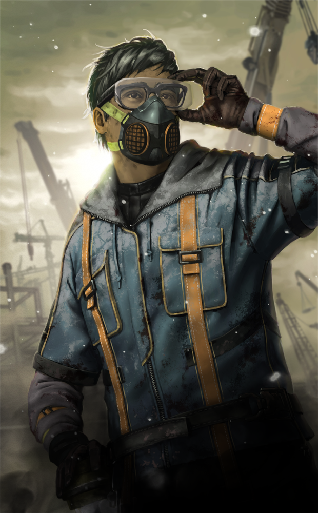

# live · 7.7.0_1796729live

| | |
|---|---|
| Build date | 2024-05-28 15:33 UTC |
| CDN version | `7.7.0_1796729live-1716910426` |
| Key | `7.7.0_live` |
| Compared with | [7.6.2_1731307live](../7.6.2_1731307live/CHANGES.md) (2024-04-18 21:12 UTC) |

## Summary

**1** added · **2** modified · **0** removed · 1 unchanged

## New or updated images

<a href="images/T_UI_CollectionBanner_Aftermath.png"></a>

## Modified files

### [`GameConfigs.json`](GameConfigs.json)

[Full line-by-line diff](diffs/GameConfigs.json.diff)

```diff
+ $.DSProviderOnShutdownNotificationDelay: 90.0
+ $.dynamicContent
+ $.enableChallengeSystem: false
+ $.enableFirstMoveAfterForcedUpdates: false
+ $.enableRealtimeMoriPreview: true
+ $.enableUmgStore: true
+ $.dlc.dlcAdditionalInfo[0].isChapterDlc: "false"
+ $.dlc.dlcAdditionalInfo[1].isChapterDlc: "false"
- $.dlc.dlcAdditionalInfo[1].dlcId: "80suitcase"
+ $.dlc.dlcAdditionalInfo[1].dlcId: "BaseGame"
+ $.dlc.dlcAdditionalInfo[2].isChapterDlc: "false"
- $.dlc.dlcAdditionalInfo[2].dlcId: "bloodletting"
+ $.dlc.dlcAdditionalInfo[2].dlcId: "80suitcase"
+ $.dlc.dlcAdditionalInfo[3].isChapterDlc: "false"
- $.dlc.dlcAdditionalInfo[3].dlcId: "bloodstainedSack"
+ $.dlc.dlcAdditionalInfo[3].dlcId: "bloodletting"
+ $.dlc.dlcAdditionalInfo[4].isChapterDlc: "false"
- $.dlc.dlcAdditionalInfo[4].dlcId: "charityChest"
+ $.dlc.dlcAdditionalInfo[4].dlcId: "bloodstainedSack"
+ $.dlc.dlcAdditionalInfo[5].isChapterDlc: "false"
- $.dlc.dlcAdditionalInfo[5].dlcId: "GStar2017"
+ $.dlc.dlcAdditionalInfo[5].dlcId: "charityChest"
+ $.dlc.dlcAdditionalInfo[6].isChapterDlc: "false"
- $.dlc.dlcAdditionalInfo[6].dlcId: "ChineseEventOct2017"
+ $.dlc.dlcAdditionalInfo[6].dlcId: "GStar2017"
+ $.dlc.dlcAdditionalInfo[7].isChapterDlc: "false"
- $.dlc.dlcAdditionalInfo[7].dlcId: "DeathGarden"
+ $.dlc.dlcAdditionalInfo[7].dlcId: "ChineseEventOct2017"
+ $.dlc.dlcAdditionalInfo[8].isChapterDlc: "false"
- $.dlc.dlcAdditionalInfo[8].dlcId: "Kabuki"
+ $.dlc.dlcAdditionalInfo[8].dlcId: "DeathGarden"
+ $.dlc.dlcAdditionalInfo[9].isChapterDlc: "false"
- $.dlc.dlcAdditionalInfo[9].dlcId: "StoreItem"
+ $.dlc.dlcAdditionalInfo[9].dlcId: "Kabuki"
+ $.dlc.dlcAdditionalInfo[10].isChapterDlc: "false"
- $.dlc.dlcAdditionalInfo[10].dlcId: "Pulcinella"
+ $.dlc.dlcAdditionalInfo[10].dlcId: "StoreItem"
+ $.dlc.dlcAdditionalInfo[11].isChapterDlc: "false"
- $.dlc.dlcAdditionalInfo[11].dlcId: "UmbraCust1"
+ $.dlc.dlcAdditionalInfo[11].dlcId: "Pulcinella"
+ $.dlc.dlcAdditionalInfo[12].isChapterDlc: "false"
- $.dlc.dlcAdditionalInfo[12].dlcId: "UmbraCust2"
+ $.dlc.dlcAdditionalInfo[12].dlcId: "UmbraCust1"
+ $.dlc.dlcAdditionalInfo[13].isChapterDlc: "false"
- $.dlc.dlcAdditionalInfo[13].dlcId: "headCase"
+ $.dlc.dlcAdditionalInfo[13].dlcId: "UmbraCust2"
+ $.dlc.dlcAdditionalInfo[14].isChapterDlc: "false"
- $.dlc.dlcAdditionalInfo[14].dlcId: "OrionCust"
+ $.dlc.dlcAdditionalInfo[14].dlcId: "headCase"
+ $.dlc.dlcAdditionalInfo[15].isChapterDlc: "false"
- $.dlc.dlcAdditionalInfo[15].dlcId: "lastBreath"
+ $.dlc.dlcAdditionalInfo[15].dlcId: "OrionCust"
+ $.dlc.dlcAdditionalInfo[16].isChapterDlc: "false"
- $.dlc.dlcAdditionalInfo[16].dlcId: "WalesCust"
+ $.dlc.dlcAdditionalInfo[16].dlcId: "lastBreath"
- $.dlc.dlcAdditionalInfo[17].availableStartDate: "2024-01-08T11:00:00"
+ $.dlc.dlcAdditionalInfo[17].isChapterDlc: "false"
+ $.dlc.dlcAdditionalInfo[17].isShownInGameStore: false
- $.dlc.dlcAdditionalInfo[17].dlcId: "HeritagePack1"
+ $.dlc.dlcAdditionalInfo[17].dlcId: "WalesCust"
- $.dlc.dlcAdditionalInfo[18].availableStartDate: "2024-01-08T11:00:00"
+ $.dlc.dlcAdditionalInfo[18].isChapterDlc: "false"
+ $.dlc.dlcAdditionalInfo[18].isShownInGameStore: false
- $.dlc.dlcAdditionalInfo[18].dlcId: "HeritagePack2"
+ $.dlc.dlcAdditionalInfo[18].dlcId: "EpicBrillFreeWeek"
- $.dlc.dlcAdditionalInfo[19].availableStartDate: "2024-01-08T11:00:00"
+ $.dlc.dlcAdditionalInfo[19].isChapterDlc: "false"
+ $.dlc.dlcAdditionalInfo[19].isShownInGameStore: false
- $.dlc.dlcAdditionalInfo[19].dlcId: "HeritagePack3"
+ $.dlc.dlcAdditionalInfo[19].dlcId: "EpicBrillGeneral"
- $.dlc.dlcAdditionalInfo[20].availableEndDate: "2024-01-08T11:00:00"
- $.dlc.dlcAdditionalInfo[20].availableStartDate: "2020-01-01T01:00:00"
+ $.dlc.dlcAdditionalInfo[20].isChapterDlc: "false"
+ $.dlc.dlcAdditionalInfo[20].isShownInGameStore: false
- $.dlc.dlcAdditionalInfo[20].dlcId: "fleshAndMud"
+ $.dlc.dlcAdditionalInfo[20].dlcId: "EpicSilentHillEdition"
- $.dlc.dlcAdditionalInfo[21].availableEndDate: "2024-01-08T11:00:00"
- $.dlc.dlcAdditionalInfo[21].availableStartDate: "2020-01-01T01:00:00"
+ $.dlc.dlcAdditionalInfo[21].isChapterDlc: "false"
+ $.dlc.dlcAdditionalInfo[21].isShownInGameStore: false
- $.dlc.dlcAdditionalInfo[21].dlcId: "sparkofMadness"
+ $.dlc.dlcAdditionalInfo[21].dlcId: "EpicUltimateEdition"
- $.dlc.dlcAdditionalInfo[22].availableEndDate: "2024-01-08T11:00:00"
- $.dlc.dlcAdditionalInfo[22].availableStartDate: "2020-01-01T01:00:00"
+ $.dlc.dlcAdditionalInfo[22].isChapterDlc: "false"
+ $.dlc.dlcAdditionalInfo[22].isShownInGameStore: false
- $.dlc.dlcAdditionalInfo[22].dlcId: "Guam"
+ $.dlc.dlcAdditionalInfo[22].dlcId: "ACPack_01"
- $.dlc.dlcAdditionalInfo[23].availableEndDate: "2024-01-08T11:00:00"
- $.dlc.dlcAdditionalInfo[23].availableStartDate: "2020-01-01T01:00:00"
+ $.dlc.dlcAdditionalInfo[23].isChapterDlc: "false"
+ $.dlc.dlcAdditionalInfo[23].isShownInGameStore: false
- $.dlc.dlcAdditionalInfo[23].dlcId: "Haiti"
+ $.dlc.dlcAdditionalInfo[23].dlcId: "ACPack_02"
- $.dlc.dlcAdditionalInfo[24].availableEndDate: "2024-01-08T11:00:00"
- $.dlc.dlcAdditionalInfo[24].availableStartDate: "2020-01-01T01:00:00"
+ $.dlc.dlcAdditionalInfo[24].isChapterDlc: "false"
+ $.dlc.dlcAdditionalInfo[24].isShownInGameStore: false
- $.dlc.dlcAdditionalInfo[24].dlcId: "Kenya"
+ $.dlc.dlcAdditionalInfo[24].dlcId: "ACPack_03"
- $.dlc.dlcAdditionalInfo[25].availableEndDate: "2024-01-08T11:00:00"
- $.dlc.dlcAdditionalInfo[25].availableStartDate: "2020-01-01T01:00:00"
+ $.dlc.dlcAdditionalInfo[25].isChapterDlc: "false"
+ $.dlc.dlcAdditionalInfo[25].isShownInGameStore: false
- $.dlc.dlcAdditionalInfo[25].dlcId: "Mali"
+ $.dlc.dlcAdditionalInfo[25].dlcId: "ACPack_04"
- $.dlc.dlcAdditionalInfo[26].availableEndDate: "2024-01-08T11:00:00"
- $.dlc.dlcAdditionalInfo[26].availableStartDate: "2020-01-01T01:00:00"
+ $.dlc.dlcAdditionalInfo[26].isChapterDlc: "false"
+ $.dlc.dlcAdditionalInfo[26].isShownInGameStore: false
- $.dlc.dlcAdditionalInfo[26].dlcId: "Sweden"
+ $.dlc.dlcAdditionalInfo[26].dlcId: "ACPack_05"
- $.dlc.dlcAdditionalInfo[27].availableEndDate: "2024-01-08T11:00:00"
- $.dlc.dlcAdditionalInfo[27].availableStartDate: "2020-01-01T01:00:00"
+ $.dlc.dlcAdditionalInfo[27].isChapterDlc: "false"
+ $.dlc.dlcAdditionalInfo[27].isShownInGameStore: false
- $.dlc.dlcAdditionalInfo[27].dlcId: "Ukraine"
+ $.dlc.dlcAdditionalInfo[27].dlcId: "ACPack_06"
- $.dlc.dlcAdditionalInfo[28].availableEndDate: "2024-01-08T11:00:00"
+ $.dlc.dlcAdditionalInfo[28].isChapterDlc: "false"
- $.dlc.dlcAdditionalInfo[28].availableStartDate: "2020-01-01T01:00:00"
+ $.dlc.dlcAdditionalInfo[28].availableStartDate: "2024-01-08T11:00:00"
- $.dlc.dlcAdditionalInfo[28].dlcId: "Yemen"
+ $.dlc.dlcAdditionalInfo[28].dlcId: "HeritagePack1"
- $.dlc.dlcAdditionalInfo[29].availableEndDate: "2024-01-08T11:00:00"
+ $.dlc.dlcAdditionalInfo[29].isChapterDlc: "false"
- $.dlc.dlcAdditionalInfo[29].availableStartDate: "2020-01-01T01:00:00"
+ $.dlc.dlcAdditionalInfo[29].availableStartDate: "2024-01-08T11:00:00"
- $.dlc.dlcAdditionalInfo[29].dlcId: "Aurora"
+ $.dlc.dlcAdditionalInfo[29].dlcId: "HeritagePack2"
- $.dlc.dlcAdditionalInfo[30].availableEndDate: "2024-01-08T11:00:00"
+ $.dlc.dlcAdditionalInfo[30].isChapterDlc: "false"
- $.dlc.dlcAdditionalInfo[30].availableStartDate: "2020-01-01T01:00:00"
+ $.dlc.dlcAdditionalInfo[30].availableStartDate: "2024-01-08T11:00:00"
- $.dlc.dlcAdditionalInfo[30].dlcId: "Comet"
+ $.dlc.dlcAdditionalInfo[30].dlcId: "HeritagePack3"
- $.dlc.dlcAdditionalInfo[31].availableEndDate: "2024-01-08T11:00:00"
+ $.dlc.dlcAdditionalInfo[31].isChapterDlc: "false"
- $.dlc.dlcAdditionalInfo[31].availableStartDate: "2020-01-01T01:00:00"
+ $.dlc.dlcAdditionalInfo[31].availableStartDate: "2024-05-14T11:00:00"
- $.dlc.dlcAdditionalInfo[31].dlcId: "Hubble"
+ $.dlc.dlcAdditionalInfo[31].dlcId: "HeritagePack4"
+ $.dlc.dlcAdditionalInfo[32].availableEndDate: "2024-01-08T11:00:00"
- $.dlc.dlcAdditionalInfo[32].availableStartDate: "2023-07-25T01:00:00"
+ $.dlc.dlcAdditionalInfo[32].availableStartDate: "2020-01-01T01:00:00"
- $.dlc.dlcAdditionalInfo[32].dlcId: "Venus"
+ $.dlc.dlcAdditionalInfo[32].dlcId: "fleshAndMud"
+ $.dlc.dlcAdditionalInfo[33].availableEndDate: "2024-01-08T11:00:00"
- $.dlc.dlcAdditionalInfo[33].availableStartDate: "2023-08-29T01:00:00"
+ $.dlc.dlcAdditionalInfo[33].availableStartDate: "2020-01-01T01:00:00"
- $.dlc.dlcAdditionalInfo[33].dlcId: "Wormhole"
+ $.dlc.dlcAdditionalInfo[33].dlcId: "sparkofMadness"
+ $.dlc.dlcAdditionalInfo[34].availableEndDate: "2024-01-08T11:00:00"
- $.dlc.dlcAdditionalInfo[34].availableStartDate: "2023-11-28T01:00:00"
+ $.dlc.dlcAdditionalInfo[34].availableStartDate: "2020-01-01T01:00:00"
- $.dlc.dlcAdditionalInfo[34].dlcId: "Yerkes"
+ $.dlc.dlcAdditionalInfo[34].dlcId: "Guam"
+ $.dlc.dlcAdditionalInfo[35]
+ $.dlc.dlcAdditionalInfo[36]
+ $.dlc.dlcAdditionalInfo[37]
+ $.dlc.dlcAdditionalInfo[38]
+ $.dlc.dlcAdditionalInfo[39]
+ $.dlc.dlcAdditionalInfo[40]
+ $.dlc.dlcAdditionalInfo[41]
+ $.dlc.dlcAdditionalInfo[42]
+ $.dlc.dlcAdditionalInfo[43]
+ $.dlc.dlcAdditionalInfo[44]
+ $.dlc.dlcAdditionalInfo[45]
+ $.dlc.dlcAdditionalInfo[46]
+ $.dlc.dlcAdditionalInfo[47]
+ $.dlc.dlcAdditionalInfo[48]
+ $.dlc.dlcAdditionalInfo[49]
+ $.dlc.dlcAdditionalInfo[50]
+ $.dlc.dlcAdditionalInfo[51]
+ $.dlc.dlcAdditionalInfo[52]
```

### [`dynamicContent/DynamicContent.json`](dynamicContent/DynamicContent.json)

[Full line-by-line diff](diffs/dynamicContent/DynamicContent.json.diff)

```diff
+ $.entries[0]
```

