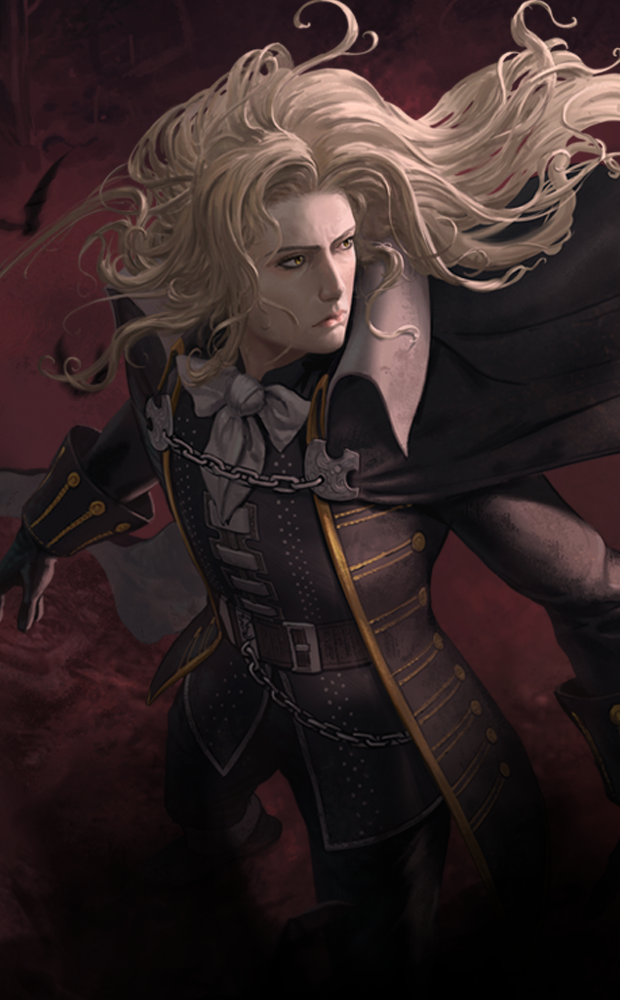
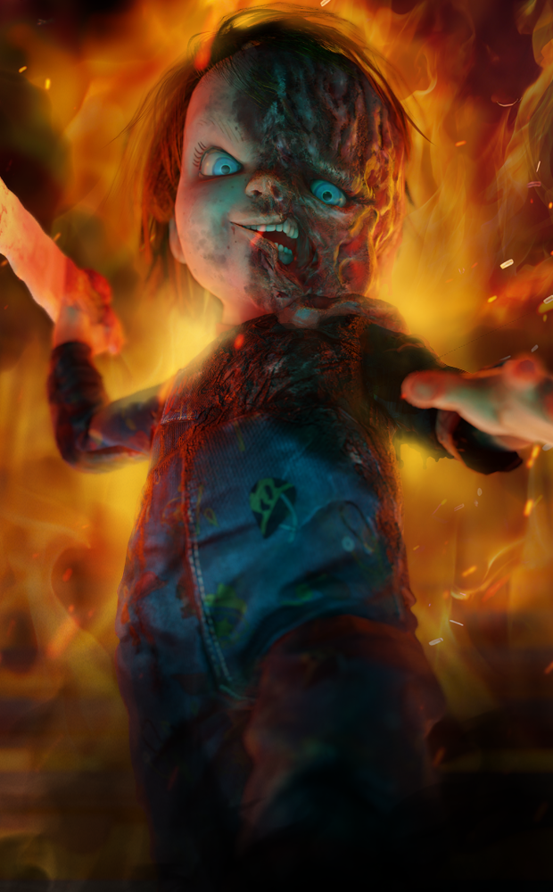
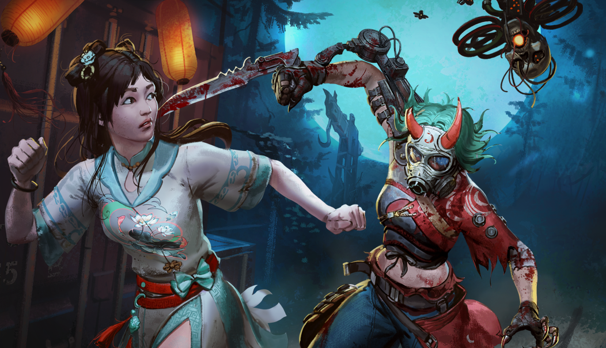

# live · 8.2.0_2054297live

| | |
|---|---|
| Build date | 2024-10-03 14:48 UTC |
| CDN version | `8.2.0_2054297live-1727966915` |
| Key | `8.2.0_live` |
| Compared with | [8.1.0_1920500live](../8.1.0_1920500live/CHANGES.md) (2024-08-27 14:09 UTC) |

## Summary

**7** added · **3** modified · **0** removed · 0 unchanged

## New or updated images

<a href="images/T_UI_CollectionBanner_AutumnFashion.png"></a>
<a href="images/T_UI_CollectionBanner_Castlevania.png"></a>
<a href="images/T_UI_CollectionBanner_Chucky2.png"></a>
<a href="images/T_UI_CollectionBanner_Ghostface.png"></a>
<a href="images/T_UI_SpecialPack_DaysGoneBy.png"></a>
<a href="images/T_UI_SpecialPack_Dredge.png"></a>
<a href="images/T_UI_SpecialPack_Firemoon.png"></a>

## Modified files

### [`GameConfigs.json`](GameConfigs.json)

[Full line-by-line diff](diffs/GameConfigs.json.diff)

```diff
+ $.analyticsRules
+ $.analyticsRulesHVS
+ $.enableFullProfileSaveAtLocation
+ $.analytics.autoflushFrequency: 60
+ $.analytics.autoflushInGameFrequency: 60
+ $.contentVersion.clientNewContentRebootMaxSeconds: 30.0
+ $.contentVersion.clientNewContentRebootMinSeconds: 0.0
- $.contentVersion.clientNewContentForceReboot: false
+ $.contentVersion.clientNewContentForceReboot: true
- $.hangTimes[8].hardcapTimeout: 15.0
+ $.hangTimes[8].hardcapTimeout: 30.0
```

### [`GameConfigsDS.json`](GameConfigsDS.json)

[Full line-by-line diff](diffs/GameConfigsDS.json.diff)

```diff
+ $.analyticsRulesDedicatedServer
```

### [`dynamicContent/DynamicContent.json`](dynamicContent/DynamicContent.json)

[Full line-by-line diff](diffs/dynamicContent/DynamicContent.json.diff)

```diff
+ $.entries[0].enableChecksum: false
- $.entries[0].contentVersion: "59bba4cad6bb8477e9ef20bfd1f716e18e4c8673"
+ $.entries[0].contentVersion: "e0cb9dda3df3b0d00c40d5997464811cafd21ba3"
- $.entries[0].packagedPath: "/Game/UI/UMGAssets/Icons/Banners/BundleBanners/SpecialPack/T_UI_SpecialPack_Romulus.T_UI_SpecialPack_Romulus"
+ $.entries[0].packagedPath: "/Game/UI/UMGAssets/Icons/Banners/BundleBanners/SpecialPack/T_UI_SpecialPack_DaysGoneBy.T_UI_SpecialPack_DaysGoneBy"
- $.entries[0].uri: "images/T_UI_SpecialPack_Romulus.png"
+ $.entries[0].uri: "images/T_UI_SpecialPack_DaysGoneBy.png"
+ $.entries[1].enableChecksum: false
- $.entries[1].contentVersion: "19fe131c21a7805e13e383a3c12be8a6b34860a7"
+ $.entries[1].contentVersion: "971e8b0fc26b074adc264e03abc7ae3d3b4b3aca"
- $.entries[1].downloadStrategy: "preferRemote"
+ $.entries[1].downloadStrategy: "preferPackaged"
- $.entries[1].packagedPath: "/Game/UI/UMGAssets/Icons/Banners/BundleBanners/SpecialPack/T_UI_SpecialPack_Domrebel.T_UI_SpecialPack_Domrebel"
+ $.entries[1].packagedPath: "/Game/UI/UMGAssets/Icons/Banners/BundleBanners/SpecialPack/T_UI_SpecialPack_Dredge.T_UI_SpecialPack_Dredge"
- $.entries[1].uri: "images/T_UI_SpecialPack_Domrebel.png"
+ $.entries[1].uri: "images/T_UI_SpecialPack_Dredge.png"
+ $.entries[2].enableChecksum: false
- $.entries[2].contentVersion: "72ae7350957edde4e4898e458644f28d953b9afd"
+ $.entries[2].contentVersion: "49604a100b1288d794fd4ce4bfdfdae5bca32cb0"
- $.entries[2].downloadStrategy: "preferPackaged"
+ $.entries[2].downloadStrategy: "preferRemote"
- $.entries[2].packagedPath: "/Game/UI/UMGAssets/Icons/Banners/BundleBanners/SpecialPack/T_UI_SpecialPack_RiftCharacters20.T_UI_SpecialPack_RiftCharacters20"
+ $.entries[2].packagedPath: "/Game/UI/UMGAssets/Icons/Banners/BundleBanners/SpecialPack/T_UI_SpecialPack_Firemoon.T_UI_SpecialPack_Firemoon"
- $.entries[2].uri: "images/T_UI_SpecialPack_RiftCharacters20.png"
+ $.entries[2].uri: "images/T_UI_SpecialPack_Firemoon.png"
+ $.entries[3].enableChecksum: false
- $.entries[3].contentVersion: "371439cc08d0afbaa17aa58eb54e3a2812a8c724"
+ $.entries[3].contentVersion: "95cf6b11b9904bd7c1b9c8889a77f08e1e51d251"
- $.entries[3].downloadStrategy: "preferRemote"
+ $.entries[3].downloadStrategy: "preferPackaged"
- $.entries[3].packagedPath: "/Game/UI/UMGAssets/Icons/Banners/CollectionBanners/T_UI_CollectionBanner_Noir.T_UI_CollectionBanner_Noir"
+ $.entries[3].packagedPath: "/Game/UI/UMGAssets/Icons/Banners/CollectionBanners/T_UI_CollectionBanner_Castlevania.T_UI_CollectionBanner_Castlevania"
- $.entries[3].uri: "images/T_UI_CollectionBanner_Noir.png"
+ $.entries[3].uri: "images/T_UI_CollectionBanner_Castlevania.png"
+ $.entries[4].enableChecksum: false
- $.entries[4].contentVersion: "2a243b0fe9fd9c9390a32d17b70ce5a35b0c9050"
+ $.entries[4].contentVersion: "b0af03832869795957ae32217c798be8ac7706ca"
- $.entries[4].packagedPath: "/Game/UI/UMGAssets/Icons/Banners/CollectionBanners/T_UI_CollectionBanner_HorrorsFromTheDeep.T_UI_CollectionBanner_HorrorsFromTheDeep"
+ $.entries[4].packagedPath: "/Game/UI/UMGAssets/Icons/Banners/CollectionBanners/T_UI_CollectionBanner_Chucky2.T_UI_CollectionBanner_Chucky2"
- $.entries[4].uri: "images/T_UI_CollectionBanner_HorrorsFromTheDeep.png"
+ $.entries[4].uri: "images/T_UI_CollectionBanner_Chucky2.png"
+ $.entries[5].enableChecksum: false
- $.entries[5].contentVersion: "aba06b6c24cbe23b0ce0cf3149ceee6a8763bfcf"
+ $.entries[5].contentVersion: "9c325f90384c61dde9f5d2321a99ea6b021549aa"
- $.entries[5].downloadStrategy: "preferRemote"
+ $.entries[5].downloadStrategy: "preferPackaged"
- $.entries[5].packagedPath: "/Game/UI/UMGAssets/Icons/Banners/CollectionBanners/T_UI_CollectionBanner_ForgottenMemory.T_UI_CollectionBanner_ForgottenMemory"
+ $.entries[5].packagedPath: "/Game/UI/UMGAssets/Icons/Banners/CollectionBanners/T_UI_CollectionBanner_AutumnFashion.T_UI_CollectionBanner_AutumnFashion"
- $.entries[5].uri: "images/T_UI_CollectionBanner_ForgottenMemory.png"
+ $.entries[5].uri: "images/T_UI_CollectionBanner_AutumnFashion.png"
+ $.entries[6].enableChecksum: false
- $.entries[6].contentVersion: "568e47878a84314b86310c7527fef23b017df2e8"
+ $.entries[6].contentVersion: "7e0704306c45b4e6a840a2d015b84ab3679cb522"
- $.entries[6].packagedPath: "/Game/UI/UMGAssets/Icons/Banners/CollectionBanners/T_UI_CollectionBanner_BloodandBones.T_UI_CollectionBanner_BloodandBones"
+ $.entries[6].packagedPath: "/Game/UI/UMGAssets/Icons/Banners/CollectionBanners/T_UI_CollectionBanner_Ghostface.T_UI_CollectionBanner_Ghostface"
- $.entries[6].uri: "images/T_UI_CollectionBanner_BloodandBones.png"
+ $.entries[6].uri: "images/T_UI_CollectionBanner_Ghostface.png"
- $.entries[7]
- $.entries[8]
- $.entries[9]
```

