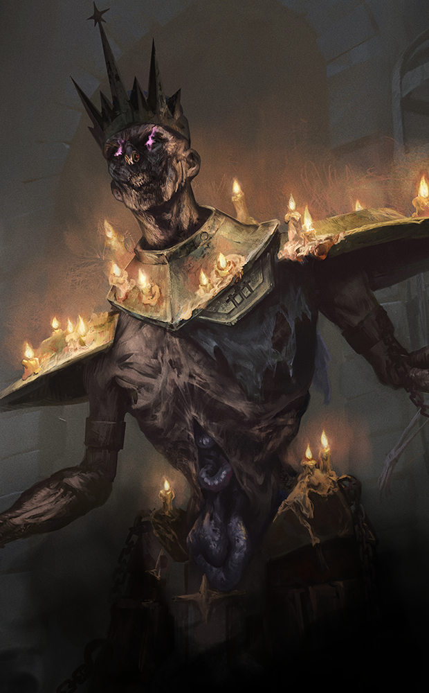
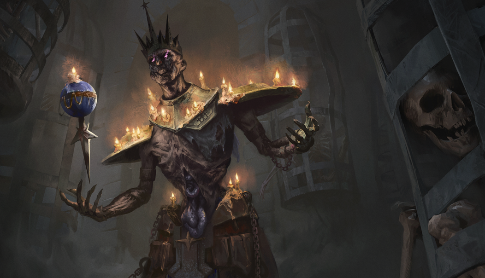
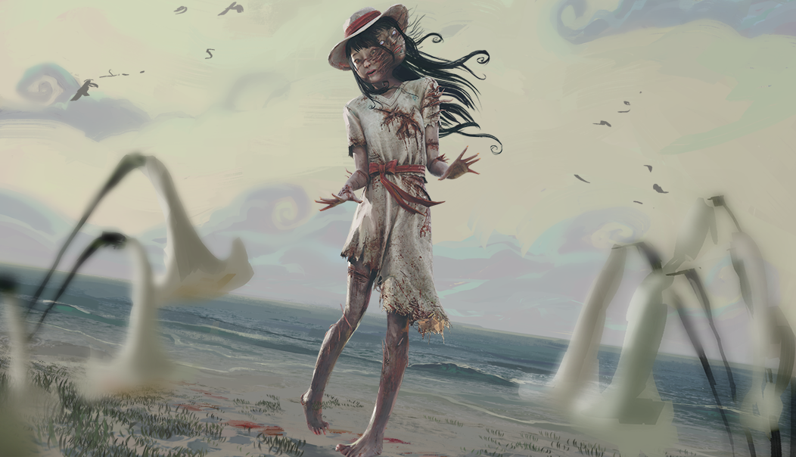

# live · 8.4.2_2231971live

| | |
|---|---|
| Build date | 2025-01-21 20:32 UTC |
| CDN version | `8.4.2_2231971live-1737491522` |
| Key | `8.4.2_live` |
| Compared with | [8.3.2_2182351live](../8.3.2_2182351live/CHANGES.md) (2024-11-27 22:36 UTC) |

## Summary

**183** added · **2** modified · **0** removed · 1 unchanged

## New or updated images

<a href="images/T_UI_CollectionBanner_DungeonsAndDragons2.png"></a>
<a href="images/T_UI_SpecialPack_BoneChill2023.png"></a>
<a href="images/T_UI_SpecialPack_DungeonsAndDragons.png"></a>
<a href="images/T_UI_SpecialPack_JunjiIto.png"></a>
<a href="images/T_UI_SpecialPack_WinterTales.png"></a>

## Added files

- [`archiveJournals/storyJournals.json`](archiveJournals/storyJournals.json)
- [`archiveQuests/Anniversary2022.json`](archiveQuests/Anniversary2022.json)
- [`archiveQuests/Anniversary2023.json`](archiveQuests/Anniversary2023.json)
- [`archiveQuests/Anniversary2024.json`](archiveQuests/Anniversary2024.json)
- [`archiveQuests/CalamariV1.json`](archiveQuests/CalamariV1.json)
- [`archiveQuests/CalamariV2.json`](archiveQuests/CalamariV2.json)
- [`archiveQuests/ChocolateBoxGelato.json`](archiveQuests/ChocolateBoxGelato.json)
- [`archiveQuests/ChocolateBoxV1.json`](archiveQuests/ChocolateBoxV1.json)
- [`archiveQuests/DreadByDaylightZodiac.json`](archiveQuests/DreadByDaylightZodiac.json)
- [`archiveQuests/FireflyV1.json`](archiveQuests/FireflyV1.json)
- [`archiveQuests/Halloween2021.json`](archiveQuests/Halloween2021.json)
- [`archiveQuests/Halloween2022.json`](archiveQuests/Halloween2022.json)
- [`archiveQuests/Halloween2023.json`](archiveQuests/Halloween2023.json)
- [`archiveQuests/Halloween2024.json`](archiveQuests/Halloween2024.json)
- [`archiveQuests/Spring2024.json`](archiveQuests/Spring2024.json)
- [`archiveQuests/Summer2023.json`](archiveQuests/Summer2023.json)
- [`archiveQuests/Tome01.json`](archiveQuests/Tome01.json)
- [`archiveQuests/Tome02.json`](archiveQuests/Tome02.json)
- [`archiveQuests/Tome03.json`](archiveQuests/Tome03.json)
- [`archiveQuests/Tome04.json`](archiveQuests/Tome04.json)
- [`archiveQuests/Tome05.json`](archiveQuests/Tome05.json)
- [`archiveQuests/Tome06.json`](archiveQuests/Tome06.json)
- [`archiveQuests/Tome07.json`](archiveQuests/Tome07.json)
- [`archiveQuests/Tome08.json`](archiveQuests/Tome08.json)
- [`archiveQuests/Tome09.json`](archiveQuests/Tome09.json)
- [`archiveQuests/Tome10.json`](archiveQuests/Tome10.json)
- [`archiveQuests/Tome11.json`](archiveQuests/Tome11.json)
- [`archiveQuests/Tome12.json`](archiveQuests/Tome12.json)
- [`archiveQuests/Tome13.json`](archiveQuests/Tome13.json)
- [`archiveQuests/Tome14.json`](archiveQuests/Tome14.json)
- [`archiveQuests/Tome15.json`](archiveQuests/Tome15.json)
- [`archiveQuests/Tome16.json`](archiveQuests/Tome16.json)
- [`archiveQuests/Tome17.json`](archiveQuests/Tome17.json)
- [`archiveQuests/Tome18.json`](archiveQuests/Tome18.json)
- [`archiveQuests/Tome19.json`](archiveQuests/Tome19.json)
- [`archiveQuests/Tome20.json`](archiveQuests/Tome20.json)
- [`archiveQuests/Tome21.json`](archiveQuests/Tome21.json)
- [`archiveQuests/Winter2022.json`](archiveQuests/Winter2022.json)
- [`archiveQuests/Winter2023.json`](archiveQuests/Winter2023.json)
- [`archiveQuests/Winter2024.json`](archiveQuests/Winter2024.json)
- [`archiveRewardData/content.json`](archiveRewardData/content.json)
- [`archiveRewardGrid/Tome01.json`](archiveRewardGrid/Tome01.json)
- [`archiveRewardGrid/Tome02.json`](archiveRewardGrid/Tome02.json)
- [`archiveRewardGrid/Tome03.json`](archiveRewardGrid/Tome03.json)
- [`archiveRewardGrid/Tome04.json`](archiveRewardGrid/Tome04.json)
- [`archiveRewardGrid/Tome05.json`](archiveRewardGrid/Tome05.json)
- [`archiveRewardGrid/Tome06.json`](archiveRewardGrid/Tome06.json)
- [`archiveRewardGrid/Tome07.json`](archiveRewardGrid/Tome07.json)
- [`archiveRewardGrid/Tome08.json`](archiveRewardGrid/Tome08.json)
- [`archiveRewardGrid/Tome09.json`](archiveRewardGrid/Tome09.json)
- [`archiveRewardGrid/Tome10.json`](archiveRewardGrid/Tome10.json)
- [`archiveRewardGrid/Tome11.json`](archiveRewardGrid/Tome11.json)
- [`archiveRewardGrid/Tome12.json`](archiveRewardGrid/Tome12.json)
- [`archiveRewardGrid/Tome13.json`](archiveRewardGrid/Tome13.json)
- [`archiveRewardGrid/Tome14.json`](archiveRewardGrid/Tome14.json)
- [`archiveRewardGrid/Tome15.json`](archiveRewardGrid/Tome15.json)
- [`archiveRewardGrid/Tome16.json`](archiveRewardGrid/Tome16.json)
- [`archiveRewardGrid/Tome17.json`](archiveRewardGrid/Tome17.json)
- [`archiveRewardGrid/Tome18.json`](archiveRewardGrid/Tome18.json)
- [`archiveRewardGrid/Tome19.json`](archiveRewardGrid/Tome19.json)
- [`archiveRewardGrid/Tome20.json`](archiveRewardGrid/Tome20.json)
- [`archiveRewardGrid/Tome21.json`](archiveRewardGrid/Tome21.json)
- [`bloodwebGenerationRules.json`](bloodwebGenerationRules.json)
- [`bonusPointEventsContent.json`](bonusPointEventsContent.json)
- [`catalog.json`](catalog.json)
- [`cinematics.json`](cinematics.json)
- [`collections.json`](collections.json)
- [`consents/eula/v4/de.json`](consents/eula/v4/de.json)
- [`consents/eula/v4/definition.json`](consents/eula/v4/definition.json)
- [`consents/eula/v4/en.json`](consents/eula/v4/en.json)
- [`consents/eula/v4/es-MX.json`](consents/eula/v4/es-MX.json)
- [`consents/eula/v4/es.json`](consents/eula/v4/es.json)
- [`consents/eula/v4/fr.json`](consents/eula/v4/fr.json)
- [`consents/eula/v4/it.json`](consents/eula/v4/it.json)
- [`consents/eula/v4/ja.json`](consents/eula/v4/ja.json)
- [`consents/eula/v4/ko.json`](consents/eula/v4/ko.json)
- [`consents/eula/v4/pl.json`](consents/eula/v4/pl.json)
- [`consents/eula/v4/pt-BR.json`](consents/eula/v4/pt-BR.json)
- [`consents/eula/v4/ru.json`](consents/eula/v4/ru.json)
- [`consents/eula/v4/th.json`](consents/eula/v4/th.json)
- [`consents/eula/v4/tr.json`](consents/eula/v4/tr.json)
- [`consents/eula/v4/zh-Hans.json`](consents/eula/v4/zh-Hans.json)
- [`consents/eula/v4/zh-Hant.json`](consents/eula/v4/zh-Hant.json)
- [`consents/eula_psn_eu/v5/de.json`](consents/eula_psn_eu/v5/de.json)
- [`consents/eula_psn_eu/v5/definition.json`](consents/eula_psn_eu/v5/definition.json)
- [`consents/eula_psn_eu/v5/en.json`](consents/eula_psn_eu/v5/en.json)
- [`consents/eula_psn_eu/v5/es-MX.json`](consents/eula_psn_eu/v5/es-MX.json)
- [`consents/eula_psn_eu/v5/es.json`](consents/eula_psn_eu/v5/es.json)
- [`consents/eula_psn_eu/v5/fr.json`](consents/eula_psn_eu/v5/fr.json)
- [`consents/eula_psn_eu/v5/it.json`](consents/eula_psn_eu/v5/it.json)
- [`consents/eula_psn_eu/v5/ja.json`](consents/eula_psn_eu/v5/ja.json)
- [`consents/eula_psn_eu/v5/ko.json`](consents/eula_psn_eu/v5/ko.json)
- [`consents/eula_psn_eu/v5/pl.json`](consents/eula_psn_eu/v5/pl.json)
- [`consents/eula_psn_eu/v5/pt-BR.json`](consents/eula_psn_eu/v5/pt-BR.json)
- [`consents/eula_psn_eu/v5/ru.json`](consents/eula_psn_eu/v5/ru.json)
- [`consents/eula_psn_eu/v5/th.json`](consents/eula_psn_eu/v5/th.json)
- [`consents/eula_psn_eu/v5/tr.json`](consents/eula_psn_eu/v5/tr.json)
- [`consents/eula_psn_eu/v5/zh-Hans.json`](consents/eula_psn_eu/v5/zh-Hans.json)
- [`consents/eula_psn_eu/v5/zh-Hant.json`](consents/eula_psn_eu/v5/zh-Hant.json)
- [`consents/eula_psn_na/v5/de.json`](consents/eula_psn_na/v5/de.json)
- [`consents/eula_psn_na/v5/definition.json`](consents/eula_psn_na/v5/definition.json)
- [`consents/eula_psn_na/v5/en.json`](consents/eula_psn_na/v5/en.json)
- [`consents/eula_psn_na/v5/es-MX.json`](consents/eula_psn_na/v5/es-MX.json)
- [`consents/eula_psn_na/v5/es.json`](consents/eula_psn_na/v5/es.json)
- [`consents/eula_psn_na/v5/fr.json`](consents/eula_psn_na/v5/fr.json)
- [`consents/eula_psn_na/v5/it.json`](consents/eula_psn_na/v5/it.json)
- [`consents/eula_psn_na/v5/ja.json`](consents/eula_psn_na/v5/ja.json)
- [`consents/eula_psn_na/v5/ko.json`](consents/eula_psn_na/v5/ko.json)
- [`consents/eula_psn_na/v5/pl.json`](consents/eula_psn_na/v5/pl.json)
- [`consents/eula_psn_na/v5/pt-BR.json`](consents/eula_psn_na/v5/pt-BR.json)
- [`consents/eula_psn_na/v5/ru.json`](consents/eula_psn_na/v5/ru.json)
- [`consents/eula_psn_na/v5/th.json`](consents/eula_psn_na/v5/th.json)
- [`consents/eula_psn_na/v5/tr.json`](consents/eula_psn_na/v5/tr.json)
- [`consents/eula_psn_na/v5/zh-Hans.json`](consents/eula_psn_na/v5/zh-Hans.json)
- [`consents/eula_psn_na/v5/zh-Hant.json`](consents/eula_psn_na/v5/zh-Hant.json)
- [`consents/marketing/v2/de.json`](consents/marketing/v2/de.json)
- [`consents/marketing/v2/definition.json`](consents/marketing/v2/definition.json)
- [`consents/marketing/v2/en.json`](consents/marketing/v2/en.json)
- [`consents/marketing/v2/es-MX.json`](consents/marketing/v2/es-MX.json)
- [`consents/marketing/v2/es.json`](consents/marketing/v2/es.json)
- [`consents/marketing/v2/fr.json`](consents/marketing/v2/fr.json)
- [`consents/marketing/v2/it.json`](consents/marketing/v2/it.json)
- [`consents/marketing/v2/ja.json`](consents/marketing/v2/ja.json)
- [`consents/marketing/v2/ko.json`](consents/marketing/v2/ko.json)
- [`consents/marketing/v2/pl.json`](consents/marketing/v2/pl.json)
- [`consents/marketing/v2/pt-BR.json`](consents/marketing/v2/pt-BR.json)
- [`consents/marketing/v2/ru.json`](consents/marketing/v2/ru.json)
- [`consents/marketing/v2/th.json`](consents/marketing/v2/th.json)
- [`consents/marketing/v2/tr.json`](consents/marketing/v2/tr.json)
- [`consents/marketing/v2/zh-Hans.json`](consents/marketing/v2/zh-Hans.json)
- [`consents/marketing/v2/zh-Hant.json`](consents/marketing/v2/zh-Hant.json)
- [`consents/privacy/v3/de.json`](consents/privacy/v3/de.json)
- [`consents/privacy/v3/definition.json`](consents/privacy/v3/definition.json)
- [`consents/privacy/v3/en.json`](consents/privacy/v3/en.json)
- [`consents/privacy/v3/es-MX.json`](consents/privacy/v3/es-MX.json)
- [`consents/privacy/v3/es.json`](consents/privacy/v3/es.json)
- [`consents/privacy/v3/fr.json`](consents/privacy/v3/fr.json)
- [`consents/privacy/v3/it.json`](consents/privacy/v3/it.json)
- [`consents/privacy/v3/ja.json`](consents/privacy/v3/ja.json)
- [`consents/privacy/v3/ko.json`](consents/privacy/v3/ko.json)
- [`consents/privacy/v3/pl.json`](consents/privacy/v3/pl.json)
- [`consents/privacy/v3/pt-BR.json`](consents/privacy/v3/pt-BR.json)
- [`consents/privacy/v3/ru.json`](consents/privacy/v3/ru.json)
- [`consents/privacy/v3/th.json`](consents/privacy/v3/th.json)
- [`consents/privacy/v3/tr.json`](consents/privacy/v3/tr.json)
- [`consents/privacy/v3/zh-Hans.json`](consents/privacy/v3/zh-Hans.json)
- [`consents/privacy/v3/zh-Hant.json`](consents/privacy/v3/zh-Hant.json)
- [`contentMetadata.json`](contentMetadata.json)
- [`contentSchedule.json`](contentSchedule.json)
- [`coreRituals.json`](coreRituals.json)
- [`crossPromoCampaigns.json`](crossPromoCampaigns.json)
- [`emblemTunable.json`](emblemTunable.json)
- [`experimentalFeatures/experimentalFeatures.json`](experimentalFeatures/experimentalFeatures.json)
- [`featureLocks.json`](featureLocks.json)
- [`freetoplay/EU/event.json`](freetoplay/EU/event.json)
- [`freetoplay/NA/event.json`](freetoplay/NA/event.json)
- [`itemsKillswitch.json`](itemsKillswitch.json)
- [`loadingText/specialEventsLoadingText_de.json`](loadingText/specialEventsLoadingText_de.json)
- [`loadingText/specialEventsLoadingText_en.json`](loadingText/specialEventsLoadingText_en.json)
- [`loadingText/specialEventsLoadingText_es-MX.json`](loadingText/specialEventsLoadingText_es-MX.json)
- [`loadingText/specialEventsLoadingText_es.json`](loadingText/specialEventsLoadingText_es.json)
- [`loadingText/specialEventsLoadingText_fr.json`](loadingText/specialEventsLoadingText_fr.json)
- [`loadingText/specialEventsLoadingText_it.json`](loadingText/specialEventsLoadingText_it.json)
- [`loadingText/specialEventsLoadingText_ja.json`](loadingText/specialEventsLoadingText_ja.json)
- [`loadingText/specialEventsLoadingText_ko.json`](loadingText/specialEventsLoadingText_ko.json)
- [`loadingText/specialEventsLoadingText_pl.json`](loadingText/specialEventsLoadingText_pl.json)
- [`loadingText/specialEventsLoadingText_pt-BR.json`](loadingText/specialEventsLoadingText_pt-BR.json)
- [`loadingText/specialEventsLoadingText_ru.json`](loadingText/specialEventsLoadingText_ru.json)
- [`loadingText/specialEventsLoadingText_th.json`](loadingText/specialEventsLoadingText_th.json)
- [`loadingText/specialEventsLoadingText_tr.json`](loadingText/specialEventsLoadingText_tr.json)
- [`loadingText/specialEventsLoadingText_zh-Hans.json`](loadingText/specialEventsLoadingText_zh-Hans.json)
- [`loadingText/specialEventsLoadingText_zh-Hant.json`](loadingText/specialEventsLoadingText_zh-Hant.json)
- [`onboarding/onboarding.json`](onboarding/onboarding.json)
- [`prestige/prestige.json`](prestige/prestige.json)
- [`randomRewards.json`](randomRewards.json)
- [`ranksThresholds.json`](ranksThresholds.json)
- [`recommendations.json`](recommendations.json)
- [`specialEventsContent.json`](specialEventsContent.json)

## Modified files

### [`GameConfigs.json`](GameConfigs.json)

[Full line-by-line diff](diffs/GameConfigs.json.diff)

```diff
- $.enableFullProfileSaveAtLocation
+ $.afk
+ $.enableCrossPromoPopupDisplay: true
+ $.inbox
+ $.saveFullProfileLocations
- $.analytics.detailedScoreTypeBlacklist[]: "GameEvent.Camper.Pallet.PullUp.Complete"
+ $.analyticsRules.KAL[]: "InboxAnalytics"
+ $.analyticsRules.KL[]: "InboxErrorAnalytics"
+ $.analyticsRules.KL[]: "InboxLoadedAnalytics"
+ $.dedicatedServer.endpointsHTTP
+ $.dedicatedServer.endpointsUDP
+ $.dedicatedServer.useUDPLatencyPings: false
- $.dedicatedServer.latencyRetryCooldownSeconds: 600
+ $.dedicatedServer.latencyRetryCooldownSeconds: 600.0
- $.dedicatedServer.suspiciousEnabledBuilds[]: "DBD_Live_DS_Lin_Test_472_1566101"
+ $.dedicatedServer.suspiciousEnabledBuilds[]: "DBD_Churros_DS_Lin_Test_409_1759908"
+ $.dynamicContent.DynamicContentKillswitchPlatforms
```

### [`dynamicContent/DynamicContent.json`](dynamicContent/DynamicContent.json)

[Full line-by-line diff](diffs/dynamicContent/DynamicContent.json.diff)

```diff
+ $.entries[0]
+ $.entries[1]
+ $.entries[2]
+ $.entries[3]
+ $.entries[4]
+ $.entries[5]
+ $.entries[6]
+ $.entries[7]
+ $.entries[8]
+ $.entries[9]
+ $.entries[10]
+ $.entries[11]
+ $.entries[12]
+ $.entries[13]
+ $.entries[14]
+ $.entries[15]
+ $.entries[16]
+ $.entries[17]
+ $.entries[18]
+ $.entries[19]
+ $.entries[20]
+ $.entries[21]
+ $.entries[22]
+ $.entries[23]
+ $.entries[24]
+ $.entries[25]
+ $.entries[26]
+ $.entries[27]
+ $.entries[28]
+ $.entries[29]
+ $.entries[30]
+ $.entries[31]
+ $.entries[32]
+ $.entries[33]
+ $.entries[34]
+ $.entries[35]
+ $.entries[36]
+ $.entries[37]
+ $.entries[38]
+ $.entries[39]
+ $.entries[40]
+ $.entries[41]
+ $.entries[42]
+ $.entries[43]
+ $.entries[44]
+ $.entries[45]
+ $.entries[46]
+ $.entries[47]
+ $.entries[48]
+ $.entries[49]
+ $.entries[50]
+ $.entries[51]
+ $.entries[52]
+ $.entries[53]
+ $.entries[54]
+ $.entries[55]
+ $.entries[56]
+ $.entries[57]
+ $.entries[58]
+ $.entries[59]
+ $.entries[60]
+ $.entries[61]
+ $.entries[62]
+ $.entries[63]
+ $.entries[64]
+ $.entries[65]
+ $.entries[66]
+ $.entries[67]
+ $.entries[68]
+ $.entries[69]
+ $.entries[70]
+ $.entries[71]
+ $.entries[72]
+ $.entries[73]
+ $.entries[74]
+ $.entries[75]
+ $.entries[76]
+ $.entries[77]
+ $.entries[78]
+ $.entries[79]
+ $.entries[80]
+ $.entries[81]
+ $.entries[82]
+ $.entries[83]
+ $.entries[84]
+ $.entries[85]
+ $.entries[86]
+ $.entries[87]
+ $.entries[88]
+ $.entries[89]
+ $.entries[90]
+ $.entries[91]
+ $.entries[92]
+ $.entries[93]
+ $.entries[94]
+ $.entries[95]
+ $.entries[96]
+ $.entries[97]
+ $.entries[98]
+ $.entries[99]
+ $.entries[100]
+ $.entries[101]
+ $.entries[102]
+ $.entries[103]
+ $.entries[104]
+ $.entries[105]
+ $.entries[106]
+ $.entries[107]
+ $.entries[108]
+ $.entries[109]
+ $.entries[110]
+ $.entries[111]
+ $.entries[112]
+ $.entries[113]
+ $.entries[114]
+ $.entries[115]
+ $.entries[116]
+ $.entries[117]
+ $.entries[118]
+ $.entries[119]
+ $.entries[120]
+ $.entries[121]
+ $.entries[122]
+ $.entries[123]
+ $.entries[124]
+ $.entries[125]
+ $.entries[126]
+ $.entries[127]
+ $.entries[128]
+ $.entries[129]
+ $.entries[130]
+ $.entries[131]
+ $.entries[132]
+ $.entries[133]
+ $.entries[134]
+ $.entries[135]
+ $.entries[136]
+ $.entries[137]
+ $.entries[138]
+ $.entries[139]
+ $.entries[140]
+ $.entries[141]
+ $.entries[142]
+ $.entries[143]
+ $.entries[144]
+ $.entries[145]
+ $.entries[146]
+ $.entries[147]
+ $.entries[148]
+ $.entries[149]
+ $.entries[150]
+ $.entries[151]
+ $.entries[152]
+ $.entries[153]
+ $.entries[154]
+ $.entries[155]
+ $.entries[156]
+ $.entries[157]
+ $.entries[158]
+ $.entries[159]
+ $.entries[160]
+ $.entries[161]
+ $.entries[162]
+ $.entries[163]
+ $.entries[164]
+ $.entries[165]
+ $.entries[166]
+ $.entries[167]
+ $.entries[168]
+ $.entries[169]
+ $.entries[170]
+ $.entries[171]
+ $.entries[172]
+ $.entries[173]
+ $.entries[174]
+ $.entries[175]
+ $.entries[176]
+ $.entries[177]
+ $.entries[178]
+ $.entries[179]
+ $.entries[180]
+ $.entries[181]
+ $.entries[182]
+ $.entries[183]
+ $.entries[184]
+ $.entries[185]
+ $.entries[186]
+ $.entries[187]
+ $.entries[188]
+ $.entries[189]
+ $.entries[190]
+ $.entries[191]
+ $.entries[192]
+ $.entries[193]
+ $.entries[194]
+ $.entries[195]
+ $.entries[196]
+ $.entries[197]
+ $.entries[198]
```

## Could not download

- `news/versionedNews.json (HTTP 404)`
- `news/versionedNews_de.json (HTTP 404)`
- `news/versionedNews_en.json (HTTP 404)`
- `news/versionedNews_es-MX.json (HTTP 404)`
- `news/versionedNews_es.json (HTTP 404)`
- `news/versionedNews_fr.json (HTTP 404)`
- `news/versionedNews_it.json (HTTP 404)`
- `news/versionedNews_ja.json (HTTP 404)`
- `news/versionedNews_ko.json (HTTP 404)`
- `news/versionedNews_pl.json (HTTP 404)`
- `news/versionedNews_pt-BR.json (HTTP 404)`
- `news/versionedNews_ru.json (HTTP 404)`
- `news/versionedNews_th.json (HTTP 404)`
- `news/versionedNews_tr.json (HTTP 404)`
- `news/versionedNews_zh-Hans.json (HTTP 404)`
- `news/versionedNews_zh-Hant.json (HTTP 404)`

