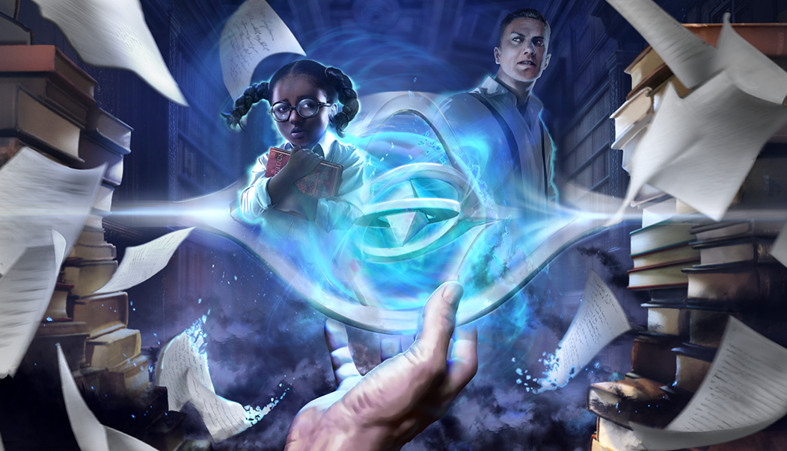
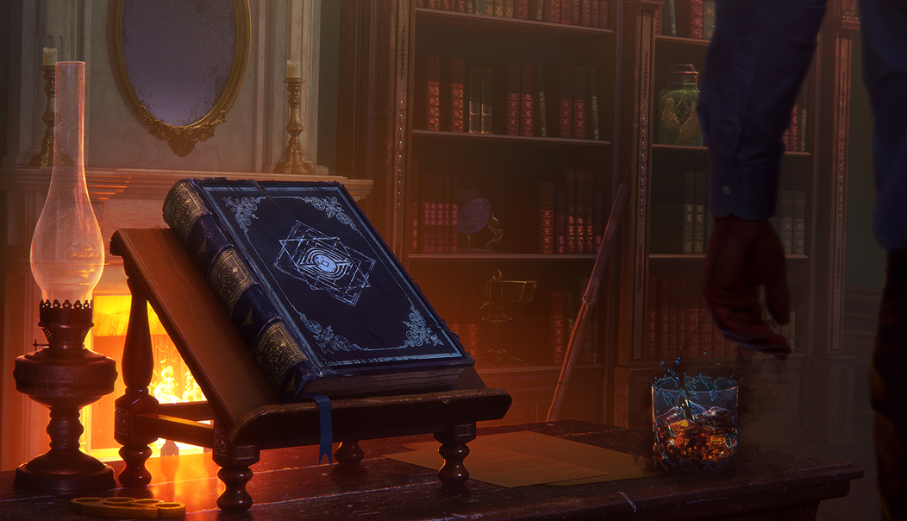
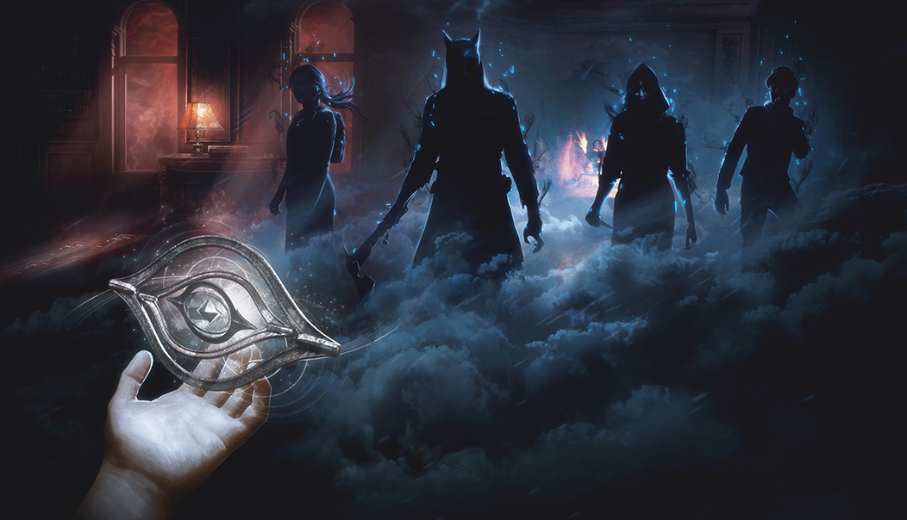
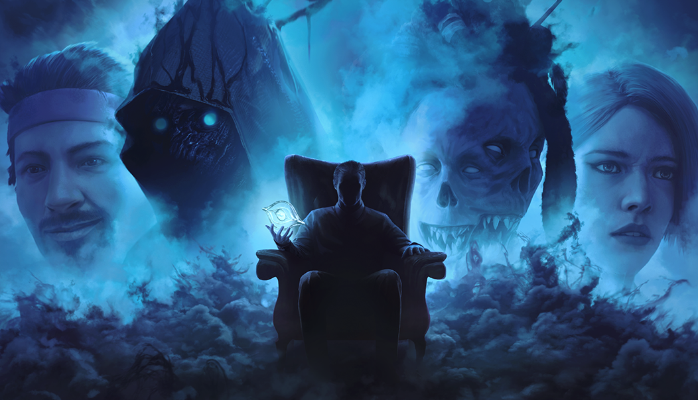
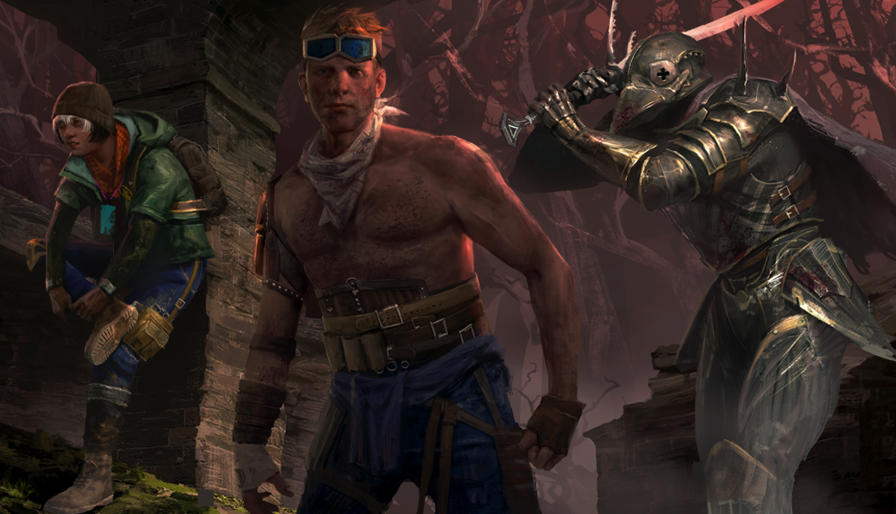

# live · 8.5.2_2369089live

| | |
|---|---|
| Build date | 2025-04-01 15:07 UTC |
| CDN version | `8.5.2_2369089live-1743520074` |
| Key | `8.5.2_live` |
| Compared with | [8.5.0_2335221live](../8.5.0_2335221live/CHANGES.md) (2025-03-18 14:31 UTC) |

## Summary

**5** added · **10** modified · **0** removed · 175 unchanged

## New or updated images

<a href="images/T_UI_SpecialPack_Tome1.png"></a>
<a href="images/T_UI_SpecialPack_Tome2.png"></a>
<a href="images/T_UI_SpecialPack_Tome3.png"></a>
<a href="images/T_UI_SpecialPack_Tome4.png"></a>
<a href="images/T_UI_SpecialPack_Wasteland.png"></a>

## Modified files

### [`GameConfigs.json`](GameConfigs.json)

[Full line-by-line diff](diffs/GameConfigs.json.diff)

```diff
- $.analytics.gameInitVerbose: true
+ $.analytics.gameInitVerbose: false
+ $.analyticsRules.BL[]: "RTMAnalytics"
- $.analyticsRules.KL[]: "RTMAnalytics"
```

### [`GameConfigsDS.json`](GameConfigsDS.json)

[Full line-by-line diff](diffs/GameConfigsDS.json.diff)

```diff
+ $.analyticsRulesDedicatedServer.BL[]: "RTMAnalytics"
- $.analyticsRulesDedicatedServer.KL[]: "RTMAnalytics"
```

### [`catalog.json`](catalog.json)

[Full line-by-line diff](diffs/catalog.json.diff)

```diff
- $[id=Recurring_Survivor_Bundle_2_250318]
+ $[id=HO_BDG_02]
+ $[id=HO_BNR_02]
+ $[id=JP_Head027]
+ $[id=JP_Legs027]
+ $[id=JP_Torso027]
+ $[id=K22_Body015]
+ $[id=K22_Head015]
+ $[id=K22_W015]
+ $[id=K24_Body008]
+ $[id=K24_Head008]
+ $[id=K24_W008]
+ $[id=K29_Body008]
+ $[id=K29_Head008]
+ $[id=K29_W008]
+ $[id=K35_Head012]
+ $[id=S26_Head011]
+ $[id=S26_Legs011]
+ $[id=S26_Torso011]
+ $[id=S27_Head010]
+ $[id=S27_Legs010]
+ $[id=S27_Torso010]
+ $[id=S32_Head009]
+ $[id=S32_Legs009]
+ $[id=S32_Torso009]
+ $[id=S33_Head008]
+ $[id=S33_Legs008]
+ $[id=S33_Torso008]
+ $[id=S41_Torso015]
+ $[id=S45_Torso009]
+ $[id=UK_Body019]
+ $[id=UK_Head019]
+ $[id=UK_W019]
+ $[id=JP_outfit_027]
+ $[id=K22_outfit_015]
+ $[id=K24_outfit_008]
+ $[id=K29_outfit_008]
+ $[id=S26_Outfit_011]
+ $[id=S27_Outfit_010]
+ $[id=S32_outfit_009]
+ $[id=S33_outfit_008]
+ $[id=UK_outfit_019]
+ $[id=LicensorBundle_Castlevania]
+ $[id=LicensorBundle_IronMaiden]
+ $[id=LicensorBundle_Slipknot]
+ $[id=ProjectW_Survivor_Outfit_Bundle]
+ $[id=ResidentEvil_Killer_Bundle]
+ $[id=ResidentEvil_Killer_Outfit_Bundle]
+ $[id=ResidentEvil_Survivor_Bundle]
+ $[id=ResidentEvil_Survivor_Outfit_Bundle]
+ $[id=Tome_1_Bundle]
+ $[id=Tome_2_Bundle]
+ $[id=Tome_3_Bundle]
+ $[id=Tome_4_Bundle]
+ $[id=Valentines_Bundle]
+ $[id=Recurring_Charm_Bundle_250325]
+ $[id=Recurring_Charm_Bundle_250401]
+ $[id=Recurring_Dev_Bundle_250325]
+ $[id=Recurring_Dev_Bundle_250401]
+ $[id=From_The_Rift_Bundle_250325]
+ $[id=From_The_Rift_Bundle_250401]
+ $[id=Recurring_Killer_Bundle_250325]
+ $[id=Recurring_Killer_Bundle_250401]
+ $[id=Recurring_Survivor_Bundle_250325]
+ $[id=Recurring_Survivor_Bundle_250401]
+ $[id=K20].eventCostList
+ $[id=K20].metaData.temporaryDiscounts
+ $[id=S22].eventCostList
+ $[id=S22].metaData.temporaryDiscounts
+ $[id=S26].eventCostList
+ $[id=S26].metaData.temporaryDiscounts
+ $[id=S27].eventCostList
+ $[id=S27].metaData.temporaryDiscounts
+ $[id=K24].eventCostList
+ $[id=K24].metaData.temporaryDiscounts
+ $[id=K29].eventCostList
+ $[id=K29].metaData.temporaryDiscounts
+ $[id=S32].eventCostList
+ $[id=S32].metaData.temporaryDiscounts
+ $[id=S33].eventCostList
+ $[id=S33].metaData.temporaryDiscounts
+ $[id=S40].eventCostList
+ $[id=S40].metaData.temporaryDiscounts
+ $[id=K36].eventCostList
+ $[id=K36].metaData.temporaryDiscounts
+ $[id=S42].eventCostList
+ $[id=S42].metaData.temporaryDiscounts
+ $[id=K37].eventCostList
+ $[id=K37].metaData.temporaryDiscounts
+ $[id=S44].eventCostList
+ $[id=S44].metaData.temporaryDiscounts
+ $[id=DF_Head024].defaultCost[1]
- $[id=DF_Head024].metaData.releaseDate: "2018-06-12T00:00:00"
+ $[id=DF_Head024].metaData.releaseDate: "2025-04-01T15:00:00"
- $[id=DF_Head024].purchasable: false
+ $[id=DF_Head024].purchasable: true
- $[id=HS_Head016].metaData.limitedTimeEndDate: "2024-04-08T15:00:00"
+ $[id=HS_Head016].metaData.limitedTimeEndDate: "2025-04-08T15:00:00"
+ $[id=MT_Head020].defaultCost[1]
+ $[id=MT_Legs020].defaultCost[1]
+ $[id=MT_Torso020].defaultCost[1]
+ $[id=S22_Torso01_01].eventCostList[0]
+ $[id=S22_Torso01_01].metaData.temporaryDiscounts
+ $[id=S22_Torso01_02].eventCostList[0]
+ $[id=S22_Torso01_02].metaData.temporaryDiscounts
+ $[id=S22_Torso01_03].eventCostList[0]
+ $[id=S22_Torso01_03].metaData.temporaryDiscounts
+ $[id=S22_Torso01_04].eventCostList[0]
+ $[id=S22_Torso01_04].metaData.temporaryDiscounts
+ $[id=S22_Torso01_05].eventCostList[0]
+ $[id=S22_Torso01_05].metaData.temporaryDiscounts
+ $[id=S22_Torso01_06].eventCostList[0]
+ $[id=S22_Torso01_06].metaData.temporaryDiscounts
+ $[id=S28_Head015].defaultCost[1]
+ $[id=S28_Legs015].defaultCost[1]
+ $[id=S28_Torso015].defaultCost[1]
- $[id=S34_Head018].metaData.limitedTimeEndDate: "2024-04-08T15:00:00"
+ $[id=S34_Head018].metaData.limitedTimeEndDate: "2025-04-08T15:00:00"
+ $[id=S42_Torso01_02].eventCostList[0]
+ $[id=S42_Torso01_02].metaData.temporaryDiscounts
+ $[id=S42_Torso01_CV02].eventCostList[0]
+ $[id=S42_Torso01_CV02].metaData.temporaryDiscounts
+ $[id=S42_Torso01_CV04].eventCostList[0]
+ $[id=S42_Torso01_CV04].metaData.temporaryDiscounts
+ $[id=S42_Torso02_01].eventCostList[0]
+ $[id=S42_Torso02_01].metaData.temporaryDiscounts
+ $[id=S42_Torso02_03].eventCostList[0]
+ $[id=S42_Torso02_03].metaData.temporaryDiscounts
+ $[id=S42_Torso02_CV01].eventCostList[0]
+ $[id=S42_Torso02_CV01].metaData.temporaryDiscounts
+ $[id=S42_Torso02_CV03].eventCostList[0]
+ $[id=S42_Torso02_CV03].metaData.temporaryDiscounts
+ $[id=TW_Body014].defaultCost[1]
+ $[id=TW_Head014].defaultCost[1]
+ $[id=TW_W014].defaultCost[1]
+ $[id=FM_outfit_021].metaData.temporaryDiscounts
+ $[id=FM_outfit_022].metaData.temporaryDiscounts
+ $[id=GS_outfit_032].metaData.temporaryDiscounts
+ $[id=HS_outfit_020].metaData.temporaryDiscounts
+ $[id=K20_outfit_006].metaData.temporaryDiscounts
+ $[id=K20_outfit_007].metaData.temporaryDiscounts
+ $[id=K20_outfit_008].metaData.temporaryDiscounts
+ $[id=K21_outfit_012].metaData.temporaryDiscounts
+ $[id=K24_outfit_007].metaData.temporaryDiscounts
+ $[id=K29_outfit_006].metaData.temporaryDiscounts
+ $[id=K29_outfit_007].metaData.temporaryDiscounts
+ $[id=K30_outfit_014].metaData.temporaryDiscounts
+ $[id=K36_outfit_006].metaData.temporaryDiscounts
+ $[id=K37_outfit_006].metaData.temporaryDiscounts
+ $[id=K37_outfit_007].metaData.temporaryDiscounts
+ $[id=KK_outfit_016].metaData.temporaryDiscounts
+ $[id=KK_outfit_016_01].metaData.temporaryDiscounts
+ $[id=KK_outfit_016_02].metaData.temporaryDiscounts
+ $[id=KK_outfit_016_03].metaData.temporaryDiscounts
+ $[id=KK_outfit_023].metaData.temporaryDiscounts
+ $[id=KK_outfit_034].metaData.temporaryDiscounts
+ $[id=KS_outfit_022].metaData.temporaryDiscounts
+ $[id=MT_outfit_029].metaData.temporaryDiscounts
+ $[id=S22_outfit_006].metaData.temporaryDiscounts
+ $[id=S22_outfit_007].metaData.temporaryDiscounts
+ $[id=S22_outfit_008].metaData.temporaryDiscounts
+ $[id=S22_outfit_010].metaData.temporaryDiscounts
+ $[id=S22_outfit_011].metaData.temporaryDiscounts
+ $[id=S22_outfit_012].metaData.temporaryDiscounts
+ $[id=S22_outfit_02].metaData.temporaryDiscounts
+ $[id=S22_outfit_02_01].metaData.temporaryDiscounts
+ $[id=S23_outfit_019].metaData.temporaryDiscounts
+ $[id=S23_outfit_024].metaData.temporaryDiscounts
+ $[id=S26_Outfit_006].metaData.temporaryDiscounts
+ $[id=S26_Outfit_008].metaData.temporaryDiscounts
+ $[id=S26_Outfit_009].metaData.temporaryDiscounts
+ $[id=S26_Outfit_010].metaData.temporaryDiscounts
+ $[id=S26_Outfit_02].metaData.temporaryDiscounts
+ $[id=S27_Outfit_006].metaData.temporaryDiscounts
+ $[id=S27_Outfit_008].metaData.temporaryDiscounts
+ $[id=S27_Outfit_009].metaData.temporaryDiscounts
+ $[id=S27_Outfit_02].metaData.temporaryDiscounts
+ $[id=S28_outfit_025].metaData.temporaryDiscounts
+ $[id=S28_outfit_027].metaData.temporaryDiscounts
+ $[id=S32_outfit_006].metaData.temporaryDiscounts
+ $[id=S32_outfit_008].metaData.temporaryDiscounts
+ $[id=S33_outfit_006].metaData.temporaryDiscounts
+ $[id=S36_outfit_013].metaData.temporaryDiscounts
+ $[id=S40_outfit_006].metaData.temporaryDiscounts
+ $[id=S40_outfit_007].metaData.temporaryDiscounts
+ $[id=S40_outfit_008].metaData.temporaryDiscounts
+ $[id=S40_outfit_009].metaData.temporaryDiscounts
+ $[id=S40_outfit_010].metaData.temporaryDiscounts
+ $[id=S42_outfit_006].metaData.temporaryDiscounts
+ $[id=S42_outfit_007].metaData.temporaryDiscounts
+ $[id=S42_outfit_008].metaData.temporaryDiscounts
+ $[id=S42_outfit_01_01].metaData.temporaryDiscounts
+ $[id=S42_outfit_01_02].metaData.temporaryDiscounts
+ $[id=S42_outfit_01_03].metaData.temporaryDiscounts
+ $[id=S42_outfit_01_CV01].metaData.temporaryDiscounts
+ $[id=S42_outfit_01_CV02].metaData.temporaryDiscounts
+ $[id=S42_outfit_01_CV03].metaData.temporaryDiscounts
+ $[id=S42_outfit_01_CV04].metaData.temporaryDiscounts
+ $[id=S44_outfit_006].metaData.temporaryDiscounts
+ $[id=S44_outfit_007].metaData.temporaryDiscounts
… 11 more change(s) — see the commit diff for everything
```

### [`contentMetadata.json`](contentMetadata.json)

[Full line-by-line diff](diffs/contentMetadata.json.diff)

```diff
- $.deploymentDate: "2025-03-18 14:30:59Z"
+ $.deploymentDate: "2025-04-01 15:06:40Z"
```

### [`crossPromoCampaigns.json`](crossPromoCampaigns.json)

[Full line-by-line diff](diffs/crossPromoCampaigns.json.diff)

```diff
- $.Campaigns["DBD-Store-Promo_2"].daysBetweenViews: 7
+ $.Campaigns["DBD-Store-Promo_2"].daysBetweenViews: 15
```

### [`dlcList.json`](dlcList.json)

[Full line-by-line diff](diffs/dlcList.json.diff)

```diff
- $.dlcList.Gemini.isShownInGameStore: true
+ $.dlcList.Gemini.isShownInGameStore: false
```

### [`dynamicContent/DynamicContent.json`](dynamicContent/DynamicContent.json)

[Full line-by-line diff](diffs/dynamicContent/DynamicContent.json.diff)

```diff
- $.entries[0].downloadStrategy: "preferRemote"
+ $.entries[0].downloadStrategy: "preferPackaged"
- $.entries[1].contentVersion: "c83b395285eedb20d5731ee161c8c95d6694acae"
+ $.entries[1].contentVersion: "b818bdf525cccfbb0fcc820f0cc48abbb58b9bb4"
- $.entries[1].packagedPath: "/Game/UI/UMGAssets/Icons/Banners/BundleBanners/SpecialPack/T_UI_SpecialPack_Tome22.T_UI_SpecialPack_Tome22"
+ $.entries[1].packagedPath: "/Game/UI/UMGAssets/Icons/Banners/BundleBanners/SpecialPack/T_UI_SpecialPack_Tome1.T_UI_SpecialPack_Tome1"
- $.entries[1].uri: "images/T_UI_SpecialPack_Tome22.png"
+ $.entries[1].uri: "images/T_UI_SpecialPack_Tome1.png"
- $.entries[2].contentVersion: "4a8dc6836775f6b633fec22081aeb9b07f45724a"
+ $.entries[2].contentVersion: "83d9bba5f3cf318378d4b4247c7f34313f37071f"
- $.entries[2].downloadStrategy: "preferRemote"
+ $.entries[2].downloadStrategy: "preferPackaged"
- $.entries[2].packagedPath: "/Game/UI/UMGAssets/Icons/Banners/BundleBanners/SpecialPack/T_UI_SpecialPack_IronMaiden.T_UI_SpecialPack_IronMaiden"
+ $.entries[2].packagedPath: "/Game/UI/UMGAssets/Icons/Banners/BundleBanners/SpecialPack/T_UI_SpecialPack_Tome2.T_UI_SpecialPack_Tome2"
- $.entries[2].uri: "images/T_UI_SpecialPack_IronMaiden.png"
+ $.entries[2].uri: "images/T_UI_SpecialPack_Tome2.png"
- $.entries[3].contentVersion: "a376acfc87e5939f7f625755a9f1a39c886334bd"
+ $.entries[3].contentVersion: "828948a9e4b2816b2cec7390af40dbb7a8507ffe"
- $.entries[3].downloadStrategy: "preferRemote"
+ $.entries[3].downloadStrategy: "preferPackaged"
- $.entries[3].packagedPath: "/Game/UI/UMGAssets/Icons/Banners/CollectionBanners/T_UI_CollectionBanner_ResidentEvil_V2.T_UI_CollectionBanner_ResidentEvil_V2"
+ $.entries[3].packagedPath: "/Game/UI/UMGAssets/Icons/Banners/BundleBanners/SpecialPack/T_UI_SpecialPack_Tome3.T_UI_SpecialPack_Tome3"
- $.entries[3].uri: "images/T_UI_CollectionBanner_ResidentEvil_V2.png"
+ $.entries[3].uri: "images/T_UI_SpecialPack_Tome3.png"
- $.entries[4].contentVersion: "53964bcb15e57ecf8ea8c3fb65b6991aa31f8b12"
+ $.entries[4].contentVersion: "81bd8b50d5c6189c369286cc3c1eea1245ed8e12"
- $.entries[4].downloadStrategy: "preferRemote"
+ $.entries[4].downloadStrategy: "preferPackaged"
- $.entries[4].packagedPath: "/Game/UI/UMGAssets/Icons/Banners/BundleBanners/SpecialPack/T_UI_SpecialPack_ResidentEvil_V2.T_UI_SpecialPack_ResidentEvil_V2"
+ $.entries[4].packagedPath: "/Game/UI/UMGAssets/Icons/Banners/BundleBanners/SpecialPack/T_UI_SpecialPack_Tome4.T_UI_SpecialPack_Tome4"
- $.entries[4].uri: "images/T_UI_SpecialPack_ResidentEvil_V2.png"
+ $.entries[4].uri: "images/T_UI_SpecialPack_Tome4.png"
- $.entries[5].contentVersion: "046cd26cefdc52db4b6e33c63284a66b5f3f45df"
+ $.entries[5].contentVersion: "0af46be5fa8d2787dd8fb885cc30c0b73ea5fa33"
- $.entries[5].downloadStrategy: "preferPackaged"
+ $.entries[5].downloadStrategy: "preferRemote"
- $.entries[5].enableChecksum: false
+ $.entries[5].enableChecksum: true
- $.entries[5].packagedPath: "/Game/UI/UMGAssets/Icons/Banners/CollectionBanners/T_UI_CollectionBanner_ArtistsFromTheFog_V2.T_UI_CollectionBanner_ArtistsFromTheFog_V2"
+ $.entries[5].packagedPath: ""
- $.entries[5].schema: "s3verbin://"
+ $.entries[5].schema: "s3ver://"
- $.entries[5].uri: "images/T_UI_CollectionBanner_ArtistsFromTheFog_V2.png"
+ $.entries[5].uri: "catalog.json"
- $.entries[6].contentVersion: "6b6cc597f89669c958c0f2180cc08d20d368d896"
+ $.entries[6].contentVersion: "eaa89a42558391113270baa6df715723ca7c9ade"
- $.entries[6].downloadStrategy: "preferPackaged"
+ $.entries[6].downloadStrategy: "preferRemote"
- $.entries[6].enableChecksum: false
+ $.entries[6].enableChecksum: true
- $.entries[6].packagedPath: "/Game/UI/UMGAssets/Icons/Banners/BundleBanners/SpecialPack/T_UI_SpecialPack_ArtistsFromTheFog.T_UI_SpecialPack_ArtistsFromTheFog"
+ $.entries[6].packagedPath: ""
- $.entries[6].schema: "s3verbin://"
+ $.entries[6].schema: "s3ver://"
- $.entries[6].uri: "images/T_UI_SpecialPack_ArtistsFromTheFog.png"
+ $.entries[6].uri: "bonusPointEventsContent.json"
- $.entries[7].contentVersion: "0e887f7f4810dad4a46b8d4cbcb4b36b2d2a67c5"
+ $.entries[7].contentVersion: "685c9bb83a6a6a3846260c1b15d9f2fe746bac5a"
- $.entries[7].downloadStrategy: "preferPackaged"
+ $.entries[7].downloadStrategy: "preferRemote"
- $.entries[7].enableChecksum: false
+ $.entries[7].enableChecksum: true
- $.entries[7].packagedPath: "/Game/UI/UMGAssets/Icons/Banners/CollectionBanners/T_UI_CollectionBanner_LunarNewYear2025.T_UI_CollectionBanner_LunarNewYear2025"
+ $.entries[7].packagedPath: ""
- $.entries[7].schema: "s3verbin://"
+ $.entries[7].schema: "s3ver://"
- $.entries[7].uri: "images/T_UI_CollectionBanner_LunarNewYear2025.png"
+ $.entries[7].uri: "freetoplay/NA/event.json"
- $.entries[8].contentVersion: "2982adcbf6304b4510b40e1f62ba09a384b8499c"
+ $.entries[8].contentVersion: "685c9bb83a6a6a3846260c1b15d9f2fe746bac5a"
- $.entries[8].downloadStrategy: "preferPackaged"
+ $.entries[8].downloadStrategy: "preferRemote"
- $.entries[8].enableChecksum: false
+ $.entries[8].enableChecksum: true
- $.entries[8].packagedPath: "/Game/UI/UMGAssets/Icons/Banners/BundleBanners/SpecialPack/T_UI_SpecialPack_LunarNewYear2025.T_UI_SpecialPack_LunarNewYear2025"
+ $.entries[8].packagedPath: ""
- $.entries[8].schema: "s3verbin://"
+ $.entries[8].schema: "s3ver://"
- $.entries[8].uri: "images/T_UI_SpecialPack_LunarNewYear2025.png"
+ $.entries[8].uri: "freetoplay/EU/event.json"
- $.entries[9].contentVersion: "40bacfa0cfb91ee0682afcad0b976f0eb8811913"
+ $.entries[9].contentVersion: "2f126916a6227f1aead8a3c07837e8505c23cb35"
- $.entries[9].uri: "catalog.json"
+ $.entries[9].uri: "archiveQuests/Anniversary2022.json"
- $.entries[10].contentVersion: "4c08a2553fd3679b8f0847453afaf80ff937d48a"
+ $.entries[10].contentVersion: "843e0e096d87beb4ae134a394329edc40b6fb85c"
- $.entries[10].uri: "bonusPointEventsContent.json"
+ $.entries[10].uri: "archiveQuests/Anniversary2023.json"
- $.entries[11].contentVersion: "0c805e05a4d450919eb0559d457340ec1132ee28"
+ $.entries[11].contentVersion: "02fde988454a53598a5fba88b7d5d0a3c14412ee"
- $.entries[11].uri: "freetoplay/NA/event.json"
+ $.entries[11].uri: "archiveQuests/Anniversary2024.json"
- $.entries[12].contentVersion: "0c805e05a4d450919eb0559d457340ec1132ee28"
+ $.entries[12].contentVersion: "b0f1d3d14955b37e1585bfce4eee9d001c96701a"
- $.entries[12].uri: "freetoplay/EU/event.json"
+ $.entries[12].uri: "archiveQuests/CalamariV1.json"
- $.entries[13].contentVersion: "46b10f27c38075004e18952439dcf2335b7f2bae"
+ $.entries[13].contentVersion: "10c758fca24d15cdabb2583cb222c0f739f06c2b"
- $.entries[13].uri: "archiveQuests/Anniversary2022.json"
+ $.entries[13].uri: "archiveQuests/CalamariV2.json"
- $.entries[14].contentVersion: "b30ad432f9321c9eca5072c2e7a8654f45d33913"
+ $.entries[14].contentVersion: "06d82540614245278764b434c8769714f1881a02"
- $.entries[14].uri: "archiveQuests/Anniversary2023.json"
+ $.entries[14].uri: "archiveQuests/CalamariV3.json"
- $.entries[15].contentVersion: "6598fa9ab37dbce6fb86dd31bae207898e82e8ef"
+ $.entries[15].contentVersion: "12c0d0049e3555a50602e62e8b79d7c747f0fe10"
- $.entries[15].uri: "archiveQuests/Anniversary2024.json"
+ $.entries[15].uri: "archiveQuests/ChocolateBoxGelato.json"
- $.entries[16].contentVersion: "d0b0a380642085ccd59643fb0d250f1f96a26972"
+ $.entries[16].contentVersion: "554c400b072b7af341c932d63dcc3676ca7d5904"
- $.entries[16].uri: "archiveQuests/CalamariV1.json"
+ $.entries[16].uri: "archiveQuests/ChocolateBoxV1.json"
- $.entries[17].contentVersion: "4b8b9534c7f1c7dd42e82190a69fd978ce1544b9"
+ $.entries[17].contentVersion: "ee809b423de85bf0de794d16a46524ab919eab95"
- $.entries[17].uri: "archiveQuests/CalamariV2.json"
+ $.entries[17].uri: "archiveQuests/DreadByDaylightZodiac.json"
- $.entries[18].contentVersion: "4416ef4cd4846e4907c0a88c13465b1960734c93"
+ $.entries[18].contentVersion: "9b982adc29354f7c3d6a8f5610816be53b1f4591"
- $.entries[18].uri: "archiveQuests/CalamariV3.json"
+ $.entries[18].uri: "archiveQuests/FireflyV1.json"
- $.entries[19].contentVersion: "6c3e87772d6217628dabd7672d131ddc0a83ee5d"
+ $.entries[19].contentVersion: "71c3c0bc176f575b2282ec61cc770697a5fd45c8"
- $.entries[19].uri: "archiveQuests/ChocolateBoxGelato.json"
+ $.entries[19].uri: "archiveQuests/Halloween2021.json"
- $.entries[20].contentVersion: "a247517cddce7cfa0f4b81564cbd272166c56361"
+ $.entries[20].contentVersion: "78d3c3e6bf401e8b6977e932c51f6bd276616637"
- $.entries[20].uri: "archiveQuests/ChocolateBoxV1.json"
+ $.entries[20].uri: "archiveQuests/Halloween2022.json"
- $.entries[21].contentVersion: "4315f96dae67085847bb72975e6381b1dda3395b"
+ $.entries[21].contentVersion: "217f2b68ac007386165f4a7591070eeaa2691b55"
- $.entries[21].uri: "archiveQuests/DreadByDaylightZodiac.json"
+ $.entries[21].uri: "archiveQuests/Halloween2023.json"
- $.entries[22].contentVersion: "1062ef8360209c2da91e037555c8c713ae528320"
+ $.entries[22].contentVersion: "65ac6df4ecfe1a0fea5c1d3820d7988b425ce5eb"
- $.entries[22].uri: "archiveQuests/FireflyV1.json"
+ $.entries[22].uri: "archiveQuests/Halloween2024.json"
- $.entries[23].contentVersion: "33faa556b13db0569edb9021cb63e7ff86cdb922"
+ $.entries[23].contentVersion: "82da1434713a68c8f7b1638c6d973b90530254a9"
- $.entries[23].uri: "archiveQuests/Halloween2021.json"
+ $.entries[23].uri: "archiveQuests/Spring2024.json"
- $.entries[24].contentVersion: "ae2d0b9dcb88d278ea4cdfe6826599ccda6e0d2b"
+ $.entries[24].contentVersion: "fd1fbdfbef6a9bc56cea52e66c09c30e08e2979a"
- $.entries[24].uri: "archiveQuests/Halloween2022.json"
+ $.entries[24].uri: "archiveQuests/Summer2023.json"
- $.entries[25].contentVersion: "ee137fdb9a0f9f905493cff8d8683f27ed17a095"
+ $.entries[25].contentVersion: "5d1af2da2453bb0c4ecb52dd46cd4270f55b61f8"
- $.entries[25].uri: "archiveQuests/Halloween2023.json"
+ $.entries[25].uri: "archiveQuests/Tome01.json"
- $.entries[26].contentVersion: "0ed663a9ee71a6934f06e116d596d576381c3f4b"
+ $.entries[26].contentVersion: "e85278b489f41472396e4f62f99d75bf8c4a80e1"
- $.entries[26].uri: "archiveQuests/Halloween2024.json"
+ $.entries[26].uri: "archiveQuests/Tome02.json"
- $.entries[27].contentVersion: "7db83d4d533bdc22db92a9390ccbe20b06a21af4"
+ $.entries[27].contentVersion: "7b7cfed0f02e837f03e1e5cad1f48e72de27a9a9"
- $.entries[27].uri: "archiveQuests/Spring2024.json"
+ $.entries[27].uri: "archiveQuests/Tome03.json"
- $.entries[28].contentVersion: "3bfe564c7fa1c7df3e1b9a179bf95e906c6ab69d"
+ $.entries[28].contentVersion: "0b257668e06021b88bd848c8b07f50c1b3ffbe38"
- $.entries[28].uri: "archiveQuests/Summer2023.json"
+ $.entries[28].uri: "archiveQuests/Tome04.json"
- $.entries[29].contentVersion: "a55a2d271c5bfc01529a7fb8cd1e2b1e34d7b942"
+ $.entries[29].contentVersion: "b028aa9c97b5c855fc73b572471de7070d30d855"
- $.entries[29].uri: "archiveQuests/Tome01.json"
+ $.entries[29].uri: "archiveQuests/Tome05.json"
- $.entries[30].contentVersion: "0997a07b8c444b2edf29a545f49598a3edcaed9b"
+ $.entries[30].contentVersion: "dc13bce183fa917d48250db09ea3a6df6d57a150"
- $.entries[30].uri: "archiveQuests/Tome02.json"
+ $.entries[30].uri: "archiveQuests/Tome06.json"
- $.entries[31].contentVersion: "73819905307fe0506c6b903a307f6137505aaf6d"
+ $.entries[31].contentVersion: "5aaf57063068e3e1e9a4bb41a442139b2f09f6b5"
- $.entries[31].uri: "archiveQuests/Tome03.json"
+ $.entries[31].uri: "archiveQuests/Tome07.json"
- $.entries[32].contentVersion: "b31c09305af6668f8e3775b7661a03b9d51798c6"
+ $.entries[32].contentVersion: "54be4d724477f17931de43801491773bcda8761f"
- $.entries[32].uri: "archiveQuests/Tome04.json"
+ $.entries[32].uri: "archiveQuests/Tome08.json"
- $.entries[33].contentVersion: "39f22c4741a8477b9c7c1fca01381a86c25688dc"
+ $.entries[33].contentVersion: "8e044d252e18e47fdcadb32a8790681fe48a1d26"
- $.entries[33].uri: "archiveQuests/Tome05.json"
+ $.entries[33].uri: "archiveQuests/Tome09.json"
- $.entries[34].contentVersion: "d3ad12cbc6985f5d53967372283655e7bc17f8ca"
+ $.entries[34].contentVersion: "2ff257196c01ef717e53e03fc648e0821c6e4448"
- $.entries[34].uri: "archiveQuests/Tome06.json"
+ $.entries[34].uri: "archiveQuests/Tome10.json"
- $.entries[35].contentVersion: "34ec480819e5e2e141a20efbdb642e89e14a0a66"
+ $.entries[35].contentVersion: "8a5263c88e00f4f0ec7970af11313aac72ca43fd"
- $.entries[35].uri: "archiveQuests/Tome07.json"
+ $.entries[35].uri: "archiveQuests/Tome11.json"
- $.entries[36].contentVersion: "b7b2c7a8e828d5c884d45b4da2b3311145465413"
+ $.entries[36].contentVersion: "575f6f902df950958687a0ebebb19fae33dcde7b"
- $.entries[36].uri: "archiveQuests/Tome08.json"
+ $.entries[36].uri: "archiveQuests/Tome12.json"
- $.entries[37].contentVersion: "ff12a1645d17031b23a0494abccf90e96aef17a4"
+ $.entries[37].contentVersion: "802c9ab79cd4b2d9486a2cfbd49dea1821bb8f08"
- $.entries[37].uri: "archiveQuests/Tome09.json"
+ $.entries[37].uri: "archiveQuests/Tome13.json"
- $.entries[38].contentVersion: "89712dc50fa971c2734f2c30d77fe89a825fede0"
+ $.entries[38].contentVersion: "3eee4f5d63a8116a927b99052c24b63f04f6308c"
- $.entries[38].uri: "archiveQuests/Tome10.json"
+ $.entries[38].uri: "archiveQuests/Tome14.json"
… 708 more change(s) — see the commit diff for everything
```

### [`loadingText/specialEventsLoadingText_zh-Hans.json`](loadingText/specialEventsLoadingText_zh-Hans.json)

[Full line-by-line diff](diffs/loadingText/specialEventsLoadingText_zh-Hans.json.diff)

```diff
- $.loadingText[id=Anniversary2024_104].description: "啊和雷普利（还有琼斯）一起在诺斯特罗莫诺号上对抗异形女王，梦想成真了！"
+ $.loadingText[id=Anniversary2024_104].description: "啊和雷普莉（还有琼斯）一起在诺斯特罗莫诺号上对抗异形女王，梦想成真了！"
```

### [`recommendations.json`](recommendations.json)

[Full line-by-line diff](diffs/recommendations.json.diff)

```diff
+ $.featuredCard[id=HotdogW3]
+ $.featuredCard[id=HotdogW4]
+ $.featuredCard[id=HotdogW5]
+ $.featuredCard[id=HotdogW6]
+ $.featuredCard[id=HotdogW7]
+ $.featuredCard[id=HotdogW8]
+ $.featuredCustomizationRecommendations[id=HotdogW3]
+ $.featuredCustomizationRecommendations[id=HotdogW4]
+ $.featuredCustomizationRecommendations[id=HotdogW5]
+ $.featuredCustomizationRecommendations[id=HotdogW6]
+ $.featuredCustomizationRecommendations[id=HotdogW7]
+ $.featuredCustomizationRecommendations[id=HotdogSale]
+ $.featuredCustomizationRecommendations[id=HotdogW8]
+ $.featuredCustomizationRecommendations[id=HotdogW9]
+ $.featuredCustomizationRecommendations[id=HotdogW10]
+ $.specialsRecommendations[id=ResidentEvil]
+ $.specialsRecommendations[id=Hellraiser]
+ $.specialsRecommendations[id=TombRaiderSale]
+ $.specialsRecommendations[id=FearlessLegends]
+ $.specialsRecommendations[id=FearlessLegends_Part_2]
+ $.specialsRecommendations[id=Hellraiser_2]
```

### [`specialEventsContent.json`](specialEventsContent.json)

[Full line-by-line diff](diffs/specialEventsContent.json.diff)

```diff
+ $.specialEvents[44]
- $.specialEventsData[10].eventId: "ChocolateBoxV1"
+ $.specialEventsData[10].eventId: "ChocolateBoxHotdog"
- $.specialEventsData[11].eventId: "DreadByDaylightZodiac"
+ $.specialEventsData[11].eventId: "ChocolateBoxV1"
- $.specialEventsData[11].lteData.affectsMMR: false
+ $.specialEventsData[11].lteData.affectsMMR: true
- $.specialEventsData[11].lteData.gameModeQueue: "DreadByDaylight"
+ $.specialEventsData[11].lteData.gameModeQueue: "ChocolateBox"
- $.specialEventsData[11].lteData.gameType: "DreadByDaylight"
+ $.specialEventsData[11].lteData.gameType: "ChocolateBox"
- $.specialEventsData[12].eventId: "FireflyV1"
+ $.specialEventsData[12].eventId: "DreadByDaylightZodiac"
- $.specialEventsData[12].lteData.gameModeQueue: "Firefly"
+ $.specialEventsData[12].lteData.gameModeQueue: "DreadByDaylight"
- $.specialEventsData[12].lteData.gameType: "Firefly"
+ $.specialEventsData[12].lteData.gameType: "DreadByDaylight"
+ $.specialEventsData[13].lteData
- $.specialEventsData[13].eventId: "Halloween2022"
+ $.specialEventsData[13].eventId: "FireflyV1"
- $.specialEventsData[13].ownerRewards[id=Halloween2022Reward]
- $.specialEventsData[14].eventId: "Halloween2023"
+ $.specialEventsData[14].eventId: "Halloween2022"
- $.specialEventsData[14].milestoneRewards[0]
- $.specialEventsData[14].milestoneRewards[1]
- $.specialEventsData[14].milestoneRewards[2]
+ $.specialEventsData[14].ownerRewards[id=Halloween2022Reward]
- $.specialEventsData[15].lteData
- $.specialEventsData[15].eventId: "Halloween2024"
+ $.specialEventsData[15].eventId: "Halloween2023"
- $.specialEventsData[15].eventPeriods[id=Halloween2024]
- $.specialEventsData[15].milestoneRewards[0].rewards[id=FU_012]
+ $.specialEventsData[15].milestoneRewards[0].rewards[id=XR_037]
- $.specialEventsData[15].milestoneRewards[1].rewards[id=FU_BDG_18]
+ $.specialEventsData[15].milestoneRewards[1].rewards[id=MT_Head027]
- $.specialEventsData[15].milestoneRewards[2].pointsCost: 20
+ $.specialEventsData[15].milestoneRewards[2].pointsCost: 21
- $.specialEventsData[15].milestoneRewards[2].rewards[id=FU_BNR_12]
+ $.specialEventsData[15].milestoneRewards[2].rewards[id=K30_Head011]
+ $.specialEventsData[16].lteData
- $.specialEventsData[16].eventId: "Lunar2022"
+ $.specialEventsData[16].eventId: "Halloween2024"
+ $.specialEventsData[16].eventPeriods[id=Halloween2024]
+ $.specialEventsData[16].milestoneRewards[0]
+ $.specialEventsData[16].milestoneRewards[1]
+ $.specialEventsData[16].milestoneRewards[2]
- $.specialEventsData[16].miscRewards[id=killerStaticReward]
- $.specialEventsData[16].ownerRewards[id=Lunar2022Reward]
- $.specialEventsData[16].scoreEventRewards[0]
- $.specialEventsData[16].scoreEventRewards[1]
- $.specialEventsData[16].scoreEventRewards[2]
- $.specialEventsData[16].scoreEventRewards[3]
- $.specialEventsData[16].scoreEventRewards[4]
- $.specialEventsData[16].scoreEventRewards[5]
- $.specialEventsData[16].scoreEventRewards[6]
- $.specialEventsData[16].scoreEventRewards[7]
- $.specialEventsData[17].eventId: "Lunar2023"
+ $.specialEventsData[17].eventId: "Lunar2022"
- $.specialEventsData[17].miscRewards[id=killerStaticReward].rewards[id=Bloodpoints].amount: 5000
+ $.specialEventsData[17].miscRewards[id=killerStaticReward].rewards[id=Bloodpoints].amount: 4000
- $.specialEventsData[17].ownerRewards[id=Lunar2023Reward]
+ $.specialEventsData[17].ownerRewards[id=Lunar2022Reward]
- $.specialEventsData[17].scoreEventRewards[2].weight: 15
+ $.specialEventsData[17].scoreEventRewards[2].weight: 20
- $.specialEventsData[17].scoreEventRewards[3].weight: 25
+ $.specialEventsData[17].scoreEventRewards[3].weight: 20
- $.specialEventsData[17].scoreEventRewards[5].weight: 20
+ $.specialEventsData[17].scoreEventRewards[5].weight: 15
- $.specialEventsData[17].scoreEventRewards[6].weight: 10
+ $.specialEventsData[17].scoreEventRewards[6].weight: 8
- $.specialEventsData[17].scoreEventRewards[7].weight: 5
+ $.specialEventsData[17].scoreEventRewards[7].weight: 2
- $.specialEventsData[18].eventId: "Spring2024"
+ $.specialEventsData[18].eventId: "Lunar2023"
- $.specialEventsData[18].eventTrackerObjectives[id=main]
+ $.specialEventsData[18].miscRewards[id=killerStaticReward]
+ $.specialEventsData[18].ownerRewards[id=Lunar2023Reward]
+ $.specialEventsData[18].scoreEventRewards[0]
+ $.specialEventsData[18].scoreEventRewards[1]
+ $.specialEventsData[18].scoreEventRewards[2]
+ $.specialEventsData[18].scoreEventRewards[3]
+ $.specialEventsData[18].scoreEventRewards[4]
+ $.specialEventsData[18].scoreEventRewards[5]
+ $.specialEventsData[18].scoreEventRewards[6]
+ $.specialEventsData[18].scoreEventRewards[7]
- $.specialEventsData[19].eventId: "Winter2023"
+ $.specialEventsData[19].eventId: "Spring2024"
+ $.specialEventsData[19].eventTrackerObjectives[id=main]
- $.specialEventsData[19].milestoneRewards[0]
- $.specialEventsData[19].milestoneRewards[1]
- $.specialEventsData[19].milestoneRewards[2]
- $.specialEventsData[19].milestoneRewards[3]
- $.specialEventsData[19].milestoneRewards[4]
- $.specialEventsData[20].lteData
- $.specialEventsData[20].eventId: "Winter2024"
+ $.specialEventsData[20].eventId: "Winter2023"
- $.specialEventsData[20].eventPeriods[id=Winter2024]
- $.specialEventsData[20].milestoneRewards[0].pointsCost: 6
+ $.specialEventsData[20].milestoneRewards[0].pointsCost: 3
- $.specialEventsData[20].milestoneRewards[0].rewards[id=GEL_001]
+ $.specialEventsData[20].milestoneRewards[0].rewards[id=YE_005]
- $.specialEventsData[20].milestoneRewards[1].pointsCost: 12
+ $.specialEventsData[20].milestoneRewards[1].pointsCost: 6
- $.specialEventsData[20].milestoneRewards[1].rewards[id=GE_BDG_08]
+ $.specialEventsData[20].milestoneRewards[1].rewards[id=YE_BDG_01]
- $.specialEventsData[20].milestoneRewards[2].pointsCost: 21
+ $.specialEventsData[20].milestoneRewards[2].pointsCost: 9
- $.specialEventsData[20].milestoneRewards[2].rewards[id=GE_BNR_07]
+ $.specialEventsData[20].milestoneRewards[2].rewards[id=YE_BNR_01]
+ $.specialEventsData[20].milestoneRewards[3]
+ $.specialEventsData[20].milestoneRewards[4]
+ $.specialEventsData[21]
```

## Could not download

- `news/versionedNews.json (HTTP 404)`
- `news/versionedNews_de.json (HTTP 404)`
- `news/versionedNews_en.json (HTTP 404)`
- `news/versionedNews_es-MX.json (HTTP 404)`
- `news/versionedNews_es.json (HTTP 404)`
- `news/versionedNews_fr.json (HTTP 404)`
- `news/versionedNews_it.json (HTTP 404)`
- `news/versionedNews_ja.json (HTTP 404)`
- `news/versionedNews_ko.json (HTTP 404)`
- `news/versionedNews_pl.json (HTTP 404)`
- `news/versionedNews_pt-BR.json (HTTP 404)`
- `news/versionedNews_ru.json (HTTP 404)`
- `news/versionedNews_th.json (HTTP 404)`
- `news/versionedNews_tr.json (HTTP 404)`
- `news/versionedNews_zh-Hans.json (HTTP 404)`
- `news/versionedNews_zh-Hant.json (HTTP 404)`

