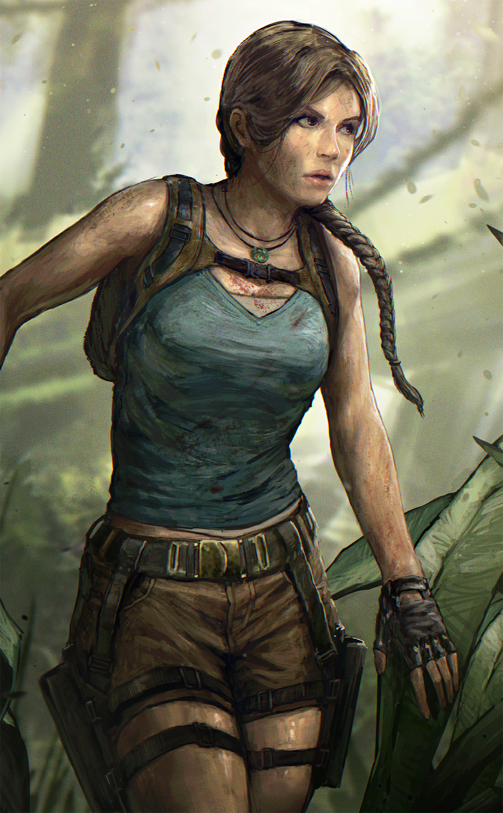
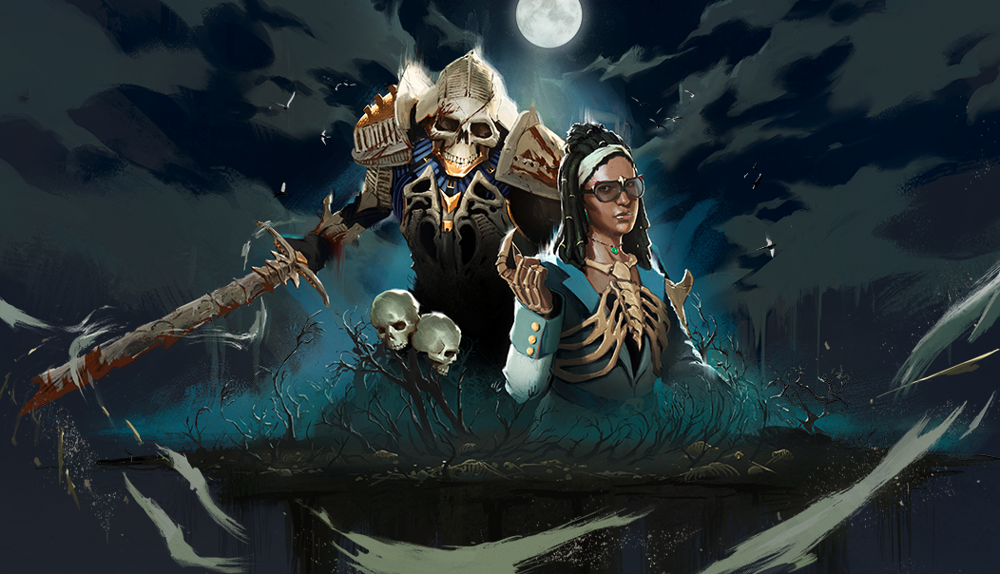
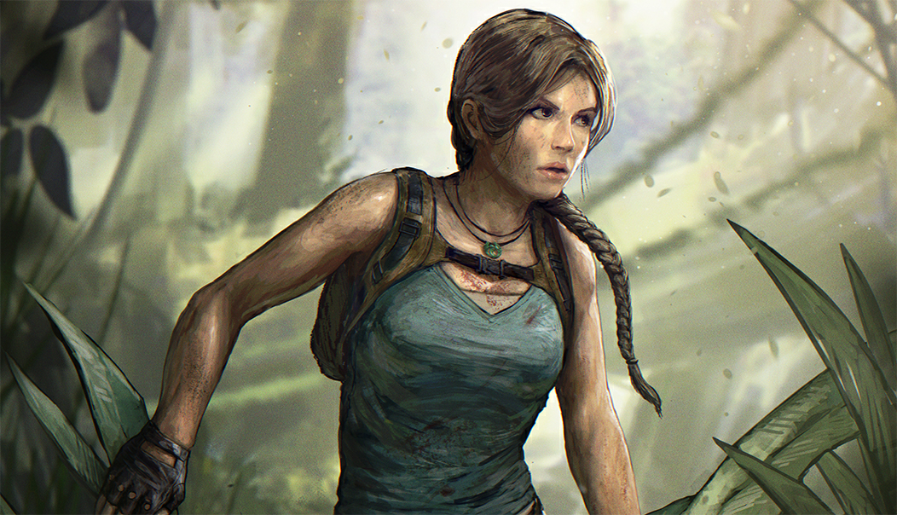

# live · 9.1.0_2670116live

| | |
|---|---|
| Build date | 2025-08-08 14:47 UTC |
| CDN version | `9.1.0_2670116live-1754664451` |
| Key | `9.1.0_live` |
| Compared with | [9.1.1_2667139live](../9.1.1_2667139live/CHANGES.md) (2025-08-06 15:16 UTC) |

## Summary

**3** added · **10** modified · **1** removed · 197 unchanged

## New or updated images

<a href="images/T_UI_CollectionBanner_TombRaider_2.png"></a>
<a href="images/T_UI_SpecialPack_Rift2.png"></a>
<a href="images/T_UI_SpecialPack_TombRaider_2.png"></a>

## Removed files

- `images/T_UI_CollectionBanner_CounterCulture.png`

## Modified files

### [`catalog.json`](catalog.json)

[Full line-by-line diff](diffs/catalog.json.diff)

```diff
- $[id=DK_Head031]
- $[id=DK_Legs031]
- $[id=DK_Torso031]
- $[id=K23_Body027]
- $[id=K23_Head027]
- $[id=K23_W027]
- $[id=NK_Head036]
- $[id=NK_Legs036]
- $[id=NK_Torso036]
- $[id=US_Head030]
- $[id=US_Legs030]
- $[id=US_Torso030]
- $[id=DK_outfit_031]
- $[id=K23_outfit_027]
- $[id=NK_outfit_036]
- $[id=US_Outfit_030]
```

### [`challengeLocs/challengeText_de.json`](challengeLocs/challengeText_de.json)

[Full line-by-line diff](diffs/challengeLocs/challengeText_de.json.diff)

```diff
- $.locText[316].text: "@#CHALLENGE_EarnGatekeeperGold_INFO"
+ $.locText[316].text: "Earn {0} Gold Gatekeeper emblem(s)"
- $.locText[317].text: "@#CHALLENGE_EarnLightbringerGold_INFO"
+ $.locText[317].text: "Earn {0} Gold Lightbringer emblem(s)"
- $.locText[320].text: "@#CHALLENGE_EarnChaserGold_INFO"
+ $.locText[320].text: "Earn {0} Gold Chaser emblem(s)"
- $.locText[321].text: "@#CHALLENGE_EarnEvaderGold_INFO"
+ $.locText[321].text: "Earn {0} Gold Evader emblem(s)"
- $.locText[324].text: "@#CHALLENGE_EarnDevoutGold_INFO"
+ $.locText[324].text: "Earn {0} Gold Devout emblem(s)"
- $.locText[325].text: "@#CHALLENGE_EarnUnbrokenGold_INFO"
+ $.locText[325].text: "Earn {0} Gold Unbroken emblem(s)"
- $.locText[328].text: "@#CHALLENGE_EarnMaliciousGold_INFO"
+ $.locText[328].text: "Earn {0} Gold Malicious emblem(s)"
- $.locText[329].text: "@#CHALLENGE_EarnBenevolentGold_INFO"
+ $.locText[329].text: "Verdiene {0} goldene(s) Hilfsbereit-Emblem(e)."
- $.locText[335].text: "@#CHALLENGE_EscapeThroughHatch_INFO"
+ $.locText[335].text: "Entkomme {0} Prüfung(en) durch eine Bodenluke."
- $.locText[338].text: "@#CHALLENGE_EarnGatekeeperIridescent_INFO"
+ $.locText[338].text: "Verdiene {0} schillernde(s) Torwächter-Emblem(e)."
- $.locText[339].text: "@#CHALLENGE_EarnLightbringerIridescent_INFO"
+ $.locText[339].text: "Verdiene {0} schillernde(s) Lichtgestalt-Emblem(e)."
- $.locText[344].text: "@#CHALLENGE_EarnChaserIridescent_INFO"
+ $.locText[344].text: "Verdiene {0} schillernde(s) Verfolger-Emblem(e)."
- $.locText[345].text: "@#CHALLENGE_EarnEvaderIridescent_INFO"
+ $.locText[345].text: "Verdiene {0} schillernde(s) Flüchtling-Emblem(e)."
- $.locText[348].text: "@#CHALLENGE_ChaseSingleTrial_INFO"
+ $.locText[348].text: "Jage in einer einzigen Prüfung {0} Sek. lang."
- $.locText[353].text: "@#CHALLENGE_EarnDevoutIridescent_INFO"
+ $.locText[353].text: "Verdiene {0} schillernde(s) Inbrünstig-Emblem(e)."
- $.locText[354].text: "@#CHALLENGE_EarnUnbrokenIridescent_INFO"
+ $.locText[354].text: "Verdiene {0} schillernde(s) Ungebrochen-Emblem(e)."
- $.locText[357].text: "@#CHALLENGE_SabotageHook_INFO"
+ $.locText[357].text: "Sabotiere {0} Haken."
- $.locText[360].text: "@#CHALLENGE_EarnMaliciousIridescent_INFO"
+ $.locText[360].text: "Verdiene {0} schillernde(s) Boshaft-Emblem(e)."
- $.locText[361].text: "@#CHALLENGE_EarnBenevolentIridescent_INFO"
+ $.locText[361].text: "Verdiene {0} schillernde(s) Hilfsbereit-Emblem(e)."
- $.locText[366].text: "@#CHALLENGE_EarnEmblemsIridescent_INFO"
+ $.locText[366].text: "Verdiene {0} schillernde(s) Emblem(e)."
- $.locText[369].text: "@#CHALLENGE_DownWithStatusEffect_INFO"
+ $.locText[369].text: "Strecke {0} Überlebende(n) mit Statuseffekten nieder."
```

### [`challengeLocs/challengeText_es-MX.json`](challengeLocs/challengeText_es-MX.json)

[Full line-by-line diff](diffs/challengeLocs/challengeText_es-MX.json.diff)

```diff
- $.locText[316].text: "@#CHALLENGE_EarnGatekeeperGold_INFO"
+ $.locText[316].text: "Earn {0} Gold Gatekeeper emblem(s)"
- $.locText[317].text: "@#CHALLENGE_EarnLightbringerGold_INFO"
+ $.locText[317].text: "Earn {0} Gold Lightbringer emblem(s)"
- $.locText[320].text: "@#CHALLENGE_EarnChaserGold_INFO"
+ $.locText[320].text: "Earn {0} Gold Chaser emblem(s)"
- $.locText[321].text: "@#CHALLENGE_EarnEvaderGold_INFO"
+ $.locText[321].text: "Earn {0} Gold Evader emblem(s)"
- $.locText[324].text: "@#CHALLENGE_EarnDevoutGold_INFO"
+ $.locText[324].text: "Earn {0} Gold Devout emblem(s)"
- $.locText[325].text: "@#CHALLENGE_EarnUnbrokenGold_INFO"
+ $.locText[325].text: "Earn {0} Gold Unbroken emblem(s)"
- $.locText[328].text: "@#CHALLENGE_EarnMaliciousGold_INFO"
+ $.locText[328].text: "Earn {0} Gold Malicious emblem(s)"
- $.locText[329].text: "@#CHALLENGE_EarnBenevolentGold_INFO"
+ $.locText[329].text: "Gana {0} emblema(s) de Benevolente de oro"
- $.locText[335].text: "@#CHALLENGE_EscapeThroughHatch_INFO"
+ $.locText[335].text: "Escapa de {0} partida(s) por una trampilla"
- $.locText[338].text: "@#CHALLENGE_EarnGatekeeperIridescent_INFO"
+ $.locText[338].text: "Gana {0} emblema(s) de Portero iridiscentes"
- $.locText[339].text: "@#CHALLENGE_EarnLightbringerIridescent_INFO"
+ $.locText[339].text: "Gana {0} emblema(s) de Iluminador iridiscentes"
- $.locText[344].text: "@#CHALLENGE_EarnChaserIridescent_INFO"
+ $.locText[344].text: "Gana {0} emblema(s) de Perseguidor iridiscentes"
- $.locText[345].text: "@#CHALLENGE_EarnEvaderIridescent_INFO"
+ $.locText[345].text: "Gana {0} emblema(s) de Evasor iridiscentes"
- $.locText[348].text: "@#CHALLENGE_ChaseSingleTrial_INFO"
+ $.locText[348].text: "Persigue durante {0} segundos en una sola partida"
- $.locText[353].text: "@#CHALLENGE_EarnDevoutIridescent_INFO"
+ $.locText[353].text: "Gana {0} emblema(s) de Devoto iridiscentes"
- $.locText[354].text: "@#CHALLENGE_EarnUnbrokenIridescent_INFO"
+ $.locText[354].text: "Gana {0} emblema(s) de Supervivencia iridiscentes"
- $.locText[357].text: "@#CHALLENGE_SabotageHook_INFO"
+ $.locText[357].text: "Sabotea {0} gancho(s)"
- $.locText[360].text: "@#CHALLENGE_EarnMaliciousIridescent_INFO"
+ $.locText[360].text: "Gana {0} emblema(s) de Malvado iridiscentes"
- $.locText[361].text: "@#CHALLENGE_EarnBenevolentIridescent_INFO"
+ $.locText[361].text: "Gana {0} emblema(s) de Benevolente iridiscentes"
- $.locText[366].text: "@#CHALLENGE_EarnEmblemsIridescent_INFO"
+ $.locText[366].text: "Gana {0} emblema(s) iridiscentes"
- $.locText[369].text: "@#CHALLENGE_DownWithStatusEffect_INFO"
+ $.locText[369].text: "Derriba a {0} sobreviviente(s) que sufra(n) los efectos de estado"
```

### [`challengeLocs/challengeText_es.json`](challengeLocs/challengeText_es.json)

[Full line-by-line diff](diffs/challengeLocs/challengeText_es.json.diff)

```diff
- $.locText[316].text: "@#CHALLENGE_EarnGatekeeperGold_INFO"
+ $.locText[316].text: "Earn {0} Gold Gatekeeper emblem(s)"
- $.locText[317].text: "@#CHALLENGE_EarnLightbringerGold_INFO"
+ $.locText[317].text: "Earn {0} Gold Lightbringer emblem(s)"
- $.locText[320].text: "@#CHALLENGE_EarnChaserGold_INFO"
+ $.locText[320].text: "Earn {0} Gold Chaser emblem(s)"
- $.locText[321].text: "@#CHALLENGE_EarnEvaderGold_INFO"
+ $.locText[321].text: "Earn {0} Gold Evader emblem(s)"
- $.locText[324].text: "@#CHALLENGE_EarnDevoutGold_INFO"
+ $.locText[324].text: "Earn {0} Gold Devout emblem(s)"
- $.locText[325].text: "@#CHALLENGE_EarnUnbrokenGold_INFO"
+ $.locText[325].text: "Earn {0} Gold Unbroken emblem(s)"
- $.locText[328].text: "@#CHALLENGE_EarnMaliciousGold_INFO"
+ $.locText[328].text: "Earn {0} Gold Malicious emblem(s)"
- $.locText[329].text: "@#CHALLENGE_EarnBenevolentGold_INFO"
+ $.locText[329].text: "Consigue {0} emblema(s) de Altruismo de oro."
- $.locText[335].text: "@#CHALLENGE_EscapeThroughHatch_INFO"
+ $.locText[335].text: "Escapa de {0} partida(s) por una trampilla."
- $.locText[338].text: "@#CHALLENGE_EarnGatekeeperIridescent_INFO"
+ $.locText[338].text: "Consigue {0} emblema(s) de Vigilante iridiscente(s)."
- $.locText[339].text: "@#CHALLENGE_EarnLightbringerIridescent_INFO"
+ $.locText[339].text: "Consigue {0} emblema(s) de Objetivos iridiscente(s)."
- $.locText[344].text: "@#CHALLENGE_EarnChaserIridescent_INFO"
+ $.locText[344].text: "Consigue {0} emblema(s) de Caza iridiscente(s)."
- $.locText[345].text: "@#CHALLENGE_EarnEvaderIridescent_INFO"
+ $.locText[345].text: "Consigue {0} emblema(s) de Audacia iridiscente(s)."
- $.locText[348].text: "@#CHALLENGE_ChaseSingleTrial_INFO"
+ $.locText[348].text: "Persigue durante {0} segundos en una sola partida."
- $.locText[353].text: "@#CHALLENGE_EarnDevoutIridescent_INFO"
+ $.locText[353].text: "Consigue {0} emblema(s) de Sacrificio iridiscente(s)."
- $.locText[354].text: "@#CHALLENGE_EarnUnbrokenIridescent_INFO"
+ $.locText[354].text: "Consigue {0} emblema(s) de Supervivencia iridiscente(s)."
- $.locText[357].text: "@#CHALLENGE_SabotageHook_INFO"
+ $.locText[357].text: "Sabotea {0} gancho(s)."
- $.locText[360].text: "@#CHALLENGE_EarnMaliciousIridescent_INFO"
+ $.locText[360].text: "Consigue {0} emblema(s) de Brutalidad iridiscente(s)."
- $.locText[361].text: "@#CHALLENGE_EarnBenevolentIridescent_INFO"
+ $.locText[361].text: "Consigue {0} emblema(s) de Altruismo iridiscente(s)."
- $.locText[366].text: "@#CHALLENGE_EarnEmblemsIridescent_INFO"
+ $.locText[366].text: "Consigue {0} emblema(s) iridiscente(s)."
- $.locText[369].text: "@#CHALLENGE_DownWithStatusEffect_INFO"
+ $.locText[369].text: "Derriba a {0} superviviente(s) que sufran efectos de estado."
```

### [`challengeLocs/challengeText_fr.json`](challengeLocs/challengeText_fr.json)

[Full line-by-line diff](diffs/challengeLocs/challengeText_fr.json.diff)

```diff
- $.locText[17].text: "Réparez {0} générateur(s) au total"
+ $.locText[17].text: "Réparer {0} générateur(s) au total"
- $.locText[26].text: "Pourchassez pendant {0} secondes"
+ $.locText[26].text: "Pourchasser pendant {0} secondes"
- $.locText[31].text: "Renversez {0} palette(s) pendant une poursuite"
+ $.locText[31].text: "Renverser {0} palette(s) pendant une poursuite"
- $.locText[46].text: "Jouez avec {1} dans {0} épreuve(s)"
+ $.locText[46].text: "Jouer avec {1} dans {0} épreuve(s)"
- $.locText[47].text: "Jouez avec {1} dans {0} Épreuve(s)"
+ $.locText[47].text: "Jouer avec {1} dans {0} Épreuve(s)"
- $.locText[50].text: "Dérangez {0} corbeau(x)"
+ $.locText[50].text: "Déranger {0} corbeau(x)"
- $.locText[53].text: "Mettez à terre {0} survivant(s)"
+ $.locText[53].text: "Mettre à terre {0} survivant(s)"
- $.locText[54].text: "Réussissez {0} tests d'habileté pendant que vous soignez un survivant"
+ $.locText[54].text: "Réussir {0} tests d'habileté tout en soignant un survivant"
- $.locText[74].text: "Sacrifiez {0} survivant(s)"
+ $.locText[74].text: "Sacrifier {0} survivant(s)"
- $.locText[83].text: "Gagnez {0} Emblèmes d'Or"
+ $.locText[83].text: "Gagner {0} Emblèmes d'Or"
- $.locText[88].text: "Franchissez des obstacles {0} fois pendant une poursuite"
+ $.locText[88].text: "Franchir {0} obstacles en courant pendant une poursuite"
- $.locText[106].text: "Transportez des survivants sur {0} mètres"
+ $.locText[106].text: "Transporter des survivants sur {0} mètres"
- $.locText[107].text: "Échappez à {0} poursuite(s)"
+ $.locText[107].text: "Échapper à {0} poursuite(s)"
- $.locText[110].text: "Interrompez et saisissez {0} survivant(s)"
+ $.locText[110].text: "Interrompre et saisir {0} survivant(s)"
- $.locText[114].text: "Révélez l'aura de survivants pendant {0} secondes"
+ $.locText[114].text: "Révéler l'aura de survivants pendant {0} secondes"
- $.locText[120].text: "Tuez {0} survivant(s)"
+ $.locText[120].text: "Tuer {0} survivant(s)"
- $.locText[127].text: "Épuisez complètement {0} trousse(s) de soins"
+ $.locText[127].text: "Épuiser complètement {0} trousse(s) de soins"
- $.locText[132].text: "Effectuez des actions coopératives pendant un total de {0} secondes"
+ $.locText[132].text: "Effectuer des actions coopératives pendant un total de {0} secondes"
- $.locText[135].text: "Frappez {0} survivants dans les 10 secondes suivant la révélation de leur aura"
+ $.locText[135].text: "Frapper {0} survivants dans les 10 secondes suivant la révélation de leur aura"
- $.locText[141].text: "Épuisez complètement {0} boîte(s) à outils"
+ $.locText[141].text: "Épuiser complètement {0} boîte(s) à outils"
- $.locText[144].text: "Terminez {0} épreuve(s) sans qu'aucun survivant ne s'échappe par les portes de sortie"
+ $.locText[144].text: "Terminer {0} épreuve(s) sans que les survivants s'échappent par les portes de sortie"
- $.locText[152].text: "Gagnez {0} emblème(s) d'argent."
+ $.locText[152].text: "Gagner {0} emblème(s) d'Argent"
- $.locText[158].text: "Soignez un total de <b>{0} état(s) de santé</b>"
+ $.locText[158].text: "Soigner un total de <b>{0} état(s) de santé</b>"
- $.locText[161].text: "Purifiez {0} totem(s)"
+ $.locText[161].text: "Purifier {0} totem(s)"
- $.locText[165].text: "Entrez dans un casier {0} fois pendant une poursuite ou dans les 5 secondes suivant votre échappée d'une poursuite en une seule épreuve"
+ $.locText[165].text: "Entrer dans un casier {0} fois pendant une poursuite ou dans les 5 secondes après avoir échappé à une poursuite en une seule épreuve"
- $.locText[170].text: "Mettez à terre {0} survivant(s) près d'une palette"
+ $.locText[170].text: "Mettre à terre {0} survivant(s) près d'une palette"
- $.locText[171].text: "Soignez {0} survivant(s) de l'état critique"
+ $.locText[171].text: "Soigner {0} survivant(s) de l'état critique"
- $.locText[174].text: "Tombez de haut en vous faisant poursuivre {0} fois en une seule épreuve"
+ $.locText[174].text: "Tomber de haut en se faisant poursuivre {0} fois en une seule épreuve"
- $.locText[300].text: "Réparez {0} générateur(s)"
+ $.locText[300].text: "Réparer {0} générateur(s)"
```

### [`challengeLocs/challengeText_it.json`](challengeLocs/challengeText_it.json)

[Full line-by-line diff](diffs/challengeLocs/challengeText_it.json.diff)

```diff
- $.locText[316].text: "@#CHALLENGE_EarnGatekeeperGold_INFO"
+ $.locText[316].text: "Earn {0} Gold Gatekeeper emblem(s)"
- $.locText[317].text: "@#CHALLENGE_EarnLightbringerGold_INFO"
+ $.locText[317].text: "Earn {0} Gold Lightbringer emblem(s)"
- $.locText[320].text: "@#CHALLENGE_EarnChaserGold_INFO"
+ $.locText[320].text: "Earn {0} Gold Chaser emblem(s)"
- $.locText[321].text: "@#CHALLENGE_EarnEvaderGold_INFO"
+ $.locText[321].text: "Earn {0} Gold Evader emblem(s)"
- $.locText[324].text: "@#CHALLENGE_EarnDevoutGold_INFO"
+ $.locText[324].text: "Earn {0} Gold Devout emblem(s)"
- $.locText[325].text: "@#CHALLENGE_EarnUnbrokenGold_INFO"
+ $.locText[325].text: "Earn {0} Gold Unbroken emblem(s)"
- $.locText[328].text: "@#CHALLENGE_EarnMaliciousGold_INFO"
+ $.locText[328].text: "Earn {0} Gold Malicious emblem(s)"
- $.locText[329].text: "@#CHALLENGE_EarnBenevolentGold_INFO"
+ $.locText[329].text: "Ottieni {0} emblema/i della Benevolenza d'oro"
- $.locText[335].text: "@#CHALLENGE_EscapeThroughHatch_INFO"
+ $.locText[335].text: "Fuggi da {0} prova/e da una botola oscura."
- $.locText[338].text: "@#CHALLENGE_EarnGatekeeperIridescent_INFO"
+ $.locText[338].text: "Ottieni {0} emblema/i del Piantone di qualità iridescente"
- $.locText[339].text: "@#CHALLENGE_EarnLightbringerIridescent_INFO"
+ $.locText[339].text: "Ottieni {0} Portatore di luce di qualità iridescente"
- $.locText[344].text: "@#CHALLENGE_EarnChaserIridescent_INFO"
+ $.locText[344].text: "Ottieni {0} emblema/i dell'Inseguitore di qualità iridescente"
- $.locText[345].text: "@#CHALLENGE_EarnEvaderIridescent_INFO"
+ $.locText[345].text: "Ottieni {0} emblema/i dell'Evasione di qualità iridescente"
- $.locText[348].text: "@#CHALLENGE_ChaseSingleTrial_INFO"
+ $.locText[348].text: "Insegui per {0} secondi in una sola prova"
- $.locText[353].text: "@#CHALLENGE_EarnDevoutIridescent_INFO"
+ $.locText[353].text: "Ottieni {0} emblema/i della Devozione di qualità iridescente"
- $.locText[354].text: "@#CHALLENGE_EarnUnbrokenIridescent_INFO"
+ $.locText[354].text: "Ottieni {0} emblema/i Tutt'intero di qualità iridescente"
- $.locText[357].text: "@#CHALLENGE_SabotageHook_INFO"
+ $.locText[357].text: "Sabota {0} gancio/i"
- $.locText[360].text: "@#CHALLENGE_EarnMaliciousIridescent_INFO"
+ $.locText[360].text: "Ottieni {0} emblema/i della Malignità di qualità iridescente"
- $.locText[361].text: "@#CHALLENGE_EarnBenevolentIridescent_INFO"
+ $.locText[361].text: "Ottieni {0} emblema/i della Benevolenza di qualità iridescente"
- $.locText[366].text: "@#CHALLENGE_EarnEmblemsIridescent_INFO"
+ $.locText[366].text: "Ottieni {0} emblema/i di qualità iridescente"
- $.locText[369].text: "@#CHALLENGE_DownWithStatusEffect_INFO"
+ $.locText[369].text: "Abbatti {0} sopravvissuto/i con effetti di stato"
```

### [`challengeLocs/challengeText_pt-BR.json`](challengeLocs/challengeText_pt-BR.json)

[Full line-by-line diff](diffs/challengeLocs/challengeText_pt-BR.json.diff)

```diff
- $.locText[316].text: "@#CHALLENGE_EarnGatekeeperGold_INFO"
+ $.locText[316].text: "Earn {0} Gold Gatekeeper emblem(s)"
- $.locText[317].text: "@#CHALLENGE_EarnLightbringerGold_INFO"
+ $.locText[317].text: "Earn {0} Gold Lightbringer emblem(s)"
- $.locText[320].text: "@#CHALLENGE_EarnChaserGold_INFO"
+ $.locText[320].text: "Earn {0} Gold Chaser emblem(s)"
- $.locText[321].text: "@#CHALLENGE_EarnEvaderGold_INFO"
+ $.locText[321].text: "Earn {0} Gold Evader emblem(s)"
- $.locText[324].text: "@#CHALLENGE_EarnDevoutGold_INFO"
+ $.locText[324].text: "Earn {0} Gold Devout emblem(s)"
- $.locText[325].text: "@#CHALLENGE_EarnUnbrokenGold_INFO"
+ $.locText[325].text: "Earn {0} Gold Unbroken emblem(s)"
- $.locText[328].text: "@#CHALLENGE_EarnMaliciousGold_INFO"
+ $.locText[328].text: "Earn {0} Gold Malicious emblem(s)"
- $.locText[329].text: "@#CHALLENGE_EarnBenevolentGold_INFO"
+ $.locText[329].text: "Obtenha {0} Emblema(s) de Benevolência de Ouro"
- $.locText[335].text: "@#CHALLENGE_EscapeThroughHatch_INFO"
+ $.locText[335].text: "Fuja de {0} partidas(s) por uma escotilha."
- $.locText[338].text: "@#CHALLENGE_EarnGatekeeperIridescent_INFO"
+ $.locText[338].text: "Obtenha {0} Emblema(s) de Guardião do Portão Iridescente"
- $.locText[339].text: "@#CHALLENGE_EarnLightbringerIridescent_INFO"
+ $.locText[339].text: "Obtenha {0} Emblema(s) de Iluminação Iridescente"
- $.locText[344].text: "@#CHALLENGE_EarnChaserIridescent_INFO"
+ $.locText[344].text: "Obtenha {0} Emblema(s) de Caçador Iridescente"
- $.locText[345].text: "@#CHALLENGE_EarnEvaderIridescent_INFO"
+ $.locText[345].text: "Obtenha {0} Emblema(s) de Evasão Iridescente"
- $.locText[348].text: "@#CHALLENGE_ChaseSingleTrial_INFO"
+ $.locText[348].text: "Persiga por {0} s em uma única partida"
- $.locText[353].text: "@#CHALLENGE_EarnDevoutIridescent_INFO"
+ $.locText[353].text: "Obtenha {0} Emblema(s) de Devoção Iridescente"
- $.locText[354].text: "@#CHALLENGE_EarnUnbrokenIridescent_INFO"
+ $.locText[354].text: "Obtenha {0} Emblema(s) de Invencibilidade Iridescente"
- $.locText[357].text: "@#CHALLENGE_SabotageHook_INFO"
+ $.locText[357].text: "Sabote {0} gancho(s)"
- $.locText[360].text: "@#CHALLENGE_EarnMaliciousIridescent_INFO"
+ $.locText[360].text: "Obtenha {0} Emblema(s) de Malícia Iridescente"
- $.locText[361].text: "@#CHALLENGE_EarnBenevolentIridescent_INFO"
+ $.locText[361].text: "Obtenha {0} Emblema(s) de Benevolência Iridescente"
- $.locText[366].text: "@#CHALLENGE_EarnEmblemsIridescent_INFO"
+ $.locText[366].text: "Obtenha {0} emblema(s) de qualidade Iridescente"
- $.locText[369].text: "@#CHALLENGE_DownWithStatusEffect_INFO"
+ $.locText[369].text: "Derrube {0} Sobrevivente(s) com efeitos de estado"
```

### [`challengeLocs/challengeText_th.json`](challengeLocs/challengeText_th.json)

[Full line-by-line diff](diffs/challengeLocs/challengeText_th.json.diff)

```diff
- $.locText[316].text: "@#CHALLENGE_EarnGatekeeperGold_INFO"
+ $.locText[316].text: "Earn {0} Gold Gatekeeper emblem(s)"
- $.locText[317].text: "@#CHALLENGE_EarnLightbringerGold_INFO"
+ $.locText[317].text: "Earn {0} Gold Lightbringer emblem(s)"
- $.locText[320].text: "@#CHALLENGE_EarnChaserGold_INFO"
+ $.locText[320].text: "Earn {0} Gold Chaser emblem(s)"
- $.locText[321].text: "@#CHALLENGE_EarnEvaderGold_INFO"
+ $.locText[321].text: "Earn {0} Gold Evader emblem(s)"
- $.locText[324].text: "@#CHALLENGE_EarnDevoutGold_INFO"
+ $.locText[324].text: "Earn {0} Gold Devout emblem(s)"
- $.locText[325].text: "@#CHALLENGE_EarnUnbrokenGold_INFO"
+ $.locText[325].text: "Earn {0} Gold Unbroken emblem(s)"
- $.locText[328].text: "@#CHALLENGE_EarnMaliciousGold_INFO"
+ $.locText[328].text: "Earn {0} Gold Malicious emblem(s)"
- $.locText[329].text: "@#CHALLENGE_EarnBenevolentGold_INFO"
+ $.locText[329].text: "ได้รับตราเมตตาทอง {0} ชิ้น"
- $.locText[335].text: "@#CHALLENGE_EscapeThroughHatch_INFO"
+ $.locText[335].text: "หลบหนีจากเกมผ่านช่องทางหนี {0} เกม"
- $.locText[338].text: "@#CHALLENGE_EarnGatekeeperIridescent_INFO"
+ $.locText[338].text: "ได้รับตราทวารบาลสีรุ้ง {0} ชิ้น"
- $.locText[339].text: "@#CHALLENGE_EarnLightbringerIridescent_INFO"
+ $.locText[339].text: "ได้รับตราผู้ส่องสว่างสีรุ้ง {0} ชิ้น"
- $.locText[344].text: "@#CHALLENGE_EarnChaserIridescent_INFO"
+ $.locText[344].text: "ได้รับตราผู้ไล่ล่าสีรุ้ง {0} ชิ้น"
- $.locText[345].text: "@#CHALLENGE_EarnEvaderIridescent_INFO"
+ $.locText[345].text: "ได้รับตราจอมหลบหลีกสีรุ้ง {0} ชิ้น"
- $.locText[348].text: "@#CHALLENGE_ChaseSingleTrial_INFO"
+ $.locText[348].text: "ไล่ล่านาน {0} วินาทีในเกมเดียว"
- $.locText[353].text: "@#CHALLENGE_EarnDevoutIridescent_INFO"
+ $.locText[353].text: "ได้รับตราศรัทธาแรงกล้าสีรุ้ง {0} ชิ้น"
- $.locText[354].text: "@#CHALLENGE_EarnUnbrokenIridescent_INFO"
+ $.locText[354].text: "ได้รับตราไม่แตกหักสีรุ้ง {0} ชิ้น"
- $.locText[357].text: "@#CHALLENGE_SabotageHook_INFO"
+ $.locText[357].text: "ทำลายตะขอ {0} อัน"
- $.locText[360].text: "@#CHALLENGE_EarnMaliciousIridescent_INFO"
+ $.locText[360].text: "ได้รับตรามุ่งร้ายสีรุ้ง {0} ชิ้น"
- $.locText[361].text: "@#CHALLENGE_EarnBenevolentIridescent_INFO"
+ $.locText[361].text: "ได้รับตราเมตตาสีรุ้ง {0} ชิ้น"
- $.locText[366].text: "@#CHALLENGE_EarnEmblemsIridescent_INFO"
+ $.locText[366].text: "ได้รับตราสีรุ้ง{0} ชิ้น"
- $.locText[369].text: "@#CHALLENGE_DownWithStatusEffect_INFO"
+ $.locText[369].text: "ทำให้ผู้รอดชีวิตที่ติดเอฟเฟกต์สถานะล้มลงคลาน {0} คน"
```

### [`collections.json`](collections.json)

[Full line-by-line diff](diffs/collections.json.diff)

```diff
- $.collections[21].limitedAvailabilityStartDate: "2025-08-12T15:00:00Z"
- $.collections[21].visibleBeforeStartDate: false
- $.collections[21].collectionId: "Counterculture"
+ $.collections[21].collectionId: "SpringEnsembles"
- $.collections[21].collectionTitle.de: "Gegenkultur"
+ $.collections[21].collectionTitle.de: "Frühlings-Ensembles"
- $.collections[21].collectionTitle.en: "Counterculture"
+ $.collections[21].collectionTitle.en: "Spring Ensembles"
- $.collections[21].collectionTitle.es: "Contracultura"
+ $.collections[21].collectionTitle.es: "Conjuntos de primavera"
- $.collections[21].collectionTitle["es-MX"]: "Contracultura"
+ $.collections[21].collectionTitle["es-MX"]: "Conjuntos de primavera"
- $.collections[21].collectionTitle.fr: "Contreculture"
+ $.collections[21].collectionTitle.fr: "Ensembles printaniers"
- $.collections[21].collectionTitle.it: "Controcultura"
+ $.collections[21].collectionTitle.it: "Completi primaverili"
- $.collections[21].collectionTitle.ja: "カウンターカルチャー"
+ $.collections[21].collectionTitle.ja: "春のアンサンブル"
- $.collections[21].collectionTitle.ko: "반문화"
+ $.collections[21].collectionTitle.ko: "봄의 조화"
- $.collections[21].collectionTitle.pl: "Kontrkultura"
+ $.collections[21].collectionTitle.pl: "Wiosenne stroje"
- $.collections[21].collectionTitle["pt-BR"]: "Contracultura"
+ $.collections[21].collectionTitle["pt-BR"]: "Conjuntos de Primavera"
- $.collections[21].collectionTitle.ru: "Контркультура"
+ $.collections[21].collectionTitle.ru: "Весенний ансамбль"
- $.collections[21].collectionTitle.th: "วัฒนธรรมปรปักษ์"
+ $.collections[21].collectionTitle.th: "เครื่องแต่งกายฤดูใบไม้ผลิ"
- $.collections[21].collectionTitle.tr: "Karşı Kültür"
+ $.collections[21].collectionTitle.tr: "Bahar Kreasyonu"
- $.collections[21].collectionTitle["zh-Hans"]: "反文化"
+ $.collections[21].collectionTitle["zh-Hans"]: "春日套装"
- $.collections[21].collectionTitle["zh-Hant"]: "反文化"
+ $.collections[21].collectionTitle["zh-Hant"]: "春天靈魂"
- $.collections[21].heroImage.path: "/Game/UI/UMGAssets/Icons/Banners/CollectionBanners/Lasagna/T_UI_CollectionBanner_CounterCulture.T_UI_CollectionBanner_CounterCulture"
+ $.collections[21].heroImage.path: "/Game/UI/UMGAssets/Icons/Banners/CollectionBanners/T_UI_CollectionBanner_SpringEnsembles.T_UI_CollectionBanner_SpringEnsembles"
- $.collections[21].inclusionVersion: "9.1.1"
+ $.collections[21].inclusionVersion: "7.7.0 PTB"
- $.collections[21].items[]: "NK_outfit_036"
- $.collections[21].items[]: "US_Outfit_030"
- $.collections[21].items[]: "DK_outfit_031"
- $.collections[21].items[]: "K23_outfit_027"
- $.collections[21].items[]: "NK_outfit_018"
+ $.collections[21].items[]: "Ace_outfit_008_01"
+ $.collections[21].items[]: "HillBilly_outfit_008_01"
+ $.collections[21].items[]: "FM_outfit_011"
+ $.collections[21].items[]: "FM_outfit_011_01"
+ $.collections[21].items[]: "S28_outfit_011"
+ $.collections[21].items[]: "US_outfit_015"
+ $.collections[21].items[]: "K21_outfit_010"
+ $.collections[21].items[]: "K26_outfit_007"
+ $.collections[21].items[]: "GK_outfit_013"
+ $.collections[21].items[]: "S29_outfit_008"
- $.collections[21].sortOrder: "-148"
+ $.collections[21].sortOrder: "-15"
- $.collections[21].updatedDate: "2025-07-21T16:29:52.758Z"
+ $.collections[21].updatedDate: "2024-02-20T17:45:49Z"
- $.collections[22].collectionId: "SpringEnsembles"
+ $.collections[22].collectionId: "PopSuperstar"
- $.collections[22].collectionTitle.de: "Frühlings-Ensembles"
+ $.collections[22].collectionTitle.de: "Superpopstar"
- $.collections[22].collectionTitle.en: "Spring Ensembles"
+ $.collections[22].collectionTitle.en: "Pop Superstar"
- $.collections[22].collectionTitle.es: "Conjuntos de primavera"
+ $.collections[22].collectionTitle.es: "Superestrella del pop"
- $.collections[22].collectionTitle["es-MX"]: "Conjuntos de primavera"
+ $.collections[22].collectionTitle["es-MX"]: "Superestrella del pop"
- $.collections[22].collectionTitle.fr: "Ensembles printaniers"
+ $.collections[22].collectionTitle.fr: "Superstar de la pop"
- $.collections[22].collectionTitle.it: "Completi primaverili"
+ $.collections[22].collectionTitle.it: "Superstar pop"
- $.collections[22].collectionTitle.ja: "春のアンサンブル"
+ $.collections[22].collectionTitle.ja: "ポップスター"
- $.collections[22].collectionTitle.ko: "봄의 조화"
+ $.collections[22].collectionTitle.ko: "팝 슈퍼스타"
- $.collections[22].collectionTitle.pl: "Wiosenne stroje"
+ $.collections[22].collectionTitle.pl: "Supergwiazda popu"
- $.collections[22].collectionTitle["pt-BR"]: "Conjuntos de Primavera"
+ $.collections[22].collectionTitle["pt-BR"]: "Estrela Pop"
- $.collections[22].collectionTitle.ru: "Весенний ансамбль"
+ $.collections[22].collectionTitle.ru: "Поп-суперзвезда"
- $.collections[22].collectionTitle.th: "เครื่องแต่งกายฤดูใบไม้ผลิ"
+ $.collections[22].collectionTitle.th: "ซูเปอร์สตาร์ป็อป"
- $.collections[22].collectionTitle.tr: "Bahar Kreasyonu"
+ $.collections[22].collectionTitle.tr: "Popçu Süperstar"
- $.collections[22].collectionTitle["zh-Hans"]: "春日套装"
+ $.collections[22].collectionTitle["zh-Hans"]: "流行巨星"
- $.collections[22].collectionTitle["zh-Hant"]: "春天靈魂"
+ $.collections[22].collectionTitle["zh-Hant"]: "流行巨星"
- $.collections[22].heroImage.path: "/Game/UI/UMGAssets/Icons/Banners/CollectionBanners/T_UI_CollectionBanner_SpringEnsembles.T_UI_CollectionBanner_SpringEnsembles"
+ $.collections[22].heroImage.path: "/Game/UI/UMGAssets/Icons/Banners/CollectionBanners/T_UI_CollectionBanner_PopSuperstar.T_UI_CollectionBanner_PopSuperstar"
- $.collections[22].items[]: "Ace_outfit_008_01"
- $.collections[22].items[]: "HillBilly_outfit_008_01"
- $.collections[22].items[]: "FM_outfit_011"
- $.collections[22].items[]: "FM_outfit_011_01"
- $.collections[22].items[]: "S28_outfit_011"
- $.collections[22].items[]: "US_outfit_015"
- $.collections[22].items[]: "K21_outfit_010"
- $.collections[22].items[]: "K26_outfit_007"
- $.collections[22].items[]: "GK_outfit_013"
- $.collections[22].items[]: "S29_outfit_008"
+ $.collections[22].items[]: "FM_outfit_020"
+ $.collections[22].items[]: "GS_outfit_020"
+ $.collections[22].items[]: "S25_outfit_013"
+ $.collections[22].items[]: "K23_outfit_012"
- $.collections[22].sortOrder: "-15"
+ $.collections[22].sortOrder: "-16"
- $.collections[22].updatedDate: "2024-02-20T17:45:49Z"
+ $.collections[22].updatedDate: "0001-01-01T00:00:00Z"
- $.collections[23].collectionId: "PopSuperstar"
+ $.collections[23].collectionId: "Leatherface"
- $.collections[23].collectionTitle.de: "Superpopstar"
+ $.collections[23].collectionTitle.de: "Leatherface"
- $.collections[23].collectionTitle.en: "Pop Superstar"
+ $.collections[23].collectionTitle.en: "Leatherface"
- $.collections[23].collectionTitle.es: "Superestrella del pop"
+ $.collections[23].collectionTitle.es: "Cara de cuero"
- $.collections[23].collectionTitle["es-MX"]: "Superestrella del pop"
+ $.collections[23].collectionTitle["es-MX"]: "Cara de cuero"
- $.collections[23].collectionTitle.fr: "Superstar de la pop"
+ $.collections[23].collectionTitle.fr: "Leatherface"
- $.collections[23].collectionTitle.it: "Superstar pop"
+ $.collections[23].collectionTitle.it: "Faccia di cuoio"
- $.collections[23].collectionTitle.ja: "ポップスター"
+ $.collections[23].collectionTitle.ja: "レザーフェイス"
- $.collections[23].collectionTitle.ko: "팝 슈퍼스타"
+ $.collections[23].collectionTitle.ko: "가죽 가면"
- $.collections[23].collectionTitle.pl: "Supergwiazda popu"
+ $.collections[23].collectionTitle.pl: "Leatherface"
- $.collections[23].collectionTitle["pt-BR"]: "Estrela Pop"
+ $.collections[23].collectionTitle["pt-BR"]: "Leatherface"
- $.collections[23].collectionTitle.ru: "Поп-суперзвезда"
+ $.collections[23].collectionTitle.ru: "Кожаное Лицо"
- $.collections[23].collectionTitle.th: "ซูเปอร์สตาร์ป็อป"
+ $.collections[23].collectionTitle.th: "หน้ากากหนัง"
- $.collections[23].collectionTitle.tr: "Popçu Süperstar"
+ $.collections[23].collectionTitle.tr: "Deri Surat"
- $.collections[23].collectionTitle["zh-Hans"]: "流行巨星"
+ $.collections[23].collectionTitle["zh-Hans"]: "人皮脸"
- $.collections[23].collectionTitle["zh-Hant"]: "流行巨星"
+ $.collections[23].collectionTitle["zh-Hant"]: "皮臉"
- $.collections[23].heroImage.path: "/Game/UI/UMGAssets/Icons/Banners/CollectionBanners/T_UI_CollectionBanner_PopSuperstar.T_UI_CollectionBanner_PopSuperstar"
+ $.collections[23].heroImage.path: "/Game/UI/UMGAssets/Icons/Banners/CollectionBanners/T_UI_CollectionBanner_Leatherface.T_UI_CollectionBanner_Leatherface"
- $.collections[23].inclusionVersion: "7.7.0 PTB"
+ $.collections[23].inclusionVersion: "8.1.0"
- $.collections[23].items[]: "FM_outfit_020"
- $.collections[23].items[]: "GS_outfit_020"
- $.collections[23].items[]: "S25_outfit_013"
- $.collections[23].items[]: "K23_outfit_012"
+ $.collections[23].items[]: "CA_outfit_006"
+ $.collections[23].items[]: "CA_outfit_007"
- $.collections[23].updatedDate: "0001-01-01T00:00:00Z"
+ $.collections[23].updatedDate: "2024-06-25T12:13:35Z"
- $.collections[24].collectionId: "Leatherface"
+ $.collections[24].collectionId: "HookedOnYou"
- $.collections[24].collectionTitle.de: "Leatherface"
+ $.collections[24].collectionTitle.de: "Hooked on You"
- $.collections[24].collectionTitle.en: "Leatherface"
+ $.collections[24].collectionTitle.en: "Hooked on You"
- $.collections[24].collectionTitle.es: "Cara de cuero"
+ $.collections[24].collectionTitle.es: "Hooked on You"
- $.collections[24].collectionTitle["es-MX"]: "Cara de cuero"
+ $.collections[24].collectionTitle["es-MX"]: "Hooked on You"
- $.collections[24].collectionTitle.fr: "Leatherface"
+ $.collections[24].collectionTitle.fr: "Hooked on You"
- $.collections[24].collectionTitle.it: "Faccia di cuoio"
+ $.collections[24].collectionTitle.it: "Hooked on You"
- $.collections[24].collectionTitle.ja: "レザーフェイス"
+ $.collections[24].collectionTitle.ja: "Hooked on You"
- $.collections[24].collectionTitle.ko: "가죽 가면"
+ $.collections[24].collectionTitle.ko: "Hooked on You"
- $.collections[24].collectionTitle.pl: "Leatherface"
+ $.collections[24].collectionTitle.pl: "Hooked On You"
- $.collections[24].collectionTitle["pt-BR"]: "Leatherface"
+ $.collections[24].collectionTitle["pt-BR"]: "Hooked on You"
- $.collections[24].collectionTitle.ru: "Кожаное Лицо"
+ $.collections[24].collectionTitle.ru: "На твоем крючке"
- $.collections[24].collectionTitle.th: "หน้ากากหนัง"
+ $.collections[24].collectionTitle.th: "Hooked on You"
- $.collections[24].collectionTitle.tr: "Deri Surat"
+ $.collections[24].collectionTitle.tr: "Sana Tutuldum"
- $.collections[24].collectionTitle["zh-Hans"]: "人皮脸"
+ $.collections[24].collectionTitle["zh-Hans"]: "心醉魂迷"
- $.collections[24].collectionTitle["zh-Hant"]: "皮臉"
+ $.collections[24].collectionTitle["zh-Hant"]: "《鉤魂迷戀》"
- $.collections[24].heroImage.path: "/Game/UI/UMGAssets/Icons/Banners/CollectionBanners/T_UI_CollectionBanner_Leatherface.T_UI_CollectionBanner_Leatherface"
+ $.collections[24].heroImage.path: "/Game/UI/UMGAssets/Icons/Banners/CollectionBanners/T_UI_CollectionBanner_HookedOnYou.T_UI_CollectionBanner_HookedOnYou"
- $.collections[24].inclusionVersion: "8.1.0"
+ $.collections[24].inclusionVersion: "7.7.0 PTB"
- $.collections[24].items[]: "CA_outfit_006"
- $.collections[24].items[]: "CA_outfit_007"
+ $.collections[24].items[]: "CM_outfit_021"
+ $.collections[24].items[]: "DF_outfit_023"
+ $.collections[24].items[]: "BE_outfit_017"
+ $.collections[24].items[]: "K23_outfit_014"
+ $.collections[24].items[]: "HK_outfit_017"
- $.collections[24].sortOrder: "-16"
+ $.collections[24].sortOrder: "-19"
- $.collections[24].updatedDate: "2024-06-25T12:13:35Z"
+ $.collections[24].updatedDate: "0001-01-01T00:00:00Z"
… 3595 more change(s) — see the commit diff for everything
```

### [`dynamicContent/DynamicContent.json`](dynamicContent/DynamicContent.json)

[Full line-by-line diff](diffs/dynamicContent/DynamicContent.json.diff)

```diff
- $.entries[0].contentVersion: "f7c93776f522193fdbac58c1416ed2bb8ee190ec"
+ $.entries[0].contentVersion: "a7a641e983d0a73a05f9cf7c36abc38aaadf91d0"
- $.entries[0].downloadStrategy: "preferRemote"
+ $.entries[0].downloadStrategy: "preferPackaged"
- $.entries[0].packagedPath: "/DBDUICore/Assets/HUD/Tutorial/T_UI_Tutorial_ImageBG_GenQuest1.T_UI_Tutorial_ImageBG_GenQuest1"
+ $.entries[0].packagedPath: "/Game/UI/UMGAssets/Icons/Banners/BundleBanners/SpecialPack/Lasagna/T_UI_SpecialPack_TombRaider_2.T_UI_SpecialPack_TombRaider_2"
- $.entries[0].uri: "images/T_UI_Tutorial_ImageBG_GenQuest1.png"
+ $.entries[0].uri: "images/T_UI_SpecialPack_TombRaider_2.png"
- $.entries[1].contentVersion: "4ae305ae1f966db3228ce77826da57e2ece140b4"
+ $.entries[1].contentVersion: "134f970ea383b09ad301321d2a6be91363299df5"
- $.entries[1].downloadStrategy: "preferRemote"
+ $.entries[1].downloadStrategy: "preferPackaged"
- $.entries[1].packagedPath: "/DBDUICore/Assets/HUD/Tutorial/T_UI_Tutorial_ImageBG_cosmetic.T_UI_Tutorial_ImageBG_cosmetic"
+ $.entries[1].packagedPath: "/Game/UI/UMGAssets/Icons/Banners/BundleBanners/SpecialPack/Lasagna/T_UI_SpecialPack_Rift2.T_UI_SpecialPack_Rift2"
- $.entries[1].uri: "images/T_UI_Tutorial_ImageBG_cosmetic.png"
+ $.entries[1].uri: "images/T_UI_SpecialPack_Rift2.png"
- $.entries[2].contentVersion: "f8c74b123d0ba3a66d82d9ba6e26486b88797b88"
+ $.entries[2].contentVersion: "f7c93776f522193fdbac58c1416ed2bb8ee190ec"
- $.entries[2].packagedPath: "/DBDUICore/Assets/HUD/Tutorial/T_UI_Tutorial_ImageBG_gift.T_UI_Tutorial_ImageBG_gift"
+ $.entries[2].packagedPath: "/DBDUICore/Assets/HUD/Tutorial/T_UI_Tutorial_ImageBG_GenQuest1.T_UI_Tutorial_ImageBG_GenQuest1"
- $.entries[2].uri: "images/T_UI_Tutorial_ImageBG_gift.png"
+ $.entries[2].uri: "images/T_UI_Tutorial_ImageBG_GenQuest1.png"
- $.entries[3].contentVersion: "5e5847bbaa9026df8974640c4221cb29dde49cd4"
+ $.entries[3].contentVersion: "4ae305ae1f966db3228ce77826da57e2ece140b4"
- $.entries[3].packagedPath: "/DBDUICore/Assets/HUD/Tutorial/T_UI_Tutorial_ImageBG_generator.T_UI_Tutorial_ImageBG_generator"
+ $.entries[3].packagedPath: "/DBDUICore/Assets/HUD/Tutorial/T_UI_Tutorial_ImageBG_cosmetic.T_UI_Tutorial_ImageBG_cosmetic"
- $.entries[3].uri: "images/T_UI_Tutorial_ImageBG_generator.png"
+ $.entries[3].uri: "images/T_UI_Tutorial_ImageBG_cosmetic.png"
- $.entries[4].contentVersion: "8d51d9453eeec0693818a88be2da61dcea187d3b"
+ $.entries[4].contentVersion: "f8c74b123d0ba3a66d82d9ba6e26486b88797b88"
- $.entries[4].packagedPath: "/DBDUICore/Assets/HUD/Tutorial/T_UI_Tutorial_ImageBG_chest.T_UI_Tutorial_ImageBG_chest"
+ $.entries[4].packagedPath: "/DBDUICore/Assets/HUD/Tutorial/T_UI_Tutorial_ImageBG_gift.T_UI_Tutorial_ImageBG_gift"
- $.entries[4].uri: "images/T_UI_Tutorial_ImageBG_chest.png"
+ $.entries[4].uri: "images/T_UI_Tutorial_ImageBG_gift.png"
- $.entries[5].contentVersion: "5e60df1be92791f89aa0c333c944dba0aec50614"
+ $.entries[5].contentVersion: "5e5847bbaa9026df8974640c4221cb29dde49cd4"
- $.entries[5].downloadStrategy: "preferPackaged"
+ $.entries[5].downloadStrategy: "preferRemote"
- $.entries[5].packagedPath: "/Game/UI/UMGAssets/Icons/Banners/CollectionBanners/Lasagna/T_UI_CollectionBanner_CounterCulture.T_UI_CollectionBanner_CounterCulture"
+ $.entries[5].packagedPath: "/DBDUICore/Assets/HUD/Tutorial/T_UI_Tutorial_ImageBG_generator.T_UI_Tutorial_ImageBG_generator"
- $.entries[5].uri: "images/T_UI_CollectionBanner_CounterCulture.png"
+ $.entries[5].uri: "images/T_UI_Tutorial_ImageBG_generator.png"
- $.entries[6].contentVersion: "8da28150553ebc8d213755cf98e4e7bfad9e98a7"
+ $.entries[6].contentVersion: "8d51d9453eeec0693818a88be2da61dcea187d3b"
- $.entries[6].enableChecksum: true
+ $.entries[6].enableChecksum: false
- $.entries[6].packagedPath: ""
+ $.entries[6].packagedPath: "/DBDUICore/Assets/HUD/Tutorial/T_UI_Tutorial_ImageBG_chest.T_UI_Tutorial_ImageBG_chest"
- $.entries[6].schema: "s3ver://"
+ $.entries[6].schema: "s3verbin://"
- $.entries[6].uri: "catalog.json"
+ $.entries[6].uri: "images/T_UI_Tutorial_ImageBG_chest.png"
- $.entries[7].contentVersion: "8d059bb266a7448c61659872975431e8fe951855"
+ $.entries[7].contentVersion: "0b04975aefa99fbbbb93782c68c2653e49210e88"
- $.entries[7].downloadStrategy: "preferRemote"
+ $.entries[7].downloadStrategy: "preferPackaged"
- $.entries[7].enableChecksum: true
+ $.entries[7].enableChecksum: false
- $.entries[7].packagedPath: ""
+ $.entries[7].packagedPath: "/Game/UI/UMGAssets/Icons/Banners/CollectionBanners/Lasagna/T_UI_CollectionBanner_TombRaider_2.T_UI_CollectionBanner_TombRaider_2"
- $.entries[7].schema: "s3ver://"
+ $.entries[7].schema: "s3verbin://"
- $.entries[7].uri: "bonusPointEventsContent.json"
+ $.entries[7].uri: "images/T_UI_CollectionBanner_TombRaider_2.png"
- $.entries[8].contentVersion: "acf05d4fce78e0ee4837e3a30de2b59caaebdaac"
+ $.entries[8].contentVersion: "a7a641e983d0a73a05f9cf7c36abc38aaadf91d0"
- $.entries[8].downloadStrategy: "preferRemote"
+ $.entries[8].downloadStrategy: "preferPackaged"
- $.entries[8].enableChecksum: true
+ $.entries[8].enableChecksum: false
- $.entries[8].packagedPath: ""
+ $.entries[8].packagedPath: "/Game/UI/UMGAssets/Icons/Banners/BundleBanners/SpecialPack/Lasagna/T_UI_SpecialPack_TombRaider_2.T_UI_SpecialPack_TombRaider_2"
- $.entries[8].schema: "s3ver://"
+ $.entries[8].schema: "s3verbin://"
- $.entries[8].uri: "freetoplay/NA/event.json"
+ $.entries[8].uri: "images/T_UI_SpecialPack_TombRaider_2.png"
- $.entries[9].contentVersion: "acf05d4fce78e0ee4837e3a30de2b59caaebdaac"
+ $.entries[9].contentVersion: "a6daee7d1089b99ccab222ac9da82d657406921e"
- $.entries[9].uri: "freetoplay/EU/event.json"
+ $.entries[9].uri: "catalog.json"
- $.entries[10].contentVersion: "1e32575be5a8355126944c495c47fc0db54de567"
+ $.entries[10].contentVersion: "c475d13427ca9ac7bb1fe0994050cb768fdbfd93"
- $.entries[10].uri: "archiveQuests/Anniversary2022.json"
+ $.entries[10].uri: "bonusPointEventsContent.json"
- $.entries[11].contentVersion: "7917a5d1f3b30afffef95873ea8fcffe99660c51"
+ $.entries[11].contentVersion: "e3c874f4ad4f65f0cb153ce7a08e38e8387106a6"
- $.entries[11].uri: "archiveQuests/Anniversary2023.json"
+ $.entries[11].uri: "freetoplay/NA/event.json"
- $.entries[12].contentVersion: "a71f19880b168e93453262306147002e52b57219"
+ $.entries[12].contentVersion: "e3c874f4ad4f65f0cb153ce7a08e38e8387106a6"
- $.entries[12].uri: "archiveQuests/Anniversary2024.json"
+ $.entries[12].uri: "freetoplay/EU/event.json"
- $.entries[13].contentVersion: "cbf0c66dc699583cca9401b8d57fed5409ca30a1"
+ $.entries[13].contentVersion: "54a6fb6f7db6e7a5193a5fc1491e28ba0e3ac8b3"
- $.entries[13].uri: "archiveQuests/CalamariV1.json"
+ $.entries[13].uri: "archiveQuests/Anniversary2022.json"
- $.entries[14].contentVersion: "39993a62e4b32782fcc300d69d0605d3d0b48da0"
+ $.entries[14].contentVersion: "537abb3ccab895a11dd5ef37a30d156a287c8e1e"
- $.entries[14].uri: "archiveQuests/CalamariV2.json"
+ $.entries[14].uri: "archiveQuests/Anniversary2023.json"
- $.entries[15].contentVersion: "7e4204cf429cc50328f384df1a8f8bb9905c9f18"
+ $.entries[15].contentVersion: "b4019d1b83d72ed4f20a5156ea98f7be7a9d21dc"
- $.entries[15].uri: "archiveQuests/CalamariV3.json"
+ $.entries[15].uri: "archiveQuests/Anniversary2024.json"
- $.entries[16].contentVersion: "476168959cd642053ba37424236be342ea559001"
+ $.entries[16].contentVersion: "f41993733b4c0c89a46cbade4a472521c5092700"
- $.entries[16].uri: "archiveQuests/ChocolateBoxGelato.json"
+ $.entries[16].uri: "archiveQuests/CalamariV1.json"
- $.entries[17].contentVersion: "fc63681b77f0c0142e013069f9af97f804c79681"
+ $.entries[17].contentVersion: "a24ecfecdda9fa43f7c5dea98b366bc5157416bf"
- $.entries[17].uri: "archiveQuests/ChocolateBoxV1.json"
+ $.entries[17].uri: "archiveQuests/CalamariV2.json"
- $.entries[18].contentVersion: "a908b0e4a5892d288edc9d1d18eebcc5382706e5"
+ $.entries[18].contentVersion: "2c7ddedd07c3a44d21bea6ca62ebc504a12621d3"
- $.entries[18].uri: "archiveQuests/DreadByDaylightZodiac.json"
+ $.entries[18].uri: "archiveQuests/CalamariV3.json"
- $.entries[19].contentVersion: "76554aff2d9d4cca0900a65a4a0c34f743414125"
+ $.entries[19].contentVersion: "d1d5340fc8a820caed56ec611500c08d99f38acd"
- $.entries[19].uri: "archiveQuests/FireflyV1.json"
+ $.entries[19].uri: "archiveQuests/ChocolateBoxGelato.json"
- $.entries[20].contentVersion: "18ef1911903fde114cf87d6240869ca8eaabf4ca"
+ $.entries[20].contentVersion: "2b96f3a2ae57ee78d0def7af79c810973286530a"
- $.entries[20].uri: "archiveQuests/Halloween2021.json"
+ $.entries[20].uri: "archiveQuests/ChocolateBoxV1.json"
- $.entries[21].contentVersion: "7bb42cd60bcd282ede87c27f1cf133b3c53b4541"
+ $.entries[21].contentVersion: "d04e87c85214d3edeefdff180146ed61b573a31c"
- $.entries[21].uri: "archiveQuests/Halloween2022.json"
+ $.entries[21].uri: "archiveQuests/DreadByDaylightZodiac.json"
- $.entries[22].contentVersion: "5b5310bd5aa8a61915f80690fe79852dd28cdc00"
+ $.entries[22].contentVersion: "b1fff5078efba95251760ff4d01e4b763a8faa31"
- $.entries[22].uri: "archiveQuests/Halloween2023.json"
+ $.entries[22].uri: "archiveQuests/FireflyV1.json"
- $.entries[23].contentVersion: "4e1d880202f9e42e9f558609ac47b1d50ce09799"
+ $.entries[23].contentVersion: "e611a950479b638f9a8b7d5b5ecab5a486b988c3"
- $.entries[23].uri: "archiveQuests/Halloween2024.json"
+ $.entries[23].uri: "archiveQuests/Halloween2021.json"
- $.entries[24].contentVersion: "7d7e35788138d233b95ede9142eb63b959a84fea"
+ $.entries[24].contentVersion: "c3787a0c95065b801e16630dba1a2ae1cbc77ae4"
- $.entries[24].uri: "archiveQuests/Spring2024.json"
+ $.entries[24].uri: "archiveQuests/Halloween2022.json"
- $.entries[25].contentVersion: "a5af258a8bd427da792c65e39951caeb0c8259f0"
+ $.entries[25].contentVersion: "6a78a8c42dd3f0c3c68c4d2a44c57bebc57f22bd"
- $.entries[25].uri: "archiveQuests/Spring2025.json"
+ $.entries[25].uri: "archiveQuests/Halloween2023.json"
- $.entries[26].contentVersion: "0fdffba16977e5926682aa7c6070ca92a602c710"
+ $.entries[26].contentVersion: "f3b1d3c4ff239118287ffcc420c8b85ae4279ca5"
- $.entries[26].uri: "archiveQuests/Summer2023.json"
+ $.entries[26].uri: "archiveQuests/Halloween2024.json"
- $.entries[27].contentVersion: "a1fe1dfd63ce578dd2fe4b9ee7c6ad8bc32c930f"
+ $.entries[27].contentVersion: "a6136fbeb645d10c481385c4cbf7d860c9023d01"
- $.entries[27].uri: "archiveQuests/Tome01.json"
+ $.entries[27].uri: "archiveQuests/Spring2024.json"
- $.entries[28].contentVersion: "28cbd58af804545441392bf038796ea7aca136c6"
+ $.entries[28].contentVersion: "a7fed0b82c2348272fe98b20bcb8e17a3567e7fa"
- $.entries[28].uri: "archiveQuests/Tome02.json"
+ $.entries[28].uri: "archiveQuests/Spring2025.json"
- $.entries[29].contentVersion: "9627312227e31702916d26b789784007eb59ba8f"
+ $.entries[29].contentVersion: "eeb8348e1be2920c1e29f949c25e34d9c15740db"
- $.entries[29].uri: "archiveQuests/Tome03.json"
+ $.entries[29].uri: "archiveQuests/Summer2023.json"
- $.entries[30].contentVersion: "ebf59aeb1b018b3d3f892e6744fe3af9a5337667"
+ $.entries[30].contentVersion: "d15028be84670cfb719fb5b099b951e308cf20f1"
- $.entries[30].uri: "archiveQuests/Tome04.json"
+ $.entries[30].uri: "archiveQuests/Tome01.json"
- $.entries[31].contentVersion: "01d6054eb8fe6bcf1a9cb1337902fb3048fda203"
+ $.entries[31].contentVersion: "bf0139eb9531d2e3d00ea6e07bb1003f057bfe6c"
- $.entries[31].uri: "archiveQuests/Tome05.json"
+ $.entries[31].uri: "archiveQuests/Tome02.json"
- $.entries[32].contentVersion: "2dbdc1ed4ec56c70ecd8123db699c2ac909032bb"
+ $.entries[32].contentVersion: "a260bcb87fc5d8b464d2d42dd15232c345e8b8f2"
- $.entries[32].uri: "archiveQuests/Tome06.json"
+ $.entries[32].uri: "archiveQuests/Tome03.json"
- $.entries[33].contentVersion: "d39f9e16279372696d7af05544ab9472956499ad"
+ $.entries[33].contentVersion: "7fbbdafda211506c75afcb15965da6dda50232b2"
- $.entries[33].uri: "archiveQuests/Tome07.json"
+ $.entries[33].uri: "archiveQuests/Tome04.json"
- $.entries[34].contentVersion: "5c836b70d58a827880c5dfbe61018549a133624d"
+ $.entries[34].contentVersion: "9cd36618bb6119e63181a4b851ed934d4e600d1e"
- $.entries[34].uri: "archiveQuests/Tome08.json"
+ $.entries[34].uri: "archiveQuests/Tome05.json"
- $.entries[35].contentVersion: "9c2f16589befa0859800af26316a792020a3f8d7"
+ $.entries[35].contentVersion: "a7e45ab5132432cc0595b807a01914fd49c39b83"
- $.entries[35].uri: "archiveQuests/Tome09.json"
+ $.entries[35].uri: "archiveQuests/Tome06.json"
- $.entries[36].contentVersion: "f1ab7fc55b02df7604e8e14f05da032c7f5dd525"
+ $.entries[36].contentVersion: "abc9d7db57e548fff91873a35670167c362eade5"
- $.entries[36].uri: "archiveQuests/Tome10.json"
+ $.entries[36].uri: "archiveQuests/Tome07.json"
- $.entries[37].contentVersion: "d7698a739eb36d86e2bcaa3528b8f02ff6b85865"
+ $.entries[37].contentVersion: "5f01effe1ee9ac1bfa8f854100ab058f6f119748"
- $.entries[37].uri: "archiveQuests/Tome11.json"
+ $.entries[37].uri: "archiveQuests/Tome08.json"
- $.entries[38].contentVersion: "5635e890685d02a99c95b41e4c78b617417b05a7"
+ $.entries[38].contentVersion: "ad08e7cc6c9adb507a7cf6f15ebdcbfbc5bad509"
- $.entries[38].uri: "archiveQuests/Tome12.json"
+ $.entries[38].uri: "archiveQuests/Tome09.json"
- $.entries[39].contentVersion: "5cce940d609bdaa9b124ac3779794c22688e8969"
+ $.entries[39].contentVersion: "306dc21e63c26db58dbcef0eef13fba1daeaf1f4"
- $.entries[39].uri: "archiveQuests/Tome13.json"
+ $.entries[39].uri: "archiveQuests/Tome10.json"
… 697 more change(s) — see the commit diff for everything
```

