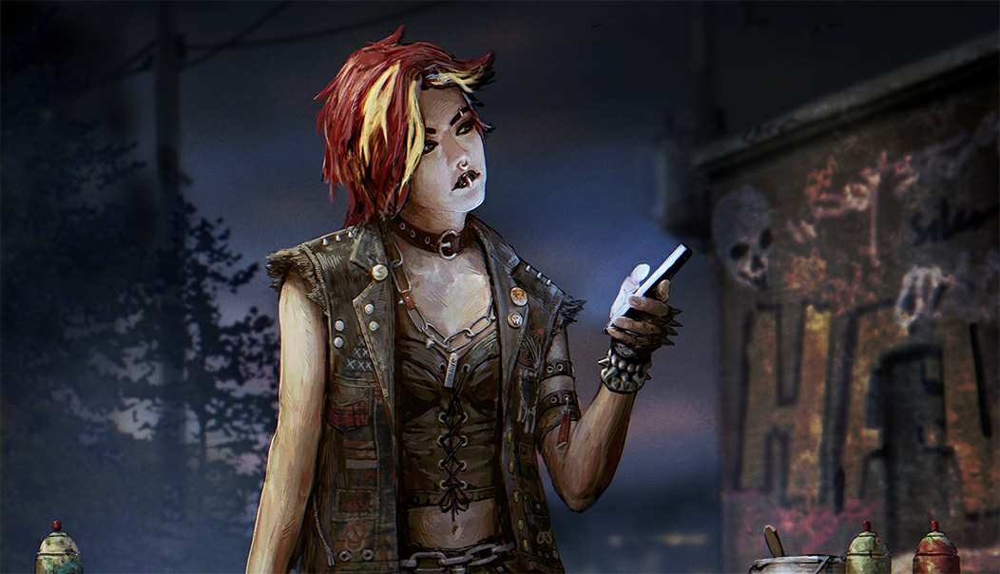

# live · 9.1.1_2671329live

| | |
|---|---|
| Build date | 2025-08-12 15:17 UTC |
| CDN version | `9.1.1_2671329live-1755011853` |
| Key | `9.1.1_live` |
| Compared with | [9.1.1_2670305live](../9.1.1_2670305live/CHANGES.md) (2025-08-08 17:39 UTC) |

## Summary

**1** added · **10** modified · **0** removed · 198 unchanged

## New or updated images

<a href="images/T_UI_SpecialPack_CounterCulture.png"></a>

## Modified files

### [`catalog.json`](catalog.json)

[Full line-by-line diff](diffs/catalog.json.diff)

```diff
+ $[id=From_The_Rift_Bundle_250812]
+ $[id=Recurring_Charm_Bundle_250812]
+ $[id=Recurring_Dev_Bundle_250812]
+ $[id=Recurring_Killer_Bundle_250812]
+ $[id=Recurring_Survivor_Bundle_250812]
- $[id=From_The_Rift_Bundle_250729].metaData.imageComposition.maxItemCount: 1
+ $[id=From_The_Rift_Bundle_250729].metaData.imageComposition.maxItemCount: 2
- $[id=From_The_Rift_Bundle_250805].metaData.imageComposition.maxItemCount: 1
+ $[id=From_The_Rift_Bundle_250805].metaData.imageComposition.maxItemCount: 2
```

### [`challengeLocs/challengeText_de.json`](challengeLocs/challengeText_de.json)

[Full line-by-line diff](diffs/challengeLocs/challengeText_de.json.diff)

```diff
- $.locText[253].text: "Mit kosmetischen Gegenständen kannst du das Aussehen von Überlebenden und Killern anpassen."
+ $.locText[253].text: "Mit kosmetischen Gegenständen kannst du das Aussehen von Überlebenden und Killern anpassen. Für den Abschluss des Tutorials bekommst du kostenlose kosmetische …
- $.locText[266].text: "Zerstöre {0} Palette(n) oder {0} Mauer(n)."
+ $.locText[266].text: "Zerstöre {0} Palette(n) oder Mauer(n)."
- $.locText[316].text: "Earn {0} Gold Gatekeeper emblem(s)"
+ $.locText[316].text: "Verdiene {0} goldene(s) Torwächter-Emblem(e)."
- $.locText[317].text: "Earn {0} Gold Lightbringer emblem(s)"
+ $.locText[317].text: "Verdiene {0} goldene(s) Lichtgestalt-Emblem(e)."
- $.locText[320].text: "Earn {0} Gold Chaser emblem(s)"
+ $.locText[320].text: "Verdiene {0} goldene(s) Verfolger-Emblem(e)."
- $.locText[321].text: "Earn {0} Gold Evader emblem(s)"
+ $.locText[321].text: "Verdiene {0} goldene(s) Flüchtling-Emblem(e)."
- $.locText[324].text: "Earn {0} Gold Devout emblem(s)"
+ $.locText[324].text: "Verdiene {0} goldene(s) Inbrünstig-Emblem(e)."
- $.locText[325].text: "Earn {0} Gold Unbroken emblem(s)"
+ $.locText[325].text: "Verdiene {0} goldene(s) Ungebrochen-Emblem(e)."
- $.locText[328].text: "Earn {0} Gold Malicious emblem(s)"
+ $.locText[328].text: "Verdiene {0} goldene(s) Boshaft-Emblem(e)."
```

### [`challengeLocs/challengeText_es-MX.json`](challengeLocs/challengeText_es-MX.json)

[Full line-by-line diff](diffs/challengeLocs/challengeText_es-MX.json.diff)

```diff
- $.locText[253].text: "Personaliza la apariencia de sobrevivientes y asesinos con objetos cosméticos."
+ $.locText[253].text: "Personaliza la apariencia de sobrevivientes y asesinos con objetos cosméticos. Completa el tutorial para recibir objetos cosméticos gratuitos."
- $.locText[266].text: "Destruye {0} tarima(s) o {0} muro(s)."
+ $.locText[266].text: "Destruye {0} tarima(s) o muro(s)"
- $.locText[316].text: "Earn {0} Gold Gatekeeper emblem(s)"
+ $.locText[316].text: "Gana {0} emblema(s) de Portero de oro"
- $.locText[317].text: "Earn {0} Gold Lightbringer emblem(s)"
+ $.locText[317].text: "Gana {0} emblema(s) de Iluminador de oro"
- $.locText[320].text: "Earn {0} Gold Chaser emblem(s)"
+ $.locText[320].text: "Gana {0} emblema(s) de Perseguidor de oro"
- $.locText[321].text: "Earn {0} Gold Evader emblem(s)"
+ $.locText[321].text: "Gana {0} emblema(s) de Evasor de oro"
- $.locText[324].text: "Earn {0} Gold Devout emblem(s)"
+ $.locText[324].text: "Gana {0} emblema(s) de Devoto de oro"
- $.locText[325].text: "Earn {0} Gold Unbroken emblem(s)"
+ $.locText[325].text: "Gana {0} emblema(s) de Supervivencia de oro"
- $.locText[328].text: "Earn {0} Gold Malicious emblem(s)"
+ $.locText[328].text: "Gana {0} emblema(s) de Malvado de oro"
```

### [`challengeLocs/challengeText_es.json`](challengeLocs/challengeText_es.json)

[Full line-by-line diff](diffs/challengeLocs/challengeText_es.json.diff)

```diff
- $.locText[253].text: "Personaliza la apariencia de supervivientes y asesinos con objetos cosméticos."
+ $.locText[253].text: "Personaliza la apariencia de supervivientes y asesinos con objetos cosméticos. Completa el tutorial para obtener objetos cosméticos gratis."
- $.locText[266].text: "Destruye {0} palé(s) o {0} muro(s)"
+ $.locText[266].text: "Destruye {0} palé(s) o muro(s)."
- $.locText[316].text: "Earn {0} Gold Gatekeeper emblem(s)"
+ $.locText[316].text: "Consigue {0} emblema(s) de Vigilante de oro."
- $.locText[317].text: "Earn {0} Gold Lightbringer emblem(s)"
+ $.locText[317].text: "Consigue {0} emblema(s) de Objetivos de oro."
- $.locText[320].text: "Earn {0} Gold Chaser emblem(s)"
+ $.locText[320].text: "Consigue {0} emblema(s) de Caza de oro."
- $.locText[321].text: "Earn {0} Gold Evader emblem(s)"
+ $.locText[321].text: "Consigue {0} emblema(s) de Audacia de oro."
- $.locText[324].text: "Earn {0} Gold Devout emblem(s)"
+ $.locText[324].text: "Consigue {0} emblema(s) de Sacrificio de oro."
- $.locText[325].text: "Earn {0} Gold Unbroken emblem(s)"
+ $.locText[325].text: "Consigue {0} emblema(s) de Supervivencia de oro."
- $.locText[328].text: "Earn {0} Gold Malicious emblem(s)"
+ $.locText[328].text: "Consigue {0} emblema(s) de Brutalidad de oro."
```

### [`challengeLocs/challengeText_it.json`](challengeLocs/challengeText_it.json)

[Full line-by-line diff](diffs/challengeLocs/challengeText_it.json.diff)

```diff
- $.locText[253].text: "Personalizza l'aspetto di sopravvissuti e killer con gli oggetti estetici."
+ $.locText[253].text: "Personalizza l'aspetto dei sopravvissuti e dei killer con gli oggetti estetici. Completa il tutorial per ottenere oggetti estetici gratuiti."
- $.locText[266].text: "Distruggi {0} bancale/i o {0} muro/i"
+ $.locText[266].text: "Distruggi {0} bancale/i o muro/i"
- $.locText[316].text: "Earn {0} Gold Gatekeeper emblem(s)"
+ $.locText[316].text: "Ottieni {0} emblema/i del Piantone d'oro"
- $.locText[317].text: "Earn {0} Gold Lightbringer emblem(s)"
+ $.locText[317].text: "Ottieni {0} emblema/i del Portatore di luce d'oro"
- $.locText[320].text: "Earn {0} Gold Chaser emblem(s)"
+ $.locText[320].text: "Ottieni {0} emblema/i dell'Inseguitore d'oro"
- $.locText[321].text: "Earn {0} Gold Evader emblem(s)"
+ $.locText[321].text: "Ottieni {0} emblema/i dell'Evasione d'oro"
- $.locText[324].text: "Earn {0} Gold Devout emblem(s)"
+ $.locText[324].text: "Ottieni {0} emblema/i della Devozione d'oro"
- $.locText[325].text: "Earn {0} Gold Unbroken emblem(s)"
+ $.locText[325].text: "Ottieni {0} emblema/i Tutt'intero d'oro"
- $.locText[328].text: "Earn {0} Gold Malicious emblem(s)"
+ $.locText[328].text: "Ottieni {0} emblema/i della Malignità d'oro"
```

### [`challengeLocs/challengeText_pt-BR.json`](challengeLocs/challengeText_pt-BR.json)

[Full line-by-line diff](diffs/challengeLocs/challengeText_pt-BR.json.diff)

```diff
- $.locText[253].text: "Personalize a aparência de Sobreviventes e Assassinos com cosméticos."
+ $.locText[253].text: "Personalize a aparência de Sobreviventes e Assassinos com cosméticos. Complete o tutorial para receber cosméticos gratuitos."
- $.locText[266].text: "Destrua {0} barricada(s) ou {0} parede(s)"
+ $.locText[266].text: "Destrua {0} barricada(s) ou parede(s)"
- $.locText[316].text: "Earn {0} Gold Gatekeeper emblem(s)"
+ $.locText[316].text: "Obtenha {0} Emblema(s) de Guardião do Portão de Ouro"
- $.locText[317].text: "Earn {0} Gold Lightbringer emblem(s)"
+ $.locText[317].text: "Obtenha {0} Emblema(s) de Iluminação de Ouro"
- $.locText[320].text: "Earn {0} Gold Chaser emblem(s)"
+ $.locText[320].text: "Obtenha {0} Emblema(s) de Caçador de Ouro"
- $.locText[321].text: "Earn {0} Gold Evader emblem(s)"
+ $.locText[321].text: "Obtenha {0} Emblema(s) de Evasão de Ouro"
- $.locText[324].text: "Earn {0} Gold Devout emblem(s)"
+ $.locText[324].text: "Obtenha {0} Emblema(s) de Devoção de Ouro"
- $.locText[325].text: "Earn {0} Gold Unbroken emblem(s)"
+ $.locText[325].text: "Obtenha {0} Emblema(s) de Invencibilidade de Ouro"
- $.locText[328].text: "Earn {0} Gold Malicious emblem(s)"
+ $.locText[328].text: "Obtenha {0} Emblema(s) de Malícia de Ouro"
```

### [`challengeLocs/challengeText_th.json`](challengeLocs/challengeText_th.json)

[Full line-by-line diff](diffs/challengeLocs/challengeText_th.json.diff)

```diff
- $.locText[253].text: "ใช้ของตกแต่งต่างๆ มาปรับแต่งรูปลักษณ์ให้ผู้รอดชีวิตและฆาตกร"
+ $.locText[253].text: "ใช้ของตกแต่งต่างๆ มาปรับแต่งรูปลักษณ์ให้ผู้รอดชีวิตและฆาตกร ทำตามสาธิตการใช้ของตกแต่งฟรีให้เสร็จสิ้น"
- $.locText[266].text: "ทำลายแท่นไม้ {0} แท่น หรือกำแพง {0} แห่ง"
+ $.locText[266].text: "ทำลายแท่นไม้หรือกำแพง {0} แห่ง"
- $.locText[316].text: "Earn {0} Gold Gatekeeper emblem(s)"
+ $.locText[316].text: "ได้รับตราทวารบาลทอง {0} ชิ้น"
- $.locText[317].text: "Earn {0} Gold Lightbringer emblem(s)"
+ $.locText[317].text: "ได้รับตราผู้ส่องสว่างทอง {0} ชิ้น"
- $.locText[320].text: "Earn {0} Gold Chaser emblem(s)"
+ $.locText[320].text: "ได้รับตราไล่ล่าทอง {0} ชิ้น"
- $.locText[321].text: "Earn {0} Gold Evader emblem(s)"
+ $.locText[321].text: "ได้รับตราจอมหลบหลีกทอง {0} ชิ้น"
- $.locText[324].text: "Earn {0} Gold Devout emblem(s)"
+ $.locText[324].text: "ได้รับตราศรัทธาแรงกล้าทอง {0} ชิ้น"
- $.locText[325].text: "Earn {0} Gold Unbroken emblem(s)"
+ $.locText[325].text: "ได้รับตราไม่แตกหักทอง {0} ชิ้น"
- $.locText[328].text: "Earn {0} Gold Malicious emblem(s)"
+ $.locText[328].text: "ได้รับตรามุ่งร้ายทอง {0} ชิ้น"
```

### [`collections.json`](collections.json)

[Full line-by-line diff](diffs/collections.json.diff)

```diff
+ $.collections[21].additionalImages[0]
```

### [`dynamicContent/DynamicContent.json`](dynamicContent/DynamicContent.json)

[Full line-by-line diff](diffs/dynamicContent/DynamicContent.json.diff)

```diff
- $.entries[6].contentVersion: "8da28150553ebc8d213755cf98e4e7bfad9e98a7"
+ $.entries[6].contentVersion: "7466fd951478ff785d54b7526652e7ac98d18d89"
- $.entries[6].downloadStrategy: "preferRemote"
+ $.entries[6].downloadStrategy: "preferPackaged"
- $.entries[6].enableChecksum: true
+ $.entries[6].enableChecksum: false
- $.entries[6].packagedPath: ""
+ $.entries[6].packagedPath: "/Game/UI/UMGAssets/Icons/Banners/BundleBanners/SpecialPack/Lasagna/T_UI_SpecialPack_CounterCulture.T_UI_SpecialPack_CounterCulture"
- $.entries[6].schema: "s3ver://"
+ $.entries[6].schema: "s3verbin://"
- $.entries[6].uri: "catalog.json"
+ $.entries[6].uri: "images/T_UI_SpecialPack_CounterCulture.png"
- $.entries[7].contentVersion: "8d059bb266a7448c61659872975431e8fe951855"
+ $.entries[7].contentVersion: "0b488af2909713b202a7c2488583174a6a3da8d2"
- $.entries[7].uri: "bonusPointEventsContent.json"
+ $.entries[7].uri: "catalog.json"
- $.entries[8].contentVersion: "acf05d4fce78e0ee4837e3a30de2b59caaebdaac"
+ $.entries[8].contentVersion: "8d059bb266a7448c61659872975431e8fe951855"
- $.entries[8].uri: "freetoplay/NA/event.json"
+ $.entries[8].uri: "bonusPointEventsContent.json"
- $.entries[9].uri: "freetoplay/EU/event.json"
+ $.entries[9].uri: "freetoplay/NA/event.json"
- $.entries[10].contentVersion: "1e32575be5a8355126944c495c47fc0db54de567"
+ $.entries[10].contentVersion: "acf05d4fce78e0ee4837e3a30de2b59caaebdaac"
- $.entries[10].uri: "archiveQuests/Anniversary2022.json"
+ $.entries[10].uri: "freetoplay/EU/event.json"
- $.entries[11].contentVersion: "7917a5d1f3b30afffef95873ea8fcffe99660c51"
+ $.entries[11].contentVersion: "1e32575be5a8355126944c495c47fc0db54de567"
- $.entries[11].uri: "archiveQuests/Anniversary2023.json"
+ $.entries[11].uri: "archiveQuests/Anniversary2022.json"
- $.entries[12].contentVersion: "a71f19880b168e93453262306147002e52b57219"
+ $.entries[12].contentVersion: "7917a5d1f3b30afffef95873ea8fcffe99660c51"
- $.entries[12].uri: "archiveQuests/Anniversary2024.json"
+ $.entries[12].uri: "archiveQuests/Anniversary2023.json"
- $.entries[13].contentVersion: "cbf0c66dc699583cca9401b8d57fed5409ca30a1"
+ $.entries[13].contentVersion: "a71f19880b168e93453262306147002e52b57219"
- $.entries[13].uri: "archiveQuests/CalamariV1.json"
+ $.entries[13].uri: "archiveQuests/Anniversary2024.json"
- $.entries[14].contentVersion: "39993a62e4b32782fcc300d69d0605d3d0b48da0"
+ $.entries[14].contentVersion: "cbf0c66dc699583cca9401b8d57fed5409ca30a1"
- $.entries[14].uri: "archiveQuests/CalamariV2.json"
+ $.entries[14].uri: "archiveQuests/CalamariV1.json"
- $.entries[15].contentVersion: "7e4204cf429cc50328f384df1a8f8bb9905c9f18"
+ $.entries[15].contentVersion: "39993a62e4b32782fcc300d69d0605d3d0b48da0"
- $.entries[15].uri: "archiveQuests/CalamariV3.json"
+ $.entries[15].uri: "archiveQuests/CalamariV2.json"
- $.entries[16].contentVersion: "476168959cd642053ba37424236be342ea559001"
+ $.entries[16].contentVersion: "7e4204cf429cc50328f384df1a8f8bb9905c9f18"
- $.entries[16].uri: "archiveQuests/ChocolateBoxGelato.json"
+ $.entries[16].uri: "archiveQuests/CalamariV3.json"
- $.entries[17].contentVersion: "fc63681b77f0c0142e013069f9af97f804c79681"
+ $.entries[17].contentVersion: "476168959cd642053ba37424236be342ea559001"
- $.entries[17].uri: "archiveQuests/ChocolateBoxV1.json"
+ $.entries[17].uri: "archiveQuests/ChocolateBoxGelato.json"
- $.entries[18].contentVersion: "a908b0e4a5892d288edc9d1d18eebcc5382706e5"
+ $.entries[18].contentVersion: "fc63681b77f0c0142e013069f9af97f804c79681"
- $.entries[18].uri: "archiveQuests/DreadByDaylightZodiac.json"
+ $.entries[18].uri: "archiveQuests/ChocolateBoxV1.json"
- $.entries[19].contentVersion: "76554aff2d9d4cca0900a65a4a0c34f743414125"
+ $.entries[19].contentVersion: "a908b0e4a5892d288edc9d1d18eebcc5382706e5"
- $.entries[19].uri: "archiveQuests/FireflyV1.json"
+ $.entries[19].uri: "archiveQuests/DreadByDaylightZodiac.json"
- $.entries[20].contentVersion: "18ef1911903fde114cf87d6240869ca8eaabf4ca"
+ $.entries[20].contentVersion: "76554aff2d9d4cca0900a65a4a0c34f743414125"
- $.entries[20].uri: "archiveQuests/Halloween2021.json"
+ $.entries[20].uri: "archiveQuests/FireflyV1.json"
- $.entries[21].contentVersion: "7bb42cd60bcd282ede87c27f1cf133b3c53b4541"
+ $.entries[21].contentVersion: "18ef1911903fde114cf87d6240869ca8eaabf4ca"
- $.entries[21].uri: "archiveQuests/Halloween2022.json"
+ $.entries[21].uri: "archiveQuests/Halloween2021.json"
- $.entries[22].contentVersion: "5b5310bd5aa8a61915f80690fe79852dd28cdc00"
+ $.entries[22].contentVersion: "7bb42cd60bcd282ede87c27f1cf133b3c53b4541"
- $.entries[22].uri: "archiveQuests/Halloween2023.json"
+ $.entries[22].uri: "archiveQuests/Halloween2022.json"
- $.entries[23].contentVersion: "4e1d880202f9e42e9f558609ac47b1d50ce09799"
+ $.entries[23].contentVersion: "5b5310bd5aa8a61915f80690fe79852dd28cdc00"
- $.entries[23].uri: "archiveQuests/Halloween2024.json"
+ $.entries[23].uri: "archiveQuests/Halloween2023.json"
- $.entries[24].contentVersion: "7d7e35788138d233b95ede9142eb63b959a84fea"
+ $.entries[24].contentVersion: "4e1d880202f9e42e9f558609ac47b1d50ce09799"
- $.entries[24].uri: "archiveQuests/Spring2024.json"
+ $.entries[24].uri: "archiveQuests/Halloween2024.json"
- $.entries[25].contentVersion: "a5af258a8bd427da792c65e39951caeb0c8259f0"
+ $.entries[25].contentVersion: "7d7e35788138d233b95ede9142eb63b959a84fea"
- $.entries[25].uri: "archiveQuests/Spring2025.json"
+ $.entries[25].uri: "archiveQuests/Spring2024.json"
- $.entries[26].contentVersion: "0fdffba16977e5926682aa7c6070ca92a602c710"
+ $.entries[26].contentVersion: "a5af258a8bd427da792c65e39951caeb0c8259f0"
- $.entries[26].uri: "archiveQuests/Summer2023.json"
+ $.entries[26].uri: "archiveQuests/Spring2025.json"
- $.entries[27].contentVersion: "a1fe1dfd63ce578dd2fe4b9ee7c6ad8bc32c930f"
+ $.entries[27].contentVersion: "0fdffba16977e5926682aa7c6070ca92a602c710"
- $.entries[27].uri: "archiveQuests/Tome01.json"
+ $.entries[27].uri: "archiveQuests/Summer2023.json"
- $.entries[28].contentVersion: "28cbd58af804545441392bf038796ea7aca136c6"
+ $.entries[28].contentVersion: "a1fe1dfd63ce578dd2fe4b9ee7c6ad8bc32c930f"
- $.entries[28].uri: "archiveQuests/Tome02.json"
+ $.entries[28].uri: "archiveQuests/Tome01.json"
- $.entries[29].contentVersion: "9627312227e31702916d26b789784007eb59ba8f"
+ $.entries[29].contentVersion: "28cbd58af804545441392bf038796ea7aca136c6"
- $.entries[29].uri: "archiveQuests/Tome03.json"
+ $.entries[29].uri: "archiveQuests/Tome02.json"
- $.entries[30].contentVersion: "ebf59aeb1b018b3d3f892e6744fe3af9a5337667"
+ $.entries[30].contentVersion: "9627312227e31702916d26b789784007eb59ba8f"
- $.entries[30].uri: "archiveQuests/Tome04.json"
+ $.entries[30].uri: "archiveQuests/Tome03.json"
- $.entries[31].contentVersion: "01d6054eb8fe6bcf1a9cb1337902fb3048fda203"
+ $.entries[31].contentVersion: "ebf59aeb1b018b3d3f892e6744fe3af9a5337667"
- $.entries[31].uri: "archiveQuests/Tome05.json"
+ $.entries[31].uri: "archiveQuests/Tome04.json"
- $.entries[32].contentVersion: "2dbdc1ed4ec56c70ecd8123db699c2ac909032bb"
+ $.entries[32].contentVersion: "01d6054eb8fe6bcf1a9cb1337902fb3048fda203"
- $.entries[32].uri: "archiveQuests/Tome06.json"
+ $.entries[32].uri: "archiveQuests/Tome05.json"
- $.entries[33].contentVersion: "d39f9e16279372696d7af05544ab9472956499ad"
+ $.entries[33].contentVersion: "2dbdc1ed4ec56c70ecd8123db699c2ac909032bb"
- $.entries[33].uri: "archiveQuests/Tome07.json"
+ $.entries[33].uri: "archiveQuests/Tome06.json"
- $.entries[34].contentVersion: "5c836b70d58a827880c5dfbe61018549a133624d"
+ $.entries[34].contentVersion: "d39f9e16279372696d7af05544ab9472956499ad"
- $.entries[34].uri: "archiveQuests/Tome08.json"
+ $.entries[34].uri: "archiveQuests/Tome07.json"
- $.entries[35].contentVersion: "9c2f16589befa0859800af26316a792020a3f8d7"
+ $.entries[35].contentVersion: "5c836b70d58a827880c5dfbe61018549a133624d"
- $.entries[35].uri: "archiveQuests/Tome09.json"
+ $.entries[35].uri: "archiveQuests/Tome08.json"
- $.entries[36].contentVersion: "f1ab7fc55b02df7604e8e14f05da032c7f5dd525"
+ $.entries[36].contentVersion: "9c2f16589befa0859800af26316a792020a3f8d7"
- $.entries[36].uri: "archiveQuests/Tome10.json"
+ $.entries[36].uri: "archiveQuests/Tome09.json"
- $.entries[37].contentVersion: "d7698a739eb36d86e2bcaa3528b8f02ff6b85865"
+ $.entries[37].contentVersion: "f1ab7fc55b02df7604e8e14f05da032c7f5dd525"
- $.entries[37].uri: "archiveQuests/Tome11.json"
+ $.entries[37].uri: "archiveQuests/Tome10.json"
- $.entries[38].contentVersion: "5635e890685d02a99c95b41e4c78b617417b05a7"
+ $.entries[38].contentVersion: "d7698a739eb36d86e2bcaa3528b8f02ff6b85865"
- $.entries[38].uri: "archiveQuests/Tome12.json"
+ $.entries[38].uri: "archiveQuests/Tome11.json"
- $.entries[39].contentVersion: "5cce940d609bdaa9b124ac3779794c22688e8969"
+ $.entries[39].contentVersion: "5635e890685d02a99c95b41e4c78b617417b05a7"
- $.entries[39].uri: "archiveQuests/Tome13.json"
+ $.entries[39].uri: "archiveQuests/Tome12.json"
- $.entries[40].contentVersion: "0262fdae3d55ccee12e757848e24b5f8ec38da8c"
+ $.entries[40].contentVersion: "5cce940d609bdaa9b124ac3779794c22688e8969"
- $.entries[40].uri: "archiveQuests/Tome14.json"
+ $.entries[40].uri: "archiveQuests/Tome13.json"
- $.entries[41].contentVersion: "ecc74b391b9f142cf14612d768307d20a5ff0434"
+ $.entries[41].contentVersion: "0262fdae3d55ccee12e757848e24b5f8ec38da8c"
- $.entries[41].uri: "archiveQuests/Tome15.json"
+ $.entries[41].uri: "archiveQuests/Tome14.json"
- $.entries[42].contentVersion: "b1932a2fe1b66ce752881d917301c6e295ae493c"
+ $.entries[42].contentVersion: "ecc74b391b9f142cf14612d768307d20a5ff0434"
- $.entries[42].uri: "archiveQuests/Tome16.json"
+ $.entries[42].uri: "archiveQuests/Tome15.json"
- $.entries[43].contentVersion: "bfc72ffedf8be04c07075e1c4fbe3ac79a70c25f"
+ $.entries[43].contentVersion: "b1932a2fe1b66ce752881d917301c6e295ae493c"
- $.entries[43].uri: "archiveQuests/Tome17.json"
+ $.entries[43].uri: "archiveQuests/Tome16.json"
- $.entries[44].contentVersion: "c09ee25e7bd2e4d1a09ce57a6053afd210597dad"
+ $.entries[44].contentVersion: "bfc72ffedf8be04c07075e1c4fbe3ac79a70c25f"
- $.entries[44].uri: "archiveQuests/Tome18.json"
+ $.entries[44].uri: "archiveQuests/Tome17.json"
- $.entries[45].contentVersion: "4c9af6e0dcd9d0a08331b9e4201869f72d77a497"
+ $.entries[45].contentVersion: "c09ee25e7bd2e4d1a09ce57a6053afd210597dad"
- $.entries[45].uri: "archiveQuests/Tome19.json"
+ $.entries[45].uri: "archiveQuests/Tome18.json"
- $.entries[46].contentVersion: "6bf6c00ae1efb0b2ba29433d171aefc3892aaa0a"
+ $.entries[46].contentVersion: "4c9af6e0dcd9d0a08331b9e4201869f72d77a497"
- $.entries[46].uri: "archiveQuests/Tome20.json"
+ $.entries[46].uri: "archiveQuests/Tome19.json"
- $.entries[47].contentVersion: "2a4ba4445f174a7b450c65654f20bbfc53571053"
+ $.entries[47].contentVersion: "6bf6c00ae1efb0b2ba29433d171aefc3892aaa0a"
- $.entries[47].uri: "archiveQuests/Tome21.json"
+ $.entries[47].uri: "archiveQuests/Tome20.json"
- $.entries[48].contentVersion: "8fff5710d200b67f3e99ca84ae30c95c47072941"
+ $.entries[48].contentVersion: "2a4ba4445f174a7b450c65654f20bbfc53571053"
- $.entries[48].uri: "archiveQuests/Tome22.json"
+ $.entries[48].uri: "archiveQuests/Tome21.json"
- $.entries[49].contentVersion: "720382de2a8a006d9c5f8941e31ec76a99f7545c"
+ $.entries[49].contentVersion: "8fff5710d200b67f3e99ca84ae30c95c47072941"
- $.entries[49].uri: "archiveQuests/Winter2022.json"
+ $.entries[49].uri: "archiveQuests/Tome22.json"
- $.entries[50].contentVersion: "9e73d5270a8e03265460bcb43bf95a8916b10101"
+ $.entries[50].contentVersion: "720382de2a8a006d9c5f8941e31ec76a99f7545c"
- $.entries[50].uri: "archiveQuests/Winter2023.json"
+ $.entries[50].uri: "archiveQuests/Winter2022.json"
- $.entries[51].contentVersion: "b9fa8630f09e0675e7cd50e00ed630e2c2e99805"
+ $.entries[51].contentVersion: "9e73d5270a8e03265460bcb43bf95a8916b10101"
- $.entries[51].uri: "archiveQuests/Winter2024.json"
+ $.entries[51].uri: "archiveQuests/Winter2023.json"
- $.entries[52].contentVersion: "d950a441d8ba8a38ae4fa02ee35bf36f2f9087cb"
+ $.entries[52].contentVersion: "b9fa8630f09e0675e7cd50e00ed630e2c2e99805"
- $.entries[52].uri: "archiveRewardGrid/Tome01.json"
+ $.entries[52].uri: "archiveQuests/Winter2024.json"
- $.entries[53].contentVersion: "6ec350068816b7f19ce01e52ddd79510ca3f6a59"
+ $.entries[53].contentVersion: "d950a441d8ba8a38ae4fa02ee35bf36f2f9087cb"
- $.entries[53].uri: "archiveRewardGrid/Tome02.json"
+ $.entries[53].uri: "archiveRewardGrid/Tome01.json"
- $.entries[54].contentVersion: "0d94539146de3d393d2e944deb302f83523b0f73"
+ $.entries[54].contentVersion: "6ec350068816b7f19ce01e52ddd79510ca3f6a59"
… 625 more change(s) — see the commit diff for everything
```

### [`recommendations.json`](recommendations.json)

[Full line-by-line diff](diffs/recommendations.json.diff)

```diff
+ $.featuredCard[id=Lasagna_W3]
+ $.featuredCustomizationRecommendations[id=LasagnaW3]
```

