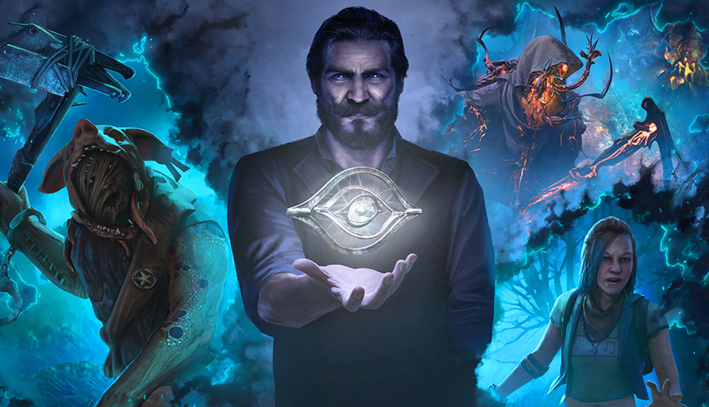
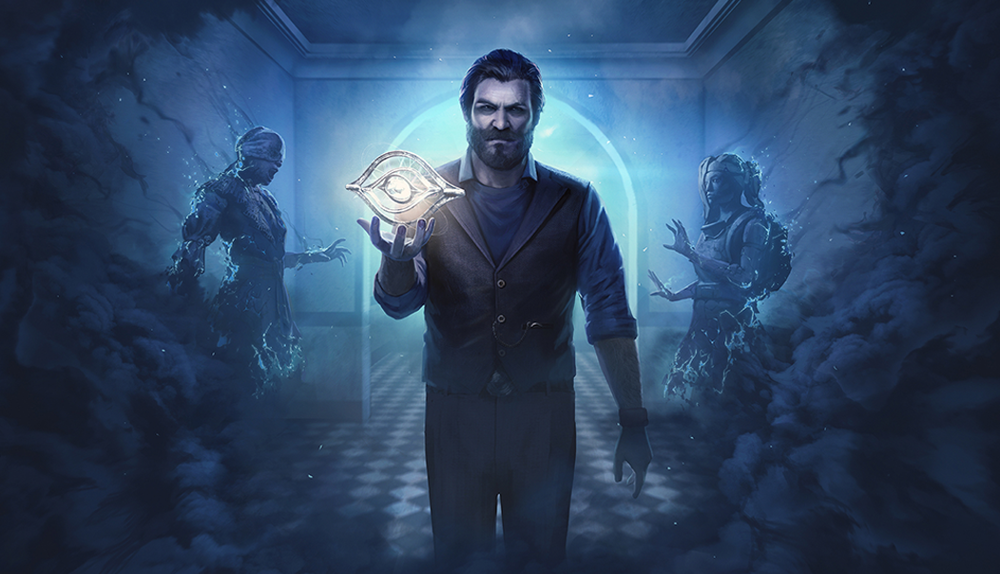

# live · 9.1.3_2706679live

| | |
|---|---|
| Build date | 2025-08-26 14:59 UTC |
| CDN version | `9.1.3_2706679live-1756220399` |
| Key | `9.1.3_live` |
| Compared with | [9.1.3_2706130live](../9.1.3_2706130live/CHANGES.md) (2025-08-26 14:55 UTC) |

## Summary

**2** added · **2** modified · **0** removed · 202 unchanged

## New or updated images

<a href="images/T_UI_SpecialPack_Tome5.png"></a>
<a href="images/T_UI_SpecialPack_Tome6.png"></a>

## Modified files

### [`catalog.json`](catalog.json)

[Full line-by-line diff](diffs/catalog.json.diff)

```diff
- $[id=Tome_5_Bundle].metaData.imagePath: "/Game/UI/UMGAssets/Icons/Banners/BundleBanners/SpecialPack/T_UI_SpecialPack_Tome3.T_UI_SpecialPack_Tome3"
+ $[id=Tome_5_Bundle].metaData.imagePath: "/Game/UI/UMGAssets/Icons/Banners/BundleBanners/SpecialPack/Lasagna/T_UI_SpecialPack_Tome5.T_UI_SpecialPack_Tome5"
- $[id=Tome_6_Bundle].metaData.imagePath: "/Game/UI/UMGAssets/Icons/Banners/BundleBanners/SpecialPack/T_UI_SpecialPack_Tome3.T_UI_SpecialPack_Tome3"
+ $[id=Tome_6_Bundle].metaData.imagePath: "/Game/UI/UMGAssets/Icons/Banners/BundleBanners/SpecialPack/Lasagna/T_UI_SpecialPack_Tome6.T_UI_SpecialPack_Tome6"
```

### [`dynamicContent/DynamicContent.json`](dynamicContent/DynamicContent.json)

[Full line-by-line diff](diffs/dynamicContent/DynamicContent.json.diff)

```diff
- $.entries[0].contentVersion: "ff437cc262850ea6df4a8ca3c5b64964964f7747"
+ $.entries[0].contentVersion: "88643dee1e6c57bd767605036473e939094fccf9"
- $.entries[0].packagedPath: "/Game/UI/UMGAssets/Icons/Banners/CollectionBanners/Lasagna/T_UI_CollectionBanner_PartyHard.T_UI_CollectionBanner_PartyHard"
+ $.entries[0].packagedPath: "/Game/UI/UMGAssets/Icons/Banners/BundleBanners/SpecialPack/Lasagna/T_UI_SpecialPack_Tome5.T_UI_SpecialPack_Tome5"
- $.entries[0].uri: "images/T_UI_CollectionBanner_PartyHard.png"
+ $.entries[0].uri: "images/T_UI_SpecialPack_Tome5.png"
- $.entries[1].contentVersion: "d16173b36a12e4a4ed82a5fc7650cf5d8a9f8bbf"
+ $.entries[1].contentVersion: "8a15d416ef70b4c552d109bc091b52cbda5ad932"
- $.entries[1].packagedPath: "/Game/UI/UMGAssets/Icons/Banners/BundleBanners/SpecialPack/Lasagna/T_UI_SpecialPack_PartyHard.T_UI_SpecialPack_PartyHard"
+ $.entries[1].packagedPath: "/Game/UI/UMGAssets/Icons/Banners/BundleBanners/SpecialPack/Lasagna/T_UI_SpecialPack_Tome6.T_UI_SpecialPack_Tome6"
- $.entries[1].uri: "images/T_UI_SpecialPack_PartyHard.png"
+ $.entries[1].uri: "images/T_UI_SpecialPack_Tome6.png"
- $.entries[2].contentVersion: "8cab51734499d39b303a357359b9a0ecbe8bf387"
+ $.entries[2].contentVersion: "ff437cc262850ea6df4a8ca3c5b64964964f7747"
- $.entries[2].enableChecksum: true
+ $.entries[2].enableChecksum: false
- $.entries[2].packagedPath: ""
+ $.entries[2].packagedPath: "/Game/UI/UMGAssets/Icons/Banners/CollectionBanners/Lasagna/T_UI_CollectionBanner_PartyHard.T_UI_CollectionBanner_PartyHard"
- $.entries[2].schema: "s3ver://"
+ $.entries[2].schema: "s3verbin://"
- $.entries[2].uri: "catalog.json"
+ $.entries[2].uri: "images/T_UI_CollectionBanner_PartyHard.png"
- $.entries[3].contentVersion: "b4a6ffed58e6fcffb914939f09b9afa9f3da5268"
+ $.entries[3].contentVersion: "d16173b36a12e4a4ed82a5fc7650cf5d8a9f8bbf"
- $.entries[3].enableChecksum: true
+ $.entries[3].enableChecksum: false
- $.entries[3].packagedPath: ""
+ $.entries[3].packagedPath: "/Game/UI/UMGAssets/Icons/Banners/BundleBanners/SpecialPack/Lasagna/T_UI_SpecialPack_PartyHard.T_UI_SpecialPack_PartyHard"
- $.entries[3].schema: "s3ver://"
+ $.entries[3].schema: "s3verbin://"
- $.entries[3].uri: "bonusPointEventsContent.json"
+ $.entries[3].uri: "images/T_UI_SpecialPack_PartyHard.png"
- $.entries[4].contentVersion: "807c86683510773f5b5540e21c207183cdd154a5"
+ $.entries[4].contentVersion: "8a65798a9ba91bb3b7191a7397d49bd7cb3b8990"
- $.entries[4].uri: "freetoplay/NA/event.json"
+ $.entries[4].uri: "catalog.json"
- $.entries[5].contentVersion: "807c86683510773f5b5540e21c207183cdd154a5"
+ $.entries[5].contentVersion: "b4a6ffed58e6fcffb914939f09b9afa9f3da5268"
- $.entries[5].uri: "freetoplay/EU/event.json"
+ $.entries[5].uri: "bonusPointEventsContent.json"
- $.entries[6].contentVersion: "8d5e48c3617ded37f978bed6f936b24ce4a4d84a"
+ $.entries[6].contentVersion: "807c86683510773f5b5540e21c207183cdd154a5"
- $.entries[6].uri: "archiveQuests/Anniversary2022.json"
+ $.entries[6].uri: "freetoplay/NA/event.json"
- $.entries[7].contentVersion: "8ad9763626b20a285f86032454b700c0757ede9f"
+ $.entries[7].contentVersion: "807c86683510773f5b5540e21c207183cdd154a5"
- $.entries[7].uri: "archiveQuests/Anniversary2023.json"
+ $.entries[7].uri: "freetoplay/EU/event.json"
- $.entries[8].contentVersion: "63b33bf43464cbc6c7cb6624ab4b2268f8b6bb82"
+ $.entries[8].contentVersion: "8d5e48c3617ded37f978bed6f936b24ce4a4d84a"
- $.entries[8].uri: "archiveQuests/Anniversary2024.json"
+ $.entries[8].uri: "archiveQuests/Anniversary2022.json"
- $.entries[9].contentVersion: "f9c0c52ef3658340ea8c9b59454494ec8426dca0"
+ $.entries[9].contentVersion: "8ad9763626b20a285f86032454b700c0757ede9f"
- $.entries[9].uri: "archiveQuests/CalamariV1.json"
+ $.entries[9].uri: "archiveQuests/Anniversary2023.json"
- $.entries[10].contentVersion: "a152f47cfedf53798388a9bcc47e2ff4926aeccd"
+ $.entries[10].contentVersion: "63b33bf43464cbc6c7cb6624ab4b2268f8b6bb82"
- $.entries[10].uri: "archiveQuests/CalamariV2.json"
+ $.entries[10].uri: "archiveQuests/Anniversary2024.json"
- $.entries[11].contentVersion: "20fc0a0a83e637d49dcf28e321dd0a225c5c420a"
+ $.entries[11].contentVersion: "f9c0c52ef3658340ea8c9b59454494ec8426dca0"
- $.entries[11].uri: "archiveQuests/CalamariV3.json"
+ $.entries[11].uri: "archiveQuests/CalamariV1.json"
- $.entries[12].contentVersion: "5a11bacc946ed364ed23d44fc56ead0b8dda574a"
+ $.entries[12].contentVersion: "a152f47cfedf53798388a9bcc47e2ff4926aeccd"
- $.entries[12].uri: "archiveQuests/ChocolateBoxGelato.json"
+ $.entries[12].uri: "archiveQuests/CalamariV2.json"
- $.entries[13].contentVersion: "5b942b365217c66d205063b3803afb3a93b86d96"
+ $.entries[13].contentVersion: "20fc0a0a83e637d49dcf28e321dd0a225c5c420a"
- $.entries[13].uri: "archiveQuests/ChocolateBoxV1.json"
+ $.entries[13].uri: "archiveQuests/CalamariV3.json"
- $.entries[14].contentVersion: "fd773cf9c178d9e06982f15d465eef51c3df166b"
+ $.entries[14].contentVersion: "5a11bacc946ed364ed23d44fc56ead0b8dda574a"
- $.entries[14].uri: "archiveQuests/DreadByDaylightZodiac.json"
+ $.entries[14].uri: "archiveQuests/ChocolateBoxGelato.json"
- $.entries[15].contentVersion: "d5bc15a7f80e1149a630aca336bd2a7f09462585"
+ $.entries[15].contentVersion: "5b942b365217c66d205063b3803afb3a93b86d96"
- $.entries[15].uri: "archiveQuests/FireflyV1.json"
+ $.entries[15].uri: "archiveQuests/ChocolateBoxV1.json"
- $.entries[16].contentVersion: "f8d7b5c9cac6e56a352f6cc60bd89448fe6bdfc3"
+ $.entries[16].contentVersion: "fd773cf9c178d9e06982f15d465eef51c3df166b"
- $.entries[16].uri: "archiveQuests/Halloween2021.json"
+ $.entries[16].uri: "archiveQuests/DreadByDaylightZodiac.json"
- $.entries[17].contentVersion: "ee3ea9d3f96ceadf9cbaac4cf785bb7b99014628"
+ $.entries[17].contentVersion: "d5bc15a7f80e1149a630aca336bd2a7f09462585"
- $.entries[17].uri: "archiveQuests/Halloween2022.json"
+ $.entries[17].uri: "archiveQuests/FireflyV1.json"
- $.entries[18].contentVersion: "9ce8211c3232135813a037398de1a77d92add255"
+ $.entries[18].contentVersion: "f8d7b5c9cac6e56a352f6cc60bd89448fe6bdfc3"
- $.entries[18].uri: "archiveQuests/Halloween2023.json"
+ $.entries[18].uri: "archiveQuests/Halloween2021.json"
- $.entries[19].contentVersion: "d90f6ecee5119a351d84a54ce937cf44292c8596"
+ $.entries[19].contentVersion: "ee3ea9d3f96ceadf9cbaac4cf785bb7b99014628"
- $.entries[19].uri: "archiveQuests/Halloween2024.json"
+ $.entries[19].uri: "archiveQuests/Halloween2022.json"
- $.entries[20].contentVersion: "80be5626a97d561f41f1b5b432d35c5ddb3cf83f"
+ $.entries[20].contentVersion: "9ce8211c3232135813a037398de1a77d92add255"
- $.entries[20].uri: "archiveQuests/Spring2024.json"
+ $.entries[20].uri: "archiveQuests/Halloween2023.json"
- $.entries[21].contentVersion: "8f05011ab417539f5df9235833669d43f0bb539f"
+ $.entries[21].contentVersion: "d90f6ecee5119a351d84a54ce937cf44292c8596"
- $.entries[21].uri: "archiveQuests/Spring2025.json"
+ $.entries[21].uri: "archiveQuests/Halloween2024.json"
- $.entries[22].contentVersion: "87cb4dfd91c3e8659efcd8f1b7a2dbb1f837cb85"
+ $.entries[22].contentVersion: "80be5626a97d561f41f1b5b432d35c5ddb3cf83f"
- $.entries[22].uri: "archiveQuests/Summer2023.json"
+ $.entries[22].uri: "archiveQuests/Spring2024.json"
- $.entries[23].contentVersion: "b170191ae584f28f7aee8df2af8558ff4ab4b9bc"
+ $.entries[23].contentVersion: "8f05011ab417539f5df9235833669d43f0bb539f"
- $.entries[23].uri: "archiveQuests/Tome01.json"
+ $.entries[23].uri: "archiveQuests/Spring2025.json"
- $.entries[24].contentVersion: "37866ee77f5b0bf64388fc55c9666c453c7bf47f"
+ $.entries[24].contentVersion: "87cb4dfd91c3e8659efcd8f1b7a2dbb1f837cb85"
- $.entries[24].uri: "archiveQuests/Tome02.json"
+ $.entries[24].uri: "archiveQuests/Summer2023.json"
- $.entries[25].contentVersion: "990f486cff81f96429df95aa98e9101b69bd8534"
+ $.entries[25].contentVersion: "b170191ae584f28f7aee8df2af8558ff4ab4b9bc"
- $.entries[25].uri: "archiveQuests/Tome03.json"
+ $.entries[25].uri: "archiveQuests/Tome01.json"
- $.entries[26].contentVersion: "86641472abbd427901d9c4c3416377ce84a2fc8f"
+ $.entries[26].contentVersion: "37866ee77f5b0bf64388fc55c9666c453c7bf47f"
- $.entries[26].uri: "archiveQuests/Tome04.json"
+ $.entries[26].uri: "archiveQuests/Tome02.json"
- $.entries[27].contentVersion: "62efe0dfc80e8a7457985bede64dbf3a87b8c2d3"
+ $.entries[27].contentVersion: "990f486cff81f96429df95aa98e9101b69bd8534"
- $.entries[27].uri: "archiveQuests/Tome05.json"
+ $.entries[27].uri: "archiveQuests/Tome03.json"
- $.entries[28].contentVersion: "44d4e86e48bd8b50a1ce1b581e7ad2a3101a077d"
+ $.entries[28].contentVersion: "86641472abbd427901d9c4c3416377ce84a2fc8f"
- $.entries[28].uri: "archiveQuests/Tome06.json"
+ $.entries[28].uri: "archiveQuests/Tome04.json"
- $.entries[29].contentVersion: "2f5851703b3b110d5827d28022bca97ba17afbb8"
+ $.entries[29].contentVersion: "62efe0dfc80e8a7457985bede64dbf3a87b8c2d3"
- $.entries[29].uri: "archiveQuests/Tome07.json"
+ $.entries[29].uri: "archiveQuests/Tome05.json"
- $.entries[30].contentVersion: "385ecc465d26342ea882b87d25c217f9175bac00"
+ $.entries[30].contentVersion: "44d4e86e48bd8b50a1ce1b581e7ad2a3101a077d"
- $.entries[30].uri: "archiveQuests/Tome08.json"
+ $.entries[30].uri: "archiveQuests/Tome06.json"
- $.entries[31].contentVersion: "3e56ab1b03848b78920a256dd1bb3ec2621c536a"
+ $.entries[31].contentVersion: "2f5851703b3b110d5827d28022bca97ba17afbb8"
- $.entries[31].uri: "archiveQuests/Tome09.json"
+ $.entries[31].uri: "archiveQuests/Tome07.json"
- $.entries[32].contentVersion: "c783e3fc8623550e5f4f3abd53f48e69faf144a9"
+ $.entries[32].contentVersion: "385ecc465d26342ea882b87d25c217f9175bac00"
- $.entries[32].uri: "archiveQuests/Tome10.json"
+ $.entries[32].uri: "archiveQuests/Tome08.json"
- $.entries[33].contentVersion: "e2c504216edd4432c4436dae7d3d8f47006e6190"
+ $.entries[33].contentVersion: "3e56ab1b03848b78920a256dd1bb3ec2621c536a"
- $.entries[33].uri: "archiveQuests/Tome11.json"
+ $.entries[33].uri: "archiveQuests/Tome09.json"
- $.entries[34].contentVersion: "9c4b0fce255a2c18d8ad33a4398113288cbcc0fa"
+ $.entries[34].contentVersion: "c783e3fc8623550e5f4f3abd53f48e69faf144a9"
- $.entries[34].uri: "archiveQuests/Tome12.json"
+ $.entries[34].uri: "archiveQuests/Tome10.json"
- $.entries[35].contentVersion: "aff6cbcb6f4a7e5019071d87a51e4a25d918260c"
+ $.entries[35].contentVersion: "e2c504216edd4432c4436dae7d3d8f47006e6190"
- $.entries[35].uri: "archiveQuests/Tome13.json"
+ $.entries[35].uri: "archiveQuests/Tome11.json"
- $.entries[36].contentVersion: "1417a3cba00b424c820efa3fd661af70539e1221"
+ $.entries[36].contentVersion: "9c4b0fce255a2c18d8ad33a4398113288cbcc0fa"
- $.entries[36].uri: "archiveQuests/Tome14.json"
+ $.entries[36].uri: "archiveQuests/Tome12.json"
- $.entries[37].contentVersion: "c6b3a810b8779cdb5d96a4877bc9c16353d9d148"
+ $.entries[37].contentVersion: "aff6cbcb6f4a7e5019071d87a51e4a25d918260c"
- $.entries[37].uri: "archiveQuests/Tome15.json"
+ $.entries[37].uri: "archiveQuests/Tome13.json"
- $.entries[38].contentVersion: "b08fbb35b100d66660266fa19bc569d2e7d01a0d"
+ $.entries[38].contentVersion: "1417a3cba00b424c820efa3fd661af70539e1221"
- $.entries[38].uri: "archiveQuests/Tome16.json"
+ $.entries[38].uri: "archiveQuests/Tome14.json"
- $.entries[39].contentVersion: "ad154d7d4ffcb12415886c09c224350f5956715e"
+ $.entries[39].contentVersion: "c6b3a810b8779cdb5d96a4877bc9c16353d9d148"
- $.entries[39].uri: "archiveQuests/Tome17.json"
+ $.entries[39].uri: "archiveQuests/Tome15.json"
- $.entries[40].contentVersion: "c217a3dab0d2f90155bd6e3c59eb946842694af5"
+ $.entries[40].contentVersion: "b08fbb35b100d66660266fa19bc569d2e7d01a0d"
- $.entries[40].uri: "archiveQuests/Tome18.json"
+ $.entries[40].uri: "archiveQuests/Tome16.json"
- $.entries[41].contentVersion: "aa52b8a8456053152ba22b3d0dc11ee2752b82e3"
+ $.entries[41].contentVersion: "ad154d7d4ffcb12415886c09c224350f5956715e"
- $.entries[41].uri: "archiveQuests/Tome19.json"
+ $.entries[41].uri: "archiveQuests/Tome17.json"
- $.entries[42].contentVersion: "01b5d14c73c13e515ff0bbe0d4ac5c913fb9a2b4"
+ $.entries[42].contentVersion: "c217a3dab0d2f90155bd6e3c59eb946842694af5"
- $.entries[42].uri: "archiveQuests/Tome20.json"
+ $.entries[42].uri: "archiveQuests/Tome18.json"
- $.entries[43].contentVersion: "7054ad3a4ee14bc16735b7785cc832f19c28e991"
+ $.entries[43].contentVersion: "aa52b8a8456053152ba22b3d0dc11ee2752b82e3"
- $.entries[43].uri: "archiveQuests/Tome21.json"
+ $.entries[43].uri: "archiveQuests/Tome19.json"
- $.entries[44].contentVersion: "d41c5be092137510012283594007e3a4f467e263"
+ $.entries[44].contentVersion: "01b5d14c73c13e515ff0bbe0d4ac5c913fb9a2b4"
- $.entries[44].uri: "archiveQuests/Tome22.json"
+ $.entries[44].uri: "archiveQuests/Tome20.json"
- $.entries[45].contentVersion: "ebe7ef03a0534ffda4f67576a356258fa84e012f"
+ $.entries[45].contentVersion: "7054ad3a4ee14bc16735b7785cc832f19c28e991"
- $.entries[45].uri: "archiveQuests/Winter2022.json"
+ $.entries[45].uri: "archiveQuests/Tome21.json"
… 650 more change(s) — see the commit diff for everything
```

