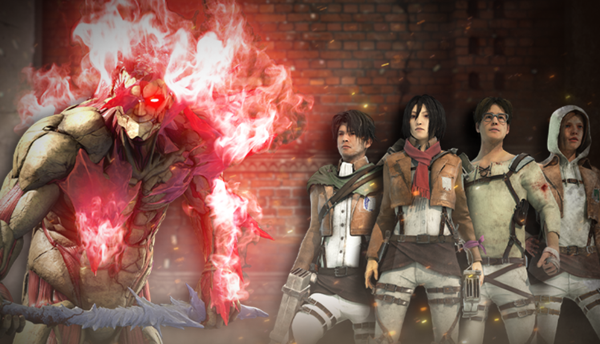

# live · 9.2.2_2796315live

| | |
|---|---|
| Build date | 2025-10-09 15:04 UTC |
| CDN version | `9.2.2_2796315live-1760022251` |
| Key | `9.2.2_live` |
| Compared with | [9.2.2_2796143live](../9.2.2_2796143live/CHANGES.md) (2025-10-09 14:56 UTC) |

## Summary

**4** added · **21** modified · **0** removed · 186 unchanged

## New or updated images

<a href="images/T_UI_CollectionBanner_AttackOnTitan.png"></a>
<a href="images/T_UI_SpecialPack_Armored_Pack.png"></a>
<a href="images/T_UI_SpecialPack_AttackOnTitan.png"></a>
<a href="images/T_UI_SpecialPack_War_Hammer_Pack.png"></a>

## Modified files

### [`catalog.json`](catalog.json)

[Full line-by-line diff](diffs/catalog.json.diff)

```diff
+ $[id=Armored_Bundle]
+ $[id=War_Hammer_Bundle]
- $[id=AV_Head017].purchasable: false
+ $[id=AV_Head017].purchasable: true
- $[id=AV_Legs017].purchasable: false
+ $[id=AV_Legs017].purchasable: true
- $[id=AV_Torso017].purchasable: false
+ $[id=AV_Torso017].purchasable: true
- $[id=DF_Head020].purchasable: false
+ $[id=DF_Head020].purchasable: true
- $[id=DF_Legs020].purchasable: false
+ $[id=DF_Legs020].purchasable: true
- $[id=DF_Torso020].purchasable: false
+ $[id=DF_Torso020].purchasable: true
- $[id=GS_Head019].purchasable: false
+ $[id=GS_Head019].purchasable: true
- $[id=GS_Legs019].purchasable: false
+ $[id=GS_Legs019].purchasable: true
- $[id=GS_Torso019].purchasable: false
+ $[id=GS_Torso019].purchasable: true
- $[id=HK_Body016].purchasable: false
+ $[id=HK_Body016].purchasable: true
- $[id=HK_Head016].purchasable: false
+ $[id=HK_Head016].purchasable: true
- $[id=HK_W016].purchasable: false
+ $[id=HK_W016].purchasable: true
- $[id=JP_Head018].purchasable: false
+ $[id=JP_Head018].purchasable: true
- $[id=JP_Legs018].purchasable: false
+ $[id=JP_Legs018].purchasable: true
- $[id=JP_Torso018].purchasable: false
+ $[id=JP_Torso018].purchasable: true
- $[id=MT_Head019].purchasable: false
+ $[id=MT_Head019].purchasable: true
- $[id=MT_Legs019].purchasable: false
+ $[id=MT_Legs019].purchasable: true
- $[id=MT_Torso019].purchasable: false
+ $[id=MT_Torso019].purchasable: true
- $[id=S23_Head018].purchasable: false
+ $[id=S23_Head018].purchasable: true
- $[id=S23_Legs018].purchasable: false
+ $[id=S23_Legs018].purchasable: true
- $[id=S23_Torso018].purchasable: false
+ $[id=S23_Torso018].purchasable: true
- $[id=SwedenKiller_Body012].purchasable: false
+ $[id=SwedenKiller_Body012].purchasable: true
- $[id=SwedenKiller_Mask012].purchasable: false
+ $[id=SwedenKiller_Mask012].purchasable: true
- $[id=SwedenKiller_W012].purchasable: false
+ $[id=SwedenKiller_W012].purchasable: true
- $[id=SwedenSurvivor_Head017].purchasable: false
+ $[id=SwedenSurvivor_Head017].purchasable: true
- $[id=SwedenSurvivor_Legs017].purchasable: false
+ $[id=SwedenSurvivor_Legs017].purchasable: true
- $[id=SwedenSurvivor_Torso017].purchasable: false
+ $[id=SwedenSurvivor_Torso017].purchasable: true
- $[id=US_Head016].purchasable: false
+ $[id=US_Head016].purchasable: true
- $[id=US_Legs016].purchasable: false
+ $[id=US_Legs016].purchasable: true
- $[id=US_Torso016].purchasable: false
+ $[id=US_Torso016].purchasable: true
- $[id=AV_outfit_017].purchasable: false
+ $[id=AV_outfit_017].purchasable: true
- $[id=DF_outfit_020].purchasable: false
+ $[id=DF_outfit_020].purchasable: true
- $[id=GS_outfit_019].purchasable: false
+ $[id=GS_outfit_019].purchasable: true
- $[id=HK_outfit_016].purchasable: false
+ $[id=HK_outfit_016].purchasable: true
- $[id=JP_outfit_018].purchasable: false
+ $[id=JP_outfit_018].purchasable: true
- $[id=MT_outfit_019].purchasable: false
+ $[id=MT_outfit_019].purchasable: true
- $[id=S23_outfit_018].purchasable: false
+ $[id=S23_outfit_018].purchasable: true
- $[id=SwedenKiller_outfit_012].purchasable: false
+ $[id=SwedenKiller_outfit_012].purchasable: true
- $[id=SwedenSurvivor_outfit_017].purchasable: false
+ $[id=SwedenSurvivor_outfit_017].purchasable: true
- $[id=US_outfit_016].purchasable: false
+ $[id=US_outfit_016].purchasable: true
```

### [`challengeLocs/challengeText_de.json`](challengeLocs/challengeText_de.json)

[Full line-by-line diff](diffs/challengeLocs/challengeText_de.json.diff)

```diff
- $.locText[395].text: "Zerstöre Kürbisse."
+ $.locText[395].text: "Zerstöre {0} Kürbis(se)."
- $.locText[395].textId: "CHALLENGE_CommunitySmashPumpkins_INFO"
+ $.locText[395].textId: "CHALLENGE_SmashPumpkins_INFO"
- $.locText[414].text: "Zerstöre {0} Kürbis(se)."
+ $.locText[414].text: "@#CHALLENGE_InjureSurvivorWithHaunt_TITLE"
- $.locText[414].textId: "CHALLENGE_SmashPumpkins_INFO"
+ $.locText[414].textId: "CHALLENGE_InjureSurvivorWithHaunt_TITLE"
- $.locText[415].text: "@#CHALLENGE_InjureSurvivorWithHaunt_TITLE"
+ $.locText[415].text: "@#CHALLENGE_InjureSurvivorWithHaunt_DESC"
- $.locText[415].textId: "CHALLENGE_InjureSurvivorWithHaunt_TITLE"
+ $.locText[415].textId: "CHALLENGE_InjureSurvivorWithHaunt_DESC"
- $.locText[416].text: "@#CHALLENGE_InjureSurvivorWithHaunt_DESC"
+ $.locText[416].text: "Verletze {0} Überlebende(n) mit einem gefangenen Spuk."
- $.locText[416].textId: "CHALLENGE_InjureSurvivorWithHaunt_DESC"
+ $.locText[416].textId: "CHALLENGE_InjureSurvivorWithHaunt_INFO"
- $.locText[417].text: "Verletze {0} Überlebende(n) mit einem gefangenen Spuk."
+ $.locText[417].text: "@#CHALLENGE_EscapeChaseWithVoidCrystalIn10Sec_TITLE"
- $.locText[417].textId: "CHALLENGE_InjureSurvivorWithHaunt_INFO"
+ $.locText[417].textId: "CHALLENGE_EscapeChaseWithVoidCrystalIn10Sec_TITLE"
- $.locText[418].text: "@#CHALLENGE_EscapeChaseWithVoidCrystalIn10Sec_TITLE"
+ $.locText[418].text: "@#CHALLENGE_EscapeChaseWithVoidCrystalIn10Sec_DESC"
- $.locText[418].textId: "CHALLENGE_EscapeChaseWithVoidCrystalIn10Sec_TITLE"
+ $.locText[418].textId: "CHALLENGE_EscapeChaseWithVoidCrystalIn10Sec_DESC"
- $.locText[419].text: "@#CHALLENGE_EscapeChaseWithVoidCrystalIn10Sec_DESC"
+ $.locText[419].text: "Entkomme {0} Jagd(en) innerhalb von 10 Sekunden nach der Verwendung eines Leerekristalls."
- $.locText[419].textId: "CHALLENGE_EscapeChaseWithVoidCrystalIn10Sec_DESC"
+ $.locText[419].textId: "CHALLENGE_EscapeChaseWithVoidCrystalIn10Sec_INFO"
- $.locText[420].text: "Entkomme {0} Jagd(en) innerhalb von 10 Sekunden nach der Verwendung eines Leerekristalls."
+ $.locText[420].text: "@#CHALLENGE_HookEsoteric_TITLE"
- $.locText[420].textId: "CHALLENGE_EscapeChaseWithVoidCrystalIn10Sec_INFO"
+ $.locText[420].textId: "CHALLENGE_HookEsoteric_TITLE"
- $.locText[421].text: "@#CHALLENGE_HookEsoteric_TITLE"
+ $.locText[421].text: "@#CHALLENGE_HookEsoteric_DESC"
- $.locText[421].textId: "CHALLENGE_HookEsoteric_TITLE"
+ $.locText[421].textId: "CHALLENGE_HookEsoteric_DESC"
- $.locText[422].text: "@#CHALLENGE_HookEsoteric_DESC"
+ $.locText[422].text: "Hake {0} Überlebende(n) an esoterischen Haken fest."
- $.locText[422].textId: "CHALLENGE_HookEsoteric_DESC"
+ $.locText[422].textId: "CHALLENGE_HookEsoteric_INFO"
- $.locText[423].text: "Hake {0} Überlebende(n) an esoterischen Haken fest."
+ $.locText[423].text: "@#CHALLENGE_RepairEsotericGen_TITLE"
- $.locText[423].textId: "CHALLENGE_HookEsoteric_INFO"
+ $.locText[423].textId: "CHALLENGE_RepairEsotericGen_TITLE"
- $.locText[424].text: "@#CHALLENGE_RepairEsotericGen_TITLE"
+ $.locText[424].text: "@#CHALLENGE_RepairEsotericGen_DESC"
- $.locText[424].textId: "CHALLENGE_RepairEsotericGen_TITLE"
+ $.locText[424].textId: "CHALLENGE_RepairEsotericGen_DESC"
- $.locText[425].text: "@#CHALLENGE_RepairEsotericGen_DESC"
+ $.locText[425].text: "Repariere {0} esoterische(n) Generator(en)."
- $.locText[425].textId: "CHALLENGE_RepairEsotericGen_DESC"
+ $.locText[425].textId: "CHALLENGE_RepairEsotericGen_INFO"
- $.locText[426].text: "Repariere {0} esoterische(n) Generator(en)."
+ $.locText[426].text: "SPUK IN DEAD BY DAYLIGHT"
- $.locText[426].textId: "CHALLENGE_RepairEsotericGen_INFO"
+ $.locText[426].textId: "EVENT_Halloween2025_TITLE"
- $.locText[427].text: "Community-Quests"
+ $.locText[427].text: "„Spuk in Dead by Daylight“-Abschlussquests"
- $.locText[427].textId: "Halloween_CommunityQuests_Title"
+ $.locText[427].textId: "Halloween_OverarchingQuests_Title"
- $.locText[428].text: "„Spuk in Dead by Daylight“-Abschlussquests"
+ $.locText[428].text: "„Spuk in Dead by Daylight“-Quests – Teil 1"
- $.locText[428].textId: "Halloween_OverarchingQuests_Title"
+ $.locText[428].textId: "Halloween_QuestList_1_Title"
- $.locText[429].text: "„Spuk in Dead by Daylight“-Quests – Teil 1"
+ $.locText[429].text: "„Spuk in Dead by Daylight“-Quests – Teil 2"
- $.locText[429].textId: "Halloween_QuestList_1_Title"
+ $.locText[429].textId: "Halloween_QuestList_2_Title"
- $.locText[430].text: "„Spuk in Dead by Daylight“-Quests – Teil 2"
+ $.locText[430].text: "„Spuk in Dead by Daylight“-Quests – Teil 3"
- $.locText[430].textId: "Halloween_QuestList_2_Title"
+ $.locText[430].textId: "Halloween_QuestList_3_Title"
- $.locText[431].text: "„Spuk in Dead by Daylight“-Quests – Teil 3"
+ $.locText[431].text: "„Spuk in Dead by Daylight“-Quests – Teil 4"
- $.locText[431].textId: "Halloween_QuestList_3_Title"
+ $.locText[431].textId: "Halloween_QuestList_4_Title"
- $.locText[432].text: "„Spuk in Dead by Daylight“-Quests – Teil 4"
+ $.locText[432].text: "Kapitelquests"
- $.locText[432].textId: "Halloween_QuestList_4_Title"
+ $.locText[432].textId: "CHALLENGESET_ChapterQuests_TITLE"
- $.locText[433].text: "Kapitelquests"
+ $.locText[433].text: "@#CHALLENGESET_ChapterQuests_INFO"
- $.locText[433].textId: "CHALLENGESET_ChapterQuests_TITLE"
+ $.locText[433].textId: "CHALLENGESET_ChapterQuests_INFO"
- $.locText[434].text: "@#CHALLENGESET_ChapterQuests_INFO"
+ $.locText[434].text: "Schließe {0} Kapitelquest(s) ab."
- $.locText[434].textId: "CHALLENGESET_ChapterQuests_INFO"
+ $.locText[434].textId: "CHALLENGE_CompleteChapterQuests_INFO"
- $.locText[435].text: "Schließe {0} Kapitelquest(s) ab."
+ $.locText[435].text: "@#CHALLENGE_PlayAsKillerOrAnyKiller_TITLE"
- $.locText[435].textId: "CHALLENGE_CompleteChapterQuests_INFO"
+ $.locText[435].textId: "CHALLENGE_PlayAsKillerOrAnyKiller_TITLE"
- $.locText[436].text: "@#CHALLENGE_PlayAsKillerOrAnyKiller_TITLE"
+ $.locText[436].text: "@#CHALLENGE_PlayAsKillerOrAnyKiller_DESC"
- $.locText[436].textId: "CHALLENGE_PlayAsKillerOrAnyKiller_TITLE"
+ $.locText[436].textId: "CHALLENGE_PlayAsKillerOrAnyKiller_DESC"
- $.locText[437].text: "@#CHALLENGE_PlayAsKillerOrAnyKiller_DESC"
+ $.locText[437].text: "Schließe {0} Prüfung(en) als ein beliebiger Killer ab."
- $.locText[437].textId: "CHALLENGE_PlayAsKillerOrAnyKiller_DESC"
+ $.locText[437].textId: "CHALLENGE_PlayAnyKiller_INFO"
- $.locText[438].text: "Schließe {0} Prüfung(en) als ein beliebiger Killer ab."
+ $.locText[438].text: "@#CHALLENGE_PlayAsSurvivorOrAnySurvivor_TITLE"
- $.locText[438].textId: "CHALLENGE_PlayAnyKiller_INFO"
+ $.locText[438].textId: "CHALLENGE_PlayAsSurvivorOrAnySurvivor_TITLE"
- $.locText[439].text: "@#CHALLENGE_PlayAsSurvivorOrAnySurvivor_TITLE"
+ $.locText[439].text: "@#CHALLENGE_PlayAsSurvivorOrAnySurvivor_DESC"
- $.locText[439].textId: "CHALLENGE_PlayAsSurvivorOrAnySurvivor_TITLE"
+ $.locText[439].textId: "CHALLENGE_PlayAsSurvivorOrAnySurvivor_DESC"
- $.locText[440].text: "@#CHALLENGE_PlayAsSurvivorOrAnySurvivor_DESC"
+ $.locText[440].text: "Schließe {0} Prüfung(en) als ein beliebiger Überlebender ab."
- $.locText[440].textId: "CHALLENGE_PlayAsSurvivorOrAnySurvivor_DESC"
+ $.locText[440].textId: "CHALLENGE_PlayAnySurvivor_INFO"
- $.locText[441].text: "Schließe {0} Prüfung(en) als ein beliebiger Überlebender ab."
+ $.locText[441].text: "@#CHALLENGE_HookAsKillerOrAnyKiller_TITLE"
- $.locText[441].textId: "CHALLENGE_PlayAnySurvivor_INFO"
+ $.locText[441].textId: "CHALLENGE_HookAsKillerOrAnyKiller_TITLE"
- $.locText[442].text: "@#CHALLENGE_HookAsKillerOrAnyKiller_TITLE"
+ $.locText[442].text: "@#CHALLENGE_HookAsKillerOrAnyKiller_DESC"
- $.locText[442].textId: "CHALLENGE_HookAsKillerOrAnyKiller_TITLE"
+ $.locText[442].textId: "CHALLENGE_HookAsKillerOrAnyKiller_DESC"
- $.locText[443].text: "@#CHALLENGE_HookAsKillerOrAnyKiller_DESC"
+ $.locText[443].text: "Hake {0} Überlebende(n) als {1} fest."
- $.locText[443].textId: "CHALLENGE_HookAsKillerOrAnyKiller_DESC"
+ $.locText[443].textId: "CHALLENGE_HookAsKiller_INFO"
- $.locText[444].text: "Hake {0} Überlebende(n) als {1} fest."
+ $.locText[444].text: "Hake {0} Überlebende(n) als ein beliebiger Killer fest."
- $.locText[444].textId: "CHALLENGE_HookAsKiller_INFO"
+ $.locText[444].textId: "CHALLENGE_HookAsAnyKiller_INFO"
- $.locText[445].text: "Hake {0} Überlebende(n) als ein beliebiger Killer fest."
+ $.locText[445].text: "@#CHALLENGE_UnhookAsSurvivorOrAnySurvivor_TITLE"
- $.locText[445].textId: "CHALLENGE_HookAsAnyKiller_INFO"
+ $.locText[445].textId: "CHALLENGE_UnhookAsSurvivorOrAnySurvivor_TITLE"
- $.locText[446].text: "@#CHALLENGE_UnhookAsSurvivorOrAnySurvivor_TITLE"
+ $.locText[446].text: "@#CHALLENGE_UnhookAsSurvivorOrAnySurvivor_DESC"
- $.locText[446].textId: "CHALLENGE_UnhookAsSurvivorOrAnySurvivor_TITLE"
+ $.locText[446].textId: "CHALLENGE_UnhookAsSurvivorOrAnySurvivor_DESC"
- $.locText[447].text: "@#CHALLENGE_UnhookAsSurvivorOrAnySurvivor_DESC"
+ $.locText[447].text: "Rette {0} Überlebende(n) als {1} sicher vom Haken."
- $.locText[447].textId: "CHALLENGE_UnhookAsSurvivorOrAnySurvivor_DESC"
+ $.locText[447].textId: "CHALLENGE_UnhookAsSurvivor_INFO"
- $.locText[448].text: "Rette {0} Überlebende(n) als {1} sicher vom Haken."
+ $.locText[448].text: "Rette {0} Überlebende(n) als ein beliebiger Überlebender sicher vom Haken."
- $.locText[448].textId: "CHALLENGE_UnhookAsSurvivor_INFO"
+ $.locText[448].textId: "CHALLENGE_UnhookAsAnySurvivor_INFO"
- $.locText[449].text: "Rette {0} Überlebende(n) als ein beliebiger Überlebender sicher vom Haken."
+ $.locText[449].text: "@#CHALLENGE_BreakGenAsKillerOrAnyKiller_TITLE"
- $.locText[449].textId: "CHALLENGE_UnhookAsAnySurvivor_INFO"
+ $.locText[449].textId: "CHALLENGE_BreakGenAsKillerOrAnyKiller_TITLE"
- $.locText[450].text: "@#CHALLENGE_BreakGenAsKillerOrAnyKiller_TITLE"
+ $.locText[450].text: "@#CHALLENGE_BreakGenAsKillerOrAnyKiller_DESC"
- $.locText[450].textId: "CHALLENGE_BreakGenAsKillerOrAnyKiller_TITLE"
+ $.locText[450].textId: "CHALLENGE_BreakGenAsKillerOrAnyKiller_DESC"
- $.locText[451].text: "@#CHALLENGE_BreakGenAsKillerOrAnyKiller_DESC"
+ $.locText[451].text: "Beschädige {0} Generator(en) als {1}."
- $.locText[451].textId: "CHALLENGE_BreakGenAsKillerOrAnyKiller_DESC"
+ $.locText[451].textId: "CHALLENGE_BreakGenAsKiller_INFO"
- $.locText[452].text: "Beschädige {0} Generator(en) als {1}."
+ $.locText[452].text: "Beschädige {0} Generator(en) als ein beliebiger Killer."
- $.locText[452].textId: "CHALLENGE_BreakGenAsKiller_INFO"
+ $.locText[452].textId: "CHALLENGE_BreakGensAnyKiller_INFO"
- $.locText[453].text: "Beschädige {0} Generator(en) als ein beliebiger Killer."
+ $.locText[453].text: "@#CHALLENGE_RepairGenAsSurvivorOrAnySurvivor_TITLE"
- $.locText[453].textId: "CHALLENGE_BreakGensAnyKiller_INFO"
+ $.locText[453].textId: "CHALLENGE_RepairGenAsSurvivorOrAnySurvivor_TITLE"
- $.locText[454].text: "@#CHALLENGE_RepairGenAsSurvivorOrAnySurvivor_TITLE"
+ $.locText[454].text: "@#CHALLENGE_RepairGenAsSurvivorOrAnySurvivor_DESC"
- $.locText[454].textId: "CHALLENGE_RepairGenAsSurvivorOrAnySurvivor_TITLE"
+ $.locText[454].textId: "CHALLENGE_RepairGenAsSurvivorOrAnySurvivor_DESC"
- $.locText[455].text: "@#CHALLENGE_RepairGenAsSurvivorOrAnySurvivor_DESC"
+ $.locText[455].text: "Repariere insgesamt {0} Generator(en) als {1}."
- $.locText[455].textId: "CHALLENGE_RepairGenAsSurvivorOrAnySurvivor_DESC"
+ $.locText[455].textId: "CHALLENGE_RepairGenAsSurvivor_INFO"
- $.locText[456].text: "Repariere insgesamt {0} Generator(en) als {1}."
+ $.locText[456].text: "Repariere insgesamt {0} Generator(en) als ein beliebiger Überlebender."
- $.locText[456].textId: "CHALLENGE_RepairGenAsSurvivor_INFO"
+ $.locText[456].textId: "CHALLENGE_RepairGenAnySurvivor_INFO"
- $.locText[457].text: "Repariere insgesamt {0} Generator(en) als ein beliebiger Überlebender."
+ $.locText[457].text: "Kapitel-Abschlussquests"
- $.locText[457].textId: "CHALLENGE_RepairGenAnySurvivor_INFO"
+ $.locText[457].textId: "LIST_OverarchingChapterQuests_TITLE"
- $.locText[458].text: "Kapitel-Abschlussquests"
+ $.locText[458].text: "KAPITELQUESTS – WOCHE 1"
- $.locText[458].textId: "LIST_OverarchingChapterQuests_TITLE"
+ $.locText[458].textId: "LIST_ChapterQuests_TITLE_1"
- $.locText[459].text: "KAPITELQUESTS – WOCHE 1"
+ $.locText[459].text: "KAPITELQUESTS – WOCHE 2"
- $.locText[459].textId: "LIST_ChapterQuests_TITLE_1"
+ $.locText[459].textId: "LIST_ChapterQuests_TITLE_2"
- $.locText[460]
```

### [`challengeLocs/challengeText_en.json`](challengeLocs/challengeText_en.json)

[Full line-by-line diff](diffs/challengeLocs/challengeText_en.json.diff)

```diff
- $.locText[395].text: "Smash pumpkin(s)"
+ $.locText[395].text: "Smash {0} pumpkin(s)"
- $.locText[395].textId: "CHALLENGE_CommunitySmashPumpkins_INFO"
+ $.locText[395].textId: "CHALLENGE_SmashPumpkins_INFO"
- $.locText[414].text: "Smash {0} pumpkin(s)"
+ $.locText[414].text: "@#CHALLENGE_InjureSurvivorWithHaunt_TITLE"
- $.locText[414].textId: "CHALLENGE_SmashPumpkins_INFO"
+ $.locText[414].textId: "CHALLENGE_InjureSurvivorWithHaunt_TITLE"
- $.locText[415].text: "@#CHALLENGE_InjureSurvivorWithHaunt_TITLE"
+ $.locText[415].text: "@#CHALLENGE_InjureSurvivorWithHaunt_DESC"
- $.locText[415].textId: "CHALLENGE_InjureSurvivorWithHaunt_TITLE"
+ $.locText[415].textId: "CHALLENGE_InjureSurvivorWithHaunt_DESC"
- $.locText[416].text: "@#CHALLENGE_InjureSurvivorWithHaunt_DESC"
+ $.locText[416].text: "Injure {0} Survivor(s) with a Captured Haunt"
- $.locText[416].textId: "CHALLENGE_InjureSurvivorWithHaunt_DESC"
+ $.locText[416].textId: "CHALLENGE_InjureSurvivorWithHaunt_INFO"
- $.locText[417].text: "Injure {0} Survivor(s) with a Captured Haunt"
+ $.locText[417].text: "@#CHALLENGE_EscapeChaseWithVoidCrystalIn10Sec_TITLE"
- $.locText[417].textId: "CHALLENGE_InjureSurvivorWithHaunt_INFO"
+ $.locText[417].textId: "CHALLENGE_EscapeChaseWithVoidCrystalIn10Sec_TITLE"
- $.locText[418].text: "@#CHALLENGE_EscapeChaseWithVoidCrystalIn10Sec_TITLE"
+ $.locText[418].text: "@#CHALLENGE_EscapeChaseWithVoidCrystalIn10Sec_DESC"
- $.locText[418].textId: "CHALLENGE_EscapeChaseWithVoidCrystalIn10Sec_TITLE"
+ $.locText[418].textId: "CHALLENGE_EscapeChaseWithVoidCrystalIn10Sec_DESC"
- $.locText[419].text: "@#CHALLENGE_EscapeChaseWithVoidCrystalIn10Sec_DESC"
+ $.locText[419].text: "Escape {0} chase(s) within 10 seconds of using a Void Crystal"
- $.locText[419].textId: "CHALLENGE_EscapeChaseWithVoidCrystalIn10Sec_DESC"
+ $.locText[419].textId: "CHALLENGE_EscapeChaseWithVoidCrystalIn10Sec_INFO"
- $.locText[420].text: "Escape {0} chase(s) within 10 seconds of using a Void Crystal"
+ $.locText[420].text: "@#CHALLENGE_HookEsoteric_TITLE"
- $.locText[420].textId: "CHALLENGE_EscapeChaseWithVoidCrystalIn10Sec_INFO"
+ $.locText[420].textId: "CHALLENGE_HookEsoteric_TITLE"
- $.locText[421].text: "@#CHALLENGE_HookEsoteric_TITLE"
+ $.locText[421].text: "@#CHALLENGE_HookEsoteric_DESC"
- $.locText[421].textId: "CHALLENGE_HookEsoteric_TITLE"
+ $.locText[421].textId: "CHALLENGE_HookEsoteric_DESC"
- $.locText[422].text: "@#CHALLENGE_HookEsoteric_DESC"
+ $.locText[422].text: "Hook {0} Survivor(s) on Esoteric Hooks"
- $.locText[422].textId: "CHALLENGE_HookEsoteric_DESC"
+ $.locText[422].textId: "CHALLENGE_HookEsoteric_INFO"
- $.locText[423].text: "Hook {0} Survivor(s) on Esoteric Hooks"
+ $.locText[423].text: "@#CHALLENGE_RepairEsotericGen_TITLE"
- $.locText[423].textId: "CHALLENGE_HookEsoteric_INFO"
+ $.locText[423].textId: "CHALLENGE_RepairEsotericGen_TITLE"
- $.locText[424].text: "@#CHALLENGE_RepairEsotericGen_TITLE"
+ $.locText[424].text: "@#CHALLENGE_RepairEsotericGen_DESC"
- $.locText[424].textId: "CHALLENGE_RepairEsotericGen_TITLE"
+ $.locText[424].textId: "CHALLENGE_RepairEsotericGen_DESC"
- $.locText[425].text: "@#CHALLENGE_RepairEsotericGen_DESC"
+ $.locText[425].text: "Repair {0} esoteric generator(s)"
- $.locText[425].textId: "CHALLENGE_RepairEsotericGen_DESC"
+ $.locText[425].textId: "CHALLENGE_RepairEsotericGen_INFO"
- $.locText[426].text: "Repair {0} esoteric generator(s)"
+ $.locText[426].text: "HAUNTED BY DAYLIGHT"
- $.locText[426].textId: "CHALLENGE_RepairEsotericGen_INFO"
+ $.locText[426].textId: "EVENT_Halloween2025_TITLE"
- $.locText[427].text: "Community Quests"
+ $.locText[427].text: "Haunted by Daylight Completion Quests"
- $.locText[427].textId: "Halloween_CommunityQuests_Title"
+ $.locText[427].textId: "Halloween_OverarchingQuests_Title"
- $.locText[428].text: "Haunted by Daylight Completion Quests"
+ $.locText[428].text: "Haunted by Daylight Quests - Part 1"
- $.locText[428].textId: "Halloween_OverarchingQuests_Title"
+ $.locText[428].textId: "Halloween_QuestList_1_Title"
- $.locText[429].text: "Haunted by Daylight Quests - Part 1"
+ $.locText[429].text: "Haunted by Daylight Quests - Part 2"
- $.locText[429].textId: "Halloween_QuestList_1_Title"
+ $.locText[429].textId: "Halloween_QuestList_2_Title"
- $.locText[430].text: "Haunted by Daylight Quests - Part 2"
+ $.locText[430].text: "Haunted by Daylight Quests - Part 3"
- $.locText[430].textId: "Halloween_QuestList_2_Title"
+ $.locText[430].textId: "Halloween_QuestList_3_Title"
- $.locText[431].text: "Haunted by Daylight Quests - Part 3"
+ $.locText[431].text: "Haunted by Daylight Quests - Part 4"
- $.locText[431].textId: "Halloween_QuestList_3_Title"
+ $.locText[431].textId: "Halloween_QuestList_4_Title"
- $.locText[432].text: "Haunted by Daylight Quests - Part 4"
+ $.locText[432].text: "Chapter Quests"
- $.locText[432].textId: "Halloween_QuestList_4_Title"
+ $.locText[432].textId: "CHALLENGESET_ChapterQuests_TITLE"
- $.locText[433].text: "Chapter Quests"
+ $.locText[433].text: "@#CHALLENGESET_ChapterQuests_INFO"
- $.locText[433].textId: "CHALLENGESET_ChapterQuests_TITLE"
+ $.locText[433].textId: "CHALLENGESET_ChapterQuests_INFO"
- $.locText[434].text: "@#CHALLENGESET_ChapterQuests_INFO"
+ $.locText[434].text: "Complete {0} Chapter quest(s)"
- $.locText[434].textId: "CHALLENGESET_ChapterQuests_INFO"
+ $.locText[434].textId: "CHALLENGE_CompleteChapterQuests_INFO"
- $.locText[435].text: "Complete {0} Chapter quest(s)"
+ $.locText[435].text: "@#CHALLENGE_PlayAsKillerOrAnyKiller_TITLE"
- $.locText[435].textId: "CHALLENGE_CompleteChapterQuests_INFO"
+ $.locText[435].textId: "CHALLENGE_PlayAsKillerOrAnyKiller_TITLE"
- $.locText[436].text: "@#CHALLENGE_PlayAsKillerOrAnyKiller_TITLE"
+ $.locText[436].text: "@#CHALLENGE_PlayAsKillerOrAnyKiller_DESC"
- $.locText[436].textId: "CHALLENGE_PlayAsKillerOrAnyKiller_TITLE"
+ $.locText[436].textId: "CHALLENGE_PlayAsKillerOrAnyKiller_DESC"
- $.locText[437].text: "@#CHALLENGE_PlayAsKillerOrAnyKiller_DESC"
+ $.locText[437].text: "Complete {0} trial(s) as any Killer"
- $.locText[437].textId: "CHALLENGE_PlayAsKillerOrAnyKiller_DESC"
+ $.locText[437].textId: "CHALLENGE_PlayAnyKiller_INFO"
- $.locText[438].text: "Complete {0} trial(s) as any Killer"
+ $.locText[438].text: "@#CHALLENGE_PlayAsSurvivorOrAnySurvivor_TITLE"
- $.locText[438].textId: "CHALLENGE_PlayAnyKiller_INFO"
+ $.locText[438].textId: "CHALLENGE_PlayAsSurvivorOrAnySurvivor_TITLE"
- $.locText[439].text: "@#CHALLENGE_PlayAsSurvivorOrAnySurvivor_TITLE"
+ $.locText[439].text: "@#CHALLENGE_PlayAsSurvivorOrAnySurvivor_DESC"
- $.locText[439].textId: "CHALLENGE_PlayAsSurvivorOrAnySurvivor_TITLE"
+ $.locText[439].textId: "CHALLENGE_PlayAsSurvivorOrAnySurvivor_DESC"
- $.locText[440].text: "@#CHALLENGE_PlayAsSurvivorOrAnySurvivor_DESC"
+ $.locText[440].text: "Complete {0} trial(s) as any Survivor"
- $.locText[440].textId: "CHALLENGE_PlayAsSurvivorOrAnySurvivor_DESC"
+ $.locText[440].textId: "CHALLENGE_PlayAnySurvivor_INFO"
- $.locText[441].text: "Complete {0} trial(s) as any Survivor"
+ $.locText[441].text: "@#CHALLENGE_HookAsKillerOrAnyKiller_TITLE"
- $.locText[441].textId: "CHALLENGE_PlayAnySurvivor_INFO"
+ $.locText[441].textId: "CHALLENGE_HookAsKillerOrAnyKiller_TITLE"
- $.locText[442].text: "@#CHALLENGE_HookAsKillerOrAnyKiller_TITLE"
+ $.locText[442].text: "@#CHALLENGE_HookAsKillerOrAnyKiller_DESC"
- $.locText[442].textId: "CHALLENGE_HookAsKillerOrAnyKiller_TITLE"
+ $.locText[442].textId: "CHALLENGE_HookAsKillerOrAnyKiller_DESC"
- $.locText[443].text: "@#CHALLENGE_HookAsKillerOrAnyKiller_DESC"
+ $.locText[443].text: "Hook {0} Survivor(s) as {1}"
- $.locText[443].textId: "CHALLENGE_HookAsKillerOrAnyKiller_DESC"
+ $.locText[443].textId: "CHALLENGE_HookAsKiller_INFO"
- $.locText[444].text: "Hook {0} Survivor(s) as {1}"
+ $.locText[444].text: "Hook {0} Survivor(s) as any Killer"
- $.locText[444].textId: "CHALLENGE_HookAsKiller_INFO"
+ $.locText[444].textId: "CHALLENGE_HookAsAnyKiller_INFO"
- $.locText[445].text: "Hook {0} Survivor(s) as any Killer"
+ $.locText[445].text: "@#CHALLENGE_UnhookAsSurvivorOrAnySurvivor_TITLE"
- $.locText[445].textId: "CHALLENGE_HookAsAnyKiller_INFO"
+ $.locText[445].textId: "CHALLENGE_UnhookAsSurvivorOrAnySurvivor_TITLE"
- $.locText[446].text: "@#CHALLENGE_UnhookAsSurvivorOrAnySurvivor_TITLE"
+ $.locText[446].text: "@#CHALLENGE_UnhookAsSurvivorOrAnySurvivor_DESC"
- $.locText[446].textId: "CHALLENGE_UnhookAsSurvivorOrAnySurvivor_TITLE"
+ $.locText[446].textId: "CHALLENGE_UnhookAsSurvivorOrAnySurvivor_DESC"
- $.locText[447].text: "@#CHALLENGE_UnhookAsSurvivorOrAnySurvivor_DESC"
+ $.locText[447].text: "Safely unhook {0} Survivor(s) as {1}"
- $.locText[447].textId: "CHALLENGE_UnhookAsSurvivorOrAnySurvivor_DESC"
+ $.locText[447].textId: "CHALLENGE_UnhookAsSurvivor_INFO"
- $.locText[448].text: "Safely unhook {0} Survivor(s) as {1}"
+ $.locText[448].text: "Safely unhook {0} Survivor(s) as any Survivor"
- $.locText[448].textId: "CHALLENGE_UnhookAsSurvivor_INFO"
+ $.locText[448].textId: "CHALLENGE_UnhookAsAnySurvivor_INFO"
- $.locText[449].text: "Safely unhook {0} Survivor(s) as any Survivor"
+ $.locText[449].text: "@#CHALLENGE_BreakGenAsKillerOrAnyKiller_TITLE"
- $.locText[449].textId: "CHALLENGE_UnhookAsAnySurvivor_INFO"
+ $.locText[449].textId: "CHALLENGE_BreakGenAsKillerOrAnyKiller_TITLE"
- $.locText[450].text: "@#CHALLENGE_BreakGenAsKillerOrAnyKiller_TITLE"
+ $.locText[450].text: "@#CHALLENGE_BreakGenAsKillerOrAnyKiller_DESC"
- $.locText[450].textId: "CHALLENGE_BreakGenAsKillerOrAnyKiller_TITLE"
+ $.locText[450].textId: "CHALLENGE_BreakGenAsKillerOrAnyKiller_DESC"
- $.locText[451].text: "@#CHALLENGE_BreakGenAsKillerOrAnyKiller_DESC"
+ $.locText[451].text: "Damage {0} generator(s) as {1}"
- $.locText[451].textId: "CHALLENGE_BreakGenAsKillerOrAnyKiller_DESC"
+ $.locText[451].textId: "CHALLENGE_BreakGenAsKiller_INFO"
- $.locText[452].text: "Damage {0} generator(s) as {1}"
+ $.locText[452].text: "Damage {0} generator(s) as any Killer"
- $.locText[452].textId: "CHALLENGE_BreakGenAsKiller_INFO"
+ $.locText[452].textId: "CHALLENGE_BreakGensAnyKiller_INFO"
- $.locText[453].text: "Damage {0} generator(s) as any Killer"
+ $.locText[453].text: "@#CHALLENGE_RepairGenAsSurvivorOrAnySurvivor_TITLE"
- $.locText[453].textId: "CHALLENGE_BreakGensAnyKiller_INFO"
+ $.locText[453].textId: "CHALLENGE_RepairGenAsSurvivorOrAnySurvivor_TITLE"
- $.locText[454].text: "@#CHALLENGE_RepairGenAsSurvivorOrAnySurvivor_TITLE"
+ $.locText[454].text: "@#CHALLENGE_RepairGenAsSurvivorOrAnySurvivor_DESC"
- $.locText[454].textId: "CHALLENGE_RepairGenAsSurvivorOrAnySurvivor_TITLE"
+ $.locText[454].textId: "CHALLENGE_RepairGenAsSurvivorOrAnySurvivor_DESC"
- $.locText[455].text: "@#CHALLENGE_RepairGenAsSurvivorOrAnySurvivor_DESC"
+ $.locText[455].text: "Repair a total of {0} generator(s) as {1}"
- $.locText[455].textId: "CHALLENGE_RepairGenAsSurvivorOrAnySurvivor_DESC"
+ $.locText[455].textId: "CHALLENGE_RepairGenAsSurvivor_INFO"
- $.locText[456].text: "Repair a total of {0} generator(s) as {1}"
+ $.locText[456].text: "Repair a total of {0} generator(s) as any Survivor"
- $.locText[456].textId: "CHALLENGE_RepairGenAsSurvivor_INFO"
+ $.locText[456].textId: "CHALLENGE_RepairGenAnySurvivor_INFO"
- $.locText[457].text: "Repair a total of {0} generator(s) as any Survivor"
+ $.locText[457].text: "Chapter Completion Quests"
- $.locText[457].textId: "CHALLENGE_RepairGenAnySurvivor_INFO"
+ $.locText[457].textId: "LIST_OverarchingChapterQuests_TITLE"
- $.locText[458].text: "Chapter Completion Quests"
+ $.locText[458].text: "CHAPTER QUESTS - WEEK 1"
- $.locText[458].textId: "LIST_OverarchingChapterQuests_TITLE"
+ $.locText[458].textId: "LIST_ChapterQuests_TITLE_1"
- $.locText[459].text: "CHAPTER QUESTS - WEEK 1"
+ $.locText[459].text: "CHAPTER QUESTS - WEEK 2"
- $.locText[459].textId: "LIST_ChapterQuests_TITLE_1"
+ $.locText[459].textId: "LIST_ChapterQuests_TITLE_2"
- $.locText[460]
```

### [`challengeLocs/challengeText_es-MX.json`](challengeLocs/challengeText_es-MX.json)

[Full line-by-line diff](diffs/challengeLocs/challengeText_es-MX.json.diff)

```diff
- $.locText[395].text: "Aplasta calabazas"
+ $.locText[395].text: "Aplasta {0} calabaza(s)"
- $.locText[395].textId: "CHALLENGE_CommunitySmashPumpkins_INFO"
+ $.locText[395].textId: "CHALLENGE_SmashPumpkins_INFO"
- $.locText[414].text: "Aplasta {0} calabaza(s)"
+ $.locText[414].text: "@#CHALLENGE_InjureSurvivorWithHaunt_TITLE"
- $.locText[414].textId: "CHALLENGE_SmashPumpkins_INFO"
+ $.locText[414].textId: "CHALLENGE_InjureSurvivorWithHaunt_TITLE"
- $.locText[415].text: "@#CHALLENGE_InjureSurvivorWithHaunt_TITLE"
+ $.locText[415].text: "@#CHALLENGE_InjureSurvivorWithHaunt_DESC"
- $.locText[415].textId: "CHALLENGE_InjureSurvivorWithHaunt_TITLE"
+ $.locText[415].textId: "CHALLENGE_InjureSurvivorWithHaunt_DESC"
- $.locText[416].text: "@#CHALLENGE_InjureSurvivorWithHaunt_DESC"
+ $.locText[416].text: "Hiere a {0} sobreviviente(s) con una aparición capturada"
- $.locText[416].textId: "CHALLENGE_InjureSurvivorWithHaunt_DESC"
+ $.locText[416].textId: "CHALLENGE_InjureSurvivorWithHaunt_INFO"
- $.locText[417].text: "Hiere a {0} sobreviviente(s) con una aparición capturada"
+ $.locText[417].text: "@#CHALLENGE_EscapeChaseWithVoidCrystalIn10Sec_TITLE"
- $.locText[417].textId: "CHALLENGE_InjureSurvivorWithHaunt_INFO"
+ $.locText[417].textId: "CHALLENGE_EscapeChaseWithVoidCrystalIn10Sec_TITLE"
- $.locText[418].text: "@#CHALLENGE_EscapeChaseWithVoidCrystalIn10Sec_TITLE"
+ $.locText[418].text: "@#CHALLENGE_EscapeChaseWithVoidCrystalIn10Sec_DESC"
- $.locText[418].textId: "CHALLENGE_EscapeChaseWithVoidCrystalIn10Sec_TITLE"
+ $.locText[418].textId: "CHALLENGE_EscapeChaseWithVoidCrystalIn10Sec_DESC"
- $.locText[419].text: "@#CHALLENGE_EscapeChaseWithVoidCrystalIn10Sec_DESC"
+ $.locText[419].text: "Escapa de {0} persecución/persecuciones dentro de los 10 segundos posteriores a usar un cristal del Vacío."
- $.locText[419].textId: "CHALLENGE_EscapeChaseWithVoidCrystalIn10Sec_DESC"
+ $.locText[419].textId: "CHALLENGE_EscapeChaseWithVoidCrystalIn10Sec_INFO"
- $.locText[420].text: "Escapa de {0} persecución/persecuciones dentro de los 10 segundos posteriores a usar un cristal del Vacío."
+ $.locText[420].text: "@#CHALLENGE_HookEsoteric_TITLE"
- $.locText[420].textId: "CHALLENGE_EscapeChaseWithVoidCrystalIn10Sec_INFO"
+ $.locText[420].textId: "CHALLENGE_HookEsoteric_TITLE"
- $.locText[421].text: "@#CHALLENGE_HookEsoteric_TITLE"
+ $.locText[421].text: "@#CHALLENGE_HookEsoteric_DESC"
- $.locText[421].textId: "CHALLENGE_HookEsoteric_TITLE"
+ $.locText[421].textId: "CHALLENGE_HookEsoteric_DESC"
- $.locText[422].text: "@#CHALLENGE_HookEsoteric_DESC"
+ $.locText[422].text: "Cuelga a {0} sobreviviente(s) en ganchos esotéricos"
- $.locText[422].textId: "CHALLENGE_HookEsoteric_DESC"
+ $.locText[422].textId: "CHALLENGE_HookEsoteric_INFO"
- $.locText[423].text: "Cuelga a {0} sobreviviente(s) en ganchos esotéricos"
+ $.locText[423].text: "@#CHALLENGE_RepairEsotericGen_TITLE"
- $.locText[423].textId: "CHALLENGE_HookEsoteric_INFO"
+ $.locText[423].textId: "CHALLENGE_RepairEsotericGen_TITLE"
- $.locText[424].text: "@#CHALLENGE_RepairEsotericGen_TITLE"
+ $.locText[424].text: "@#CHALLENGE_RepairEsotericGen_DESC"
- $.locText[424].textId: "CHALLENGE_RepairEsotericGen_TITLE"
+ $.locText[424].textId: "CHALLENGE_RepairEsotericGen_DESC"
- $.locText[425].text: "@#CHALLENGE_RepairEsotericGen_DESC"
+ $.locText[425].text: "Repara {0} generadores esotéricos"
- $.locText[425].textId: "CHALLENGE_RepairEsotericGen_DESC"
+ $.locText[425].textId: "CHALLENGE_RepairEsotericGen_INFO"
- $.locText[426].text: "Repara {0} generadores esotéricos"
+ $.locText[426].text: "HAUNTED BY DAYLIGHT"
- $.locText[426].textId: "CHALLENGE_RepairEsotericGen_INFO"
+ $.locText[426].textId: "EVENT_Halloween2025_TITLE"
- $.locText[427].text: "Misiones de la comunidad"
+ $.locText[427].text: "Misiones de finalización de Haunted by Daylight"
- $.locText[427].textId: "Halloween_CommunityQuests_Title"
+ $.locText[427].textId: "Halloween_OverarchingQuests_Title"
- $.locText[428].text: "Misiones de finalización de Haunted by Daylight"
+ $.locText[428].text: "Misiones de Haunted by Daylight - Parte 1"
- $.locText[428].textId: "Halloween_OverarchingQuests_Title"
+ $.locText[428].textId: "Halloween_QuestList_1_Title"
- $.locText[429].text: "Misiones de Haunted by Daylight - Parte 1"
+ $.locText[429].text: "Misiones de Haunted by Daylight - Parte 2"
- $.locText[429].textId: "Halloween_QuestList_1_Title"
+ $.locText[429].textId: "Halloween_QuestList_2_Title"
- $.locText[430].text: "Misiones de Haunted by Daylight - Parte 2"
+ $.locText[430].text: "Misiones de Haunted by Daylight - Parte 3"
- $.locText[430].textId: "Halloween_QuestList_2_Title"
+ $.locText[430].textId: "Halloween_QuestList_3_Title"
- $.locText[431].text: "Misiones de Haunted by Daylight - Parte 3"
+ $.locText[431].text: "Misiones de Haunted by Daylight - Parte 4"
- $.locText[431].textId: "Halloween_QuestList_3_Title"
+ $.locText[431].textId: "Halloween_QuestList_4_Title"
- $.locText[432].text: "Misiones de Haunted by Daylight - Parte 4"
+ $.locText[432].text: "Misiones de capítulo"
- $.locText[432].textId: "Halloween_QuestList_4_Title"
+ $.locText[432].textId: "CHALLENGESET_ChapterQuests_TITLE"
- $.locText[433].text: "Misiones de capítulo"
+ $.locText[433].text: "@#CHALLENGESET_ChapterQuests_INFO"
- $.locText[433].textId: "CHALLENGESET_ChapterQuests_TITLE"
+ $.locText[433].textId: "CHALLENGESET_ChapterQuests_INFO"
- $.locText[434].text: "@#CHALLENGESET_ChapterQuests_INFO"
+ $.locText[434].text: "Completa {0} misión/misiones de capítulo."
- $.locText[434].textId: "CHALLENGESET_ChapterQuests_INFO"
+ $.locText[434].textId: "CHALLENGE_CompleteChapterQuests_INFO"
- $.locText[435].text: "Completa {0} misión/misiones de capítulo."
+ $.locText[435].text: "@#CHALLENGE_PlayAsKillerOrAnyKiller_TITLE"
- $.locText[435].textId: "CHALLENGE_CompleteChapterQuests_INFO"
+ $.locText[435].textId: "CHALLENGE_PlayAsKillerOrAnyKiller_TITLE"
- $.locText[436].text: "@#CHALLENGE_PlayAsKillerOrAnyKiller_TITLE"
+ $.locText[436].text: "@#CHALLENGE_PlayAsKillerOrAnyKiller_DESC"
- $.locText[436].textId: "CHALLENGE_PlayAsKillerOrAnyKiller_TITLE"
+ $.locText[436].textId: "CHALLENGE_PlayAsKillerOrAnyKiller_DESC"
- $.locText[437].text: "@#CHALLENGE_PlayAsKillerOrAnyKiller_DESC"
+ $.locText[437].text: "Como cualquier asesino, completa {0} partida(s)."
- $.locText[437].textId: "CHALLENGE_PlayAsKillerOrAnyKiller_DESC"
+ $.locText[437].textId: "CHALLENGE_PlayAnyKiller_INFO"
- $.locText[438].text: "Como cualquier asesino, completa {0} partida(s)."
+ $.locText[438].text: "@#CHALLENGE_PlayAsSurvivorOrAnySurvivor_TITLE"
- $.locText[438].textId: "CHALLENGE_PlayAnyKiller_INFO"
+ $.locText[438].textId: "CHALLENGE_PlayAsSurvivorOrAnySurvivor_TITLE"
- $.locText[439].text: "@#CHALLENGE_PlayAsSurvivorOrAnySurvivor_TITLE"
+ $.locText[439].text: "@#CHALLENGE_PlayAsSurvivorOrAnySurvivor_DESC"
- $.locText[439].textId: "CHALLENGE_PlayAsSurvivorOrAnySurvivor_TITLE"
+ $.locText[439].textId: "CHALLENGE_PlayAsSurvivorOrAnySurvivor_DESC"
- $.locText[440].text: "@#CHALLENGE_PlayAsSurvivorOrAnySurvivor_DESC"
+ $.locText[440].text: "Como cualquier sobreviviente, completa {0} partida(s)."
- $.locText[440].textId: "CHALLENGE_PlayAsSurvivorOrAnySurvivor_DESC"
+ $.locText[440].textId: "CHALLENGE_PlayAnySurvivor_INFO"
- $.locText[441].text: "Como cualquier sobreviviente, completa {0} partida(s)."
+ $.locText[441].text: "@#CHALLENGE_HookAsKillerOrAnyKiller_TITLE"
- $.locText[441].textId: "CHALLENGE_PlayAnySurvivor_INFO"
+ $.locText[441].textId: "CHALLENGE_HookAsKillerOrAnyKiller_TITLE"
- $.locText[442].text: "@#CHALLENGE_HookAsKillerOrAnyKiller_TITLE"
+ $.locText[442].text: "@#CHALLENGE_HookAsKillerOrAnyKiller_DESC"
- $.locText[442].textId: "CHALLENGE_HookAsKillerOrAnyKiller_TITLE"
+ $.locText[442].textId: "CHALLENGE_HookAsKillerOrAnyKiller_DESC"
- $.locText[443].text: "@#CHALLENGE_HookAsKillerOrAnyKiller_DESC"
+ $.locText[443].text: "Como {1}, cuelga a {0} sobreviviente(s)."
- $.locText[443].textId: "CHALLENGE_HookAsKillerOrAnyKiller_DESC"
+ $.locText[443].textId: "CHALLENGE_HookAsKiller_INFO"
- $.locText[444].text: "Como {1}, cuelga a {0} sobreviviente(s)."
+ $.locText[444].text: "Como cualquier asesino, cuelga a {0} sobreviviente(s)."
- $.locText[444].textId: "CHALLENGE_HookAsKiller_INFO"
+ $.locText[444].textId: "CHALLENGE_HookAsAnyKiller_INFO"
- $.locText[445].text: "Como cualquier asesino, cuelga a {0} sobreviviente(s)."
+ $.locText[445].text: "@#CHALLENGE_UnhookAsSurvivorOrAnySurvivor_TITLE"
- $.locText[445].textId: "CHALLENGE_HookAsAnyKiller_INFO"
+ $.locText[445].textId: "CHALLENGE_UnhookAsSurvivorOrAnySurvivor_TITLE"
- $.locText[446].text: "@#CHALLENGE_UnhookAsSurvivorOrAnySurvivor_TITLE"
+ $.locText[446].text: "@#CHALLENGE_UnhookAsSurvivorOrAnySurvivor_DESC"
- $.locText[446].textId: "CHALLENGE_UnhookAsSurvivorOrAnySurvivor_TITLE"
+ $.locText[446].textId: "CHALLENGE_UnhookAsSurvivorOrAnySurvivor_DESC"
- $.locText[447].text: "@#CHALLENGE_UnhookAsSurvivorOrAnySurvivor_DESC"
+ $.locText[447].text: "Como {1}, descuelga de forma segura a {0} sobreviviente(s)."
- $.locText[447].textId: "CHALLENGE_UnhookAsSurvivorOrAnySurvivor_DESC"
+ $.locText[447].textId: "CHALLENGE_UnhookAsSurvivor_INFO"
- $.locText[448].text: "Como {1}, descuelga de forma segura a {0} sobreviviente(s)."
+ $.locText[448].text: "Como cualquier sobreviviente, descuelga de forma segura a {0} sobreviviente(s)."
- $.locText[448].textId: "CHALLENGE_UnhookAsSurvivor_INFO"
+ $.locText[448].textId: "CHALLENGE_UnhookAsAnySurvivor_INFO"
- $.locText[449].text: "Como cualquier sobreviviente, descuelga de forma segura a {0} sobreviviente(s)."
+ $.locText[449].text: "@#CHALLENGE_BreakGenAsKillerOrAnyKiller_TITLE"
- $.locText[449].textId: "CHALLENGE_UnhookAsAnySurvivor_INFO"
+ $.locText[449].textId: "CHALLENGE_BreakGenAsKillerOrAnyKiller_TITLE"
- $.locText[450].text: "@#CHALLENGE_BreakGenAsKillerOrAnyKiller_TITLE"
+ $.locText[450].text: "@#CHALLENGE_BreakGenAsKillerOrAnyKiller_DESC"
- $.locText[450].textId: "CHALLENGE_BreakGenAsKillerOrAnyKiller_TITLE"
+ $.locText[450].textId: "CHALLENGE_BreakGenAsKillerOrAnyKiller_DESC"
- $.locText[451].text: "@#CHALLENGE_BreakGenAsKillerOrAnyKiller_DESC"
+ $.locText[451].text: "Como {1}, daña {0} generador(es)."
- $.locText[451].textId: "CHALLENGE_BreakGenAsKillerOrAnyKiller_DESC"
+ $.locText[451].textId: "CHALLENGE_BreakGenAsKiller_INFO"
- $.locText[452].text: "Como {1}, daña {0} generador(es)."
+ $.locText[452].text: "Como cualquier asesino, daña {0} generador(es)."
- $.locText[452].textId: "CHALLENGE_BreakGenAsKiller_INFO"
+ $.locText[452].textId: "CHALLENGE_BreakGensAnyKiller_INFO"
- $.locText[453].text: "Como cualquier asesino, daña {0} generador(es)."
+ $.locText[453].text: "@#CHALLENGE_RepairGenAsSurvivorOrAnySurvivor_TITLE"
- $.locText[453].textId: "CHALLENGE_BreakGensAnyKiller_INFO"
+ $.locText[453].textId: "CHALLENGE_RepairGenAsSurvivorOrAnySurvivor_TITLE"
- $.locText[454].text: "@#CHALLENGE_RepairGenAsSurvivorOrAnySurvivor_TITLE"
+ $.locText[454].text: "@#CHALLENGE_RepairGenAsSurvivorOrAnySurvivor_DESC"
- $.locText[454].textId: "CHALLENGE_RepairGenAsSurvivorOrAnySurvivor_TITLE"
+ $.locText[454].textId: "CHALLENGE_RepairGenAsSurvivorOrAnySurvivor_DESC"
- $.locText[455].text: "@#CHALLENGE_RepairGenAsSurvivorOrAnySurvivor_DESC"
+ $.locText[455].text: "Como {1}, repara un total de {0} generador(es)."
- $.locText[455].textId: "CHALLENGE_RepairGenAsSurvivorOrAnySurvivor_DESC"
+ $.locText[455].textId: "CHALLENGE_RepairGenAsSurvivor_INFO"
- $.locText[456].text: "Como {1}, repara un total de {0} generador(es)."
+ $.locText[456].text: "Como cualquier sobreviviente, repara un total de {0} generador(es)."
- $.locText[456].textId: "CHALLENGE_RepairGenAsSurvivor_INFO"
+ $.locText[456].textId: "CHALLENGE_RepairGenAnySurvivor_INFO"
- $.locText[457].text: "Como cualquier sobreviviente, repara un total de {0} generador(es)."
+ $.locText[457].text: "Misiones de finalización de capítulo"
- $.locText[457].textId: "CHALLENGE_RepairGenAnySurvivor_INFO"
+ $.locText[457].textId: "LIST_OverarchingChapterQuests_TITLE"
- $.locText[458].text: "Misiones de finalización de capítulo"
+ $.locText[458].text: "MISIONES DE CAPÍTULO - SEMANA 1"
- $.locText[458].textId: "LIST_OverarchingChapterQuests_TITLE"
+ $.locText[458].textId: "LIST_ChapterQuests_TITLE_1"
- $.locText[459].text: "MISIONES DE CAPÍTULO - SEMANA 1"
+ $.locText[459].text: "MISIONES DE CAPÍTULO - SEMANA 2"
- $.locText[459].textId: "LIST_ChapterQuests_TITLE_1"
+ $.locText[459].textId: "LIST_ChapterQuests_TITLE_2"
- $.locText[460]
```

### [`challengeLocs/challengeText_es.json`](challengeLocs/challengeText_es.json)

[Full line-by-line diff](diffs/challengeLocs/challengeText_es.json.diff)

```diff
- $.locText[395].text: "Aplasta calabaza(s)."
+ $.locText[395].text: "Aplasta {0} calabaza(s)."
- $.locText[395].textId: "CHALLENGE_CommunitySmashPumpkins_INFO"
+ $.locText[395].textId: "CHALLENGE_SmashPumpkins_INFO"
- $.locText[414].text: "Aplasta {0} calabaza(s)."
+ $.locText[414].text: "@#CHALLENGE_InjureSurvivorWithHaunt_TITLE"
- $.locText[414].textId: "CHALLENGE_SmashPumpkins_INFO"
+ $.locText[414].textId: "CHALLENGE_InjureSurvivorWithHaunt_TITLE"
- $.locText[415].text: "@#CHALLENGE_InjureSurvivorWithHaunt_TITLE"
+ $.locText[415].text: "@#CHALLENGE_InjureSurvivorWithHaunt_DESC"
- $.locText[415].textId: "CHALLENGE_InjureSurvivorWithHaunt_TITLE"
+ $.locText[415].textId: "CHALLENGE_InjureSurvivorWithHaunt_DESC"
- $.locText[416].text: "@#CHALLENGE_InjureSurvivorWithHaunt_DESC"
+ $.locText[416].text: "Hiere a {0} superviviente(s) con una aparición capturada."
- $.locText[416].textId: "CHALLENGE_InjureSurvivorWithHaunt_DESC"
+ $.locText[416].textId: "CHALLENGE_InjureSurvivorWithHaunt_INFO"
- $.locText[417].text: "Hiere a {0} superviviente(s) con una aparición capturada."
+ $.locText[417].text: "@#CHALLENGE_EscapeChaseWithVoidCrystalIn10Sec_TITLE"
- $.locText[417].textId: "CHALLENGE_InjureSurvivorWithHaunt_INFO"
+ $.locText[417].textId: "CHALLENGE_EscapeChaseWithVoidCrystalIn10Sec_TITLE"
- $.locText[418].text: "@#CHALLENGE_EscapeChaseWithVoidCrystalIn10Sec_TITLE"
+ $.locText[418].text: "@#CHALLENGE_EscapeChaseWithVoidCrystalIn10Sec_DESC"
- $.locText[418].textId: "CHALLENGE_EscapeChaseWithVoidCrystalIn10Sec_TITLE"
+ $.locText[418].textId: "CHALLENGE_EscapeChaseWithVoidCrystalIn10Sec_DESC"
- $.locText[419].text: "@#CHALLENGE_EscapeChaseWithVoidCrystalIn10Sec_DESC"
+ $.locText[419].text: "Escapa de {0} persecución/persecuciones en 10 segundos tras haber usado un cristal del vacío."
- $.locText[419].textId: "CHALLENGE_EscapeChaseWithVoidCrystalIn10Sec_DESC"
+ $.locText[419].textId: "CHALLENGE_EscapeChaseWithVoidCrystalIn10Sec_INFO"
- $.locText[420].text: "Escapa de {0} persecución/persecuciones en 10 segundos tras haber usado un cristal del vacío."
+ $.locText[420].text: "@#CHALLENGE_HookEsoteric_TITLE"
- $.locText[420].textId: "CHALLENGE_EscapeChaseWithVoidCrystalIn10Sec_INFO"
+ $.locText[420].textId: "CHALLENGE_HookEsoteric_TITLE"
- $.locText[421].text: "@#CHALLENGE_HookEsoteric_TITLE"
+ $.locText[421].text: "@#CHALLENGE_HookEsoteric_DESC"
- $.locText[421].textId: "CHALLENGE_HookEsoteric_TITLE"
+ $.locText[421].textId: "CHALLENGE_HookEsoteric_DESC"
- $.locText[422].text: "@#CHALLENGE_HookEsoteric_DESC"
+ $.locText[422].text: "Cuelga a {0} superviviente(s) en ganchos esotéricos."
- $.locText[422].textId: "CHALLENGE_HookEsoteric_DESC"
+ $.locText[422].textId: "CHALLENGE_HookEsoteric_INFO"
- $.locText[423].text: "Cuelga a {0} superviviente(s) en ganchos esotéricos."
+ $.locText[423].text: "@#CHALLENGE_RepairEsotericGen_TITLE"
- $.locText[423].textId: "CHALLENGE_HookEsoteric_INFO"
+ $.locText[423].textId: "CHALLENGE_RepairEsotericGen_TITLE"
- $.locText[424].text: "@#CHALLENGE_RepairEsotericGen_TITLE"
+ $.locText[424].text: "@#CHALLENGE_RepairEsotericGen_DESC"
- $.locText[424].textId: "CHALLENGE_RepairEsotericGen_TITLE"
+ $.locText[424].textId: "CHALLENGE_RepairEsotericGen_DESC"
- $.locText[425].text: "@#CHALLENGE_RepairEsotericGen_DESC"
+ $.locText[425].text: "Repara {0} generador(es) esotérico(s)."
- $.locText[425].textId: "CHALLENGE_RepairEsotericGen_DESC"
+ $.locText[425].textId: "CHALLENGE_RepairEsotericGen_INFO"
- $.locText[426].text: "Repara {0} generador(es) esotérico(s)."
+ $.locText[426].text: "TERROR HASTA EL ALBA"
- $.locText[426].textId: "CHALLENGE_RepairEsotericGen_INFO"
+ $.locText[426].textId: "EVENT_Halloween2025_TITLE"
- $.locText[427].text: "Misiones de la comunidad"
+ $.locText[427].text: "Misiones de finalización de Terror hasta el alba"
- $.locText[427].textId: "Halloween_CommunityQuests_Title"
+ $.locText[427].textId: "Halloween_OverarchingQuests_Title"
- $.locText[428].text: "Misiones de finalización de Terror hasta el alba"
+ $.locText[428].text: "Misiones de Terror hasta el alba - Parte 1"
- $.locText[428].textId: "Halloween_OverarchingQuests_Title"
+ $.locText[428].textId: "Halloween_QuestList_1_Title"
- $.locText[429].text: "Misiones de Terror hasta el alba - Parte 1"
+ $.locText[429].text: "Misiones de Terror hasta el alba - Parte 2"
- $.locText[429].textId: "Halloween_QuestList_1_Title"
+ $.locText[429].textId: "Halloween_QuestList_2_Title"
- $.locText[430].text: "Misiones de Terror hasta el alba - Parte 2"
+ $.locText[430].text: "Misiones de Terror hasta el alba - Parte 3"
- $.locText[430].textId: "Halloween_QuestList_2_Title"
+ $.locText[430].textId: "Halloween_QuestList_3_Title"
- $.locText[431].text: "Misiones de Terror hasta el alba - Parte 3"
+ $.locText[431].text: "Misiones de Terror hasta el alba - Parte 4"
- $.locText[431].textId: "Halloween_QuestList_3_Title"
+ $.locText[431].textId: "Halloween_QuestList_4_Title"
- $.locText[432].text: "Misiones de Terror hasta el alba - Parte 4"
+ $.locText[432].text: "Misiones del capítulo"
- $.locText[432].textId: "Halloween_QuestList_4_Title"
+ $.locText[432].textId: "CHALLENGESET_ChapterQuests_TITLE"
- $.locText[433].text: "Misiones del capítulo"
+ $.locText[433].text: "@#CHALLENGESET_ChapterQuests_INFO"
- $.locText[433].textId: "CHALLENGESET_ChapterQuests_TITLE"
+ $.locText[433].textId: "CHALLENGESET_ChapterQuests_INFO"
- $.locText[434].text: "@#CHALLENGESET_ChapterQuests_INFO"
+ $.locText[434].text: "Completa {0} misión/misiones de capítulo."
- $.locText[434].textId: "CHALLENGESET_ChapterQuests_INFO"
+ $.locText[434].textId: "CHALLENGE_CompleteChapterQuests_INFO"
- $.locText[435].text: "Completa {0} misión/misiones de capítulo."
+ $.locText[435].text: "@#CHALLENGE_PlayAsKillerOrAnyKiller_TITLE"
- $.locText[435].textId: "CHALLENGE_CompleteChapterQuests_INFO"
+ $.locText[435].textId: "CHALLENGE_PlayAsKillerOrAnyKiller_TITLE"
- $.locText[436].text: "@#CHALLENGE_PlayAsKillerOrAnyKiller_TITLE"
+ $.locText[436].text: "@#CHALLENGE_PlayAsKillerOrAnyKiller_DESC"
- $.locText[436].textId: "CHALLENGE_PlayAsKillerOrAnyKiller_TITLE"
+ $.locText[436].textId: "CHALLENGE_PlayAsKillerOrAnyKiller_DESC"
- $.locText[437].text: "@#CHALLENGE_PlayAsKillerOrAnyKiller_DESC"
+ $.locText[437].text: "Completa {0} partida(s) con cualquier asesino."
- $.locText[437].textId: "CHALLENGE_PlayAsKillerOrAnyKiller_DESC"
+ $.locText[437].textId: "CHALLENGE_PlayAnyKiller_INFO"
- $.locText[438].text: "Completa {0} partida(s) con cualquier asesino."
+ $.locText[438].text: "@#CHALLENGE_PlayAsSurvivorOrAnySurvivor_TITLE"
- $.locText[438].textId: "CHALLENGE_PlayAnyKiller_INFO"
+ $.locText[438].textId: "CHALLENGE_PlayAsSurvivorOrAnySurvivor_TITLE"
- $.locText[439].text: "@#CHALLENGE_PlayAsSurvivorOrAnySurvivor_TITLE"
+ $.locText[439].text: "@#CHALLENGE_PlayAsSurvivorOrAnySurvivor_DESC"
- $.locText[439].textId: "CHALLENGE_PlayAsSurvivorOrAnySurvivor_TITLE"
+ $.locText[439].textId: "CHALLENGE_PlayAsSurvivorOrAnySurvivor_DESC"
- $.locText[440].text: "@#CHALLENGE_PlayAsSurvivorOrAnySurvivor_DESC"
+ $.locText[440].text: "Completa {0} partida(s) con cualquier superviviente."
- $.locText[440].textId: "CHALLENGE_PlayAsSurvivorOrAnySurvivor_DESC"
+ $.locText[440].textId: "CHALLENGE_PlayAnySurvivor_INFO"
- $.locText[441].text: "Completa {0} partida(s) con cualquier superviviente."
+ $.locText[441].text: "@#CHALLENGE_HookAsKillerOrAnyKiller_TITLE"
- $.locText[441].textId: "CHALLENGE_PlayAnySurvivor_INFO"
+ $.locText[441].textId: "CHALLENGE_HookAsKillerOrAnyKiller_TITLE"
- $.locText[442].text: "@#CHALLENGE_HookAsKillerOrAnyKiller_TITLE"
+ $.locText[442].text: "@#CHALLENGE_HookAsKillerOrAnyKiller_DESC"
- $.locText[442].textId: "CHALLENGE_HookAsKillerOrAnyKiller_TITLE"
+ $.locText[442].textId: "CHALLENGE_HookAsKillerOrAnyKiller_DESC"
- $.locText[443].text: "@#CHALLENGE_HookAsKillerOrAnyKiller_DESC"
+ $.locText[443].text: "Cuelga a {0} superviviente(s) con {1}."
- $.locText[443].textId: "CHALLENGE_HookAsKillerOrAnyKiller_DESC"
+ $.locText[443].textId: "CHALLENGE_HookAsKiller_INFO"
- $.locText[444].text: "Cuelga a {0} superviviente(s) con {1}."
+ $.locText[444].text: "Cuelga a {0} superviviente(s) con cualquier asesino."
- $.locText[444].textId: "CHALLENGE_HookAsKiller_INFO"
+ $.locText[444].textId: "CHALLENGE_HookAsAnyKiller_INFO"
- $.locText[445].text: "Cuelga a {0} superviviente(s) con cualquier asesino."
+ $.locText[445].text: "@#CHALLENGE_UnhookAsSurvivorOrAnySurvivor_TITLE"
- $.locText[445].textId: "CHALLENGE_HookAsAnyKiller_INFO"
+ $.locText[445].textId: "CHALLENGE_UnhookAsSurvivorOrAnySurvivor_TITLE"
- $.locText[446].text: "@#CHALLENGE_UnhookAsSurvivorOrAnySurvivor_TITLE"
+ $.locText[446].text: "@#CHALLENGE_UnhookAsSurvivorOrAnySurvivor_DESC"
- $.locText[446].textId: "CHALLENGE_UnhookAsSurvivorOrAnySurvivor_TITLE"
+ $.locText[446].textId: "CHALLENGE_UnhookAsSurvivorOrAnySurvivor_DESC"
- $.locText[447].text: "@#CHALLENGE_UnhookAsSurvivorOrAnySurvivor_DESC"
+ $.locText[447].text: "Desengancha a {0} superviviente(s) de forma segura con {1}."
- $.locText[447].textId: "CHALLENGE_UnhookAsSurvivorOrAnySurvivor_DESC"
+ $.locText[447].textId: "CHALLENGE_UnhookAsSurvivor_INFO"
- $.locText[448].text: "Desengancha a {0} superviviente(s) de forma segura con {1}."
+ $.locText[448].text: "Desengancha a {0} superviviente(s) de forma segura con cualquier superviviente."
- $.locText[448].textId: "CHALLENGE_UnhookAsSurvivor_INFO"
+ $.locText[448].textId: "CHALLENGE_UnhookAsAnySurvivor_INFO"
- $.locText[449].text: "Desengancha a {0} superviviente(s) de forma segura con cualquier superviviente."
+ $.locText[449].text: "@#CHALLENGE_BreakGenAsKillerOrAnyKiller_TITLE"
- $.locText[449].textId: "CHALLENGE_UnhookAsAnySurvivor_INFO"
+ $.locText[449].textId: "CHALLENGE_BreakGenAsKillerOrAnyKiller_TITLE"
- $.locText[450].text: "@#CHALLENGE_BreakGenAsKillerOrAnyKiller_TITLE"
+ $.locText[450].text: "@#CHALLENGE_BreakGenAsKillerOrAnyKiller_DESC"
- $.locText[450].textId: "CHALLENGE_BreakGenAsKillerOrAnyKiller_TITLE"
+ $.locText[450].textId: "CHALLENGE_BreakGenAsKillerOrAnyKiller_DESC"
- $.locText[451].text: "@#CHALLENGE_BreakGenAsKillerOrAnyKiller_DESC"
+ $.locText[451].text: "Daña {0} generador(es) con {1}."
- $.locText[451].textId: "CHALLENGE_BreakGenAsKillerOrAnyKiller_DESC"
+ $.locText[451].textId: "CHALLENGE_BreakGenAsKiller_INFO"
- $.locText[452].text: "Daña {0} generador(es) con {1}."
+ $.locText[452].text: "Daña {0} generador(es) con cualquier asesino."
- $.locText[452].textId: "CHALLENGE_BreakGenAsKiller_INFO"
+ $.locText[452].textId: "CHALLENGE_BreakGensAnyKiller_INFO"
- $.locText[453].text: "Daña {0} generador(es) con cualquier asesino."
+ $.locText[453].text: "@#CHALLENGE_RepairGenAsSurvivorOrAnySurvivor_TITLE"
- $.locText[453].textId: "CHALLENGE_BreakGensAnyKiller_INFO"
+ $.locText[453].textId: "CHALLENGE_RepairGenAsSurvivorOrAnySurvivor_TITLE"
- $.locText[454].text: "@#CHALLENGE_RepairGenAsSurvivorOrAnySurvivor_TITLE"
+ $.locText[454].text: "@#CHALLENGE_RepairGenAsSurvivorOrAnySurvivor_DESC"
- $.locText[454].textId: "CHALLENGE_RepairGenAsSurvivorOrAnySurvivor_TITLE"
+ $.locText[454].textId: "CHALLENGE_RepairGenAsSurvivorOrAnySurvivor_DESC"
- $.locText[455].text: "@#CHALLENGE_RepairGenAsSurvivorOrAnySurvivor_DESC"
+ $.locText[455].text: "Repara un total de {0} generador(es) con {1}."
- $.locText[455].textId: "CHALLENGE_RepairGenAsSurvivorOrAnySurvivor_DESC"
+ $.locText[455].textId: "CHALLENGE_RepairGenAsSurvivor_INFO"
- $.locText[456].text: "Repara un total de {0} generador(es) con {1}."
+ $.locText[456].text: "Repara un total de {0} generador(es) con cualquier superviviente."
- $.locText[456].textId: "CHALLENGE_RepairGenAsSurvivor_INFO"
+ $.locText[456].textId: "CHALLENGE_RepairGenAnySurvivor_INFO"
- $.locText[457].text: "Repara un total de {0} generador(es) con cualquier superviviente."
+ $.locText[457].text: "Misiones de finalización de capítulo"
- $.locText[457].textId: "CHALLENGE_RepairGenAnySurvivor_INFO"
+ $.locText[457].textId: "LIST_OverarchingChapterQuests_TITLE"
- $.locText[458].text: "Misiones de finalización de capítulo"
+ $.locText[458].text: "MISIONES DEL CAPÍTULO - SEMANA 1"
- $.locText[458].textId: "LIST_OverarchingChapterQuests_TITLE"
+ $.locText[458].textId: "LIST_ChapterQuests_TITLE_1"
- $.locText[459].text: "MISIONES DEL CAPÍTULO - SEMANA 1"
+ $.locText[459].text: "MISIONES DEL CAPÍTULO - SEMANA 2"
- $.locText[459].textId: "LIST_ChapterQuests_TITLE_1"
+ $.locText[459].textId: "LIST_ChapterQuests_TITLE_2"
- $.locText[460]
```

### [`challengeLocs/challengeText_fr.json`](challengeLocs/challengeText_fr.json)

[Full line-by-line diff](diffs/challengeLocs/challengeText_fr.json.diff)

```diff
- $.locText[395].text: "Écrasez des citrouille(s)."
+ $.locText[395].text: "Écrasez {0} citrouille(s)."
- $.locText[395].textId: "CHALLENGE_CommunitySmashPumpkins_INFO"
+ $.locText[395].textId: "CHALLENGE_SmashPumpkins_INFO"
- $.locText[414].text: "Écrasez {0} citrouille(s)."
+ $.locText[414].text: "@#CHALLENGE_InjureSurvivorWithHaunt_TITLE"
- $.locText[414].textId: "CHALLENGE_SmashPumpkins_INFO"
+ $.locText[414].textId: "CHALLENGE_InjureSurvivorWithHaunt_TITLE"
- $.locText[415].text: "@#CHALLENGE_InjureSurvivorWithHaunt_TITLE"
+ $.locText[415].text: "@#CHALLENGE_InjureSurvivorWithHaunt_DESC"
- $.locText[415].textId: "CHALLENGE_InjureSurvivorWithHaunt_TITLE"
+ $.locText[415].textId: "CHALLENGE_InjureSurvivorWithHaunt_DESC"
- $.locText[416].text: "@#CHALLENGE_InjureSurvivorWithHaunt_DESC"
+ $.locText[416].text: "Blessez {0} survivant(s) avec un Fantôme capturé."
- $.locText[416].textId: "CHALLENGE_InjureSurvivorWithHaunt_DESC"
+ $.locText[416].textId: "CHALLENGE_InjureSurvivorWithHaunt_INFO"
- $.locText[417].text: "Blessez {0} survivant(s) avec un Fantôme capturé."
+ $.locText[417].text: "@#CHALLENGE_EscapeChaseWithVoidCrystalIn10Sec_TITLE"
- $.locText[417].textId: "CHALLENGE_InjureSurvivorWithHaunt_INFO"
+ $.locText[417].textId: "CHALLENGE_EscapeChaseWithVoidCrystalIn10Sec_TITLE"
- $.locText[418].text: "@#CHALLENGE_EscapeChaseWithVoidCrystalIn10Sec_TITLE"
+ $.locText[418].text: "@#CHALLENGE_EscapeChaseWithVoidCrystalIn10Sec_DESC"
- $.locText[418].textId: "CHALLENGE_EscapeChaseWithVoidCrystalIn10Sec_TITLE"
+ $.locText[418].textId: "CHALLENGE_EscapeChaseWithVoidCrystalIn10Sec_DESC"
- $.locText[419].text: "@#CHALLENGE_EscapeChaseWithVoidCrystalIn10Sec_DESC"
+ $.locText[419].text: "Échappez à {0} poursuite(s) dans les 10 secondes suivant l'utilisation d'un Cristal du Vide."
- $.locText[419].textId: "CHALLENGE_EscapeChaseWithVoidCrystalIn10Sec_DESC"
+ $.locText[419].textId: "CHALLENGE_EscapeChaseWithVoidCrystalIn10Sec_INFO"
- $.locText[420].text: "Échappez à {0} poursuite(s) dans les 10 secondes suivant l'utilisation d'un Cristal du Vide."
+ $.locText[420].text: "@#CHALLENGE_HookEsoteric_TITLE"
- $.locText[420].textId: "CHALLENGE_EscapeChaseWithVoidCrystalIn10Sec_INFO"
+ $.locText[420].textId: "CHALLENGE_HookEsoteric_TITLE"
- $.locText[421].text: "@#CHALLENGE_HookEsoteric_TITLE"
+ $.locText[421].text: "@#CHALLENGE_HookEsoteric_DESC"
- $.locText[421].textId: "CHALLENGE_HookEsoteric_TITLE"
+ $.locText[421].textId: "CHALLENGE_HookEsoteric_DESC"
- $.locText[422].text: "@#CHALLENGE_HookEsoteric_DESC"
+ $.locText[422].text: "Suspendez {0} survivant(s) à des crochets ésotériques."
- $.locText[422].textId: "CHALLENGE_HookEsoteric_DESC"
+ $.locText[422].textId: "CHALLENGE_HookEsoteric_INFO"
- $.locText[423].text: "Suspendez {0} survivant(s) à des crochets ésotériques."
+ $.locText[423].text: "@#CHALLENGE_RepairEsotericGen_TITLE"
- $.locText[423].textId: "CHALLENGE_HookEsoteric_INFO"
+ $.locText[423].textId: "CHALLENGE_RepairEsotericGen_TITLE"
- $.locText[424].text: "@#CHALLENGE_RepairEsotericGen_TITLE"
+ $.locText[424].text: "@#CHALLENGE_RepairEsotericGen_DESC"
- $.locText[424].textId: "CHALLENGE_RepairEsotericGen_TITLE"
+ $.locText[424].textId: "CHALLENGE_RepairEsotericGen_DESC"
- $.locText[425].text: "@#CHALLENGE_RepairEsotericGen_DESC"
+ $.locText[425].text: "Réparez {0} générateur(s) ésotérique(s)."
- $.locText[425].textId: "CHALLENGE_RepairEsotericGen_DESC"
+ $.locText[425].textId: "CHALLENGE_RepairEsotericGen_INFO"
- $.locText[426].text: "Réparez {0} générateur(s) ésotérique(s)."
+ $.locText[426].text: "HANTISE EN PLEIN JOUR"
- $.locText[426].textId: "CHALLENGE_RepairEsotericGen_INFO"
+ $.locText[426].textId: "EVENT_Halloween2025_TITLE"
- $.locText[427].text: "Quêtes de la communauté"
+ $.locText[427].text: "Quêtes d'accomplissement de Hantise en plein jour"
- $.locText[427].textId: "Halloween_CommunityQuests_Title"
+ $.locText[427].textId: "Halloween_OverarchingQuests_Title"
- $.locText[428].text: "Quêtes d'accomplissement de Hantise en plein jour"
+ $.locText[428].text: "Quêtes de Hantise en plein jour — Partie 1"
- $.locText[428].textId: "Halloween_OverarchingQuests_Title"
+ $.locText[428].textId: "Halloween_QuestList_1_Title"
- $.locText[429].text: "Quêtes de Hantise en plein jour — Partie 1"
+ $.locText[429].text: "Quêtes de Hantise en plein jour — Partie 2"
- $.locText[429].textId: "Halloween_QuestList_1_Title"
+ $.locText[429].textId: "Halloween_QuestList_2_Title"
- $.locText[430].text: "Quêtes de Hantise en plein jour — Partie 2"
+ $.locText[430].text: "Quêtes de Hantise en plein jour — Partie 3"
- $.locText[430].textId: "Halloween_QuestList_2_Title"
+ $.locText[430].textId: "Halloween_QuestList_3_Title"
- $.locText[431].text: "Quêtes de Hantise en plein jour — Partie 3"
+ $.locText[431].text: "Quêtes de Hantise en plein jour — Partie 4"
- $.locText[431].textId: "Halloween_QuestList_3_Title"
+ $.locText[431].textId: "Halloween_QuestList_4_Title"
- $.locText[432].text: "Quêtes de Hantise en plein jour — Partie 4"
+ $.locText[432].text: "Quêtes de chapitre"
- $.locText[432].textId: "Halloween_QuestList_4_Title"
+ $.locText[432].textId: "CHALLENGESET_ChapterQuests_TITLE"
- $.locText[433].text: "Quêtes de chapitre"
+ $.locText[433].text: "@#CHALLENGESET_ChapterQuests_INFO"
- $.locText[433].textId: "CHALLENGESET_ChapterQuests_TITLE"
+ $.locText[433].textId: "CHALLENGESET_ChapterQuests_INFO"
- $.locText[434].text: "@#CHALLENGESET_ChapterQuests_INFO"
+ $.locText[434].text: "Accomplir {0} quête(s) de chapitre"
- $.locText[434].textId: "CHALLENGESET_ChapterQuests_INFO"
+ $.locText[434].textId: "CHALLENGE_CompleteChapterQuests_INFO"
- $.locText[435].text: "Accomplir {0} quête(s) de chapitre"
+ $.locText[435].text: "@#CHALLENGE_PlayAsKillerOrAnyKiller_TITLE"
- $.locText[435].textId: "CHALLENGE_CompleteChapterQuests_INFO"
+ $.locText[435].textId: "CHALLENGE_PlayAsKillerOrAnyKiller_TITLE"
- $.locText[436].text: "@#CHALLENGE_PlayAsKillerOrAnyKiller_TITLE"
+ $.locText[436].text: "@#CHALLENGE_PlayAsKillerOrAnyKiller_DESC"
- $.locText[436].textId: "CHALLENGE_PlayAsKillerOrAnyKiller_TITLE"
+ $.locText[436].textId: "CHALLENGE_PlayAsKillerOrAnyKiller_DESC"
- $.locText[437].text: "@#CHALLENGE_PlayAsKillerOrAnyKiller_DESC"
+ $.locText[437].text: "Avec n’importe quel tueur, terminez {0} épreuve(s)"
- $.locText[437].textId: "CHALLENGE_PlayAsKillerOrAnyKiller_DESC"
+ $.locText[437].textId: "CHALLENGE_PlayAnyKiller_INFO"
- $.locText[438].text: "Avec n’importe quel tueur, terminez {0} épreuve(s)"
+ $.locText[438].text: "@#CHALLENGE_PlayAsSurvivorOrAnySurvivor_TITLE"
- $.locText[438].textId: "CHALLENGE_PlayAnyKiller_INFO"
+ $.locText[438].textId: "CHALLENGE_PlayAsSurvivorOrAnySurvivor_TITLE"
- $.locText[439].text: "@#CHALLENGE_PlayAsSurvivorOrAnySurvivor_TITLE"
+ $.locText[439].text: "@#CHALLENGE_PlayAsSurvivorOrAnySurvivor_DESC"
- $.locText[439].textId: "CHALLENGE_PlayAsSurvivorOrAnySurvivor_TITLE"
+ $.locText[439].textId: "CHALLENGE_PlayAsSurvivorOrAnySurvivor_DESC"
- $.locText[440].text: "@#CHALLENGE_PlayAsSurvivorOrAnySurvivor_DESC"
+ $.locText[440].text: "Avec n’importe quel survivant, terminez {0} épreuve(s)"
- $.locText[440].textId: "CHALLENGE_PlayAsSurvivorOrAnySurvivor_DESC"
+ $.locText[440].textId: "CHALLENGE_PlayAnySurvivor_INFO"
- $.locText[441].text: "Avec n’importe quel survivant, terminez {0} épreuve(s)"
+ $.locText[441].text: "@#CHALLENGE_HookAsKillerOrAnyKiller_TITLE"
- $.locText[441].textId: "CHALLENGE_PlayAnySurvivor_INFO"
+ $.locText[441].textId: "CHALLENGE_HookAsKillerOrAnyKiller_TITLE"
- $.locText[442].text: "@#CHALLENGE_HookAsKillerOrAnyKiller_TITLE"
+ $.locText[442].text: "@#CHALLENGE_HookAsKillerOrAnyKiller_DESC"
- $.locText[442].textId: "CHALLENGE_HookAsKillerOrAnyKiller_TITLE"
+ $.locText[442].textId: "CHALLENGE_HookAsKillerOrAnyKiller_DESC"
- $.locText[443].text: "@#CHALLENGE_HookAsKillerOrAnyKiller_DESC"
+ $.locText[443].text: "Avec {1}, suspendez {0} survivant(s)"
- $.locText[443].textId: "CHALLENGE_HookAsKillerOrAnyKiller_DESC"
+ $.locText[443].textId: "CHALLENGE_HookAsKiller_INFO"
- $.locText[444].text: "Avec {1}, suspendez {0} survivant(s)"
+ $.locText[444].text: "Avec n’importe quel tueur, suspendez {0} survivant(s)"
- $.locText[444].textId: "CHALLENGE_HookAsKiller_INFO"
+ $.locText[444].textId: "CHALLENGE_HookAsAnyKiller_INFO"
- $.locText[445].text: "Avec n’importe quel tueur, suspendez {0} survivant(s)"
+ $.locText[445].text: "@#CHALLENGE_UnhookAsSurvivorOrAnySurvivor_TITLE"
- $.locText[445].textId: "CHALLENGE_HookAsAnyKiller_INFO"
+ $.locText[445].textId: "CHALLENGE_UnhookAsSurvivorOrAnySurvivor_TITLE"
- $.locText[446].text: "@#CHALLENGE_UnhookAsSurvivorOrAnySurvivor_TITLE"
+ $.locText[446].text: "@#CHALLENGE_UnhookAsSurvivorOrAnySurvivor_DESC"
- $.locText[446].textId: "CHALLENGE_UnhookAsSurvivorOrAnySurvivor_TITLE"
+ $.locText[446].textId: "CHALLENGE_UnhookAsSurvivorOrAnySurvivor_DESC"
- $.locText[447].text: "@#CHALLENGE_UnhookAsSurvivorOrAnySurvivor_DESC"
+ $.locText[447].text: "Avec {1}, décrochez {0} survivant(s) de façon sécurisée"
- $.locText[447].textId: "CHALLENGE_UnhookAsSurvivorOrAnySurvivor_DESC"
+ $.locText[447].textId: "CHALLENGE_UnhookAsSurvivor_INFO"
- $.locText[448].text: "Avec {1}, décrochez {0} survivant(s) de façon sécurisée"
+ $.locText[448].text: "Avec n’importe quel survivant, décrochez {0} survivant(s) de façon sécurisée"
- $.locText[448].textId: "CHALLENGE_UnhookAsSurvivor_INFO"
+ $.locText[448].textId: "CHALLENGE_UnhookAsAnySurvivor_INFO"
- $.locText[449].text: "Avec n’importe quel survivant, décrochez {0} survivant(s) de façon sécurisée"
+ $.locText[449].text: "@#CHALLENGE_BreakGenAsKillerOrAnyKiller_TITLE"
- $.locText[449].textId: "CHALLENGE_UnhookAsAnySurvivor_INFO"
+ $.locText[449].textId: "CHALLENGE_BreakGenAsKillerOrAnyKiller_TITLE"
- $.locText[450].text: "@#CHALLENGE_BreakGenAsKillerOrAnyKiller_TITLE"
+ $.locText[450].text: "@#CHALLENGE_BreakGenAsKillerOrAnyKiller_DESC"
- $.locText[450].textId: "CHALLENGE_BreakGenAsKillerOrAnyKiller_TITLE"
+ $.locText[450].textId: "CHALLENGE_BreakGenAsKillerOrAnyKiller_DESC"
- $.locText[451].text: "@#CHALLENGE_BreakGenAsKillerOrAnyKiller_DESC"
+ $.locText[451].text: "Avec {1}, endommagez {0} générateur(s)"
- $.locText[451].textId: "CHALLENGE_BreakGenAsKillerOrAnyKiller_DESC"
+ $.locText[451].textId: "CHALLENGE_BreakGenAsKiller_INFO"
- $.locText[452].text: "Avec {1}, endommagez {0} générateur(s)"
+ $.locText[452].text: "Avec n’importe quel tueur, endommagez {0} générateur(s)"
- $.locText[452].textId: "CHALLENGE_BreakGenAsKiller_INFO"
+ $.locText[452].textId: "CHALLENGE_BreakGensAnyKiller_INFO"
- $.locText[453].text: "Avec n’importe quel tueur, endommagez {0} générateur(s)"
+ $.locText[453].text: "@#CHALLENGE_RepairGenAsSurvivorOrAnySurvivor_TITLE"
- $.locText[453].textId: "CHALLENGE_BreakGensAnyKiller_INFO"
+ $.locText[453].textId: "CHALLENGE_RepairGenAsSurvivorOrAnySurvivor_TITLE"
- $.locText[454].text: "@#CHALLENGE_RepairGenAsSurvivorOrAnySurvivor_TITLE"
+ $.locText[454].text: "@#CHALLENGE_RepairGenAsSurvivorOrAnySurvivor_DESC"
- $.locText[454].textId: "CHALLENGE_RepairGenAsSurvivorOrAnySurvivor_TITLE"
+ $.locText[454].textId: "CHALLENGE_RepairGenAsSurvivorOrAnySurvivor_DESC"
- $.locText[455].text: "@#CHALLENGE_RepairGenAsSurvivorOrAnySurvivor_DESC"
+ $.locText[455].text: "Avec {1}, réparez {0} générateur(s) au total"
- $.locText[455].textId: "CHALLENGE_RepairGenAsSurvivorOrAnySurvivor_DESC"
+ $.locText[455].textId: "CHALLENGE_RepairGenAsSurvivor_INFO"
- $.locText[456].text: "Avec {1}, réparez {0} générateur(s) au total"
+ $.locText[456].text: "Avec n’importe quel survivant, réparez {0} générateur(s) au total"
- $.locText[456].textId: "CHALLENGE_RepairGenAsSurvivor_INFO"
+ $.locText[456].textId: "CHALLENGE_RepairGenAnySurvivor_INFO"
- $.locText[457].text: "Avec n’importe quel survivant, réparez {0} générateur(s) au total"
+ $.locText[457].text: "Quêtes d’accomplissement de chapitre"
- $.locText[457].textId: "CHALLENGE_RepairGenAnySurvivor_INFO"
+ $.locText[457].textId: "LIST_OverarchingChapterQuests_TITLE"
- $.locText[458].text: "Quêtes d’accomplissement de chapitre"
+ $.locText[458].text: "QUÊTES DU CHAPITRE - SEMAINE 1"
- $.locText[458].textId: "LIST_OverarchingChapterQuests_TITLE"
+ $.locText[458].textId: "LIST_ChapterQuests_TITLE_1"
- $.locText[459].text: "QUÊTES DU CHAPITRE - SEMAINE 1"
+ $.locText[459].text: "QUÊTES DU CHAPITRE - SEMAINE 2"
- $.locText[459].textId: "LIST_ChapterQuests_TITLE_1"
+ $.locText[459].textId: "LIST_ChapterQuests_TITLE_2"
- $.locText[460]
```

### [`challengeLocs/challengeText_it.json`](challengeLocs/challengeText_it.json)

[Full line-by-line diff](diffs/challengeLocs/challengeText_it.json.diff)

```diff
- $.locText[395].text: "Spacca zucche"
+ $.locText[395].text: "Spacca {0} zucca/zucche"
- $.locText[395].textId: "CHALLENGE_CommunitySmashPumpkins_INFO"
+ $.locText[395].textId: "CHALLENGE_SmashPumpkins_INFO"
- $.locText[414].text: "Spacca {0} zucca/zucche"
+ $.locText[414].text: "@#CHALLENGE_InjureSurvivorWithHaunt_TITLE"
- $.locText[414].textId: "CHALLENGE_SmashPumpkins_INFO"
+ $.locText[414].textId: "CHALLENGE_InjureSurvivorWithHaunt_TITLE"
- $.locText[415].text: "@#CHALLENGE_InjureSurvivorWithHaunt_TITLE"
+ $.locText[415].text: "@#CHALLENGE_InjureSurvivorWithHaunt_DESC"
- $.locText[415].textId: "CHALLENGE_InjureSurvivorWithHaunt_TITLE"
+ $.locText[415].textId: "CHALLENGE_InjureSurvivorWithHaunt_DESC"
- $.locText[416].text: "@#CHALLENGE_InjureSurvivorWithHaunt_DESC"
+ $.locText[416].text: "Ferisci {0} sopravvissuto/i con una Persecuzione catturata"
- $.locText[416].textId: "CHALLENGE_InjureSurvivorWithHaunt_DESC"
+ $.locText[416].textId: "CHALLENGE_InjureSurvivorWithHaunt_INFO"
- $.locText[417].text: "Ferisci {0} sopravvissuto/i con una Persecuzione catturata"
+ $.locText[417].text: "@#CHALLENGE_EscapeChaseWithVoidCrystalIn10Sec_TITLE"
- $.locText[417].textId: "CHALLENGE_InjureSurvivorWithHaunt_INFO"
+ $.locText[417].textId: "CHALLENGE_EscapeChaseWithVoidCrystalIn10Sec_TITLE"
- $.locText[418].text: "@#CHALLENGE_EscapeChaseWithVoidCrystalIn10Sec_TITLE"
+ $.locText[418].text: "@#CHALLENGE_EscapeChaseWithVoidCrystalIn10Sec_DESC"
- $.locText[418].textId: "CHALLENGE_EscapeChaseWithVoidCrystalIn10Sec_TITLE"
+ $.locText[418].textId: "CHALLENGE_EscapeChaseWithVoidCrystalIn10Sec_DESC"
- $.locText[419].text: "@#CHALLENGE_EscapeChaseWithVoidCrystalIn10Sec_DESC"
+ $.locText[419].text: "Scampa a {0} inseguimento/i entro 10 secondi da quando usi un Cristallo del Vuoto"
- $.locText[419].textId: "CHALLENGE_EscapeChaseWithVoidCrystalIn10Sec_DESC"
+ $.locText[419].textId: "CHALLENGE_EscapeChaseWithVoidCrystalIn10Sec_INFO"
- $.locText[420].text: "Scampa a {0} inseguimento/i entro 10 secondi da quando usi un Cristallo del Vuoto"
+ $.locText[420].text: "@#CHALLENGE_HookEsoteric_TITLE"
- $.locText[420].textId: "CHALLENGE_EscapeChaseWithVoidCrystalIn10Sec_INFO"
+ $.locText[420].textId: "CHALLENGE_HookEsoteric_TITLE"
- $.locText[421].text: "@#CHALLENGE_HookEsoteric_TITLE"
+ $.locText[421].text: "@#CHALLENGE_HookEsoteric_DESC"
- $.locText[421].textId: "CHALLENGE_HookEsoteric_TITLE"
+ $.locText[421].textId: "CHALLENGE_HookEsoteric_DESC"
- $.locText[422].text: "@#CHALLENGE_HookEsoteric_DESC"
+ $.locText[422].text: "Appendi {0} sopravvissuto/i ai ganci esoterici"
- $.locText[422].textId: "CHALLENGE_HookEsoteric_DESC"
+ $.locText[422].textId: "CHALLENGE_HookEsoteric_INFO"
- $.locText[423].text: "Appendi {0} sopravvissuto/i ai ganci esoterici"
+ $.locText[423].text: "@#CHALLENGE_RepairEsotericGen_TITLE"
- $.locText[423].textId: "CHALLENGE_HookEsoteric_INFO"
+ $.locText[423].textId: "CHALLENGE_RepairEsotericGen_TITLE"
- $.locText[424].text: "@#CHALLENGE_RepairEsotericGen_TITLE"
+ $.locText[424].text: "@#CHALLENGE_RepairEsotericGen_DESC"
- $.locText[424].textId: "CHALLENGE_RepairEsotericGen_TITLE"
+ $.locText[424].textId: "CHALLENGE_RepairEsotericGen_DESC"
- $.locText[425].text: "@#CHALLENGE_RepairEsotericGen_DESC"
+ $.locText[425].text: "Ripara {0} generatore/i esoterico/i."
- $.locText[425].textId: "CHALLENGE_RepairEsotericGen_DESC"
+ $.locText[425].textId: "CHALLENGE_RepairEsotericGen_INFO"
- $.locText[426].text: "Ripara {0} generatore/i esoterico/i."
+ $.locText[426].text: "PERSECUZIONE AURORALE"
- $.locText[426].textId: "CHALLENGE_RepairEsotericGen_INFO"
+ $.locText[426].textId: "EVENT_Halloween2025_TITLE"
- $.locText[427].text: "Missioni community"
+ $.locText[427].text: "Missioni completamento Persecuzione aurorale"
- $.locText[427].textId: "Halloween_CommunityQuests_Title"
+ $.locText[427].textId: "Halloween_OverarchingQuests_Title"
- $.locText[428].text: "Missioni completamento Persecuzione aurorale"
+ $.locText[428].text: "Missioni Persecuzione aurorale: parte 1"
- $.locText[428].textId: "Halloween_OverarchingQuests_Title"
+ $.locText[428].textId: "Halloween_QuestList_1_Title"
- $.locText[429].text: "Missioni Persecuzione aurorale: parte 1"
+ $.locText[429].text: "Missioni Persecuzione aurorale: parte 2"
- $.locText[429].textId: "Halloween_QuestList_1_Title"
+ $.locText[429].textId: "Halloween_QuestList_2_Title"
- $.locText[430].text: "Missioni Persecuzione aurorale: parte 2"
+ $.locText[430].text: "Missioni Persecuzione aurorale: parte 3"
- $.locText[430].textId: "Halloween_QuestList_2_Title"
+ $.locText[430].textId: "Halloween_QuestList_3_Title"
- $.locText[431].text: "Missioni Persecuzione aurorale: parte 3"
+ $.locText[431].text: "Missioni Persecuzione aurorale: parte 4"
- $.locText[431].textId: "Halloween_QuestList_3_Title"
+ $.locText[431].textId: "Halloween_QuestList_4_Title"
- $.locText[432].text: "Missioni Persecuzione aurorale: parte 4"
+ $.locText[432].text: "Missioni del capitolo"
- $.locText[432].textId: "Halloween_QuestList_4_Title"
+ $.locText[432].textId: "CHALLENGESET_ChapterQuests_TITLE"
- $.locText[433].text: "Missioni del capitolo"
+ $.locText[433].text: "@#CHALLENGESET_ChapterQuests_INFO"
- $.locText[433].textId: "CHALLENGESET_ChapterQuests_TITLE"
+ $.locText[433].textId: "CHALLENGESET_ChapterQuests_INFO"
- $.locText[434].text: "@#CHALLENGESET_ChapterQuests_INFO"
+ $.locText[434].text: "Completa {0} missione/i del capitolo"
- $.locText[434].textId: "CHALLENGESET_ChapterQuests_INFO"
+ $.locText[434].textId: "CHALLENGE_CompleteChapterQuests_INFO"
- $.locText[435].text: "Completa {0} missione/i del capitolo"
+ $.locText[435].text: "@#CHALLENGE_PlayAsKillerOrAnyKiller_TITLE"
- $.locText[435].textId: "CHALLENGE_CompleteChapterQuests_INFO"
+ $.locText[435].textId: "CHALLENGE_PlayAsKillerOrAnyKiller_TITLE"
- $.locText[436].text: "@#CHALLENGE_PlayAsKillerOrAnyKiller_TITLE"
+ $.locText[436].text: "@#CHALLENGE_PlayAsKillerOrAnyKiller_DESC"
- $.locText[436].textId: "CHALLENGE_PlayAsKillerOrAnyKiller_TITLE"
+ $.locText[436].textId: "CHALLENGE_PlayAsKillerOrAnyKiller_DESC"
- $.locText[437].text: "@#CHALLENGE_PlayAsKillerOrAnyKiller_DESC"
+ $.locText[437].text: "Completa {0} prova/e con qualunque killer"
- $.locText[437].textId: "CHALLENGE_PlayAsKillerOrAnyKiller_DESC"
+ $.locText[437].textId: "CHALLENGE_PlayAnyKiller_INFO"
- $.locText[438].text: "Completa {0} prova/e con qualunque killer"
+ $.locText[438].text: "@#CHALLENGE_PlayAsSurvivorOrAnySurvivor_TITLE"
- $.locText[438].textId: "CHALLENGE_PlayAnyKiller_INFO"
+ $.locText[438].textId: "CHALLENGE_PlayAsSurvivorOrAnySurvivor_TITLE"
- $.locText[439].text: "@#CHALLENGE_PlayAsSurvivorOrAnySurvivor_TITLE"
+ $.locText[439].text: "@#CHALLENGE_PlayAsSurvivorOrAnySurvivor_DESC"
- $.locText[439].textId: "CHALLENGE_PlayAsSurvivorOrAnySurvivor_TITLE"
+ $.locText[439].textId: "CHALLENGE_PlayAsSurvivorOrAnySurvivor_DESC"
- $.locText[440].text: "@#CHALLENGE_PlayAsSurvivorOrAnySurvivor_DESC"
+ $.locText[440].text: "Completa {0} prova/e con qualunque sopravvissuto"
- $.locText[440].textId: "CHALLENGE_PlayAsSurvivorOrAnySurvivor_DESC"
+ $.locText[440].textId: "CHALLENGE_PlayAnySurvivor_INFO"
- $.locText[441].text: "Completa {0} prova/e con qualunque sopravvissuto"
+ $.locText[441].text: "@#CHALLENGE_HookAsKillerOrAnyKiller_TITLE"
- $.locText[441].textId: "CHALLENGE_PlayAnySurvivor_INFO"
+ $.locText[441].textId: "CHALLENGE_HookAsKillerOrAnyKiller_TITLE"
- $.locText[442].text: "@#CHALLENGE_HookAsKillerOrAnyKiller_TITLE"
+ $.locText[442].text: "@#CHALLENGE_HookAsKillerOrAnyKiller_DESC"
- $.locText[442].textId: "CHALLENGE_HookAsKillerOrAnyKiller_TITLE"
+ $.locText[442].textId: "CHALLENGE_HookAsKillerOrAnyKiller_DESC"
- $.locText[443].text: "@#CHALLENGE_HookAsKillerOrAnyKiller_DESC"
+ $.locText[443].text: "Appendi al gancio {0} sopravvissuto/i con {1}"
- $.locText[443].textId: "CHALLENGE_HookAsKillerOrAnyKiller_DESC"
+ $.locText[443].textId: "CHALLENGE_HookAsKiller_INFO"
- $.locText[444].text: "Appendi al gancio {0} sopravvissuto/i con {1}"
+ $.locText[444].text: "Appendi al gancio {0} sopravvissuto/i con qualunque killer"
- $.locText[444].textId: "CHALLENGE_HookAsKiller_INFO"
+ $.locText[444].textId: "CHALLENGE_HookAsAnyKiller_INFO"
- $.locText[445].text: "Appendi al gancio {0} sopravvissuto/i con qualunque killer"
+ $.locText[445].text: "@#CHALLENGE_UnhookAsSurvivorOrAnySurvivor_TITLE"
- $.locText[445].textId: "CHALLENGE_HookAsAnyKiller_INFO"
+ $.locText[445].textId: "CHALLENGE_UnhookAsSurvivorOrAnySurvivor_TITLE"
- $.locText[446].text: "@#CHALLENGE_UnhookAsSurvivorOrAnySurvivor_TITLE"
+ $.locText[446].text: "@#CHALLENGE_UnhookAsSurvivorOrAnySurvivor_DESC"
- $.locText[446].textId: "CHALLENGE_UnhookAsSurvivorOrAnySurvivor_TITLE"
+ $.locText[446].textId: "CHALLENGE_UnhookAsSurvivorOrAnySurvivor_DESC"
- $.locText[447].text: "@#CHALLENGE_UnhookAsSurvivorOrAnySurvivor_DESC"
+ $.locText[447].text: "Libera dal gancio {0} sopravvissuto/i con {1}"
- $.locText[447].textId: "CHALLENGE_UnhookAsSurvivorOrAnySurvivor_DESC"
+ $.locText[447].textId: "CHALLENGE_UnhookAsSurvivor_INFO"
- $.locText[448].text: "Libera dal gancio {0} sopravvissuto/i con {1}"
+ $.locText[448].text: "Libera dal gancio {0} sopravvissuto/i con qualunque sopravvissuti"
- $.locText[448].textId: "CHALLENGE_UnhookAsSurvivor_INFO"
+ $.locText[448].textId: "CHALLENGE_UnhookAsAnySurvivor_INFO"
- $.locText[449].text: "Libera dal gancio {0} sopravvissuto/i con qualunque sopravvissuti"
+ $.locText[449].text: "@#CHALLENGE_BreakGenAsKillerOrAnyKiller_TITLE"
- $.locText[449].textId: "CHALLENGE_UnhookAsAnySurvivor_INFO"
+ $.locText[449].textId: "CHALLENGE_BreakGenAsKillerOrAnyKiller_TITLE"
- $.locText[450].text: "@#CHALLENGE_BreakGenAsKillerOrAnyKiller_TITLE"
+ $.locText[450].text: "@#CHALLENGE_BreakGenAsKillerOrAnyKiller_DESC"
- $.locText[450].textId: "CHALLENGE_BreakGenAsKillerOrAnyKiller_TITLE"
+ $.locText[450].textId: "CHALLENGE_BreakGenAsKillerOrAnyKiller_DESC"
- $.locText[451].text: "@#CHALLENGE_BreakGenAsKillerOrAnyKiller_DESC"
+ $.locText[451].text: "Danneggia {0} generatore/i con {1}"
- $.locText[451].textId: "CHALLENGE_BreakGenAsKillerOrAnyKiller_DESC"
+ $.locText[451].textId: "CHALLENGE_BreakGenAsKiller_INFO"
- $.locText[452].text: "Danneggia {0} generatore/i con {1}"
+ $.locText[452].text: "Danneggia {0} generatore/i con qualunque killer"
- $.locText[452].textId: "CHALLENGE_BreakGenAsKiller_INFO"
+ $.locText[452].textId: "CHALLENGE_BreakGensAnyKiller_INFO"
- $.locText[453].text: "Danneggia {0} generatore/i con qualunque killer"
+ $.locText[453].text: "@#CHALLENGE_RepairGenAsSurvivorOrAnySurvivor_TITLE"
- $.locText[453].textId: "CHALLENGE_BreakGensAnyKiller_INFO"
+ $.locText[453].textId: "CHALLENGE_RepairGenAsSurvivorOrAnySurvivor_TITLE"
- $.locText[454].text: "@#CHALLENGE_RepairGenAsSurvivorOrAnySurvivor_TITLE"
+ $.locText[454].text: "@#CHALLENGE_RepairGenAsSurvivorOrAnySurvivor_DESC"
- $.locText[454].textId: "CHALLENGE_RepairGenAsSurvivorOrAnySurvivor_TITLE"
+ $.locText[454].textId: "CHALLENGE_RepairGenAsSurvivorOrAnySurvivor_DESC"
- $.locText[455].text: "@#CHALLENGE_RepairGenAsSurvivorOrAnySurvivor_DESC"
+ $.locText[455].text: "Ripara un totale di {0} generatore/i con {1}"
- $.locText[455].textId: "CHALLENGE_RepairGenAsSurvivorOrAnySurvivor_DESC"
+ $.locText[455].textId: "CHALLENGE_RepairGenAsSurvivor_INFO"
- $.locText[456].text: "Ripara un totale di {0} generatore/i con {1}"
+ $.locText[456].text: "Ripara un totale di {0} generatore/i con qualunque sopravvissuto"
- $.locText[456].textId: "CHALLENGE_RepairGenAsSurvivor_INFO"
+ $.locText[456].textId: "CHALLENGE_RepairGenAnySurvivor_INFO"
- $.locText[457].text: "Ripara un totale di {0} generatore/i con qualunque sopravvissuto"
+ $.locText[457].text: "Missioni di completamento del capitolo"
- $.locText[457].textId: "CHALLENGE_RepairGenAnySurvivor_INFO"
+ $.locText[457].textId: "LIST_OverarchingChapterQuests_TITLE"
- $.locText[458].text: "Missioni di completamento del capitolo"
+ $.locText[458].text: "MISSIONI CAPITOLO: SETTIMANA 1"
- $.locText[458].textId: "LIST_OverarchingChapterQuests_TITLE"
+ $.locText[458].textId: "LIST_ChapterQuests_TITLE_1"
- $.locText[459].text: "MISSIONI CAPITOLO: SETTIMANA 1"
+ $.locText[459].text: "MISSIONI CAPITOLO: SETTIMANA 2"
- $.locText[459].textId: "LIST_ChapterQuests_TITLE_1"
+ $.locText[459].textId: "LIST_ChapterQuests_TITLE_2"
- $.locText[460]
```

### [`challengeLocs/challengeText_ja.json`](challengeLocs/challengeText_ja.json)

[Full line-by-line diff](diffs/challengeLocs/challengeText_ja.json.diff)

```diff
- $.locText[395].text: "カボチャをたたき割る"
+ $.locText[395].text: "カボチャを{0}個たたき割る"
- $.locText[395].textId: "CHALLENGE_CommunitySmashPumpkins_INFO"
+ $.locText[395].textId: "CHALLENGE_SmashPumpkins_INFO"
- $.locText[414].text: "カボチャを{0}個たたき割る"
+ $.locText[414].text: "@#CHALLENGE_InjureSurvivorWithHaunt_TITLE"
- $.locText[414].textId: "CHALLENGE_SmashPumpkins_INFO"
+ $.locText[414].textId: "CHALLENGE_InjureSurvivorWithHaunt_TITLE"
- $.locText[415].text: "@#CHALLENGE_InjureSurvivorWithHaunt_TITLE"
+ $.locText[415].text: "@#CHALLENGE_InjureSurvivorWithHaunt_DESC"
- $.locText[415].textId: "CHALLENGE_InjureSurvivorWithHaunt_TITLE"
+ $.locText[415].textId: "CHALLENGE_InjureSurvivorWithHaunt_DESC"
- $.locText[416].text: "@#CHALLENGE_InjureSurvivorWithHaunt_DESC"
+ $.locText[416].text: "囚われの残霊で生存者{0}人を負傷させる"
- $.locText[416].textId: "CHALLENGE_InjureSurvivorWithHaunt_DESC"
+ $.locText[416].textId: "CHALLENGE_InjureSurvivorWithHaunt_INFO"
- $.locText[417].text: "囚われの残霊で生存者{0}人を負傷させる"
+ $.locText[417].text: "@#CHALLENGE_EscapeChaseWithVoidCrystalIn10Sec_TITLE"
- $.locText[417].textId: "CHALLENGE_InjureSurvivorWithHaunt_INFO"
+ $.locText[417].textId: "CHALLENGE_EscapeChaseWithVoidCrystalIn10Sec_TITLE"
- $.locText[418].text: "@#CHALLENGE_EscapeChaseWithVoidCrystalIn10Sec_TITLE"
+ $.locText[418].text: "@#CHALLENGE_EscapeChaseWithVoidCrystalIn10Sec_DESC"
- $.locText[418].textId: "CHALLENGE_EscapeChaseWithVoidCrystalIn10Sec_TITLE"
+ $.locText[418].textId: "CHALLENGE_EscapeChaseWithVoidCrystalIn10Sec_DESC"
- $.locText[419].text: "@#CHALLENGE_EscapeChaseWithVoidCrystalIn10Sec_DESC"
+ $.locText[419].text: "虚無クリスタルを使ってから10秒以内に追跡から{0}回逃れる"
- $.locText[419].textId: "CHALLENGE_EscapeChaseWithVoidCrystalIn10Sec_DESC"
+ $.locText[419].textId: "CHALLENGE_EscapeChaseWithVoidCrystalIn10Sec_INFO"
- $.locText[420].text: "虚無クリスタルを使ってから10秒以内に追跡から{0}回逃れる"
+ $.locText[420].text: "@#CHALLENGE_HookEsoteric_TITLE"
- $.locText[420].textId: "CHALLENGE_EscapeChaseWithVoidCrystalIn10Sec_INFO"
+ $.locText[420].textId: "CHALLENGE_HookEsoteric_TITLE"
- $.locText[421].text: "@#CHALLENGE_HookEsoteric_TITLE"
+ $.locText[421].text: "@#CHALLENGE_HookEsoteric_DESC"
- $.locText[421].textId: "CHALLENGE_HookEsoteric_TITLE"
+ $.locText[421].textId: "CHALLENGE_HookEsoteric_DESC"
- $.locText[422].text: "@#CHALLENGE_HookEsoteric_DESC"
+ $.locText[422].text: "生存者{0}人を神秘のフックに吊るす"
- $.locText[422].textId: "CHALLENGE_HookEsoteric_DESC"
+ $.locText[422].textId: "CHALLENGE_HookEsoteric_INFO"
- $.locText[423].text: "生存者{0}人を神秘のフックに吊るす"
+ $.locText[423].text: "@#CHALLENGE_RepairEsotericGen_TITLE"
- $.locText[423].textId: "CHALLENGE_HookEsoteric_INFO"
+ $.locText[423].textId: "CHALLENGE_RepairEsotericGen_TITLE"
- $.locText[424].text: "@#CHALLENGE_RepairEsotericGen_TITLE"
+ $.locText[424].text: "@#CHALLENGE_RepairEsotericGen_DESC"
- $.locText[424].textId: "CHALLENGE_RepairEsotericGen_TITLE"
+ $.locText[424].textId: "CHALLENGE_RepairEsotericGen_DESC"
- $.locText[425].text: "@#CHALLENGE_RepairEsotericGen_DESC"
+ $.locText[425].text: "神秘の発電機を{0}台修理する"
- $.locText[425].textId: "CHALLENGE_RepairEsotericGen_DESC"
+ $.locText[425].textId: "CHALLENGE_RepairEsotericGen_INFO"
- $.locText[426].text: "神秘の発電機を{0}台修理する"
+ $.locText[426].text: "ホーンテッド・バイ・デイライト"
- $.locText[426].textId: "CHALLENGE_RepairEsotericGen_INFO"
+ $.locText[426].textId: "EVENT_Halloween2025_TITLE"
- $.locText[427].text: "コミュニティクエスト"
+ $.locText[427].text: "ホーンテッド・バイ・デイライト 完了クエスト"
- $.locText[427].textId: "Halloween_CommunityQuests_Title"
+ $.locText[427].textId: "Halloween_OverarchingQuests_Title"
- $.locText[428].text: "ホーンテッド・バイ・デイライト 完了クエスト"
+ $.locText[428].text: "ホーンテッド・バイ・デイライトクエスト - パート1"
- $.locText[428].textId: "Halloween_OverarchingQuests_Title"
+ $.locText[428].textId: "Halloween_QuestList_1_Title"
- $.locText[429].text: "ホーンテッド・バイ・デイライトクエスト - パート1"
+ $.locText[429].text: "ホーンテッド・バイ・デイライトクエスト - パート2"
- $.locText[429].textId: "Halloween_QuestList_1_Title"
+ $.locText[429].textId: "Halloween_QuestList_2_Title"
- $.locText[430].text: "ホーンテッド・バイ・デイライトクエスト - パート2"
+ $.locText[430].text: "ホーンテッド・バイ・デイライトクエスト - パート3"
- $.locText[430].textId: "Halloween_QuestList_2_Title"
+ $.locText[430].textId: "Halloween_QuestList_3_Title"
- $.locText[431].text: "ホーンテッド・バイ・デイライトクエスト - パート3"
+ $.locText[431].text: "ホーンテッド・バイ・デイライトクエスト - パート4"
- $.locText[431].textId: "Halloween_QuestList_3_Title"
+ $.locText[431].textId: "Halloween_QuestList_4_Title"
- $.locText[432].text: "ホーンテッド・バイ・デイライトクエスト - パート4"
+ $.locText[432].text: "キャプタークエスト"
- $.locText[432].textId: "Halloween_QuestList_4_Title"
+ $.locText[432].textId: "CHALLENGESET_ChapterQuests_TITLE"
- $.locText[433].text: "キャプタークエスト"
+ $.locText[433].text: "@#CHALLENGESET_ChapterQuests_INFO"
- $.locText[433].textId: "CHALLENGESET_ChapterQuests_TITLE"
+ $.locText[433].textId: "CHALLENGESET_ChapterQuests_INFO"
- $.locText[434].text: "@#CHALLENGESET_ChapterQuests_INFO"
+ $.locText[434].text: "チャプタークエストを{0}個完了する"
- $.locText[434].textId: "CHALLENGESET_ChapterQuests_INFO"
+ $.locText[434].textId: "CHALLENGE_CompleteChapterQuests_INFO"
- $.locText[435].text: "チャプタークエストを{0}個完了する"
+ $.locText[435].text: "@#CHALLENGE_PlayAsKillerOrAnyKiller_TITLE"
- $.locText[435].textId: "CHALLENGE_CompleteChapterQuests_INFO"
+ $.locText[435].textId: "CHALLENGE_PlayAsKillerOrAnyKiller_TITLE"
- $.locText[436].text: "@#CHALLENGE_PlayAsKillerOrAnyKiller_TITLE"
+ $.locText[436].text: "@#CHALLENGE_PlayAsKillerOrAnyKiller_DESC"
- $.locText[436].textId: "CHALLENGE_PlayAsKillerOrAnyKiller_TITLE"
+ $.locText[436].textId: "CHALLENGE_PlayAsKillerOrAnyKiller_DESC"
- $.locText[437].text: "@#CHALLENGE_PlayAsKillerOrAnyKiller_DESC"
+ $.locText[437].text: "いずれかの殺人鬼で儀式を{0}回完了する"
- $.locText[437].textId: "CHALLENGE_PlayAsKillerOrAnyKiller_DESC"
+ $.locText[437].textId: "CHALLENGE_PlayAnyKiller_INFO"
- $.locText[438].text: "いずれかの殺人鬼で儀式を{0}回完了する"
+ $.locText[438].text: "@#CHALLENGE_PlayAsSurvivorOrAnySurvivor_TITLE"
- $.locText[438].textId: "CHALLENGE_PlayAnyKiller_INFO"
+ $.locText[438].textId: "CHALLENGE_PlayAsSurvivorOrAnySurvivor_TITLE"
- $.locText[439].text: "@#CHALLENGE_PlayAsSurvivorOrAnySurvivor_TITLE"
+ $.locText[439].text: "@#CHALLENGE_PlayAsSurvivorOrAnySurvivor_DESC"
- $.locText[439].textId: "CHALLENGE_PlayAsSurvivorOrAnySurvivor_TITLE"
+ $.locText[439].textId: "CHALLENGE_PlayAsSurvivorOrAnySurvivor_DESC"
- $.locText[440].text: "@#CHALLENGE_PlayAsSurvivorOrAnySurvivor_DESC"
+ $.locText[440].text: "いずれかの生存者で儀式を{0}回完了する"
- $.locText[440].textId: "CHALLENGE_PlayAsSurvivorOrAnySurvivor_DESC"
+ $.locText[440].textId: "CHALLENGE_PlayAnySurvivor_INFO"
- $.locText[441].text: "いずれかの生存者で儀式を{0}回完了する"
+ $.locText[441].text: "@#CHALLENGE_HookAsKillerOrAnyKiller_TITLE"
- $.locText[441].textId: "CHALLENGE_PlayAnySurvivor_INFO"
+ $.locText[441].textId: "CHALLENGE_HookAsKillerOrAnyKiller_TITLE"
- $.locText[442].text: "@#CHALLENGE_HookAsKillerOrAnyKiller_TITLE"
+ $.locText[442].text: "@#CHALLENGE_HookAsKillerOrAnyKiller_DESC"
- $.locText[442].textId: "CHALLENGE_HookAsKillerOrAnyKiller_TITLE"
+ $.locText[442].textId: "CHALLENGE_HookAsKillerOrAnyKiller_DESC"
- $.locText[443].text: "@#CHALLENGE_HookAsKillerOrAnyKiller_DESC"
+ $.locText[443].text: "{1}で生存者{0}人をフックに吊るす"
- $.locText[443].textId: "CHALLENGE_HookAsKillerOrAnyKiller_DESC"
+ $.locText[443].textId: "CHALLENGE_HookAsKiller_INFO"
- $.locText[444].text: "{1}で生存者{0}人をフックに吊るす"
+ $.locText[444].text: "いずれかの殺人鬼で生存者{0}人をフックに吊るす"
- $.locText[444].textId: "CHALLENGE_HookAsKiller_INFO"
+ $.locText[444].textId: "CHALLENGE_HookAsAnyKiller_INFO"
- $.locText[445].text: "いずれかの殺人鬼で生存者{0}人をフックに吊るす"
+ $.locText[445].text: "@#CHALLENGE_UnhookAsSurvivorOrAnySurvivor_TITLE"
- $.locText[445].textId: "CHALLENGE_HookAsAnyKiller_INFO"
+ $.locText[445].textId: "CHALLENGE_UnhookAsSurvivorOrAnySurvivor_TITLE"
- $.locText[446].text: "@#CHALLENGE_UnhookAsSurvivorOrAnySurvivor_TITLE"
+ $.locText[446].text: "@#CHALLENGE_UnhookAsSurvivorOrAnySurvivor_DESC"
- $.locText[446].textId: "CHALLENGE_UnhookAsSurvivorOrAnySurvivor_TITLE"
+ $.locText[446].textId: "CHALLENGE_UnhookAsSurvivorOrAnySurvivor_DESC"
- $.locText[447].text: "@#CHALLENGE_UnhookAsSurvivorOrAnySurvivor_DESC"
+ $.locText[447].text: "{1}で、生存者{0}人を安全にフックから救助する"
- $.locText[447].textId: "CHALLENGE_UnhookAsSurvivorOrAnySurvivor_DESC"
+ $.locText[447].textId: "CHALLENGE_UnhookAsSurvivor_INFO"
- $.locText[448].text: "{1}で、生存者{0}人を安全にフックから救助する"
+ $.locText[448].text: "いずれかの生存者で、生存者{0}人を安全にフックから救助する"
- $.locText[448].textId: "CHALLENGE_UnhookAsSurvivor_INFO"
+ $.locText[448].textId: "CHALLENGE_UnhookAsAnySurvivor_INFO"
- $.locText[449].text: "いずれかの生存者で、生存者{0}人を安全にフックから救助する"
+ $.locText[449].text: "@#CHALLENGE_BreakGenAsKillerOrAnyKiller_TITLE"
- $.locText[449].textId: "CHALLENGE_UnhookAsAnySurvivor_INFO"
+ $.locText[449].textId: "CHALLENGE_BreakGenAsKillerOrAnyKiller_TITLE"
- $.locText[450].text: "@#CHALLENGE_BreakGenAsKillerOrAnyKiller_TITLE"
+ $.locText[450].text: "@#CHALLENGE_BreakGenAsKillerOrAnyKiller_DESC"
- $.locText[450].textId: "CHALLENGE_BreakGenAsKillerOrAnyKiller_TITLE"
+ $.locText[450].textId: "CHALLENGE_BreakGenAsKillerOrAnyKiller_DESC"
- $.locText[451].text: "@#CHALLENGE_BreakGenAsKillerOrAnyKiller_DESC"
+ $.locText[451].text: "{1}で発電機を{0}台破壊する"
- $.locText[451].textId: "CHALLENGE_BreakGenAsKillerOrAnyKiller_DESC"
+ $.locText[451].textId: "CHALLENGE_BreakGenAsKiller_INFO"
- $.locText[452].text: "{1}で発電機を{0}台破壊する"
+ $.locText[452].text: "いずれかの殺人鬼で発電機を{0}台破壊する"
- $.locText[452].textId: "CHALLENGE_BreakGenAsKiller_INFO"
+ $.locText[452].textId: "CHALLENGE_BreakGensAnyKiller_INFO"
- $.locText[453].text: "いずれかの殺人鬼で発電機を{0}台破壊する"
+ $.locText[453].text: "@#CHALLENGE_RepairGenAsSurvivorOrAnySurvivor_TITLE"
- $.locText[453].textId: "CHALLENGE_BreakGensAnyKiller_INFO"
+ $.locText[453].textId: "CHALLENGE_RepairGenAsSurvivorOrAnySurvivor_TITLE"
- $.locText[454].text: "@#CHALLENGE_RepairGenAsSurvivorOrAnySurvivor_TITLE"
+ $.locText[454].text: "@#CHALLENGE_RepairGenAsSurvivorOrAnySurvivor_DESC"
- $.locText[454].textId: "CHALLENGE_RepairGenAsSurvivorOrAnySurvivor_TITLE"
+ $.locText[454].textId: "CHALLENGE_RepairGenAsSurvivorOrAnySurvivor_DESC"
- $.locText[455].text: "@#CHALLENGE_RepairGenAsSurvivorOrAnySurvivor_DESC"
+ $.locText[455].text: "{1}で合計{0}台の発電機を修理する"
- $.locText[455].textId: "CHALLENGE_RepairGenAsSurvivorOrAnySurvivor_DESC"
+ $.locText[455].textId: "CHALLENGE_RepairGenAsSurvivor_INFO"
- $.locText[456].text: "{1}で合計{0}台の発電機を修理する"
+ $.locText[456].text: "いずれかの生存者で合計{0}台の発電機を修理する"
- $.locText[456].textId: "CHALLENGE_RepairGenAsSurvivor_INFO"
+ $.locText[456].textId: "CHALLENGE_RepairGenAnySurvivor_INFO"
- $.locText[457].text: "いずれかの生存者で合計{0}台の発電機を修理する"
+ $.locText[457].text: "チャプター 完了クエスト"
- $.locText[457].textId: "CHALLENGE_RepairGenAnySurvivor_INFO"
+ $.locText[457].textId: "LIST_OverarchingChapterQuests_TITLE"
- $.locText[458].text: "チャプター 完了クエスト"
+ $.locText[458].text: "チャプタークエスト - 第1週"
- $.locText[458].textId: "LIST_OverarchingChapterQuests_TITLE"
+ $.locText[458].textId: "LIST_ChapterQuests_TITLE_1"
- $.locText[459].text: "チャプタークエスト - 第1週"
+ $.locText[459].text: "チャプタークエスト - 第2週"
- $.locText[459].textId: "LIST_ChapterQuests_TITLE_1"
+ $.locText[459].textId: "LIST_ChapterQuests_TITLE_2"
- $.locText[460]
```

### [`challengeLocs/challengeText_ko.json`](challengeLocs/challengeText_ko.json)

[Full line-by-line diff](diffs/challengeLocs/challengeText_ko.json.diff)

```diff
- $.locText[395].text: "호박 박살 내기"
+ $.locText[395].text: "호박 {0}개 박살 내기"
- $.locText[395].textId: "CHALLENGE_CommunitySmashPumpkins_INFO"
+ $.locText[395].textId: "CHALLENGE_SmashPumpkins_INFO"
- $.locText[414].text: "호박 {0}개 박살 내기"
+ $.locText[414].text: "@#CHALLENGE_InjureSurvivorWithHaunt_TITLE"
- $.locText[414].textId: "CHALLENGE_SmashPumpkins_INFO"
+ $.locText[414].textId: "CHALLENGE_InjureSurvivorWithHaunt_TITLE"
- $.locText[415].text: "@#CHALLENGE_InjureSurvivorWithHaunt_TITLE"
+ $.locText[415].text: "@#CHALLENGE_InjureSurvivorWithHaunt_DESC"
- $.locText[415].textId: "CHALLENGE_InjureSurvivorWithHaunt_TITLE"
+ $.locText[415].textId: "CHALLENGE_InjureSurvivorWithHaunt_DESC"
- $.locText[416].text: "@#CHALLENGE_InjureSurvivorWithHaunt_DESC"
+ $.locText[416].text: "포획된 유령으로 생존자 {0}명에게 부상 입히기"
- $.locText[416].textId: "CHALLENGE_InjureSurvivorWithHaunt_DESC"
+ $.locText[416].textId: "CHALLENGE_InjureSurvivorWithHaunt_INFO"
- $.locText[417].text: "포획된 유령으로 생존자 {0}명에게 부상 입히기"
+ $.locText[417].text: "@#CHALLENGE_EscapeChaseWithVoidCrystalIn10Sec_TITLE"
- $.locText[417].textId: "CHALLENGE_InjureSurvivorWithHaunt_INFO"
+ $.locText[417].textId: "CHALLENGE_EscapeChaseWithVoidCrystalIn10Sec_TITLE"
- $.locText[418].text: "@#CHALLENGE_EscapeChaseWithVoidCrystalIn10Sec_TITLE"
+ $.locText[418].text: "@#CHALLENGE_EscapeChaseWithVoidCrystalIn10Sec_DESC"
- $.locText[418].textId: "CHALLENGE_EscapeChaseWithVoidCrystalIn10Sec_TITLE"
+ $.locText[418].textId: "CHALLENGE_EscapeChaseWithVoidCrystalIn10Sec_DESC"
- $.locText[419].text: "@#CHALLENGE_EscapeChaseWithVoidCrystalIn10Sec_DESC"
+ $.locText[419].text: "공허한 크리스탈을 사용한 후 10초 내에 추격에서 {0}회 탈출하기"
- $.locText[419].textId: "CHALLENGE_EscapeChaseWithVoidCrystalIn10Sec_DESC"
+ $.locText[419].textId: "CHALLENGE_EscapeChaseWithVoidCrystalIn10Sec_INFO"
- $.locText[420].text: "공허한 크리스탈을 사용한 후 10초 내에 추격에서 {0}회 탈출하기"
+ $.locText[420].text: "@#CHALLENGE_HookEsoteric_TITLE"
- $.locText[420].textId: "CHALLENGE_EscapeChaseWithVoidCrystalIn10Sec_INFO"
+ $.locText[420].textId: "CHALLENGE_HookEsoteric_TITLE"
- $.locText[421].text: "@#CHALLENGE_HookEsoteric_TITLE"
+ $.locText[421].text: "@#CHALLENGE_HookEsoteric_DESC"
- $.locText[421].textId: "CHALLENGE_HookEsoteric_TITLE"
+ $.locText[421].textId: "CHALLENGE_HookEsoteric_DESC"
- $.locText[422].text: "@#CHALLENGE_HookEsoteric_DESC"
+ $.locText[422].text: "심오한 갈고리에 생존자 {0}명 걸기"
- $.locText[422].textId: "CHALLENGE_HookEsoteric_DESC"
+ $.locText[422].textId: "CHALLENGE_HookEsoteric_INFO"
- $.locText[423].text: "심오한 갈고리에 생존자 {0}명 걸기"
+ $.locText[423].text: "@#CHALLENGE_RepairEsotericGen_TITLE"
- $.locText[423].textId: "CHALLENGE_HookEsoteric_INFO"
+ $.locText[423].textId: "CHALLENGE_RepairEsotericGen_TITLE"
- $.locText[424].text: "@#CHALLENGE_RepairEsotericGen_TITLE"
+ $.locText[424].text: "@#CHALLENGE_RepairEsotericGen_DESC"
- $.locText[424].textId: "CHALLENGE_RepairEsotericGen_TITLE"
+ $.locText[424].textId: "CHALLENGE_RepairEsotericGen_DESC"
- $.locText[425].text: "@#CHALLENGE_RepairEsotericGen_DESC"
+ $.locText[425].text: "심오한 발전기 {0}개 수리하기"
- $.locText[425].textId: "CHALLENGE_RepairEsotericGen_DESC"
+ $.locText[425].textId: "CHALLENGE_RepairEsotericGen_INFO"
- $.locText[426].text: "심오한 발전기 {0}개 수리하기"
+ $.locText[426].text: "데이라이트의 출몰"
- $.locText[426].textId: "CHALLENGE_RepairEsotericGen_INFO"
+ $.locText[426].textId: "EVENT_Halloween2025_TITLE"
- $.locText[427].text: "커뮤니티 퀘스트"
+ $.locText[427].text: "데이라이트의 출몰 완료 퀘스트"
- $.locText[427].textId: "Halloween_CommunityQuests_Title"
+ $.locText[427].textId: "Halloween_OverarchingQuests_Title"
- $.locText[428].text: "데이라이트의 출몰 완료 퀘스트"
+ $.locText[428].text: "데이라이트의 출몰 퀘스트 - 파트 1"
- $.locText[428].textId: "Halloween_OverarchingQuests_Title"
+ $.locText[428].textId: "Halloween_QuestList_1_Title"
- $.locText[429].text: "데이라이트의 출몰 퀘스트 - 파트 1"
+ $.locText[429].text: "데이라이트의 출몰 퀘스트 - 파트 2"
- $.locText[429].textId: "Halloween_QuestList_1_Title"
+ $.locText[429].textId: "Halloween_QuestList_2_Title"
- $.locText[430].text: "데이라이트의 출몰 퀘스트 - 파트 2"
+ $.locText[430].text: "데이라이트의 출몰 퀘스트 - 파트 3"
- $.locText[430].textId: "Halloween_QuestList_2_Title"
+ $.locText[430].textId: "Halloween_QuestList_3_Title"
- $.locText[431].text: "데이라이트의 출몰 퀘스트 - 파트 3"
+ $.locText[431].text: "데이라이트의 출몰 퀘스트 - 파트 4"
- $.locText[431].textId: "Halloween_QuestList_3_Title"
+ $.locText[431].textId: "Halloween_QuestList_4_Title"
- $.locText[432].text: "데이라이트의 출몰 퀘스트 - 파트 4"
+ $.locText[432].text: "챕터 퀘스트"
- $.locText[432].textId: "Halloween_QuestList_4_Title"
+ $.locText[432].textId: "CHALLENGESET_ChapterQuests_TITLE"
- $.locText[433].text: "챕터 퀘스트"
+ $.locText[433].text: "@#CHALLENGESET_ChapterQuests_INFO"
- $.locText[433].textId: "CHALLENGESET_ChapterQuests_TITLE"
+ $.locText[433].textId: "CHALLENGESET_ChapterQuests_INFO"
- $.locText[434].text: "@#CHALLENGESET_ChapterQuests_INFO"
+ $.locText[434].text: "챕터 퀘스트 {0}개 완료하기"
- $.locText[434].textId: "CHALLENGESET_ChapterQuests_INFO"
+ $.locText[434].textId: "CHALLENGE_CompleteChapterQuests_INFO"
- $.locText[435].text: "챕터 퀘스트 {0}개 완료하기"
+ $.locText[435].text: "@#CHALLENGE_PlayAsKillerOrAnyKiller_TITLE"
- $.locText[435].textId: "CHALLENGE_CompleteChapterQuests_INFO"
+ $.locText[435].textId: "CHALLENGE_PlayAsKillerOrAnyKiller_TITLE"
- $.locText[436].text: "@#CHALLENGE_PlayAsKillerOrAnyKiller_TITLE"
+ $.locText[436].text: "@#CHALLENGE_PlayAsKillerOrAnyKiller_DESC"
- $.locText[436].textId: "CHALLENGE_PlayAsKillerOrAnyKiller_TITLE"
+ $.locText[436].textId: "CHALLENGE_PlayAsKillerOrAnyKiller_DESC"
- $.locText[437].text: "@#CHALLENGE_PlayAsKillerOrAnyKiller_DESC"
+ $.locText[437].text: "아무 살인마로 플레이하며 희생제 {0}회 완료하기"
- $.locText[437].textId: "CHALLENGE_PlayAsKillerOrAnyKiller_DESC"
+ $.locText[437].textId: "CHALLENGE_PlayAnyKiller_INFO"
- $.locText[438].text: "아무 살인마로 플레이하며 희생제 {0}회 완료하기"
+ $.locText[438].text: "@#CHALLENGE_PlayAsSurvivorOrAnySurvivor_TITLE"
- $.locText[438].textId: "CHALLENGE_PlayAnyKiller_INFO"
+ $.locText[438].textId: "CHALLENGE_PlayAsSurvivorOrAnySurvivor_TITLE"
- $.locText[439].text: "@#CHALLENGE_PlayAsSurvivorOrAnySurvivor_TITLE"
+ $.locText[439].text: "@#CHALLENGE_PlayAsSurvivorOrAnySurvivor_DESC"
- $.locText[439].textId: "CHALLENGE_PlayAsSurvivorOrAnySurvivor_TITLE"
+ $.locText[439].textId: "CHALLENGE_PlayAsSurvivorOrAnySurvivor_DESC"
- $.locText[440].text: "@#CHALLENGE_PlayAsSurvivorOrAnySurvivor_DESC"
+ $.locText[440].text: "아무 생존자로 플레이하며 희생제 {0}회 완료하기"
- $.locText[440].textId: "CHALLENGE_PlayAsSurvivorOrAnySurvivor_DESC"
+ $.locText[440].textId: "CHALLENGE_PlayAnySurvivor_INFO"
- $.locText[441].text: "아무 생존자로 플레이하며 희생제 {0}회 완료하기"
+ $.locText[441].text: "@#CHALLENGE_HookAsKillerOrAnyKiller_TITLE"
- $.locText[441].textId: "CHALLENGE_PlayAnySurvivor_INFO"
+ $.locText[441].textId: "CHALLENGE_HookAsKillerOrAnyKiller_TITLE"
- $.locText[442].text: "@#CHALLENGE_HookAsKillerOrAnyKiller_TITLE"
+ $.locText[442].text: "@#CHALLENGE_HookAsKillerOrAnyKiller_DESC"
- $.locText[442].textId: "CHALLENGE_HookAsKillerOrAnyKiller_TITLE"
+ $.locText[442].textId: "CHALLENGE_HookAsKillerOrAnyKiller_DESC"
- $.locText[443].text: "@#CHALLENGE_HookAsKillerOrAnyKiller_DESC"
+ $.locText[443].text: "{0}(으)로 플레이하며 갈고리에 생존자 {1}명 걸기"
- $.locText[443].textId: "CHALLENGE_HookAsKillerOrAnyKiller_DESC"
+ $.locText[443].textId: "CHALLENGE_HookAsKiller_INFO"
- $.locText[444].text: "{0}(으)로 플레이하며 갈고리에 생존자 {1}명 걸기"
+ $.locText[444].text: "아무 살인마로 플레이하며 갈고리에 생존자 {0}명 걸기"
- $.locText[444].textId: "CHALLENGE_HookAsKiller_INFO"
+ $.locText[444].textId: "CHALLENGE_HookAsAnyKiller_INFO"
- $.locText[445].text: "아무 살인마로 플레이하며 갈고리에 생존자 {0}명 걸기"
+ $.locText[445].text: "@#CHALLENGE_UnhookAsSurvivorOrAnySurvivor_TITLE"
- $.locText[445].textId: "CHALLENGE_HookAsAnyKiller_INFO"
+ $.locText[445].textId: "CHALLENGE_UnhookAsSurvivorOrAnySurvivor_TITLE"
- $.locText[446].text: "@#CHALLENGE_UnhookAsSurvivorOrAnySurvivor_TITLE"
+ $.locText[446].text: "@#CHALLENGE_UnhookAsSurvivorOrAnySurvivor_DESC"
- $.locText[446].textId: "CHALLENGE_UnhookAsSurvivorOrAnySurvivor_TITLE"
+ $.locText[446].textId: "CHALLENGE_UnhookAsSurvivorOrAnySurvivor_DESC"
- $.locText[447].text: "@#CHALLENGE_UnhookAsSurvivorOrAnySurvivor_DESC"
+ $.locText[447].text: "{1}(으)로 플레이하며 생존자 {0}명을 안전하게 갈고리에서 구출하기"
- $.locText[447].textId: "CHALLENGE_UnhookAsSurvivorOrAnySurvivor_DESC"
+ $.locText[447].textId: "CHALLENGE_UnhookAsSurvivor_INFO"
- $.locText[448].text: "{1}(으)로 플레이하며 생존자 {0}명을 안전하게 갈고리에서 구출하기"
+ $.locText[448].text: "아무 생존자로 플레이하며 생존자 {0}명을 안전하게 갈고리에서 구출하기"
- $.locText[448].textId: "CHALLENGE_UnhookAsSurvivor_INFO"
+ $.locText[448].textId: "CHALLENGE_UnhookAsAnySurvivor_INFO"
- $.locText[449].text: "아무 생존자로 플레이하며 생존자 {0}명을 안전하게 갈고리에서 구출하기"
+ $.locText[449].text: "@#CHALLENGE_BreakGenAsKillerOrAnyKiller_TITLE"
- $.locText[449].textId: "CHALLENGE_UnhookAsAnySurvivor_INFO"
+ $.locText[449].textId: "CHALLENGE_BreakGenAsKillerOrAnyKiller_TITLE"
- $.locText[450].text: "@#CHALLENGE_BreakGenAsKillerOrAnyKiller_TITLE"
+ $.locText[450].text: "@#CHALLENGE_BreakGenAsKillerOrAnyKiller_DESC"
- $.locText[450].textId: "CHALLENGE_BreakGenAsKillerOrAnyKiller_TITLE"
+ $.locText[450].textId: "CHALLENGE_BreakGenAsKillerOrAnyKiller_DESC"
- $.locText[451].text: "@#CHALLENGE_BreakGenAsKillerOrAnyKiller_DESC"
+ $.locText[451].text: "{1}(으)로 플레이하며 발전기 {0}대 손상시키기"
- $.locText[451].textId: "CHALLENGE_BreakGenAsKillerOrAnyKiller_DESC"
+ $.locText[451].textId: "CHALLENGE_BreakGenAsKiller_INFO"
- $.locText[452].text: "{1}(으)로 플레이하며 발전기 {0}대 손상시키기"
+ $.locText[452].text: "아무 살인마로 플레이하며 발전기 {0}대 손상시키기"
- $.locText[452].textId: "CHALLENGE_BreakGenAsKiller_INFO"
+ $.locText[452].textId: "CHALLENGE_BreakGensAnyKiller_INFO"
- $.locText[453].text: "아무 살인마로 플레이하며 발전기 {0}대 손상시키기"
+ $.locText[453].text: "@#CHALLENGE_RepairGenAsSurvivorOrAnySurvivor_TITLE"
- $.locText[453].textId: "CHALLENGE_BreakGensAnyKiller_INFO"
+ $.locText[453].textId: "CHALLENGE_RepairGenAsSurvivorOrAnySurvivor_TITLE"
- $.locText[454].text: "@#CHALLENGE_RepairGenAsSurvivorOrAnySurvivor_TITLE"
+ $.locText[454].text: "@#CHALLENGE_RepairGenAsSurvivorOrAnySurvivor_DESC"
- $.locText[454].textId: "CHALLENGE_RepairGenAsSurvivorOrAnySurvivor_TITLE"
+ $.locText[454].textId: "CHALLENGE_RepairGenAsSurvivorOrAnySurvivor_DESC"
- $.locText[455].text: "@#CHALLENGE_RepairGenAsSurvivorOrAnySurvivor_DESC"
+ $.locText[455].text: "{1}(으)로 플레이하며 총 {0}개의 발전기 수리하기"
- $.locText[455].textId: "CHALLENGE_RepairGenAsSurvivorOrAnySurvivor_DESC"
+ $.locText[455].textId: "CHALLENGE_RepairGenAsSurvivor_INFO"
- $.locText[456].text: "{1}(으)로 플레이하며 총 {0}개의 발전기 수리하기"
+ $.locText[456].text: "아무 생존자로 플레이하며 총 {0}개의 발전기 수리하기"
- $.locText[456].textId: "CHALLENGE_RepairGenAsSurvivor_INFO"
+ $.locText[456].textId: "CHALLENGE_RepairGenAnySurvivor_INFO"
- $.locText[457].text: "아무 생존자로 플레이하며 총 {0}개의 발전기 수리하기"
+ $.locText[457].text: "챕터 완료 퀘스트"
- $.locText[457].textId: "CHALLENGE_RepairGenAnySurvivor_INFO"
+ $.locText[457].textId: "LIST_OverarchingChapterQuests_TITLE"
- $.locText[458].text: "챕터 완료 퀘스트"
+ $.locText[458].text: "균열 패스 퀘스트 - 1주차"
- $.locText[458].textId: "LIST_OverarchingChapterQuests_TITLE"
+ $.locText[458].textId: "LIST_ChapterQuests_TITLE_1"
- $.locText[459].text: "균열 패스 퀘스트 - 1주차"
+ $.locText[459].text: "균열 패스 퀘스트 - 2주차"
- $.locText[459].textId: "LIST_ChapterQuests_TITLE_1"
+ $.locText[459].textId: "LIST_ChapterQuests_TITLE_2"
- $.locText[460]
```

### [`challengeLocs/challengeText_pl.json`](challengeLocs/challengeText_pl.json)

[Full line-by-line diff](diffs/challengeLocs/challengeText_pl.json.diff)

```diff
- $.locText[395].text: "Rozbij dynie"
+ $.locText[395].text: "Zniszcz tyle dyń: {0}"
- $.locText[395].textId: "CHALLENGE_CommunitySmashPumpkins_INFO"
+ $.locText[395].textId: "CHALLENGE_SmashPumpkins_INFO"
- $.locText[414].text: "Zniszcz tyle dyń: {0}"
+ $.locText[414].text: "@#CHALLENGE_InjureSurvivorWithHaunt_TITLE"
- $.locText[414].textId: "CHALLENGE_SmashPumpkins_INFO"
+ $.locText[414].textId: "CHALLENGE_InjureSurvivorWithHaunt_TITLE"
- $.locText[415].text: "@#CHALLENGE_InjureSurvivorWithHaunt_TITLE"
+ $.locText[415].text: "@#CHALLENGE_InjureSurvivorWithHaunt_DESC"
- $.locText[415].textId: "CHALLENGE_InjureSurvivorWithHaunt_TITLE"
+ $.locText[415].textId: "CHALLENGE_InjureSurvivorWithHaunt_DESC"
- $.locText[416].text: "@#CHALLENGE_InjureSurvivorWithHaunt_DESC"
+ $.locText[416].text: "Zadaj obrażenia tylu ocalałym schwytanym Nawiedzeniem: {0}"
- $.locText[416].textId: "CHALLENGE_InjureSurvivorWithHaunt_DESC"
+ $.locText[416].textId: "CHALLENGE_InjureSurvivorWithHaunt_INFO"
- $.locText[417].text: "Zadaj obrażenia tylu ocalałym schwytanym Nawiedzeniem: {0}"
+ $.locText[417].text: "@#CHALLENGE_EscapeChaseWithVoidCrystalIn10Sec_TITLE"
- $.locText[417].textId: "CHALLENGE_InjureSurvivorWithHaunt_INFO"
+ $.locText[417].textId: "CHALLENGE_EscapeChaseWithVoidCrystalIn10Sec_TITLE"
- $.locText[418].text: "@#CHALLENGE_EscapeChaseWithVoidCrystalIn10Sec_TITLE"
+ $.locText[418].text: "@#CHALLENGE_EscapeChaseWithVoidCrystalIn10Sec_DESC"
- $.locText[418].textId: "CHALLENGE_EscapeChaseWithVoidCrystalIn10Sec_TITLE"
+ $.locText[418].textId: "CHALLENGE_EscapeChaseWithVoidCrystalIn10Sec_DESC"
- $.locText[419].text: "@#CHALLENGE_EscapeChaseWithVoidCrystalIn10Sec_DESC"
+ $.locText[419].text: "Ucieknij z tylu pościgów w ciągu 10 s za pomocą kryształu pustki: {0}"
- $.locText[419].textId: "CHALLENGE_EscapeChaseWithVoidCrystalIn10Sec_DESC"
+ $.locText[419].textId: "CHALLENGE_EscapeChaseWithVoidCrystalIn10Sec_INFO"
- $.locText[420].text: "Ucieknij z tylu pościgów w ciągu 10 s za pomocą kryształu pustki: {0}"
+ $.locText[420].text: "@#CHALLENGE_HookEsoteric_TITLE"
- $.locText[420].textId: "CHALLENGE_EscapeChaseWithVoidCrystalIn10Sec_INFO"
+ $.locText[420].textId: "CHALLENGE_HookEsoteric_TITLE"
- $.locText[421].text: "@#CHALLENGE_HookEsoteric_TITLE"
+ $.locText[421].text: "@#CHALLENGE_HookEsoteric_DESC"
- $.locText[421].textId: "CHALLENGE_HookEsoteric_TITLE"
+ $.locText[421].textId: "CHALLENGE_HookEsoteric_DESC"
- $.locText[422].text: "@#CHALLENGE_HookEsoteric_DESC"
+ $.locText[422].text: "Powieś tylu ocalałych na ezoterycznych hakach: {0}"
- $.locText[422].textId: "CHALLENGE_HookEsoteric_DESC"
+ $.locText[422].textId: "CHALLENGE_HookEsoteric_INFO"
- $.locText[423].text: "Powieś tylu ocalałych na ezoterycznych hakach: {0}"
+ $.locText[423].text: "@#CHALLENGE_RepairEsotericGen_TITLE"
- $.locText[423].textId: "CHALLENGE_HookEsoteric_INFO"
+ $.locText[423].textId: "CHALLENGE_RepairEsotericGen_TITLE"
- $.locText[424].text: "@#CHALLENGE_RepairEsotericGen_TITLE"
+ $.locText[424].text: "@#CHALLENGE_RepairEsotericGen_DESC"
- $.locText[424].textId: "CHALLENGE_RepairEsotericGen_TITLE"
+ $.locText[424].textId: "CHALLENGE_RepairEsotericGen_DESC"
- $.locText[425].text: "@#CHALLENGE_RepairEsotericGen_DESC"
+ $.locText[425].text: "Napraw tyle ezoterycznych generatorów: {0}"
- $.locText[425].textId: "CHALLENGE_RepairEsotericGen_DESC"
+ $.locText[425].textId: "CHALLENGE_RepairEsotericGen_INFO"
- $.locText[426].text: "Napraw tyle ezoterycznych generatorów: {0}"
+ $.locText[426].text: "HAUNTED BY DAYLIGHT"
- $.locText[426].textId: "CHALLENGE_RepairEsotericGen_INFO"
+ $.locText[426].textId: "EVENT_Halloween2025_TITLE"
- $.locText[427].text: "Zadania społeczności"
+ $.locText[427].text: "Zadania końcowe Haunted By Daylight"
- $.locText[427].textId: "Halloween_CommunityQuests_Title"
+ $.locText[427].textId: "Halloween_OverarchingQuests_Title"
- $.locText[428].text: "Zadania końcowe Haunted By Daylight"
+ $.locText[428].text: "Zadania Haunted By Daylight – część 1"
- $.locText[428].textId: "Halloween_OverarchingQuests_Title"
+ $.locText[428].textId: "Halloween_QuestList_1_Title"
- $.locText[429].text: "Zadania Haunted By Daylight – część 1"
+ $.locText[429].text: "Zadania Haunted By Daylight – część 2"
- $.locText[429].textId: "Halloween_QuestList_1_Title"
+ $.locText[429].textId: "Halloween_QuestList_2_Title"
- $.locText[430].text: "Zadania Haunted By Daylight – część 2"
+ $.locText[430].text: "Zadania Haunted By Daylight – część 3"
- $.locText[430].textId: "Halloween_QuestList_2_Title"
+ $.locText[430].textId: "Halloween_QuestList_3_Title"
- $.locText[431].text: "Zadania Haunted By Daylight – część 3"
+ $.locText[431].text: "Zadania Haunted By Daylight – część 4"
- $.locText[431].textId: "Halloween_QuestList_3_Title"
+ $.locText[431].textId: "Halloween_QuestList_4_Title"
- $.locText[432].text: "Zadania Haunted By Daylight – część 4"
+ $.locText[432].text: "Zadania rozdziału"
- $.locText[432].textId: "Halloween_QuestList_4_Title"
+ $.locText[432].textId: "CHALLENGESET_ChapterQuests_TITLE"
- $.locText[433].text: "Zadania rozdziału"
+ $.locText[433].text: "@#CHALLENGESET_ChapterQuests_INFO"
- $.locText[433].textId: "CHALLENGESET_ChapterQuests_TITLE"
+ $.locText[433].textId: "CHALLENGESET_ChapterQuests_INFO"
- $.locText[434].text: "@#CHALLENGESET_ChapterQuests_INFO"
+ $.locText[434].text: "Ukończ tyle zadań rozdziału: {0}"
- $.locText[434].textId: "CHALLENGESET_ChapterQuests_INFO"
+ $.locText[434].textId: "CHALLENGE_CompleteChapterQuests_INFO"
- $.locText[435].text: "Ukończ tyle zadań rozdziału: {0}"
+ $.locText[435].text: "@#CHALLENGE_PlayAsKillerOrAnyKiller_TITLE"
- $.locText[435].textId: "CHALLENGE_CompleteChapterQuests_INFO"
+ $.locText[435].textId: "CHALLENGE_PlayAsKillerOrAnyKiller_TITLE"
- $.locText[436].text: "@#CHALLENGE_PlayAsKillerOrAnyKiller_TITLE"
+ $.locText[436].text: "@#CHALLENGE_PlayAsKillerOrAnyKiller_DESC"
- $.locText[436].textId: "CHALLENGE_PlayAsKillerOrAnyKiller_TITLE"
+ $.locText[436].textId: "CHALLENGE_PlayAsKillerOrAnyKiller_DESC"
- $.locText[437].text: "@#CHALLENGE_PlayAsKillerOrAnyKiller_DESC"
+ $.locText[437].text: "Jako dowolny zabójca ukończ tyle prób: {0}"
- $.locText[437].textId: "CHALLENGE_PlayAsKillerOrAnyKiller_DESC"
+ $.locText[437].textId: "CHALLENGE_PlayAnyKiller_INFO"
- $.locText[438].text: "Jako dowolny zabójca ukończ tyle prób: {0}"
+ $.locText[438].text: "@#CHALLENGE_PlayAsSurvivorOrAnySurvivor_TITLE"
- $.locText[438].textId: "CHALLENGE_PlayAnyKiller_INFO"
+ $.locText[438].textId: "CHALLENGE_PlayAsSurvivorOrAnySurvivor_TITLE"
- $.locText[439].text: "@#CHALLENGE_PlayAsSurvivorOrAnySurvivor_TITLE"
+ $.locText[439].text: "@#CHALLENGE_PlayAsSurvivorOrAnySurvivor_DESC"
- $.locText[439].textId: "CHALLENGE_PlayAsSurvivorOrAnySurvivor_TITLE"
+ $.locText[439].textId: "CHALLENGE_PlayAsSurvivorOrAnySurvivor_DESC"
- $.locText[440].text: "@#CHALLENGE_PlayAsSurvivorOrAnySurvivor_DESC"
+ $.locText[440].text: "Jako dowolny ocalały ukończ tyle prób: {0}"
- $.locText[440].textId: "CHALLENGE_PlayAsSurvivorOrAnySurvivor_DESC"
+ $.locText[440].textId: "CHALLENGE_PlayAnySurvivor_INFO"
- $.locText[441].text: "Jako dowolny ocalały ukończ tyle prób: {0}"
+ $.locText[441].text: "@#CHALLENGE_HookAsKillerOrAnyKiller_TITLE"
- $.locText[441].textId: "CHALLENGE_PlayAnySurvivor_INFO"
+ $.locText[441].textId: "CHALLENGE_HookAsKillerOrAnyKiller_TITLE"
- $.locText[442].text: "@#CHALLENGE_HookAsKillerOrAnyKiller_TITLE"
+ $.locText[442].text: "@#CHALLENGE_HookAsKillerOrAnyKiller_DESC"
- $.locText[442].textId: "CHALLENGE_HookAsKillerOrAnyKiller_TITLE"
+ $.locText[442].textId: "CHALLENGE_HookAsKillerOrAnyKiller_DESC"
- $.locText[443].text: "@#CHALLENGE_HookAsKillerOrAnyKiller_DESC"
+ $.locText[443].text: "Jako {1} powieś na haku tylu ocalałych: {0}"
- $.locText[443].textId: "CHALLENGE_HookAsKillerOrAnyKiller_DESC"
+ $.locText[443].textId: "CHALLENGE_HookAsKiller_INFO"
- $.locText[444].text: "Jako {1} powieś na haku tylu ocalałych: {0}"
+ $.locText[444].text: "Jako dowolny zabójca powieś na haku tylu ocalałych: {0}"
- $.locText[444].textId: "CHALLENGE_HookAsKiller_INFO"
+ $.locText[444].textId: "CHALLENGE_HookAsAnyKiller_INFO"
- $.locText[445].text: "Jako dowolny zabójca powieś na haku tylu ocalałych: {0}"
+ $.locText[445].text: "@#CHALLENGE_UnhookAsSurvivorOrAnySurvivor_TITLE"
- $.locText[445].textId: "CHALLENGE_HookAsAnyKiller_INFO"
+ $.locText[445].textId: "CHALLENGE_UnhookAsSurvivorOrAnySurvivor_TITLE"
- $.locText[446].text: "@#CHALLENGE_UnhookAsSurvivorOrAnySurvivor_TITLE"
+ $.locText[446].text: "@#CHALLENGE_UnhookAsSurvivorOrAnySurvivor_DESC"
- $.locText[446].textId: "CHALLENGE_UnhookAsSurvivorOrAnySurvivor_TITLE"
+ $.locText[446].textId: "CHALLENGE_UnhookAsSurvivorOrAnySurvivor_DESC"
- $.locText[447].text: "@#CHALLENGE_UnhookAsSurvivorOrAnySurvivor_DESC"
+ $.locText[447].text: "Jako {1} bezpiecznie zdejmij z haka tylu ocalałych: {0}"
- $.locText[447].textId: "CHALLENGE_UnhookAsSurvivorOrAnySurvivor_DESC"
+ $.locText[447].textId: "CHALLENGE_UnhookAsSurvivor_INFO"
- $.locText[448].text: "Jako {1} bezpiecznie zdejmij z haka tylu ocalałych: {0}"
+ $.locText[448].text: "Jako dowolny ocalały bezpiecznie zdejmij z haka tylu ocalałych: {0}"
- $.locText[448].textId: "CHALLENGE_UnhookAsSurvivor_INFO"
+ $.locText[448].textId: "CHALLENGE_UnhookAsAnySurvivor_INFO"
- $.locText[449].text: "Jako dowolny ocalały bezpiecznie zdejmij z haka tylu ocalałych: {0}"
+ $.locText[449].text: "@#CHALLENGE_BreakGenAsKillerOrAnyKiller_TITLE"
- $.locText[449].textId: "CHALLENGE_UnhookAsAnySurvivor_INFO"
+ $.locText[449].textId: "CHALLENGE_BreakGenAsKillerOrAnyKiller_TITLE"
- $.locText[450].text: "@#CHALLENGE_BreakGenAsKillerOrAnyKiller_TITLE"
+ $.locText[450].text: "@#CHALLENGE_BreakGenAsKillerOrAnyKiller_DESC"
- $.locText[450].textId: "CHALLENGE_BreakGenAsKillerOrAnyKiller_TITLE"
+ $.locText[450].textId: "CHALLENGE_BreakGenAsKillerOrAnyKiller_DESC"
- $.locText[451].text: "@#CHALLENGE_BreakGenAsKillerOrAnyKiller_DESC"
+ $.locText[451].text: "Jako {1} uszkodź tyle generatorów: {0}"
- $.locText[451].textId: "CHALLENGE_BreakGenAsKillerOrAnyKiller_DESC"
+ $.locText[451].textId: "CHALLENGE_BreakGenAsKiller_INFO"
- $.locText[452].text: "Jako {1} uszkodź tyle generatorów: {0}"
+ $.locText[452].text: "Jako dowolny zabójca uszkodź tyle generatorów: {0}"
- $.locText[452].textId: "CHALLENGE_BreakGenAsKiller_INFO"
+ $.locText[452].textId: "CHALLENGE_BreakGensAnyKiller_INFO"
- $.locText[453].text: "Jako dowolny zabójca uszkodź tyle generatorów: {0}"
+ $.locText[453].text: "@#CHALLENGE_RepairGenAsSurvivorOrAnySurvivor_TITLE"
- $.locText[453].textId: "CHALLENGE_BreakGensAnyKiller_INFO"
+ $.locText[453].textId: "CHALLENGE_RepairGenAsSurvivorOrAnySurvivor_TITLE"
- $.locText[454].text: "@#CHALLENGE_RepairGenAsSurvivorOrAnySurvivor_TITLE"
+ $.locText[454].text: "@#CHALLENGE_RepairGenAsSurvivorOrAnySurvivor_DESC"
- $.locText[454].textId: "CHALLENGE_RepairGenAsSurvivorOrAnySurvivor_TITLE"
+ $.locText[454].textId: "CHALLENGE_RepairGenAsSurvivorOrAnySurvivor_DESC"
- $.locText[455].text: "@#CHALLENGE_RepairGenAsSurvivorOrAnySurvivor_DESC"
+ $.locText[455].text: "Jako {1} napraw łącznie tyle generatorów: {0}"
- $.locText[455].textId: "CHALLENGE_RepairGenAsSurvivorOrAnySurvivor_DESC"
+ $.locText[455].textId: "CHALLENGE_RepairGenAsSurvivor_INFO"
- $.locText[456].text: "Jako {1} napraw łącznie tyle generatorów: {0}"
+ $.locText[456].text: "Jako dowolny ocalały napraw łącznie tyle generatorów: {0}"
- $.locText[456].textId: "CHALLENGE_RepairGenAsSurvivor_INFO"
+ $.locText[456].textId: "CHALLENGE_RepairGenAnySurvivor_INFO"
- $.locText[457].text: "Jako dowolny ocalały napraw łącznie tyle generatorów: {0}"
+ $.locText[457].text: "Zadania ukończenia rozdziału"
- $.locText[457].textId: "CHALLENGE_RepairGenAnySurvivor_INFO"
+ $.locText[457].textId: "LIST_OverarchingChapterQuests_TITLE"
- $.locText[458].text: "Zadania ukończenia rozdziału"
+ $.locText[458].text: "ZADANIA ROZDZIAŁU – TYDZIEŃ 1"
- $.locText[458].textId: "LIST_OverarchingChapterQuests_TITLE"
+ $.locText[458].textId: "LIST_ChapterQuests_TITLE_1"
- $.locText[459].text: "ZADANIA ROZDZIAŁU – TYDZIEŃ 1"
+ $.locText[459].text: "ZADANIA ROZDZIAŁU – TYDZIEŃ 2"
- $.locText[459].textId: "LIST_ChapterQuests_TITLE_1"
+ $.locText[459].textId: "LIST_ChapterQuests_TITLE_2"
- $.locText[460]
```

### [`challengeLocs/challengeText_pt-BR.json`](challengeLocs/challengeText_pt-BR.json)

[Full line-by-line diff](diffs/challengeLocs/challengeText_pt-BR.json.diff)

```diff
- $.locText[395].text: "Destrua abóbora(s)"
+ $.locText[395].text: "Destrua {0} abóbora(s)"
- $.locText[395].textId: "CHALLENGE_CommunitySmashPumpkins_INFO"
+ $.locText[395].textId: "CHALLENGE_SmashPumpkins_INFO"
- $.locText[414].text: "Destrua {0} abóbora(s)"
+ $.locText[414].text: "@#CHALLENGE_InjureSurvivorWithHaunt_TITLE"
- $.locText[414].textId: "CHALLENGE_SmashPumpkins_INFO"
+ $.locText[414].textId: "CHALLENGE_InjureSurvivorWithHaunt_TITLE"
- $.locText[415].text: "@#CHALLENGE_InjureSurvivorWithHaunt_TITLE"
+ $.locText[415].text: "@#CHALLENGE_InjureSurvivorWithHaunt_DESC"
- $.locText[415].textId: "CHALLENGE_InjureSurvivorWithHaunt_TITLE"
+ $.locText[415].textId: "CHALLENGE_InjureSurvivorWithHaunt_DESC"
- $.locText[416].text: "@#CHALLENGE_InjureSurvivorWithHaunt_DESC"
+ $.locText[416].text: "Deixe {0} Sobrevivente(s) ferido(s) com uma Assombração Capturada"
- $.locText[416].textId: "CHALLENGE_InjureSurvivorWithHaunt_DESC"
+ $.locText[416].textId: "CHALLENGE_InjureSurvivorWithHaunt_INFO"
- $.locText[417].text: "Deixe {0} Sobrevivente(s) ferido(s) com uma Assombração Capturada"
+ $.locText[417].text: "@#CHALLENGE_EscapeChaseWithVoidCrystalIn10Sec_TITLE"
- $.locText[417].textId: "CHALLENGE_InjureSurvivorWithHaunt_INFO"
+ $.locText[417].textId: "CHALLENGE_EscapeChaseWithVoidCrystalIn10Sec_TITLE"
- $.locText[418].text: "@#CHALLENGE_EscapeChaseWithVoidCrystalIn10Sec_TITLE"
+ $.locText[418].text: "@#CHALLENGE_EscapeChaseWithVoidCrystalIn10Sec_DESC"
- $.locText[418].textId: "CHALLENGE_EscapeChaseWithVoidCrystalIn10Sec_TITLE"
+ $.locText[418].textId: "CHALLENGE_EscapeChaseWithVoidCrystalIn10Sec_DESC"
- $.locText[419].text: "@#CHALLENGE_EscapeChaseWithVoidCrystalIn10Sec_DESC"
+ $.locText[419].text: "Fuja de {0} perseguição(ões) em até 10 s após usar um Cristal de Vácuo"
- $.locText[419].textId: "CHALLENGE_EscapeChaseWithVoidCrystalIn10Sec_DESC"
+ $.locText[419].textId: "CHALLENGE_EscapeChaseWithVoidCrystalIn10Sec_INFO"
- $.locText[420].text: "Fuja de {0} perseguição(ões) em até 10 s após usar um Cristal de Vácuo"
+ $.locText[420].text: "@#CHALLENGE_HookEsoteric_TITLE"
- $.locText[420].textId: "CHALLENGE_EscapeChaseWithVoidCrystalIn10Sec_INFO"
+ $.locText[420].textId: "CHALLENGE_HookEsoteric_TITLE"
- $.locText[421].text: "@#CHALLENGE_HookEsoteric_TITLE"
+ $.locText[421].text: "@#CHALLENGE_HookEsoteric_DESC"
- $.locText[421].textId: "CHALLENGE_HookEsoteric_TITLE"
+ $.locText[421].textId: "CHALLENGE_HookEsoteric_DESC"
- $.locText[422].text: "@#CHALLENGE_HookEsoteric_DESC"
+ $.locText[422].text: "Enganche {0} Sobrevivente(s) com ganchos Esotéricos"
- $.locText[422].textId: "CHALLENGE_HookEsoteric_DESC"
+ $.locText[422].textId: "CHALLENGE_HookEsoteric_INFO"
- $.locText[423].text: "Enganche {0} Sobrevivente(s) com ganchos Esotéricos"
+ $.locText[423].text: "@#CHALLENGE_RepairEsotericGen_TITLE"
- $.locText[423].textId: "CHALLENGE_HookEsoteric_INFO"
+ $.locText[423].textId: "CHALLENGE_RepairEsotericGen_TITLE"
- $.locText[424].text: "@#CHALLENGE_RepairEsotericGen_TITLE"
+ $.locText[424].text: "@#CHALLENGE_RepairEsotericGen_DESC"
- $.locText[424].textId: "CHALLENGE_RepairEsotericGen_TITLE"
+ $.locText[424].textId: "CHALLENGE_RepairEsotericGen_DESC"
- $.locText[425].text: "@#CHALLENGE_RepairEsotericGen_DESC"
+ $.locText[425].text: "Repare {0} gerador(es) esotérico(s)"
- $.locText[425].textId: "CHALLENGE_RepairEsotericGen_DESC"
+ $.locText[425].textId: "CHALLENGE_RepairEsotericGen_INFO"
- $.locText[426].text: "Repare {0} gerador(es) esotérico(s)"
+ $.locText[426].text: "ASSOMBRADOS ATÉ A AURORA"
- $.locText[426].textId: "CHALLENGE_RepairEsotericGen_INFO"
+ $.locText[426].textId: "EVENT_Halloween2025_TITLE"
- $.locText[427].text: "Missões da Comunidade"
+ $.locText[427].text: "Missões de Conclusão de Assombrados até a Aurora"
- $.locText[427].textId: "Halloween_CommunityQuests_Title"
+ $.locText[427].textId: "Halloween_OverarchingQuests_Title"
- $.locText[428].text: "Missões de Conclusão de Assombrados até a Aurora"
+ $.locText[428].text: "Missões de Assombrados até a Aurora - Parte 1"
- $.locText[428].textId: "Halloween_OverarchingQuests_Title"
+ $.locText[428].textId: "Halloween_QuestList_1_Title"
- $.locText[429].text: "Missões de Assombrados até a Aurora - Parte 1"
+ $.locText[429].text: "Missões de Assombrados até a Aurora - Parte 2"
- $.locText[429].textId: "Halloween_QuestList_1_Title"
+ $.locText[429].textId: "Halloween_QuestList_2_Title"
- $.locText[430].text: "Missões de Assombrados até a Aurora - Parte 2"
+ $.locText[430].text: "Missões de Assombrados até a Aurora - Parte 3"
- $.locText[430].textId: "Halloween_QuestList_2_Title"
+ $.locText[430].textId: "Halloween_QuestList_3_Title"
- $.locText[431].text: "Missões de Assombrados até a Aurora - Parte 3"
+ $.locText[431].text: "Missões de Assombrados até a Aurora - Parte 4"
- $.locText[431].textId: "Halloween_QuestList_3_Title"
+ $.locText[431].textId: "Halloween_QuestList_4_Title"
- $.locText[432].text: "Missões de Assombrados até a Aurora - Parte 4"
+ $.locText[432].text: "Missões do Capítulo"
- $.locText[432].textId: "Halloween_QuestList_4_Title"
+ $.locText[432].textId: "CHALLENGESET_ChapterQuests_TITLE"
- $.locText[433].text: "Missões do Capítulo"
+ $.locText[433].text: "@#CHALLENGESET_ChapterQuests_INFO"
- $.locText[433].textId: "CHALLENGESET_ChapterQuests_TITLE"
+ $.locText[433].textId: "CHALLENGESET_ChapterQuests_INFO"
- $.locText[434].text: "@#CHALLENGESET_ChapterQuests_INFO"
+ $.locText[434].text: "Complete {0} missão(ões) do Capítulo"
- $.locText[434].textId: "CHALLENGESET_ChapterQuests_INFO"
+ $.locText[434].textId: "CHALLENGE_CompleteChapterQuests_INFO"
- $.locText[435].text: "Complete {0} missão(ões) do Capítulo"
+ $.locText[435].text: "@#CHALLENGE_PlayAsKillerOrAnyKiller_TITLE"
- $.locText[435].textId: "CHALLENGE_CompleteChapterQuests_INFO"
+ $.locText[435].textId: "CHALLENGE_PlayAsKillerOrAnyKiller_TITLE"
- $.locText[436].text: "@#CHALLENGE_PlayAsKillerOrAnyKiller_TITLE"
+ $.locText[436].text: "@#CHALLENGE_PlayAsKillerOrAnyKiller_DESC"
- $.locText[436].textId: "CHALLENGE_PlayAsKillerOrAnyKiller_TITLE"
+ $.locText[436].textId: "CHALLENGE_PlayAsKillerOrAnyKiller_DESC"
- $.locText[437].text: "@#CHALLENGE_PlayAsKillerOrAnyKiller_DESC"
+ $.locText[437].text: "Complete {0} partida(s) com qualquer Assassino"
- $.locText[437].textId: "CHALLENGE_PlayAsKillerOrAnyKiller_DESC"
+ $.locText[437].textId: "CHALLENGE_PlayAnyKiller_INFO"
- $.locText[438].text: "Complete {0} partida(s) com qualquer Assassino"
+ $.locText[438].text: "@#CHALLENGE_PlayAsSurvivorOrAnySurvivor_TITLE"
- $.locText[438].textId: "CHALLENGE_PlayAnyKiller_INFO"
+ $.locText[438].textId: "CHALLENGE_PlayAsSurvivorOrAnySurvivor_TITLE"
- $.locText[439].text: "@#CHALLENGE_PlayAsSurvivorOrAnySurvivor_TITLE"
+ $.locText[439].text: "@#CHALLENGE_PlayAsSurvivorOrAnySurvivor_DESC"
- $.locText[439].textId: "CHALLENGE_PlayAsSurvivorOrAnySurvivor_TITLE"
+ $.locText[439].textId: "CHALLENGE_PlayAsSurvivorOrAnySurvivor_DESC"
- $.locText[440].text: "@#CHALLENGE_PlayAsSurvivorOrAnySurvivor_DESC"
+ $.locText[440].text: "Complete {0} partida(s) com qualquer Sobrevivente"
- $.locText[440].textId: "CHALLENGE_PlayAsSurvivorOrAnySurvivor_DESC"
+ $.locText[440].textId: "CHALLENGE_PlayAnySurvivor_INFO"
- $.locText[441].text: "Complete {0} partida(s) com qualquer Sobrevivente"
+ $.locText[441].text: "@#CHALLENGE_HookAsKillerOrAnyKiller_TITLE"
- $.locText[441].textId: "CHALLENGE_PlayAnySurvivor_INFO"
+ $.locText[441].textId: "CHALLENGE_HookAsKillerOrAnyKiller_TITLE"
- $.locText[442].text: "@#CHALLENGE_HookAsKillerOrAnyKiller_TITLE"
+ $.locText[442].text: "@#CHALLENGE_HookAsKillerOrAnyKiller_DESC"
- $.locText[442].textId: "CHALLENGE_HookAsKillerOrAnyKiller_TITLE"
+ $.locText[442].textId: "CHALLENGE_HookAsKillerOrAnyKiller_DESC"
- $.locText[443].text: "@#CHALLENGE_HookAsKillerOrAnyKiller_DESC"
+ $.locText[443].text: "Enganche {0} Sobrevivente(s) como {1}"
- $.locText[443].textId: "CHALLENGE_HookAsKillerOrAnyKiller_DESC"
+ $.locText[443].textId: "CHALLENGE_HookAsKiller_INFO"
- $.locText[444].text: "Enganche {0} Sobrevivente(s) como {1}"
+ $.locText[444].text: "Enganche {0} Sobrevivente(s) com qualquer Assassino"
- $.locText[444].textId: "CHALLENGE_HookAsKiller_INFO"
+ $.locText[444].textId: "CHALLENGE_HookAsAnyKiller_INFO"
- $.locText[445].text: "Enganche {0} Sobrevivente(s) com qualquer Assassino"
+ $.locText[445].text: "@#CHALLENGE_UnhookAsSurvivorOrAnySurvivor_TITLE"
- $.locText[445].textId: "CHALLENGE_HookAsAnyKiller_INFO"
+ $.locText[445].textId: "CHALLENGE_UnhookAsSurvivorOrAnySurvivor_TITLE"
- $.locText[446].text: "@#CHALLENGE_UnhookAsSurvivorOrAnySurvivor_TITLE"
+ $.locText[446].text: "@#CHALLENGE_UnhookAsSurvivorOrAnySurvivor_DESC"
- $.locText[446].textId: "CHALLENGE_UnhookAsSurvivorOrAnySurvivor_TITLE"
+ $.locText[446].textId: "CHALLENGE_UnhookAsSurvivorOrAnySurvivor_DESC"
- $.locText[447].text: "@#CHALLENGE_UnhookAsSurvivorOrAnySurvivor_DESC"
+ $.locText[447].text: "Desenganche {0} Sobrevivente(s) com segurança como {1}"
- $.locText[447].textId: "CHALLENGE_UnhookAsSurvivorOrAnySurvivor_DESC"
+ $.locText[447].textId: "CHALLENGE_UnhookAsSurvivor_INFO"
- $.locText[448].text: "Desenganche {0} Sobrevivente(s) com segurança como {1}"
+ $.locText[448].text: "Desenganche {0} Sobrevivente(s) com segurança com qualquer Sobrevivente"
- $.locText[448].textId: "CHALLENGE_UnhookAsSurvivor_INFO"
+ $.locText[448].textId: "CHALLENGE_UnhookAsAnySurvivor_INFO"
- $.locText[449].text: "Desenganche {0} Sobrevivente(s) com segurança com qualquer Sobrevivente"
+ $.locText[449].text: "@#CHALLENGE_BreakGenAsKillerOrAnyKiller_TITLE"
- $.locText[449].textId: "CHALLENGE_UnhookAsAnySurvivor_INFO"
+ $.locText[449].textId: "CHALLENGE_BreakGenAsKillerOrAnyKiller_TITLE"
- $.locText[450].text: "@#CHALLENGE_BreakGenAsKillerOrAnyKiller_TITLE"
+ $.locText[450].text: "@#CHALLENGE_BreakGenAsKillerOrAnyKiller_DESC"
- $.locText[450].textId: "CHALLENGE_BreakGenAsKillerOrAnyKiller_TITLE"
+ $.locText[450].textId: "CHALLENGE_BreakGenAsKillerOrAnyKiller_DESC"
- $.locText[451].text: "@#CHALLENGE_BreakGenAsKillerOrAnyKiller_DESC"
+ $.locText[451].text: "Danifique {0} gerador(es) como {1}"
- $.locText[451].textId: "CHALLENGE_BreakGenAsKillerOrAnyKiller_DESC"
+ $.locText[451].textId: "CHALLENGE_BreakGenAsKiller_INFO"
- $.locText[452].text: "Danifique {0} gerador(es) como {1}"
+ $.locText[452].text: "Danifique {0} gerador(es) com qualquer Assassino"
- $.locText[452].textId: "CHALLENGE_BreakGenAsKiller_INFO"
+ $.locText[452].textId: "CHALLENGE_BreakGensAnyKiller_INFO"
- $.locText[453].text: "Danifique {0} gerador(es) com qualquer Assassino"
+ $.locText[453].text: "@#CHALLENGE_RepairGenAsSurvivorOrAnySurvivor_TITLE"
- $.locText[453].textId: "CHALLENGE_BreakGensAnyKiller_INFO"
+ $.locText[453].textId: "CHALLENGE_RepairGenAsSurvivorOrAnySurvivor_TITLE"
- $.locText[454].text: "@#CHALLENGE_RepairGenAsSurvivorOrAnySurvivor_TITLE"
+ $.locText[454].text: "@#CHALLENGE_RepairGenAsSurvivorOrAnySurvivor_DESC"
- $.locText[454].textId: "CHALLENGE_RepairGenAsSurvivorOrAnySurvivor_TITLE"
+ $.locText[454].textId: "CHALLENGE_RepairGenAsSurvivorOrAnySurvivor_DESC"
- $.locText[455].text: "@#CHALLENGE_RepairGenAsSurvivorOrAnySurvivor_DESC"
+ $.locText[455].text: "Repare um total de {0} gerador(es) como {1}"
- $.locText[455].textId: "CHALLENGE_RepairGenAsSurvivorOrAnySurvivor_DESC"
+ $.locText[455].textId: "CHALLENGE_RepairGenAsSurvivor_INFO"
- $.locText[456].text: "Repare um total de {0} gerador(es) como {1}"
+ $.locText[456].text: "Repare um total de {0} gerador(es) como qualquer Sobrevivente"
- $.locText[456].textId: "CHALLENGE_RepairGenAsSurvivor_INFO"
+ $.locText[456].textId: "CHALLENGE_RepairGenAnySurvivor_INFO"
- $.locText[457].text: "Repare um total de {0} gerador(es) como qualquer Sobrevivente"
+ $.locText[457].text: "Missões de Conclusão do Capítulo"
- $.locText[457].textId: "CHALLENGE_RepairGenAnySurvivor_INFO"
+ $.locText[457].textId: "LIST_OverarchingChapterQuests_TITLE"
- $.locText[458].text: "Missões de Conclusão do Capítulo"
+ $.locText[458].text: "MISSÕES DO CAPÍTULO - SEMANA 1"
- $.locText[458].textId: "LIST_OverarchingChapterQuests_TITLE"
+ $.locText[458].textId: "LIST_ChapterQuests_TITLE_1"
- $.locText[459].text: "MISSÕES DO CAPÍTULO - SEMANA 1"
+ $.locText[459].text: "MISSÕES DO CAPÍTULO - SEMANA 2"
- $.locText[459].textId: "LIST_ChapterQuests_TITLE_1"
+ $.locText[459].textId: "LIST_ChapterQuests_TITLE_2"
- $.locText[460]
```

### [`challengeLocs/challengeText_ru.json`](challengeLocs/challengeText_ru.json)

[Full line-by-line diff](diffs/challengeLocs/challengeText_ru.json.diff)

```diff
- $.locText[395].text: "Раздавите тыквы"
+ $.locText[395].text: "Раздавите тыквы ({0} шт.)"
- $.locText[395].textId: "CHALLENGE_CommunitySmashPumpkins_INFO"
+ $.locText[395].textId: "CHALLENGE_SmashPumpkins_INFO"
- $.locText[414].text: "Раздавите тыквы ({0} шт.)"
+ $.locText[414].text: "@#CHALLENGE_InjureSurvivorWithHaunt_TITLE"
- $.locText[414].textId: "CHALLENGE_SmashPumpkins_INFO"
+ $.locText[414].textId: "CHALLENGE_InjureSurvivorWithHaunt_TITLE"
- $.locText[415].text: "@#CHALLENGE_InjureSurvivorWithHaunt_TITLE"
+ $.locText[415].text: "@#CHALLENGE_InjureSurvivorWithHaunt_DESC"
- $.locText[415].textId: "CHALLENGE_InjureSurvivorWithHaunt_TITLE"
+ $.locText[415].textId: "CHALLENGE_InjureSurvivorWithHaunt_DESC"
- $.locText[416].text: "@#CHALLENGE_InjureSurvivorWithHaunt_DESC"
+ $.locText[416].text: "Раньте выжившего пойманным отголоском {0} раз(а)"
- $.locText[416].textId: "CHALLENGE_InjureSurvivorWithHaunt_DESC"
+ $.locText[416].textId: "CHALLENGE_InjureSurvivorWithHaunt_INFO"
- $.locText[417].text: "Раньте выжившего пойманным отголоском {0} раз(а)"
+ $.locText[417].text: "@#CHALLENGE_EscapeChaseWithVoidCrystalIn10Sec_TITLE"
- $.locText[417].textId: "CHALLENGE_InjureSurvivorWithHaunt_INFO"
+ $.locText[417].textId: "CHALLENGE_EscapeChaseWithVoidCrystalIn10Sec_TITLE"
- $.locText[418].text: "@#CHALLENGE_EscapeChaseWithVoidCrystalIn10Sec_TITLE"
+ $.locText[418].text: "@#CHALLENGE_EscapeChaseWithVoidCrystalIn10Sec_DESC"
- $.locText[418].textId: "CHALLENGE_EscapeChaseWithVoidCrystalIn10Sec_TITLE"
+ $.locText[418].textId: "CHALLENGE_EscapeChaseWithVoidCrystalIn10Sec_DESC"
- $.locText[419].text: "@#CHALLENGE_EscapeChaseWithVoidCrystalIn10Sec_DESC"
+ $.locText[419].text: "Уйдите от погони {0} раз(а) в течение 10 сек. после использования кристалла Пустоты"
- $.locText[419].textId: "CHALLENGE_EscapeChaseWithVoidCrystalIn10Sec_DESC"
+ $.locText[419].textId: "CHALLENGE_EscapeChaseWithVoidCrystalIn10Sec_INFO"
- $.locText[420].text: "Уйдите от погони {0} раз(а) в течение 10 сек. после использования кристалла Пустоты"
+ $.locText[420].text: "@#CHALLENGE_HookEsoteric_TITLE"
- $.locText[420].textId: "CHALLENGE_EscapeChaseWithVoidCrystalIn10Sec_INFO"
+ $.locText[420].textId: "CHALLENGE_HookEsoteric_TITLE"
- $.locText[421].text: "@#CHALLENGE_HookEsoteric_TITLE"
+ $.locText[421].text: "@#CHALLENGE_HookEsoteric_DESC"
- $.locText[421].textId: "CHALLENGE_HookEsoteric_TITLE"
+ $.locText[421].textId: "CHALLENGE_HookEsoteric_DESC"
- $.locText[422].text: "@#CHALLENGE_HookEsoteric_DESC"
+ $.locText[422].text: "Насадите выживших ({0} чел.) на эзотерические крюки"
- $.locText[422].textId: "CHALLENGE_HookEsoteric_DESC"
+ $.locText[422].textId: "CHALLENGE_HookEsoteric_INFO"
- $.locText[423].text: "Насадите выживших ({0} чел.) на эзотерические крюки"
+ $.locText[423].text: "@#CHALLENGE_RepairEsotericGen_TITLE"
- $.locText[423].textId: "CHALLENGE_HookEsoteric_INFO"
+ $.locText[423].textId: "CHALLENGE_RepairEsotericGen_TITLE"
- $.locText[424].text: "@#CHALLENGE_RepairEsotericGen_TITLE"
+ $.locText[424].text: "@#CHALLENGE_RepairEsotericGen_DESC"
- $.locText[424].textId: "CHALLENGE_RepairEsotericGen_TITLE"
+ $.locText[424].textId: "CHALLENGE_RepairEsotericGen_DESC"
- $.locText[425].text: "@#CHALLENGE_RepairEsotericGen_DESC"
+ $.locText[425].text: "Почините эзотерический генератор {0} раз(а)"
- $.locText[425].textId: "CHALLENGE_RepairEsotericGen_DESC"
+ $.locText[425].textId: "CHALLENGE_RepairEsotericGen_INFO"
- $.locText[426].text: "Почините эзотерический генератор {0} раз(а)"
+ $.locText[426].text: "HAUNTED BY DAYLIGHT"
- $.locText[426].textId: "CHALLENGE_RepairEsotericGen_INFO"
+ $.locText[426].textId: "EVENT_Halloween2025_TITLE"
- $.locText[427].text: "Задания сообщества"
+ $.locText[427].text: "Задания завершения события «Haunted by Daylight»"
- $.locText[427].textId: "Halloween_CommunityQuests_Title"
+ $.locText[427].textId: "Halloween_OverarchingQuests_Title"
- $.locText[428].text: "Задания завершения события «Haunted by Daylight»"
+ $.locText[428].text: "Задания «Haunted by Daylight» — часть 1"
- $.locText[428].textId: "Halloween_OverarchingQuests_Title"
+ $.locText[428].textId: "Halloween_QuestList_1_Title"
- $.locText[429].text: "Задания «Haunted by Daylight» — часть 1"
+ $.locText[429].text: "Задания «Haunted by Daylight» — часть 2"
- $.locText[429].textId: "Halloween_QuestList_1_Title"
+ $.locText[429].textId: "Halloween_QuestList_2_Title"
- $.locText[430].text: "Задания «Haunted by Daylight» — часть 2"
+ $.locText[430].text: "Задания «Haunted by Daylight» — часть 3"
- $.locText[430].textId: "Halloween_QuestList_2_Title"
+ $.locText[430].textId: "Halloween_QuestList_3_Title"
- $.locText[431].text: "Задания «Haunted by Daylight» — часть 3"
+ $.locText[431].text: "Задания «Haunted by Daylight» — часть 4"
- $.locText[431].textId: "Halloween_QuestList_3_Title"
+ $.locText[431].textId: "Halloween_QuestList_4_Title"
- $.locText[432].text: "Задания «Haunted by Daylight» — часть 4"
+ $.locText[432].text: "Задания главы"
- $.locText[432].textId: "Halloween_QuestList_4_Title"
+ $.locText[432].textId: "CHALLENGESET_ChapterQuests_TITLE"
- $.locText[433].text: "Задания главы"
+ $.locText[433].text: "@#CHALLENGESET_ChapterQuests_INFO"
- $.locText[433].textId: "CHALLENGESET_ChapterQuests_TITLE"
+ $.locText[433].textId: "CHALLENGESET_ChapterQuests_INFO"
- $.locText[434].text: "@#CHALLENGESET_ChapterQuests_INFO"
+ $.locText[434].text: "Выполните задания главы ({0} шт.)"
- $.locText[434].textId: "CHALLENGESET_ChapterQuests_INFO"
+ $.locText[434].textId: "CHALLENGE_CompleteChapterQuests_INFO"
- $.locText[435].text: "Выполните задания главы ({0} шт.)"
+ $.locText[435].text: "@#CHALLENGE_PlayAsKillerOrAnyKiller_TITLE"
- $.locText[435].textId: "CHALLENGE_CompleteChapterQuests_INFO"
+ $.locText[435].textId: "CHALLENGE_PlayAsKillerOrAnyKiller_TITLE"
- $.locText[436].text: "@#CHALLENGE_PlayAsKillerOrAnyKiller_TITLE"
+ $.locText[436].text: "@#CHALLENGE_PlayAsKillerOrAnyKiller_DESC"
- $.locText[436].textId: "CHALLENGE_PlayAsKillerOrAnyKiller_TITLE"
+ $.locText[436].textId: "CHALLENGE_PlayAsKillerOrAnyKiller_DESC"
- $.locText[437].text: "@#CHALLENGE_PlayAsKillerOrAnyKiller_DESC"
+ $.locText[437].text: "Завершите матч {0} раз(а), играя за любого убийцу"
- $.locText[437].textId: "CHALLENGE_PlayAsKillerOrAnyKiller_DESC"
+ $.locText[437].textId: "CHALLENGE_PlayAnyKiller_INFO"
- $.locText[438].text: "Завершите матч {0} раз(а), играя за любого убийцу"
+ $.locText[438].text: "@#CHALLENGE_PlayAsSurvivorOrAnySurvivor_TITLE"
- $.locText[438].textId: "CHALLENGE_PlayAnyKiller_INFO"
+ $.locText[438].textId: "CHALLENGE_PlayAsSurvivorOrAnySurvivor_TITLE"
- $.locText[439].text: "@#CHALLENGE_PlayAsSurvivorOrAnySurvivor_TITLE"
+ $.locText[439].text: "@#CHALLENGE_PlayAsSurvivorOrAnySurvivor_DESC"
- $.locText[439].textId: "CHALLENGE_PlayAsSurvivorOrAnySurvivor_TITLE"
+ $.locText[439].textId: "CHALLENGE_PlayAsSurvivorOrAnySurvivor_DESC"
- $.locText[440].text: "@#CHALLENGE_PlayAsSurvivorOrAnySurvivor_DESC"
+ $.locText[440].text: "Завершите матч {0} раз(а), играя за любого выжившего"
- $.locText[440].textId: "CHALLENGE_PlayAsSurvivorOrAnySurvivor_DESC"
+ $.locText[440].textId: "CHALLENGE_PlayAnySurvivor_INFO"
- $.locText[441].text: "Завершите матч {0} раз(а), играя за любого выжившего"
+ $.locText[441].text: "@#CHALLENGE_HookAsKillerOrAnyKiller_TITLE"
- $.locText[441].textId: "CHALLENGE_PlayAnySurvivor_INFO"
+ $.locText[441].textId: "CHALLENGE_HookAsKillerOrAnyKiller_TITLE"
- $.locText[442].text: "@#CHALLENGE_HookAsKillerOrAnyKiller_TITLE"
+ $.locText[442].text: "@#CHALLENGE_HookAsKillerOrAnyKiller_DESC"
- $.locText[442].textId: "CHALLENGE_HookAsKillerOrAnyKiller_TITLE"
+ $.locText[442].textId: "CHALLENGE_HookAsKillerOrAnyKiller_DESC"
- $.locText[443].text: "@#CHALLENGE_HookAsKillerOrAnyKiller_DESC"
+ $.locText[443].text: "Как {1}, повесьте на крюк выживших ({0} чел.)"
- $.locText[443].textId: "CHALLENGE_HookAsKillerOrAnyKiller_DESC"
+ $.locText[443].textId: "CHALLENGE_HookAsKiller_INFO"
- $.locText[444].text: "Как {1}, повесьте на крюк выживших ({0} чел.)"
+ $.locText[444].text: "Повесьте на крюк выживших ({0} чел.), играя за любого убийцу"
- $.locText[444].textId: "CHALLENGE_HookAsKiller_INFO"
+ $.locText[444].textId: "CHALLENGE_HookAsAnyKiller_INFO"
- $.locText[445].text: "Повесьте на крюк выживших ({0} чел.), играя за любого убийцу"
+ $.locText[445].text: "@#CHALLENGE_UnhookAsSurvivorOrAnySurvivor_TITLE"
- $.locText[445].textId: "CHALLENGE_HookAsAnyKiller_INFO"
+ $.locText[445].textId: "CHALLENGE_UnhookAsSurvivorOrAnySurvivor_TITLE"
- $.locText[446].text: "@#CHALLENGE_UnhookAsSurvivorOrAnySurvivor_TITLE"
+ $.locText[446].text: "@#CHALLENGE_UnhookAsSurvivorOrAnySurvivor_DESC"
- $.locText[446].textId: "CHALLENGE_UnhookAsSurvivorOrAnySurvivor_TITLE"
+ $.locText[446].textId: "CHALLENGE_UnhookAsSurvivorOrAnySurvivor_DESC"
- $.locText[447].text: "@#CHALLENGE_UnhookAsSurvivorOrAnySurvivor_DESC"
+ $.locText[447].text: "Как {1}, {0} раз(а) снимите выжившего с крюка"
- $.locText[447].textId: "CHALLENGE_UnhookAsSurvivorOrAnySurvivor_DESC"
+ $.locText[447].textId: "CHALLENGE_UnhookAsSurvivor_INFO"
- $.locText[448].text: "Как {1}, {0} раз(а) снимите выжившего с крюка"
+ $.locText[448].text: "{0} раз(а) снимите выжившего с крюка, играя за любого выжившего"
- $.locText[448].textId: "CHALLENGE_UnhookAsSurvivor_INFO"
+ $.locText[448].textId: "CHALLENGE_UnhookAsAnySurvivor_INFO"
- $.locText[449].text: "{0} раз(а) снимите выжившего с крюка, играя за любого выжившего"
+ $.locText[449].text: "@#CHALLENGE_BreakGenAsKillerOrAnyKiller_TITLE"
- $.locText[449].textId: "CHALLENGE_UnhookAsAnySurvivor_INFO"
+ $.locText[449].textId: "CHALLENGE_BreakGenAsKillerOrAnyKiller_TITLE"
- $.locText[450].text: "@#CHALLENGE_BreakGenAsKillerOrAnyKiller_TITLE"
+ $.locText[450].text: "@#CHALLENGE_BreakGenAsKillerOrAnyKiller_DESC"
- $.locText[450].textId: "CHALLENGE_BreakGenAsKillerOrAnyKiller_TITLE"
+ $.locText[450].textId: "CHALLENGE_BreakGenAsKillerOrAnyKiller_DESC"
- $.locText[451].text: "@#CHALLENGE_BreakGenAsKillerOrAnyKiller_DESC"
+ $.locText[451].text: "Как {1}, повредите генераторы ({0} шт.)"
- $.locText[451].textId: "CHALLENGE_BreakGenAsKillerOrAnyKiller_DESC"
+ $.locText[451].textId: "CHALLENGE_BreakGenAsKiller_INFO"
- $.locText[452].text: "Как {1}, повредите генераторы ({0} шт.)"
+ $.locText[452].text: "Повредите генераторы ({0} шт.), играя за любого убийцу"
- $.locText[452].textId: "CHALLENGE_BreakGenAsKiller_INFO"
+ $.locText[452].textId: "CHALLENGE_BreakGensAnyKiller_INFO"
- $.locText[453].text: "Повредите генераторы ({0} шт.), играя за любого убийцу"
+ $.locText[453].text: "@#CHALLENGE_RepairGenAsSurvivorOrAnySurvivor_TITLE"
- $.locText[453].textId: "CHALLENGE_BreakGensAnyKiller_INFO"
+ $.locText[453].textId: "CHALLENGE_RepairGenAsSurvivorOrAnySurvivor_TITLE"
- $.locText[454].text: "@#CHALLENGE_RepairGenAsSurvivorOrAnySurvivor_TITLE"
+ $.locText[454].text: "@#CHALLENGE_RepairGenAsSurvivorOrAnySurvivor_DESC"
- $.locText[454].textId: "CHALLENGE_RepairGenAsSurvivorOrAnySurvivor_TITLE"
+ $.locText[454].textId: "CHALLENGE_RepairGenAsSurvivorOrAnySurvivor_DESC"
- $.locText[455].text: "@#CHALLENGE_RepairGenAsSurvivorOrAnySurvivor_DESC"
+ $.locText[455].text: "Как {1}, почините генераторы, в общей сложности {0} шт."
- $.locText[455].textId: "CHALLENGE_RepairGenAsSurvivorOrAnySurvivor_DESC"
+ $.locText[455].textId: "CHALLENGE_RepairGenAsSurvivor_INFO"
- $.locText[456].text: "Как {1}, почините генераторы, в общей сложности {0} шт."
+ $.locText[456].text: "Почините генераторы, в общей сложности {0} шт., играя за любого выжившего"
- $.locText[456].textId: "CHALLENGE_RepairGenAsSurvivor_INFO"
+ $.locText[456].textId: "CHALLENGE_RepairGenAnySurvivor_INFO"
- $.locText[457].text: "Почините генераторы, в общей сложности {0} шт., играя за любого выжившего"
+ $.locText[457].text: "Задания завершения главы"
- $.locText[457].textId: "CHALLENGE_RepairGenAnySurvivor_INFO"
+ $.locText[457].textId: "LIST_OverarchingChapterQuests_TITLE"
- $.locText[458].text: "Задания завершения главы"
+ $.locText[458].text: "ЗАДАНИЯ ГЛАВЫ — НЕДЕЛЯ 1"
- $.locText[458].textId: "LIST_OverarchingChapterQuests_TITLE"
+ $.locText[458].textId: "LIST_ChapterQuests_TITLE_1"
- $.locText[459].text: "ЗАДАНИЯ ГЛАВЫ — НЕДЕЛЯ 1"
+ $.locText[459].text: "ЗАДАНИЯ ГЛАВЫ — НЕДЕЛЯ 2"
- $.locText[459].textId: "LIST_ChapterQuests_TITLE_1"
+ $.locText[459].textId: "LIST_ChapterQuests_TITLE_2"
- $.locText[460]
```

### [`challengeLocs/challengeText_th.json`](challengeLocs/challengeText_th.json)

[Full line-by-line diff](diffs/challengeLocs/challengeText_th.json.diff)

```diff
- $.locText[395].text: "ทุบฟักทอง"
+ $.locText[395].text: "ทุบฟักทอง {0} ลูก"
- $.locText[395].textId: "CHALLENGE_CommunitySmashPumpkins_INFO"
+ $.locText[395].textId: "CHALLENGE_SmashPumpkins_INFO"
- $.locText[414].text: "ทุบฟักทอง {0} ลูก"
+ $.locText[414].text: "@#CHALLENGE_InjureSurvivorWithHaunt_TITLE"
- $.locText[414].textId: "CHALLENGE_SmashPumpkins_INFO"
+ $.locText[414].textId: "CHALLENGE_InjureSurvivorWithHaunt_TITLE"
- $.locText[415].text: "@#CHALLENGE_InjureSurvivorWithHaunt_TITLE"
+ $.locText[415].text: "@#CHALLENGE_InjureSurvivorWithHaunt_DESC"
- $.locText[415].textId: "CHALLENGE_InjureSurvivorWithHaunt_TITLE"
+ $.locText[415].textId: "CHALLENGE_InjureSurvivorWithHaunt_DESC"
- $.locText[416].text: "@#CHALLENGE_InjureSurvivorWithHaunt_DESC"
+ $.locText[416].text: "ทำผู้รอดชีวิตบาดเจ็บ {0} คนด้วยสะกดหลอน"
- $.locText[416].textId: "CHALLENGE_InjureSurvivorWithHaunt_DESC"
+ $.locText[416].textId: "CHALLENGE_InjureSurvivorWithHaunt_INFO"
- $.locText[417].text: "ทำผู้รอดชีวิตบาดเจ็บ {0} คนด้วยสะกดหลอน"
+ $.locText[417].text: "@#CHALLENGE_EscapeChaseWithVoidCrystalIn10Sec_TITLE"
- $.locText[417].textId: "CHALLENGE_InjureSurvivorWithHaunt_INFO"
+ $.locText[417].textId: "CHALLENGE_EscapeChaseWithVoidCrystalIn10Sec_TITLE"
- $.locText[418].text: "@#CHALLENGE_EscapeChaseWithVoidCrystalIn10Sec_TITLE"
+ $.locText[418].text: "@#CHALLENGE_EscapeChaseWithVoidCrystalIn10Sec_DESC"
- $.locText[418].textId: "CHALLENGE_EscapeChaseWithVoidCrystalIn10Sec_TITLE"
+ $.locText[418].textId: "CHALLENGE_EscapeChaseWithVoidCrystalIn10Sec_DESC"
- $.locText[419].text: "@#CHALLENGE_EscapeChaseWithVoidCrystalIn10Sec_DESC"
+ $.locText[419].text: "หลบหนีการไล่ล่า {0} ครั้งภายใน 10 วินาทีที่ใช้คริสตัลแห่งความว่างเปล่า"
- $.locText[419].textId: "CHALLENGE_EscapeChaseWithVoidCrystalIn10Sec_DESC"
+ $.locText[419].textId: "CHALLENGE_EscapeChaseWithVoidCrystalIn10Sec_INFO"
- $.locText[420].text: "หลบหนีการไล่ล่า {0} ครั้งภายใน 10 วินาทีที่ใช้คริสตัลแห่งความว่างเปล่า"
+ $.locText[420].text: "@#CHALLENGE_HookEsoteric_TITLE"
- $.locText[420].textId: "CHALLENGE_EscapeChaseWithVoidCrystalIn10Sec_INFO"
+ $.locText[420].textId: "CHALLENGE_HookEsoteric_TITLE"
- $.locText[421].text: "@#CHALLENGE_HookEsoteric_TITLE"
+ $.locText[421].text: "@#CHALLENGE_HookEsoteric_DESC"
- $.locText[421].textId: "CHALLENGE_HookEsoteric_TITLE"
+ $.locText[421].textId: "CHALLENGE_HookEsoteric_DESC"
- $.locText[422].text: "@#CHALLENGE_HookEsoteric_DESC"
+ $.locText[422].text: "จับผู้รอดชีวิต {0} คนแขวนบนตะขอลึกลับ"
- $.locText[422].textId: "CHALLENGE_HookEsoteric_DESC"
+ $.locText[422].textId: "CHALLENGE_HookEsoteric_INFO"
- $.locText[423].text: "จับผู้รอดชีวิต {0} คนแขวนบนตะขอลึกลับ"
+ $.locText[423].text: "@#CHALLENGE_RepairEsotericGen_TITLE"
- $.locText[423].textId: "CHALLENGE_HookEsoteric_INFO"
+ $.locText[423].textId: "CHALLENGE_RepairEsotericGen_TITLE"
- $.locText[424].text: "@#CHALLENGE_RepairEsotericGen_TITLE"
+ $.locText[424].text: "@#CHALLENGE_RepairEsotericGen_DESC"
- $.locText[424].textId: "CHALLENGE_RepairEsotericGen_TITLE"
+ $.locText[424].textId: "CHALLENGE_RepairEsotericGen_DESC"
- $.locText[425].text: "@#CHALLENGE_RepairEsotericGen_DESC"
+ $.locText[425].text: "ซ่อมเครื่องปั่นไฟลึกลับ {0} เครื่อง"
- $.locText[425].textId: "CHALLENGE_RepairEsotericGen_DESC"
+ $.locText[425].textId: "CHALLENGE_RepairEsotericGen_INFO"
- $.locText[426].text: "ซ่อมเครื่องปั่นไฟลึกลับ {0} เครื่อง"
+ $.locText[426].text: "ทิวาหลอน"
- $.locText[426].textId: "CHALLENGE_RepairEsotericGen_INFO"
+ $.locText[426].textId: "EVENT_Halloween2025_TITLE"
- $.locText[427].text: "เควสต์ชุมชน"
+ $.locText[427].text: "การทำเควสต์ทิวาหลอนเสร็จสิ้น"
- $.locText[427].textId: "Halloween_CommunityQuests_Title"
+ $.locText[427].textId: "Halloween_OverarchingQuests_Title"
- $.locText[428].text: "การทำเควสต์ทิวาหลอนเสร็จสิ้น"
+ $.locText[428].text: "เควสต์ทิวาหลอน - ส่วนที่ 1"
- $.locText[428].textId: "Halloween_OverarchingQuests_Title"
+ $.locText[428].textId: "Halloween_QuestList_1_Title"
- $.locText[429].text: "เควสต์ทิวาหลอน - ส่วนที่ 1"
+ $.locText[429].text: "เควสต์ทิวาหลอน - ส่วนที่ 2"
- $.locText[429].textId: "Halloween_QuestList_1_Title"
+ $.locText[429].textId: "Halloween_QuestList_2_Title"
- $.locText[430].text: "เควสต์ทิวาหลอน - ส่วนที่ 2"
+ $.locText[430].text: "เควสต์ทิวาหลอน - ส่วนที่ 3"
- $.locText[430].textId: "Halloween_QuestList_2_Title"
+ $.locText[430].textId: "Halloween_QuestList_3_Title"
- $.locText[431].text: "เควสต์ทิวาหลอน - ส่วนที่ 3"
+ $.locText[431].text: "เควสต์ทิวาหลอน - ส่วนที่ 4"
- $.locText[431].textId: "Halloween_QuestList_3_Title"
+ $.locText[431].textId: "Halloween_QuestList_4_Title"
- $.locText[432].text: "เควสต์ทิวาหลอน - ส่วนที่ 4"
+ $.locText[432].text: "เควสต์ประจำบท"
- $.locText[432].textId: "Halloween_QuestList_4_Title"
+ $.locText[432].textId: "CHALLENGESET_ChapterQuests_TITLE"
- $.locText[433].text: "เควสต์ประจำบท"
+ $.locText[433].text: "@#CHALLENGESET_ChapterQuests_INFO"
- $.locText[433].textId: "CHALLENGESET_ChapterQuests_TITLE"
+ $.locText[433].textId: "CHALLENGESET_ChapterQuests_INFO"
- $.locText[434].text: "@#CHALLENGESET_ChapterQuests_INFO"
+ $.locText[434].text: "พิชิตเควสต์ประจำบท {0} เควสต์"
- $.locText[434].textId: "CHALLENGESET_ChapterQuests_INFO"
+ $.locText[434].textId: "CHALLENGE_CompleteChapterQuests_INFO"
- $.locText[435].text: "พิชิตเควสต์ประจำบท {0} เควสต์"
+ $.locText[435].text: "@#CHALLENGE_PlayAsKillerOrAnyKiller_TITLE"
- $.locText[435].textId: "CHALLENGE_CompleteChapterQuests_INFO"
+ $.locText[435].textId: "CHALLENGE_PlayAsKillerOrAnyKiller_TITLE"
- $.locText[436].text: "@#CHALLENGE_PlayAsKillerOrAnyKiller_TITLE"
+ $.locText[436].text: "@#CHALLENGE_PlayAsKillerOrAnyKiller_DESC"
- $.locText[436].textId: "CHALLENGE_PlayAsKillerOrAnyKiller_TITLE"
+ $.locText[436].textId: "CHALLENGE_PlayAsKillerOrAnyKiller_DESC"
- $.locText[437].text: "@#CHALLENGE_PlayAsKillerOrAnyKiller_DESC"
+ $.locText[437].text: "จบ {0} เกมโดยเล่นเป็นฆาตกรคนใดก็ได้"
- $.locText[437].textId: "CHALLENGE_PlayAsKillerOrAnyKiller_DESC"
+ $.locText[437].textId: "CHALLENGE_PlayAnyKiller_INFO"
- $.locText[438].text: "จบ {0} เกมโดยเล่นเป็นฆาตกรคนใดก็ได้"
+ $.locText[438].text: "@#CHALLENGE_PlayAsSurvivorOrAnySurvivor_TITLE"
- $.locText[438].textId: "CHALLENGE_PlayAnyKiller_INFO"
+ $.locText[438].textId: "CHALLENGE_PlayAsSurvivorOrAnySurvivor_TITLE"
- $.locText[439].text: "@#CHALLENGE_PlayAsSurvivorOrAnySurvivor_TITLE"
+ $.locText[439].text: "@#CHALLENGE_PlayAsSurvivorOrAnySurvivor_DESC"
- $.locText[439].textId: "CHALLENGE_PlayAsSurvivorOrAnySurvivor_TITLE"
+ $.locText[439].textId: "CHALLENGE_PlayAsSurvivorOrAnySurvivor_DESC"
- $.locText[440].text: "@#CHALLENGE_PlayAsSurvivorOrAnySurvivor_DESC"
+ $.locText[440].text: "จบ {0} เกมโดยเล่นเป็นผู้รอดชีวิตคนใดก็ได้"
- $.locText[440].textId: "CHALLENGE_PlayAsSurvivorOrAnySurvivor_DESC"
+ $.locText[440].textId: "CHALLENGE_PlayAnySurvivor_INFO"
- $.locText[441].text: "จบ {0} เกมโดยเล่นเป็นผู้รอดชีวิตคนใดก็ได้"
+ $.locText[441].text: "@#CHALLENGE_HookAsKillerOrAnyKiller_TITLE"
- $.locText[441].textId: "CHALLENGE_PlayAnySurvivor_INFO"
+ $.locText[441].textId: "CHALLENGE_HookAsKillerOrAnyKiller_TITLE"
- $.locText[442].text: "@#CHALLENGE_HookAsKillerOrAnyKiller_TITLE"
+ $.locText[442].text: "@#CHALLENGE_HookAsKillerOrAnyKiller_DESC"
- $.locText[442].textId: "CHALLENGE_HookAsKillerOrAnyKiller_TITLE"
+ $.locText[442].textId: "CHALLENGE_HookAsKillerOrAnyKiller_DESC"
- $.locText[443].text: "@#CHALLENGE_HookAsKillerOrAnyKiller_DESC"
+ $.locText[443].text: "จับผู้รอดชีวิตแขวนบนตะขอ {0} คนโดยเล่นเป็น{1}"
- $.locText[443].textId: "CHALLENGE_HookAsKillerOrAnyKiller_DESC"
+ $.locText[443].textId: "CHALLENGE_HookAsKiller_INFO"
- $.locText[444].text: "จับผู้รอดชีวิตแขวนบนตะขอ {0} คนโดยเล่นเป็น{1}"
+ $.locText[444].text: "จับผู้รอดชีวิตแขวนบนตะขอ {0} คนโดยเล่นเป็นฆาตกรคนใดก็ได้"
- $.locText[444].textId: "CHALLENGE_HookAsKiller_INFO"
+ $.locText[444].textId: "CHALLENGE_HookAsAnyKiller_INFO"
- $.locText[445].text: "จับผู้รอดชีวิตแขวนบนตะขอ {0} คนโดยเล่นเป็นฆาตกรคนใดก็ได้"
+ $.locText[445].text: "@#CHALLENGE_UnhookAsSurvivorOrAnySurvivor_TITLE"
- $.locText[445].textId: "CHALLENGE_HookAsAnyKiller_INFO"
+ $.locText[445].textId: "CHALLENGE_UnhookAsSurvivorOrAnySurvivor_TITLE"
- $.locText[446].text: "@#CHALLENGE_UnhookAsSurvivorOrAnySurvivor_TITLE"
+ $.locText[446].text: "@#CHALLENGE_UnhookAsSurvivorOrAnySurvivor_DESC"
- $.locText[446].textId: "CHALLENGE_UnhookAsSurvivorOrAnySurvivor_TITLE"
+ $.locText[446].textId: "CHALLENGE_UnhookAsSurvivorOrAnySurvivor_DESC"
- $.locText[447].text: "@#CHALLENGE_UnhookAsSurvivorOrAnySurvivor_DESC"
+ $.locText[447].text: "ปลดผู้รอดชีวิตลงจากตะขออย่างปลอดภัย {0} คนโดยเล่นเป็น{1}"
- $.locText[447].textId: "CHALLENGE_UnhookAsSurvivorOrAnySurvivor_DESC"
+ $.locText[447].textId: "CHALLENGE_UnhookAsSurvivor_INFO"
- $.locText[448].text: "ปลดผู้รอดชีวิตลงจากตะขออย่างปลอดภัย {0} คนโดยเล่นเป็น{1}"
+ $.locText[448].text: "ปลดผู้รอดชีวิตลงจากตะขออย่างปลอดภัย {0} คนโดยเล่นเป็นผู้รอดชีวิตคนใดก็ได้"
- $.locText[448].textId: "CHALLENGE_UnhookAsSurvivor_INFO"
+ $.locText[448].textId: "CHALLENGE_UnhookAsAnySurvivor_INFO"
- $.locText[449].text: "ปลดผู้รอดชีวิตลงจากตะขออย่างปลอดภัย {0} คนโดยเล่นเป็นผู้รอดชีวิตคนใดก็ได้"
+ $.locText[449].text: "@#CHALLENGE_BreakGenAsKillerOrAnyKiller_TITLE"
- $.locText[449].textId: "CHALLENGE_UnhookAsAnySurvivor_INFO"
+ $.locText[449].textId: "CHALLENGE_BreakGenAsKillerOrAnyKiller_TITLE"
- $.locText[450].text: "@#CHALLENGE_BreakGenAsKillerOrAnyKiller_TITLE"
+ $.locText[450].text: "@#CHALLENGE_BreakGenAsKillerOrAnyKiller_DESC"
- $.locText[450].textId: "CHALLENGE_BreakGenAsKillerOrAnyKiller_TITLE"
+ $.locText[450].textId: "CHALLENGE_BreakGenAsKillerOrAnyKiller_DESC"
- $.locText[451].text: "@#CHALLENGE_BreakGenAsKillerOrAnyKiller_DESC"
+ $.locText[451].text: "ทำความเสียหายให้เครื่องปั่นไฟ {0} เครื่องโดยเล่นเป็น{1}"
- $.locText[451].textId: "CHALLENGE_BreakGenAsKillerOrAnyKiller_DESC"
+ $.locText[451].textId: "CHALLENGE_BreakGenAsKiller_INFO"
- $.locText[452].text: "ทำความเสียหายให้เครื่องปั่นไฟ {0} เครื่องโดยเล่นเป็น{1}"
+ $.locText[452].text: "ทำความเสียหายให้เครื่องปั่นไฟ {0} เครื่องโดยเล่นเป็นฆาตกรคนใดก็ได้"
- $.locText[452].textId: "CHALLENGE_BreakGenAsKiller_INFO"
+ $.locText[452].textId: "CHALLENGE_BreakGensAnyKiller_INFO"
- $.locText[453].text: "ทำความเสียหายให้เครื่องปั่นไฟ {0} เครื่องโดยเล่นเป็นฆาตกรคนใดก็ได้"
+ $.locText[453].text: "@#CHALLENGE_RepairGenAsSurvivorOrAnySurvivor_TITLE"
- $.locText[453].textId: "CHALLENGE_BreakGensAnyKiller_INFO"
+ $.locText[453].textId: "CHALLENGE_RepairGenAsSurvivorOrAnySurvivor_TITLE"
- $.locText[454].text: "@#CHALLENGE_RepairGenAsSurvivorOrAnySurvivor_TITLE"
+ $.locText[454].text: "@#CHALLENGE_RepairGenAsSurvivorOrAnySurvivor_DESC"
- $.locText[454].textId: "CHALLENGE_RepairGenAsSurvivorOrAnySurvivor_TITLE"
+ $.locText[454].textId: "CHALLENGE_RepairGenAsSurvivorOrAnySurvivor_DESC"
- $.locText[455].text: "@#CHALLENGE_RepairGenAsSurvivorOrAnySurvivor_DESC"
+ $.locText[455].text: "ซ่อมแซมเครื่องปั่นไฟรวม {0} เครื่องโดยเล่นเป็น{1}"
- $.locText[455].textId: "CHALLENGE_RepairGenAsSurvivorOrAnySurvivor_DESC"
+ $.locText[455].textId: "CHALLENGE_RepairGenAsSurvivor_INFO"
- $.locText[456].text: "ซ่อมแซมเครื่องปั่นไฟรวม {0} เครื่องโดยเล่นเป็น{1}"
+ $.locText[456].text: "ซ่อมแซมเครื่องปั่นไฟรวม {0} เครื่องโดยเล่นเป็นผู้รอดชีวิตคนใดก็ได้"
- $.locText[456].textId: "CHALLENGE_RepairGenAsSurvivor_INFO"
+ $.locText[456].textId: "CHALLENGE_RepairGenAnySurvivor_INFO"
- $.locText[457].text: "ซ่อมแซมเครื่องปั่นไฟรวม {0} เครื่องโดยเล่นเป็นผู้รอดชีวิตคนใดก็ได้"
+ $.locText[457].text: "การพิชิตเควสต์ประจำบท"
- $.locText[457].textId: "CHALLENGE_RepairGenAnySurvivor_INFO"
+ $.locText[457].textId: "LIST_OverarchingChapterQuests_TITLE"
- $.locText[458].text: "การพิชิตเควสต์ประจำบท"
+ $.locText[458].text: "เควสต์ประจำบท - สัปดาห์ที่ 1"
- $.locText[458].textId: "LIST_OverarchingChapterQuests_TITLE"
+ $.locText[458].textId: "LIST_ChapterQuests_TITLE_1"
- $.locText[459].text: "เควสต์ประจำบท - สัปดาห์ที่ 1"
+ $.locText[459].text: "เควสต์ประจำบท - สัปดาห์ที่ 2"
- $.locText[459].textId: "LIST_ChapterQuests_TITLE_1"
+ $.locText[459].textId: "LIST_ChapterQuests_TITLE_2"
- $.locText[460]
```

### [`challengeLocs/challengeText_tr.json`](challengeLocs/challengeText_tr.json)

[Full line-by-line diff](diffs/challengeLocs/challengeText_tr.json.diff)

```diff
- $.locText[395].text: "Balkabağı ez"
+ $.locText[395].text: "{0} balkabağı ez."
- $.locText[395].textId: "CHALLENGE_CommunitySmashPumpkins_INFO"
+ $.locText[395].textId: "CHALLENGE_SmashPumpkins_INFO"
- $.locText[414].text: "{0} balkabağı ez."
+ $.locText[414].text: "@#CHALLENGE_InjureSurvivorWithHaunt_TITLE"
- $.locText[414].textId: "CHALLENGE_SmashPumpkins_INFO"
+ $.locText[414].textId: "CHALLENGE_InjureSurvivorWithHaunt_TITLE"
- $.locText[415].text: "@#CHALLENGE_InjureSurvivorWithHaunt_TITLE"
+ $.locText[415].text: "@#CHALLENGE_InjureSurvivorWithHaunt_DESC"
- $.locText[415].textId: "CHALLENGE_InjureSurvivorWithHaunt_TITLE"
+ $.locText[415].textId: "CHALLENGE_InjureSurvivorWithHaunt_DESC"
- $.locText[416].text: "@#CHALLENGE_InjureSurvivorWithHaunt_DESC"
+ $.locText[416].text: "Bir Yakalanmış Lanetli Anı ile {0} Kurban yarala."
- $.locText[416].textId: "CHALLENGE_InjureSurvivorWithHaunt_DESC"
+ $.locText[416].textId: "CHALLENGE_InjureSurvivorWithHaunt_INFO"
- $.locText[417].text: "Bir Yakalanmış Lanetli Anı ile {0} Kurban yarala."
+ $.locText[417].text: "@#CHALLENGE_EscapeChaseWithVoidCrystalIn10Sec_TITLE"
- $.locText[417].textId: "CHALLENGE_InjureSurvivorWithHaunt_INFO"
+ $.locText[417].textId: "CHALLENGE_EscapeChaseWithVoidCrystalIn10Sec_TITLE"
- $.locText[418].text: "@#CHALLENGE_EscapeChaseWithVoidCrystalIn10Sec_TITLE"
+ $.locText[418].text: "@#CHALLENGE_EscapeChaseWithVoidCrystalIn10Sec_DESC"
- $.locText[418].textId: "CHALLENGE_EscapeChaseWithVoidCrystalIn10Sec_TITLE"
+ $.locText[418].textId: "CHALLENGE_EscapeChaseWithVoidCrystalIn10Sec_DESC"
- $.locText[419].text: "@#CHALLENGE_EscapeChaseWithVoidCrystalIn10Sec_DESC"
+ $.locText[419].text: "Bir Hiçlik Kristali kullandıktan sonra 10 saniye içinde {0} kovalamadan kaç."
- $.locText[419].textId: "CHALLENGE_EscapeChaseWithVoidCrystalIn10Sec_DESC"
+ $.locText[419].textId: "CHALLENGE_EscapeChaseWithVoidCrystalIn10Sec_INFO"
- $.locText[420].text: "Bir Hiçlik Kristali kullandıktan sonra 10 saniye içinde {0} kovalamadan kaç."
+ $.locText[420].text: "@#CHALLENGE_HookEsoteric_TITLE"
- $.locText[420].textId: "CHALLENGE_EscapeChaseWithVoidCrystalIn10Sec_INFO"
+ $.locText[420].textId: "CHALLENGE_HookEsoteric_TITLE"
- $.locText[421].text: "@#CHALLENGE_HookEsoteric_TITLE"
+ $.locText[421].text: "@#CHALLENGE_HookEsoteric_DESC"
- $.locText[421].textId: "CHALLENGE_HookEsoteric_TITLE"
+ $.locText[421].textId: "CHALLENGE_HookEsoteric_DESC"
- $.locText[422].text: "@#CHALLENGE_HookEsoteric_DESC"
+ $.locText[422].text: "{0} Kurban'ı İçrek Kancalara as."
- $.locText[422].textId: "CHALLENGE_HookEsoteric_DESC"
+ $.locText[422].textId: "CHALLENGE_HookEsoteric_INFO"
- $.locText[423].text: "{0} Kurban'ı İçrek Kancalara as."
+ $.locText[423].text: "@#CHALLENGE_RepairEsotericGen_TITLE"
- $.locText[423].textId: "CHALLENGE_HookEsoteric_INFO"
+ $.locText[423].textId: "CHALLENGE_RepairEsotericGen_TITLE"
- $.locText[424].text: "@#CHALLENGE_RepairEsotericGen_TITLE"
+ $.locText[424].text: "@#CHALLENGE_RepairEsotericGen_DESC"
- $.locText[424].textId: "CHALLENGE_RepairEsotericGen_TITLE"
+ $.locText[424].textId: "CHALLENGE_RepairEsotericGen_DESC"
- $.locText[425].text: "@#CHALLENGE_RepairEsotericGen_DESC"
+ $.locText[425].text: "{0} içrek jeneratörü tamir et"
- $.locText[425].textId: "CHALLENGE_RepairEsotericGen_DESC"
+ $.locText[425].textId: "CHALLENGE_RepairEsotericGen_INFO"
- $.locText[426].text: "{0} içrek jeneratörü tamir et"
+ $.locText[426].text: "HAUNTED BY DAYLIGHT"
- $.locText[426].textId: "CHALLENGE_RepairEsotericGen_INFO"
+ $.locText[426].textId: "EVENT_Halloween2025_TITLE"
- $.locText[427].text: "Topluluk Görevleri"
+ $.locText[427].text: "Haunted By Daylight Tamamlama Görevleri"
- $.locText[427].textId: "Halloween_CommunityQuests_Title"
+ $.locText[427].textId: "Halloween_OverarchingQuests_Title"
- $.locText[428].text: "Haunted By Daylight Tamamlama Görevleri"
+ $.locText[428].text: "Haunted by Daylight Görevleri - 1. Kısım"
- $.locText[428].textId: "Halloween_OverarchingQuests_Title"
+ $.locText[428].textId: "Halloween_QuestList_1_Title"
- $.locText[429].text: "Haunted by Daylight Görevleri - 1. Kısım"
+ $.locText[429].text: "Haunted by Daylight Görevleri - 2. Kısım"
- $.locText[429].textId: "Halloween_QuestList_1_Title"
+ $.locText[429].textId: "Halloween_QuestList_2_Title"
- $.locText[430].text: "Haunted by Daylight Görevleri - 2. Kısım"
+ $.locText[430].text: "Haunted by Daylight Görevleri - 3. Kısım"
- $.locText[430].textId: "Halloween_QuestList_2_Title"
+ $.locText[430].textId: "Halloween_QuestList_3_Title"
- $.locText[431].text: "Haunted by Daylight Görevleri - 3. Kısım"
+ $.locText[431].text: "Haunted by Daylight Görevleri - 4. Kısım"
- $.locText[431].textId: "Halloween_QuestList_3_Title"
+ $.locText[431].textId: "Halloween_QuestList_4_Title"
- $.locText[432].text: "Haunted by Daylight Görevleri - 4. Kısım"
+ $.locText[432].text: "Bölüm Görevleri"
- $.locText[432].textId: "Halloween_QuestList_4_Title"
+ $.locText[432].textId: "CHALLENGESET_ChapterQuests_TITLE"
- $.locText[433].text: "Bölüm Görevleri"
+ $.locText[433].text: "@#CHALLENGESET_ChapterQuests_INFO"
- $.locText[433].textId: "CHALLENGESET_ChapterQuests_TITLE"
+ $.locText[433].textId: "CHALLENGESET_ChapterQuests_INFO"
- $.locText[434].text: "@#CHALLENGESET_ChapterQuests_INFO"
+ $.locText[434].text: "{0} Bölüm görevi tamamla."
- $.locText[434].textId: "CHALLENGESET_ChapterQuests_INFO"
+ $.locText[434].textId: "CHALLENGE_CompleteChapterQuests_INFO"
- $.locText[435].text: "{0} Bölüm görevi tamamla."
+ $.locText[435].text: "@#CHALLENGE_PlayAsKillerOrAnyKiller_TITLE"
- $.locText[435].textId: "CHALLENGE_CompleteChapterQuests_INFO"
+ $.locText[435].textId: "CHALLENGE_PlayAsKillerOrAnyKiller_TITLE"
- $.locText[436].text: "@#CHALLENGE_PlayAsKillerOrAnyKiller_TITLE"
+ $.locText[436].text: "@#CHALLENGE_PlayAsKillerOrAnyKiller_DESC"
- $.locText[436].textId: "CHALLENGE_PlayAsKillerOrAnyKiller_TITLE"
+ $.locText[436].textId: "CHALLENGE_PlayAsKillerOrAnyKiller_DESC"
- $.locText[437].text: "@#CHALLENGE_PlayAsKillerOrAnyKiller_DESC"
+ $.locText[437].text: "Herhangi bir Katil olarak {0} mücadele tamamla."
- $.locText[437].textId: "CHALLENGE_PlayAsKillerOrAnyKiller_DESC"
+ $.locText[437].textId: "CHALLENGE_PlayAnyKiller_INFO"
- $.locText[438].text: "Herhangi bir Katil olarak {0} mücadele tamamla."
+ $.locText[438].text: "@#CHALLENGE_PlayAsSurvivorOrAnySurvivor_TITLE"
- $.locText[438].textId: "CHALLENGE_PlayAnyKiller_INFO"
+ $.locText[438].textId: "CHALLENGE_PlayAsSurvivorOrAnySurvivor_TITLE"
- $.locText[439].text: "@#CHALLENGE_PlayAsSurvivorOrAnySurvivor_TITLE"
+ $.locText[439].text: "@#CHALLENGE_PlayAsSurvivorOrAnySurvivor_DESC"
- $.locText[439].textId: "CHALLENGE_PlayAsSurvivorOrAnySurvivor_TITLE"
+ $.locText[439].textId: "CHALLENGE_PlayAsSurvivorOrAnySurvivor_DESC"
- $.locText[440].text: "@#CHALLENGE_PlayAsSurvivorOrAnySurvivor_DESC"
+ $.locText[440].text: "Herhangi bir Kurban olarak {0} mücadele tamamla."
- $.locText[440].textId: "CHALLENGE_PlayAsSurvivorOrAnySurvivor_DESC"
+ $.locText[440].textId: "CHALLENGE_PlayAnySurvivor_INFO"
- $.locText[441].text: "Herhangi bir Kurban olarak {0} mücadele tamamla."
+ $.locText[441].text: "@#CHALLENGE_HookAsKillerOrAnyKiller_TITLE"
- $.locText[441].textId: "CHALLENGE_PlayAnySurvivor_INFO"
+ $.locText[441].textId: "CHALLENGE_HookAsKillerOrAnyKiller_TITLE"
- $.locText[442].text: "@#CHALLENGE_HookAsKillerOrAnyKiller_TITLE"
+ $.locText[442].text: "@#CHALLENGE_HookAsKillerOrAnyKiller_DESC"
- $.locText[442].textId: "CHALLENGE_HookAsKillerOrAnyKiller_TITLE"
+ $.locText[442].textId: "CHALLENGE_HookAsKillerOrAnyKiller_DESC"
- $.locText[443].text: "@#CHALLENGE_HookAsKillerOrAnyKiller_DESC"
+ $.locText[443].text: "{1} olarak {0} Kurban'ı kancaya as."
- $.locText[443].textId: "CHALLENGE_HookAsKillerOrAnyKiller_DESC"
+ $.locText[443].textId: "CHALLENGE_HookAsKiller_INFO"
- $.locText[444].text: "{1} olarak {0} Kurban'ı kancaya as."
+ $.locText[444].text: "Herhangi bir Katil olarak {0} Kurban'ı kancaya as."
- $.locText[444].textId: "CHALLENGE_HookAsKiller_INFO"
+ $.locText[444].textId: "CHALLENGE_HookAsAnyKiller_INFO"
- $.locText[445].text: "Herhangi bir Katil olarak {0} Kurban'ı kancaya as."
+ $.locText[445].text: "@#CHALLENGE_UnhookAsSurvivorOrAnySurvivor_TITLE"
- $.locText[445].textId: "CHALLENGE_HookAsAnyKiller_INFO"
+ $.locText[445].textId: "CHALLENGE_UnhookAsSurvivorOrAnySurvivor_TITLE"
- $.locText[446].text: "@#CHALLENGE_UnhookAsSurvivorOrAnySurvivor_TITLE"
+ $.locText[446].text: "@#CHALLENGE_UnhookAsSurvivorOrAnySurvivor_DESC"
- $.locText[446].textId: "CHALLENGE_UnhookAsSurvivorOrAnySurvivor_TITLE"
+ $.locText[446].textId: "CHALLENGE_UnhookAsSurvivorOrAnySurvivor_DESC"
- $.locText[447].text: "@#CHALLENGE_UnhookAsSurvivorOrAnySurvivor_DESC"
+ $.locText[447].text: "{1} olarak {0} Kurban'ı güvenle kancadan kurtar."
- $.locText[447].textId: "CHALLENGE_UnhookAsSurvivorOrAnySurvivor_DESC"
+ $.locText[447].textId: "CHALLENGE_UnhookAsSurvivor_INFO"
- $.locText[448].text: "{1} olarak {0} Kurban'ı güvenle kancadan kurtar."
+ $.locText[448].text: "Herhangi bir Kurban olarak {0} Kurban'ı güvenle kancadan kurtar."
- $.locText[448].textId: "CHALLENGE_UnhookAsSurvivor_INFO"
+ $.locText[448].textId: "CHALLENGE_UnhookAsAnySurvivor_INFO"
- $.locText[449].text: "Herhangi bir Kurban olarak {0} Kurban'ı güvenle kancadan kurtar."
+ $.locText[449].text: "@#CHALLENGE_BreakGenAsKillerOrAnyKiller_TITLE"
- $.locText[449].textId: "CHALLENGE_UnhookAsAnySurvivor_INFO"
+ $.locText[449].textId: "CHALLENGE_BreakGenAsKillerOrAnyKiller_TITLE"
- $.locText[450].text: "@#CHALLENGE_BreakGenAsKillerOrAnyKiller_TITLE"
+ $.locText[450].text: "@#CHALLENGE_BreakGenAsKillerOrAnyKiller_DESC"
- $.locText[450].textId: "CHALLENGE_BreakGenAsKillerOrAnyKiller_TITLE"
+ $.locText[450].textId: "CHALLENGE_BreakGenAsKillerOrAnyKiller_DESC"
- $.locText[451].text: "@#CHALLENGE_BreakGenAsKillerOrAnyKiller_DESC"
+ $.locText[451].text: "{1} olarak {0} jeneratöre hasar ver."
- $.locText[451].textId: "CHALLENGE_BreakGenAsKillerOrAnyKiller_DESC"
+ $.locText[451].textId: "CHALLENGE_BreakGenAsKiller_INFO"
- $.locText[452].text: "{1} olarak {0} jeneratöre hasar ver."
+ $.locText[452].text: "Herhangi bir Katil olarak {0} jeneratöre hasar ver."
- $.locText[452].textId: "CHALLENGE_BreakGenAsKiller_INFO"
+ $.locText[452].textId: "CHALLENGE_BreakGensAnyKiller_INFO"
- $.locText[453].text: "Herhangi bir Katil olarak {0} jeneratöre hasar ver."
+ $.locText[453].text: "@#CHALLENGE_RepairGenAsSurvivorOrAnySurvivor_TITLE"
- $.locText[453].textId: "CHALLENGE_BreakGensAnyKiller_INFO"
+ $.locText[453].textId: "CHALLENGE_RepairGenAsSurvivorOrAnySurvivor_TITLE"
- $.locText[454].text: "@#CHALLENGE_RepairGenAsSurvivorOrAnySurvivor_TITLE"
+ $.locText[454].text: "@#CHALLENGE_RepairGenAsSurvivorOrAnySurvivor_DESC"
- $.locText[454].textId: "CHALLENGE_RepairGenAsSurvivorOrAnySurvivor_TITLE"
+ $.locText[454].textId: "CHALLENGE_RepairGenAsSurvivorOrAnySurvivor_DESC"
- $.locText[455].text: "@#CHALLENGE_RepairGenAsSurvivorOrAnySurvivor_DESC"
+ $.locText[455].text: "{1} olarak toplam {0} jeneratör tamir et."
- $.locText[455].textId: "CHALLENGE_RepairGenAsSurvivorOrAnySurvivor_DESC"
+ $.locText[455].textId: "CHALLENGE_RepairGenAsSurvivor_INFO"
- $.locText[456].text: "{1} olarak toplam {0} jeneratör tamir et."
+ $.locText[456].text: "Herhangi bir Kurban olarak toplam {0} jeneratör tamir et."
- $.locText[456].textId: "CHALLENGE_RepairGenAsSurvivor_INFO"
+ $.locText[456].textId: "CHALLENGE_RepairGenAnySurvivor_INFO"
- $.locText[457].text: "Herhangi bir Kurban olarak toplam {0} jeneratör tamir et."
+ $.locText[457].text: "Bölüm Tamamlama Görevleri"
- $.locText[457].textId: "CHALLENGE_RepairGenAnySurvivor_INFO"
+ $.locText[457].textId: "LIST_OverarchingChapterQuests_TITLE"
- $.locText[458].text: "Bölüm Tamamlama Görevleri"
+ $.locText[458].text: "BÖLÜM GÖREVLERİ - 1. HAFTA"
- $.locText[458].textId: "LIST_OverarchingChapterQuests_TITLE"
+ $.locText[458].textId: "LIST_ChapterQuests_TITLE_1"
- $.locText[459].text: "BÖLÜM GÖREVLERİ - 1. HAFTA"
+ $.locText[459].text: "BÖLÜM GÖREVLERİ - 2. HAFTA"
- $.locText[459].textId: "LIST_ChapterQuests_TITLE_1"
+ $.locText[459].textId: "LIST_ChapterQuests_TITLE_2"
- $.locText[460]
```

### [`challengeLocs/challengeText_zh-Hans.json`](challengeLocs/challengeText_zh-Hans.json)

[Full line-by-line diff](diffs/challengeLocs/challengeText_zh-Hans.json.diff)

```diff
- $.locText[395].text: "砸烂南瓜"
+ $.locText[395].text: "砸烂{0}个南瓜"
- $.locText[395].textId: "CHALLENGE_CommunitySmashPumpkins_INFO"
+ $.locText[395].textId: "CHALLENGE_SmashPumpkins_INFO"
- $.locText[414].text: "砸烂{0}个南瓜"
+ $.locText[414].text: "@#CHALLENGE_InjureSurvivorWithHaunt_TITLE"
- $.locText[414].textId: "CHALLENGE_SmashPumpkins_INFO"
+ $.locText[414].textId: "CHALLENGE_InjureSurvivorWithHaunt_TITLE"
- $.locText[415].text: "@#CHALLENGE_InjureSurvivorWithHaunt_TITLE"
+ $.locText[415].text: "@#CHALLENGE_InjureSurvivorWithHaunt_DESC"
- $.locText[415].textId: "CHALLENGE_InjureSurvivorWithHaunt_TITLE"
+ $.locText[415].textId: "CHALLENGE_InjureSurvivorWithHaunt_DESC"
- $.locText[416].text: "@#CHALLENGE_InjureSurvivorWithHaunt_DESC"
+ $.locText[416].text: "使用俘获魂灵伤害逃生者，累计{0}次"
- $.locText[416].textId: "CHALLENGE_InjureSurvivorWithHaunt_DESC"
+ $.locText[416].textId: "CHALLENGE_InjureSurvivorWithHaunt_INFO"
- $.locText[417].text: "使用俘获魂灵伤害逃生者，累计{0}次"
+ $.locText[417].text: "@#CHALLENGE_EscapeChaseWithVoidCrystalIn10Sec_TITLE"
- $.locText[417].textId: "CHALLENGE_InjureSurvivorWithHaunt_INFO"
+ $.locText[417].textId: "CHALLENGE_EscapeChaseWithVoidCrystalIn10Sec_TITLE"
- $.locText[418].text: "@#CHALLENGE_EscapeChaseWithVoidCrystalIn10Sec_TITLE"
+ $.locText[418].text: "@#CHALLENGE_EscapeChaseWithVoidCrystalIn10Sec_DESC"
- $.locText[418].textId: "CHALLENGE_EscapeChaseWithVoidCrystalIn10Sec_TITLE"
+ $.locText[418].textId: "CHALLENGE_EscapeChaseWithVoidCrystalIn10Sec_DESC"
- $.locText[419].text: "@#CHALLENGE_EscapeChaseWithVoidCrystalIn10Sec_DESC"
+ $.locText[419].text: "使用虛空水晶后10秒内逃脱追杀，累计{0}次"
- $.locText[419].textId: "CHALLENGE_EscapeChaseWithVoidCrystalIn10Sec_DESC"
+ $.locText[419].textId: "CHALLENGE_EscapeChaseWithVoidCrystalIn10Sec_INFO"
- $.locText[420].text: "使用虛空水晶后10秒内逃脱追杀，累计{0}次"
+ $.locText[420].text: "@#CHALLENGE_HookEsoteric_TITLE"
- $.locText[420].textId: "CHALLENGE_EscapeChaseWithVoidCrystalIn10Sec_INFO"
+ $.locText[420].textId: "CHALLENGE_HookEsoteric_TITLE"
- $.locText[421].text: "@#CHALLENGE_HookEsoteric_TITLE"
+ $.locText[421].text: "@#CHALLENGE_HookEsoteric_DESC"
- $.locText[421].textId: "CHALLENGE_HookEsoteric_TITLE"
+ $.locText[421].textId: "CHALLENGE_HookEsoteric_DESC"
- $.locText[422].text: "@#CHALLENGE_HookEsoteric_DESC"
+ $.locText[422].text: "将{0}名逃生者钩在神秘的钩子上"
- $.locText[422].textId: "CHALLENGE_HookEsoteric_DESC"
+ $.locText[422].textId: "CHALLENGE_HookEsoteric_INFO"
- $.locText[423].text: "将{0}名逃生者钩在神秘的钩子上"
+ $.locText[423].text: "@#CHALLENGE_RepairEsotericGen_TITLE"
- $.locText[423].textId: "CHALLENGE_HookEsoteric_INFO"
+ $.locText[423].textId: "CHALLENGE_RepairEsotericGen_TITLE"
- $.locText[424].text: "@#CHALLENGE_RepairEsotericGen_TITLE"
+ $.locText[424].text: "@#CHALLENGE_RepairEsotericGen_DESC"
- $.locText[424].textId: "CHALLENGE_RepairEsotericGen_TITLE"
+ $.locText[424].textId: "CHALLENGE_RepairEsotericGen_DESC"
- $.locText[425].text: "@#CHALLENGE_RepairEsotericGen_DESC"
+ $.locText[425].text: "修理{0}台神秘发电机"
- $.locText[425].textId: "CHALLENGE_RepairEsotericGen_DESC"
+ $.locText[425].textId: "CHALLENGE_RepairEsotericGen_INFO"
- $.locText[426].text: "修理{0}台神秘发电机"
+ $.locText[426].text: "黎明鬼祟"
- $.locText[426].textId: "CHALLENGE_RepairEsotericGen_INFO"
+ $.locText[426].textId: "EVENT_Halloween2025_TITLE"
- $.locText[427].text: "社区任务"
+ $.locText[427].text: "黎明鬼祟完成度任务"
- $.locText[427].textId: "Halloween_CommunityQuests_Title"
+ $.locText[427].textId: "Halloween_OverarchingQuests_Title"
- $.locText[428].text: "黎明鬼祟完成度任务"
+ $.locText[428].text: "黎明鬼祟任务 - 第1部分"
- $.locText[428].textId: "Halloween_OverarchingQuests_Title"
+ $.locText[428].textId: "Halloween_QuestList_1_Title"
- $.locText[429].text: "黎明鬼祟任务 - 第1部分"
+ $.locText[429].text: "黎明鬼祟任务 - 第2部分"
- $.locText[429].textId: "Halloween_QuestList_1_Title"
+ $.locText[429].textId: "Halloween_QuestList_2_Title"
- $.locText[430].text: "黎明鬼祟任务 - 第2部分"
+ $.locText[430].text: "黎明鬼祟任务 - 第3部分"
- $.locText[430].textId: "Halloween_QuestList_2_Title"
+ $.locText[430].textId: "Halloween_QuestList_3_Title"
- $.locText[431].text: "黎明鬼祟任务 - 第3部分"
+ $.locText[431].text: "黎明鬼祟任务 - 第4部分"
- $.locText[431].textId: "Halloween_QuestList_3_Title"
+ $.locText[431].textId: "Halloween_QuestList_4_Title"
- $.locText[432].text: "黎明鬼祟任务 - 第4部分"
+ $.locText[432].text: "章节任务"
- $.locText[432].textId: "Halloween_QuestList_4_Title"
+ $.locText[432].textId: "CHALLENGESET_ChapterQuests_TITLE"
- $.locText[433].text: "章节任务"
+ $.locText[433].text: "@#CHALLENGESET_ChapterQuests_INFO"
- $.locText[433].textId: "CHALLENGESET_ChapterQuests_TITLE"
+ $.locText[433].textId: "CHALLENGESET_ChapterQuests_INFO"
- $.locText[434].text: "@#CHALLENGESET_ChapterQuests_INFO"
+ $.locText[434].text: "完成{0}个章节任务"
- $.locText[434].textId: "CHALLENGESET_ChapterQuests_INFO"
+ $.locText[434].textId: "CHALLENGE_CompleteChapterQuests_INFO"
- $.locText[435].text: "完成{0}个章节任务"
+ $.locText[435].text: "@#CHALLENGE_PlayAsKillerOrAnyKiller_TITLE"
- $.locText[435].textId: "CHALLENGE_CompleteChapterQuests_INFO"
+ $.locText[435].textId: "CHALLENGE_PlayAsKillerOrAnyKiller_TITLE"
- $.locText[436].text: "@#CHALLENGE_PlayAsKillerOrAnyKiller_TITLE"
+ $.locText[436].text: "@#CHALLENGE_PlayAsKillerOrAnyKiller_DESC"
- $.locText[436].textId: "CHALLENGE_PlayAsKillerOrAnyKiller_TITLE"
+ $.locText[436].textId: "CHALLENGE_PlayAsKillerOrAnyKiller_DESC"
- $.locText[437].text: "@#CHALLENGE_PlayAsKillerOrAnyKiller_DESC"
+ $.locText[437].text: "扮演任意杀手，完成{0}场对局"
- $.locText[437].textId: "CHALLENGE_PlayAsKillerOrAnyKiller_DESC"
+ $.locText[437].textId: "CHALLENGE_PlayAnyKiller_INFO"
- $.locText[438].text: "扮演任意杀手，完成{0}场对局"
+ $.locText[438].text: "@#CHALLENGE_PlayAsSurvivorOrAnySurvivor_TITLE"
- $.locText[438].textId: "CHALLENGE_PlayAnyKiller_INFO"
+ $.locText[438].textId: "CHALLENGE_PlayAsSurvivorOrAnySurvivor_TITLE"
- $.locText[439].text: "@#CHALLENGE_PlayAsSurvivorOrAnySurvivor_TITLE"
+ $.locText[439].text: "@#CHALLENGE_PlayAsSurvivorOrAnySurvivor_DESC"
- $.locText[439].textId: "CHALLENGE_PlayAsSurvivorOrAnySurvivor_TITLE"
+ $.locText[439].textId: "CHALLENGE_PlayAsSurvivorOrAnySurvivor_DESC"
- $.locText[440].text: "@#CHALLENGE_PlayAsSurvivorOrAnySurvivor_DESC"
+ $.locText[440].text: "扮演任意逃生者，完成{0}场对局"
- $.locText[440].textId: "CHALLENGE_PlayAsSurvivorOrAnySurvivor_DESC"
+ $.locText[440].textId: "CHALLENGE_PlayAnySurvivor_INFO"
- $.locText[441].text: "扮演任意逃生者，完成{0}场对局"
+ $.locText[441].text: "@#CHALLENGE_HookAsKillerOrAnyKiller_TITLE"
- $.locText[441].textId: "CHALLENGE_PlayAnySurvivor_INFO"
+ $.locText[441].textId: "CHALLENGE_HookAsKillerOrAnyKiller_TITLE"
- $.locText[442].text: "@#CHALLENGE_HookAsKillerOrAnyKiller_TITLE"
+ $.locText[442].text: "@#CHALLENGE_HookAsKillerOrAnyKiller_DESC"
- $.locText[442].textId: "CHALLENGE_HookAsKillerOrAnyKiller_TITLE"
+ $.locText[442].textId: "CHALLENGE_HookAsKillerOrAnyKiller_DESC"
- $.locText[443].text: "@#CHALLENGE_HookAsKillerOrAnyKiller_DESC"
+ $.locText[443].text: "扮演{1}，钩住{0}名逃生者"
- $.locText[443].textId: "CHALLENGE_HookAsKillerOrAnyKiller_DESC"
+ $.locText[443].textId: "CHALLENGE_HookAsKiller_INFO"
- $.locText[444].text: "扮演{1}，钩住{0}名逃生者"
+ $.locText[444].text: "扮演任意杀手，钩住{0}名逃生者"
- $.locText[444].textId: "CHALLENGE_HookAsKiller_INFO"
+ $.locText[444].textId: "CHALLENGE_HookAsAnyKiller_INFO"
- $.locText[445].text: "扮演任意杀手，钩住{0}名逃生者"
+ $.locText[445].text: "@#CHALLENGE_UnhookAsSurvivorOrAnySurvivor_TITLE"
- $.locText[445].textId: "CHALLENGE_HookAsAnyKiller_INFO"
+ $.locText[445].textId: "CHALLENGE_UnhookAsSurvivorOrAnySurvivor_TITLE"
- $.locText[446].text: "@#CHALLENGE_UnhookAsSurvivorOrAnySurvivor_TITLE"
+ $.locText[446].text: "@#CHALLENGE_UnhookAsSurvivorOrAnySurvivor_DESC"
- $.locText[446].textId: "CHALLENGE_UnhookAsSurvivorOrAnySurvivor_TITLE"
+ $.locText[446].textId: "CHALLENGE_UnhookAsSurvivorOrAnySurvivor_DESC"
- $.locText[447].text: "@#CHALLENGE_UnhookAsSurvivorOrAnySurvivor_DESC"
+ $.locText[447].text: "扮演{1}，安全解救{0}名逃生者"
- $.locText[447].textId: "CHALLENGE_UnhookAsSurvivorOrAnySurvivor_DESC"
+ $.locText[447].textId: "CHALLENGE_UnhookAsSurvivor_INFO"
- $.locText[448].text: "扮演{1}，安全解救{0}名逃生者"
+ $.locText[448].text: "扮演任意逃生者，安全解救{0}名逃生者"
- $.locText[448].textId: "CHALLENGE_UnhookAsSurvivor_INFO"
+ $.locText[448].textId: "CHALLENGE_UnhookAsAnySurvivor_INFO"
- $.locText[449].text: "扮演任意逃生者，安全解救{0}名逃生者"
+ $.locText[449].text: "@#CHALLENGE_BreakGenAsKillerOrAnyKiller_TITLE"
- $.locText[449].textId: "CHALLENGE_UnhookAsAnySurvivor_INFO"
+ $.locText[449].textId: "CHALLENGE_BreakGenAsKillerOrAnyKiller_TITLE"
- $.locText[450].text: "@#CHALLENGE_BreakGenAsKillerOrAnyKiller_TITLE"
+ $.locText[450].text: "@#CHALLENGE_BreakGenAsKillerOrAnyKiller_DESC"
- $.locText[450].textId: "CHALLENGE_BreakGenAsKillerOrAnyKiller_TITLE"
+ $.locText[450].textId: "CHALLENGE_BreakGenAsKillerOrAnyKiller_DESC"
- $.locText[451].text: "@#CHALLENGE_BreakGenAsKillerOrAnyKiller_DESC"
+ $.locText[451].text: "扮演{1}，破坏{0}台发电机"
- $.locText[451].textId: "CHALLENGE_BreakGenAsKillerOrAnyKiller_DESC"
+ $.locText[451].textId: "CHALLENGE_BreakGenAsKiller_INFO"
- $.locText[452].text: "扮演{1}，破坏{0}台发电机"
+ $.locText[452].text: "扮演任意杀手，破坏{0}台发电机"
- $.locText[452].textId: "CHALLENGE_BreakGenAsKiller_INFO"
+ $.locText[452].textId: "CHALLENGE_BreakGensAnyKiller_INFO"
- $.locText[453].text: "扮演任意杀手，破坏{0}台发电机"
+ $.locText[453].text: "@#CHALLENGE_RepairGenAsSurvivorOrAnySurvivor_TITLE"
- $.locText[453].textId: "CHALLENGE_BreakGensAnyKiller_INFO"
+ $.locText[453].textId: "CHALLENGE_RepairGenAsSurvivorOrAnySurvivor_TITLE"
- $.locText[454].text: "@#CHALLENGE_RepairGenAsSurvivorOrAnySurvivor_TITLE"
+ $.locText[454].text: "@#CHALLENGE_RepairGenAsSurvivorOrAnySurvivor_DESC"
- $.locText[454].textId: "CHALLENGE_RepairGenAsSurvivorOrAnySurvivor_TITLE"
+ $.locText[454].textId: "CHALLENGE_RepairGenAsSurvivorOrAnySurvivor_DESC"
- $.locText[455].text: "@#CHALLENGE_RepairGenAsSurvivorOrAnySurvivor_DESC"
+ $.locText[455].text: "扮演{1}，累计修理{0}台发电机"
- $.locText[455].textId: "CHALLENGE_RepairGenAsSurvivorOrAnySurvivor_DESC"
+ $.locText[455].textId: "CHALLENGE_RepairGenAsSurvivor_INFO"
- $.locText[456].text: "扮演{1}，累计修理{0}台发电机"
+ $.locText[456].text: "扮演任意逃生者，累计修理{0}台发电机"
- $.locText[456].textId: "CHALLENGE_RepairGenAsSurvivor_INFO"
+ $.locText[456].textId: "CHALLENGE_RepairGenAnySurvivor_INFO"
- $.locText[457].text: "扮演任意逃生者，累计修理{0}台发电机"
+ $.locText[457].text: "章节完成度任务"
- $.locText[457].textId: "CHALLENGE_RepairGenAnySurvivor_INFO"
+ $.locText[457].textId: "LIST_OverarchingChapterQuests_TITLE"
- $.locText[458].text: "章节完成度任务"
+ $.locText[458].text: "章节任务 - 第1周"
- $.locText[458].textId: "LIST_OverarchingChapterQuests_TITLE"
+ $.locText[458].textId: "LIST_ChapterQuests_TITLE_1"
- $.locText[459].text: "章节任务 - 第1周"
+ $.locText[459].text: "章节任务 - 第2周"
- $.locText[459].textId: "LIST_ChapterQuests_TITLE_1"
+ $.locText[459].textId: "LIST_ChapterQuests_TITLE_2"
- $.locText[460]
```

### [`challengeLocs/challengeText_zh-Hant.json`](challengeLocs/challengeText_zh-Hant.json)

[Full line-by-line diff](diffs/challengeLocs/challengeText_zh-Hant.json.diff)

```diff
- $.locText[395].text: "砸爛南瓜"
+ $.locText[395].text: "敲碎{0}個南瓜"
- $.locText[395].textId: "CHALLENGE_CommunitySmashPumpkins_INFO"
+ $.locText[395].textId: "CHALLENGE_SmashPumpkins_INFO"
- $.locText[414].text: "敲碎{0}個南瓜"
+ $.locText[414].text: "@#CHALLENGE_InjureSurvivorWithHaunt_TITLE"
- $.locText[414].textId: "CHALLENGE_SmashPumpkins_INFO"
+ $.locText[414].textId: "CHALLENGE_InjureSurvivorWithHaunt_TITLE"
- $.locText[415].text: "@#CHALLENGE_InjureSurvivorWithHaunt_TITLE"
+ $.locText[415].text: "@#CHALLENGE_InjureSurvivorWithHaunt_DESC"
- $.locText[415].textId: "CHALLENGE_InjureSurvivorWithHaunt_TITLE"
+ $.locText[415].textId: "CHALLENGE_InjureSurvivorWithHaunt_DESC"
- $.locText[416].text: "@#CHALLENGE_InjureSurvivorWithHaunt_DESC"
+ $.locText[416].text: "使用擄獲鬼魂使{0}名倖存者受傷。"
- $.locText[416].textId: "CHALLENGE_InjureSurvivorWithHaunt_DESC"
+ $.locText[416].textId: "CHALLENGE_InjureSurvivorWithHaunt_INFO"
- $.locText[417].text: "使用擄獲鬼魂使{0}名倖存者受傷。"
+ $.locText[417].text: "@#CHALLENGE_EscapeChaseWithVoidCrystalIn10Sec_TITLE"
- $.locText[417].textId: "CHALLENGE_InjureSurvivorWithHaunt_INFO"
+ $.locText[417].textId: "CHALLENGE_EscapeChaseWithVoidCrystalIn10Sec_TITLE"
- $.locText[418].text: "@#CHALLENGE_EscapeChaseWithVoidCrystalIn10Sec_TITLE"
+ $.locText[418].text: "@#CHALLENGE_EscapeChaseWithVoidCrystalIn10Sec_DESC"
- $.locText[418].textId: "CHALLENGE_EscapeChaseWithVoidCrystalIn10Sec_TITLE"
+ $.locText[418].textId: "CHALLENGE_EscapeChaseWithVoidCrystalIn10Sec_DESC"
- $.locText[419].text: "@#CHALLENGE_EscapeChaseWithVoidCrystalIn10Sec_DESC"
+ $.locText[419].text: "使用虛空水晶在10秒內逃離{0}次追殺。"
- $.locText[419].textId: "CHALLENGE_EscapeChaseWithVoidCrystalIn10Sec_DESC"
+ $.locText[419].textId: "CHALLENGE_EscapeChaseWithVoidCrystalIn10Sec_INFO"
- $.locText[420].text: "使用虛空水晶在10秒內逃離{0}次追殺。"
+ $.locText[420].text: "@#CHALLENGE_HookEsoteric_TITLE"
- $.locText[420].textId: "CHALLENGE_EscapeChaseWithVoidCrystalIn10Sec_INFO"
+ $.locText[420].textId: "CHALLENGE_HookEsoteric_TITLE"
- $.locText[421].text: "@#CHALLENGE_HookEsoteric_TITLE"
+ $.locText[421].text: "@#CHALLENGE_HookEsoteric_DESC"
- $.locText[421].textId: "CHALLENGE_HookEsoteric_TITLE"
+ $.locText[421].textId: "CHALLENGE_HookEsoteric_DESC"
- $.locText[422].text: "@#CHALLENGE_HookEsoteric_DESC"
+ $.locText[422].text: "把{0}名倖存者掛上古怪鉤子。"
- $.locText[422].textId: "CHALLENGE_HookEsoteric_DESC"
+ $.locText[422].textId: "CHALLENGE_HookEsoteric_INFO"
- $.locText[423].text: "把{0}名倖存者掛上古怪鉤子。"
+ $.locText[423].text: "@#CHALLENGE_RepairEsotericGen_TITLE"
- $.locText[423].textId: "CHALLENGE_HookEsoteric_INFO"
+ $.locText[423].textId: "CHALLENGE_RepairEsotericGen_TITLE"
- $.locText[424].text: "@#CHALLENGE_RepairEsotericGen_TITLE"
+ $.locText[424].text: "@#CHALLENGE_RepairEsotericGen_DESC"
- $.locText[424].textId: "CHALLENGE_RepairEsotericGen_TITLE"
+ $.locText[424].textId: "CHALLENGE_RepairEsotericGen_DESC"
- $.locText[425].text: "@#CHALLENGE_RepairEsotericGen_DESC"
+ $.locText[425].text: "修理{0}台古怪發電機"
- $.locText[425].textId: "CHALLENGE_RepairEsotericGen_DESC"
+ $.locText[425].textId: "CHALLENGE_RepairEsotericGen_INFO"
- $.locText[426].text: "修理{0}台古怪發電機"
+ $.locText[426].text: "黎明鬧鬼"
- $.locText[426].textId: "CHALLENGE_RepairEsotericGen_INFO"
+ $.locText[426].textId: "EVENT_Halloween2025_TITLE"
- $.locText[427].text: "社群任務"
+ $.locText[427].text: "黎明鬧鬼完成任務"
- $.locText[427].textId: "Halloween_CommunityQuests_Title"
+ $.locText[427].textId: "Halloween_OverarchingQuests_Title"
- $.locText[428].text: "黎明鬧鬼完成任務"
+ $.locText[428].text: "黎明鬧鬼任務 - 第1部分"
- $.locText[428].textId: "Halloween_OverarchingQuests_Title"
+ $.locText[428].textId: "Halloween_QuestList_1_Title"
- $.locText[429].text: "黎明鬧鬼任務 - 第1部分"
+ $.locText[429].text: "黎明鬧鬼任務 - 第2部分"
- $.locText[429].textId: "Halloween_QuestList_1_Title"
+ $.locText[429].textId: "Halloween_QuestList_2_Title"
- $.locText[430].text: "黎明鬧鬼任務 - 第2部分"
+ $.locText[430].text: "黎明鬧鬼任務 - 第3部分"
- $.locText[430].textId: "Halloween_QuestList_2_Title"
+ $.locText[430].textId: "Halloween_QuestList_3_Title"
- $.locText[431].text: "黎明鬧鬼任務 - 第3部分"
+ $.locText[431].text: "黎明鬧鬼任務 - 第4部分"
- $.locText[431].textId: "Halloween_QuestList_3_Title"
+ $.locText[431].textId: "Halloween_QuestList_4_Title"
- $.locText[432].text: "黎明鬧鬼任務 - 第4部分"
+ $.locText[432].text: "章節任務"
- $.locText[432].textId: "Halloween_QuestList_4_Title"
+ $.locText[432].textId: "CHALLENGESET_ChapterQuests_TITLE"
- $.locText[433].text: "章節任務"
+ $.locText[433].text: "@#CHALLENGESET_ChapterQuests_INFO"
- $.locText[433].textId: "CHALLENGESET_ChapterQuests_TITLE"
+ $.locText[433].textId: "CHALLENGESET_ChapterQuests_INFO"
- $.locText[434].text: "@#CHALLENGESET_ChapterQuests_INFO"
+ $.locText[434].text: "完成{0}項章節任務"
- $.locText[434].textId: "CHALLENGESET_ChapterQuests_INFO"
+ $.locText[434].textId: "CHALLENGE_CompleteChapterQuests_INFO"
- $.locText[435].text: "完成{0}項章節任務"
+ $.locText[435].text: "@#CHALLENGE_PlayAsKillerOrAnyKiller_TITLE"
- $.locText[435].textId: "CHALLENGE_CompleteChapterQuests_INFO"
+ $.locText[435].textId: "CHALLENGE_PlayAsKillerOrAnyKiller_TITLE"
- $.locText[436].text: "@#CHALLENGE_PlayAsKillerOrAnyKiller_TITLE"
+ $.locText[436].text: "@#CHALLENGE_PlayAsKillerOrAnyKiller_DESC"
- $.locText[436].textId: "CHALLENGE_PlayAsKillerOrAnyKiller_TITLE"
+ $.locText[436].textId: "CHALLENGE_PlayAsKillerOrAnyKiller_DESC"
- $.locText[437].text: "@#CHALLENGE_PlayAsKillerOrAnyKiller_DESC"
+ $.locText[437].text: "扮演任一殺手，完成{0}場遊戲"
- $.locText[437].textId: "CHALLENGE_PlayAsKillerOrAnyKiller_DESC"
+ $.locText[437].textId: "CHALLENGE_PlayAnyKiller_INFO"
- $.locText[438].text: "扮演任一殺手，完成{0}場遊戲"
+ $.locText[438].text: "@#CHALLENGE_PlayAsSurvivorOrAnySurvivor_TITLE"
- $.locText[438].textId: "CHALLENGE_PlayAnyKiller_INFO"
+ $.locText[438].textId: "CHALLENGE_PlayAsSurvivorOrAnySurvivor_TITLE"
- $.locText[439].text: "@#CHALLENGE_PlayAsSurvivorOrAnySurvivor_TITLE"
+ $.locText[439].text: "@#CHALLENGE_PlayAsSurvivorOrAnySurvivor_DESC"
- $.locText[439].textId: "CHALLENGE_PlayAsSurvivorOrAnySurvivor_TITLE"
+ $.locText[439].textId: "CHALLENGE_PlayAsSurvivorOrAnySurvivor_DESC"
- $.locText[440].text: "@#CHALLENGE_PlayAsSurvivorOrAnySurvivor_DESC"
+ $.locText[440].text: "扮演任一倖存者，完成{0}場遊戲"
- $.locText[440].textId: "CHALLENGE_PlayAsSurvivorOrAnySurvivor_DESC"
+ $.locText[440].textId: "CHALLENGE_PlayAnySurvivor_INFO"
- $.locText[441].text: "扮演任一倖存者，完成{0}場遊戲"
+ $.locText[441].text: "@#CHALLENGE_HookAsKillerOrAnyKiller_TITLE"
- $.locText[441].textId: "CHALLENGE_PlayAnySurvivor_INFO"
+ $.locText[441].textId: "CHALLENGE_HookAsKillerOrAnyKiller_TITLE"
- $.locText[442].text: "@#CHALLENGE_HookAsKillerOrAnyKiller_TITLE"
+ $.locText[442].text: "@#CHALLENGE_HookAsKillerOrAnyKiller_DESC"
- $.locText[442].textId: "CHALLENGE_HookAsKillerOrAnyKiller_TITLE"
+ $.locText[442].textId: "CHALLENGE_HookAsKillerOrAnyKiller_DESC"
- $.locText[443].text: "@#CHALLENGE_HookAsKillerOrAnyKiller_DESC"
+ $.locText[443].text: "扮演{1}，把{0}個倖存者掛上鉤子"
- $.locText[443].textId: "CHALLENGE_HookAsKillerOrAnyKiller_DESC"
+ $.locText[443].textId: "CHALLENGE_HookAsKiller_INFO"
- $.locText[444].text: "扮演{1}，把{0}個倖存者掛上鉤子"
+ $.locText[444].text: "扮演任一殺手，把{0}個倖存者掛上鉤子"
- $.locText[444].textId: "CHALLENGE_HookAsKiller_INFO"
+ $.locText[444].textId: "CHALLENGE_HookAsAnyKiller_INFO"
- $.locText[445].text: "扮演任一殺手，把{0}個倖存者掛上鉤子"
+ $.locText[445].text: "@#CHALLENGE_UnhookAsSurvivorOrAnySurvivor_TITLE"
- $.locText[445].textId: "CHALLENGE_HookAsAnyKiller_INFO"
+ $.locText[445].textId: "CHALLENGE_UnhookAsSurvivorOrAnySurvivor_TITLE"
- $.locText[446].text: "@#CHALLENGE_UnhookAsSurvivorOrAnySurvivor_TITLE"
+ $.locText[446].text: "@#CHALLENGE_UnhookAsSurvivorOrAnySurvivor_DESC"
- $.locText[446].textId: "CHALLENGE_UnhookAsSurvivorOrAnySurvivor_TITLE"
+ $.locText[446].textId: "CHALLENGE_UnhookAsSurvivorOrAnySurvivor_DESC"
- $.locText[447].text: "@#CHALLENGE_UnhookAsSurvivorOrAnySurvivor_DESC"
+ $.locText[447].text: "扮演{1}，將{0}名倖存者平安救下鉤子"
- $.locText[447].textId: "CHALLENGE_UnhookAsSurvivorOrAnySurvivor_DESC"
+ $.locText[447].textId: "CHALLENGE_UnhookAsSurvivor_INFO"
- $.locText[448].text: "扮演{1}，將{0}名倖存者平安救下鉤子"
+ $.locText[448].text: "扮演任一倖存者，將{0}名倖存者平安救下鉤子"
- $.locText[448].textId: "CHALLENGE_UnhookAsSurvivor_INFO"
+ $.locText[448].textId: "CHALLENGE_UnhookAsAnySurvivor_INFO"
- $.locText[449].text: "扮演任一倖存者，將{0}名倖存者平安救下鉤子"
+ $.locText[449].text: "@#CHALLENGE_BreakGenAsKillerOrAnyKiller_TITLE"
- $.locText[449].textId: "CHALLENGE_UnhookAsAnySurvivor_INFO"
+ $.locText[449].textId: "CHALLENGE_BreakGenAsKillerOrAnyKiller_TITLE"
- $.locText[450].text: "@#CHALLENGE_BreakGenAsKillerOrAnyKiller_TITLE"
+ $.locText[450].text: "@#CHALLENGE_BreakGenAsKillerOrAnyKiller_DESC"
- $.locText[450].textId: "CHALLENGE_BreakGenAsKillerOrAnyKiller_TITLE"
+ $.locText[450].textId: "CHALLENGE_BreakGenAsKillerOrAnyKiller_DESC"
- $.locText[451].text: "@#CHALLENGE_BreakGenAsKillerOrAnyKiller_DESC"
+ $.locText[451].text: "扮演{1}，破壞{0}台發電機"
- $.locText[451].textId: "CHALLENGE_BreakGenAsKillerOrAnyKiller_DESC"
+ $.locText[451].textId: "CHALLENGE_BreakGenAsKiller_INFO"
- $.locText[452].text: "扮演{1}，破壞{0}台發電機"
+ $.locText[452].text: "扮演任一殺手，破壞{0}台發電機"
- $.locText[452].textId: "CHALLENGE_BreakGenAsKiller_INFO"
+ $.locText[452].textId: "CHALLENGE_BreakGensAnyKiller_INFO"
- $.locText[453].text: "扮演任一殺手，破壞{0}台發電機"
+ $.locText[453].text: "@#CHALLENGE_RepairGenAsSurvivorOrAnySurvivor_TITLE"
- $.locText[453].textId: "CHALLENGE_BreakGensAnyKiller_INFO"
+ $.locText[453].textId: "CHALLENGE_RepairGenAsSurvivorOrAnySurvivor_TITLE"
- $.locText[454].text: "@#CHALLENGE_RepairGenAsSurvivorOrAnySurvivor_TITLE"
+ $.locText[454].text: "@#CHALLENGE_RepairGenAsSurvivorOrAnySurvivor_DESC"
- $.locText[454].textId: "CHALLENGE_RepairGenAsSurvivorOrAnySurvivor_TITLE"
+ $.locText[454].textId: "CHALLENGE_RepairGenAsSurvivorOrAnySurvivor_DESC"
- $.locText[455].text: "@#CHALLENGE_RepairGenAsSurvivorOrAnySurvivor_DESC"
+ $.locText[455].text: "扮演{1}，總共修復{0}台發電機"
- $.locText[455].textId: "CHALLENGE_RepairGenAsSurvivorOrAnySurvivor_DESC"
+ $.locText[455].textId: "CHALLENGE_RepairGenAsSurvivor_INFO"
- $.locText[456].text: "扮演{1}，總共修復{0}台發電機"
+ $.locText[456].text: "扮演任一倖存者，總共修復{0}台發電機"
- $.locText[456].textId: "CHALLENGE_RepairGenAsSurvivor_INFO"
+ $.locText[456].textId: "CHALLENGE_RepairGenAnySurvivor_INFO"
- $.locText[457].text: "扮演任一倖存者，總共修復{0}台發電機"
+ $.locText[457].text: "章節通關任務"
- $.locText[457].textId: "CHALLENGE_RepairGenAnySurvivor_INFO"
+ $.locText[457].textId: "LIST_OverarchingChapterQuests_TITLE"
- $.locText[458].text: "章節通關任務"
+ $.locText[458].text: "章節任務 - 第1週"
- $.locText[458].textId: "LIST_OverarchingChapterQuests_TITLE"
+ $.locText[458].textId: "LIST_ChapterQuests_TITLE_1"
- $.locText[459].text: "章節任務 - 第1週"
+ $.locText[459].text: "章節任務 - 第2週"
- $.locText[459].textId: "LIST_ChapterQuests_TITLE_1"
+ $.locText[459].textId: "LIST_ChapterQuests_TITLE_2"
- $.locText[460]
```

### [`challengeSets.json`](challengeSets.json)

[Full line-by-line diff](diffs/challengeSets.json.diff)

```diff
- $.Halloween_2025_Set.challengeList[0].challenges[id=Halloween_2025_Set-Halloween_CommunityQuests-EC_SmashPumpkins]
+ $.Halloween_2025_Set.challengeList[0].challenges[id=Halloween_2025_Set-Halloween_RemovedCommunityQuests-ED_SmashPumpkins]
- $.Halloween_2025_Set.challengeList[0].listId: "Halloween_2025_Set-Halloween_CommunityQuests"
+ $.Halloween_2025_Set.challengeList[0].listId: "Halloween_2025_Set-Halloween_RemovedCommunityQuests"
- $.Halloween_2025_Set.challengeList[0].listTitleStringId: "Halloween_CommunityQuests_Title"
+ $.Halloween_2025_Set.challengeList[0].listTitleStringId: "EVENT_Halloween2025_TITLE"
- $.Halloween_2025_Set.challengeList[4].challenges[id=Halloween_2025_Set-Halloween_QuestList_3-ED_SmashPumpkins]
+ $.Halloween_2025_Set.challengeList[4].challenges[id=Halloween_2025_Set-Halloween_QuestList_3-D_CarryOrEscapeChase]
- $.Milestone_03_Set.endDate: "2026-01-27T14:59:59"
+ $.Milestone_03_Set.endDate: "2026-01-27T16:00:00"
```

### [`collections.json`](collections.json)

[Full line-by-line diff](diffs/collections.json.diff)

```diff
+ $.collections[31].additionalImages[0]
- $.collections[31].collectionId: "VoidTouched"
+ $.collections[31].collectionId: "AttackOnTitan"
- $.collections[31].collectionTitle.de: "Die Leere"
+ $.collections[31].collectionTitle.de: "Attack On Titan"
- $.collections[31].collectionTitle.en: "The Void"
+ $.collections[31].collectionTitle.en: "Attack on Titan"
- $.collections[31].collectionTitle.es: "El Vacío"
+ $.collections[31].collectionTitle.es: "Ataque a los Titanes"
- $.collections[31].collectionTitle["es-MX"]: "El Vacío"
+ $.collections[31].collectionTitle["es-MX"]: "Attack on Titan"
- $.collections[31].collectionTitle.fr: "Le Vide"
+ $.collections[31].collectionTitle.fr: "L'Attaque des Titans"
- $.collections[31].collectionTitle.it: "Il Vuoto"
+ $.collections[31].collectionTitle.it: "Attack on Titan"
- $.collections[31].collectionTitle.ja: "虚無"
+ $.collections[31].collectionTitle.ja: "進撃の巨人"
- $.collections[31].collectionTitle.ko: "보이드"
+ $.collections[31].collectionTitle.ko: "진격의 거인"
- $.collections[31].collectionTitle.pl: "Pustka"
+ $.collections[31].collectionTitle.pl: "Attack on Titan"
- $.collections[31].collectionTitle["pt-BR"]: "O Vácuo"
+ $.collections[31].collectionTitle["pt-BR"]: "Ataque dos Titãs"
- $.collections[31].collectionTitle.ru: "Пустота"
+ $.collections[31].collectionTitle.ru: "Атака титанов"
- $.collections[31].collectionTitle.th: "ความว่างเปล่า"
+ $.collections[31].collectionTitle.th: "ผ่าพิภพไททัน"
- $.collections[31].collectionTitle.tr: "Hiçlik"
+ $.collections[31].collectionTitle.tr: "Attack on Titan"
- $.collections[31].collectionTitle["zh-Hans"]: "虚空"
+ $.collections[31].collectionTitle["zh-Hans"]: "《进击的巨人》"
- $.collections[31].collectionTitle["zh-Hant"]: "虛空"
+ $.collections[31].collectionTitle["zh-Hant"]: "進擊的巨人"
- $.collections[31].heroImage.path: "/Game/UI/UMGAssets/Icons/Banners/CollectionBanners/Fudge/T_UI_CollectionBanner_Void_BC.T_UI_CollectionBanner_Void_BC"
+ $.collections[31].heroImage.path: "/Game/UI/UMGAssets/Icons/Banners/CollectionBanners/Maple/T_UI_CollectionBanner_AttackOnTitan.T_UI_CollectionBanner_AttackOnTitan"
- $.collections[31].inclusionVersion: "7.7.0 PTB"
+ $.collections[31].inclusionVersion: "9.2.0"
- $.collections[31].items[]: "DK_outfit_019"
- $.collections[31].items[]: "GS_outfit_033"
- $.collections[31].items[]: "HS_outfit_025"
- $.collections[31].items[]: "MK_outfit_017"
- $.collections[31].items[]: "S25_outfit_019"
- $.collections[31].items[]: "S31_outfit_013"
- $.collections[31].items[]: "US_outfit_025"
+ $.collections[31].items[]: "AV_outfit_017"
+ $.collections[31].items[]: "DF_outfit_020"
+ $.collections[31].items[]: "GS_outfit_019"
+ $.collections[31].items[]: "HK_outfit_016"
+ $.collections[31].items[]: "JP_outfit_018"
+ $.collections[31].items[]: "MT_outfit_019"
+ $.collections[31].items[]: "S23_outfit_018"
+ $.collections[31].items[]: "SwedenKiller_outfit_012"
+ $.collections[31].items[]: "SwedenSurvivor_outfit_017"
+ $.collections[31].items[]: "US_outfit_016"
- $.collections[31].limitedAvailabilityStartDate: "2025-10-14T15:00:00Z"
+ $.collections[31].limitedAvailabilityStartDate: "2025-10-09T15:00:00Z"
- $.collections[31].sortOrder: "-173"
+ $.collections[31].sortOrder: "-170"
- $.collections[31].updatedDate: "2024-09-19T19:13:53Z"
+ $.collections[31].updatedDate: "2025-10-08T13:41:42.263Z"
- $.collections[32].limitedAvailabilityEndDate: "2025-11-04T15:00:00Z"
- $.collections[32].visibleAfterEndDate: false
- $.collections[32].collectionId: "MidnightGrove"
+ $.collections[32].collectionId: "VoidTouched"
- $.collections[32].collectionTitle.de: "Der Mitternachtshain"
+ $.collections[32].collectionTitle.de: "Die Leere"
- $.collections[32].collectionTitle.en: "The Midnight Grove"
+ $.collections[32].collectionTitle.en: "The Void"
- $.collections[32].collectionTitle.es: "Arboleda de medianoche"
+ $.collections[32].collectionTitle.es: "El Vacío"
- $.collections[32].collectionTitle["es-MX"]: "El bosque nocturno"
+ $.collections[32].collectionTitle["es-MX"]: "El Vacío"
- $.collections[32].collectionTitle.fr: "Le Bosquet de minuit"
+ $.collections[32].collectionTitle.fr: "Le Vide"
- $.collections[32].collectionTitle.it: "Bosco notturno"
+ $.collections[32].collectionTitle.it: "Il Vuoto"
- $.collections[32].collectionTitle.ja: "真夜中の森"
+ $.collections[32].collectionTitle.ja: "虚無"
- $.collections[32].collectionTitle.ko: "자정의 숲"
+ $.collections[32].collectionTitle.ko: "보이드"
- $.collections[32].collectionTitle.pl: "Północny gaj"
+ $.collections[32].collectionTitle.pl: "Pustka"
- $.collections[32].collectionTitle["pt-BR"]: "O Bosque da Meia-Noite"
+ $.collections[32].collectionTitle["pt-BR"]: "O Vácuo"
- $.collections[32].collectionTitle.ru: "Полуночная роща"
+ $.collections[32].collectionTitle.ru: "Пустота"
- $.collections[32].collectionTitle.th: "สวนเที่ยงคืน"
+ $.collections[32].collectionTitle.th: "ความว่างเปล่า"
- $.collections[32].collectionTitle.tr: "Gece Yarısı Korusu"
+ $.collections[32].collectionTitle.tr: "Hiçlik"
- $.collections[32].collectionTitle["zh-Hans"]: "午夜林地"
+ $.collections[32].collectionTitle["zh-Hans"]: "虚空"
- $.collections[32].collectionTitle["zh-Hant"]: "午夜樹林"
+ $.collections[32].collectionTitle["zh-Hant"]: "虛空"
- $.collections[32].heroImage.path: "/Game/UI/UMGAssets/Icons/Banners/CollectionBanners/T_UI_CollectionBanner_MidnightGrove_BC.T_UI_CollectionBanner_MidnightGrove_BC"
+ $.collections[32].heroImage.path: "/Game/UI/UMGAssets/Icons/Banners/CollectionBanners/Fudge/T_UI_CollectionBanner_Void_BC.T_UI_CollectionBanner_Void_BC"
- $.collections[32].inclusionVersion: "8.3.0"
+ $.collections[32].inclusionVersion: "7.7.0 PTB"
- $.collections[32].items[]: "AV_outfit_010_01"
- $.collections[32].items[]: "DF_outfit_005_01"
- $.collections[32].items[]: "DO_outfit_013"
- $.collections[32].items[]: "FM_outfit_01_06"
- $.collections[32].items[]: "GK_outfit_02_04"
- $.collections[32].items[]: "KS_outfit_008_01"
- $.collections[32].items[]: "S28_outfit_007"
- $.collections[32].items[]: "TR_outfit_01_04"
- $.collections[32].items[]: "TW_outfit_007_01"
+ $.collections[32].items[]: "DK_outfit_019"
+ $.collections[32].items[]: "GS_outfit_033"
+ $.collections[32].items[]: "HS_outfit_025"
+ $.collections[32].items[]: "MK_outfit_017"
+ $.collections[32].items[]: "S25_outfit_019"
+ $.collections[32].items[]: "S31_outfit_013"
+ $.collections[32].items[]: "US_outfit_025"
- $.collections[32].sortOrder: "-174"
+ $.collections[32].sortOrder: "-173"
- $.collections[32].updatedDate: "2024-09-19T16:10:17Z"
+ $.collections[32].updatedDate: "2024-09-19T19:13:53Z"
- $.collections[33].collectionId: "TricksAndTreats"
+ $.collections[33].collectionId: "MidnightGrove"
- $.collections[33].collectionTitle.de: "Süßes und Saures"
+ $.collections[33].collectionTitle.de: "Der Mitternachtshain"
- $.collections[33].collectionTitle.en: "Tricks and Treats"
+ $.collections[33].collectionTitle.en: "The Midnight Grove"
- $.collections[33].collectionTitle.es: "Trucos y tratos"
+ $.collections[33].collectionTitle.es: "Arboleda de medianoche"
- $.collections[33].collectionTitle["es-MX"]: "Dulces y travesuras"
+ $.collections[33].collectionTitle["es-MX"]: "El bosque nocturno"
- $.collections[33].collectionTitle.fr: "Farces et friandises"
+ $.collections[33].collectionTitle.fr: "Le Bosquet de minuit"
- $.collections[33].collectionTitle.it: "Dolcetti e scherzetti"
+ $.collections[33].collectionTitle.it: "Bosco notturno"
- $.collections[33].collectionTitle.ja: "トリックとトリート"
+ $.collections[33].collectionTitle.ja: "真夜中の森"
- $.collections[33].collectionTitle.ko: "장난과 과자"
+ $.collections[33].collectionTitle.ko: "자정의 숲"
- $.collections[33].collectionTitle.pl: "Cukierki i psikusy"
+ $.collections[33].collectionTitle.pl: "Północny gaj"
- $.collections[33].collectionTitle["pt-BR"]: "Gostosuras e Travessuras"
+ $.collections[33].collectionTitle["pt-BR"]: "O Bosque da Meia-Noite"
- $.collections[33].collectionTitle.ru: "Гадости и сладости"
+ $.collections[33].collectionTitle.ru: "Полуночная роща"
- $.collections[33].collectionTitle.th: "ทริกส์ออร์ทรีตส์"
+ $.collections[33].collectionTitle.th: "สวนเที่ยงคืน"
- $.collections[33].collectionTitle.tr: "Şekerler ve Şakalar"
+ $.collections[33].collectionTitle.tr: "Gece Yarısı Korusu"
- $.collections[33].collectionTitle["zh-Hans"]: "糖果与捣蛋"
+ $.collections[33].collectionTitle["zh-Hans"]: "午夜林地"
- $.collections[33].collectionTitle["zh-Hant"]: "搗蛋有禮"
+ $.collections[33].collectionTitle["zh-Hant"]: "午夜樹林"
- $.collections[33].heroImage.path: "/Game/UI/UMGAssets/Icons/Banners/CollectionBanners/Fudge/T_UI_CollectionBanner_TricksAndTreats_BC.T_UI_CollectionBanner_TricksAndTreats_BC"
+ $.collections[33].heroImage.path: "/Game/UI/UMGAssets/Icons/Banners/CollectionBanners/T_UI_CollectionBanner_MidnightGrove_BC.T_UI_CollectionBanner_MidnightGrove_BC"
- $.collections[33].inclusionVersion: "7.7.0 PTB"
+ $.collections[33].inclusionVersion: "8.3.0"
- $.collections[33].items[]: "AV_Torso025"
- $.collections[33].items[]: "BE_W023"
- $.collections[33].items[]: "CM_outfit_025"
- $.collections[33].items[]: "CM_Torso008_01"
- $.collections[33].items[]: "DF_outfit_022"
- $.collections[33].items[]: "DK_Torso006_01"
- $.collections[33].items[]: "DO_W015"
- $.collections[33].items[]: "FM_outfit_028"
- $.collections[33].items[]: "FM_Torso01_06"
- $.collections[33].items[]: "GK_W017"
- $.collections[33].items[]: "GS_outfit_021"
- $.collections[33].items[]: "GS_Torso018_01"
- $.collections[33].items[]: "HK_W023"
- $.collections[33].items[]: "JP_outfit_021"
- $.collections[33].items[]: "K21_W019"
- $.collections[33].items[]: "K22_W009"
- $.collections[33].items[]: "K23_outfit_025"
- $.collections[33].items[]: "K26_W016"
- $.collections[33].items[]: "K28_W012"
- $.collections[33].items[]: "K30_outfit_011"
- $.collections[33].items[]: "K30_W015"
- $.collections[33].items[]: "K32_W011"
- $.collections[33].items[]: "K35_W009"
- $.collections[33].items[]: "KK_W030"
- $.collections[33].items[]: "MK_W012"
- $.collections[33].items[]: "MS_outfit_018"
- $.collections[33].items[]: "MS_Torso007_01"
- $.collections[33].items[]: "MT_outfit_027"
- $.collections[33].items[]: "MT_Torso031"
- $.collections[33].items[]: "NK_Torso019_01"
- $.collections[33].items[]: "S23_Torso009_01"
- $.collections[33].items[]: "S24_Torso007_01"
- $.collections[33].items[]: "S25_outfit_027"
- $.collections[33].items[]: "S25_Torso012_01"
- $.collections[33].items[]: "S28_outfit_028"
- $.collections[33].items[]: "S28_Torso008_02"
- $.collections[33].items[]: "S29_Torso019"
- $.collections[33].items[]: "S31_Torso008_01"
- $.collections[33].items[]: "S34_Torso008_01"
- $.collections[33].items[]: "S35_Torso018"
- $.collections[33].items[]: "S36_Torso019"
- $.collections[33].items[]: "S37_Torso017"
- $.collections[33].items[]: "S41_outfit_012"
- $.collections[33].items[]: "SwedenSurvivor_Torso010_01"
- $.collections[33].items[]: "TC_W014"
- $.collections[33].items[]: "TN_W015"
… 3329 more change(s) — see the commit diff for everything
```

### [`collectionsCampaigns.json`](collectionsCampaigns.json)

[Full line-by-line diff](diffs/collectionsCampaigns.json.diff)

```diff
- $.Campaigns.NyaightOfTheLivingCat.activeToDate: "2025-10-31T15:00:00"
+ $.Campaigns.NyaightOfTheLivingCat.activeToDate: "2025-10-08T15:00:00"
```

### [`dynamicContent/DynamicContent.json`](dynamicContent/DynamicContent.json)

[Full line-by-line diff](diffs/dynamicContent/DynamicContent.json.diff)

```diff
- $.entries[0].contentVersion: "300916bd34af0919914af1be14cb8e626389ce25"
+ $.entries[0].contentVersion: "bc91afb9b0bbf7475be03083d15e485d5c3888fb"
- $.entries[0].downloadStrategy: "preferPackaged"
+ $.entries[0].downloadStrategy: "preferRemote"
- $.entries[0].packagedPath: "/Game/UI/UMGAssets/Icons/Banners/BundleBanners/SpecialPack/Maple/T_UI_Specialpack_HauntedByDaylight2024.T_UI_Specialpack_HauntedByDaylight2024"
+ $.entries[0].packagedPath: "/Game/UI/UMGAssets/Icons/Banners/BundleBanners/SpecialPack/Maple/T_UI_SpecialPack_Armored_Pack.T_UI_SpecialPack_Armored_Pack"
- $.entries[0].uri: "images/T_UI_Specialpack_HauntedByDaylight2024.png"
+ $.entries[0].uri: "images/T_UI_SpecialPack_Armored_Pack.png"
- $.entries[1].contentVersion: "a046c3e24e3acdca2fe0edcc58f4560604168fa1"
+ $.entries[1].contentVersion: "300916bd34af0919914af1be14cb8e626389ce25"
- $.entries[1].packagedPath: "/Game/UI/UMGAssets/Icons/Banners/BundleBanners/SpecialPack/Maple/T_UI_SpecialPack_Rift3.T_UI_SpecialPack_Rift3"
+ $.entries[1].packagedPath: "/Game/UI/UMGAssets/Icons/Banners/BundleBanners/SpecialPack/Maple/T_UI_Specialpack_HauntedByDaylight2024.T_UI_Specialpack_HauntedByDaylight2024"
- $.entries[1].uri: "images/T_UI_SpecialPack_Rift3.png"
+ $.entries[1].uri: "images/T_UI_Specialpack_HauntedByDaylight2024.png"
- $.entries[2].contentVersion: "f52804eb6662dcdbd0ac9f0b91e17f1b9f1faa08"
+ $.entries[2].contentVersion: "a046c3e24e3acdca2fe0edcc58f4560604168fa1"
- $.entries[2].downloadStrategy: "preferRemote"
+ $.entries[2].downloadStrategy: "preferPackaged"
- $.entries[2].enableChecksum: true
+ $.entries[2].enableChecksum: false
- $.entries[2].packagedPath: ""
+ $.entries[2].packagedPath: "/Game/UI/UMGAssets/Icons/Banners/BundleBanners/SpecialPack/Maple/T_UI_SpecialPack_Rift3.T_UI_SpecialPack_Rift3"
- $.entries[2].schema: "s3ver://"
+ $.entries[2].schema: "s3verbin://"
- $.entries[2].uri: "catalog.json"
+ $.entries[2].uri: "images/T_UI_SpecialPack_Rift3.png"
- $.entries[3].contentVersion: "7149f0777c9ee6086e174b85769e2c8c3d6882de"
+ $.entries[3].contentVersion: "ad95328b76cdadf2da70b59f17e3d2d429a21cc4"
- $.entries[3].enableChecksum: true
+ $.entries[3].enableChecksum: false
- $.entries[3].packagedPath: ""
+ $.entries[3].packagedPath: "/Game/UI/UMGAssets/Icons/Banners/BundleBanners/SpecialPack/Maple/T_UI_SpecialPack_War_Hammer_Pack.T_UI_SpecialPack_War_Hammer_Pack"
- $.entries[3].schema: "s3ver://"
+ $.entries[3].schema: "s3verbin://"
- $.entries[3].uri: "bonusPointEventsContent.json"
+ $.entries[3].uri: "images/T_UI_SpecialPack_War_Hammer_Pack.png"
- $.entries[4].contentVersion: "3a07314e9a6ed7d2048ce8e2dbcabd30e5389a1f"
+ $.entries[4].contentVersion: "06db561c7780da61e3dc6167e33436fea07a4dc8"
- $.entries[4].enableChecksum: true
+ $.entries[4].enableChecksum: false
- $.entries[4].packagedPath: ""
+ $.entries[4].packagedPath: "/Game/UI/UMGAssets/Icons/Banners/CollectionBanners/Maple/T_UI_CollectionBanner_AttackOnTitan.T_UI_CollectionBanner_AttackOnTitan"
- $.entries[4].schema: "s3ver://"
+ $.entries[4].schema: "s3verbin://"
- $.entries[4].uri: "freetoplay/NA/event.json"
+ $.entries[4].uri: "images/T_UI_CollectionBanner_AttackOnTitan.png"
- $.entries[5].contentVersion: "3a07314e9a6ed7d2048ce8e2dbcabd30e5389a1f"
+ $.entries[5].contentVersion: "8c96a4af62cf5aff0298cca03dcb961aed00964e"
- $.entries[5].enableChecksum: true
+ $.entries[5].enableChecksum: false
- $.entries[5].packagedPath: ""
+ $.entries[5].packagedPath: "/Game/UI/UMGAssets/Icons/Banners/BundleBanners/SpecialPack/Maple/T_UI_SpecialPack_AttackOnTitan.T_UI_SpecialPack_AttackOnTitan"
- $.entries[5].schema: "s3ver://"
+ $.entries[5].schema: "s3verbin://"
- $.entries[5].uri: "freetoplay/EU/event.json"
+ $.entries[5].uri: "images/T_UI_SpecialPack_AttackOnTitan.png"
- $.entries[6].contentVersion: "83968ba4671301731f95658aeb76529345631289"
+ $.entries[6].contentVersion: "319893f7ddeb26b30ea49d82eb8917762751d465"
- $.entries[6].uri: "archiveQuests/Anniversary2022.json"
+ $.entries[6].uri: "catalog.json"
- $.entries[7].contentVersion: "479aa8ad3ce195fa224157021ed3d1c73c75cfc5"
+ $.entries[7].contentVersion: "7149f0777c9ee6086e174b85769e2c8c3d6882de"
- $.entries[7].uri: "archiveQuests/Anniversary2023.json"
+ $.entries[7].uri: "bonusPointEventsContent.json"
- $.entries[8].contentVersion: "29476ea173535a27c5f1d874a7bd6b8257c67c5c"
+ $.entries[8].contentVersion: "3a07314e9a6ed7d2048ce8e2dbcabd30e5389a1f"
- $.entries[8].uri: "archiveQuests/Anniversary2024.json"
+ $.entries[8].uri: "freetoplay/NA/event.json"
- $.entries[9].contentVersion: "6bb68cd7dfda1c9e1d7fa4158bd9f4fc6f3482f1"
+ $.entries[9].contentVersion: "3a07314e9a6ed7d2048ce8e2dbcabd30e5389a1f"
- $.entries[9].uri: "archiveQuests/CalamariV1.json"
+ $.entries[9].uri: "freetoplay/EU/event.json"
- $.entries[10].contentVersion: "ba1ebc392c0e2575adb6d1adb59e6dd85305bb8f"
+ $.entries[10].contentVersion: "83968ba4671301731f95658aeb76529345631289"
- $.entries[10].uri: "archiveQuests/CalamariV2.json"
+ $.entries[10].uri: "archiveQuests/Anniversary2022.json"
- $.entries[11].contentVersion: "e520af59e61c3e63eec79bf683a3d0c77d98881d"
+ $.entries[11].contentVersion: "479aa8ad3ce195fa224157021ed3d1c73c75cfc5"
- $.entries[11].uri: "archiveQuests/CalamariV3.json"
+ $.entries[11].uri: "archiveQuests/Anniversary2023.json"
- $.entries[12].contentVersion: "1635f1bb6b3e782470aa1a1f8afab87a1ed09f92"
+ $.entries[12].contentVersion: "29476ea173535a27c5f1d874a7bd6b8257c67c5c"
- $.entries[12].uri: "archiveQuests/ChocolateBoxGelato.json"
+ $.entries[12].uri: "archiveQuests/Anniversary2024.json"
- $.entries[13].contentVersion: "b79d351a23907b14e40d4895448245e714c382bc"
+ $.entries[13].contentVersion: "6bb68cd7dfda1c9e1d7fa4158bd9f4fc6f3482f1"
- $.entries[13].uri: "archiveQuests/ChocolateBoxV1.json"
+ $.entries[13].uri: "archiveQuests/CalamariV1.json"
- $.entries[14].contentVersion: "e14d802bbfca9bd3a30736f4e102873a4584fd81"
+ $.entries[14].contentVersion: "ba1ebc392c0e2575adb6d1adb59e6dd85305bb8f"
- $.entries[14].uri: "archiveQuests/DreadByDaylightZodiac.json"
+ $.entries[14].uri: "archiveQuests/CalamariV2.json"
- $.entries[15].contentVersion: "532bc7b3ae5f206e49389f222fc53fdd5da8be28"
+ $.entries[15].contentVersion: "e520af59e61c3e63eec79bf683a3d0c77d98881d"
- $.entries[15].uri: "archiveQuests/FireflyV1.json"
+ $.entries[15].uri: "archiveQuests/CalamariV3.json"
- $.entries[16].contentVersion: "854614282a79d10bef966b561adbb49e23fb869c"
+ $.entries[16].contentVersion: "1635f1bb6b3e782470aa1a1f8afab87a1ed09f92"
- $.entries[16].uri: "archiveQuests/Halloween2021.json"
+ $.entries[16].uri: "archiveQuests/ChocolateBoxGelato.json"
- $.entries[17].contentVersion: "722f3a072c5629ba655ec1f4e9156f1e6f906923"
+ $.entries[17].contentVersion: "b79d351a23907b14e40d4895448245e714c382bc"
- $.entries[17].uri: "archiveQuests/Halloween2022.json"
+ $.entries[17].uri: "archiveQuests/ChocolateBoxV1.json"
- $.entries[18].contentVersion: "fab41ec15484d4faa2183a6211de8ff3b202809d"
+ $.entries[18].contentVersion: "e14d802bbfca9bd3a30736f4e102873a4584fd81"
- $.entries[18].uri: "archiveQuests/Halloween2023.json"
+ $.entries[18].uri: "archiveQuests/DreadByDaylightZodiac.json"
- $.entries[19].contentVersion: "db3c1d12561ea142cfd67adfe62831e341e2b669"
+ $.entries[19].contentVersion: "532bc7b3ae5f206e49389f222fc53fdd5da8be28"
- $.entries[19].uri: "archiveQuests/Halloween2024.json"
+ $.entries[19].uri: "archiveQuests/FireflyV1.json"
- $.entries[20].contentVersion: "b91d9707fb146abc287600d6712e40527cfa027b"
+ $.entries[20].contentVersion: "854614282a79d10bef966b561adbb49e23fb869c"
- $.entries[20].uri: "archiveQuests/Spring2024.json"
+ $.entries[20].uri: "archiveQuests/Halloween2021.json"
- $.entries[21].contentVersion: "3cc52f7f21a41a7fa3043a9c1d450431f91d4741"
+ $.entries[21].contentVersion: "722f3a072c5629ba655ec1f4e9156f1e6f906923"
- $.entries[21].uri: "archiveQuests/Spring2025.json"
+ $.entries[21].uri: "archiveQuests/Halloween2022.json"
- $.entries[22].contentVersion: "949009e5f1d895e16940aec0b264968f194103a4"
+ $.entries[22].contentVersion: "fab41ec15484d4faa2183a6211de8ff3b202809d"
- $.entries[22].uri: "archiveQuests/Summer2023.json"
+ $.entries[22].uri: "archiveQuests/Halloween2023.json"
- $.entries[23].contentVersion: "1442435e95543291dd0164bb4305774a76a0efd5"
+ $.entries[23].contentVersion: "db3c1d12561ea142cfd67adfe62831e341e2b669"
- $.entries[23].uri: "archiveQuests/Tome01.json"
+ $.entries[23].uri: "archiveQuests/Halloween2024.json"
- $.entries[24].contentVersion: "172cafa64c97b98d88413688e053e7009327dbde"
+ $.entries[24].contentVersion: "b91d9707fb146abc287600d6712e40527cfa027b"
- $.entries[24].uri: "archiveQuests/Tome02.json"
+ $.entries[24].uri: "archiveQuests/Spring2024.json"
- $.entries[25].contentVersion: "cb095bc3d5ebf03bcb5d42c00d0657e2711b52fd"
+ $.entries[25].contentVersion: "3cc52f7f21a41a7fa3043a9c1d450431f91d4741"
- $.entries[25].uri: "archiveQuests/Tome03.json"
+ $.entries[25].uri: "archiveQuests/Spring2025.json"
- $.entries[26].contentVersion: "0f15e94c25385f9a6dc6c267a9ea59b76da1aadd"
+ $.entries[26].contentVersion: "949009e5f1d895e16940aec0b264968f194103a4"
- $.entries[26].uri: "archiveQuests/Tome04.json"
+ $.entries[26].uri: "archiveQuests/Summer2023.json"
- $.entries[27].contentVersion: "bc50b24678bd2733fb221748cedad957e7b1ff9a"
+ $.entries[27].contentVersion: "1442435e95543291dd0164bb4305774a76a0efd5"
- $.entries[27].uri: "archiveQuests/Tome05.json"
+ $.entries[27].uri: "archiveQuests/Tome01.json"
- $.entries[28].contentVersion: "ae3fe62e28153792172f0f2914513ae3763e45b4"
+ $.entries[28].contentVersion: "172cafa64c97b98d88413688e053e7009327dbde"
- $.entries[28].uri: "archiveQuests/Tome06.json"
+ $.entries[28].uri: "archiveQuests/Tome02.json"
- $.entries[29].contentVersion: "5c47faa387f1708077ebbcbededeafbd9d8b4325"
+ $.entries[29].contentVersion: "cb095bc3d5ebf03bcb5d42c00d0657e2711b52fd"
- $.entries[29].uri: "archiveQuests/Tome07.json"
+ $.entries[29].uri: "archiveQuests/Tome03.json"
- $.entries[30].contentVersion: "17b3fa184a69d21911d0ab79de7b782e329b1d20"
+ $.entries[30].contentVersion: "0f15e94c25385f9a6dc6c267a9ea59b76da1aadd"
- $.entries[30].uri: "archiveQuests/Tome08.json"
+ $.entries[30].uri: "archiveQuests/Tome04.json"
- $.entries[31].contentVersion: "e8348e9f7000b9fd4b3253c212bbebe7f1adf5eb"
+ $.entries[31].contentVersion: "bc50b24678bd2733fb221748cedad957e7b1ff9a"
- $.entries[31].uri: "archiveQuests/Tome09.json"
+ $.entries[31].uri: "archiveQuests/Tome05.json"
- $.entries[32].contentVersion: "3bf710d04488232cac02a2f919a22e2ef0f907a2"
+ $.entries[32].contentVersion: "ae3fe62e28153792172f0f2914513ae3763e45b4"
- $.entries[32].uri: "archiveQuests/Tome10.json"
+ $.entries[32].uri: "archiveQuests/Tome06.json"
- $.entries[33].contentVersion: "d5765956e001ac5993efe50f0cfaf991517a6c80"
+ $.entries[33].contentVersion: "5c47faa387f1708077ebbcbededeafbd9d8b4325"
- $.entries[33].uri: "archiveQuests/Tome11.json"
+ $.entries[33].uri: "archiveQuests/Tome07.json"
- $.entries[34].contentVersion: "3941bfbce4b183caccf29c9f68d269e9b9695cec"
+ $.entries[34].contentVersion: "17b3fa184a69d21911d0ab79de7b782e329b1d20"
- $.entries[34].uri: "archiveQuests/Tome12.json"
+ $.entries[34].uri: "archiveQuests/Tome08.json"
- $.entries[35].contentVersion: "e9131fe81bd0ea41f9040f9d0277401f717387b5"
+ $.entries[35].contentVersion: "e8348e9f7000b9fd4b3253c212bbebe7f1adf5eb"
- $.entries[35].uri: "archiveQuests/Tome13.json"
+ $.entries[35].uri: "archiveQuests/Tome09.json"
- $.entries[36].contentVersion: "7c369d8998d95122f5ca0a8bc3ee766f1f5e761d"
+ $.entries[36].contentVersion: "3bf710d04488232cac02a2f919a22e2ef0f907a2"
- $.entries[36].uri: "archiveQuests/Tome14.json"
+ $.entries[36].uri: "archiveQuests/Tome10.json"
- $.entries[37].contentVersion: "5c89ea5b72facd17e2b2700b2f405e041fa80801"
+ $.entries[37].contentVersion: "d5765956e001ac5993efe50f0cfaf991517a6c80"
- $.entries[37].uri: "archiveQuests/Tome15.json"
+ $.entries[37].uri: "archiveQuests/Tome11.json"
- $.entries[38].contentVersion: "9d1be7c9568d86f94a2a57e1372085860b161db0"
+ $.entries[38].contentVersion: "3941bfbce4b183caccf29c9f68d269e9b9695cec"
- $.entries[38].uri: "archiveQuests/Tome16.json"
+ $.entries[38].uri: "archiveQuests/Tome12.json"
- $.entries[39].contentVersion: "e58da61c27abceb60cf632608ec0df50f6fa84f4"
+ $.entries[39].contentVersion: "e9131fe81bd0ea41f9040f9d0277401f717387b5"
- $.entries[39].uri: "archiveQuests/Tome17.json"
+ $.entries[39].uri: "archiveQuests/Tome13.json"
- $.entries[40].contentVersion: "0a0db7b268a70308b2f901fd3de67438fff1592a"
+ $.entries[40].contentVersion: "7c369d8998d95122f5ca0a8bc3ee766f1f5e761d"
- $.entries[40].uri: "archiveQuests/Tome18.json"
+ $.entries[40].uri: "archiveQuests/Tome14.json"
- $.entries[41].contentVersion: "cf907fc469274b85e6a27c5fb1b81171adc8f3d6"
+ $.entries[41].contentVersion: "5c89ea5b72facd17e2b2700b2f405e041fa80801"
- $.entries[41].uri: "archiveQuests/Tome19.json"
+ $.entries[41].uri: "archiveQuests/Tome15.json"
… 692 more change(s) — see the commit diff for everything
```

### [`recommendations.json`](recommendations.json)

[Full line-by-line diff](diffs/recommendations.json.diff)

```diff
+ $.featuredCard[id=Maple_W4]
+ $.featuredCustomizationRecommendations[id=MapleW4]
```

