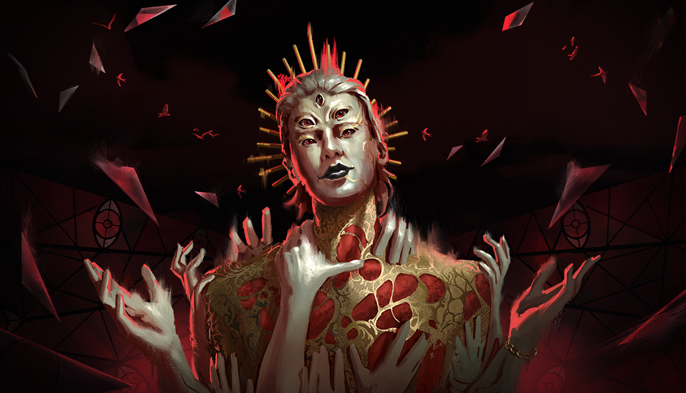

# live · 9.2.2_2821527live

| | |
|---|---|
| Build date | 2025-10-22 16:35 UTC |
| CDN version | `9.2.2_2821527live-1761150916` |
| Key | `9.2.2_live` |
| Compared with | [9.2.3_2820871live](../9.2.3_2820871live/CHANGES.md) (2025-10-22 16:04 UTC) |

## Summary

**2** added · **20** modified · **0** removed · 189 unchanged

## New or updated images

<a href="images/T_UI_SpecialPack_Rift3.png"></a>
<a href="images/T_UI_Specialpack_HauntedByDaylight2024.png"></a>

## Modified files

### [`catalog.json`](catalog.json)

[Full line-by-line diff](diffs/catalog.json.diff)

```diff
- $[id=K20_Body010]
- $[id=K20_Head010]
- $[id=K20_W010]
- $[id=K35_Body015]
- $[id=K35_Head015]
- $[id=K35_W015]
- $[id=K37_Body009]
- $[id=K37_Head009]
- $[id=K37_W009]
- $[id=K40_Body010]
- $[id=K40_Head010]
- $[id=K40_W010]
- $[id=MS_Head026]
- $[id=MS_Legs026]
- $[id=MS_Torso026]
- $[id=NA_011]
- $[id=NA_015]
- $[id=NA_BDG_02]
- $[id=NA_BDG_03]
- $[id=NA_BDG_07]
- $[id=NA_BNR_02]
- $[id=S22_Head013]
- $[id=S22_Legs013]
- $[id=S22_Torso013]
- $[id=S41_Head020]
- $[id=S41_Legs020]
- $[id=S41_Torso020]
- $[id=S44_Head011]
- $[id=S44_Legs011]
- $[id=S44_Torso011]
- $[id=K20_outfit_010]
- $[id=K35_outfit_015]
- $[id=K37_outfit_009]
- $[id=K40_outfit_010]
- $[id=MS_outfit_026]
- $[id=S22_outfit_013]
- $[id=S41_outfit_020]
- $[id=S44_outfit_011]
- $[id=Castlevania_Bundle_Maple]
- $[id=Cozy_Break_Bundle]
- $[id=Silent_Hill_Bundle_Maple]
```

### [`challengeLocs/challengeText_de.json`](challengeLocs/challengeText_de.json)

[Full line-by-line diff](diffs/challengeLocs/challengeText_de.json.diff)

```diff
- $.locText[432].text: "@#CHALLENGE_CompleteModeTrialOrTrial_TITLE"
+ $.locText[432].text: "Kapitelquests"
- $.locText[432].textId: "CHALLENGE_CompleteModeTrialOrTrial_TITLE"
+ $.locText[432].textId: "CHALLENGESET_ChapterQuests_TITLE"
- $.locText[433].text: "@#CHALLENGE_CompleteModeTrialOrTrial_DESC"
+ $.locText[433].text: "@#CHALLENGESET_ChapterQuests_INFO"
- $.locText[433].textId: "CHALLENGE_CompleteModeTrialOrTrial_DESC"
+ $.locText[433].textId: "CHALLENGESET_ChapterQuests_INFO"
- $.locText[434].text: "@#CHALLENGE_MoriOrEscape_TITLE"
+ $.locText[434].text: "Schließe {0} Kapitelquest(s) ab."
- $.locText[434].textId: "CHALLENGE_MoriOrEscape_TITLE"
+ $.locText[434].textId: "CHALLENGE_CompleteChapterQuests_INFO"
- $.locText[435].text: "@#CHALLENGE_MoriOrEscape_DESC"
+ $.locText[435].text: "@#CHALLENGE_PlayAsKillerOrAnyKiller_TITLE"
- $.locText[435].textId: "CHALLENGE_MoriOrEscape_DESC"
+ $.locText[435].textId: "CHALLENGE_PlayAsKillerOrAnyKiller_TITLE"
- $.locText[436].text: "Kapitelquests"
+ $.locText[436].text: "@#CHALLENGE_PlayAsKillerOrAnyKiller_DESC"
- $.locText[436].textId: "CHALLENGESET_ChapterQuests_TITLE"
+ $.locText[436].textId: "CHALLENGE_PlayAsKillerOrAnyKiller_DESC"
- $.locText[437].text: "@#CHALLENGESET_ChapterQuests_INFO"
+ $.locText[437].text: "Schließe {0} Prüfung(en) als ein beliebiger Killer ab."
- $.locText[437].textId: "CHALLENGESET_ChapterQuests_INFO"
+ $.locText[437].textId: "CHALLENGE_PlayAnyKiller_INFO"
- $.locText[438].text: "Schließe {0} Kapitelquest(s) ab."
+ $.locText[438].text: "@#CHALLENGE_PlayAsSurvivorOrAnySurvivor_TITLE"
- $.locText[438].textId: "CHALLENGE_CompleteChapterQuests_INFO"
+ $.locText[438].textId: "CHALLENGE_PlayAsSurvivorOrAnySurvivor_TITLE"
- $.locText[439].text: "@#CHALLENGE_PlayAsKillerOrAnyKiller_TITLE"
+ $.locText[439].text: "@#CHALLENGE_PlayAsSurvivorOrAnySurvivor_DESC"
- $.locText[439].textId: "CHALLENGE_PlayAsKillerOrAnyKiller_TITLE"
+ $.locText[439].textId: "CHALLENGE_PlayAsSurvivorOrAnySurvivor_DESC"
- $.locText[440].text: "@#CHALLENGE_PlayAsKillerOrAnyKiller_DESC"
+ $.locText[440].text: "Schließe {0} Prüfung(en) als ein beliebiger Überlebender ab."
- $.locText[440].textId: "CHALLENGE_PlayAsKillerOrAnyKiller_DESC"
+ $.locText[440].textId: "CHALLENGE_PlayAnySurvivor_INFO"
- $.locText[441].text: "Schließe {0} Prüfung(en) als ein beliebiger Killer ab."
+ $.locText[441].text: "@#CHALLENGE_HookAsKillerOrAnyKiller_TITLE"
- $.locText[441].textId: "CHALLENGE_PlayAnyKiller_INFO"
+ $.locText[441].textId: "CHALLENGE_HookAsKillerOrAnyKiller_TITLE"
- $.locText[442].text: "@#CHALLENGE_PlayAsSurvivorOrAnySurvivor_TITLE"
+ $.locText[442].text: "@#CHALLENGE_HookAsKillerOrAnyKiller_DESC"
- $.locText[442].textId: "CHALLENGE_PlayAsSurvivorOrAnySurvivor_TITLE"
+ $.locText[442].textId: "CHALLENGE_HookAsKillerOrAnyKiller_DESC"
- $.locText[443].text: "@#CHALLENGE_PlayAsSurvivorOrAnySurvivor_DESC"
+ $.locText[443].text: "Hake {0} Überlebende(n) als {1} fest."
- $.locText[443].textId: "CHALLENGE_PlayAsSurvivorOrAnySurvivor_DESC"
+ $.locText[443].textId: "CHALLENGE_HookAsKiller_INFO"
- $.locText[444].text: "Schließe {0} Prüfung(en) als ein beliebiger Überlebender ab."
+ $.locText[444].text: "Hake {0} Überlebende(n) als ein beliebiger Killer fest."
- $.locText[444].textId: "CHALLENGE_PlayAnySurvivor_INFO"
+ $.locText[444].textId: "CHALLENGE_HookAsAnyKiller_INFO"
- $.locText[445].text: "@#CHALLENGE_HookAsKillerOrAnyKiller_TITLE"
+ $.locText[445].text: "@#CHALLENGE_UnhookAsSurvivorOrAnySurvivor_TITLE"
- $.locText[445].textId: "CHALLENGE_HookAsKillerOrAnyKiller_TITLE"
+ $.locText[445].textId: "CHALLENGE_UnhookAsSurvivorOrAnySurvivor_TITLE"
- $.locText[446].text: "@#CHALLENGE_HookAsKillerOrAnyKiller_DESC"
+ $.locText[446].text: "@#CHALLENGE_UnhookAsSurvivorOrAnySurvivor_DESC"
- $.locText[446].textId: "CHALLENGE_HookAsKillerOrAnyKiller_DESC"
+ $.locText[446].textId: "CHALLENGE_UnhookAsSurvivorOrAnySurvivor_DESC"
- $.locText[447].text: "Hake {0} Überlebende(n) als {1} fest."
+ $.locText[447].text: "Rette {0} Überlebende(n) als {1} sicher vom Haken."
- $.locText[447].textId: "CHALLENGE_HookAsKiller_INFO"
+ $.locText[447].textId: "CHALLENGE_UnhookAsSurvivor_INFO"
- $.locText[448].text: "Hake {0} Überlebende(n) als ein beliebiger Killer fest."
+ $.locText[448].text: "Rette {0} Überlebende(n) als ein beliebiger Überlebender sicher vom Haken."
- $.locText[448].textId: "CHALLENGE_HookAsAnyKiller_INFO"
+ $.locText[448].textId: "CHALLENGE_UnhookAsAnySurvivor_INFO"
- $.locText[449].text: "@#CHALLENGE_UnhookAsSurvivorOrAnySurvivor_TITLE"
+ $.locText[449].text: "@#CHALLENGE_BreakGenAsKillerOrAnyKiller_TITLE"
- $.locText[449].textId: "CHALLENGE_UnhookAsSurvivorOrAnySurvivor_TITLE"
+ $.locText[449].textId: "CHALLENGE_BreakGenAsKillerOrAnyKiller_TITLE"
- $.locText[450].text: "@#CHALLENGE_UnhookAsSurvivorOrAnySurvivor_DESC"
+ $.locText[450].text: "@#CHALLENGE_BreakGenAsKillerOrAnyKiller_DESC"
- $.locText[450].textId: "CHALLENGE_UnhookAsSurvivorOrAnySurvivor_DESC"
+ $.locText[450].textId: "CHALLENGE_BreakGenAsKillerOrAnyKiller_DESC"
- $.locText[451].text: "Rette {0} Überlebende(n) als {1} sicher vom Haken."
+ $.locText[451].text: "Beschädige {0} Generator(en) als {1}."
- $.locText[451].textId: "CHALLENGE_UnhookAsSurvivor_INFO"
+ $.locText[451].textId: "CHALLENGE_BreakGenAsKiller_INFO"
- $.locText[452].text: "Rette {0} Überlebende(n) als ein beliebiger Überlebender sicher vom Haken."
+ $.locText[452].text: "Beschädige {0} Generator(en) als ein beliebiger Killer."
- $.locText[452].textId: "CHALLENGE_UnhookAsAnySurvivor_INFO"
+ $.locText[452].textId: "CHALLENGE_BreakGensAnyKiller_INFO"
- $.locText[453].text: "@#CHALLENGE_BreakGenAsKillerOrAnyKiller_TITLE"
+ $.locText[453].text: "@#CHALLENGE_RepairGenAsSurvivorOrAnySurvivor_TITLE"
- $.locText[453].textId: "CHALLENGE_BreakGenAsKillerOrAnyKiller_TITLE"
+ $.locText[453].textId: "CHALLENGE_RepairGenAsSurvivorOrAnySurvivor_TITLE"
- $.locText[454].text: "@#CHALLENGE_BreakGenAsKillerOrAnyKiller_DESC"
+ $.locText[454].text: "@#CHALLENGE_RepairGenAsSurvivorOrAnySurvivor_DESC"
- $.locText[454].textId: "CHALLENGE_BreakGenAsKillerOrAnyKiller_DESC"
+ $.locText[454].textId: "CHALLENGE_RepairGenAsSurvivorOrAnySurvivor_DESC"
- $.locText[455].text: "Beschädige {0} Generator(en) als {1}."
+ $.locText[455].text: "Repariere insgesamt {0} Generator(en) als {1}."
- $.locText[455].textId: "CHALLENGE_BreakGenAsKiller_INFO"
+ $.locText[455].textId: "CHALLENGE_RepairGenAsSurvivor_INFO"
- $.locText[456].text: "Beschädige {0} Generator(en) als ein beliebiger Killer."
+ $.locText[456].text: "Repariere insgesamt {0} Generator(en) als ein beliebiger Überlebender."
- $.locText[456].textId: "CHALLENGE_BreakGensAnyKiller_INFO"
+ $.locText[456].textId: "CHALLENGE_RepairGenAnySurvivor_INFO"
- $.locText[457].text: "@#CHALLENGE_RepairGenAsSurvivorOrAnySurvivor_TITLE"
+ $.locText[457].text: "Kapitel-Abschlussquests"
- $.locText[457].textId: "CHALLENGE_RepairGenAsSurvivorOrAnySurvivor_TITLE"
+ $.locText[457].textId: "LIST_OverarchingChapterQuests_TITLE"
- $.locText[458].text: "@#CHALLENGE_RepairGenAsSurvivorOrAnySurvivor_DESC"
+ $.locText[458].text: "KAPITELQUESTS – WOCHE 1"
- $.locText[458].textId: "CHALLENGE_RepairGenAsSurvivorOrAnySurvivor_DESC"
+ $.locText[458].textId: "LIST_ChapterQuests_TITLE_1"
- $.locText[459].text: "Repariere insgesamt {0} Generator(en) als {1}."
+ $.locText[459].text: "KAPITELQUESTS – WOCHE 2"
- $.locText[459].textId: "CHALLENGE_RepairGenAsSurvivor_INFO"
+ $.locText[459].textId: "LIST_ChapterQuests_TITLE_2"
- $.locText[460]
- $.locText[461]
- $.locText[462]
- $.locText[463]
```

### [`challengeLocs/challengeText_en.json`](challengeLocs/challengeText_en.json)

[Full line-by-line diff](diffs/challengeLocs/challengeText_en.json.diff)

```diff
- $.locText[432].text: "@#CHALLENGE_CompleteModeTrialOrTrial_TITLE"
+ $.locText[432].text: "Chapter Quests"
- $.locText[432].textId: "CHALLENGE_CompleteModeTrialOrTrial_TITLE"
+ $.locText[432].textId: "CHALLENGESET_ChapterQuests_TITLE"
- $.locText[433].text: "@#CHALLENGE_CompleteModeTrialOrTrial_DESC"
+ $.locText[433].text: "@#CHALLENGESET_ChapterQuests_INFO"
- $.locText[433].textId: "CHALLENGE_CompleteModeTrialOrTrial_DESC"
+ $.locText[433].textId: "CHALLENGESET_ChapterQuests_INFO"
- $.locText[434].text: "@#CHALLENGE_MoriOrEscape_TITLE"
+ $.locText[434].text: "Complete {0} Chapter quest(s)"
- $.locText[434].textId: "CHALLENGE_MoriOrEscape_TITLE"
+ $.locText[434].textId: "CHALLENGE_CompleteChapterQuests_INFO"
- $.locText[435].text: "@#CHALLENGE_MoriOrEscape_DESC"
+ $.locText[435].text: "@#CHALLENGE_PlayAsKillerOrAnyKiller_TITLE"
- $.locText[435].textId: "CHALLENGE_MoriOrEscape_DESC"
+ $.locText[435].textId: "CHALLENGE_PlayAsKillerOrAnyKiller_TITLE"
- $.locText[436].text: "Chapter Quests"
+ $.locText[436].text: "@#CHALLENGE_PlayAsKillerOrAnyKiller_DESC"
- $.locText[436].textId: "CHALLENGESET_ChapterQuests_TITLE"
+ $.locText[436].textId: "CHALLENGE_PlayAsKillerOrAnyKiller_DESC"
- $.locText[437].text: "@#CHALLENGESET_ChapterQuests_INFO"
+ $.locText[437].text: "Complete {0} trial(s) as any Killer"
- $.locText[437].textId: "CHALLENGESET_ChapterQuests_INFO"
+ $.locText[437].textId: "CHALLENGE_PlayAnyKiller_INFO"
- $.locText[438].text: "Complete {0} Chapter quest(s)"
+ $.locText[438].text: "@#CHALLENGE_PlayAsSurvivorOrAnySurvivor_TITLE"
- $.locText[438].textId: "CHALLENGE_CompleteChapterQuests_INFO"
+ $.locText[438].textId: "CHALLENGE_PlayAsSurvivorOrAnySurvivor_TITLE"
- $.locText[439].text: "@#CHALLENGE_PlayAsKillerOrAnyKiller_TITLE"
+ $.locText[439].text: "@#CHALLENGE_PlayAsSurvivorOrAnySurvivor_DESC"
- $.locText[439].textId: "CHALLENGE_PlayAsKillerOrAnyKiller_TITLE"
+ $.locText[439].textId: "CHALLENGE_PlayAsSurvivorOrAnySurvivor_DESC"
- $.locText[440].text: "@#CHALLENGE_PlayAsKillerOrAnyKiller_DESC"
+ $.locText[440].text: "Complete {0} trial(s) as any Survivor"
- $.locText[440].textId: "CHALLENGE_PlayAsKillerOrAnyKiller_DESC"
+ $.locText[440].textId: "CHALLENGE_PlayAnySurvivor_INFO"
- $.locText[441].text: "Complete {0} trial(s) as any Killer"
+ $.locText[441].text: "@#CHALLENGE_HookAsKillerOrAnyKiller_TITLE"
- $.locText[441].textId: "CHALLENGE_PlayAnyKiller_INFO"
+ $.locText[441].textId: "CHALLENGE_HookAsKillerOrAnyKiller_TITLE"
- $.locText[442].text: "@#CHALLENGE_PlayAsSurvivorOrAnySurvivor_TITLE"
+ $.locText[442].text: "@#CHALLENGE_HookAsKillerOrAnyKiller_DESC"
- $.locText[442].textId: "CHALLENGE_PlayAsSurvivorOrAnySurvivor_TITLE"
+ $.locText[442].textId: "CHALLENGE_HookAsKillerOrAnyKiller_DESC"
- $.locText[443].text: "@#CHALLENGE_PlayAsSurvivorOrAnySurvivor_DESC"
+ $.locText[443].text: "Hook {0} Survivor(s) as {1}"
- $.locText[443].textId: "CHALLENGE_PlayAsSurvivorOrAnySurvivor_DESC"
+ $.locText[443].textId: "CHALLENGE_HookAsKiller_INFO"
- $.locText[444].text: "Complete {0} trial(s) as any Survivor"
+ $.locText[444].text: "Hook {0} Survivor(s) as any Killer"
- $.locText[444].textId: "CHALLENGE_PlayAnySurvivor_INFO"
+ $.locText[444].textId: "CHALLENGE_HookAsAnyKiller_INFO"
- $.locText[445].text: "@#CHALLENGE_HookAsKillerOrAnyKiller_TITLE"
+ $.locText[445].text: "@#CHALLENGE_UnhookAsSurvivorOrAnySurvivor_TITLE"
- $.locText[445].textId: "CHALLENGE_HookAsKillerOrAnyKiller_TITLE"
+ $.locText[445].textId: "CHALLENGE_UnhookAsSurvivorOrAnySurvivor_TITLE"
- $.locText[446].text: "@#CHALLENGE_HookAsKillerOrAnyKiller_DESC"
+ $.locText[446].text: "@#CHALLENGE_UnhookAsSurvivorOrAnySurvivor_DESC"
- $.locText[446].textId: "CHALLENGE_HookAsKillerOrAnyKiller_DESC"
+ $.locText[446].textId: "CHALLENGE_UnhookAsSurvivorOrAnySurvivor_DESC"
- $.locText[447].text: "Hook {0} Survivor(s) as {1}"
+ $.locText[447].text: "Safely unhook {0} Survivor(s) as {1}"
- $.locText[447].textId: "CHALLENGE_HookAsKiller_INFO"
+ $.locText[447].textId: "CHALLENGE_UnhookAsSurvivor_INFO"
- $.locText[448].text: "Hook {0} Survivor(s) as any Killer"
+ $.locText[448].text: "Safely unhook {0} Survivor(s) as any Survivor"
- $.locText[448].textId: "CHALLENGE_HookAsAnyKiller_INFO"
+ $.locText[448].textId: "CHALLENGE_UnhookAsAnySurvivor_INFO"
- $.locText[449].text: "@#CHALLENGE_UnhookAsSurvivorOrAnySurvivor_TITLE"
+ $.locText[449].text: "@#CHALLENGE_BreakGenAsKillerOrAnyKiller_TITLE"
- $.locText[449].textId: "CHALLENGE_UnhookAsSurvivorOrAnySurvivor_TITLE"
+ $.locText[449].textId: "CHALLENGE_BreakGenAsKillerOrAnyKiller_TITLE"
- $.locText[450].text: "@#CHALLENGE_UnhookAsSurvivorOrAnySurvivor_DESC"
+ $.locText[450].text: "@#CHALLENGE_BreakGenAsKillerOrAnyKiller_DESC"
- $.locText[450].textId: "CHALLENGE_UnhookAsSurvivorOrAnySurvivor_DESC"
+ $.locText[450].textId: "CHALLENGE_BreakGenAsKillerOrAnyKiller_DESC"
- $.locText[451].text: "Safely unhook {0} Survivor(s) as {1}"
+ $.locText[451].text: "Damage {0} generator(s) as {1}"
- $.locText[451].textId: "CHALLENGE_UnhookAsSurvivor_INFO"
+ $.locText[451].textId: "CHALLENGE_BreakGenAsKiller_INFO"
- $.locText[452].text: "Safely unhook {0} Survivor(s) as any Survivor"
+ $.locText[452].text: "Damage {0} generator(s) as any Killer"
- $.locText[452].textId: "CHALLENGE_UnhookAsAnySurvivor_INFO"
+ $.locText[452].textId: "CHALLENGE_BreakGensAnyKiller_INFO"
- $.locText[453].text: "@#CHALLENGE_BreakGenAsKillerOrAnyKiller_TITLE"
+ $.locText[453].text: "@#CHALLENGE_RepairGenAsSurvivorOrAnySurvivor_TITLE"
- $.locText[453].textId: "CHALLENGE_BreakGenAsKillerOrAnyKiller_TITLE"
+ $.locText[453].textId: "CHALLENGE_RepairGenAsSurvivorOrAnySurvivor_TITLE"
- $.locText[454].text: "@#CHALLENGE_BreakGenAsKillerOrAnyKiller_DESC"
+ $.locText[454].text: "@#CHALLENGE_RepairGenAsSurvivorOrAnySurvivor_DESC"
- $.locText[454].textId: "CHALLENGE_BreakGenAsKillerOrAnyKiller_DESC"
+ $.locText[454].textId: "CHALLENGE_RepairGenAsSurvivorOrAnySurvivor_DESC"
- $.locText[455].text: "Damage {0} generator(s) as {1}"
+ $.locText[455].text: "Repair a total of {0} generator(s) as {1}"
- $.locText[455].textId: "CHALLENGE_BreakGenAsKiller_INFO"
+ $.locText[455].textId: "CHALLENGE_RepairGenAsSurvivor_INFO"
- $.locText[456].text: "Damage {0} generator(s) as any Killer"
+ $.locText[456].text: "Repair a total of {0} generator(s) as any Survivor"
- $.locText[456].textId: "CHALLENGE_BreakGensAnyKiller_INFO"
+ $.locText[456].textId: "CHALLENGE_RepairGenAnySurvivor_INFO"
- $.locText[457].text: "@#CHALLENGE_RepairGenAsSurvivorOrAnySurvivor_TITLE"
+ $.locText[457].text: "Chapter Completion Quests"
- $.locText[457].textId: "CHALLENGE_RepairGenAsSurvivorOrAnySurvivor_TITLE"
+ $.locText[457].textId: "LIST_OverarchingChapterQuests_TITLE"
- $.locText[458].text: "@#CHALLENGE_RepairGenAsSurvivorOrAnySurvivor_DESC"
+ $.locText[458].text: "CHAPTER QUESTS - WEEK 1"
- $.locText[458].textId: "CHALLENGE_RepairGenAsSurvivorOrAnySurvivor_DESC"
+ $.locText[458].textId: "LIST_ChapterQuests_TITLE_1"
- $.locText[459].text: "Repair a total of {0} generator(s) as {1}"
+ $.locText[459].text: "CHAPTER QUESTS - WEEK 2"
- $.locText[459].textId: "CHALLENGE_RepairGenAsSurvivor_INFO"
+ $.locText[459].textId: "LIST_ChapterQuests_TITLE_2"
- $.locText[460]
- $.locText[461]
- $.locText[462]
- $.locText[463]
```

### [`challengeLocs/challengeText_es-MX.json`](challengeLocs/challengeText_es-MX.json)

[Full line-by-line diff](diffs/challengeLocs/challengeText_es-MX.json.diff)

```diff
- $.locText[432].text: "@#CHALLENGE_CompleteModeTrialOrTrial_TITLE"
+ $.locText[432].text: "Misiones de capítulo"
- $.locText[432].textId: "CHALLENGE_CompleteModeTrialOrTrial_TITLE"
+ $.locText[432].textId: "CHALLENGESET_ChapterQuests_TITLE"
- $.locText[433].text: "@#CHALLENGE_CompleteModeTrialOrTrial_DESC"
+ $.locText[433].text: "@#CHALLENGESET_ChapterQuests_INFO"
- $.locText[433].textId: "CHALLENGE_CompleteModeTrialOrTrial_DESC"
+ $.locText[433].textId: "CHALLENGESET_ChapterQuests_INFO"
- $.locText[434].text: "@#CHALLENGE_MoriOrEscape_TITLE"
+ $.locText[434].text: "Completa {0} misión/misiones de capítulo."
- $.locText[434].textId: "CHALLENGE_MoriOrEscape_TITLE"
+ $.locText[434].textId: "CHALLENGE_CompleteChapterQuests_INFO"
- $.locText[435].text: "@#CHALLENGE_MoriOrEscape_DESC"
+ $.locText[435].text: "@#CHALLENGE_PlayAsKillerOrAnyKiller_TITLE"
- $.locText[435].textId: "CHALLENGE_MoriOrEscape_DESC"
+ $.locText[435].textId: "CHALLENGE_PlayAsKillerOrAnyKiller_TITLE"
- $.locText[436].text: "Misiones de capítulo"
+ $.locText[436].text: "@#CHALLENGE_PlayAsKillerOrAnyKiller_DESC"
- $.locText[436].textId: "CHALLENGESET_ChapterQuests_TITLE"
+ $.locText[436].textId: "CHALLENGE_PlayAsKillerOrAnyKiller_DESC"
- $.locText[437].text: "@#CHALLENGESET_ChapterQuests_INFO"
+ $.locText[437].text: "Como cualquier asesino, completa {0} partida(s)."
- $.locText[437].textId: "CHALLENGESET_ChapterQuests_INFO"
+ $.locText[437].textId: "CHALLENGE_PlayAnyKiller_INFO"
- $.locText[438].text: "Completa {0} misión/misiones de capítulo."
+ $.locText[438].text: "@#CHALLENGE_PlayAsSurvivorOrAnySurvivor_TITLE"
- $.locText[438].textId: "CHALLENGE_CompleteChapterQuests_INFO"
+ $.locText[438].textId: "CHALLENGE_PlayAsSurvivorOrAnySurvivor_TITLE"
- $.locText[439].text: "@#CHALLENGE_PlayAsKillerOrAnyKiller_TITLE"
+ $.locText[439].text: "@#CHALLENGE_PlayAsSurvivorOrAnySurvivor_DESC"
- $.locText[439].textId: "CHALLENGE_PlayAsKillerOrAnyKiller_TITLE"
+ $.locText[439].textId: "CHALLENGE_PlayAsSurvivorOrAnySurvivor_DESC"
- $.locText[440].text: "@#CHALLENGE_PlayAsKillerOrAnyKiller_DESC"
+ $.locText[440].text: "Como cualquier sobreviviente, completa {0} partida(s)."
- $.locText[440].textId: "CHALLENGE_PlayAsKillerOrAnyKiller_DESC"
+ $.locText[440].textId: "CHALLENGE_PlayAnySurvivor_INFO"
- $.locText[441].text: "Como cualquier asesino, completa {0} partida(s)."
+ $.locText[441].text: "@#CHALLENGE_HookAsKillerOrAnyKiller_TITLE"
- $.locText[441].textId: "CHALLENGE_PlayAnyKiller_INFO"
+ $.locText[441].textId: "CHALLENGE_HookAsKillerOrAnyKiller_TITLE"
- $.locText[442].text: "@#CHALLENGE_PlayAsSurvivorOrAnySurvivor_TITLE"
+ $.locText[442].text: "@#CHALLENGE_HookAsKillerOrAnyKiller_DESC"
- $.locText[442].textId: "CHALLENGE_PlayAsSurvivorOrAnySurvivor_TITLE"
+ $.locText[442].textId: "CHALLENGE_HookAsKillerOrAnyKiller_DESC"
- $.locText[443].text: "@#CHALLENGE_PlayAsSurvivorOrAnySurvivor_DESC"
+ $.locText[443].text: "Como {1}, cuelga a {0} sobreviviente(s)."
- $.locText[443].textId: "CHALLENGE_PlayAsSurvivorOrAnySurvivor_DESC"
+ $.locText[443].textId: "CHALLENGE_HookAsKiller_INFO"
- $.locText[444].text: "Como cualquier sobreviviente, completa {0} partida(s)."
+ $.locText[444].text: "Como cualquier asesino, cuelga a {0} sobreviviente(s)."
- $.locText[444].textId: "CHALLENGE_PlayAnySurvivor_INFO"
+ $.locText[444].textId: "CHALLENGE_HookAsAnyKiller_INFO"
- $.locText[445].text: "@#CHALLENGE_HookAsKillerOrAnyKiller_TITLE"
+ $.locText[445].text: "@#CHALLENGE_UnhookAsSurvivorOrAnySurvivor_TITLE"
- $.locText[445].textId: "CHALLENGE_HookAsKillerOrAnyKiller_TITLE"
+ $.locText[445].textId: "CHALLENGE_UnhookAsSurvivorOrAnySurvivor_TITLE"
- $.locText[446].text: "@#CHALLENGE_HookAsKillerOrAnyKiller_DESC"
+ $.locText[446].text: "@#CHALLENGE_UnhookAsSurvivorOrAnySurvivor_DESC"
- $.locText[446].textId: "CHALLENGE_HookAsKillerOrAnyKiller_DESC"
+ $.locText[446].textId: "CHALLENGE_UnhookAsSurvivorOrAnySurvivor_DESC"
- $.locText[447].text: "Como {1}, cuelga a {0} sobreviviente(s)."
+ $.locText[447].text: "Como {1}, descuelga de forma segura a {0} sobreviviente(s)."
- $.locText[447].textId: "CHALLENGE_HookAsKiller_INFO"
+ $.locText[447].textId: "CHALLENGE_UnhookAsSurvivor_INFO"
- $.locText[448].text: "Como cualquier asesino, cuelga a {0} sobreviviente(s)."
+ $.locText[448].text: "Como cualquier sobreviviente, descuelga de forma segura a {0} sobreviviente(s)."
- $.locText[448].textId: "CHALLENGE_HookAsAnyKiller_INFO"
+ $.locText[448].textId: "CHALLENGE_UnhookAsAnySurvivor_INFO"
- $.locText[449].text: "@#CHALLENGE_UnhookAsSurvivorOrAnySurvivor_TITLE"
+ $.locText[449].text: "@#CHALLENGE_BreakGenAsKillerOrAnyKiller_TITLE"
- $.locText[449].textId: "CHALLENGE_UnhookAsSurvivorOrAnySurvivor_TITLE"
+ $.locText[449].textId: "CHALLENGE_BreakGenAsKillerOrAnyKiller_TITLE"
- $.locText[450].text: "@#CHALLENGE_UnhookAsSurvivorOrAnySurvivor_DESC"
+ $.locText[450].text: "@#CHALLENGE_BreakGenAsKillerOrAnyKiller_DESC"
- $.locText[450].textId: "CHALLENGE_UnhookAsSurvivorOrAnySurvivor_DESC"
+ $.locText[450].textId: "CHALLENGE_BreakGenAsKillerOrAnyKiller_DESC"
- $.locText[451].text: "Como {1}, descuelga de forma segura a {0} sobreviviente(s)."
+ $.locText[451].text: "Como {1}, daña {0} generador(es)."
- $.locText[451].textId: "CHALLENGE_UnhookAsSurvivor_INFO"
+ $.locText[451].textId: "CHALLENGE_BreakGenAsKiller_INFO"
- $.locText[452].text: "Como cualquier sobreviviente, descuelga de forma segura a {0} sobreviviente(s)."
+ $.locText[452].text: "Como cualquier asesino, daña {0} generador(es)."
- $.locText[452].textId: "CHALLENGE_UnhookAsAnySurvivor_INFO"
+ $.locText[452].textId: "CHALLENGE_BreakGensAnyKiller_INFO"
- $.locText[453].text: "@#CHALLENGE_BreakGenAsKillerOrAnyKiller_TITLE"
+ $.locText[453].text: "@#CHALLENGE_RepairGenAsSurvivorOrAnySurvivor_TITLE"
- $.locText[453].textId: "CHALLENGE_BreakGenAsKillerOrAnyKiller_TITLE"
+ $.locText[453].textId: "CHALLENGE_RepairGenAsSurvivorOrAnySurvivor_TITLE"
- $.locText[454].text: "@#CHALLENGE_BreakGenAsKillerOrAnyKiller_DESC"
+ $.locText[454].text: "@#CHALLENGE_RepairGenAsSurvivorOrAnySurvivor_DESC"
- $.locText[454].textId: "CHALLENGE_BreakGenAsKillerOrAnyKiller_DESC"
+ $.locText[454].textId: "CHALLENGE_RepairGenAsSurvivorOrAnySurvivor_DESC"
- $.locText[455].text: "Como {1}, daña {0} generador(es)."
+ $.locText[455].text: "Como {1}, repara un total de {0} generador(es)."
- $.locText[455].textId: "CHALLENGE_BreakGenAsKiller_INFO"
+ $.locText[455].textId: "CHALLENGE_RepairGenAsSurvivor_INFO"
- $.locText[456].text: "Como cualquier asesino, daña {0} generador(es)."
+ $.locText[456].text: "Como cualquier sobreviviente, repara un total de {0} generador(es)."
- $.locText[456].textId: "CHALLENGE_BreakGensAnyKiller_INFO"
+ $.locText[456].textId: "CHALLENGE_RepairGenAnySurvivor_INFO"
- $.locText[457].text: "@#CHALLENGE_RepairGenAsSurvivorOrAnySurvivor_TITLE"
+ $.locText[457].text: "Misiones de finalización de capítulo"
- $.locText[457].textId: "CHALLENGE_RepairGenAsSurvivorOrAnySurvivor_TITLE"
+ $.locText[457].textId: "LIST_OverarchingChapterQuests_TITLE"
- $.locText[458].text: "@#CHALLENGE_RepairGenAsSurvivorOrAnySurvivor_DESC"
+ $.locText[458].text: "MISIONES DE CAPÍTULO - SEMANA 1"
- $.locText[458].textId: "CHALLENGE_RepairGenAsSurvivorOrAnySurvivor_DESC"
+ $.locText[458].textId: "LIST_ChapterQuests_TITLE_1"
- $.locText[459].text: "Como {1}, repara un total de {0} generador(es)."
+ $.locText[459].text: "MISIONES DE CAPÍTULO - SEMANA 2"
- $.locText[459].textId: "CHALLENGE_RepairGenAsSurvivor_INFO"
+ $.locText[459].textId: "LIST_ChapterQuests_TITLE_2"
- $.locText[460]
- $.locText[461]
- $.locText[462]
- $.locText[463]
```

### [`challengeLocs/challengeText_es.json`](challengeLocs/challengeText_es.json)

[Full line-by-line diff](diffs/challengeLocs/challengeText_es.json.diff)

```diff
- $.locText[432].text: "@#CHALLENGE_CompleteModeTrialOrTrial_TITLE"
+ $.locText[432].text: "Misiones del capítulo"
- $.locText[432].textId: "CHALLENGE_CompleteModeTrialOrTrial_TITLE"
+ $.locText[432].textId: "CHALLENGESET_ChapterQuests_TITLE"
- $.locText[433].text: "@#CHALLENGE_CompleteModeTrialOrTrial_DESC"
+ $.locText[433].text: "@#CHALLENGESET_ChapterQuests_INFO"
- $.locText[433].textId: "CHALLENGE_CompleteModeTrialOrTrial_DESC"
+ $.locText[433].textId: "CHALLENGESET_ChapterQuests_INFO"
- $.locText[434].text: "@#CHALLENGE_MoriOrEscape_TITLE"
+ $.locText[434].text: "Completa {0} misión/misiones de capítulo."
- $.locText[434].textId: "CHALLENGE_MoriOrEscape_TITLE"
+ $.locText[434].textId: "CHALLENGE_CompleteChapterQuests_INFO"
- $.locText[435].text: "@#CHALLENGE_MoriOrEscape_DESC"
+ $.locText[435].text: "@#CHALLENGE_PlayAsKillerOrAnyKiller_TITLE"
- $.locText[435].textId: "CHALLENGE_MoriOrEscape_DESC"
+ $.locText[435].textId: "CHALLENGE_PlayAsKillerOrAnyKiller_TITLE"
- $.locText[436].text: "Misiones del capítulo"
+ $.locText[436].text: "@#CHALLENGE_PlayAsKillerOrAnyKiller_DESC"
- $.locText[436].textId: "CHALLENGESET_ChapterQuests_TITLE"
+ $.locText[436].textId: "CHALLENGE_PlayAsKillerOrAnyKiller_DESC"
- $.locText[437].text: "@#CHALLENGESET_ChapterQuests_INFO"
+ $.locText[437].text: "Completa {0} partida(s) con cualquier asesino."
- $.locText[437].textId: "CHALLENGESET_ChapterQuests_INFO"
+ $.locText[437].textId: "CHALLENGE_PlayAnyKiller_INFO"
- $.locText[438].text: "Completa {0} misión/misiones de capítulo."
+ $.locText[438].text: "@#CHALLENGE_PlayAsSurvivorOrAnySurvivor_TITLE"
- $.locText[438].textId: "CHALLENGE_CompleteChapterQuests_INFO"
+ $.locText[438].textId: "CHALLENGE_PlayAsSurvivorOrAnySurvivor_TITLE"
- $.locText[439].text: "@#CHALLENGE_PlayAsKillerOrAnyKiller_TITLE"
+ $.locText[439].text: "@#CHALLENGE_PlayAsSurvivorOrAnySurvivor_DESC"
- $.locText[439].textId: "CHALLENGE_PlayAsKillerOrAnyKiller_TITLE"
+ $.locText[439].textId: "CHALLENGE_PlayAsSurvivorOrAnySurvivor_DESC"
- $.locText[440].text: "@#CHALLENGE_PlayAsKillerOrAnyKiller_DESC"
+ $.locText[440].text: "Completa {0} partida(s) con cualquier superviviente."
- $.locText[440].textId: "CHALLENGE_PlayAsKillerOrAnyKiller_DESC"
+ $.locText[440].textId: "CHALLENGE_PlayAnySurvivor_INFO"
- $.locText[441].text: "Completa {0} partida(s) con cualquier asesino."
+ $.locText[441].text: "@#CHALLENGE_HookAsKillerOrAnyKiller_TITLE"
- $.locText[441].textId: "CHALLENGE_PlayAnyKiller_INFO"
+ $.locText[441].textId: "CHALLENGE_HookAsKillerOrAnyKiller_TITLE"
- $.locText[442].text: "@#CHALLENGE_PlayAsSurvivorOrAnySurvivor_TITLE"
+ $.locText[442].text: "@#CHALLENGE_HookAsKillerOrAnyKiller_DESC"
- $.locText[442].textId: "CHALLENGE_PlayAsSurvivorOrAnySurvivor_TITLE"
+ $.locText[442].textId: "CHALLENGE_HookAsKillerOrAnyKiller_DESC"
- $.locText[443].text: "@#CHALLENGE_PlayAsSurvivorOrAnySurvivor_DESC"
+ $.locText[443].text: "Cuelga a {0} superviviente(s) con {1}."
- $.locText[443].textId: "CHALLENGE_PlayAsSurvivorOrAnySurvivor_DESC"
+ $.locText[443].textId: "CHALLENGE_HookAsKiller_INFO"
- $.locText[444].text: "Completa {0} partida(s) con cualquier superviviente."
+ $.locText[444].text: "Cuelga a {0} superviviente(s) con cualquier asesino."
- $.locText[444].textId: "CHALLENGE_PlayAnySurvivor_INFO"
+ $.locText[444].textId: "CHALLENGE_HookAsAnyKiller_INFO"
- $.locText[445].text: "@#CHALLENGE_HookAsKillerOrAnyKiller_TITLE"
+ $.locText[445].text: "@#CHALLENGE_UnhookAsSurvivorOrAnySurvivor_TITLE"
- $.locText[445].textId: "CHALLENGE_HookAsKillerOrAnyKiller_TITLE"
+ $.locText[445].textId: "CHALLENGE_UnhookAsSurvivorOrAnySurvivor_TITLE"
- $.locText[446].text: "@#CHALLENGE_HookAsKillerOrAnyKiller_DESC"
+ $.locText[446].text: "@#CHALLENGE_UnhookAsSurvivorOrAnySurvivor_DESC"
- $.locText[446].textId: "CHALLENGE_HookAsKillerOrAnyKiller_DESC"
+ $.locText[446].textId: "CHALLENGE_UnhookAsSurvivorOrAnySurvivor_DESC"
- $.locText[447].text: "Cuelga a {0} superviviente(s) con {1}."
+ $.locText[447].text: "Desengancha a {0} superviviente(s) de forma segura con {1}."
- $.locText[447].textId: "CHALLENGE_HookAsKiller_INFO"
+ $.locText[447].textId: "CHALLENGE_UnhookAsSurvivor_INFO"
- $.locText[448].text: "Cuelga a {0} superviviente(s) con cualquier asesino."
+ $.locText[448].text: "Desengancha a {0} superviviente(s) de forma segura con cualquier superviviente."
- $.locText[448].textId: "CHALLENGE_HookAsAnyKiller_INFO"
+ $.locText[448].textId: "CHALLENGE_UnhookAsAnySurvivor_INFO"
- $.locText[449].text: "@#CHALLENGE_UnhookAsSurvivorOrAnySurvivor_TITLE"
+ $.locText[449].text: "@#CHALLENGE_BreakGenAsKillerOrAnyKiller_TITLE"
- $.locText[449].textId: "CHALLENGE_UnhookAsSurvivorOrAnySurvivor_TITLE"
+ $.locText[449].textId: "CHALLENGE_BreakGenAsKillerOrAnyKiller_TITLE"
- $.locText[450].text: "@#CHALLENGE_UnhookAsSurvivorOrAnySurvivor_DESC"
+ $.locText[450].text: "@#CHALLENGE_BreakGenAsKillerOrAnyKiller_DESC"
- $.locText[450].textId: "CHALLENGE_UnhookAsSurvivorOrAnySurvivor_DESC"
+ $.locText[450].textId: "CHALLENGE_BreakGenAsKillerOrAnyKiller_DESC"
- $.locText[451].text: "Desengancha a {0} superviviente(s) de forma segura con {1}."
+ $.locText[451].text: "Daña {0} generador(es) con {1}."
- $.locText[451].textId: "CHALLENGE_UnhookAsSurvivor_INFO"
+ $.locText[451].textId: "CHALLENGE_BreakGenAsKiller_INFO"
- $.locText[452].text: "Desengancha a {0} superviviente(s) de forma segura con cualquier superviviente."
+ $.locText[452].text: "Daña {0} generador(es) con cualquier asesino."
- $.locText[452].textId: "CHALLENGE_UnhookAsAnySurvivor_INFO"
+ $.locText[452].textId: "CHALLENGE_BreakGensAnyKiller_INFO"
- $.locText[453].text: "@#CHALLENGE_BreakGenAsKillerOrAnyKiller_TITLE"
+ $.locText[453].text: "@#CHALLENGE_RepairGenAsSurvivorOrAnySurvivor_TITLE"
- $.locText[453].textId: "CHALLENGE_BreakGenAsKillerOrAnyKiller_TITLE"
+ $.locText[453].textId: "CHALLENGE_RepairGenAsSurvivorOrAnySurvivor_TITLE"
- $.locText[454].text: "@#CHALLENGE_BreakGenAsKillerOrAnyKiller_DESC"
+ $.locText[454].text: "@#CHALLENGE_RepairGenAsSurvivorOrAnySurvivor_DESC"
- $.locText[454].textId: "CHALLENGE_BreakGenAsKillerOrAnyKiller_DESC"
+ $.locText[454].textId: "CHALLENGE_RepairGenAsSurvivorOrAnySurvivor_DESC"
- $.locText[455].text: "Daña {0} generador(es) con {1}."
+ $.locText[455].text: "Repara un total de {0} generador(es) con {1}."
- $.locText[455].textId: "CHALLENGE_BreakGenAsKiller_INFO"
+ $.locText[455].textId: "CHALLENGE_RepairGenAsSurvivor_INFO"
- $.locText[456].text: "Daña {0} generador(es) con cualquier asesino."
+ $.locText[456].text: "Repara un total de {0} generador(es) con cualquier superviviente."
- $.locText[456].textId: "CHALLENGE_BreakGensAnyKiller_INFO"
+ $.locText[456].textId: "CHALLENGE_RepairGenAnySurvivor_INFO"
- $.locText[457].text: "@#CHALLENGE_RepairGenAsSurvivorOrAnySurvivor_TITLE"
+ $.locText[457].text: "Misiones de finalización de capítulo"
- $.locText[457].textId: "CHALLENGE_RepairGenAsSurvivorOrAnySurvivor_TITLE"
+ $.locText[457].textId: "LIST_OverarchingChapterQuests_TITLE"
- $.locText[458].text: "@#CHALLENGE_RepairGenAsSurvivorOrAnySurvivor_DESC"
+ $.locText[458].text: "MISIONES DEL CAPÍTULO - SEMANA 1"
- $.locText[458].textId: "CHALLENGE_RepairGenAsSurvivorOrAnySurvivor_DESC"
+ $.locText[458].textId: "LIST_ChapterQuests_TITLE_1"
- $.locText[459].text: "Repara un total de {0} generador(es) con {1}."
+ $.locText[459].text: "MISIONES DEL CAPÍTULO - SEMANA 2"
- $.locText[459].textId: "CHALLENGE_RepairGenAsSurvivor_INFO"
+ $.locText[459].textId: "LIST_ChapterQuests_TITLE_2"
- $.locText[460]
- $.locText[461]
- $.locText[462]
- $.locText[463]
```

### [`challengeLocs/challengeText_fr.json`](challengeLocs/challengeText_fr.json)

[Full line-by-line diff](diffs/challengeLocs/challengeText_fr.json.diff)

```diff
- $.locText[432].text: "@#CHALLENGE_CompleteModeTrialOrTrial_TITLE"
+ $.locText[432].text: "Quêtes de chapitre"
- $.locText[432].textId: "CHALLENGE_CompleteModeTrialOrTrial_TITLE"
+ $.locText[432].textId: "CHALLENGESET_ChapterQuests_TITLE"
- $.locText[433].text: "@#CHALLENGE_CompleteModeTrialOrTrial_DESC"
+ $.locText[433].text: "@#CHALLENGESET_ChapterQuests_INFO"
- $.locText[433].textId: "CHALLENGE_CompleteModeTrialOrTrial_DESC"
+ $.locText[433].textId: "CHALLENGESET_ChapterQuests_INFO"
- $.locText[434].text: "@#CHALLENGE_MoriOrEscape_TITLE"
+ $.locText[434].text: "Accomplir {0} quête(s) de chapitre"
- $.locText[434].textId: "CHALLENGE_MoriOrEscape_TITLE"
+ $.locText[434].textId: "CHALLENGE_CompleteChapterQuests_INFO"
- $.locText[435].text: "@#CHALLENGE_MoriOrEscape_DESC"
+ $.locText[435].text: "@#CHALLENGE_PlayAsKillerOrAnyKiller_TITLE"
- $.locText[435].textId: "CHALLENGE_MoriOrEscape_DESC"
+ $.locText[435].textId: "CHALLENGE_PlayAsKillerOrAnyKiller_TITLE"
- $.locText[436].text: "Quêtes de chapitre"
+ $.locText[436].text: "@#CHALLENGE_PlayAsKillerOrAnyKiller_DESC"
- $.locText[436].textId: "CHALLENGESET_ChapterQuests_TITLE"
+ $.locText[436].textId: "CHALLENGE_PlayAsKillerOrAnyKiller_DESC"
- $.locText[437].text: "@#CHALLENGESET_ChapterQuests_INFO"
+ $.locText[437].text: "Avec n’importe quel tueur, terminer {0} épreuve(s)"
- $.locText[437].textId: "CHALLENGESET_ChapterQuests_INFO"
+ $.locText[437].textId: "CHALLENGE_PlayAnyKiller_INFO"
- $.locText[438].text: "Accomplir {0} quête(s) de chapitre"
+ $.locText[438].text: "@#CHALLENGE_PlayAsSurvivorOrAnySurvivor_TITLE"
- $.locText[438].textId: "CHALLENGE_CompleteChapterQuests_INFO"
+ $.locText[438].textId: "CHALLENGE_PlayAsSurvivorOrAnySurvivor_TITLE"
- $.locText[439].text: "@#CHALLENGE_PlayAsKillerOrAnyKiller_TITLE"
+ $.locText[439].text: "@#CHALLENGE_PlayAsSurvivorOrAnySurvivor_DESC"
- $.locText[439].textId: "CHALLENGE_PlayAsKillerOrAnyKiller_TITLE"
+ $.locText[439].textId: "CHALLENGE_PlayAsSurvivorOrAnySurvivor_DESC"
- $.locText[440].text: "@#CHALLENGE_PlayAsKillerOrAnyKiller_DESC"
+ $.locText[440].text: "Avec n’importe quel survivant, terminer {0} épreuve(s)"
- $.locText[440].textId: "CHALLENGE_PlayAsKillerOrAnyKiller_DESC"
+ $.locText[440].textId: "CHALLENGE_PlayAnySurvivor_INFO"
- $.locText[441].text: "Avec n’importe quel tueur, terminer {0} épreuve(s)"
+ $.locText[441].text: "@#CHALLENGE_HookAsKillerOrAnyKiller_TITLE"
- $.locText[441].textId: "CHALLENGE_PlayAnyKiller_INFO"
+ $.locText[441].textId: "CHALLENGE_HookAsKillerOrAnyKiller_TITLE"
- $.locText[442].text: "@#CHALLENGE_PlayAsSurvivorOrAnySurvivor_TITLE"
+ $.locText[442].text: "@#CHALLENGE_HookAsKillerOrAnyKiller_DESC"
- $.locText[442].textId: "CHALLENGE_PlayAsSurvivorOrAnySurvivor_TITLE"
+ $.locText[442].textId: "CHALLENGE_HookAsKillerOrAnyKiller_DESC"
- $.locText[443].text: "@#CHALLENGE_PlayAsSurvivorOrAnySurvivor_DESC"
+ $.locText[443].text: "Avec {1}, accrocher {0} survivant(s)"
- $.locText[443].textId: "CHALLENGE_PlayAsSurvivorOrAnySurvivor_DESC"
+ $.locText[443].textId: "CHALLENGE_HookAsKiller_INFO"
- $.locText[444].text: "Avec n’importe quel survivant, terminer {0} épreuve(s)"
+ $.locText[444].text: "Avec n’importe quel tueur, accrocher {0} survivant(s)"
- $.locText[444].textId: "CHALLENGE_PlayAnySurvivor_INFO"
+ $.locText[444].textId: "CHALLENGE_HookAsAnyKiller_INFO"
- $.locText[445].text: "@#CHALLENGE_HookAsKillerOrAnyKiller_TITLE"
+ $.locText[445].text: "@#CHALLENGE_UnhookAsSurvivorOrAnySurvivor_TITLE"
- $.locText[445].textId: "CHALLENGE_HookAsKillerOrAnyKiller_TITLE"
+ $.locText[445].textId: "CHALLENGE_UnhookAsSurvivorOrAnySurvivor_TITLE"
- $.locText[446].text: "@#CHALLENGE_HookAsKillerOrAnyKiller_DESC"
+ $.locText[446].text: "@#CHALLENGE_UnhookAsSurvivorOrAnySurvivor_DESC"
- $.locText[446].textId: "CHALLENGE_HookAsKillerOrAnyKiller_DESC"
+ $.locText[446].textId: "CHALLENGE_UnhookAsSurvivorOrAnySurvivor_DESC"
- $.locText[447].text: "Avec {1}, accrocher {0} survivant(s)"
+ $.locText[447].text: "Avec {1}, décrocher {0} survivant(s) de façon sécurisée"
- $.locText[447].textId: "CHALLENGE_HookAsKiller_INFO"
+ $.locText[447].textId: "CHALLENGE_UnhookAsSurvivor_INFO"
- $.locText[448].text: "Avec n’importe quel tueur, accrocher {0} survivant(s)"
+ $.locText[448].text: "Avec n’importe quel survivant, décrocher {0} survivant(s) de façon sécurisée"
- $.locText[448].textId: "CHALLENGE_HookAsAnyKiller_INFO"
+ $.locText[448].textId: "CHALLENGE_UnhookAsAnySurvivor_INFO"
- $.locText[449].text: "@#CHALLENGE_UnhookAsSurvivorOrAnySurvivor_TITLE"
+ $.locText[449].text: "@#CHALLENGE_BreakGenAsKillerOrAnyKiller_TITLE"
- $.locText[449].textId: "CHALLENGE_UnhookAsSurvivorOrAnySurvivor_TITLE"
+ $.locText[449].textId: "CHALLENGE_BreakGenAsKillerOrAnyKiller_TITLE"
- $.locText[450].text: "@#CHALLENGE_UnhookAsSurvivorOrAnySurvivor_DESC"
+ $.locText[450].text: "@#CHALLENGE_BreakGenAsKillerOrAnyKiller_DESC"
- $.locText[450].textId: "CHALLENGE_UnhookAsSurvivorOrAnySurvivor_DESC"
+ $.locText[450].textId: "CHALLENGE_BreakGenAsKillerOrAnyKiller_DESC"
- $.locText[451].text: "Avec {1}, décrocher {0} survivant(s) de façon sécurisée"
+ $.locText[451].text: "Avec {1}, endommager {0} générateur(s)"
- $.locText[451].textId: "CHALLENGE_UnhookAsSurvivor_INFO"
+ $.locText[451].textId: "CHALLENGE_BreakGenAsKiller_INFO"
- $.locText[452].text: "Avec n’importe quel survivant, décrocher {0} survivant(s) de façon sécurisée"
+ $.locText[452].text: "Avec n’importe quel tueur, endommager {0} générateur(s)"
- $.locText[452].textId: "CHALLENGE_UnhookAsAnySurvivor_INFO"
+ $.locText[452].textId: "CHALLENGE_BreakGensAnyKiller_INFO"
- $.locText[453].text: "@#CHALLENGE_BreakGenAsKillerOrAnyKiller_TITLE"
+ $.locText[453].text: "@#CHALLENGE_RepairGenAsSurvivorOrAnySurvivor_TITLE"
- $.locText[453].textId: "CHALLENGE_BreakGenAsKillerOrAnyKiller_TITLE"
+ $.locText[453].textId: "CHALLENGE_RepairGenAsSurvivorOrAnySurvivor_TITLE"
- $.locText[454].text: "@#CHALLENGE_BreakGenAsKillerOrAnyKiller_DESC"
+ $.locText[454].text: "@#CHALLENGE_RepairGenAsSurvivorOrAnySurvivor_DESC"
- $.locText[454].textId: "CHALLENGE_BreakGenAsKillerOrAnyKiller_DESC"
+ $.locText[454].textId: "CHALLENGE_RepairGenAsSurvivorOrAnySurvivor_DESC"
- $.locText[455].text: "Avec {1}, endommager {0} générateur(s)"
+ $.locText[455].text: "Avec {1}, réparer {0} générateur(s) au total"
- $.locText[455].textId: "CHALLENGE_BreakGenAsKiller_INFO"
+ $.locText[455].textId: "CHALLENGE_RepairGenAsSurvivor_INFO"
- $.locText[456].text: "Avec n’importe quel tueur, endommager {0} générateur(s)"
+ $.locText[456].text: "Avec n’importe quel survivant, réparer {0} générateur(s) au total"
- $.locText[456].textId: "CHALLENGE_BreakGensAnyKiller_INFO"
+ $.locText[456].textId: "CHALLENGE_RepairGenAnySurvivor_INFO"
- $.locText[457].text: "@#CHALLENGE_RepairGenAsSurvivorOrAnySurvivor_TITLE"
+ $.locText[457].text: "Quêtes d’accomplissement de chapitre"
- $.locText[457].textId: "CHALLENGE_RepairGenAsSurvivorOrAnySurvivor_TITLE"
+ $.locText[457].textId: "LIST_OverarchingChapterQuests_TITLE"
- $.locText[458].text: "@#CHALLENGE_RepairGenAsSurvivorOrAnySurvivor_DESC"
+ $.locText[458].text: "QUÊTES DU CHAPITRE - SEMAINE 1"
- $.locText[458].textId: "CHALLENGE_RepairGenAsSurvivorOrAnySurvivor_DESC"
+ $.locText[458].textId: "LIST_ChapterQuests_TITLE_1"
- $.locText[459].text: "Avec {1}, réparer {0} générateur(s) au total"
+ $.locText[459].text: "QUÊTES DU CHAPITRE - SEMAINE 2"
- $.locText[459].textId: "CHALLENGE_RepairGenAsSurvivor_INFO"
+ $.locText[459].textId: "LIST_ChapterQuests_TITLE_2"
- $.locText[460]
- $.locText[461]
- $.locText[462]
- $.locText[463]
```

### [`challengeLocs/challengeText_it.json`](challengeLocs/challengeText_it.json)

[Full line-by-line diff](diffs/challengeLocs/challengeText_it.json.diff)

```diff
- $.locText[432].text: "@#CHALLENGE_CompleteModeTrialOrTrial_TITLE"
+ $.locText[432].text: "Missioni del capitolo"
- $.locText[432].textId: "CHALLENGE_CompleteModeTrialOrTrial_TITLE"
+ $.locText[432].textId: "CHALLENGESET_ChapterQuests_TITLE"
- $.locText[433].text: "@#CHALLENGE_CompleteModeTrialOrTrial_DESC"
+ $.locText[433].text: "@#CHALLENGESET_ChapterQuests_INFO"
- $.locText[433].textId: "CHALLENGE_CompleteModeTrialOrTrial_DESC"
+ $.locText[433].textId: "CHALLENGESET_ChapterQuests_INFO"
- $.locText[434].text: "@#CHALLENGE_MoriOrEscape_TITLE"
+ $.locText[434].text: "Completa {0} missione/i del capitolo"
- $.locText[434].textId: "CHALLENGE_MoriOrEscape_TITLE"
+ $.locText[434].textId: "CHALLENGE_CompleteChapterQuests_INFO"
- $.locText[435].text: "@#CHALLENGE_MoriOrEscape_DESC"
+ $.locText[435].text: "@#CHALLENGE_PlayAsKillerOrAnyKiller_TITLE"
- $.locText[435].textId: "CHALLENGE_MoriOrEscape_DESC"
+ $.locText[435].textId: "CHALLENGE_PlayAsKillerOrAnyKiller_TITLE"
- $.locText[436].text: "Missioni del capitolo"
+ $.locText[436].text: "@#CHALLENGE_PlayAsKillerOrAnyKiller_DESC"
- $.locText[436].textId: "CHALLENGESET_ChapterQuests_TITLE"
+ $.locText[436].textId: "CHALLENGE_PlayAsKillerOrAnyKiller_DESC"
- $.locText[437].text: "@#CHALLENGESET_ChapterQuests_INFO"
+ $.locText[437].text: "Completa {0} prova/e con qualunque killer"
- $.locText[437].textId: "CHALLENGESET_ChapterQuests_INFO"
+ $.locText[437].textId: "CHALLENGE_PlayAnyKiller_INFO"
- $.locText[438].text: "Completa {0} missione/i del capitolo"
+ $.locText[438].text: "@#CHALLENGE_PlayAsSurvivorOrAnySurvivor_TITLE"
- $.locText[438].textId: "CHALLENGE_CompleteChapterQuests_INFO"
+ $.locText[438].textId: "CHALLENGE_PlayAsSurvivorOrAnySurvivor_TITLE"
- $.locText[439].text: "@#CHALLENGE_PlayAsKillerOrAnyKiller_TITLE"
+ $.locText[439].text: "@#CHALLENGE_PlayAsSurvivorOrAnySurvivor_DESC"
- $.locText[439].textId: "CHALLENGE_PlayAsKillerOrAnyKiller_TITLE"
+ $.locText[439].textId: "CHALLENGE_PlayAsSurvivorOrAnySurvivor_DESC"
- $.locText[440].text: "@#CHALLENGE_PlayAsKillerOrAnyKiller_DESC"
+ $.locText[440].text: "Completa {0} prova/e con qualunque sopravvissuto"
- $.locText[440].textId: "CHALLENGE_PlayAsKillerOrAnyKiller_DESC"
+ $.locText[440].textId: "CHALLENGE_PlayAnySurvivor_INFO"
- $.locText[441].text: "Completa {0} prova/e con qualunque killer"
+ $.locText[441].text: "@#CHALLENGE_HookAsKillerOrAnyKiller_TITLE"
- $.locText[441].textId: "CHALLENGE_PlayAnyKiller_INFO"
+ $.locText[441].textId: "CHALLENGE_HookAsKillerOrAnyKiller_TITLE"
- $.locText[442].text: "@#CHALLENGE_PlayAsSurvivorOrAnySurvivor_TITLE"
+ $.locText[442].text: "@#CHALLENGE_HookAsKillerOrAnyKiller_DESC"
- $.locText[442].textId: "CHALLENGE_PlayAsSurvivorOrAnySurvivor_TITLE"
+ $.locText[442].textId: "CHALLENGE_HookAsKillerOrAnyKiller_DESC"
- $.locText[443].text: "@#CHALLENGE_PlayAsSurvivorOrAnySurvivor_DESC"
+ $.locText[443].text: "Appendi al gancio {0} sopravvissuto/i con {1}"
- $.locText[443].textId: "CHALLENGE_PlayAsSurvivorOrAnySurvivor_DESC"
+ $.locText[443].textId: "CHALLENGE_HookAsKiller_INFO"
- $.locText[444].text: "Completa {0} prova/e con qualunque sopravvissuto"
+ $.locText[444].text: "Appendi al gancio {0} sopravvissuto/i con qualunque killer"
- $.locText[444].textId: "CHALLENGE_PlayAnySurvivor_INFO"
+ $.locText[444].textId: "CHALLENGE_HookAsAnyKiller_INFO"
- $.locText[445].text: "@#CHALLENGE_HookAsKillerOrAnyKiller_TITLE"
+ $.locText[445].text: "@#CHALLENGE_UnhookAsSurvivorOrAnySurvivor_TITLE"
- $.locText[445].textId: "CHALLENGE_HookAsKillerOrAnyKiller_TITLE"
+ $.locText[445].textId: "CHALLENGE_UnhookAsSurvivorOrAnySurvivor_TITLE"
- $.locText[446].text: "@#CHALLENGE_HookAsKillerOrAnyKiller_DESC"
+ $.locText[446].text: "@#CHALLENGE_UnhookAsSurvivorOrAnySurvivor_DESC"
- $.locText[446].textId: "CHALLENGE_HookAsKillerOrAnyKiller_DESC"
+ $.locText[446].textId: "CHALLENGE_UnhookAsSurvivorOrAnySurvivor_DESC"
- $.locText[447].text: "Appendi al gancio {0} sopravvissuto/i con {1}"
+ $.locText[447].text: "Libera dal gancio {0} sopravvissuto/i con {1}"
- $.locText[447].textId: "CHALLENGE_HookAsKiller_INFO"
+ $.locText[447].textId: "CHALLENGE_UnhookAsSurvivor_INFO"
- $.locText[448].text: "Appendi al gancio {0} sopravvissuto/i con qualunque killer"
+ $.locText[448].text: "Libera dal gancio {0} sopravvissuto/i con qualunque sopravvissuti"
- $.locText[448].textId: "CHALLENGE_HookAsAnyKiller_INFO"
+ $.locText[448].textId: "CHALLENGE_UnhookAsAnySurvivor_INFO"
- $.locText[449].text: "@#CHALLENGE_UnhookAsSurvivorOrAnySurvivor_TITLE"
+ $.locText[449].text: "@#CHALLENGE_BreakGenAsKillerOrAnyKiller_TITLE"
- $.locText[449].textId: "CHALLENGE_UnhookAsSurvivorOrAnySurvivor_TITLE"
+ $.locText[449].textId: "CHALLENGE_BreakGenAsKillerOrAnyKiller_TITLE"
- $.locText[450].text: "@#CHALLENGE_UnhookAsSurvivorOrAnySurvivor_DESC"
+ $.locText[450].text: "@#CHALLENGE_BreakGenAsKillerOrAnyKiller_DESC"
- $.locText[450].textId: "CHALLENGE_UnhookAsSurvivorOrAnySurvivor_DESC"
+ $.locText[450].textId: "CHALLENGE_BreakGenAsKillerOrAnyKiller_DESC"
- $.locText[451].text: "Libera dal gancio {0} sopravvissuto/i con {1}"
+ $.locText[451].text: "Danneggia {0} generatore/i con {1}"
- $.locText[451].textId: "CHALLENGE_UnhookAsSurvivor_INFO"
+ $.locText[451].textId: "CHALLENGE_BreakGenAsKiller_INFO"
- $.locText[452].text: "Libera dal gancio {0} sopravvissuto/i con qualunque sopravvissuti"
+ $.locText[452].text: "Danneggia {0} generatore/i con qualunque killer"
- $.locText[452].textId: "CHALLENGE_UnhookAsAnySurvivor_INFO"
+ $.locText[452].textId: "CHALLENGE_BreakGensAnyKiller_INFO"
- $.locText[453].text: "@#CHALLENGE_BreakGenAsKillerOrAnyKiller_TITLE"
+ $.locText[453].text: "@#CHALLENGE_RepairGenAsSurvivorOrAnySurvivor_TITLE"
- $.locText[453].textId: "CHALLENGE_BreakGenAsKillerOrAnyKiller_TITLE"
+ $.locText[453].textId: "CHALLENGE_RepairGenAsSurvivorOrAnySurvivor_TITLE"
- $.locText[454].text: "@#CHALLENGE_BreakGenAsKillerOrAnyKiller_DESC"
+ $.locText[454].text: "@#CHALLENGE_RepairGenAsSurvivorOrAnySurvivor_DESC"
- $.locText[454].textId: "CHALLENGE_BreakGenAsKillerOrAnyKiller_DESC"
+ $.locText[454].textId: "CHALLENGE_RepairGenAsSurvivorOrAnySurvivor_DESC"
- $.locText[455].text: "Danneggia {0} generatore/i con {1}"
+ $.locText[455].text: "Ripara un totale di {0} generatore/i con {1}"
- $.locText[455].textId: "CHALLENGE_BreakGenAsKiller_INFO"
+ $.locText[455].textId: "CHALLENGE_RepairGenAsSurvivor_INFO"
- $.locText[456].text: "Danneggia {0} generatore/i con qualunque killer"
+ $.locText[456].text: "Ripara un totale di {0} generatore/i con qualunque sopravvissuto"
- $.locText[456].textId: "CHALLENGE_BreakGensAnyKiller_INFO"
+ $.locText[456].textId: "CHALLENGE_RepairGenAnySurvivor_INFO"
- $.locText[457].text: "@#CHALLENGE_RepairGenAsSurvivorOrAnySurvivor_TITLE"
+ $.locText[457].text: "Missioni di completamento del capitolo"
- $.locText[457].textId: "CHALLENGE_RepairGenAsSurvivorOrAnySurvivor_TITLE"
+ $.locText[457].textId: "LIST_OverarchingChapterQuests_TITLE"
- $.locText[458].text: "@#CHALLENGE_RepairGenAsSurvivorOrAnySurvivor_DESC"
+ $.locText[458].text: "MISSIONI CAPITOLO: SETTIMANA 1"
- $.locText[458].textId: "CHALLENGE_RepairGenAsSurvivorOrAnySurvivor_DESC"
+ $.locText[458].textId: "LIST_ChapterQuests_TITLE_1"
- $.locText[459].text: "Ripara un totale di {0} generatore/i con {1}"
+ $.locText[459].text: "MISSIONI CAPITOLO: SETTIMANA 2"
- $.locText[459].textId: "CHALLENGE_RepairGenAsSurvivor_INFO"
+ $.locText[459].textId: "LIST_ChapterQuests_TITLE_2"
- $.locText[460]
- $.locText[461]
- $.locText[462]
- $.locText[463]
```

### [`challengeLocs/challengeText_ja.json`](challengeLocs/challengeText_ja.json)

[Full line-by-line diff](diffs/challengeLocs/challengeText_ja.json.diff)

```diff
- $.locText[432].text: "@#CHALLENGE_CompleteModeTrialOrTrial_TITLE"
+ $.locText[432].text: "キャプタークエスト"
- $.locText[432].textId: "CHALLENGE_CompleteModeTrialOrTrial_TITLE"
+ $.locText[432].textId: "CHALLENGESET_ChapterQuests_TITLE"
- $.locText[433].text: "@#CHALLENGE_CompleteModeTrialOrTrial_DESC"
+ $.locText[433].text: "@#CHALLENGESET_ChapterQuests_INFO"
- $.locText[433].textId: "CHALLENGE_CompleteModeTrialOrTrial_DESC"
+ $.locText[433].textId: "CHALLENGESET_ChapterQuests_INFO"
- $.locText[434].text: "@#CHALLENGE_MoriOrEscape_TITLE"
+ $.locText[434].text: "チャプタークエストを{0}個完了する"
- $.locText[434].textId: "CHALLENGE_MoriOrEscape_TITLE"
+ $.locText[434].textId: "CHALLENGE_CompleteChapterQuests_INFO"
- $.locText[435].text: "@#CHALLENGE_MoriOrEscape_DESC"
+ $.locText[435].text: "@#CHALLENGE_PlayAsKillerOrAnyKiller_TITLE"
- $.locText[435].textId: "CHALLENGE_MoriOrEscape_DESC"
+ $.locText[435].textId: "CHALLENGE_PlayAsKillerOrAnyKiller_TITLE"
- $.locText[436].text: "キャプタークエスト"
+ $.locText[436].text: "@#CHALLENGE_PlayAsKillerOrAnyKiller_DESC"
- $.locText[436].textId: "CHALLENGESET_ChapterQuests_TITLE"
+ $.locText[436].textId: "CHALLENGE_PlayAsKillerOrAnyKiller_DESC"
- $.locText[437].text: "@#CHALLENGESET_ChapterQuests_INFO"
+ $.locText[437].text: "いずれかの殺人鬼で儀式を{0}回完了する"
- $.locText[437].textId: "CHALLENGESET_ChapterQuests_INFO"
+ $.locText[437].textId: "CHALLENGE_PlayAnyKiller_INFO"
- $.locText[438].text: "チャプタークエストを{0}個完了する"
+ $.locText[438].text: "@#CHALLENGE_PlayAsSurvivorOrAnySurvivor_TITLE"
- $.locText[438].textId: "CHALLENGE_CompleteChapterQuests_INFO"
+ $.locText[438].textId: "CHALLENGE_PlayAsSurvivorOrAnySurvivor_TITLE"
- $.locText[439].text: "@#CHALLENGE_PlayAsKillerOrAnyKiller_TITLE"
+ $.locText[439].text: "@#CHALLENGE_PlayAsSurvivorOrAnySurvivor_DESC"
- $.locText[439].textId: "CHALLENGE_PlayAsKillerOrAnyKiller_TITLE"
+ $.locText[439].textId: "CHALLENGE_PlayAsSurvivorOrAnySurvivor_DESC"
- $.locText[440].text: "@#CHALLENGE_PlayAsKillerOrAnyKiller_DESC"
+ $.locText[440].text: "いずれかの生存者で儀式を{0}回完了する"
- $.locText[440].textId: "CHALLENGE_PlayAsKillerOrAnyKiller_DESC"
+ $.locText[440].textId: "CHALLENGE_PlayAnySurvivor_INFO"
- $.locText[441].text: "いずれかの殺人鬼で儀式を{0}回完了する"
+ $.locText[441].text: "@#CHALLENGE_HookAsKillerOrAnyKiller_TITLE"
- $.locText[441].textId: "CHALLENGE_PlayAnyKiller_INFO"
+ $.locText[441].textId: "CHALLENGE_HookAsKillerOrAnyKiller_TITLE"
- $.locText[442].text: "@#CHALLENGE_PlayAsSurvivorOrAnySurvivor_TITLE"
+ $.locText[442].text: "@#CHALLENGE_HookAsKillerOrAnyKiller_DESC"
- $.locText[442].textId: "CHALLENGE_PlayAsSurvivorOrAnySurvivor_TITLE"
+ $.locText[442].textId: "CHALLENGE_HookAsKillerOrAnyKiller_DESC"
- $.locText[443].text: "@#CHALLENGE_PlayAsSurvivorOrAnySurvivor_DESC"
+ $.locText[443].text: "{1}で生存者{0}人をフックに吊るす"
- $.locText[443].textId: "CHALLENGE_PlayAsSurvivorOrAnySurvivor_DESC"
+ $.locText[443].textId: "CHALLENGE_HookAsKiller_INFO"
- $.locText[444].text: "いずれかの生存者で儀式を{0}回完了する"
+ $.locText[444].text: "いずれかの殺人鬼で生存者{0}人をフックに吊るす"
- $.locText[444].textId: "CHALLENGE_PlayAnySurvivor_INFO"
+ $.locText[444].textId: "CHALLENGE_HookAsAnyKiller_INFO"
- $.locText[445].text: "@#CHALLENGE_HookAsKillerOrAnyKiller_TITLE"
+ $.locText[445].text: "@#CHALLENGE_UnhookAsSurvivorOrAnySurvivor_TITLE"
- $.locText[445].textId: "CHALLENGE_HookAsKillerOrAnyKiller_TITLE"
+ $.locText[445].textId: "CHALLENGE_UnhookAsSurvivorOrAnySurvivor_TITLE"
- $.locText[446].text: "@#CHALLENGE_HookAsKillerOrAnyKiller_DESC"
+ $.locText[446].text: "@#CHALLENGE_UnhookAsSurvivorOrAnySurvivor_DESC"
- $.locText[446].textId: "CHALLENGE_HookAsKillerOrAnyKiller_DESC"
+ $.locText[446].textId: "CHALLENGE_UnhookAsSurvivorOrAnySurvivor_DESC"
- $.locText[447].text: "{1}で生存者{0}人をフックに吊るす"
+ $.locText[447].text: "{1}で、生存者{0}人を安全にフックから救助する"
- $.locText[447].textId: "CHALLENGE_HookAsKiller_INFO"
+ $.locText[447].textId: "CHALLENGE_UnhookAsSurvivor_INFO"
- $.locText[448].text: "いずれかの殺人鬼で生存者{0}人をフックに吊るす"
+ $.locText[448].text: "いずれかの生存者で、生存者{0}人を安全にフックから救助する"
- $.locText[448].textId: "CHALLENGE_HookAsAnyKiller_INFO"
+ $.locText[448].textId: "CHALLENGE_UnhookAsAnySurvivor_INFO"
- $.locText[449].text: "@#CHALLENGE_UnhookAsSurvivorOrAnySurvivor_TITLE"
+ $.locText[449].text: "@#CHALLENGE_BreakGenAsKillerOrAnyKiller_TITLE"
- $.locText[449].textId: "CHALLENGE_UnhookAsSurvivorOrAnySurvivor_TITLE"
+ $.locText[449].textId: "CHALLENGE_BreakGenAsKillerOrAnyKiller_TITLE"
- $.locText[450].text: "@#CHALLENGE_UnhookAsSurvivorOrAnySurvivor_DESC"
+ $.locText[450].text: "@#CHALLENGE_BreakGenAsKillerOrAnyKiller_DESC"
- $.locText[450].textId: "CHALLENGE_UnhookAsSurvivorOrAnySurvivor_DESC"
+ $.locText[450].textId: "CHALLENGE_BreakGenAsKillerOrAnyKiller_DESC"
- $.locText[451].text: "{1}で、生存者{0}人を安全にフックから救助する"
+ $.locText[451].text: "{1}で発電機を{0}台破壊する"
- $.locText[451].textId: "CHALLENGE_UnhookAsSurvivor_INFO"
+ $.locText[451].textId: "CHALLENGE_BreakGenAsKiller_INFO"
- $.locText[452].text: "いずれかの生存者で、生存者{0}人を安全にフックから救助する"
+ $.locText[452].text: "いずれかの殺人鬼で発電機を{0}台破壊する"
- $.locText[452].textId: "CHALLENGE_UnhookAsAnySurvivor_INFO"
+ $.locText[452].textId: "CHALLENGE_BreakGensAnyKiller_INFO"
- $.locText[453].text: "@#CHALLENGE_BreakGenAsKillerOrAnyKiller_TITLE"
+ $.locText[453].text: "@#CHALLENGE_RepairGenAsSurvivorOrAnySurvivor_TITLE"
- $.locText[453].textId: "CHALLENGE_BreakGenAsKillerOrAnyKiller_TITLE"
+ $.locText[453].textId: "CHALLENGE_RepairGenAsSurvivorOrAnySurvivor_TITLE"
- $.locText[454].text: "@#CHALLENGE_BreakGenAsKillerOrAnyKiller_DESC"
+ $.locText[454].text: "@#CHALLENGE_RepairGenAsSurvivorOrAnySurvivor_DESC"
- $.locText[454].textId: "CHALLENGE_BreakGenAsKillerOrAnyKiller_DESC"
+ $.locText[454].textId: "CHALLENGE_RepairGenAsSurvivorOrAnySurvivor_DESC"
- $.locText[455].text: "{1}で発電機を{0}台破壊する"
+ $.locText[455].text: "{1}で合計{0}台の発電機を修理する"
- $.locText[455].textId: "CHALLENGE_BreakGenAsKiller_INFO"
+ $.locText[455].textId: "CHALLENGE_RepairGenAsSurvivor_INFO"
- $.locText[456].text: "いずれかの殺人鬼で発電機を{0}台破壊する"
+ $.locText[456].text: "いずれかの生存者で合計{0}台の発電機を修理する"
- $.locText[456].textId: "CHALLENGE_BreakGensAnyKiller_INFO"
+ $.locText[456].textId: "CHALLENGE_RepairGenAnySurvivor_INFO"
- $.locText[457].text: "@#CHALLENGE_RepairGenAsSurvivorOrAnySurvivor_TITLE"
+ $.locText[457].text: "チャプター 完了クエスト"
- $.locText[457].textId: "CHALLENGE_RepairGenAsSurvivorOrAnySurvivor_TITLE"
+ $.locText[457].textId: "LIST_OverarchingChapterQuests_TITLE"
- $.locText[458].text: "@#CHALLENGE_RepairGenAsSurvivorOrAnySurvivor_DESC"
+ $.locText[458].text: "チャプタークエスト - 第1週"
- $.locText[458].textId: "CHALLENGE_RepairGenAsSurvivorOrAnySurvivor_DESC"
+ $.locText[458].textId: "LIST_ChapterQuests_TITLE_1"
- $.locText[459].text: "{1}で合計{0}台の発電機を修理する"
+ $.locText[459].text: "チャプタークエスト - 第2週"
- $.locText[459].textId: "CHALLENGE_RepairGenAsSurvivor_INFO"
+ $.locText[459].textId: "LIST_ChapterQuests_TITLE_2"
- $.locText[460]
- $.locText[461]
- $.locText[462]
- $.locText[463]
```

### [`challengeLocs/challengeText_ko.json`](challengeLocs/challengeText_ko.json)

[Full line-by-line diff](diffs/challengeLocs/challengeText_ko.json.diff)

```diff
- $.locText[432].text: "@#CHALLENGE_CompleteModeTrialOrTrial_TITLE"
+ $.locText[432].text: "챕터 퀘스트"
- $.locText[432].textId: "CHALLENGE_CompleteModeTrialOrTrial_TITLE"
+ $.locText[432].textId: "CHALLENGESET_ChapterQuests_TITLE"
- $.locText[433].text: "@#CHALLENGE_CompleteModeTrialOrTrial_DESC"
+ $.locText[433].text: "@#CHALLENGESET_ChapterQuests_INFO"
- $.locText[433].textId: "CHALLENGE_CompleteModeTrialOrTrial_DESC"
+ $.locText[433].textId: "CHALLENGESET_ChapterQuests_INFO"
- $.locText[434].text: "@#CHALLENGE_MoriOrEscape_TITLE"
+ $.locText[434].text: "챕터 퀘스트 {0}개 완료하기"
- $.locText[434].textId: "CHALLENGE_MoriOrEscape_TITLE"
+ $.locText[434].textId: "CHALLENGE_CompleteChapterQuests_INFO"
- $.locText[435].text: "@#CHALLENGE_MoriOrEscape_DESC"
+ $.locText[435].text: "@#CHALLENGE_PlayAsKillerOrAnyKiller_TITLE"
- $.locText[435].textId: "CHALLENGE_MoriOrEscape_DESC"
+ $.locText[435].textId: "CHALLENGE_PlayAsKillerOrAnyKiller_TITLE"
- $.locText[436].text: "챕터 퀘스트"
+ $.locText[436].text: "@#CHALLENGE_PlayAsKillerOrAnyKiller_DESC"
- $.locText[436].textId: "CHALLENGESET_ChapterQuests_TITLE"
+ $.locText[436].textId: "CHALLENGE_PlayAsKillerOrAnyKiller_DESC"
- $.locText[437].text: "@#CHALLENGESET_ChapterQuests_INFO"
+ $.locText[437].text: "아무 살인마로 플레이하며 희생제 {0}회 완료하기"
- $.locText[437].textId: "CHALLENGESET_ChapterQuests_INFO"
+ $.locText[437].textId: "CHALLENGE_PlayAnyKiller_INFO"
- $.locText[438].text: "챕터 퀘스트 {0}개 완료하기"
+ $.locText[438].text: "@#CHALLENGE_PlayAsSurvivorOrAnySurvivor_TITLE"
- $.locText[438].textId: "CHALLENGE_CompleteChapterQuests_INFO"
+ $.locText[438].textId: "CHALLENGE_PlayAsSurvivorOrAnySurvivor_TITLE"
- $.locText[439].text: "@#CHALLENGE_PlayAsKillerOrAnyKiller_TITLE"
+ $.locText[439].text: "@#CHALLENGE_PlayAsSurvivorOrAnySurvivor_DESC"
- $.locText[439].textId: "CHALLENGE_PlayAsKillerOrAnyKiller_TITLE"
+ $.locText[439].textId: "CHALLENGE_PlayAsSurvivorOrAnySurvivor_DESC"
- $.locText[440].text: "@#CHALLENGE_PlayAsKillerOrAnyKiller_DESC"
+ $.locText[440].text: "아무 생존자로 플레이하며 희생제 {0}회 완료하기"
- $.locText[440].textId: "CHALLENGE_PlayAsKillerOrAnyKiller_DESC"
+ $.locText[440].textId: "CHALLENGE_PlayAnySurvivor_INFO"
- $.locText[441].text: "아무 살인마로 플레이하며 희생제 {0}회 완료하기"
+ $.locText[441].text: "@#CHALLENGE_HookAsKillerOrAnyKiller_TITLE"
- $.locText[441].textId: "CHALLENGE_PlayAnyKiller_INFO"
+ $.locText[441].textId: "CHALLENGE_HookAsKillerOrAnyKiller_TITLE"
- $.locText[442].text: "@#CHALLENGE_PlayAsSurvivorOrAnySurvivor_TITLE"
+ $.locText[442].text: "@#CHALLENGE_HookAsKillerOrAnyKiller_DESC"
- $.locText[442].textId: "CHALLENGE_PlayAsSurvivorOrAnySurvivor_TITLE"
+ $.locText[442].textId: "CHALLENGE_HookAsKillerOrAnyKiller_DESC"
- $.locText[443].text: "@#CHALLENGE_PlayAsSurvivorOrAnySurvivor_DESC"
+ $.locText[443].text: "{0}(으)로 플레이하며 갈고리에 생존자 {1}명 걸기"
- $.locText[443].textId: "CHALLENGE_PlayAsSurvivorOrAnySurvivor_DESC"
+ $.locText[443].textId: "CHALLENGE_HookAsKiller_INFO"
- $.locText[444].text: "아무 생존자로 플레이하며 희생제 {0}회 완료하기"
+ $.locText[444].text: "아무 살인마로 플레이하며 갈고리에 생존자 {0}명 걸기"
- $.locText[444].textId: "CHALLENGE_PlayAnySurvivor_INFO"
+ $.locText[444].textId: "CHALLENGE_HookAsAnyKiller_INFO"
- $.locText[445].text: "@#CHALLENGE_HookAsKillerOrAnyKiller_TITLE"
+ $.locText[445].text: "@#CHALLENGE_UnhookAsSurvivorOrAnySurvivor_TITLE"
- $.locText[445].textId: "CHALLENGE_HookAsKillerOrAnyKiller_TITLE"
+ $.locText[445].textId: "CHALLENGE_UnhookAsSurvivorOrAnySurvivor_TITLE"
- $.locText[446].text: "@#CHALLENGE_HookAsKillerOrAnyKiller_DESC"
+ $.locText[446].text: "@#CHALLENGE_UnhookAsSurvivorOrAnySurvivor_DESC"
- $.locText[446].textId: "CHALLENGE_HookAsKillerOrAnyKiller_DESC"
+ $.locText[446].textId: "CHALLENGE_UnhookAsSurvivorOrAnySurvivor_DESC"
- $.locText[447].text: "{0}(으)로 플레이하며 갈고리에 생존자 {1}명 걸기"
+ $.locText[447].text: "{1}(으)로 플레이하며 생존자 {0}명을 안전하게 갈고리에서 구출하기"
- $.locText[447].textId: "CHALLENGE_HookAsKiller_INFO"
+ $.locText[447].textId: "CHALLENGE_UnhookAsSurvivor_INFO"
- $.locText[448].text: "아무 살인마로 플레이하며 갈고리에 생존자 {0}명 걸기"
+ $.locText[448].text: "아무 생존자로 플레이하며 생존자 {0}명을 안전하게 갈고리에서 구출하기"
- $.locText[448].textId: "CHALLENGE_HookAsAnyKiller_INFO"
+ $.locText[448].textId: "CHALLENGE_UnhookAsAnySurvivor_INFO"
- $.locText[449].text: "@#CHALLENGE_UnhookAsSurvivorOrAnySurvivor_TITLE"
+ $.locText[449].text: "@#CHALLENGE_BreakGenAsKillerOrAnyKiller_TITLE"
- $.locText[449].textId: "CHALLENGE_UnhookAsSurvivorOrAnySurvivor_TITLE"
+ $.locText[449].textId: "CHALLENGE_BreakGenAsKillerOrAnyKiller_TITLE"
- $.locText[450].text: "@#CHALLENGE_UnhookAsSurvivorOrAnySurvivor_DESC"
+ $.locText[450].text: "@#CHALLENGE_BreakGenAsKillerOrAnyKiller_DESC"
- $.locText[450].textId: "CHALLENGE_UnhookAsSurvivorOrAnySurvivor_DESC"
+ $.locText[450].textId: "CHALLENGE_BreakGenAsKillerOrAnyKiller_DESC"
- $.locText[451].text: "{1}(으)로 플레이하며 생존자 {0}명을 안전하게 갈고리에서 구출하기"
+ $.locText[451].text: "{1}(으)로 플레이하며 발전기 {0}대 손상시키기"
- $.locText[451].textId: "CHALLENGE_UnhookAsSurvivor_INFO"
+ $.locText[451].textId: "CHALLENGE_BreakGenAsKiller_INFO"
- $.locText[452].text: "아무 생존자로 플레이하며 생존자 {0}명을 안전하게 갈고리에서 구출하기"
+ $.locText[452].text: "아무 살인마로 플레이하며 발전기 {0}대 손상시키기"
- $.locText[452].textId: "CHALLENGE_UnhookAsAnySurvivor_INFO"
+ $.locText[452].textId: "CHALLENGE_BreakGensAnyKiller_INFO"
- $.locText[453].text: "@#CHALLENGE_BreakGenAsKillerOrAnyKiller_TITLE"
+ $.locText[453].text: "@#CHALLENGE_RepairGenAsSurvivorOrAnySurvivor_TITLE"
- $.locText[453].textId: "CHALLENGE_BreakGenAsKillerOrAnyKiller_TITLE"
+ $.locText[453].textId: "CHALLENGE_RepairGenAsSurvivorOrAnySurvivor_TITLE"
- $.locText[454].text: "@#CHALLENGE_BreakGenAsKillerOrAnyKiller_DESC"
+ $.locText[454].text: "@#CHALLENGE_RepairGenAsSurvivorOrAnySurvivor_DESC"
- $.locText[454].textId: "CHALLENGE_BreakGenAsKillerOrAnyKiller_DESC"
+ $.locText[454].textId: "CHALLENGE_RepairGenAsSurvivorOrAnySurvivor_DESC"
- $.locText[455].text: "{1}(으)로 플레이하며 발전기 {0}대 손상시키기"
+ $.locText[455].text: "{1}(으)로 플레이하며 총 {0}개의 발전기 수리하기"
- $.locText[455].textId: "CHALLENGE_BreakGenAsKiller_INFO"
+ $.locText[455].textId: "CHALLENGE_RepairGenAsSurvivor_INFO"
- $.locText[456].text: "아무 살인마로 플레이하며 발전기 {0}대 손상시키기"
+ $.locText[456].text: "아무 생존자로 플레이하며 총 {0}개의 발전기 수리하기"
- $.locText[456].textId: "CHALLENGE_BreakGensAnyKiller_INFO"
+ $.locText[456].textId: "CHALLENGE_RepairGenAnySurvivor_INFO"
- $.locText[457].text: "@#CHALLENGE_RepairGenAsSurvivorOrAnySurvivor_TITLE"
+ $.locText[457].text: "챕터 완료 퀘스트"
- $.locText[457].textId: "CHALLENGE_RepairGenAsSurvivorOrAnySurvivor_TITLE"
+ $.locText[457].textId: "LIST_OverarchingChapterQuests_TITLE"
- $.locText[458].text: "@#CHALLENGE_RepairGenAsSurvivorOrAnySurvivor_DESC"
+ $.locText[458].text: "균열 패스 퀘스트 - 1주차"
- $.locText[458].textId: "CHALLENGE_RepairGenAsSurvivorOrAnySurvivor_DESC"
+ $.locText[458].textId: "LIST_ChapterQuests_TITLE_1"
- $.locText[459].text: "{1}(으)로 플레이하며 총 {0}개의 발전기 수리하기"
+ $.locText[459].text: "균열 패스 퀘스트 - 2주차"
- $.locText[459].textId: "CHALLENGE_RepairGenAsSurvivor_INFO"
+ $.locText[459].textId: "LIST_ChapterQuests_TITLE_2"
- $.locText[460]
- $.locText[461]
- $.locText[462]
- $.locText[463]
```

### [`challengeLocs/challengeText_pl.json`](challengeLocs/challengeText_pl.json)

[Full line-by-line diff](diffs/challengeLocs/challengeText_pl.json.diff)

```diff
- $.locText[432].text: "@#CHALLENGE_CompleteModeTrialOrTrial_TITLE"
+ $.locText[432].text: "Zadania rozdziału"
- $.locText[432].textId: "CHALLENGE_CompleteModeTrialOrTrial_TITLE"
+ $.locText[432].textId: "CHALLENGESET_ChapterQuests_TITLE"
- $.locText[433].text: "@#CHALLENGE_CompleteModeTrialOrTrial_DESC"
+ $.locText[433].text: "@#CHALLENGESET_ChapterQuests_INFO"
- $.locText[433].textId: "CHALLENGE_CompleteModeTrialOrTrial_DESC"
+ $.locText[433].textId: "CHALLENGESET_ChapterQuests_INFO"
- $.locText[434].text: "@#CHALLENGE_MoriOrEscape_TITLE"
+ $.locText[434].text: "Ukończ tyle zadań rozdziału: {0}"
- $.locText[434].textId: "CHALLENGE_MoriOrEscape_TITLE"
+ $.locText[434].textId: "CHALLENGE_CompleteChapterQuests_INFO"
- $.locText[435].text: "@#CHALLENGE_MoriOrEscape_DESC"
+ $.locText[435].text: "@#CHALLENGE_PlayAsKillerOrAnyKiller_TITLE"
- $.locText[435].textId: "CHALLENGE_MoriOrEscape_DESC"
+ $.locText[435].textId: "CHALLENGE_PlayAsKillerOrAnyKiller_TITLE"
- $.locText[436].text: "Zadania rozdziału"
+ $.locText[436].text: "@#CHALLENGE_PlayAsKillerOrAnyKiller_DESC"
- $.locText[436].textId: "CHALLENGESET_ChapterQuests_TITLE"
+ $.locText[436].textId: "CHALLENGE_PlayAsKillerOrAnyKiller_DESC"
- $.locText[437].text: "@#CHALLENGESET_ChapterQuests_INFO"
+ $.locText[437].text: "Jako dowolny zabójca ukończ tyle prób: {0}"
- $.locText[437].textId: "CHALLENGESET_ChapterQuests_INFO"
+ $.locText[437].textId: "CHALLENGE_PlayAnyKiller_INFO"
- $.locText[438].text: "Ukończ tyle zadań rozdziału: {0}"
+ $.locText[438].text: "@#CHALLENGE_PlayAsSurvivorOrAnySurvivor_TITLE"
- $.locText[438].textId: "CHALLENGE_CompleteChapterQuests_INFO"
+ $.locText[438].textId: "CHALLENGE_PlayAsSurvivorOrAnySurvivor_TITLE"
- $.locText[439].text: "@#CHALLENGE_PlayAsKillerOrAnyKiller_TITLE"
+ $.locText[439].text: "@#CHALLENGE_PlayAsSurvivorOrAnySurvivor_DESC"
- $.locText[439].textId: "CHALLENGE_PlayAsKillerOrAnyKiller_TITLE"
+ $.locText[439].textId: "CHALLENGE_PlayAsSurvivorOrAnySurvivor_DESC"
- $.locText[440].text: "@#CHALLENGE_PlayAsKillerOrAnyKiller_DESC"
+ $.locText[440].text: "Jako dowolny ocalały ukończ tyle prób: {0}"
- $.locText[440].textId: "CHALLENGE_PlayAsKillerOrAnyKiller_DESC"
+ $.locText[440].textId: "CHALLENGE_PlayAnySurvivor_INFO"
- $.locText[441].text: "Jako dowolny zabójca ukończ tyle prób: {0}"
+ $.locText[441].text: "@#CHALLENGE_HookAsKillerOrAnyKiller_TITLE"
- $.locText[441].textId: "CHALLENGE_PlayAnyKiller_INFO"
+ $.locText[441].textId: "CHALLENGE_HookAsKillerOrAnyKiller_TITLE"
- $.locText[442].text: "@#CHALLENGE_PlayAsSurvivorOrAnySurvivor_TITLE"
+ $.locText[442].text: "@#CHALLENGE_HookAsKillerOrAnyKiller_DESC"
- $.locText[442].textId: "CHALLENGE_PlayAsSurvivorOrAnySurvivor_TITLE"
+ $.locText[442].textId: "CHALLENGE_HookAsKillerOrAnyKiller_DESC"
- $.locText[443].text: "@#CHALLENGE_PlayAsSurvivorOrAnySurvivor_DESC"
+ $.locText[443].text: "Jako {1} powieś na haku tylu ocalałych: {0}"
- $.locText[443].textId: "CHALLENGE_PlayAsSurvivorOrAnySurvivor_DESC"
+ $.locText[443].textId: "CHALLENGE_HookAsKiller_INFO"
- $.locText[444].text: "Jako dowolny ocalały ukończ tyle prób: {0}"
+ $.locText[444].text: "Jako dowolny zabójca powieś na haku tylu ocalałych: {0}"
- $.locText[444].textId: "CHALLENGE_PlayAnySurvivor_INFO"
+ $.locText[444].textId: "CHALLENGE_HookAsAnyKiller_INFO"
- $.locText[445].text: "@#CHALLENGE_HookAsKillerOrAnyKiller_TITLE"
+ $.locText[445].text: "@#CHALLENGE_UnhookAsSurvivorOrAnySurvivor_TITLE"
- $.locText[445].textId: "CHALLENGE_HookAsKillerOrAnyKiller_TITLE"
+ $.locText[445].textId: "CHALLENGE_UnhookAsSurvivorOrAnySurvivor_TITLE"
- $.locText[446].text: "@#CHALLENGE_HookAsKillerOrAnyKiller_DESC"
+ $.locText[446].text: "@#CHALLENGE_UnhookAsSurvivorOrAnySurvivor_DESC"
- $.locText[446].textId: "CHALLENGE_HookAsKillerOrAnyKiller_DESC"
+ $.locText[446].textId: "CHALLENGE_UnhookAsSurvivorOrAnySurvivor_DESC"
- $.locText[447].text: "Jako {1} powieś na haku tylu ocalałych: {0}"
+ $.locText[447].text: "Jako {1} bezpiecznie zdejmij z haka tylu ocalałych: {0}"
- $.locText[447].textId: "CHALLENGE_HookAsKiller_INFO"
+ $.locText[447].textId: "CHALLENGE_UnhookAsSurvivor_INFO"
- $.locText[448].text: "Jako dowolny zabójca powieś na haku tylu ocalałych: {0}"
+ $.locText[448].text: "Jako dowolny ocalały bezpiecznie zdejmij z haka tylu ocalałych: {0}"
- $.locText[448].textId: "CHALLENGE_HookAsAnyKiller_INFO"
+ $.locText[448].textId: "CHALLENGE_UnhookAsAnySurvivor_INFO"
- $.locText[449].text: "@#CHALLENGE_UnhookAsSurvivorOrAnySurvivor_TITLE"
+ $.locText[449].text: "@#CHALLENGE_BreakGenAsKillerOrAnyKiller_TITLE"
- $.locText[449].textId: "CHALLENGE_UnhookAsSurvivorOrAnySurvivor_TITLE"
+ $.locText[449].textId: "CHALLENGE_BreakGenAsKillerOrAnyKiller_TITLE"
- $.locText[450].text: "@#CHALLENGE_UnhookAsSurvivorOrAnySurvivor_DESC"
+ $.locText[450].text: "@#CHALLENGE_BreakGenAsKillerOrAnyKiller_DESC"
- $.locText[450].textId: "CHALLENGE_UnhookAsSurvivorOrAnySurvivor_DESC"
+ $.locText[450].textId: "CHALLENGE_BreakGenAsKillerOrAnyKiller_DESC"
- $.locText[451].text: "Jako {1} bezpiecznie zdejmij z haka tylu ocalałych: {0}"
+ $.locText[451].text: "Jako {1} uszkodź tyle generatorów: {0}"
- $.locText[451].textId: "CHALLENGE_UnhookAsSurvivor_INFO"
+ $.locText[451].textId: "CHALLENGE_BreakGenAsKiller_INFO"
- $.locText[452].text: "Jako dowolny ocalały bezpiecznie zdejmij z haka tylu ocalałych: {0}"
+ $.locText[452].text: "Jako dowolny zabójca uszkodź tyle generatorów: {0}"
- $.locText[452].textId: "CHALLENGE_UnhookAsAnySurvivor_INFO"
+ $.locText[452].textId: "CHALLENGE_BreakGensAnyKiller_INFO"
- $.locText[453].text: "@#CHALLENGE_BreakGenAsKillerOrAnyKiller_TITLE"
+ $.locText[453].text: "@#CHALLENGE_RepairGenAsSurvivorOrAnySurvivor_TITLE"
- $.locText[453].textId: "CHALLENGE_BreakGenAsKillerOrAnyKiller_TITLE"
+ $.locText[453].textId: "CHALLENGE_RepairGenAsSurvivorOrAnySurvivor_TITLE"
- $.locText[454].text: "@#CHALLENGE_BreakGenAsKillerOrAnyKiller_DESC"
+ $.locText[454].text: "@#CHALLENGE_RepairGenAsSurvivorOrAnySurvivor_DESC"
- $.locText[454].textId: "CHALLENGE_BreakGenAsKillerOrAnyKiller_DESC"
+ $.locText[454].textId: "CHALLENGE_RepairGenAsSurvivorOrAnySurvivor_DESC"
- $.locText[455].text: "Jako {1} uszkodź tyle generatorów: {0}"
+ $.locText[455].text: "Jako {1} napraw łącznie tyle generatorów: {0}"
- $.locText[455].textId: "CHALLENGE_BreakGenAsKiller_INFO"
+ $.locText[455].textId: "CHALLENGE_RepairGenAsSurvivor_INFO"
- $.locText[456].text: "Jako dowolny zabójca uszkodź tyle generatorów: {0}"
+ $.locText[456].text: "Jako dowolny ocalały napraw łącznie tyle generatorów: {0}"
- $.locText[456].textId: "CHALLENGE_BreakGensAnyKiller_INFO"
+ $.locText[456].textId: "CHALLENGE_RepairGenAnySurvivor_INFO"
- $.locText[457].text: "@#CHALLENGE_RepairGenAsSurvivorOrAnySurvivor_TITLE"
+ $.locText[457].text: "Zadania ukończenia rozdziału"
- $.locText[457].textId: "CHALLENGE_RepairGenAsSurvivorOrAnySurvivor_TITLE"
+ $.locText[457].textId: "LIST_OverarchingChapterQuests_TITLE"
- $.locText[458].text: "@#CHALLENGE_RepairGenAsSurvivorOrAnySurvivor_DESC"
+ $.locText[458].text: "ZADANIA ROZDZIAŁU – TYDZIEŃ 1"
- $.locText[458].textId: "CHALLENGE_RepairGenAsSurvivorOrAnySurvivor_DESC"
+ $.locText[458].textId: "LIST_ChapterQuests_TITLE_1"
- $.locText[459].text: "Jako {1} napraw łącznie tyle generatorów: {0}"
+ $.locText[459].text: "ZADANIA ROZDZIAŁU – TYDZIEŃ 2"
- $.locText[459].textId: "CHALLENGE_RepairGenAsSurvivor_INFO"
+ $.locText[459].textId: "LIST_ChapterQuests_TITLE_2"
- $.locText[460]
- $.locText[461]
- $.locText[462]
- $.locText[463]
```

### [`challengeLocs/challengeText_pt-BR.json`](challengeLocs/challengeText_pt-BR.json)

[Full line-by-line diff](diffs/challengeLocs/challengeText_pt-BR.json.diff)

```diff
- $.locText[432].text: "@#CHALLENGE_CompleteModeTrialOrTrial_TITLE"
+ $.locText[432].text: "Missões do Capítulo"
- $.locText[432].textId: "CHALLENGE_CompleteModeTrialOrTrial_TITLE"
+ $.locText[432].textId: "CHALLENGESET_ChapterQuests_TITLE"
- $.locText[433].text: "@#CHALLENGE_CompleteModeTrialOrTrial_DESC"
+ $.locText[433].text: "@#CHALLENGESET_ChapterQuests_INFO"
- $.locText[433].textId: "CHALLENGE_CompleteModeTrialOrTrial_DESC"
+ $.locText[433].textId: "CHALLENGESET_ChapterQuests_INFO"
- $.locText[434].text: "@#CHALLENGE_MoriOrEscape_TITLE"
+ $.locText[434].text: "Complete {0} missão(ões) do Capítulo"
- $.locText[434].textId: "CHALLENGE_MoriOrEscape_TITLE"
+ $.locText[434].textId: "CHALLENGE_CompleteChapterQuests_INFO"
- $.locText[435].text: "@#CHALLENGE_MoriOrEscape_DESC"
+ $.locText[435].text: "@#CHALLENGE_PlayAsKillerOrAnyKiller_TITLE"
- $.locText[435].textId: "CHALLENGE_MoriOrEscape_DESC"
+ $.locText[435].textId: "CHALLENGE_PlayAsKillerOrAnyKiller_TITLE"
- $.locText[436].text: "Missões do Capítulo"
+ $.locText[436].text: "@#CHALLENGE_PlayAsKillerOrAnyKiller_DESC"
- $.locText[436].textId: "CHALLENGESET_ChapterQuests_TITLE"
+ $.locText[436].textId: "CHALLENGE_PlayAsKillerOrAnyKiller_DESC"
- $.locText[437].text: "@#CHALLENGESET_ChapterQuests_INFO"
+ $.locText[437].text: "Complete {0} partida(s) com qualquer Assassino"
- $.locText[437].textId: "CHALLENGESET_ChapterQuests_INFO"
+ $.locText[437].textId: "CHALLENGE_PlayAnyKiller_INFO"
- $.locText[438].text: "Complete {0} missão(ões) do Capítulo"
+ $.locText[438].text: "@#CHALLENGE_PlayAsSurvivorOrAnySurvivor_TITLE"
- $.locText[438].textId: "CHALLENGE_CompleteChapterQuests_INFO"
+ $.locText[438].textId: "CHALLENGE_PlayAsSurvivorOrAnySurvivor_TITLE"
- $.locText[439].text: "@#CHALLENGE_PlayAsKillerOrAnyKiller_TITLE"
+ $.locText[439].text: "@#CHALLENGE_PlayAsSurvivorOrAnySurvivor_DESC"
- $.locText[439].textId: "CHALLENGE_PlayAsKillerOrAnyKiller_TITLE"
+ $.locText[439].textId: "CHALLENGE_PlayAsSurvivorOrAnySurvivor_DESC"
- $.locText[440].text: "@#CHALLENGE_PlayAsKillerOrAnyKiller_DESC"
+ $.locText[440].text: "Complete {0} partida(s) com qualquer Sobrevivente"
- $.locText[440].textId: "CHALLENGE_PlayAsKillerOrAnyKiller_DESC"
+ $.locText[440].textId: "CHALLENGE_PlayAnySurvivor_INFO"
- $.locText[441].text: "Complete {0} partida(s) com qualquer Assassino"
+ $.locText[441].text: "@#CHALLENGE_HookAsKillerOrAnyKiller_TITLE"
- $.locText[441].textId: "CHALLENGE_PlayAnyKiller_INFO"
+ $.locText[441].textId: "CHALLENGE_HookAsKillerOrAnyKiller_TITLE"
- $.locText[442].text: "@#CHALLENGE_PlayAsSurvivorOrAnySurvivor_TITLE"
+ $.locText[442].text: "@#CHALLENGE_HookAsKillerOrAnyKiller_DESC"
- $.locText[442].textId: "CHALLENGE_PlayAsSurvivorOrAnySurvivor_TITLE"
+ $.locText[442].textId: "CHALLENGE_HookAsKillerOrAnyKiller_DESC"
- $.locText[443].text: "@#CHALLENGE_PlayAsSurvivorOrAnySurvivor_DESC"
+ $.locText[443].text: "Enganche {0} Sobrevivente(s) como {1}"
- $.locText[443].textId: "CHALLENGE_PlayAsSurvivorOrAnySurvivor_DESC"
+ $.locText[443].textId: "CHALLENGE_HookAsKiller_INFO"
- $.locText[444].text: "Complete {0} partida(s) com qualquer Sobrevivente"
+ $.locText[444].text: "Enganche {0} Sobrevivente(s) com qualquer Assassino"
- $.locText[444].textId: "CHALLENGE_PlayAnySurvivor_INFO"
+ $.locText[444].textId: "CHALLENGE_HookAsAnyKiller_INFO"
- $.locText[445].text: "@#CHALLENGE_HookAsKillerOrAnyKiller_TITLE"
+ $.locText[445].text: "@#CHALLENGE_UnhookAsSurvivorOrAnySurvivor_TITLE"
- $.locText[445].textId: "CHALLENGE_HookAsKillerOrAnyKiller_TITLE"
+ $.locText[445].textId: "CHALLENGE_UnhookAsSurvivorOrAnySurvivor_TITLE"
- $.locText[446].text: "@#CHALLENGE_HookAsKillerOrAnyKiller_DESC"
+ $.locText[446].text: "@#CHALLENGE_UnhookAsSurvivorOrAnySurvivor_DESC"
- $.locText[446].textId: "CHALLENGE_HookAsKillerOrAnyKiller_DESC"
+ $.locText[446].textId: "CHALLENGE_UnhookAsSurvivorOrAnySurvivor_DESC"
- $.locText[447].text: "Enganche {0} Sobrevivente(s) como {1}"
+ $.locText[447].text: "Desenganche {0} Sobrevivente(s) com segurança como {1}"
- $.locText[447].textId: "CHALLENGE_HookAsKiller_INFO"
+ $.locText[447].textId: "CHALLENGE_UnhookAsSurvivor_INFO"
- $.locText[448].text: "Enganche {0} Sobrevivente(s) com qualquer Assassino"
+ $.locText[448].text: "Desenganche {0} Sobrevivente(s) com segurança com qualquer Sobrevivente"
- $.locText[448].textId: "CHALLENGE_HookAsAnyKiller_INFO"
+ $.locText[448].textId: "CHALLENGE_UnhookAsAnySurvivor_INFO"
- $.locText[449].text: "@#CHALLENGE_UnhookAsSurvivorOrAnySurvivor_TITLE"
+ $.locText[449].text: "@#CHALLENGE_BreakGenAsKillerOrAnyKiller_TITLE"
- $.locText[449].textId: "CHALLENGE_UnhookAsSurvivorOrAnySurvivor_TITLE"
+ $.locText[449].textId: "CHALLENGE_BreakGenAsKillerOrAnyKiller_TITLE"
- $.locText[450].text: "@#CHALLENGE_UnhookAsSurvivorOrAnySurvivor_DESC"
+ $.locText[450].text: "@#CHALLENGE_BreakGenAsKillerOrAnyKiller_DESC"
- $.locText[450].textId: "CHALLENGE_UnhookAsSurvivorOrAnySurvivor_DESC"
+ $.locText[450].textId: "CHALLENGE_BreakGenAsKillerOrAnyKiller_DESC"
- $.locText[451].text: "Desenganche {0} Sobrevivente(s) com segurança como {1}"
+ $.locText[451].text: "Danifique {0} gerador(es) como {1}"
- $.locText[451].textId: "CHALLENGE_UnhookAsSurvivor_INFO"
+ $.locText[451].textId: "CHALLENGE_BreakGenAsKiller_INFO"
- $.locText[452].text: "Desenganche {0} Sobrevivente(s) com segurança com qualquer Sobrevivente"
+ $.locText[452].text: "Danifique {0} gerador(es) com qualquer Assassino"
- $.locText[452].textId: "CHALLENGE_UnhookAsAnySurvivor_INFO"
+ $.locText[452].textId: "CHALLENGE_BreakGensAnyKiller_INFO"
- $.locText[453].text: "@#CHALLENGE_BreakGenAsKillerOrAnyKiller_TITLE"
+ $.locText[453].text: "@#CHALLENGE_RepairGenAsSurvivorOrAnySurvivor_TITLE"
- $.locText[453].textId: "CHALLENGE_BreakGenAsKillerOrAnyKiller_TITLE"
+ $.locText[453].textId: "CHALLENGE_RepairGenAsSurvivorOrAnySurvivor_TITLE"
- $.locText[454].text: "@#CHALLENGE_BreakGenAsKillerOrAnyKiller_DESC"
+ $.locText[454].text: "@#CHALLENGE_RepairGenAsSurvivorOrAnySurvivor_DESC"
- $.locText[454].textId: "CHALLENGE_BreakGenAsKillerOrAnyKiller_DESC"
+ $.locText[454].textId: "CHALLENGE_RepairGenAsSurvivorOrAnySurvivor_DESC"
- $.locText[455].text: "Danifique {0} gerador(es) como {1}"
+ $.locText[455].text: "Repare um total de {0} gerador(es) como {1}"
- $.locText[455].textId: "CHALLENGE_BreakGenAsKiller_INFO"
+ $.locText[455].textId: "CHALLENGE_RepairGenAsSurvivor_INFO"
- $.locText[456].text: "Danifique {0} gerador(es) com qualquer Assassino"
+ $.locText[456].text: "Repare um total de {0} gerador(es) como qualquer Sobrevivente"
- $.locText[456].textId: "CHALLENGE_BreakGensAnyKiller_INFO"
+ $.locText[456].textId: "CHALLENGE_RepairGenAnySurvivor_INFO"
- $.locText[457].text: "@#CHALLENGE_RepairGenAsSurvivorOrAnySurvivor_TITLE"
+ $.locText[457].text: "Missões de Conclusão do Capítulo"
- $.locText[457].textId: "CHALLENGE_RepairGenAsSurvivorOrAnySurvivor_TITLE"
+ $.locText[457].textId: "LIST_OverarchingChapterQuests_TITLE"
- $.locText[458].text: "@#CHALLENGE_RepairGenAsSurvivorOrAnySurvivor_DESC"
+ $.locText[458].text: "MISSÕES DO CAPÍTULO - SEMANA 1"
- $.locText[458].textId: "CHALLENGE_RepairGenAsSurvivorOrAnySurvivor_DESC"
+ $.locText[458].textId: "LIST_ChapterQuests_TITLE_1"
- $.locText[459].text: "Repare um total de {0} gerador(es) como {1}"
+ $.locText[459].text: "MISSÕES DO CAPÍTULO - SEMANA 2"
- $.locText[459].textId: "CHALLENGE_RepairGenAsSurvivor_INFO"
+ $.locText[459].textId: "LIST_ChapterQuests_TITLE_2"
- $.locText[460]
- $.locText[461]
- $.locText[462]
- $.locText[463]
```

### [`challengeLocs/challengeText_ru.json`](challengeLocs/challengeText_ru.json)

[Full line-by-line diff](diffs/challengeLocs/challengeText_ru.json.diff)

```diff
- $.locText[432].text: "@#CHALLENGE_CompleteModeTrialOrTrial_TITLE"
+ $.locText[432].text: "Задания главы"
- $.locText[432].textId: "CHALLENGE_CompleteModeTrialOrTrial_TITLE"
+ $.locText[432].textId: "CHALLENGESET_ChapterQuests_TITLE"
- $.locText[433].text: "@#CHALLENGE_CompleteModeTrialOrTrial_DESC"
+ $.locText[433].text: "@#CHALLENGESET_ChapterQuests_INFO"
- $.locText[433].textId: "CHALLENGE_CompleteModeTrialOrTrial_DESC"
+ $.locText[433].textId: "CHALLENGESET_ChapterQuests_INFO"
- $.locText[434].text: "@#CHALLENGE_MoriOrEscape_TITLE"
+ $.locText[434].text: "Выполните задания главы ({0} шт.)"
- $.locText[434].textId: "CHALLENGE_MoriOrEscape_TITLE"
+ $.locText[434].textId: "CHALLENGE_CompleteChapterQuests_INFO"
- $.locText[435].text: "@#CHALLENGE_MoriOrEscape_DESC"
+ $.locText[435].text: "@#CHALLENGE_PlayAsKillerOrAnyKiller_TITLE"
- $.locText[435].textId: "CHALLENGE_MoriOrEscape_DESC"
+ $.locText[435].textId: "CHALLENGE_PlayAsKillerOrAnyKiller_TITLE"
- $.locText[436].text: "Задания главы"
+ $.locText[436].text: "@#CHALLENGE_PlayAsKillerOrAnyKiller_DESC"
- $.locText[436].textId: "CHALLENGESET_ChapterQuests_TITLE"
+ $.locText[436].textId: "CHALLENGE_PlayAsKillerOrAnyKiller_DESC"
- $.locText[437].text: "@#CHALLENGESET_ChapterQuests_INFO"
+ $.locText[437].text: "Завершите матч {0} раз(а), играя за любого убийцу"
- $.locText[437].textId: "CHALLENGESET_ChapterQuests_INFO"
+ $.locText[437].textId: "CHALLENGE_PlayAnyKiller_INFO"
- $.locText[438].text: "Выполните задания главы ({0} шт.)"
+ $.locText[438].text: "@#CHALLENGE_PlayAsSurvivorOrAnySurvivor_TITLE"
- $.locText[438].textId: "CHALLENGE_CompleteChapterQuests_INFO"
+ $.locText[438].textId: "CHALLENGE_PlayAsSurvivorOrAnySurvivor_TITLE"
- $.locText[439].text: "@#CHALLENGE_PlayAsKillerOrAnyKiller_TITLE"
+ $.locText[439].text: "@#CHALLENGE_PlayAsSurvivorOrAnySurvivor_DESC"
- $.locText[439].textId: "CHALLENGE_PlayAsKillerOrAnyKiller_TITLE"
+ $.locText[439].textId: "CHALLENGE_PlayAsSurvivorOrAnySurvivor_DESC"
- $.locText[440].text: "@#CHALLENGE_PlayAsKillerOrAnyKiller_DESC"
+ $.locText[440].text: "Завершите матч {0} раз(а), играя за любого выжившего"
- $.locText[440].textId: "CHALLENGE_PlayAsKillerOrAnyKiller_DESC"
+ $.locText[440].textId: "CHALLENGE_PlayAnySurvivor_INFO"
- $.locText[441].text: "Завершите матч {0} раз(а), играя за любого убийцу"
+ $.locText[441].text: "@#CHALLENGE_HookAsKillerOrAnyKiller_TITLE"
- $.locText[441].textId: "CHALLENGE_PlayAnyKiller_INFO"
+ $.locText[441].textId: "CHALLENGE_HookAsKillerOrAnyKiller_TITLE"
- $.locText[442].text: "@#CHALLENGE_PlayAsSurvivorOrAnySurvivor_TITLE"
+ $.locText[442].text: "@#CHALLENGE_HookAsKillerOrAnyKiller_DESC"
- $.locText[442].textId: "CHALLENGE_PlayAsSurvivorOrAnySurvivor_TITLE"
+ $.locText[442].textId: "CHALLENGE_HookAsKillerOrAnyKiller_DESC"
- $.locText[443].text: "@#CHALLENGE_PlayAsSurvivorOrAnySurvivor_DESC"
+ $.locText[443].text: "Как {1}, повесьте на крюк выживших ({0} чел.)"
- $.locText[443].textId: "CHALLENGE_PlayAsSurvivorOrAnySurvivor_DESC"
+ $.locText[443].textId: "CHALLENGE_HookAsKiller_INFO"
- $.locText[444].text: "Завершите матч {0} раз(а), играя за любого выжившего"
+ $.locText[444].text: "Повесьте на крюк выживших ({0} чел.), играя за любого убийцу"
- $.locText[444].textId: "CHALLENGE_PlayAnySurvivor_INFO"
+ $.locText[444].textId: "CHALLENGE_HookAsAnyKiller_INFO"
- $.locText[445].text: "@#CHALLENGE_HookAsKillerOrAnyKiller_TITLE"
+ $.locText[445].text: "@#CHALLENGE_UnhookAsSurvivorOrAnySurvivor_TITLE"
- $.locText[445].textId: "CHALLENGE_HookAsKillerOrAnyKiller_TITLE"
+ $.locText[445].textId: "CHALLENGE_UnhookAsSurvivorOrAnySurvivor_TITLE"
- $.locText[446].text: "@#CHALLENGE_HookAsKillerOrAnyKiller_DESC"
+ $.locText[446].text: "@#CHALLENGE_UnhookAsSurvivorOrAnySurvivor_DESC"
- $.locText[446].textId: "CHALLENGE_HookAsKillerOrAnyKiller_DESC"
+ $.locText[446].textId: "CHALLENGE_UnhookAsSurvivorOrAnySurvivor_DESC"
- $.locText[447].text: "Как {1}, повесьте на крюк выживших ({0} чел.)"
+ $.locText[447].text: "Как {1}, {0} раз(а) снимите выжившего с крюка"
- $.locText[447].textId: "CHALLENGE_HookAsKiller_INFO"
+ $.locText[447].textId: "CHALLENGE_UnhookAsSurvivor_INFO"
- $.locText[448].text: "Повесьте на крюк выживших ({0} чел.), играя за любого убийцу"
+ $.locText[448].text: "{0} раз(а) снимите выжившего с крюка, играя за любого выжившего"
- $.locText[448].textId: "CHALLENGE_HookAsAnyKiller_INFO"
+ $.locText[448].textId: "CHALLENGE_UnhookAsAnySurvivor_INFO"
- $.locText[449].text: "@#CHALLENGE_UnhookAsSurvivorOrAnySurvivor_TITLE"
+ $.locText[449].text: "@#CHALLENGE_BreakGenAsKillerOrAnyKiller_TITLE"
- $.locText[449].textId: "CHALLENGE_UnhookAsSurvivorOrAnySurvivor_TITLE"
+ $.locText[449].textId: "CHALLENGE_BreakGenAsKillerOrAnyKiller_TITLE"
- $.locText[450].text: "@#CHALLENGE_UnhookAsSurvivorOrAnySurvivor_DESC"
+ $.locText[450].text: "@#CHALLENGE_BreakGenAsKillerOrAnyKiller_DESC"
- $.locText[450].textId: "CHALLENGE_UnhookAsSurvivorOrAnySurvivor_DESC"
+ $.locText[450].textId: "CHALLENGE_BreakGenAsKillerOrAnyKiller_DESC"
- $.locText[451].text: "Как {1}, {0} раз(а) снимите выжившего с крюка"
+ $.locText[451].text: "Как {1}, повредите генераторы ({0} шт.)"
- $.locText[451].textId: "CHALLENGE_UnhookAsSurvivor_INFO"
+ $.locText[451].textId: "CHALLENGE_BreakGenAsKiller_INFO"
- $.locText[452].text: "{0} раз(а) снимите выжившего с крюка, играя за любого выжившего"
+ $.locText[452].text: "Повредите генераторы ({0} шт.), играя за любого убийцу"
- $.locText[452].textId: "CHALLENGE_UnhookAsAnySurvivor_INFO"
+ $.locText[452].textId: "CHALLENGE_BreakGensAnyKiller_INFO"
- $.locText[453].text: "@#CHALLENGE_BreakGenAsKillerOrAnyKiller_TITLE"
+ $.locText[453].text: "@#CHALLENGE_RepairGenAsSurvivorOrAnySurvivor_TITLE"
- $.locText[453].textId: "CHALLENGE_BreakGenAsKillerOrAnyKiller_TITLE"
+ $.locText[453].textId: "CHALLENGE_RepairGenAsSurvivorOrAnySurvivor_TITLE"
- $.locText[454].text: "@#CHALLENGE_BreakGenAsKillerOrAnyKiller_DESC"
+ $.locText[454].text: "@#CHALLENGE_RepairGenAsSurvivorOrAnySurvivor_DESC"
- $.locText[454].textId: "CHALLENGE_BreakGenAsKillerOrAnyKiller_DESC"
+ $.locText[454].textId: "CHALLENGE_RepairGenAsSurvivorOrAnySurvivor_DESC"
- $.locText[455].text: "Как {1}, повредите генераторы ({0} шт.)"
+ $.locText[455].text: "Как {1}, почините генераторы, в общей сложности {0} шт."
- $.locText[455].textId: "CHALLENGE_BreakGenAsKiller_INFO"
+ $.locText[455].textId: "CHALLENGE_RepairGenAsSurvivor_INFO"
- $.locText[456].text: "Повредите генераторы ({0} шт.), играя за любого убийцу"
+ $.locText[456].text: "Почините генераторы, в общей сложности {0} шт., играя за любого выжившего"
- $.locText[456].textId: "CHALLENGE_BreakGensAnyKiller_INFO"
+ $.locText[456].textId: "CHALLENGE_RepairGenAnySurvivor_INFO"
- $.locText[457].text: "@#CHALLENGE_RepairGenAsSurvivorOrAnySurvivor_TITLE"
+ $.locText[457].text: "Задания завершения главы"
- $.locText[457].textId: "CHALLENGE_RepairGenAsSurvivorOrAnySurvivor_TITLE"
+ $.locText[457].textId: "LIST_OverarchingChapterQuests_TITLE"
- $.locText[458].text: "@#CHALLENGE_RepairGenAsSurvivorOrAnySurvivor_DESC"
+ $.locText[458].text: "ЗАДАНИЯ ГЛАВЫ — НЕДЕЛЯ 1"
- $.locText[458].textId: "CHALLENGE_RepairGenAsSurvivorOrAnySurvivor_DESC"
+ $.locText[458].textId: "LIST_ChapterQuests_TITLE_1"
- $.locText[459].text: "Как {1}, почините генераторы, в общей сложности {0} шт."
+ $.locText[459].text: "ЗАДАНИЯ ГЛАВЫ — НЕДЕЛЯ 2"
- $.locText[459].textId: "CHALLENGE_RepairGenAsSurvivor_INFO"
+ $.locText[459].textId: "LIST_ChapterQuests_TITLE_2"
- $.locText[460]
- $.locText[461]
- $.locText[462]
- $.locText[463]
```

### [`challengeLocs/challengeText_th.json`](challengeLocs/challengeText_th.json)

[Full line-by-line diff](diffs/challengeLocs/challengeText_th.json.diff)

```diff
- $.locText[432].text: "@#CHALLENGE_CompleteModeTrialOrTrial_TITLE"
+ $.locText[432].text: "เควสต์ประจำบท"
- $.locText[432].textId: "CHALLENGE_CompleteModeTrialOrTrial_TITLE"
+ $.locText[432].textId: "CHALLENGESET_ChapterQuests_TITLE"
- $.locText[433].text: "@#CHALLENGE_CompleteModeTrialOrTrial_DESC"
+ $.locText[433].text: "@#CHALLENGESET_ChapterQuests_INFO"
- $.locText[433].textId: "CHALLENGE_CompleteModeTrialOrTrial_DESC"
+ $.locText[433].textId: "CHALLENGESET_ChapterQuests_INFO"
- $.locText[434].text: "@#CHALLENGE_MoriOrEscape_TITLE"
+ $.locText[434].text: "พิชิตเควสต์ประจำบท {0} เควสต์"
- $.locText[434].textId: "CHALLENGE_MoriOrEscape_TITLE"
+ $.locText[434].textId: "CHALLENGE_CompleteChapterQuests_INFO"
- $.locText[435].text: "@#CHALLENGE_MoriOrEscape_DESC"
+ $.locText[435].text: "@#CHALLENGE_PlayAsKillerOrAnyKiller_TITLE"
- $.locText[435].textId: "CHALLENGE_MoriOrEscape_DESC"
+ $.locText[435].textId: "CHALLENGE_PlayAsKillerOrAnyKiller_TITLE"
- $.locText[436].text: "เควสต์ประจำบท"
+ $.locText[436].text: "@#CHALLENGE_PlayAsKillerOrAnyKiller_DESC"
- $.locText[436].textId: "CHALLENGESET_ChapterQuests_TITLE"
+ $.locText[436].textId: "CHALLENGE_PlayAsKillerOrAnyKiller_DESC"
- $.locText[437].text: "@#CHALLENGESET_ChapterQuests_INFO"
+ $.locText[437].text: "จบ {0} เกมโดยเล่นเป็นฆาตกรคนใดก็ได้"
- $.locText[437].textId: "CHALLENGESET_ChapterQuests_INFO"
+ $.locText[437].textId: "CHALLENGE_PlayAnyKiller_INFO"
- $.locText[438].text: "พิชิตเควสต์ประจำบท {0} เควสต์"
+ $.locText[438].text: "@#CHALLENGE_PlayAsSurvivorOrAnySurvivor_TITLE"
- $.locText[438].textId: "CHALLENGE_CompleteChapterQuests_INFO"
+ $.locText[438].textId: "CHALLENGE_PlayAsSurvivorOrAnySurvivor_TITLE"
- $.locText[439].text: "@#CHALLENGE_PlayAsKillerOrAnyKiller_TITLE"
+ $.locText[439].text: "@#CHALLENGE_PlayAsSurvivorOrAnySurvivor_DESC"
- $.locText[439].textId: "CHALLENGE_PlayAsKillerOrAnyKiller_TITLE"
+ $.locText[439].textId: "CHALLENGE_PlayAsSurvivorOrAnySurvivor_DESC"
- $.locText[440].text: "@#CHALLENGE_PlayAsKillerOrAnyKiller_DESC"
+ $.locText[440].text: "จบ {0} เกมโดยเล่นเป็นผู้รอดชีวิตคนใดก็ได้"
- $.locText[440].textId: "CHALLENGE_PlayAsKillerOrAnyKiller_DESC"
+ $.locText[440].textId: "CHALLENGE_PlayAnySurvivor_INFO"
- $.locText[441].text: "จบ {0} เกมโดยเล่นเป็นฆาตกรคนใดก็ได้"
+ $.locText[441].text: "@#CHALLENGE_HookAsKillerOrAnyKiller_TITLE"
- $.locText[441].textId: "CHALLENGE_PlayAnyKiller_INFO"
+ $.locText[441].textId: "CHALLENGE_HookAsKillerOrAnyKiller_TITLE"
- $.locText[442].text: "@#CHALLENGE_PlayAsSurvivorOrAnySurvivor_TITLE"
+ $.locText[442].text: "@#CHALLENGE_HookAsKillerOrAnyKiller_DESC"
- $.locText[442].textId: "CHALLENGE_PlayAsSurvivorOrAnySurvivor_TITLE"
+ $.locText[442].textId: "CHALLENGE_HookAsKillerOrAnyKiller_DESC"
- $.locText[443].text: "@#CHALLENGE_PlayAsSurvivorOrAnySurvivor_DESC"
+ $.locText[443].text: "จับผู้รอดชีวิตแขวนบนตะขอ {0} คนโดยเล่นเป็น{1}"
- $.locText[443].textId: "CHALLENGE_PlayAsSurvivorOrAnySurvivor_DESC"
+ $.locText[443].textId: "CHALLENGE_HookAsKiller_INFO"
- $.locText[444].text: "จบ {0} เกมโดยเล่นเป็นผู้รอดชีวิตคนใดก็ได้"
+ $.locText[444].text: "จับผู้รอดชีวิตแขวนบนตะขอ {0} คนโดยเล่นเป็นฆาตกรคนใดก็ได้"
- $.locText[444].textId: "CHALLENGE_PlayAnySurvivor_INFO"
+ $.locText[444].textId: "CHALLENGE_HookAsAnyKiller_INFO"
- $.locText[445].text: "@#CHALLENGE_HookAsKillerOrAnyKiller_TITLE"
+ $.locText[445].text: "@#CHALLENGE_UnhookAsSurvivorOrAnySurvivor_TITLE"
- $.locText[445].textId: "CHALLENGE_HookAsKillerOrAnyKiller_TITLE"
+ $.locText[445].textId: "CHALLENGE_UnhookAsSurvivorOrAnySurvivor_TITLE"
- $.locText[446].text: "@#CHALLENGE_HookAsKillerOrAnyKiller_DESC"
+ $.locText[446].text: "@#CHALLENGE_UnhookAsSurvivorOrAnySurvivor_DESC"
- $.locText[446].textId: "CHALLENGE_HookAsKillerOrAnyKiller_DESC"
+ $.locText[446].textId: "CHALLENGE_UnhookAsSurvivorOrAnySurvivor_DESC"
- $.locText[447].text: "จับผู้รอดชีวิตแขวนบนตะขอ {0} คนโดยเล่นเป็น{1}"
+ $.locText[447].text: "ปลดผู้รอดชีวิตลงจากตะขออย่างปลอดภัย {0} คนโดยเล่นเป็น{1}"
- $.locText[447].textId: "CHALLENGE_HookAsKiller_INFO"
+ $.locText[447].textId: "CHALLENGE_UnhookAsSurvivor_INFO"
- $.locText[448].text: "จับผู้รอดชีวิตแขวนบนตะขอ {0} คนโดยเล่นเป็นฆาตกรคนใดก็ได้"
+ $.locText[448].text: "ปลดผู้รอดชีวิตลงจากตะขออย่างปลอดภัย {0} คนโดยเล่นเป็นผู้รอดชีวิตคนใดก็ได้"
- $.locText[448].textId: "CHALLENGE_HookAsAnyKiller_INFO"
+ $.locText[448].textId: "CHALLENGE_UnhookAsAnySurvivor_INFO"
- $.locText[449].text: "@#CHALLENGE_UnhookAsSurvivorOrAnySurvivor_TITLE"
+ $.locText[449].text: "@#CHALLENGE_BreakGenAsKillerOrAnyKiller_TITLE"
- $.locText[449].textId: "CHALLENGE_UnhookAsSurvivorOrAnySurvivor_TITLE"
+ $.locText[449].textId: "CHALLENGE_BreakGenAsKillerOrAnyKiller_TITLE"
- $.locText[450].text: "@#CHALLENGE_UnhookAsSurvivorOrAnySurvivor_DESC"
+ $.locText[450].text: "@#CHALLENGE_BreakGenAsKillerOrAnyKiller_DESC"
- $.locText[450].textId: "CHALLENGE_UnhookAsSurvivorOrAnySurvivor_DESC"
+ $.locText[450].textId: "CHALLENGE_BreakGenAsKillerOrAnyKiller_DESC"
- $.locText[451].text: "ปลดผู้รอดชีวิตลงจากตะขออย่างปลอดภัย {0} คนโดยเล่นเป็น{1}"
+ $.locText[451].text: "ทำความเสียหายให้เครื่องปั่นไฟ {0} เครื่องโดยเล่นเป็น{1}"
- $.locText[451].textId: "CHALLENGE_UnhookAsSurvivor_INFO"
+ $.locText[451].textId: "CHALLENGE_BreakGenAsKiller_INFO"
- $.locText[452].text: "ปลดผู้รอดชีวิตลงจากตะขออย่างปลอดภัย {0} คนโดยเล่นเป็นผู้รอดชีวิตคนใดก็ได้"
+ $.locText[452].text: "ทำความเสียหายให้เครื่องปั่นไฟ {0} เครื่องโดยเล่นเป็นฆาตกรคนใดก็ได้"
- $.locText[452].textId: "CHALLENGE_UnhookAsAnySurvivor_INFO"
+ $.locText[452].textId: "CHALLENGE_BreakGensAnyKiller_INFO"
- $.locText[453].text: "@#CHALLENGE_BreakGenAsKillerOrAnyKiller_TITLE"
+ $.locText[453].text: "@#CHALLENGE_RepairGenAsSurvivorOrAnySurvivor_TITLE"
- $.locText[453].textId: "CHALLENGE_BreakGenAsKillerOrAnyKiller_TITLE"
+ $.locText[453].textId: "CHALLENGE_RepairGenAsSurvivorOrAnySurvivor_TITLE"
- $.locText[454].text: "@#CHALLENGE_BreakGenAsKillerOrAnyKiller_DESC"
+ $.locText[454].text: "@#CHALLENGE_RepairGenAsSurvivorOrAnySurvivor_DESC"
- $.locText[454].textId: "CHALLENGE_BreakGenAsKillerOrAnyKiller_DESC"
+ $.locText[454].textId: "CHALLENGE_RepairGenAsSurvivorOrAnySurvivor_DESC"
- $.locText[455].text: "ทำความเสียหายให้เครื่องปั่นไฟ {0} เครื่องโดยเล่นเป็น{1}"
+ $.locText[455].text: "ซ่อมแซมเครื่องปั่นไฟรวม {0} เครื่องโดยเล่นเป็น{1}"
- $.locText[455].textId: "CHALLENGE_BreakGenAsKiller_INFO"
+ $.locText[455].textId: "CHALLENGE_RepairGenAsSurvivor_INFO"
- $.locText[456].text: "ทำความเสียหายให้เครื่องปั่นไฟ {0} เครื่องโดยเล่นเป็นฆาตกรคนใดก็ได้"
+ $.locText[456].text: "ซ่อมแซมเครื่องปั่นไฟรวม {0} เครื่องโดยเล่นเป็นผู้รอดชีวิตคนใดก็ได้"
- $.locText[456].textId: "CHALLENGE_BreakGensAnyKiller_INFO"
+ $.locText[456].textId: "CHALLENGE_RepairGenAnySurvivor_INFO"
- $.locText[457].text: "@#CHALLENGE_RepairGenAsSurvivorOrAnySurvivor_TITLE"
+ $.locText[457].text: "การพิชิตเควสต์ประจำบท"
- $.locText[457].textId: "CHALLENGE_RepairGenAsSurvivorOrAnySurvivor_TITLE"
+ $.locText[457].textId: "LIST_OverarchingChapterQuests_TITLE"
- $.locText[458].text: "@#CHALLENGE_RepairGenAsSurvivorOrAnySurvivor_DESC"
+ $.locText[458].text: "เควสต์ประจำบท - สัปดาห์ที่ 1"
- $.locText[458].textId: "CHALLENGE_RepairGenAsSurvivorOrAnySurvivor_DESC"
+ $.locText[458].textId: "LIST_ChapterQuests_TITLE_1"
- $.locText[459].text: "ซ่อมแซมเครื่องปั่นไฟรวม {0} เครื่องโดยเล่นเป็น{1}"
+ $.locText[459].text: "เควสต์ประจำบท - สัปดาห์ที่ 2"
- $.locText[459].textId: "CHALLENGE_RepairGenAsSurvivor_INFO"
+ $.locText[459].textId: "LIST_ChapterQuests_TITLE_2"
- $.locText[460]
- $.locText[461]
- $.locText[462]
- $.locText[463]
```

### [`challengeLocs/challengeText_tr.json`](challengeLocs/challengeText_tr.json)

[Full line-by-line diff](diffs/challengeLocs/challengeText_tr.json.diff)

```diff
- $.locText[432].text: "@#CHALLENGE_CompleteModeTrialOrTrial_TITLE"
+ $.locText[432].text: "Bölüm Görevleri"
- $.locText[432].textId: "CHALLENGE_CompleteModeTrialOrTrial_TITLE"
+ $.locText[432].textId: "CHALLENGESET_ChapterQuests_TITLE"
- $.locText[433].text: "@#CHALLENGE_CompleteModeTrialOrTrial_DESC"
+ $.locText[433].text: "@#CHALLENGESET_ChapterQuests_INFO"
- $.locText[433].textId: "CHALLENGE_CompleteModeTrialOrTrial_DESC"
+ $.locText[433].textId: "CHALLENGESET_ChapterQuests_INFO"
- $.locText[434].text: "@#CHALLENGE_MoriOrEscape_TITLE"
+ $.locText[434].text: "{0} Bölüm görevi tamamla."
- $.locText[434].textId: "CHALLENGE_MoriOrEscape_TITLE"
+ $.locText[434].textId: "CHALLENGE_CompleteChapterQuests_INFO"
- $.locText[435].text: "@#CHALLENGE_MoriOrEscape_DESC"
+ $.locText[435].text: "@#CHALLENGE_PlayAsKillerOrAnyKiller_TITLE"
- $.locText[435].textId: "CHALLENGE_MoriOrEscape_DESC"
+ $.locText[435].textId: "CHALLENGE_PlayAsKillerOrAnyKiller_TITLE"
- $.locText[436].text: "Bölüm Görevleri"
+ $.locText[436].text: "@#CHALLENGE_PlayAsKillerOrAnyKiller_DESC"
- $.locText[436].textId: "CHALLENGESET_ChapterQuests_TITLE"
+ $.locText[436].textId: "CHALLENGE_PlayAsKillerOrAnyKiller_DESC"
- $.locText[437].text: "@#CHALLENGESET_ChapterQuests_INFO"
+ $.locText[437].text: "Herhangi bir Katil olarak {0} mücadele tamamla."
- $.locText[437].textId: "CHALLENGESET_ChapterQuests_INFO"
+ $.locText[437].textId: "CHALLENGE_PlayAnyKiller_INFO"
- $.locText[438].text: "{0} Bölüm görevi tamamla."
+ $.locText[438].text: "@#CHALLENGE_PlayAsSurvivorOrAnySurvivor_TITLE"
- $.locText[438].textId: "CHALLENGE_CompleteChapterQuests_INFO"
+ $.locText[438].textId: "CHALLENGE_PlayAsSurvivorOrAnySurvivor_TITLE"
- $.locText[439].text: "@#CHALLENGE_PlayAsKillerOrAnyKiller_TITLE"
+ $.locText[439].text: "@#CHALLENGE_PlayAsSurvivorOrAnySurvivor_DESC"
- $.locText[439].textId: "CHALLENGE_PlayAsKillerOrAnyKiller_TITLE"
+ $.locText[439].textId: "CHALLENGE_PlayAsSurvivorOrAnySurvivor_DESC"
- $.locText[440].text: "@#CHALLENGE_PlayAsKillerOrAnyKiller_DESC"
+ $.locText[440].text: "Herhangi bir Kurban olarak {0} mücadele tamamla."
- $.locText[440].textId: "CHALLENGE_PlayAsKillerOrAnyKiller_DESC"
+ $.locText[440].textId: "CHALLENGE_PlayAnySurvivor_INFO"
- $.locText[441].text: "Herhangi bir Katil olarak {0} mücadele tamamla."
+ $.locText[441].text: "@#CHALLENGE_HookAsKillerOrAnyKiller_TITLE"
- $.locText[441].textId: "CHALLENGE_PlayAnyKiller_INFO"
+ $.locText[441].textId: "CHALLENGE_HookAsKillerOrAnyKiller_TITLE"
- $.locText[442].text: "@#CHALLENGE_PlayAsSurvivorOrAnySurvivor_TITLE"
+ $.locText[442].text: "@#CHALLENGE_HookAsKillerOrAnyKiller_DESC"
- $.locText[442].textId: "CHALLENGE_PlayAsSurvivorOrAnySurvivor_TITLE"
+ $.locText[442].textId: "CHALLENGE_HookAsKillerOrAnyKiller_DESC"
- $.locText[443].text: "@#CHALLENGE_PlayAsSurvivorOrAnySurvivor_DESC"
+ $.locText[443].text: "{1} olarak {0} Kurban'ı kancaya as."
- $.locText[443].textId: "CHALLENGE_PlayAsSurvivorOrAnySurvivor_DESC"
+ $.locText[443].textId: "CHALLENGE_HookAsKiller_INFO"
- $.locText[444].text: "Herhangi bir Kurban olarak {0} mücadele tamamla."
+ $.locText[444].text: "Herhangi bir Katil olarak {0} Kurban'ı kancaya as."
- $.locText[444].textId: "CHALLENGE_PlayAnySurvivor_INFO"
+ $.locText[444].textId: "CHALLENGE_HookAsAnyKiller_INFO"
- $.locText[445].text: "@#CHALLENGE_HookAsKillerOrAnyKiller_TITLE"
+ $.locText[445].text: "@#CHALLENGE_UnhookAsSurvivorOrAnySurvivor_TITLE"
- $.locText[445].textId: "CHALLENGE_HookAsKillerOrAnyKiller_TITLE"
+ $.locText[445].textId: "CHALLENGE_UnhookAsSurvivorOrAnySurvivor_TITLE"
- $.locText[446].text: "@#CHALLENGE_HookAsKillerOrAnyKiller_DESC"
+ $.locText[446].text: "@#CHALLENGE_UnhookAsSurvivorOrAnySurvivor_DESC"
- $.locText[446].textId: "CHALLENGE_HookAsKillerOrAnyKiller_DESC"
+ $.locText[446].textId: "CHALLENGE_UnhookAsSurvivorOrAnySurvivor_DESC"
- $.locText[447].text: "{1} olarak {0} Kurban'ı kancaya as."
+ $.locText[447].text: "{1} olarak {0} Kurban'ı güvenle kancadan kurtar."
- $.locText[447].textId: "CHALLENGE_HookAsKiller_INFO"
+ $.locText[447].textId: "CHALLENGE_UnhookAsSurvivor_INFO"
- $.locText[448].text: "Herhangi bir Katil olarak {0} Kurban'ı kancaya as."
+ $.locText[448].text: "Herhangi bir Kurban olarak {0} Kurban'ı güvenle kancadan kurtar."
- $.locText[448].textId: "CHALLENGE_HookAsAnyKiller_INFO"
+ $.locText[448].textId: "CHALLENGE_UnhookAsAnySurvivor_INFO"
- $.locText[449].text: "@#CHALLENGE_UnhookAsSurvivorOrAnySurvivor_TITLE"
+ $.locText[449].text: "@#CHALLENGE_BreakGenAsKillerOrAnyKiller_TITLE"
- $.locText[449].textId: "CHALLENGE_UnhookAsSurvivorOrAnySurvivor_TITLE"
+ $.locText[449].textId: "CHALLENGE_BreakGenAsKillerOrAnyKiller_TITLE"
- $.locText[450].text: "@#CHALLENGE_UnhookAsSurvivorOrAnySurvivor_DESC"
+ $.locText[450].text: "@#CHALLENGE_BreakGenAsKillerOrAnyKiller_DESC"
- $.locText[450].textId: "CHALLENGE_UnhookAsSurvivorOrAnySurvivor_DESC"
+ $.locText[450].textId: "CHALLENGE_BreakGenAsKillerOrAnyKiller_DESC"
- $.locText[451].text: "{1} olarak {0} Kurban'ı güvenle kancadan kurtar."
+ $.locText[451].text: "{1} olarak {0} jeneratöre hasar ver."
- $.locText[451].textId: "CHALLENGE_UnhookAsSurvivor_INFO"
+ $.locText[451].textId: "CHALLENGE_BreakGenAsKiller_INFO"
- $.locText[452].text: "Herhangi bir Kurban olarak {0} Kurban'ı güvenle kancadan kurtar."
+ $.locText[452].text: "Herhangi bir Katil olarak {0} jeneratöre hasar ver."
- $.locText[452].textId: "CHALLENGE_UnhookAsAnySurvivor_INFO"
+ $.locText[452].textId: "CHALLENGE_BreakGensAnyKiller_INFO"
- $.locText[453].text: "@#CHALLENGE_BreakGenAsKillerOrAnyKiller_TITLE"
+ $.locText[453].text: "@#CHALLENGE_RepairGenAsSurvivorOrAnySurvivor_TITLE"
- $.locText[453].textId: "CHALLENGE_BreakGenAsKillerOrAnyKiller_TITLE"
+ $.locText[453].textId: "CHALLENGE_RepairGenAsSurvivorOrAnySurvivor_TITLE"
- $.locText[454].text: "@#CHALLENGE_BreakGenAsKillerOrAnyKiller_DESC"
+ $.locText[454].text: "@#CHALLENGE_RepairGenAsSurvivorOrAnySurvivor_DESC"
- $.locText[454].textId: "CHALLENGE_BreakGenAsKillerOrAnyKiller_DESC"
+ $.locText[454].textId: "CHALLENGE_RepairGenAsSurvivorOrAnySurvivor_DESC"
- $.locText[455].text: "{1} olarak {0} jeneratöre hasar ver."
+ $.locText[455].text: "{1} olarak toplam {0} jeneratör tamir et."
- $.locText[455].textId: "CHALLENGE_BreakGenAsKiller_INFO"
+ $.locText[455].textId: "CHALLENGE_RepairGenAsSurvivor_INFO"
- $.locText[456].text: "Herhangi bir Katil olarak {0} jeneratöre hasar ver."
+ $.locText[456].text: "Herhangi bir Kurban olarak toplam {0} jeneratör tamir et."
- $.locText[456].textId: "CHALLENGE_BreakGensAnyKiller_INFO"
+ $.locText[456].textId: "CHALLENGE_RepairGenAnySurvivor_INFO"
- $.locText[457].text: "@#CHALLENGE_RepairGenAsSurvivorOrAnySurvivor_TITLE"
+ $.locText[457].text: "Bölüm Tamamlama Görevleri"
- $.locText[457].textId: "CHALLENGE_RepairGenAsSurvivorOrAnySurvivor_TITLE"
+ $.locText[457].textId: "LIST_OverarchingChapterQuests_TITLE"
- $.locText[458].text: "@#CHALLENGE_RepairGenAsSurvivorOrAnySurvivor_DESC"
+ $.locText[458].text: "BÖLÜM GÖREVLERİ - 1. HAFTA"
- $.locText[458].textId: "CHALLENGE_RepairGenAsSurvivorOrAnySurvivor_DESC"
+ $.locText[458].textId: "LIST_ChapterQuests_TITLE_1"
- $.locText[459].text: "{1} olarak toplam {0} jeneratör tamir et."
+ $.locText[459].text: "BÖLÜM GÖREVLERİ - 2. HAFTA"
- $.locText[459].textId: "CHALLENGE_RepairGenAsSurvivor_INFO"
+ $.locText[459].textId: "LIST_ChapterQuests_TITLE_2"
- $.locText[460]
- $.locText[461]
- $.locText[462]
- $.locText[463]
```

### [`challengeLocs/challengeText_zh-Hans.json`](challengeLocs/challengeText_zh-Hans.json)

[Full line-by-line diff](diffs/challengeLocs/challengeText_zh-Hans.json.diff)

```diff
- $.locText[432].text: "@#CHALLENGE_CompleteModeTrialOrTrial_TITLE"
+ $.locText[432].text: "章节任务"
- $.locText[432].textId: "CHALLENGE_CompleteModeTrialOrTrial_TITLE"
+ $.locText[432].textId: "CHALLENGESET_ChapterQuests_TITLE"
- $.locText[433].text: "@#CHALLENGE_CompleteModeTrialOrTrial_DESC"
+ $.locText[433].text: "@#CHALLENGESET_ChapterQuests_INFO"
- $.locText[433].textId: "CHALLENGE_CompleteModeTrialOrTrial_DESC"
+ $.locText[433].textId: "CHALLENGESET_ChapterQuests_INFO"
- $.locText[434].text: "@#CHALLENGE_MoriOrEscape_TITLE"
+ $.locText[434].text: "完成{0}个章节任务"
- $.locText[434].textId: "CHALLENGE_MoriOrEscape_TITLE"
+ $.locText[434].textId: "CHALLENGE_CompleteChapterQuests_INFO"
- $.locText[435].text: "@#CHALLENGE_MoriOrEscape_DESC"
+ $.locText[435].text: "@#CHALLENGE_PlayAsKillerOrAnyKiller_TITLE"
- $.locText[435].textId: "CHALLENGE_MoriOrEscape_DESC"
+ $.locText[435].textId: "CHALLENGE_PlayAsKillerOrAnyKiller_TITLE"
- $.locText[436].text: "章节任务"
+ $.locText[436].text: "@#CHALLENGE_PlayAsKillerOrAnyKiller_DESC"
- $.locText[436].textId: "CHALLENGESET_ChapterQuests_TITLE"
+ $.locText[436].textId: "CHALLENGE_PlayAsKillerOrAnyKiller_DESC"
- $.locText[437].text: "@#CHALLENGESET_ChapterQuests_INFO"
+ $.locText[437].text: "扮演任意杀手，完成{0}场对局"
- $.locText[437].textId: "CHALLENGESET_ChapterQuests_INFO"
+ $.locText[437].textId: "CHALLENGE_PlayAnyKiller_INFO"
- $.locText[438].text: "完成{0}个章节任务"
+ $.locText[438].text: "@#CHALLENGE_PlayAsSurvivorOrAnySurvivor_TITLE"
- $.locText[438].textId: "CHALLENGE_CompleteChapterQuests_INFO"
+ $.locText[438].textId: "CHALLENGE_PlayAsSurvivorOrAnySurvivor_TITLE"
- $.locText[439].text: "@#CHALLENGE_PlayAsKillerOrAnyKiller_TITLE"
+ $.locText[439].text: "@#CHALLENGE_PlayAsSurvivorOrAnySurvivor_DESC"
- $.locText[439].textId: "CHALLENGE_PlayAsKillerOrAnyKiller_TITLE"
+ $.locText[439].textId: "CHALLENGE_PlayAsSurvivorOrAnySurvivor_DESC"
- $.locText[440].text: "@#CHALLENGE_PlayAsKillerOrAnyKiller_DESC"
+ $.locText[440].text: "扮演任意逃生者，完成{0}场对局"
- $.locText[440].textId: "CHALLENGE_PlayAsKillerOrAnyKiller_DESC"
+ $.locText[440].textId: "CHALLENGE_PlayAnySurvivor_INFO"
- $.locText[441].text: "扮演任意杀手，完成{0}场对局"
+ $.locText[441].text: "@#CHALLENGE_HookAsKillerOrAnyKiller_TITLE"
- $.locText[441].textId: "CHALLENGE_PlayAnyKiller_INFO"
+ $.locText[441].textId: "CHALLENGE_HookAsKillerOrAnyKiller_TITLE"
- $.locText[442].text: "@#CHALLENGE_PlayAsSurvivorOrAnySurvivor_TITLE"
+ $.locText[442].text: "@#CHALLENGE_HookAsKillerOrAnyKiller_DESC"
- $.locText[442].textId: "CHALLENGE_PlayAsSurvivorOrAnySurvivor_TITLE"
+ $.locText[442].textId: "CHALLENGE_HookAsKillerOrAnyKiller_DESC"
- $.locText[443].text: "@#CHALLENGE_PlayAsSurvivorOrAnySurvivor_DESC"
+ $.locText[443].text: "扮演{1}，钩住{0}名逃生者"
- $.locText[443].textId: "CHALLENGE_PlayAsSurvivorOrAnySurvivor_DESC"
+ $.locText[443].textId: "CHALLENGE_HookAsKiller_INFO"
- $.locText[444].text: "扮演任意逃生者，完成{0}场对局"
+ $.locText[444].text: "扮演任意杀手，钩住{0}名逃生者"
- $.locText[444].textId: "CHALLENGE_PlayAnySurvivor_INFO"
+ $.locText[444].textId: "CHALLENGE_HookAsAnyKiller_INFO"
- $.locText[445].text: "@#CHALLENGE_HookAsKillerOrAnyKiller_TITLE"
+ $.locText[445].text: "@#CHALLENGE_UnhookAsSurvivorOrAnySurvivor_TITLE"
- $.locText[445].textId: "CHALLENGE_HookAsKillerOrAnyKiller_TITLE"
+ $.locText[445].textId: "CHALLENGE_UnhookAsSurvivorOrAnySurvivor_TITLE"
- $.locText[446].text: "@#CHALLENGE_HookAsKillerOrAnyKiller_DESC"
+ $.locText[446].text: "@#CHALLENGE_UnhookAsSurvivorOrAnySurvivor_DESC"
- $.locText[446].textId: "CHALLENGE_HookAsKillerOrAnyKiller_DESC"
+ $.locText[446].textId: "CHALLENGE_UnhookAsSurvivorOrAnySurvivor_DESC"
- $.locText[447].text: "扮演{1}，钩住{0}名逃生者"
+ $.locText[447].text: "扮演{1}，安全解救{0}名逃生者"
- $.locText[447].textId: "CHALLENGE_HookAsKiller_INFO"
+ $.locText[447].textId: "CHALLENGE_UnhookAsSurvivor_INFO"
- $.locText[448].text: "扮演任意杀手，钩住{0}名逃生者"
+ $.locText[448].text: "扮演任意逃生者，安全解救{0}名逃生者"
- $.locText[448].textId: "CHALLENGE_HookAsAnyKiller_INFO"
+ $.locText[448].textId: "CHALLENGE_UnhookAsAnySurvivor_INFO"
- $.locText[449].text: "@#CHALLENGE_UnhookAsSurvivorOrAnySurvivor_TITLE"
+ $.locText[449].text: "@#CHALLENGE_BreakGenAsKillerOrAnyKiller_TITLE"
- $.locText[449].textId: "CHALLENGE_UnhookAsSurvivorOrAnySurvivor_TITLE"
+ $.locText[449].textId: "CHALLENGE_BreakGenAsKillerOrAnyKiller_TITLE"
- $.locText[450].text: "@#CHALLENGE_UnhookAsSurvivorOrAnySurvivor_DESC"
+ $.locText[450].text: "@#CHALLENGE_BreakGenAsKillerOrAnyKiller_DESC"
- $.locText[450].textId: "CHALLENGE_UnhookAsSurvivorOrAnySurvivor_DESC"
+ $.locText[450].textId: "CHALLENGE_BreakGenAsKillerOrAnyKiller_DESC"
- $.locText[451].text: "扮演{1}，安全解救{0}名逃生者"
+ $.locText[451].text: "扮演{1}，破坏{0}台发电机"
- $.locText[451].textId: "CHALLENGE_UnhookAsSurvivor_INFO"
+ $.locText[451].textId: "CHALLENGE_BreakGenAsKiller_INFO"
- $.locText[452].text: "扮演任意逃生者，安全解救{0}名逃生者"
+ $.locText[452].text: "扮演任意杀手，破坏{0}台发电机"
- $.locText[452].textId: "CHALLENGE_UnhookAsAnySurvivor_INFO"
+ $.locText[452].textId: "CHALLENGE_BreakGensAnyKiller_INFO"
- $.locText[453].text: "@#CHALLENGE_BreakGenAsKillerOrAnyKiller_TITLE"
+ $.locText[453].text: "@#CHALLENGE_RepairGenAsSurvivorOrAnySurvivor_TITLE"
- $.locText[453].textId: "CHALLENGE_BreakGenAsKillerOrAnyKiller_TITLE"
+ $.locText[453].textId: "CHALLENGE_RepairGenAsSurvivorOrAnySurvivor_TITLE"
- $.locText[454].text: "@#CHALLENGE_BreakGenAsKillerOrAnyKiller_DESC"
+ $.locText[454].text: "@#CHALLENGE_RepairGenAsSurvivorOrAnySurvivor_DESC"
- $.locText[454].textId: "CHALLENGE_BreakGenAsKillerOrAnyKiller_DESC"
+ $.locText[454].textId: "CHALLENGE_RepairGenAsSurvivorOrAnySurvivor_DESC"
- $.locText[455].text: "扮演{1}，破坏{0}台发电机"
+ $.locText[455].text: "扮演{1}，累计修理{0}台发电机"
- $.locText[455].textId: "CHALLENGE_BreakGenAsKiller_INFO"
+ $.locText[455].textId: "CHALLENGE_RepairGenAsSurvivor_INFO"
- $.locText[456].text: "扮演任意杀手，破坏{0}台发电机"
+ $.locText[456].text: "扮演任意逃生者，累计修理{0}台发电机"
- $.locText[456].textId: "CHALLENGE_BreakGensAnyKiller_INFO"
+ $.locText[456].textId: "CHALLENGE_RepairGenAnySurvivor_INFO"
- $.locText[457].text: "@#CHALLENGE_RepairGenAsSurvivorOrAnySurvivor_TITLE"
+ $.locText[457].text: "章节完成度任务"
- $.locText[457].textId: "CHALLENGE_RepairGenAsSurvivorOrAnySurvivor_TITLE"
+ $.locText[457].textId: "LIST_OverarchingChapterQuests_TITLE"
- $.locText[458].text: "@#CHALLENGE_RepairGenAsSurvivorOrAnySurvivor_DESC"
+ $.locText[458].text: "章节任务 - 第1周"
- $.locText[458].textId: "CHALLENGE_RepairGenAsSurvivorOrAnySurvivor_DESC"
+ $.locText[458].textId: "LIST_ChapterQuests_TITLE_1"
- $.locText[459].text: "扮演{1}，累计修理{0}台发电机"
+ $.locText[459].text: "章节任务 - 第2周"
- $.locText[459].textId: "CHALLENGE_RepairGenAsSurvivor_INFO"
+ $.locText[459].textId: "LIST_ChapterQuests_TITLE_2"
- $.locText[460]
- $.locText[461]
- $.locText[462]
- $.locText[463]
```

### [`challengeLocs/challengeText_zh-Hant.json`](challengeLocs/challengeText_zh-Hant.json)

[Full line-by-line diff](diffs/challengeLocs/challengeText_zh-Hant.json.diff)

```diff
- $.locText[432].text: "@#CHALLENGE_CompleteModeTrialOrTrial_TITLE"
+ $.locText[432].text: "章節任務"
- $.locText[432].textId: "CHALLENGE_CompleteModeTrialOrTrial_TITLE"
+ $.locText[432].textId: "CHALLENGESET_ChapterQuests_TITLE"
- $.locText[433].text: "@#CHALLENGE_CompleteModeTrialOrTrial_DESC"
+ $.locText[433].text: "@#CHALLENGESET_ChapterQuests_INFO"
- $.locText[433].textId: "CHALLENGE_CompleteModeTrialOrTrial_DESC"
+ $.locText[433].textId: "CHALLENGESET_ChapterQuests_INFO"
- $.locText[434].text: "@#CHALLENGE_MoriOrEscape_TITLE"
+ $.locText[434].text: "完成{0}項章節任務"
- $.locText[434].textId: "CHALLENGE_MoriOrEscape_TITLE"
+ $.locText[434].textId: "CHALLENGE_CompleteChapterQuests_INFO"
- $.locText[435].text: "@#CHALLENGE_MoriOrEscape_DESC"
+ $.locText[435].text: "@#CHALLENGE_PlayAsKillerOrAnyKiller_TITLE"
- $.locText[435].textId: "CHALLENGE_MoriOrEscape_DESC"
+ $.locText[435].textId: "CHALLENGE_PlayAsKillerOrAnyKiller_TITLE"
- $.locText[436].text: "章節任務"
+ $.locText[436].text: "@#CHALLENGE_PlayAsKillerOrAnyKiller_DESC"
- $.locText[436].textId: "CHALLENGESET_ChapterQuests_TITLE"
+ $.locText[436].textId: "CHALLENGE_PlayAsKillerOrAnyKiller_DESC"
- $.locText[437].text: "@#CHALLENGESET_ChapterQuests_INFO"
+ $.locText[437].text: "扮演任一殺手，完成{0}場遊戲"
- $.locText[437].textId: "CHALLENGESET_ChapterQuests_INFO"
+ $.locText[437].textId: "CHALLENGE_PlayAnyKiller_INFO"
- $.locText[438].text: "完成{0}項章節任務"
+ $.locText[438].text: "@#CHALLENGE_PlayAsSurvivorOrAnySurvivor_TITLE"
- $.locText[438].textId: "CHALLENGE_CompleteChapterQuests_INFO"
+ $.locText[438].textId: "CHALLENGE_PlayAsSurvivorOrAnySurvivor_TITLE"
- $.locText[439].text: "@#CHALLENGE_PlayAsKillerOrAnyKiller_TITLE"
+ $.locText[439].text: "@#CHALLENGE_PlayAsSurvivorOrAnySurvivor_DESC"
- $.locText[439].textId: "CHALLENGE_PlayAsKillerOrAnyKiller_TITLE"
+ $.locText[439].textId: "CHALLENGE_PlayAsSurvivorOrAnySurvivor_DESC"
- $.locText[440].text: "@#CHALLENGE_PlayAsKillerOrAnyKiller_DESC"
+ $.locText[440].text: "扮演任一倖存者，完成{0}場遊戲"
- $.locText[440].textId: "CHALLENGE_PlayAsKillerOrAnyKiller_DESC"
+ $.locText[440].textId: "CHALLENGE_PlayAnySurvivor_INFO"
- $.locText[441].text: "扮演任一殺手，完成{0}場遊戲"
+ $.locText[441].text: "@#CHALLENGE_HookAsKillerOrAnyKiller_TITLE"
- $.locText[441].textId: "CHALLENGE_PlayAnyKiller_INFO"
+ $.locText[441].textId: "CHALLENGE_HookAsKillerOrAnyKiller_TITLE"
- $.locText[442].text: "@#CHALLENGE_PlayAsSurvivorOrAnySurvivor_TITLE"
+ $.locText[442].text: "@#CHALLENGE_HookAsKillerOrAnyKiller_DESC"
- $.locText[442].textId: "CHALLENGE_PlayAsSurvivorOrAnySurvivor_TITLE"
+ $.locText[442].textId: "CHALLENGE_HookAsKillerOrAnyKiller_DESC"
- $.locText[443].text: "@#CHALLENGE_PlayAsSurvivorOrAnySurvivor_DESC"
+ $.locText[443].text: "扮演{1}，把{0}個倖存者掛上鉤子"
- $.locText[443].textId: "CHALLENGE_PlayAsSurvivorOrAnySurvivor_DESC"
+ $.locText[443].textId: "CHALLENGE_HookAsKiller_INFO"
- $.locText[444].text: "扮演任一倖存者，完成{0}場遊戲"
+ $.locText[444].text: "扮演任一殺手，把{0}個倖存者掛上鉤子"
- $.locText[444].textId: "CHALLENGE_PlayAnySurvivor_INFO"
+ $.locText[444].textId: "CHALLENGE_HookAsAnyKiller_INFO"
- $.locText[445].text: "@#CHALLENGE_HookAsKillerOrAnyKiller_TITLE"
+ $.locText[445].text: "@#CHALLENGE_UnhookAsSurvivorOrAnySurvivor_TITLE"
- $.locText[445].textId: "CHALLENGE_HookAsKillerOrAnyKiller_TITLE"
+ $.locText[445].textId: "CHALLENGE_UnhookAsSurvivorOrAnySurvivor_TITLE"
- $.locText[446].text: "@#CHALLENGE_HookAsKillerOrAnyKiller_DESC"
+ $.locText[446].text: "@#CHALLENGE_UnhookAsSurvivorOrAnySurvivor_DESC"
- $.locText[446].textId: "CHALLENGE_HookAsKillerOrAnyKiller_DESC"
+ $.locText[446].textId: "CHALLENGE_UnhookAsSurvivorOrAnySurvivor_DESC"
- $.locText[447].text: "扮演{1}，把{0}個倖存者掛上鉤子"
+ $.locText[447].text: "扮演{1}，將{0}名倖存者平安救下鉤子"
- $.locText[447].textId: "CHALLENGE_HookAsKiller_INFO"
+ $.locText[447].textId: "CHALLENGE_UnhookAsSurvivor_INFO"
- $.locText[448].text: "扮演任一殺手，把{0}個倖存者掛上鉤子"
+ $.locText[448].text: "扮演任一倖存者，將{0}名倖存者平安救下鉤子"
- $.locText[448].textId: "CHALLENGE_HookAsAnyKiller_INFO"
+ $.locText[448].textId: "CHALLENGE_UnhookAsAnySurvivor_INFO"
- $.locText[449].text: "@#CHALLENGE_UnhookAsSurvivorOrAnySurvivor_TITLE"
+ $.locText[449].text: "@#CHALLENGE_BreakGenAsKillerOrAnyKiller_TITLE"
- $.locText[449].textId: "CHALLENGE_UnhookAsSurvivorOrAnySurvivor_TITLE"
+ $.locText[449].textId: "CHALLENGE_BreakGenAsKillerOrAnyKiller_TITLE"
- $.locText[450].text: "@#CHALLENGE_UnhookAsSurvivorOrAnySurvivor_DESC"
+ $.locText[450].text: "@#CHALLENGE_BreakGenAsKillerOrAnyKiller_DESC"
- $.locText[450].textId: "CHALLENGE_UnhookAsSurvivorOrAnySurvivor_DESC"
+ $.locText[450].textId: "CHALLENGE_BreakGenAsKillerOrAnyKiller_DESC"
- $.locText[451].text: "扮演{1}，將{0}名倖存者平安救下鉤子"
+ $.locText[451].text: "扮演{1}，破壞{0}台發電機"
- $.locText[451].textId: "CHALLENGE_UnhookAsSurvivor_INFO"
+ $.locText[451].textId: "CHALLENGE_BreakGenAsKiller_INFO"
- $.locText[452].text: "扮演任一倖存者，將{0}名倖存者平安救下鉤子"
+ $.locText[452].text: "扮演任一殺手，破壞{0}台發電機"
- $.locText[452].textId: "CHALLENGE_UnhookAsAnySurvivor_INFO"
+ $.locText[452].textId: "CHALLENGE_BreakGensAnyKiller_INFO"
- $.locText[453].text: "@#CHALLENGE_BreakGenAsKillerOrAnyKiller_TITLE"
+ $.locText[453].text: "@#CHALLENGE_RepairGenAsSurvivorOrAnySurvivor_TITLE"
- $.locText[453].textId: "CHALLENGE_BreakGenAsKillerOrAnyKiller_TITLE"
+ $.locText[453].textId: "CHALLENGE_RepairGenAsSurvivorOrAnySurvivor_TITLE"
- $.locText[454].text: "@#CHALLENGE_BreakGenAsKillerOrAnyKiller_DESC"
+ $.locText[454].text: "@#CHALLENGE_RepairGenAsSurvivorOrAnySurvivor_DESC"
- $.locText[454].textId: "CHALLENGE_BreakGenAsKillerOrAnyKiller_DESC"
+ $.locText[454].textId: "CHALLENGE_RepairGenAsSurvivorOrAnySurvivor_DESC"
- $.locText[455].text: "扮演{1}，破壞{0}台發電機"
+ $.locText[455].text: "扮演{1}，總共修復{0}台發電機"
- $.locText[455].textId: "CHALLENGE_BreakGenAsKiller_INFO"
+ $.locText[455].textId: "CHALLENGE_RepairGenAsSurvivor_INFO"
- $.locText[456].text: "扮演任一殺手，破壞{0}台發電機"
+ $.locText[456].text: "扮演任一倖存者，總共修復{0}台發電機"
- $.locText[456].textId: "CHALLENGE_BreakGensAnyKiller_INFO"
+ $.locText[456].textId: "CHALLENGE_RepairGenAnySurvivor_INFO"
- $.locText[457].text: "@#CHALLENGE_RepairGenAsSurvivorOrAnySurvivor_TITLE"
+ $.locText[457].text: "章節通關任務"
- $.locText[457].textId: "CHALLENGE_RepairGenAsSurvivorOrAnySurvivor_TITLE"
+ $.locText[457].textId: "LIST_OverarchingChapterQuests_TITLE"
- $.locText[458].text: "@#CHALLENGE_RepairGenAsSurvivorOrAnySurvivor_DESC"
+ $.locText[458].text: "章節任務 - 第1週"
- $.locText[458].textId: "CHALLENGE_RepairGenAsSurvivorOrAnySurvivor_DESC"
+ $.locText[458].textId: "LIST_ChapterQuests_TITLE_1"
- $.locText[459].text: "扮演{1}，總共修復{0}台發電機"
+ $.locText[459].text: "章節任務 - 第2週"
- $.locText[459].textId: "CHALLENGE_RepairGenAsSurvivor_INFO"
+ $.locText[459].textId: "LIST_ChapterQuests_TITLE_2"
- $.locText[460]
- $.locText[461]
- $.locText[462]
- $.locText[463]
```

### [`challengeSets.json`](challengeSets.json)

[Full line-by-line diff](diffs/challengeSets.json.diff)

```diff
- $.CalamariMaple
```

### [`dynamicContent/DynamicContent.json`](dynamicContent/DynamicContent.json)

[Full line-by-line diff](diffs/dynamicContent/DynamicContent.json.diff)

```diff
- $.entries[0].downloadStrategy: "preferPackaged"
+ $.entries[0].downloadStrategy: "preferRemote"
- $.entries[1].contentVersion: "ad95328b76cdadf2da70b59f17e3d2d429a21cc4"
+ $.entries[1].contentVersion: "300916bd34af0919914af1be14cb8e626389ce25"
- $.entries[1].packagedPath: "/Game/UI/UMGAssets/Icons/Banners/BundleBanners/SpecialPack/Maple/T_UI_SpecialPack_War_Hammer_Pack.T_UI_SpecialPack_War_Hammer_Pack"
+ $.entries[1].packagedPath: "/Game/UI/UMGAssets/Icons/Banners/BundleBanners/SpecialPack/Maple/T_UI_Specialpack_HauntedByDaylight2024.T_UI_Specialpack_HauntedByDaylight2024"
- $.entries[1].uri: "images/T_UI_SpecialPack_War_Hammer_Pack.png"
+ $.entries[1].uri: "images/T_UI_Specialpack_HauntedByDaylight2024.png"
- $.entries[2].contentVersion: "06db561c7780da61e3dc6167e33436fea07a4dc8"
+ $.entries[2].contentVersion: "a046c3e24e3acdca2fe0edcc58f4560604168fa1"
- $.entries[2].packagedPath: "/Game/UI/UMGAssets/Icons/Banners/CollectionBanners/Maple/T_UI_CollectionBanner_AttackOnTitan.T_UI_CollectionBanner_AttackOnTitan"
+ $.entries[2].packagedPath: "/Game/UI/UMGAssets/Icons/Banners/BundleBanners/SpecialPack/Maple/T_UI_SpecialPack_Rift3.T_UI_SpecialPack_Rift3"
- $.entries[2].uri: "images/T_UI_CollectionBanner_AttackOnTitan.png"
+ $.entries[2].uri: "images/T_UI_SpecialPack_Rift3.png"
- $.entries[3].contentVersion: "8c96a4af62cf5aff0298cca03dcb961aed00964e"
+ $.entries[3].contentVersion: "ad95328b76cdadf2da70b59f17e3d2d429a21cc4"
- $.entries[3].downloadStrategy: "preferPackaged"
+ $.entries[3].downloadStrategy: "preferRemote"
- $.entries[3].packagedPath: "/Game/UI/UMGAssets/Icons/Banners/BundleBanners/SpecialPack/Maple/T_UI_SpecialPack_AttackOnTitan.T_UI_SpecialPack_AttackOnTitan"
+ $.entries[3].packagedPath: "/Game/UI/UMGAssets/Icons/Banners/BundleBanners/SpecialPack/Maple/T_UI_SpecialPack_War_Hammer_Pack.T_UI_SpecialPack_War_Hammer_Pack"
- $.entries[3].uri: "images/T_UI_SpecialPack_AttackOnTitan.png"
+ $.entries[3].uri: "images/T_UI_SpecialPack_War_Hammer_Pack.png"
- $.entries[4].contentVersion: "9ef85a82ced9d9cb44ee69768f7ba965cc07c031"
+ $.entries[4].contentVersion: "06db561c7780da61e3dc6167e33436fea07a4dc8"
- $.entries[4].enableChecksum: true
+ $.entries[4].enableChecksum: false
- $.entries[4].packagedPath: ""
+ $.entries[4].packagedPath: "/Game/UI/UMGAssets/Icons/Banners/CollectionBanners/Maple/T_UI_CollectionBanner_AttackOnTitan.T_UI_CollectionBanner_AttackOnTitan"
- $.entries[4].schema: "s3ver://"
+ $.entries[4].schema: "s3verbin://"
- $.entries[4].uri: "catalog.json"
+ $.entries[4].uri: "images/T_UI_CollectionBanner_AttackOnTitan.png"
- $.entries[5].contentVersion: "6812f00daa71669efcff698ce65cdab932d58f21"
+ $.entries[5].contentVersion: "8c96a4af62cf5aff0298cca03dcb961aed00964e"
- $.entries[5].enableChecksum: true
+ $.entries[5].enableChecksum: false
- $.entries[5].packagedPath: ""
+ $.entries[5].packagedPath: "/Game/UI/UMGAssets/Icons/Banners/BundleBanners/SpecialPack/Maple/T_UI_SpecialPack_AttackOnTitan.T_UI_SpecialPack_AttackOnTitan"
- $.entries[5].schema: "s3ver://"
+ $.entries[5].schema: "s3verbin://"
- $.entries[5].uri: "bonusPointEventsContent.json"
+ $.entries[5].uri: "images/T_UI_SpecialPack_AttackOnTitan.png"
- $.entries[6].contentVersion: "423f378770698fe8e972daa3bec2f4cbf868e445"
+ $.entries[6].contentVersion: "801b2be9d4c8ecb903c295025d0b8f13f0fac437"
- $.entries[6].uri: "freetoplay/NA/event.json"
+ $.entries[6].uri: "catalog.json"
- $.entries[7].contentVersion: "423f378770698fe8e972daa3bec2f4cbf868e445"
+ $.entries[7].contentVersion: "7149f0777c9ee6086e174b85769e2c8c3d6882de"
- $.entries[7].uri: "freetoplay/EU/event.json"
+ $.entries[7].uri: "bonusPointEventsContent.json"
- $.entries[8].contentVersion: "d5e0e8bd0f90c312e5f704de6ecfeef6f00b83c1"
+ $.entries[8].contentVersion: "3a07314e9a6ed7d2048ce8e2dbcabd30e5389a1f"
- $.entries[8].uri: "archiveQuests/Anniversary2022.json"
+ $.entries[8].uri: "freetoplay/NA/event.json"
- $.entries[9].contentVersion: "e2a1096960e5c7a873c611ed47d333a99d24ebdd"
+ $.entries[9].contentVersion: "3a07314e9a6ed7d2048ce8e2dbcabd30e5389a1f"
- $.entries[9].uri: "archiveQuests/Anniversary2023.json"
+ $.entries[9].uri: "freetoplay/EU/event.json"
- $.entries[10].contentVersion: "05d6d3f58a1345aacd11fc2e75894807eddfeef3"
+ $.entries[10].contentVersion: "83968ba4671301731f95658aeb76529345631289"
- $.entries[10].uri: "archiveQuests/Anniversary2024.json"
+ $.entries[10].uri: "archiveQuests/Anniversary2022.json"
- $.entries[11].contentVersion: "eecb76706efe064879d907f01fa9f0afc01ac22a"
+ $.entries[11].contentVersion: "479aa8ad3ce195fa224157021ed3d1c73c75cfc5"
- $.entries[11].uri: "archiveQuests/CalamariV1.json"
+ $.entries[11].uri: "archiveQuests/Anniversary2023.json"
- $.entries[12].contentVersion: "357ed733a42915259430ccbd97f96a79378e41b8"
+ $.entries[12].contentVersion: "29476ea173535a27c5f1d874a7bd6b8257c67c5c"
- $.entries[12].uri: "archiveQuests/CalamariV2.json"
+ $.entries[12].uri: "archiveQuests/Anniversary2024.json"
- $.entries[13].contentVersion: "ab8a5bbaf6bab9f6bf2aff6a12f2799e06132a2a"
+ $.entries[13].contentVersion: "6bb68cd7dfda1c9e1d7fa4158bd9f4fc6f3482f1"
- $.entries[13].uri: "archiveQuests/CalamariV3.json"
+ $.entries[13].uri: "archiveQuests/CalamariV1.json"
- $.entries[14].contentVersion: "92dfd1dd5cf5987e95665b7ac3cb97425910511b"
+ $.entries[14].contentVersion: "ba1ebc392c0e2575adb6d1adb59e6dd85305bb8f"
- $.entries[14].uri: "archiveQuests/ChocolateBoxGelato.json"
+ $.entries[14].uri: "archiveQuests/CalamariV2.json"
- $.entries[15].contentVersion: "5ce80b592944bb959f0797f9caef628c398ac6f7"
+ $.entries[15].contentVersion: "e520af59e61c3e63eec79bf683a3d0c77d98881d"
- $.entries[15].uri: "archiveQuests/ChocolateBoxV1.json"
+ $.entries[15].uri: "archiveQuests/CalamariV3.json"
- $.entries[16].contentVersion: "04c11644bf22e3a902dc3227387584e893566976"
+ $.entries[16].contentVersion: "1635f1bb6b3e782470aa1a1f8afab87a1ed09f92"
- $.entries[16].uri: "archiveQuests/DreadByDaylightZodiac.json"
+ $.entries[16].uri: "archiveQuests/ChocolateBoxGelato.json"
- $.entries[17].contentVersion: "6ae77d38a262a124285d02cbb35fbe8324a92a0f"
+ $.entries[17].contentVersion: "b79d351a23907b14e40d4895448245e714c382bc"
- $.entries[17].uri: "archiveQuests/FireflyV1.json"
+ $.entries[17].uri: "archiveQuests/ChocolateBoxV1.json"
- $.entries[18].contentVersion: "38259f3c3fd14c6bf9cb29b9fa562afd1986b72c"
+ $.entries[18].contentVersion: "e14d802bbfca9bd3a30736f4e102873a4584fd81"
- $.entries[18].uri: "archiveQuests/Halloween2021.json"
+ $.entries[18].uri: "archiveQuests/DreadByDaylightZodiac.json"
- $.entries[19].contentVersion: "4d1be4b2b3d9ed21233f91db6c9f975ca27e346e"
+ $.entries[19].contentVersion: "532bc7b3ae5f206e49389f222fc53fdd5da8be28"
- $.entries[19].uri: "archiveQuests/Halloween2022.json"
+ $.entries[19].uri: "archiveQuests/FireflyV1.json"
- $.entries[20].contentVersion: "fd502adcfe1014bdf563e46cf548b1d339cdcad8"
+ $.entries[20].contentVersion: "854614282a79d10bef966b561adbb49e23fb869c"
- $.entries[20].uri: "archiveQuests/Halloween2023.json"
+ $.entries[20].uri: "archiveQuests/Halloween2021.json"
- $.entries[21].contentVersion: "d71a64c0471f3cc6cd6315b9bffedba0d17718bc"
+ $.entries[21].contentVersion: "722f3a072c5629ba655ec1f4e9156f1e6f906923"
- $.entries[21].uri: "archiveQuests/Halloween2024.json"
+ $.entries[21].uri: "archiveQuests/Halloween2022.json"
- $.entries[22].contentVersion: "7f0486632c765d0319c093737f20a5580a5eb65b"
+ $.entries[22].contentVersion: "fab41ec15484d4faa2183a6211de8ff3b202809d"
- $.entries[22].uri: "archiveQuests/Spring2024.json"
+ $.entries[22].uri: "archiveQuests/Halloween2023.json"
- $.entries[23].contentVersion: "492a01cabead72f8144157bec185062389d5574c"
+ $.entries[23].contentVersion: "db3c1d12561ea142cfd67adfe62831e341e2b669"
- $.entries[23].uri: "archiveQuests/Spring2025.json"
+ $.entries[23].uri: "archiveQuests/Halloween2024.json"
- $.entries[24].contentVersion: "8eb11e763d31632b64fe72bacb293d7f5325362e"
+ $.entries[24].contentVersion: "b91d9707fb146abc287600d6712e40527cfa027b"
- $.entries[24].uri: "archiveQuests/Summer2023.json"
+ $.entries[24].uri: "archiveQuests/Spring2024.json"
- $.entries[25].contentVersion: "066aedd55fb8e6bed06020170374b50d5cde11b0"
+ $.entries[25].contentVersion: "3cc52f7f21a41a7fa3043a9c1d450431f91d4741"
- $.entries[25].uri: "archiveQuests/Tome01.json"
+ $.entries[25].uri: "archiveQuests/Spring2025.json"
- $.entries[26].contentVersion: "c040ab206fe33879a4873533b125aaf3b8fd546c"
+ $.entries[26].contentVersion: "949009e5f1d895e16940aec0b264968f194103a4"
- $.entries[26].uri: "archiveQuests/Tome02.json"
+ $.entries[26].uri: "archiveQuests/Summer2023.json"
- $.entries[27].contentVersion: "9bc10fcdfd767bf5a7fc92ad6048079db177c220"
+ $.entries[27].contentVersion: "1442435e95543291dd0164bb4305774a76a0efd5"
- $.entries[27].uri: "archiveQuests/Tome03.json"
+ $.entries[27].uri: "archiveQuests/Tome01.json"
- $.entries[28].contentVersion: "3d792cb0c9344b45f096364edc398c70f421f194"
+ $.entries[28].contentVersion: "172cafa64c97b98d88413688e053e7009327dbde"
- $.entries[28].uri: "archiveQuests/Tome04.json"
+ $.entries[28].uri: "archiveQuests/Tome02.json"
- $.entries[29].contentVersion: "f7cb2ad04150da116a1e3e0e4b180f239ba0c4c9"
+ $.entries[29].contentVersion: "cb095bc3d5ebf03bcb5d42c00d0657e2711b52fd"
- $.entries[29].uri: "archiveQuests/Tome05.json"
+ $.entries[29].uri: "archiveQuests/Tome03.json"
- $.entries[30].contentVersion: "3898d8a328f2302f55d66295341c77a43400b1ec"
+ $.entries[30].contentVersion: "0f15e94c25385f9a6dc6c267a9ea59b76da1aadd"
- $.entries[30].uri: "archiveQuests/Tome06.json"
+ $.entries[30].uri: "archiveQuests/Tome04.json"
- $.entries[31].contentVersion: "5cab87e53bbdff63b549faa1b5cdfa25d904f343"
+ $.entries[31].contentVersion: "bc50b24678bd2733fb221748cedad957e7b1ff9a"
- $.entries[31].uri: "archiveQuests/Tome07.json"
+ $.entries[31].uri: "archiveQuests/Tome05.json"
- $.entries[32].contentVersion: "7a01f8d9241d076148a2116030459b586d05e7b1"
+ $.entries[32].contentVersion: "ae3fe62e28153792172f0f2914513ae3763e45b4"
- $.entries[32].uri: "archiveQuests/Tome08.json"
+ $.entries[32].uri: "archiveQuests/Tome06.json"
- $.entries[33].contentVersion: "0a6b10f7e269e13d6adb792a1db1069029f68e85"
+ $.entries[33].contentVersion: "6d3d7fed991b72f2e109a1ded4cfbf2f311f5473"
- $.entries[33].uri: "archiveQuests/Tome09.json"
+ $.entries[33].uri: "archiveQuests/Tome07.json"
- $.entries[34].contentVersion: "c4f09d48fcff02cc600d7317018da5493ad9c1a3"
+ $.entries[34].contentVersion: "9c4c23f8e0177dd9e759a29a0dc6941288c2b835"
- $.entries[34].uri: "archiveQuests/Tome10.json"
+ $.entries[34].uri: "archiveQuests/Tome08.json"
- $.entries[35].contentVersion: "fc1a08c3c7733fa15b3f947d50083dd4bb66dc02"
+ $.entries[35].contentVersion: "e8348e9f7000b9fd4b3253c212bbebe7f1adf5eb"
- $.entries[35].uri: "archiveQuests/Tome11.json"
+ $.entries[35].uri: "archiveQuests/Tome09.json"
- $.entries[36].contentVersion: "2f26f7cbaae627eaab895b1674779d15a899e332"
+ $.entries[36].contentVersion: "3bf710d04488232cac02a2f919a22e2ef0f907a2"
- $.entries[36].uri: "archiveQuests/Tome12.json"
+ $.entries[36].uri: "archiveQuests/Tome10.json"
- $.entries[37].contentVersion: "d9304f76d9c5dd4c7c9301786a1df2548499d228"
+ $.entries[37].contentVersion: "d5765956e001ac5993efe50f0cfaf991517a6c80"
- $.entries[37].uri: "archiveQuests/Tome13.json"
+ $.entries[37].uri: "archiveQuests/Tome11.json"
- $.entries[38].contentVersion: "8f03d8327d108c20baf98e4d704e4ab318e87fc9"
+ $.entries[38].contentVersion: "3941bfbce4b183caccf29c9f68d269e9b9695cec"
- $.entries[38].uri: "archiveQuests/Tome14.json"
+ $.entries[38].uri: "archiveQuests/Tome12.json"
- $.entries[39].contentVersion: "77901febf477f48b89d7764497e40c892c30bb4a"
+ $.entries[39].contentVersion: "e9131fe81bd0ea41f9040f9d0277401f717387b5"
- $.entries[39].uri: "archiveQuests/Tome15.json"
+ $.entries[39].uri: "archiveQuests/Tome13.json"
- $.entries[40].contentVersion: "aad5b9730dac47f009f211ef50e2ea0e213dc2d1"
+ $.entries[40].contentVersion: "7c369d8998d95122f5ca0a8bc3ee766f1f5e761d"
- $.entries[40].uri: "archiveQuests/Tome16.json"
+ $.entries[40].uri: "archiveQuests/Tome14.json"
- $.entries[41].contentVersion: "bec0cb83c0027e3bc12e70249d2b70544add3bce"
+ $.entries[41].contentVersion: "5c89ea5b72facd17e2b2700b2f405e041fa80801"
- $.entries[41].uri: "archiveQuests/Tome17.json"
+ $.entries[41].uri: "archiveQuests/Tome15.json"
- $.entries[42].contentVersion: "743d1738b802d7669d2ca5a9e9fcadbe7fae677b"
+ $.entries[42].contentVersion: "9d1be7c9568d86f94a2a57e1372085860b161db0"
- $.entries[42].uri: "archiveQuests/Tome18.json"
+ $.entries[42].uri: "archiveQuests/Tome16.json"
- $.entries[43].contentVersion: "e6468b6de49eaaa479d0a7664d46ae4d422111c2"
+ $.entries[43].contentVersion: "e58da61c27abceb60cf632608ec0df50f6fa84f4"
- $.entries[43].uri: "archiveQuests/Tome19.json"
+ $.entries[43].uri: "archiveQuests/Tome17.json"
- $.entries[44].contentVersion: "950cf402a7d1bf8f3a881dbf21ce394d2b90fe52"
+ $.entries[44].contentVersion: "0a0db7b268a70308b2f901fd3de67438fff1592a"
- $.entries[44].uri: "archiveQuests/Tome20.json"
+ $.entries[44].uri: "archiveQuests/Tome18.json"
- $.entries[45].contentVersion: "8987e05bcaf69b1a0fd1c54dc418dd50a8800e66"
+ $.entries[45].contentVersion: "cf907fc469274b85e6a27c5fb1b81171adc8f3d6"
… 672 more change(s) — see the commit diff for everything
```

### [`itemsKillswitch.json`](itemsKillswitch.json)

[Full line-by-line diff](diffs/itemsKillswitch.json.diff)

```diff
- $.disabledItems.Mindbreaker
```

### [`specialEventsContent.json`](specialEventsContent.json)

[Full line-by-line diff](diffs/specialEventsContent.json.diff)

```diff
- $.specialEvents[57].eventId: "CalamariV6"
+ $.specialEvents[57].eventId: "DbdDay2025"
- $.specialEvents[57].mainEndTime: "2025-11-20T16:00:00"
+ $.specialEvents[57].mainEndTime: "2025-10-21T15:00:00"
- $.specialEvents[57].postEndTime: "2025-11-20T16:00:00"
+ $.specialEvents[57].postEndTime: "2025-10-21T15:00:00"
- $.specialEvents[57].startTime: "2025-11-06T16:00:00"
+ $.specialEvents[57].startTime: "2025-10-02T15:00:00"
- $.specialEvents[58]
- $.specialEventsData[11].eventId: "CalamariV6"
+ $.specialEventsData[11].eventId: "ChocolateBoxEclair"
+ $.specialEventsData[11].lteData.incentiveBonus: 0.0
- $.specialEventsData[11].lteData.affectsMMR: false
+ $.specialEventsData[11].lteData.affectsMMR: true
- $.specialEventsData[11].lteData.gameModeQueue: "Calamari"
+ $.specialEventsData[11].lteData.gameModeQueue: "ChocolateBox"
- $.specialEventsData[11].lteData.gameType: "Calamari"
+ $.specialEventsData[11].lteData.gameType: "ChocolateBox"
- $.specialEventsData[12].eventId: "ChocolateBoxEclair"
+ $.specialEventsData[12].eventId: "ChocolateBoxGelato"
- $.specialEventsData[13].eventId: "ChocolateBoxGelato"
+ $.specialEventsData[13].eventId: "ChocolateBoxHotdog"
- $.specialEventsData[14].eventId: "ChocolateBoxHotdog"
+ $.specialEventsData[14].eventId: "ChocolateBoxIcecream"
- $.specialEventsData[15].eventId: "ChocolateBoxIcecream"
+ $.specialEventsData[15].eventId: "ChocolateBoxJerky"
- $.specialEventsData[16].eventId: "ChocolateBoxJerky"
+ $.specialEventsData[16].eventId: "ChocolateBoxKetchup"
- $.specialEventsData[17].eventId: "ChocolateBoxKetchup"
+ $.specialEventsData[17].eventId: "ChocolateBoxV1"
- $.specialEventsData[18].eventId: "ChocolateBoxV1"
+ $.specialEventsData[18].eventId: "DreadByDaylightZodiac"
- $.specialEventsData[18].lteData.affectsMMR: true
+ $.specialEventsData[18].lteData.affectsMMR: false
- $.specialEventsData[18].lteData.gameModeQueue: "ChocolateBox"
+ $.specialEventsData[18].lteData.gameModeQueue: "DreadByDaylight"
- $.specialEventsData[18].lteData.gameType: "ChocolateBox"
+ $.specialEventsData[18].lteData.gameType: "DreadByDaylight"
- $.specialEventsData[19].eventId: "DreadByDaylightZodiac"
+ $.specialEventsData[19].eventId: "FireflyV1"
- $.specialEventsData[19].lteData.gameModeQueue: "DreadByDaylight"
+ $.specialEventsData[19].lteData.gameModeQueue: "Firefly"
- $.specialEventsData[19].lteData.gameType: "DreadByDaylight"
+ $.specialEventsData[19].lteData.gameType: "Firefly"
- $.specialEventsData[20].lteData
- $.specialEventsData[20].eventId: "FireflyV1"
+ $.specialEventsData[20].eventId: "Halloween2022"
+ $.specialEventsData[20].ownerRewards[id=Halloween2022Reward]
- $.specialEventsData[21].eventId: "Halloween2022"
+ $.specialEventsData[21].eventId: "Halloween2023"
+ $.specialEventsData[21].milestoneRewards[0]
+ $.specialEventsData[21].milestoneRewards[1]
+ $.specialEventsData[21].milestoneRewards[2]
- $.specialEventsData[21].ownerRewards[id=Halloween2022Reward]
+ $.specialEventsData[22].lteData
- $.specialEventsData[22].eventId: "Halloween2023"
+ $.specialEventsData[22].eventId: "Halloween2024"
+ $.specialEventsData[22].eventPeriods[id=Halloween2024]
- $.specialEventsData[22].milestoneRewards[0].rewards[id=XR_037]
+ $.specialEventsData[22].milestoneRewards[0].rewards[id=FU_012]
- $.specialEventsData[22].milestoneRewards[1].rewards[id=MT_Head027]
+ $.specialEventsData[22].milestoneRewards[1].rewards[id=FU_BDG_18]
- $.specialEventsData[22].milestoneRewards[2].pointsCost: 21
+ $.specialEventsData[22].milestoneRewards[2].pointsCost: 20
- $.specialEventsData[22].milestoneRewards[2].rewards[id=K30_Head011]
+ $.specialEventsData[22].milestoneRewards[2].rewards[id=FU_BNR_12]
- $.specialEventsData[23].eventId: "Halloween2024"
+ $.specialEventsData[23].eventId: "Halloween2025"
- $.specialEventsData[23].eventPeriods[id=Halloween2024]
- $.specialEventsData[23].lteData.incentiveBonus: 50.0
- $.specialEventsData[23].lteData.gameModeQueue: "Halloween2024"
+ $.specialEventsData[23].lteData.gameModeQueue: "Halloween2025"
- $.specialEventsData[23].milestoneRewards[0]
- $.specialEventsData[23].milestoneRewards[1]
- $.specialEventsData[23].milestoneRewards[2]
- $.specialEventsData[24].lteData
- $.specialEventsData[24].eventId: "Halloween2025"
+ $.specialEventsData[24].eventId: "Lunar2022"
+ $.specialEventsData[24].miscRewards[id=killerStaticReward]
+ $.specialEventsData[24].ownerRewards[id=Lunar2022Reward]
+ $.specialEventsData[24].scoreEventRewards[0]
+ $.specialEventsData[24].scoreEventRewards[1]
+ $.specialEventsData[24].scoreEventRewards[2]
+ $.specialEventsData[24].scoreEventRewards[3]
+ $.specialEventsData[24].scoreEventRewards[4]
+ $.specialEventsData[24].scoreEventRewards[5]
+ $.specialEventsData[24].scoreEventRewards[6]
+ $.specialEventsData[24].scoreEventRewards[7]
- $.specialEventsData[25].eventId: "Lunar2022"
+ $.specialEventsData[25].eventId: "Lunar2023"
- $.specialEventsData[25].miscRewards[id=killerStaticReward].rewards[id=Bloodpoints].amount: 4000
+ $.specialEventsData[25].miscRewards[id=killerStaticReward].rewards[id=Bloodpoints].amount: 5000
- $.specialEventsData[25].ownerRewards[id=Lunar2022Reward]
+ $.specialEventsData[25].ownerRewards[id=Lunar2023Reward]
- $.specialEventsData[25].scoreEventRewards[2].weight: 20
+ $.specialEventsData[25].scoreEventRewards[2].weight: 15
- $.specialEventsData[25].scoreEventRewards[3].weight: 20
+ $.specialEventsData[25].scoreEventRewards[3].weight: 25
- $.specialEventsData[25].scoreEventRewards[5].weight: 15
+ $.specialEventsData[25].scoreEventRewards[5].weight: 20
- $.specialEventsData[25].scoreEventRewards[6].weight: 8
+ $.specialEventsData[25].scoreEventRewards[6].weight: 10
- $.specialEventsData[25].scoreEventRewards[7].weight: 2
+ $.specialEventsData[25].scoreEventRewards[7].weight: 5
+ $.specialEventsData[26].lteData
- $.specialEventsData[26].eventId: "Lunar2023"
+ $.specialEventsData[26].eventId: "MapShowcaseKetchup"
- $.specialEventsData[26].miscRewards[id=killerStaticReward]
- $.specialEventsData[26].ownerRewards[id=Lunar2023Reward]
- $.specialEventsData[26].scoreEventRewards[0]
- $.specialEventsData[26].scoreEventRewards[1]
- $.specialEventsData[26].scoreEventRewards[2]
- $.specialEventsData[26].scoreEventRewards[3]
- $.specialEventsData[26].scoreEventRewards[4]
- $.specialEventsData[26].scoreEventRewards[5]
- $.specialEventsData[26].scoreEventRewards[6]
- $.specialEventsData[26].scoreEventRewards[7]
- $.specialEventsData[27].lteData
- $.specialEventsData[27].eventId: "MapShowcaseKetchup"
+ $.specialEventsData[27].eventId: "Spring2024"
+ $.specialEventsData[27].eventTrackerObjectives[id=main]
+ $.specialEventsData[28].lteData
- $.specialEventsData[28].eventId: "Spring2024"
+ $.specialEventsData[28].eventId: "Spring2025"
- $.specialEventsData[28].eventTrackerObjectives[id=main].questEventId: "QuestEvent.SpringEventPlaceZone"
- $.specialEventsData[28].eventTrackerObjectives[id=main].questEventParams: "instigator:me"
+ $.specialEventsData[28].eventTrackerObjectives[id=main].additionalEventIdsWithMilestoneBonus
+ $.specialEventsData[28].eventTrackerObjectives[id=main].questEventConditions
+ $.specialEventsData[28].eventTrackerObjectives[id=main].questEvents
- $.specialEventsData[28].eventTrackerObjectives[id=main].maxProgressionPerMatchPlayer: 10
+ $.specialEventsData[28].eventTrackerObjectives[id=main].maxProgressionPerMatchPlayer: 16
- $.specialEventsData[28].eventTrackerObjectives[id=main].milestones[0].additiveMultiplier: 1.0
+ $.specialEventsData[28].eventTrackerObjectives[id=main].milestones[0].additiveMultiplier: 1.25
- $.specialEventsData[28].eventTrackerObjectives[id=main].milestones[1].additiveMultiplier: 2.0
+ $.specialEventsData[28].eventTrackerObjectives[id=main].milestones[1].additiveMultiplier: 1.5
- $.specialEventsData[28].eventTrackerObjectives[id=main].milestones[1].neededProgression: 7000000
+ $.specialEventsData[28].eventTrackerObjectives[id=main].milestones[1].neededProgression: 2500000
- $.specialEventsData[28].eventTrackerObjectives[id=main].milestones[2].additiveMultiplier: 3.0
+ $.specialEventsData[28].eventTrackerObjectives[id=main].milestones[2].additiveMultiplier: 2.0
- $.specialEventsData[28].eventTrackerObjectives[id=main].milestones[2].neededProgression: 20000000
+ $.specialEventsData[28].eventTrackerObjectives[id=main].milestones[2].neededProgression: 10000000
- $.specialEventsData[28].eventTrackerObjectives[id=main].milestones[3].additiveMultiplier: 4.0
+ $.specialEventsData[28].eventTrackerObjectives[id=main].milestones[3].additiveMultiplier: 2.75
- $.specialEventsData[28].eventTrackerObjectives[id=main].milestones[3].neededProgression: 35000000
+ $.specialEventsData[28].eventTrackerObjectives[id=main].milestones[3].neededProgression: 22500000
+ $.specialEventsData[28].eventTrackerObjectives[id=main].milestones[4]
+ $.specialEventsData[28].eventTrackerObjectives[id=main].milestones[5]
+ $.specialEventsData[28].milestoneRewards[0]
+ $.specialEventsData[28].milestoneRewards[1]
+ $.specialEventsData[28].milestoneRewards[2]
- $.specialEventsData[29].lteData
- $.specialEventsData[29].eventId: "Spring2025"
+ $.specialEventsData[29].eventId: "Winter2023"
- $.specialEventsData[29].eventTrackerObjectives[id=main]
- $.specialEventsData[29].milestoneRewards[0].rewards[id=IC_001]
+ $.specialEventsData[29].milestoneRewards[0].rewards[id=YE_005]
- $.specialEventsData[29].milestoneRewards[1].pointsCost: 8
+ $.specialEventsData[29].milestoneRewards[1].pointsCost: 6
- $.specialEventsData[29].milestoneRewards[1].rewards[id=IC_BDG_03]
+ $.specialEventsData[29].milestoneRewards[1].rewards[id=YE_BDG_01]
- $.specialEventsData[29].milestoneRewards[2].pointsCost: 15
+ $.specialEventsData[29].milestoneRewards[2].pointsCost: 9
- $.specialEventsData[29].milestoneRewards[2].rewards[id=IC_BNR_03]
+ $.specialEventsData[29].milestoneRewards[2].rewards[id=YE_BNR_01]
+ $.specialEventsData[29].milestoneRewards[3]
+ $.specialEventsData[29].milestoneRewards[4]
+ $.specialEventsData[30].lteData
- $.specialEventsData[30].eventId: "Winter2023"
+ $.specialEventsData[30].eventId: "Winter2024"
+ $.specialEventsData[30].eventPeriods[id=Winter2024]
- $.specialEventsData[30].milestoneRewards[0].pointsCost: 3
+ $.specialEventsData[30].milestoneRewards[0].pointsCost: 6
- $.specialEventsData[30].milestoneRewards[0].rewards[id=YE_005]
+ $.specialEventsData[30].milestoneRewards[0].rewards[id=GEL_001]
- $.specialEventsData[30].milestoneRewards[1].pointsCost: 6
+ $.specialEventsData[30].milestoneRewards[1].pointsCost: 12
- $.specialEventsData[30].milestoneRewards[1].rewards[id=YE_BDG_01]
+ $.specialEventsData[30].milestoneRewards[1].rewards[id=GE_BDG_08]
- $.specialEventsData[30].milestoneRewards[2].pointsCost: 9
+ $.specialEventsData[30].milestoneRewards[2].pointsCost: 21
- $.specialEventsData[30].milestoneRewards[2].rewards[id=YE_BNR_01]
+ $.specialEventsData[30].milestoneRewards[2].rewards[id=GE_BNR_07]
- $.specialEventsData[30].milestoneRewards[3]
- $.specialEventsData[30].milestoneRewards[4]
- $.specialEventsData[31]
```

