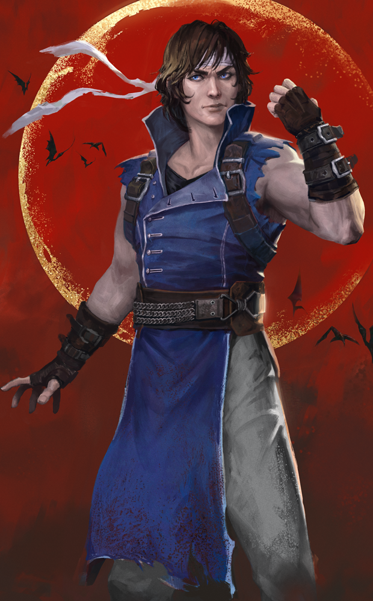

# live · 9.2.3_2851803live

| | |
|---|---|
| Build date | 2025-11-06 16:18 UTC |
| CDN version | `9.2.3_2851803live-1762445898` |
| Key | `9.2.3_live` |
| Compared with | [9.2.3_2850259live](../9.2.3_2850259live/CHANGES.md) (2025-11-05 16:03 UTC) |

## Summary

**2** added · **6** modified · **0** removed · 205 unchanged

## New or updated images

<a href="images/T_UI_CollectionBanner_Castlevania_Richter.png"></a>
<a href="images/T_UI_SpecialPack_Castlevania_Richter.png"></a>

## Modified files

### [`catalog.json`](catalog.json)

[Full line-by-line diff](diffs/catalog.json.diff)

```diff
- $[id=Castlevania_Bundle_Maple].metaData.sortOrder: 403
+ $[id=Castlevania_Bundle_Maple].metaData.sortOrder: 3000
- $[id=Silent_Hill_Bundle_Maple].metaData.sortOrder: 403
+ $[id=Silent_Hill_Bundle_Maple].metaData.sortOrder: 2999
```

### [`challengeLocs/challengeText_zh-Hans.json`](challengeLocs/challengeText_zh-Hans.json)

[Full line-by-line diff](diffs/challengeLocs/challengeText_zh-Hans.json.diff)

```diff
- $.locText[26].text: "追杀{0}秒"
+ $.locText[26].text: "追逐{0}秒"
- $.locText[31].text: "被追杀时，扔下{0}处木板"
+ $.locText[31].text: "被追逐时，扔下{0}处木板"
- $.locText[107].text: "逃脱{0}次追杀"
+ $.locText[107].text: "逃脱{0}次追逐"
- $.locText[156].text: "在单场对局中，被追杀{0}秒"
+ $.locText[156].text: "在单场对局中，被追逐{0}秒"
- $.locText[165].text: "在单场对局中，被追杀期间、或逃离追杀后的5秒内进入储物柜，累计{0}次"
+ $.locText[165].text: "在单场对局中，被追逐期间、或逃离追逐后的5秒内进入储物柜，累计{0}次"
- $.locText[174].text: "在单场对局中，被追杀时摔落{0}次"
+ $.locText[174].text: "在单场对局中，被追逐时摔落{0}次"
- $.locText[228].text: "追杀过程中，激活邀请函能力，对杀手封锁可翻越窗户，累计{0}次"
+ $.locText[228].text: "追逐过程中，激活邀请函能力，对杀手封锁可翻越窗户，累计{0}次"
- $.locText[231].text: "在追杀过程中，激活任意邀请函能力{0}次"
+ $.locText[231].text: "在追逐过程中，激活任意邀请函能力{0}次"
- $.locText[234].text: "不处于追杀过程中时，激活任意邀请函能力{0}次"
+ $.locText[234].text: "不处于追逐过程中时，激活任意邀请函能力{0}次"
- $.locText[237].text: "追杀过程中，激活抵御眩晕邀请函能力{0}次"
+ $.locText[237].text: "追逐过程中，激活抵御眩晕邀请函能力{0}次"
- $.locText[419].text: "使用虛空水晶后10秒内逃脱追杀，累计{0}次"
+ $.locText[419].text: "使用虛空水晶后10秒内逃脱追逐，累计{0}次"
```

### [`collections.json`](collections.json)

[Full line-by-line diff](diffs/collections.json.diff)

```diff
+ $.collections[6].additionalImages[0]
- $.collections[6].collectionId: "SilentHillMega"
+ $.collections[6].collectionId: "Chrysalis"
- $.collections[6].collectionTitle.de: "Silent Hill"
+ $.collections[6].collectionTitle.de: "Kokonsammlung"
- $.collections[6].collectionTitle.en: "Silent Hill"
+ $.collections[6].collectionTitle.en: "Chrysalis Collection"
- $.collections[6].collectionTitle.es: "Silent Hill"
+ $.collections[6].collectionTitle.es: "Colección de Crisálida"
- $.collections[6].collectionTitle["es-MX"]: "Silent Hill"
+ $.collections[6].collectionTitle["es-MX"]: "Colección Crisálida"
- $.collections[6].collectionTitle.fr: "Silent Hill"
+ $.collections[6].collectionTitle.fr: "Collection Chrysalide"
- $.collections[6].collectionTitle.it: "Silent Hill"
+ $.collections[6].collectionTitle.it: "Collezione Crisalide"
- $.collections[6].collectionTitle.ja: "サイレントヒル"
+ $.collections[6].collectionTitle.ja: "蛹コレクション"
- $.collections[6].collectionTitle.ko: "사일런트 힐"
+ $.collections[6].collectionTitle.ko: "번데기 컬렉션"
- $.collections[6].collectionTitle.pl: "Silent Hill"
+ $.collections[6].collectionTitle.pl: "Kolekcja „Poczwarka”"
- $.collections[6].collectionTitle["pt-BR"]: "Silent Hill"
+ $.collections[6].collectionTitle["pt-BR"]: "Coleção Crisálida"
- $.collections[6].collectionTitle.ru: "Сайлент Хилл"
+ $.collections[6].collectionTitle.ru: "Коллекция «Кокон»"
- $.collections[6].collectionTitle.th: "ไซเลนต์ฮิล"
+ $.collections[6].collectionTitle.th: "ชุดสะสมดักแด้"
- $.collections[6].collectionTitle.tr: "Silent Hill"
+ $.collections[6].collectionTitle.tr: "Koza Koleksiyonu"
- $.collections[6].collectionTitle["zh-Hans"]: "寂静岭"
+ $.collections[6].collectionTitle["zh-Hans"]: "茧蛹收藏"
- $.collections[6].collectionTitle["zh-Hant"]: "沉默之丘"
+ $.collections[6].collectionTitle["zh-Hant"]: "繭蛹收藏"
- $.collections[6].heroImage.path: "/Game/UI/UMGAssets/Icons/Banners/CollectionBanners/T_UI_CollectionBanner_SilentHill.T_UI_CollectionBanner_SilentHill"
+ $.collections[6].heroImage.path: "/Game/UI/UMGAssets/Icons/Banners/CollectionBanners/Jerky/T_UI_CollectionBanner_Chrysalis_2.T_UI_CollectionBanner_Chrysalis_2"
- $.collections[6].inclusionVersion: "7.7.0 PTB"
+ $.collections[6].inclusionVersion: "7.7.0"
- $.collections[6].items[]: "FM_outfit_022"
- $.collections[6].items[]: "K20_outfit_006"
- $.collections[6].items[]: "K20_outfit_007"
- $.collections[6].items[]: "K20_outfit_008"
- $.collections[6].items[]: "KK_outfit_016"
- $.collections[6].items[]: "KK_outfit_016_01"
- $.collections[6].items[]: "KK_outfit_016_02"
- $.collections[6].items[]: "KK_outfit_016_03"
- $.collections[6].items[]: "S22_outfit_006"
- $.collections[6].items[]: "S22_outfit_007"
- $.collections[6].items[]: "S22_outfit_008"
- $.collections[6].items[]: "S22_outfit_010"
- $.collections[6].items[]: "S22_outfit_011"
- $.collections[6].items[]: "S22_outfit_012"
- $.collections[6].items[]: "S22_outfit_02"
- $.collections[6].items[]: "S22_outfit_02_01"
- $.collections[6].items[]: "S22_Torso01_01"
- $.collections[6].items[]: "S22_Torso01_02"
- $.collections[6].items[]: "S22_Torso01_03"
- $.collections[6].items[]: "S22_Torso01_04"
- $.collections[6].items[]: "S22_Torso01_05"
- $.collections[6].items[]: "S22_Torso01_06"
+ $.collections[6].items[]: "DO_outfit_014"
+ $.collections[6].items[]: "GS_Head030"
+ $.collections[6].items[]: "K30_outfit_013"
+ $.collections[6].items[]: "K33_outfit_011"
+ $.collections[6].items[]: "KS_outfit_015"
+ $.collections[6].items[]: "NK_outfit_021"
+ $.collections[6].items[]: "S35_outfit_021"
+ $.collections[6].items[]: "S36_outfit_023"
+ $.collections[6].items[]: "S41_outfit_008"
+ $.collections[6].items[]: "SwedenKiller_outfit_022"
+ $.collections[6].items[]: "UK_outfit_010"
- $.collections[6].sortOrder: "-111"
+ $.collections[6].sortOrder: "-112"
- $.collections[6].updatedDate: "2025-05-16T13:01:57.852Z"
+ $.collections[6].updatedDate: "2025-05-16T13:09:22.94Z"
+ $.collections[7].limitedAvailabilityStartDate: "2025-05-27T15:00:00Z"
+ $.collections[7].visibleBeforeStartDate: false
- $.collections[7].additionalImages[0].path: "/Game/UI/UMGAssets/Icons/Banners/BundleBanners/SpecialPack/Jerky/T_UI_SpecialPack_Chrysalis_1.T_UI_SpecialPack_Chrysalis_1"
+ $.collections[7].additionalImages[0].path: "/Game/UI/UMGAssets/Icons/Banners/BundleBanners/SpecialPack/Jerky/T_UI_SpecialPack_CatsAndDogs.T_UI_SpecialPack_CatsAndDogs"
- $.collections[7].collectionId: "Chrysalis"
+ $.collections[7].collectionId: "Cats&Dogs"
- $.collections[7].collectionTitle.de: "Kokonsammlung"
+ $.collections[7].collectionTitle.de: "Katzen und Hunde "
- $.collections[7].collectionTitle.en: "Chrysalis Collection"
+ $.collections[7].collectionTitle.en: "Cats & Dogs "
- $.collections[7].collectionTitle.es: "Colección de Crisálida"
+ $.collections[7].collectionTitle.es: "Como perros y gatos "
- $.collections[7].collectionTitle["es-MX"]: "Colección Crisálida"
+ $.collections[7].collectionTitle["es-MX"]: "Gatos y perros "
- $.collections[7].collectionTitle.fr: "Collection Chrysalide"
+ $.collections[7].collectionTitle.fr: "Chiens et chats"
- $.collections[7].collectionTitle.it: "Collezione Crisalide"
+ $.collections[7].collectionTitle.it: "Cani e gatti "
- $.collections[7].collectionTitle.ja: "蛹コレクション"
+ $.collections[7].collectionTitle.ja: "犬と猫 "
- $.collections[7].collectionTitle.ko: "번데기 컬렉션"
+ $.collections[7].collectionTitle.ko: "개와 고양이"
- $.collections[7].collectionTitle.pl: "Kolekcja „Poczwarka”"
+ $.collections[7].collectionTitle.pl: "Psy i koty "
- $.collections[7].collectionTitle["pt-BR"]: "Coleção Crisálida"
+ $.collections[7].collectionTitle["pt-BR"]: "Cães e Gatos "
- $.collections[7].collectionTitle.ru: "Коллекция «Кокон»"
+ $.collections[7].collectionTitle.ru: "Кошки и собаки "
- $.collections[7].collectionTitle.th: "ชุดสะสมดักแด้"
+ $.collections[7].collectionTitle.th: "แมวกับหมา "
- $.collections[7].collectionTitle.tr: "Koza Koleksiyonu"
+ $.collections[7].collectionTitle.tr: "Kediler ve Köpekler "
- $.collections[7].collectionTitle["zh-Hans"]: "茧蛹收藏"
+ $.collections[7].collectionTitle["zh-Hans"]: "猫猫&狗狗"
- $.collections[7].collectionTitle["zh-Hant"]: "繭蛹收藏"
+ $.collections[7].collectionTitle["zh-Hant"]: "貓與狗 "
- $.collections[7].heroImage.path: "/Game/UI/UMGAssets/Icons/Banners/CollectionBanners/Jerky/T_UI_CollectionBanner_Chrysalis_2.T_UI_CollectionBanner_Chrysalis_2"
+ $.collections[7].heroImage.path: "/Game/UI/UMGAssets/Icons/Banners/CollectionBanners/Jerky/T_UI_CollectionBanner_CatsAndDogs_2.T_UI_CollectionBanner_CatsAndDogs_2"
- $.collections[7].inclusionVersion: "7.7.0"
+ $.collections[7].inclusionVersion: "7.7.0 PTB"
- $.collections[7].items[]: "DO_outfit_014"
- $.collections[7].items[]: "GS_Head030"
- $.collections[7].items[]: "K20_outfit_009"
- $.collections[7].items[]: "K30_outfit_013"
- $.collections[7].items[]: "K33_outfit_011"
- $.collections[7].items[]: "KS_outfit_015"
- $.collections[7].items[]: "NK_outfit_021"
- $.collections[7].items[]: "S35_outfit_021"
- $.collections[7].items[]: "S36_outfit_023"
- $.collections[7].items[]: "S41_outfit_008"
- $.collections[7].items[]: "SwedenKiller_outfit_022"
- $.collections[7].items[]: "UK_outfit_010"
+ $.collections[7].items[]: "AV_Torso023"
+ $.collections[7].items[]: "CM_outfit_019"
+ $.collections[7].items[]: "DF_Torso017"
+ $.collections[7].items[]: "GS_Torso025"
+ $.collections[7].items[]: "JP_Torso020"
+ $.collections[7].items[]: "K35_outfit_007"
+ $.collections[7].items[]: "KK_Body021"
+ $.collections[7].items[]: "KS_Torso013"
+ $.collections[7].items[]: "MT_outfit_016"
+ $.collections[7].items[]: "NK_Torso019"
+ $.collections[7].items[]: "OK_Mask015"
+ $.collections[7].items[]: "S23_Torso020"
+ $.collections[7].items[]: "S25_Torso018"
+ $.collections[7].items[]: "S29_Torso014"
+ $.collections[7].items[]: "S31_Torso012"
+ $.collections[7].items[]: "S34_Torso013"
+ $.collections[7].items[]: "S35_Torso015"
+ $.collections[7].items[]: "S36_Torso016"
+ $.collections[7].items[]: "S37_Torso015"
+ $.collections[7].items[]: "S39_outfit_011"
- $.collections[7].sortOrder: "-112"
+ $.collections[7].sortOrder: "-113"
- $.collections[7].updatedDate: "2025-05-16T13:09:22.94Z"
+ $.collections[7].updatedDate: "2025-05-22T12:45:53.83Z"
- $.collections[8].additionalImages[0].path: "/Game/UI/UMGAssets/Icons/Banners/BundleBanners/SpecialPack/Jerky/T_UI_SpecialPack_CatsAndDogs.T_UI_SpecialPack_CatsAndDogs"
+ $.collections[8].additionalImages[0].path: "/Game/UI/UMGAssets/Icons/Banners/BundleBanners/SpecialPack/Jerky/T_UI_SpecialPack_TheWitcher.T_UI_SpecialPack_TheWitcher"
- $.collections[8].collectionId: "Cats&Dogs"
+ $.collections[8].collectionId: "TheWitcher"
- $.collections[8].collectionTitle.de: "Katzen und Hunde "
+ $.collections[8].collectionTitle.de: "The Witcher"
- $.collections[8].collectionTitle.en: "Cats & Dogs "
+ $.collections[8].collectionTitle.en: "The Witcher"
- $.collections[8].collectionTitle.es: "Como perros y gatos "
+ $.collections[8].collectionTitle.es: "The Witcher"
- $.collections[8].collectionTitle["es-MX"]: "Gatos y perros "
+ $.collections[8].collectionTitle["es-MX"]: "The Witcher"
- $.collections[8].collectionTitle.fr: "Chiens et chats"
+ $.collections[8].collectionTitle.fr: "The Witcher"
- $.collections[8].collectionTitle.it: "Cani e gatti "
+ $.collections[8].collectionTitle.it: "The Witcher"
- $.collections[8].collectionTitle.ja: "犬と猫 "
+ $.collections[8].collectionTitle.ja: "ウィッチャー"
- $.collections[8].collectionTitle.ko: "개와 고양이"
+ $.collections[8].collectionTitle.ko: "위쳐"
- $.collections[8].collectionTitle.pl: "Psy i koty "
+ $.collections[8].collectionTitle.pl: "Wiedźmin"
- $.collections[8].collectionTitle["pt-BR"]: "Cães e Gatos "
+ $.collections[8].collectionTitle["pt-BR"]: "The Witcher"
- $.collections[8].collectionTitle.ru: "Кошки и собаки "
+ $.collections[8].collectionTitle.ru: "Ведьмак"
- $.collections[8].collectionTitle.th: "แมวกับหมา "
+ $.collections[8].collectionTitle.th: "เดอะวิทเชอร์"
- $.collections[8].collectionTitle.tr: "Kediler ve Köpekler "
+ $.collections[8].collectionTitle.tr: "The Witcher"
- $.collections[8].collectionTitle["zh-Hans"]: "猫猫&狗狗"
+ $.collections[8].collectionTitle["zh-Hans"]: "《The Witcher》"
- $.collections[8].collectionTitle["zh-Hant"]: "貓與狗 "
+ $.collections[8].collectionTitle["zh-Hant"]: "《獵魔士》"
- $.collections[8].heroImage.path: "/Game/UI/UMGAssets/Icons/Banners/CollectionBanners/Jerky/T_UI_CollectionBanner_CatsAndDogs_2.T_UI_CollectionBanner_CatsAndDogs_2"
+ $.collections[8].heroImage.path: "/Game/UI/UMGAssets/Icons/Banners/CollectionBanners/Jerky/T_UI_CollectionBanner_TheWitcher.T_UI_CollectionBanner_TheWitcher"
- $.collections[8].inclusionVersion: "7.7.0 PTB"
+ $.collections[8].inclusionVersion: "8.7.2"
- $.collections[8].items[]: "AV_Torso023"
- $.collections[8].items[]: "CM_outfit_019"
- $.collections[8].items[]: "DF_Torso017"
- $.collections[8].items[]: "GS_Torso025"
- $.collections[8].items[]: "JP_Torso020"
- $.collections[8].items[]: "K35_outfit_007"
- $.collections[8].items[]: "KK_Body021"
- $.collections[8].items[]: "KS_Torso013"
- $.collections[8].items[]: "MT_outfit_016"
- $.collections[8].items[]: "NK_Torso019"
- $.collections[8].items[]: "OK_Mask015"
- $.collections[8].items[]: "S23_Torso020"
… 2004 more change(s) — see the commit diff for everything
```

### [`dynamicContent/DynamicContent.json`](dynamicContent/DynamicContent.json)

[Full line-by-line diff](diffs/dynamicContent/DynamicContent.json.diff)

```diff
- $.entries[6].contentVersion: "9d37a682b21e8dbf8019a9f200258b01a2abc11c"
+ $.entries[6].contentVersion: "6d995da0679d39c28b1ea4814e9880b430247f0c"
- $.entries[6].downloadStrategy: "preferRemote"
+ $.entries[6].downloadStrategy: "preferPackaged"
- $.entries[6].enableChecksum: true
+ $.entries[6].enableChecksum: false
- $.entries[6].packagedPath: ""
+ $.entries[6].packagedPath: "/Game/UI/UMGAssets/Icons/Banners/CollectionBanners/Maple/T_UI_CollectionBanner_Castlevania_Richter.T_UI_CollectionBanner_Castlevania_Richter"
- $.entries[6].schema: "s3ver://"
+ $.entries[6].schema: "s3verbin://"
- $.entries[6].uri: "catalog.json"
+ $.entries[6].uri: "images/T_UI_CollectionBanner_Castlevania_Richter.png"
- $.entries[7].contentVersion: "fed4f79aedbcaaea876a7910be046136d61319b8"
+ $.entries[7].contentVersion: "d3250b6140766fef6bb94cdf00277d33b4db925e"
- $.entries[7].downloadStrategy: "preferRemote"
+ $.entries[7].downloadStrategy: "preferPackaged"
- $.entries[7].enableChecksum: true
+ $.entries[7].enableChecksum: false
- $.entries[7].packagedPath: ""
+ $.entries[7].packagedPath: "/Game/UI/UMGAssets/Icons/Banners/BundleBanners/SpecialPack/Maple/T_UI_SpecialPack_Castlevania_Richter.T_UI_SpecialPack_Castlevania_Richter"
- $.entries[7].schema: "s3ver://"
+ $.entries[7].schema: "s3verbin://"
- $.entries[7].uri: "bonusPointEventsContent.json"
+ $.entries[7].uri: "images/T_UI_SpecialPack_Castlevania_Richter.png"
- $.entries[8].contentVersion: "423f378770698fe8e972daa3bec2f4cbf868e445"
+ $.entries[8].contentVersion: "25f9cd30e832c687befe2dfc28936fcc135c80cd"
- $.entries[8].uri: "freetoplay/NA/event.json"
+ $.entries[8].uri: "catalog.json"
- $.entries[9].contentVersion: "423f378770698fe8e972daa3bec2f4cbf868e445"
+ $.entries[9].contentVersion: "fed4f79aedbcaaea876a7910be046136d61319b8"
- $.entries[9].uri: "freetoplay/EU/event.json"
+ $.entries[9].uri: "bonusPointEventsContent.json"
- $.entries[10].contentVersion: "d5e0e8bd0f90c312e5f704de6ecfeef6f00b83c1"
+ $.entries[10].contentVersion: "423f378770698fe8e972daa3bec2f4cbf868e445"
- $.entries[10].uri: "archiveQuests/Anniversary2022.json"
+ $.entries[10].uri: "freetoplay/NA/event.json"
- $.entries[11].contentVersion: "e2a1096960e5c7a873c611ed47d333a99d24ebdd"
+ $.entries[11].contentVersion: "423f378770698fe8e972daa3bec2f4cbf868e445"
- $.entries[11].uri: "archiveQuests/Anniversary2023.json"
+ $.entries[11].uri: "freetoplay/EU/event.json"
- $.entries[12].contentVersion: "05d6d3f58a1345aacd11fc2e75894807eddfeef3"
+ $.entries[12].contentVersion: "d5e0e8bd0f90c312e5f704de6ecfeef6f00b83c1"
- $.entries[12].uri: "archiveQuests/Anniversary2024.json"
+ $.entries[12].uri: "archiveQuests/Anniversary2022.json"
- $.entries[13].contentVersion: "eecb76706efe064879d907f01fa9f0afc01ac22a"
+ $.entries[13].contentVersion: "e2a1096960e5c7a873c611ed47d333a99d24ebdd"
- $.entries[13].uri: "archiveQuests/CalamariV1.json"
+ $.entries[13].uri: "archiveQuests/Anniversary2023.json"
- $.entries[14].contentVersion: "357ed733a42915259430ccbd97f96a79378e41b8"
+ $.entries[14].contentVersion: "05d6d3f58a1345aacd11fc2e75894807eddfeef3"
- $.entries[14].uri: "archiveQuests/CalamariV2.json"
+ $.entries[14].uri: "archiveQuests/Anniversary2024.json"
- $.entries[15].contentVersion: "ab8a5bbaf6bab9f6bf2aff6a12f2799e06132a2a"
+ $.entries[15].contentVersion: "eecb76706efe064879d907f01fa9f0afc01ac22a"
- $.entries[15].uri: "archiveQuests/CalamariV3.json"
+ $.entries[15].uri: "archiveQuests/CalamariV1.json"
- $.entries[16].contentVersion: "92dfd1dd5cf5987e95665b7ac3cb97425910511b"
+ $.entries[16].contentVersion: "357ed733a42915259430ccbd97f96a79378e41b8"
- $.entries[16].uri: "archiveQuests/ChocolateBoxGelato.json"
+ $.entries[16].uri: "archiveQuests/CalamariV2.json"
- $.entries[17].contentVersion: "5ce80b592944bb959f0797f9caef628c398ac6f7"
+ $.entries[17].contentVersion: "ab8a5bbaf6bab9f6bf2aff6a12f2799e06132a2a"
- $.entries[17].uri: "archiveQuests/ChocolateBoxV1.json"
+ $.entries[17].uri: "archiveQuests/CalamariV3.json"
- $.entries[18].contentVersion: "04c11644bf22e3a902dc3227387584e893566976"
+ $.entries[18].contentVersion: "92dfd1dd5cf5987e95665b7ac3cb97425910511b"
- $.entries[18].uri: "archiveQuests/DreadByDaylightZodiac.json"
+ $.entries[18].uri: "archiveQuests/ChocolateBoxGelato.json"
- $.entries[19].contentVersion: "6ae77d38a262a124285d02cbb35fbe8324a92a0f"
+ $.entries[19].contentVersion: "5ce80b592944bb959f0797f9caef628c398ac6f7"
- $.entries[19].uri: "archiveQuests/FireflyV1.json"
+ $.entries[19].uri: "archiveQuests/ChocolateBoxV1.json"
- $.entries[20].contentVersion: "38259f3c3fd14c6bf9cb29b9fa562afd1986b72c"
+ $.entries[20].contentVersion: "04c11644bf22e3a902dc3227387584e893566976"
- $.entries[20].uri: "archiveQuests/Halloween2021.json"
+ $.entries[20].uri: "archiveQuests/DreadByDaylightZodiac.json"
- $.entries[21].contentVersion: "4d1be4b2b3d9ed21233f91db6c9f975ca27e346e"
+ $.entries[21].contentVersion: "6ae77d38a262a124285d02cbb35fbe8324a92a0f"
- $.entries[21].uri: "archiveQuests/Halloween2022.json"
+ $.entries[21].uri: "archiveQuests/FireflyV1.json"
- $.entries[22].contentVersion: "fd502adcfe1014bdf563e46cf548b1d339cdcad8"
+ $.entries[22].contentVersion: "38259f3c3fd14c6bf9cb29b9fa562afd1986b72c"
- $.entries[22].uri: "archiveQuests/Halloween2023.json"
+ $.entries[22].uri: "archiveQuests/Halloween2021.json"
- $.entries[23].contentVersion: "d71a64c0471f3cc6cd6315b9bffedba0d17718bc"
+ $.entries[23].contentVersion: "4d1be4b2b3d9ed21233f91db6c9f975ca27e346e"
- $.entries[23].uri: "archiveQuests/Halloween2024.json"
+ $.entries[23].uri: "archiveQuests/Halloween2022.json"
- $.entries[24].contentVersion: "7f0486632c765d0319c093737f20a5580a5eb65b"
+ $.entries[24].contentVersion: "fd502adcfe1014bdf563e46cf548b1d339cdcad8"
- $.entries[24].uri: "archiveQuests/Spring2024.json"
+ $.entries[24].uri: "archiveQuests/Halloween2023.json"
- $.entries[25].contentVersion: "492a01cabead72f8144157bec185062389d5574c"
+ $.entries[25].contentVersion: "d71a64c0471f3cc6cd6315b9bffedba0d17718bc"
- $.entries[25].uri: "archiveQuests/Spring2025.json"
+ $.entries[25].uri: "archiveQuests/Halloween2024.json"
- $.entries[26].contentVersion: "8eb11e763d31632b64fe72bacb293d7f5325362e"
+ $.entries[26].contentVersion: "7f0486632c765d0319c093737f20a5580a5eb65b"
- $.entries[26].uri: "archiveQuests/Summer2023.json"
+ $.entries[26].uri: "archiveQuests/Spring2024.json"
- $.entries[27].contentVersion: "066aedd55fb8e6bed06020170374b50d5cde11b0"
+ $.entries[27].contentVersion: "492a01cabead72f8144157bec185062389d5574c"
- $.entries[27].uri: "archiveQuests/Tome01.json"
+ $.entries[27].uri: "archiveQuests/Spring2025.json"
- $.entries[28].contentVersion: "c040ab206fe33879a4873533b125aaf3b8fd546c"
+ $.entries[28].contentVersion: "8eb11e763d31632b64fe72bacb293d7f5325362e"
- $.entries[28].uri: "archiveQuests/Tome02.json"
+ $.entries[28].uri: "archiveQuests/Summer2023.json"
- $.entries[29].contentVersion: "9bc10fcdfd767bf5a7fc92ad6048079db177c220"
+ $.entries[29].contentVersion: "066aedd55fb8e6bed06020170374b50d5cde11b0"
- $.entries[29].uri: "archiveQuests/Tome03.json"
+ $.entries[29].uri: "archiveQuests/Tome01.json"
- $.entries[30].contentVersion: "3d792cb0c9344b45f096364edc398c70f421f194"
+ $.entries[30].contentVersion: "c040ab206fe33879a4873533b125aaf3b8fd546c"
- $.entries[30].uri: "archiveQuests/Tome04.json"
+ $.entries[30].uri: "archiveQuests/Tome02.json"
- $.entries[31].contentVersion: "f7cb2ad04150da116a1e3e0e4b180f239ba0c4c9"
+ $.entries[31].contentVersion: "9bc10fcdfd767bf5a7fc92ad6048079db177c220"
- $.entries[31].uri: "archiveQuests/Tome05.json"
+ $.entries[31].uri: "archiveQuests/Tome03.json"
- $.entries[32].contentVersion: "3898d8a328f2302f55d66295341c77a43400b1ec"
+ $.entries[32].contentVersion: "3d792cb0c9344b45f096364edc398c70f421f194"
- $.entries[32].uri: "archiveQuests/Tome06.json"
+ $.entries[32].uri: "archiveQuests/Tome04.json"
- $.entries[33].contentVersion: "5cab87e53bbdff63b549faa1b5cdfa25d904f343"
+ $.entries[33].contentVersion: "f7cb2ad04150da116a1e3e0e4b180f239ba0c4c9"
- $.entries[33].uri: "archiveQuests/Tome07.json"
+ $.entries[33].uri: "archiveQuests/Tome05.json"
- $.entries[34].contentVersion: "7a01f8d9241d076148a2116030459b586d05e7b1"
+ $.entries[34].contentVersion: "3898d8a328f2302f55d66295341c77a43400b1ec"
- $.entries[34].uri: "archiveQuests/Tome08.json"
+ $.entries[34].uri: "archiveQuests/Tome06.json"
- $.entries[35].contentVersion: "0a6b10f7e269e13d6adb792a1db1069029f68e85"
+ $.entries[35].contentVersion: "5cab87e53bbdff63b549faa1b5cdfa25d904f343"
- $.entries[35].uri: "archiveQuests/Tome09.json"
+ $.entries[35].uri: "archiveQuests/Tome07.json"
- $.entries[36].contentVersion: "c4f09d48fcff02cc600d7317018da5493ad9c1a3"
+ $.entries[36].contentVersion: "7a01f8d9241d076148a2116030459b586d05e7b1"
- $.entries[36].uri: "archiveQuests/Tome10.json"
+ $.entries[36].uri: "archiveQuests/Tome08.json"
- $.entries[37].contentVersion: "fc1a08c3c7733fa15b3f947d50083dd4bb66dc02"
+ $.entries[37].contentVersion: "0a6b10f7e269e13d6adb792a1db1069029f68e85"
- $.entries[37].uri: "archiveQuests/Tome11.json"
+ $.entries[37].uri: "archiveQuests/Tome09.json"
- $.entries[38].contentVersion: "2f26f7cbaae627eaab895b1674779d15a899e332"
+ $.entries[38].contentVersion: "c4f09d48fcff02cc600d7317018da5493ad9c1a3"
- $.entries[38].uri: "archiveQuests/Tome12.json"
+ $.entries[38].uri: "archiveQuests/Tome10.json"
- $.entries[39].contentVersion: "d9304f76d9c5dd4c7c9301786a1df2548499d228"
+ $.entries[39].contentVersion: "fc1a08c3c7733fa15b3f947d50083dd4bb66dc02"
- $.entries[39].uri: "archiveQuests/Tome13.json"
+ $.entries[39].uri: "archiveQuests/Tome11.json"
- $.entries[40].contentVersion: "8f03d8327d108c20baf98e4d704e4ab318e87fc9"
+ $.entries[40].contentVersion: "2f26f7cbaae627eaab895b1674779d15a899e332"
- $.entries[40].uri: "archiveQuests/Tome14.json"
+ $.entries[40].uri: "archiveQuests/Tome12.json"
- $.entries[41].contentVersion: "77901febf477f48b89d7764497e40c892c30bb4a"
+ $.entries[41].contentVersion: "d9304f76d9c5dd4c7c9301786a1df2548499d228"
- $.entries[41].uri: "archiveQuests/Tome15.json"
+ $.entries[41].uri: "archiveQuests/Tome13.json"
- $.entries[42].contentVersion: "aad5b9730dac47f009f211ef50e2ea0e213dc2d1"
+ $.entries[42].contentVersion: "8f03d8327d108c20baf98e4d704e4ab318e87fc9"
- $.entries[42].uri: "archiveQuests/Tome16.json"
+ $.entries[42].uri: "archiveQuests/Tome14.json"
- $.entries[43].contentVersion: "bec0cb83c0027e3bc12e70249d2b70544add3bce"
+ $.entries[43].contentVersion: "77901febf477f48b89d7764497e40c892c30bb4a"
- $.entries[43].uri: "archiveQuests/Tome17.json"
+ $.entries[43].uri: "archiveQuests/Tome15.json"
- $.entries[44].contentVersion: "743d1738b802d7669d2ca5a9e9fcadbe7fae677b"
+ $.entries[44].contentVersion: "aad5b9730dac47f009f211ef50e2ea0e213dc2d1"
- $.entries[44].uri: "archiveQuests/Tome18.json"
+ $.entries[44].uri: "archiveQuests/Tome16.json"
- $.entries[45].contentVersion: "e6468b6de49eaaa479d0a7664d46ae4d422111c2"
+ $.entries[45].contentVersion: "bec0cb83c0027e3bc12e70249d2b70544add3bce"
- $.entries[45].uri: "archiveQuests/Tome19.json"
+ $.entries[45].uri: "archiveQuests/Tome17.json"
- $.entries[46].contentVersion: "950cf402a7d1bf8f3a881dbf21ce394d2b90fe52"
+ $.entries[46].contentVersion: "743d1738b802d7669d2ca5a9e9fcadbe7fae677b"
- $.entries[46].uri: "archiveQuests/Tome20.json"
+ $.entries[46].uri: "archiveQuests/Tome18.json"
- $.entries[47].contentVersion: "8987e05bcaf69b1a0fd1c54dc418dd50a8800e66"
+ $.entries[47].contentVersion: "e6468b6de49eaaa479d0a7664d46ae4d422111c2"
- $.entries[47].uri: "archiveQuests/Tome21.json"
+ $.entries[47].uri: "archiveQuests/Tome19.json"
- $.entries[48].contentVersion: "cccdc4ca8103b0b5919306900be27079c1819e2e"
+ $.entries[48].contentVersion: "950cf402a7d1bf8f3a881dbf21ce394d2b90fe52"
- $.entries[48].uri: "archiveQuests/Tome22.json"
+ $.entries[48].uri: "archiveQuests/Tome20.json"
- $.entries[49].contentVersion: "9a69357dae22368ef4262c5b5e3556b3acc927b1"
+ $.entries[49].contentVersion: "8987e05bcaf69b1a0fd1c54dc418dd50a8800e66"
- $.entries[49].uri: "archiveQuests/Winter2022.json"
+ $.entries[49].uri: "archiveQuests/Tome21.json"
- $.entries[50].contentVersion: "2607084e336fae42c8a41e84864e54ae2f99c66f"
+ $.entries[50].contentVersion: "cccdc4ca8103b0b5919306900be27079c1819e2e"
- $.entries[50].uri: "archiveQuests/Winter2023.json"
+ $.entries[50].uri: "archiveQuests/Tome22.json"
- $.entries[51].contentVersion: "ae76c40574b12fd570a3bebb6653a4bfbe1d904b"
+ $.entries[51].contentVersion: "9a69357dae22368ef4262c5b5e3556b3acc927b1"
- $.entries[51].uri: "archiveQuests/Winter2024.json"
+ $.entries[51].uri: "archiveQuests/Winter2022.json"
… 654 more change(s) — see the commit diff for everything
```

### [`loadingText/specialEventsLoadingText_zh-Hans.json`](loadingText/specialEventsLoadingText_zh-Hans.json)

[Full line-by-line diff](diffs/loadingText/specialEventsLoadingText_zh-Hans.json.diff)

```diff
- $.loadingText[id=Anniversary2025_002].description: "奇怪的是，被追杀时，我喊“停！我就是制作组的”也不能让杀手停下来。"
+ $.loadingText[id=Anniversary2025_002].description: "奇怪的是，被追逐时，我喊“停！我就是制作组的”也不能让杀手停下来。"
```

### [`recommendations.json`](recommendations.json)

[Full line-by-line diff](diffs/recommendations.json.diff)

```diff
+ $.featuredCard[id=Maple_W8]
+ $.featuredCustomizationRecommendations[id=MapleW9]
```

