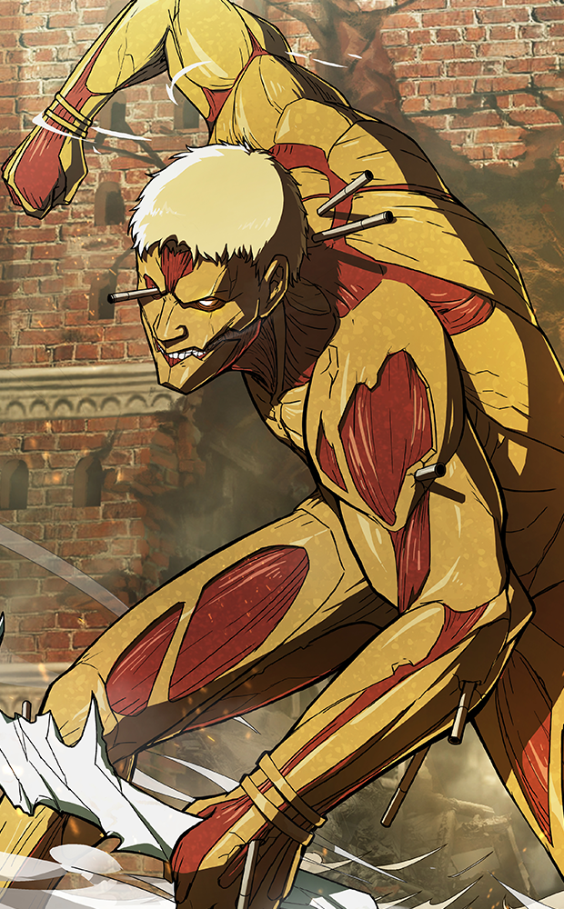
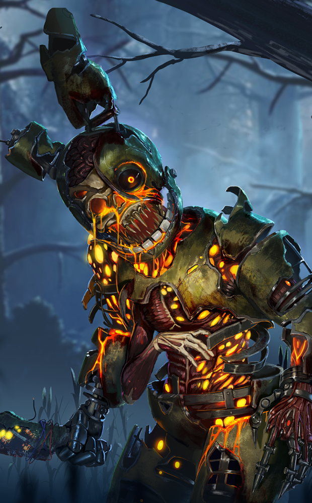
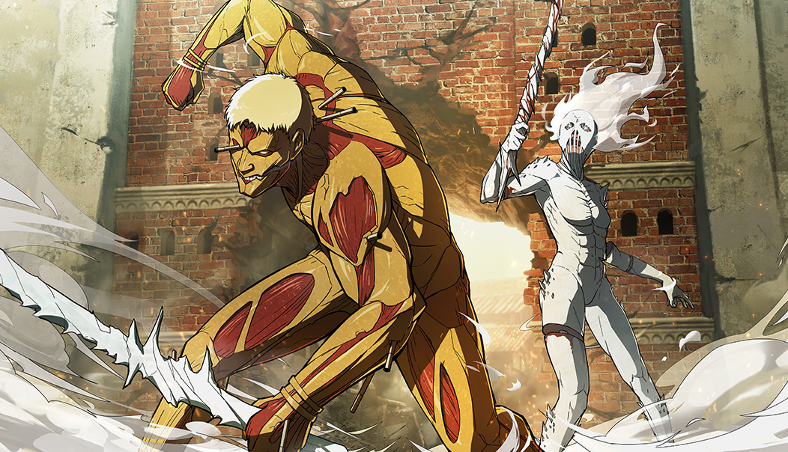
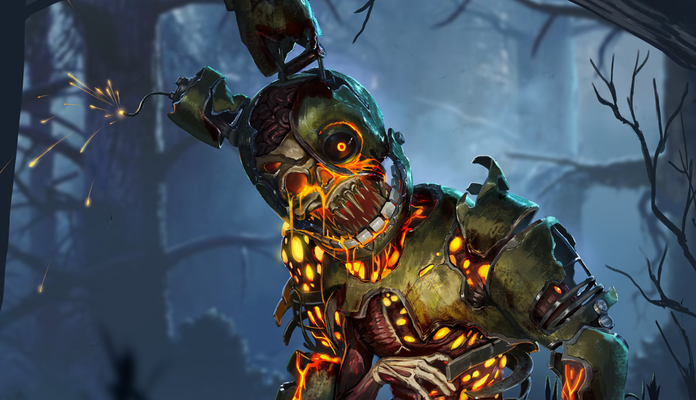
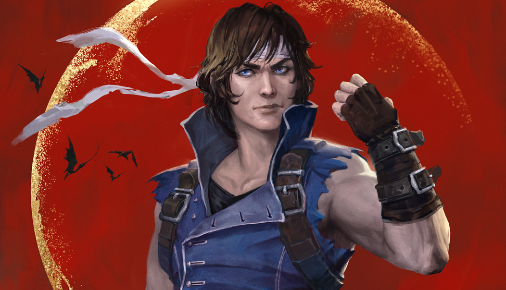

# live · 9.2.3_2869495live

| | |
|---|---|
| Build date | 2025-11-18 13:27 UTC |
| CDN version | `9.2.3_2869495live-1763472474` |
| Key | `9.2.3_live` |
| Compared with | [9.3.0_2868470live](../9.3.0_2868470live/CHANGES.md) (2025-11-17 19:56 UTC) |

## Summary

**8** added · **29** modified · **0** removed · 176 unchanged

## New or updated images

<a href="images/T_UI_CollectionBanner_AttackOnTitan.png"></a>
<a href="images/T_UI_CollectionBanner_BlightedSpringtrap.png"></a>
<a href="images/T_UI_CollectionBanner_Castlevania_Richter.png"></a>
<a href="images/T_UI_SpecialPack_Armored_Pack.png"></a>
<a href="images/T_UI_SpecialPack_AttackOnTitan.png"></a>
<a href="images/T_UI_SpecialPack_BlightedSpringtrap.png"></a>
<a href="images/T_UI_SpecialPack_Castlevania_Richter.png"></a>
<a href="images/T_UI_SpecialPack_War_Hammer_Pack.png"></a>

## Modified files

### [`GameConfigs.json`](GameConfigs.json)

[Full line-by-line diff](diffs/GameConfigs.json.diff)

```diff
- $.cinematic
```

### [`archiveJournals/archiveS3Journals.json`](archiveJournals/archiveS3Journals.json)

[Full line-by-line diff](diffs/archiveJournals/archiveS3Journals.json.diff)

```diff
- $.TOME23.vignettes[id=TOME23_02]
- $.TOME23.vignettes[id=TOME23_01].entries[9]
```

### [`archiveJournals/storyJournals.json`](archiveJournals/storyJournals.json)

[Full line-by-line diff](diffs/archiveJournals/storyJournals.json.diff)

```diff
- $.TOME23.TOME23_02
```

### [`bloodwebGenerationRules.json`](bloodwebGenerationRules.json)

[Full line-by-line diff](diffs/bloodwebGenerationRules.json.diff)

```diff
- $.BulkCost[3].CostList[0].Value[]: 13250
- $.BulkCost[3].CostList[0].Value[]: 27500
- $.BulkCost[3].CostList[0].Value[]: 28000
- $.BulkCost[3].CostList[0].Value[]: 32500
- $.BulkCost[3].CostList[0].Value[]: 35750
+ $.BulkCost[3].CostList[0].Value[]: 26750
+ $.BulkCost[3].CostList[0].Value[]: 34500
- $.BulkCost[3].CostList[1].Value[]: 13250
- $.BulkCost[3].CostList[1].Value[]: 29500
- $.BulkCost[3].CostList[1].Value[]: 27500
- $.BulkCost[3].CostList[1].Value[]: 28000
- $.BulkCost[3].CostList[1].Value[]: 35250
+ $.BulkCost[3].CostList[1].Value[]: 30000
+ $.BulkCost[3].CostList[1].Value[]: 26750
+ $.BulkCost[3].CostList[1].Value[]: 34500
- $.BulkCost[3].CostList[2].Value[]: 13250
- $.BulkCost[3].CostList[2].Value[]: 27500
- $.BulkCost[3].CostList[2].Value[]: 28000
+ $.BulkCost[3].CostList[2].Value[]: 26750
- $.BulkCost[3].CostList[3].Value[]: 13250
- $.BulkCost[3].CostList[3].Value[]: 27500
- $.BulkCost[3].CostList[3].Value[]: 28000
+ $.BulkCost[3].CostList[3].Value[]: 26750
- $.BulkCost[3].CostList[4].Value[]: 13250
- $.BulkCost[3].CostList[4].Value[]: 27500
- $.BulkCost[3].CostList[4].Value[]: 28000
+ $.BulkCost[3].CostList[4].Value[]: 26750
- $.BulkCost[3].CostList[5].Value[]: 13250
- $.BulkCost[3].CostList[5].Value[]: 27500
- $.BulkCost[3].CostList[5].Value[]: 28000
+ $.BulkCost[3].CostList[5].Value[]: 26750
- $.BulkCost[8].CostList[0].Value[]: 13250
- $.BulkCost[8].CostList[0].Value[]: 27500
- $.BulkCost[8].CostList[0].Value[]: 28000
- $.BulkCost[8].CostList[0].Value[]: 32500
- $.BulkCost[8].CostList[0].Value[]: 35750
+ $.BulkCost[8].CostList[0].Value[]: 26750
+ $.BulkCost[8].CostList[0].Value[]: 34500
- $.BulkCost[8].CostList[1].Value[]: 13250
- $.BulkCost[8].CostList[1].Value[]: 29500
- $.BulkCost[8].CostList[1].Value[]: 27500
- $.BulkCost[8].CostList[1].Value[]: 28000
- $.BulkCost[8].CostList[1].Value[]: 35250
+ $.BulkCost[8].CostList[1].Value[]: 30000
+ $.BulkCost[8].CostList[1].Value[]: 26750
+ $.BulkCost[8].CostList[1].Value[]: 34500
- $.BulkCost[8].CostList[2].Value[]: 13250
- $.BulkCost[8].CostList[2].Value[]: 27500
- $.BulkCost[8].CostList[2].Value[]: 28000
+ $.BulkCost[8].CostList[2].Value[]: 26750
- $.BulkCost[8].CostList[3].Value[]: 13250
- $.BulkCost[8].CostList[3].Value[]: 27500
- $.BulkCost[8].CostList[3].Value[]: 28000
+ $.BulkCost[8].CostList[3].Value[]: 26750
- $.BulkCost[8].CostList[4].Value[]: 13250
- $.BulkCost[8].CostList[4].Value[]: 27500
- $.BulkCost[8].CostList[4].Value[]: 28000
+ $.BulkCost[8].CostList[4].Value[]: 26750
- $.BulkCost[8].CostList[5].Value[]: 13250
- $.BulkCost[8].CostList[5].Value[]: 27500
- $.BulkCost[8].CostList[5].Value[]: 28000
+ $.BulkCost[8].CostList[5].Value[]: 26750
- $.BulkCost[12].CostList[0].Value[]: 14000
- $.BulkCost[12].CostList[0].Value[]: 18500
- $.BulkCost[12].CostList[0].Value[]: 13250
- $.BulkCost[12].CostList[0].Value[]: 22250
- $.BulkCost[12].CostList[0].Value[]: 28250
- $.BulkCost[12].CostList[0].Value[]: 28000
- $.BulkCost[12].CostList[0].Value[]: 31500
- $.BulkCost[12].CostList[0].Value[]: 32500
- $.BulkCost[12].CostList[0].Value[]: 36500
+ $.BulkCost[12].CostList[0].Value[]: 12500
+ $.BulkCost[12].CostList[0].Value[]: 26750
+ $.BulkCost[12].CostList[0].Value[]: 34500
- $.BulkCost[12].CostList[1].Value[]: 14000
- $.BulkCost[12].CostList[1].Value[]: 18500
- $.BulkCost[12].CostList[1].Value[]: 13250
- $.BulkCost[12].CostList[1].Value[]: 22250
- $.BulkCost[12].CostList[1].Value[]: 28250
- $.BulkCost[12].CostList[1].Value[]: 28000
- $.BulkCost[12].CostList[1].Value[]: 31500
- $.BulkCost[12].CostList[1].Value[]: 33250
- $.BulkCost[12].CostList[1].Value[]: 37250
+ $.BulkCost[12].CostList[1].Value[]: 26750
+ $.BulkCost[12].CostList[1].Value[]: 35250
- $.BulkCost[12].CostList[2].Value[]: 14000
- $.BulkCost[12].CostList[2].Value[]: 18500
- $.BulkCost[12].CostList[2].Value[]: 13250
- $.BulkCost[12].CostList[2].Value[]: 22250
- $.BulkCost[12].CostList[2].Value[]: 28250
- $.BulkCost[12].CostList[2].Value[]: 28750
- $.BulkCost[12].CostList[2].Value[]: 31500
- $.BulkCost[12].CostList[2].Value[]: 33250
- $.BulkCost[12].CostList[2].Value[]: 37250
+ $.BulkCost[12].CostList[2].Value[]: 12500
+ $.BulkCost[12].CostList[2].Value[]: 23500
+ $.BulkCost[12].CostList[2].Value[]: 26750
+ $.BulkCost[12].CostList[2].Value[]: 27500
+ $.BulkCost[12].CostList[2].Value[]: 30750
- $.BulkCost[12].CostList[3].Value[]: 14000
- $.BulkCost[12].CostList[3].Value[]: 18500
- $.BulkCost[12].CostList[3].Value[]: 13250
- $.BulkCost[12].CostList[3].Value[]: 22250
- $.BulkCost[12].CostList[3].Value[]: 28250
- $.BulkCost[12].CostList[3].Value[]: 28750
- $.BulkCost[12].CostList[3].Value[]: 31500
- $.BulkCost[12].CostList[3].Value[]: 33250
- $.BulkCost[12].CostList[3].Value[]: 37250
+ $.BulkCost[12].CostList[3].Value[]: 12500
+ $.BulkCost[12].CostList[3].Value[]: 23500
+ $.BulkCost[12].CostList[3].Value[]: 26750
+ $.BulkCost[12].CostList[3].Value[]: 27500
+ $.BulkCost[12].CostList[3].Value[]: 30750
- $.BulkCost[12].CostList[4].Value[]: 14000
- $.BulkCost[12].CostList[4].Value[]: 18500
- $.BulkCost[12].CostList[4].Value[]: 13250
- $.BulkCost[12].CostList[4].Value[]: 22250
- $.BulkCost[12].CostList[4].Value[]: 28250
- $.BulkCost[12].CostList[4].Value[]: 28750
- $.BulkCost[12].CostList[4].Value[]: 31500
- $.BulkCost[12].CostList[4].Value[]: 33250
- $.BulkCost[12].CostList[4].Value[]: 37250
+ $.BulkCost[12].CostList[4].Value[]: 12500
+ $.BulkCost[12].CostList[4].Value[]: 26750
+ $.BulkCost[12].CostList[4].Value[]: 27500
+ $.BulkCost[12].CostList[4].Value[]: 30750
- $.BulkCost[12].CostList[5].Value[]: 14000
- $.BulkCost[12].CostList[5].Value[]: 18500
- $.BulkCost[12].CostList[5].Value[]: 13250
- $.BulkCost[12].CostList[5].Value[]: 22250
- $.BulkCost[12].CostList[5].Value[]: 28250
- $.BulkCost[12].CostList[5].Value[]: 28750
- $.BulkCost[12].CostList[5].Value[]: 31500
- $.BulkCost[12].CostList[5].Value[]: 33250
- $.BulkCost[12].CostList[5].Value[]: 37250
+ $.BulkCost[12].CostList[5].Value[]: 12500
+ $.BulkCost[12].CostList[5].Value[]: 23500
+ $.BulkCost[12].CostList[5].Value[]: 26750
+ $.BulkCost[12].CostList[5].Value[]: 27500
+ $.BulkCost[12].CostList[5].Value[]: 30750
- $.BulkCost[16]
- $.EventChestProbability[13]
```

### [`catalog.json`](catalog.json)

[Full line-by-line diff](diffs/catalog.json.diff)

```diff
- $[id=JP_Torso032]
- $[id=K34_Body012]
- $[id=K34_Head012]
- $[id=K34_W012]
- $[id=K35_W016]
- $[id=K38_W010]
- $[id=K41_Body008]
- $[id=K41_Head008]
- $[id=K41_Head01_WinterEvent2025]
- $[id=K41_W008]
- $[id=OK_Body017]
- $[id=OK_Mask017]
- $[id=OK_W017]
- $[id=OM_BDG_05]
- $[id=OM_BDG_06]
- $[id=OM_BDG_07]
- $[id=OM_BDG_08]
- $[id=OM_BDG_10]
- $[id=OM_BDG_11]
- $[id=OM_BNR_03]
- $[id=OM_BNR_04]
- $[id=OM_BNR_05]
- $[id=OM_BNR_06]
- $[id=OM_BNR_07]
- $[id=OM_BNR_09]
- $[id=OML_002]
- $[id=OML_003]
- $[id=S24_Torso027]
- $[id=S28_Torso033]
- $[id=S37_Head024]
- $[id=S37_Legs024]
- $[id=S37_Torso024]
- $[id=S46_Torso013]
- $[id=S47_Head010]
- $[id=S47_Legs010]
- $[id=S47_Torso009]
- $[id=S47_Torso010]
- $[id=S48_Head010]
- $[id=S48_Legs010]
- $[id=S48_Torso009]
- $[id=S48_Torso010]
- $[id=S49_Torso009]
- $[id=TN_W025]
- $[id=K34_outfit_012]
- $[id=K41_outfit_008]
- $[id=OK_outfit_017]
- $[id=S37_outfit_024]
- $[id=S47_outfit_010]
- $[id=S48_outfit_010]
- $[id=BoneChillBundle2025]
- $[id=DeckTheTrials2025]
- $[id=IcyWeaponBundle2025]
- $[id=StarrySweaterBundle2025_0]
- $[id=UglySweaterBundle2025]
- $[id=WinterTalesBundle2025]
+ $[id=Laurie].eventCostList
+ $[id=Laurie].metaData.temporaryDiscounts
+ $[id=Ace].eventCostList
+ $[id=Ace].metaData.temporaryDiscounts
+ $[id=Shape].eventCostList
+ $[id=Shape].metaData.temporaryDiscounts
+ $[id=Witch].eventCostList
+ $[id=Witch].metaData.temporaryDiscounts
+ $[id=Feng].eventCostList
+ $[id=Feng].metaData.temporaryDiscounts
+ $[id=Killer07].eventCostList
+ $[id=Killer07].metaData.temporaryDiscounts
+ $[id=Kate].eventCostList
+ $[id=Kate].metaData.temporaryDiscounts
+ $[id=Cannibal].eventCostList
+ $[id=Cannibal].metaData.temporaryDiscounts
+ $[id=Quentin].eventCostList
+ $[id=Quentin].metaData.temporaryDiscounts
+ $[id=Nightmare].eventCostList
+ $[id=Nightmare].metaData.temporaryDiscounts
+ $[id=Eric].eventCostList
+ $[id=Eric].metaData.temporaryDiscounts
+ $[id=Pig].eventCostList
+ $[id=Pig].metaData.temporaryDiscounts
+ $[id=Clown].eventCostList
+ $[id=Clown].metaData.temporaryDiscounts
+ $[id=Adam].eventCostList
+ $[id=Adam].metaData.temporaryDiscounts
+ $[id=Spirit].eventCostList
+ $[id=Spirit].metaData.temporaryDiscounts
+ $[id=Legion].eventCostList
+ $[id=Legion].metaData.temporaryDiscounts
+ $[id=Jeff].eventCostList
+ $[id=Jeff].metaData.temporaryDiscounts
+ $[id=Plague].eventCostList
+ $[id=Plague].metaData.temporaryDiscounts
+ $[id=Jane].eventCostList
+ $[id=Jane].metaData.temporaryDiscounts
+ $[id=Ash].eventCostList
+ $[id=Ash].metaData.temporaryDiscounts
+ $[id=Ghostface].eventCostList
+ $[id=Ghostface].metaData.temporaryDiscounts
+ $[id=Oni].eventCostList
+ $[id=Oni].metaData.temporaryDiscounts
+ $[id=Yui].eventCostList
+ $[id=Yui].metaData.temporaryDiscounts
+ $[id=Gunslinger].eventCostList
+ $[id=Gunslinger].metaData.temporaryDiscounts
+ $[id=Zarina].eventCostList
+ $[id=Zarina].metaData.temporaryDiscounts
+ $[id=K20].eventCostList
+ $[id=K20].metaData.temporaryDiscounts
+ $[id=S22].eventCostList
+ $[id=S22].metaData.temporaryDiscounts
+ $[id=K21].eventCostList
+ $[id=K21].metaData.temporaryDiscounts
+ $[id=S23].eventCostList
+ $[id=S23].metaData.temporaryDiscounts
+ $[id=K22].eventCostList
+ $[id=K22].metaData.temporaryDiscounts
+ $[id=S24].eventCostList
+ $[id=S24].metaData.temporaryDiscounts
+ $[id=K23].eventCostList
+ $[id=K23].metaData.temporaryDiscounts
+ $[id=S25].eventCostList
+ $[id=S25].metaData.temporaryDiscounts
+ $[id=S26].eventCostList
+ $[id=S26].metaData.temporaryDiscounts
+ $[id=S27].eventCostList
+ $[id=S27].metaData.temporaryDiscounts
+ $[id=K24].eventCostList
+ $[id=K24].metaData.temporaryDiscounts
+ $[id=S28].eventCostList
+ $[id=S28].metaData.temporaryDiscounts
+ $[id=S29].eventCostList
+ $[id=S29].metaData.temporaryDiscounts
+ $[id=K26].eventCostList
+ $[id=K26].metaData.temporaryDiscounts
+ $[id=K27].eventCostList
+ $[id=K27].metaData.temporaryDiscounts
+ $[id=S30].eventCostList
+ $[id=S30].metaData.temporaryDiscounts
+ $[id=K28].eventCostList
+ $[id=K28].metaData.temporaryDiscounts
+ $[id=S31].eventCostList
+ $[id=S31].metaData.temporaryDiscounts
+ $[id=K29].eventCostList
+ $[id=K29].metaData.temporaryDiscounts
+ $[id=S32].eventCostList
+ $[id=S32].metaData.temporaryDiscounts
+ $[id=S33].eventCostList
+ $[id=S33].metaData.temporaryDiscounts
+ $[id=K30].eventCostList
+ $[id=K30].metaData.temporaryDiscounts
+ $[id=S34].eventCostList
+ $[id=S34].metaData.temporaryDiscounts
+ $[id=K31].eventCostList
+ $[id=K31].metaData.temporaryDiscounts
+ $[id=S35].eventCostList
+ $[id=S35].metaData.temporaryDiscounts
+ $[id=S36].eventCostList
+ $[id=S36].metaData.temporaryDiscounts
+ $[id=K32].eventCostList
+ $[id=K32].metaData.temporaryDiscounts
+ $[id=S37].eventCostList
+ $[id=S37].metaData.temporaryDiscounts
+ $[id=S38].eventCostList
+ $[id=S38].metaData.temporaryDiscounts
+ $[id=K33].eventCostList
+ $[id=K33].metaData.temporaryDiscounts
+ $[id=S39].eventCostList
+ $[id=S39].metaData.temporaryDiscounts
+ $[id=K34].eventCostList
+ $[id=K34].metaData.temporaryDiscounts
+ $[id=S40].eventCostList
+ $[id=S40].metaData.temporaryDiscounts
+ $[id=K35].eventCostList
+ $[id=K35].metaData.temporaryDiscounts
+ $[id=S41].eventCostList
+ $[id=S41].metaData.temporaryDiscounts
+ $[id=K36].eventCostList
+ $[id=K36].metaData.temporaryDiscounts
+ $[id=S42].eventCostList
+ $[id=S42].metaData.temporaryDiscounts
+ $[id=S43].eventCostList
+ $[id=S43].metaData.temporaryDiscounts
+ $[id=K37].eventCostList
+ $[id=K37].metaData.temporaryDiscounts
+ $[id=S44].eventCostList
+ $[id=S44].metaData.temporaryDiscounts
+ $[id=K38].eventCostList
+ $[id=K38].metaData.temporaryDiscounts
+ $[id=S45].eventCostList
+ $[id=S45].metaData.temporaryDiscounts
+ $[id=K39].eventCostList
+ $[id=K39].metaData.temporaryDiscounts
+ $[id=S46].eventCostList
+ $[id=S46].metaData.temporaryDiscounts
- $[id=AV_Head012].metaData.availablePeriods[1]
- $[id=AV_Legs012].metaData.availablePeriods[1]
- $[id=AV_Torso006].eventCostList[0]
- $[id=AV_Torso006].metaData.temporaryDiscounts
- $[id=AV_Torso006].metaData.availablePeriods[1]
- $[id=AV_Torso012].metaData.availablePeriods[1]
- $[id=BE_Body010].metaData.availablePeriods[1]
… 1629 more change(s) — see the commit diff for everything
```

### [`challengeLocs/challengeText_de.json`](challengeLocs/challengeText_de.json)

[Full line-by-line diff](diffs/challengeLocs/challengeText_de.json.diff)

```diff
- $.locText[464]
- $.locText[465]
- $.locText[466]
- $.locText[467]
- $.locText[468]
- $.locText[469]
- $.locText[470]
- $.locText[471]
- $.locText[472]
- $.locText[473]
- $.locText[474]
- $.locText[475]
- $.locText[476]
- $.locText[477]
- $.locText[478]
- $.locText[479]
- $.locText[480]
- $.locText[481]
- $.locText[482]
- $.locText[483]
- $.locText[484]
- $.locText[485]
- $.locText[486]
- $.locText[487]
- $.locText[488]
- $.locText[489]
- $.locText[490]
- $.locText[491]
- $.locText[492]
- $.locText[493]
- $.locText[494]
- $.locText[495]
- $.locText[496]
- $.locText[497]
- $.locText[498]
- $.locText[499]
- $.locText[500]
- $.locText[501]
- $.locText[502]
- $.locText[503]
- $.locText[504]
- $.locText[505]
- $.locText[506]
```

### [`challengeLocs/challengeText_en.json`](challengeLocs/challengeText_en.json)

[Full line-by-line diff](diffs/challengeLocs/challengeText_en.json.diff)

```diff
- $.locText[464]
- $.locText[465]
- $.locText[466]
- $.locText[467]
- $.locText[468]
- $.locText[469]
- $.locText[470]
- $.locText[471]
- $.locText[472]
- $.locText[473]
- $.locText[474]
- $.locText[475]
- $.locText[476]
- $.locText[477]
- $.locText[478]
- $.locText[479]
- $.locText[480]
- $.locText[481]
- $.locText[482]
- $.locText[483]
- $.locText[484]
- $.locText[485]
- $.locText[486]
- $.locText[487]
- $.locText[488]
- $.locText[489]
- $.locText[490]
- $.locText[491]
- $.locText[492]
- $.locText[493]
- $.locText[494]
- $.locText[495]
- $.locText[496]
- $.locText[497]
- $.locText[498]
- $.locText[499]
- $.locText[500]
- $.locText[501]
- $.locText[502]
- $.locText[503]
- $.locText[504]
- $.locText[505]
- $.locText[506]
```

### [`challengeLocs/challengeText_es-MX.json`](challengeLocs/challengeText_es-MX.json)

[Full line-by-line diff](diffs/challengeLocs/challengeText_es-MX.json.diff)

```diff
- $.locText[464]
- $.locText[465]
- $.locText[466]
- $.locText[467]
- $.locText[468]
- $.locText[469]
- $.locText[470]
- $.locText[471]
- $.locText[472]
- $.locText[473]
- $.locText[474]
- $.locText[475]
- $.locText[476]
- $.locText[477]
- $.locText[478]
- $.locText[479]
- $.locText[480]
- $.locText[481]
- $.locText[482]
- $.locText[483]
- $.locText[484]
- $.locText[485]
- $.locText[486]
- $.locText[487]
- $.locText[488]
- $.locText[489]
- $.locText[490]
- $.locText[491]
- $.locText[492]
- $.locText[493]
- $.locText[494]
- $.locText[495]
- $.locText[496]
- $.locText[497]
- $.locText[498]
- $.locText[499]
- $.locText[500]
- $.locText[501]
- $.locText[502]
- $.locText[503]
- $.locText[504]
- $.locText[505]
- $.locText[506]
```

### [`challengeLocs/challengeText_es.json`](challengeLocs/challengeText_es.json)

[Full line-by-line diff](diffs/challengeLocs/challengeText_es.json.diff)

```diff
- $.locText[464]
- $.locText[465]
- $.locText[466]
- $.locText[467]
- $.locText[468]
- $.locText[469]
- $.locText[470]
- $.locText[471]
- $.locText[472]
- $.locText[473]
- $.locText[474]
- $.locText[475]
- $.locText[476]
- $.locText[477]
- $.locText[478]
- $.locText[479]
- $.locText[480]
- $.locText[481]
- $.locText[482]
- $.locText[483]
- $.locText[484]
- $.locText[485]
- $.locText[486]
- $.locText[487]
- $.locText[488]
- $.locText[489]
- $.locText[490]
- $.locText[491]
- $.locText[492]
- $.locText[493]
- $.locText[494]
- $.locText[495]
- $.locText[496]
- $.locText[497]
- $.locText[498]
- $.locText[499]
- $.locText[500]
- $.locText[501]
- $.locText[502]
- $.locText[503]
- $.locText[504]
- $.locText[505]
- $.locText[506]
```

### [`challengeLocs/challengeText_fr.json`](challengeLocs/challengeText_fr.json)

[Full line-by-line diff](diffs/challengeLocs/challengeText_fr.json.diff)

```diff
- $.locText[464]
- $.locText[465]
- $.locText[466]
- $.locText[467]
- $.locText[468]
- $.locText[469]
- $.locText[470]
- $.locText[471]
- $.locText[472]
- $.locText[473]
- $.locText[474]
- $.locText[475]
- $.locText[476]
- $.locText[477]
- $.locText[478]
- $.locText[479]
- $.locText[480]
- $.locText[481]
- $.locText[482]
- $.locText[483]
- $.locText[484]
- $.locText[485]
- $.locText[486]
- $.locText[487]
- $.locText[488]
- $.locText[489]
- $.locText[490]
- $.locText[491]
- $.locText[492]
- $.locText[493]
- $.locText[494]
- $.locText[495]
- $.locText[496]
- $.locText[497]
- $.locText[498]
- $.locText[499]
- $.locText[500]
- $.locText[501]
- $.locText[502]
- $.locText[503]
- $.locText[504]
- $.locText[505]
- $.locText[506]
```

### [`challengeLocs/challengeText_it.json`](challengeLocs/challengeText_it.json)

[Full line-by-line diff](diffs/challengeLocs/challengeText_it.json.diff)

```diff
- $.locText[464]
- $.locText[465]
- $.locText[466]
- $.locText[467]
- $.locText[468]
- $.locText[469]
- $.locText[470]
- $.locText[471]
- $.locText[472]
- $.locText[473]
- $.locText[474]
- $.locText[475]
- $.locText[476]
- $.locText[477]
- $.locText[478]
- $.locText[479]
- $.locText[480]
- $.locText[481]
- $.locText[482]
- $.locText[483]
- $.locText[484]
- $.locText[485]
- $.locText[486]
- $.locText[487]
- $.locText[488]
- $.locText[489]
- $.locText[490]
- $.locText[491]
- $.locText[492]
- $.locText[493]
- $.locText[494]
- $.locText[495]
- $.locText[496]
- $.locText[497]
- $.locText[498]
- $.locText[499]
- $.locText[500]
- $.locText[501]
- $.locText[502]
- $.locText[503]
- $.locText[504]
- $.locText[505]
- $.locText[506]
```

### [`challengeLocs/challengeText_ja.json`](challengeLocs/challengeText_ja.json)

[Full line-by-line diff](diffs/challengeLocs/challengeText_ja.json.diff)

```diff
- $.locText[464]
- $.locText[465]
- $.locText[466]
- $.locText[467]
- $.locText[468]
- $.locText[469]
- $.locText[470]
- $.locText[471]
- $.locText[472]
- $.locText[473]
- $.locText[474]
- $.locText[475]
- $.locText[476]
- $.locText[477]
- $.locText[478]
- $.locText[479]
- $.locText[480]
- $.locText[481]
- $.locText[482]
- $.locText[483]
- $.locText[484]
- $.locText[485]
- $.locText[486]
- $.locText[487]
- $.locText[488]
- $.locText[489]
- $.locText[490]
- $.locText[491]
- $.locText[492]
- $.locText[493]
- $.locText[494]
- $.locText[495]
- $.locText[496]
- $.locText[497]
- $.locText[498]
- $.locText[499]
- $.locText[500]
- $.locText[501]
- $.locText[502]
- $.locText[503]
- $.locText[504]
- $.locText[505]
- $.locText[506]
```

### [`challengeLocs/challengeText_ko.json`](challengeLocs/challengeText_ko.json)

[Full line-by-line diff](diffs/challengeLocs/challengeText_ko.json.diff)

```diff
- $.locText[464]
- $.locText[465]
- $.locText[466]
- $.locText[467]
- $.locText[468]
- $.locText[469]
- $.locText[470]
- $.locText[471]
- $.locText[472]
- $.locText[473]
- $.locText[474]
- $.locText[475]
- $.locText[476]
- $.locText[477]
- $.locText[478]
- $.locText[479]
- $.locText[480]
- $.locText[481]
- $.locText[482]
- $.locText[483]
- $.locText[484]
- $.locText[485]
- $.locText[486]
- $.locText[487]
- $.locText[488]
- $.locText[489]
- $.locText[490]
- $.locText[491]
- $.locText[492]
- $.locText[493]
- $.locText[494]
- $.locText[495]
- $.locText[496]
- $.locText[497]
- $.locText[498]
- $.locText[499]
- $.locText[500]
- $.locText[501]
- $.locText[502]
- $.locText[503]
- $.locText[504]
- $.locText[505]
- $.locText[506]
```

### [`challengeLocs/challengeText_pl.json`](challengeLocs/challengeText_pl.json)

[Full line-by-line diff](diffs/challengeLocs/challengeText_pl.json.diff)

```diff
- $.locText[464]
- $.locText[465]
- $.locText[466]
- $.locText[467]
- $.locText[468]
- $.locText[469]
- $.locText[470]
- $.locText[471]
- $.locText[472]
- $.locText[473]
- $.locText[474]
- $.locText[475]
- $.locText[476]
- $.locText[477]
- $.locText[478]
- $.locText[479]
- $.locText[480]
- $.locText[481]
- $.locText[482]
- $.locText[483]
- $.locText[484]
- $.locText[485]
- $.locText[486]
- $.locText[487]
- $.locText[488]
- $.locText[489]
- $.locText[490]
- $.locText[491]
- $.locText[492]
- $.locText[493]
- $.locText[494]
- $.locText[495]
- $.locText[496]
- $.locText[497]
- $.locText[498]
- $.locText[499]
- $.locText[500]
- $.locText[501]
- $.locText[502]
- $.locText[503]
- $.locText[504]
- $.locText[505]
- $.locText[506]
```

### [`challengeLocs/challengeText_pt-BR.json`](challengeLocs/challengeText_pt-BR.json)

[Full line-by-line diff](diffs/challengeLocs/challengeText_pt-BR.json.diff)

```diff
- $.locText[464]
- $.locText[465]
- $.locText[466]
- $.locText[467]
- $.locText[468]
- $.locText[469]
- $.locText[470]
- $.locText[471]
- $.locText[472]
- $.locText[473]
- $.locText[474]
- $.locText[475]
- $.locText[476]
- $.locText[477]
- $.locText[478]
- $.locText[479]
- $.locText[480]
- $.locText[481]
- $.locText[482]
- $.locText[483]
- $.locText[484]
- $.locText[485]
- $.locText[486]
- $.locText[487]
- $.locText[488]
- $.locText[489]
- $.locText[490]
- $.locText[491]
- $.locText[492]
- $.locText[493]
- $.locText[494]
- $.locText[495]
- $.locText[496]
- $.locText[497]
- $.locText[498]
- $.locText[499]
- $.locText[500]
- $.locText[501]
- $.locText[502]
- $.locText[503]
- $.locText[504]
- $.locText[505]
- $.locText[506]
```

### [`challengeLocs/challengeText_ru.json`](challengeLocs/challengeText_ru.json)

[Full line-by-line diff](diffs/challengeLocs/challengeText_ru.json.diff)

```diff
- $.locText[464]
- $.locText[465]
- $.locText[466]
- $.locText[467]
- $.locText[468]
- $.locText[469]
- $.locText[470]
- $.locText[471]
- $.locText[472]
- $.locText[473]
- $.locText[474]
- $.locText[475]
- $.locText[476]
- $.locText[477]
- $.locText[478]
- $.locText[479]
- $.locText[480]
- $.locText[481]
- $.locText[482]
- $.locText[483]
- $.locText[484]
- $.locText[485]
- $.locText[486]
- $.locText[487]
- $.locText[488]
- $.locText[489]
- $.locText[490]
- $.locText[491]
- $.locText[492]
- $.locText[493]
- $.locText[494]
- $.locText[495]
- $.locText[496]
- $.locText[497]
- $.locText[498]
- $.locText[499]
- $.locText[500]
- $.locText[501]
- $.locText[502]
- $.locText[503]
- $.locText[504]
- $.locText[505]
- $.locText[506]
```

### [`challengeLocs/challengeText_th.json`](challengeLocs/challengeText_th.json)

[Full line-by-line diff](diffs/challengeLocs/challengeText_th.json.diff)

```diff
- $.locText[464]
- $.locText[465]
- $.locText[466]
- $.locText[467]
- $.locText[468]
- $.locText[469]
- $.locText[470]
- $.locText[471]
- $.locText[472]
- $.locText[473]
- $.locText[474]
- $.locText[475]
- $.locText[476]
- $.locText[477]
- $.locText[478]
- $.locText[479]
- $.locText[480]
- $.locText[481]
- $.locText[482]
- $.locText[483]
- $.locText[484]
- $.locText[485]
- $.locText[486]
- $.locText[487]
- $.locText[488]
- $.locText[489]
- $.locText[490]
- $.locText[491]
- $.locText[492]
- $.locText[493]
- $.locText[494]
- $.locText[495]
- $.locText[496]
- $.locText[497]
- $.locText[498]
- $.locText[499]
- $.locText[500]
- $.locText[501]
- $.locText[502]
- $.locText[503]
- $.locText[504]
- $.locText[505]
- $.locText[506]
```

### [`challengeLocs/challengeText_tr.json`](challengeLocs/challengeText_tr.json)

[Full line-by-line diff](diffs/challengeLocs/challengeText_tr.json.diff)

```diff
- $.locText[464]
- $.locText[465]
- $.locText[466]
- $.locText[467]
- $.locText[468]
- $.locText[469]
- $.locText[470]
- $.locText[471]
- $.locText[472]
- $.locText[473]
- $.locText[474]
- $.locText[475]
- $.locText[476]
- $.locText[477]
- $.locText[478]
- $.locText[479]
- $.locText[480]
- $.locText[481]
- $.locText[482]
- $.locText[483]
- $.locText[484]
- $.locText[485]
- $.locText[486]
- $.locText[487]
- $.locText[488]
- $.locText[489]
- $.locText[490]
- $.locText[491]
- $.locText[492]
- $.locText[493]
- $.locText[494]
- $.locText[495]
- $.locText[496]
- $.locText[497]
- $.locText[498]
- $.locText[499]
- $.locText[500]
- $.locText[501]
- $.locText[502]
- $.locText[503]
- $.locText[504]
- $.locText[505]
- $.locText[506]
```

### [`challengeLocs/challengeText_zh-Hans.json`](challengeLocs/challengeText_zh-Hans.json)

[Full line-by-line diff](diffs/challengeLocs/challengeText_zh-Hans.json.diff)

```diff
- $.locText[464]
- $.locText[465]
- $.locText[466]
- $.locText[467]
- $.locText[468]
- $.locText[469]
- $.locText[470]
- $.locText[471]
- $.locText[472]
- $.locText[473]
- $.locText[474]
- $.locText[475]
- $.locText[476]
- $.locText[477]
- $.locText[478]
- $.locText[479]
- $.locText[480]
- $.locText[481]
- $.locText[482]
- $.locText[483]
- $.locText[484]
- $.locText[485]
- $.locText[486]
- $.locText[487]
- $.locText[488]
- $.locText[489]
- $.locText[490]
- $.locText[491]
- $.locText[492]
- $.locText[493]
- $.locText[494]
- $.locText[495]
- $.locText[496]
- $.locText[497]
- $.locText[498]
- $.locText[499]
- $.locText[500]
- $.locText[501]
- $.locText[502]
- $.locText[503]
- $.locText[504]
- $.locText[505]
- $.locText[506]
```

### [`challengeLocs/challengeText_zh-Hant.json`](challengeLocs/challengeText_zh-Hant.json)

[Full line-by-line diff](diffs/challengeLocs/challengeText_zh-Hant.json.diff)

```diff
- $.locText[464]
- $.locText[465]
- $.locText[466]
- $.locText[467]
- $.locText[468]
- $.locText[469]
- $.locText[470]
- $.locText[471]
- $.locText[472]
- $.locText[473]
- $.locText[474]
- $.locText[475]
- $.locText[476]
- $.locText[477]
- $.locText[478]
- $.locText[479]
- $.locText[480]
- $.locText[481]
- $.locText[482]
- $.locText[483]
- $.locText[484]
- $.locText[485]
- $.locText[486]
- $.locText[487]
- $.locText[488]
- $.locText[489]
- $.locText[490]
- $.locText[491]
- $.locText[492]
- $.locText[493]
- $.locText[494]
- $.locText[495]
- $.locText[496]
- $.locText[497]
- $.locText[498]
- $.locText[499]
- $.locText[500]
- $.locText[501]
- $.locText[502]
- $.locText[503]
- $.locText[504]
- $.locText[505]
- $.locText[506]
```

### [`challengeSets.json`](challengeSets.json)

[Full line-by-line diff](diffs/challengeSets.json.diff)

```diff
- $.PTB_Test
- $.Winter_2025_Set
```

### [`collections.json`](collections.json)

[Full line-by-line diff](diffs/collections.json.diff)

```diff
- $.collections[5].items[]: "K33_outfit_012"
- $.collections[5].updatedDate: "2025-10-24T16:36:32.62Z"
+ $.collections[5].updatedDate: "2025-08-27T12:51:13.197Z"
- $.collections[32].additionalImages[0].path: "/Game/UI/UMGAssets/Icons/Banners/BundleBanners/SpecialPack/Maple/T_UI_SpecialPack_BlightedSpringtrap.T_UI_SpecialPack_BlightedSpringtrap"
+ $.collections[32].additionalImages[0].path: "/Game/UI/UMGAssets/Icons/Banners/BundleBanners/SpecialPack/Lasagna/T_UI_SpecialPack_TheWalkingDead.T_UI_SpecialPack_TheWalkingDead"
- $.collections[32].collectionId: "BlightedMega"
+ $.collections[32].collectionId: "TheWalkingDead"
- $.collections[32].collectionTitle.de: "Heilige Fäule"
+ $.collections[32].collectionTitle.de: "The Walking Dead"
- $.collections[32].collectionTitle.en: "Hallowed Blight"
+ $.collections[32].collectionTitle.en: "The Walking Dead"
- $.collections[32].collectionTitle.es: "Plaga sagrada"
+ $.collections[32].collectionTitle.es: "The Walking Dead"
- $.collections[32].collectionTitle["es-MX"]: "Plaga sagrada"
+ $.collections[32].collectionTitle["es-MX"]: "The Walking Dead"
- $.collections[32].collectionTitle.fr: "Fléau consacré"
+ $.collections[32].collectionTitle.fr: "The Walking Dead"
- $.collections[32].collectionTitle.it: "Sacra piaga"
+ $.collections[32].collectionTitle.it: "The Walking Dead"
- $.collections[32].collectionTitle.ja: "神聖なる疫病"
+ $.collections[32].collectionTitle.ja: "ウォーキング・デッド"
- $.collections[32].collectionTitle.ko: "신성한 황폐화"
+ $.collections[32].collectionTitle.ko: "워킹 데드"
- $.collections[32].collectionTitle.pl: "Halloweenowa Zaraza"
+ $.collections[32].collectionTitle.pl: "The Walking Dead"
- $.collections[32].collectionTitle["pt-BR"]: "Dia da Praga"
+ $.collections[32].collectionTitle["pt-BR"]: "The Walking Dead"
- $.collections[32].collectionTitle.ru: "Священное увядание"
+ $.collections[32].collectionTitle.ru: "Ходячие мертвецы"
- $.collections[32].collectionTitle.th: "โรคไม้ศักดิ์สิทธิ์"
+ $.collections[32].collectionTitle.th: "The Walking Dead"
- $.collections[32].collectionTitle.tr: "Kutsal Felaket"
+ $.collections[32].collectionTitle.tr: "The Walking Dead"
- $.collections[32].collectionTitle["zh-Hans"]: "万圣枯萎"
+ $.collections[32].collectionTitle["zh-Hans"]: "《The Walking Dead》"
- $.collections[32].collectionTitle["zh-Hant"]: "萬聖枯萎"
+ $.collections[32].collectionTitle["zh-Hant"]: "《陰屍路》"
- $.collections[32].heroImage.path: "/Game/UI/UMGAssets/Icons/Banners/CollectionBanners/Maple/T_UI_CollectionBanner_BlightedSpringtrap.T_UI_CollectionBanner_BlightedSpringtrap"
+ $.collections[32].heroImage.path: "/Game/UI/UMGAssets/Icons/Banners/CollectionBanners/Lasagna/T_UI_CollectionBanner_TheWalkingDead.T_UI_CollectionBanner_TheWalkingDead"
- $.collections[32].inclusionVersion: "7.7.0 PTB"
+ $.collections[32].inclusionVersion: "9.1.0 PTB"
- $.collections[32].items[]: "Bear_outfit_006"
- $.collections[32].items[]: "Bob_outfit_010"
- $.collections[32].items[]: "Chuckles_outfit_010"
- $.collections[32].items[]: "Claudette_outfit_019"
- $.collections[32].items[]: "DK_outfit_013"
- $.collections[32].items[]: "Dwight_outfit_019"
- $.collections[32].items[]: "FK_outfit_011"
- $.collections[32].items[]: "FM_outfit_013"
- $.collections[32].items[]: "GK_outfit_009"
- $.collections[32].items[]: "HillBilly_outfit_010"
- $.collections[32].items[]: "HK_outfit_008"
- $.collections[32].items[]: "HS_outfit_014"
- $.collections[32].items[]: "JP_outfit_011"
- $.collections[32].items[]: "K20_outfit_008"
- $.collections[32].items[]: "K21_outfit_007"
- $.collections[32].items[]: "K24_outfit_007"
- $.collections[32].items[]: "K27_outfit_007"
- $.collections[32].items[]: "K29_outfit_007"
- $.collections[32].items[]: "K33_outfit_008"
- $.collections[32].items[]: "K34_outfit_010"
- $.collections[32].items[]: "K35_outfit_015"
- $.collections[32].items[]: "K40_outfit_010"
- $.collections[32].items[]: "Killer07_outfit_013"
- $.collections[32].items[]: "KK_outfit_018"
- $.collections[32].items[]: "MK_outfit_008"
- $.collections[32].items[]: "NK_outfit_017"
- $.collections[32].items[]: "OK_outfit_009"
- $.collections[32].items[]: "S23_outfit_008"
- $.collections[32].items[]: "S30_outfit_008"
- $.collections[32].items[]: "S38_outfit_015"
- $.collections[32].items[]: "SwedenKiller_outfit_013"
- $.collections[32].items[]: "SwedenSurvivor_outfit_012"
- $.collections[32].items[]: "TN_outfit_009"
- $.collections[32].items[]: "UK_outfit_018"
- $.collections[32].items[]: "WI_outfit_008"
+ $.collections[32].items[]: "S47_outfit_006"
+ $.collections[32].items[]: "S47_outfit_007"
+ $.collections[32].items[]: "S47_outfit_008"
+ $.collections[32].items[]: "S47_Torso01_01"
+ $.collections[32].items[]: "S47_Torso01_02"
+ $.collections[32].items[]: "S47_Torso01_03"
+ $.collections[32].items[]: "S48_outfit_006"
+ $.collections[32].items[]: "S48_outfit_007"
+ $.collections[32].items[]: "S48_outfit_008"
+ $.collections[32].items[]: "S48_Torso01_01"
+ $.collections[32].items[]: "S48_Torso01_02"
+ $.collections[32].items[]: "S48_Torso01_03"
- $.collections[32].updatedDate: "2025-10-23T17:46:37.151Z"
+ $.collections[32].updatedDate: "2025-10-24T20:03:46.481Z"
- $.collections[34].additionalImages[0].path: "/Game/UI/UMGAssets/Icons/Banners/BundleBanners/SpecialPack/T_UI_SpecialPack_SilentHill2_BC.T_UI_SpecialPack_SilentHill2_BC"
+ $.collections[34].additionalImages[0].path: "/Game/UI/UMGAssets/Icons/Banners/BundleBanners/SpecialPack/Maple/T_UI_SpecialPack_BlightedSpringtrap.T_UI_SpecialPack_BlightedSpringtrap"
- $.collections[34].collectionId: "SilentHillMega"
+ $.collections[34].collectionId: "BlightedMega"
- $.collections[34].collectionTitle.de: "Silent Hill"
+ $.collections[34].collectionTitle.de: "Heilige Fäule"
- $.collections[34].collectionTitle.en: "Silent Hill"
+ $.collections[34].collectionTitle.en: "Hallowed Blight"
- $.collections[34].collectionTitle.es: "Silent Hill"
+ $.collections[34].collectionTitle.es: "Plaga sagrada"
- $.collections[34].collectionTitle["es-MX"]: "Silent Hill"
+ $.collections[34].collectionTitle["es-MX"]: "Plaga sagrada"
- $.collections[34].collectionTitle.fr: "Silent Hill"
+ $.collections[34].collectionTitle.fr: "Fléau consacré"
- $.collections[34].collectionTitle.it: "Silent Hill"
+ $.collections[34].collectionTitle.it: "Sacra piaga"
- $.collections[34].collectionTitle.ja: "サイレントヒル"
+ $.collections[34].collectionTitle.ja: "神聖なる疫病"
- $.collections[34].collectionTitle.ko: "사일런트 힐"
+ $.collections[34].collectionTitle.ko: "신성한 황폐화"
- $.collections[34].collectionTitle.pl: "Silent Hill"
+ $.collections[34].collectionTitle.pl: "Halloweenowa Zaraza"
- $.collections[34].collectionTitle["pt-BR"]: "Silent Hill"
+ $.collections[34].collectionTitle["pt-BR"]: "Dia da Praga"
- $.collections[34].collectionTitle.ru: "Сайлент Хилл"
+ $.collections[34].collectionTitle.ru: "Священное увядание"
- $.collections[34].collectionTitle.th: "ไซเลนต์ฮิล"
+ $.collections[34].collectionTitle.th: "โรคไม้ศักดิ์สิทธิ์"
- $.collections[34].collectionTitle.tr: "Silent Hill"
+ $.collections[34].collectionTitle.tr: "Kutsal Felaket"
- $.collections[34].collectionTitle["zh-Hans"]: "寂静岭"
+ $.collections[34].collectionTitle["zh-Hans"]: "万圣枯萎"
- $.collections[34].collectionTitle["zh-Hant"]: "沉默之丘"
+ $.collections[34].collectionTitle["zh-Hant"]: "萬聖枯萎"
- $.collections[34].heroImage.path: "/Game/UI/UMGAssets/Icons/Banners/CollectionBanners/T_UI_CollectionBanner_SilentHill.T_UI_CollectionBanner_SilentHill"
+ $.collections[34].heroImage.path: "/Game/UI/UMGAssets/Icons/Banners/CollectionBanners/Maple/T_UI_CollectionBanner_BlightedSpringtrap.T_UI_CollectionBanner_BlightedSpringtrap"
- $.collections[34].items[]: "FM_outfit_022"
- $.collections[34].items[]: "K20_outfit_006"
- $.collections[34].items[]: "K20_outfit_007"
- $.collections[34].items[]: "K20_outfit_009"
- $.collections[34].items[]: "K20_outfit_010"
- $.collections[34].items[]: "KK_outfit_016"
- $.collections[34].items[]: "KK_outfit_016_01"
- $.collections[34].items[]: "KK_outfit_016_02"
- $.collections[34].items[]: "KK_outfit_016_03"
- $.collections[34].items[]: "S22_outfit_006"
- $.collections[34].items[]: "S22_outfit_007"
- $.collections[34].items[]: "S22_outfit_008"
- $.collections[34].items[]: "S22_outfit_010"
- $.collections[34].items[]: "S22_outfit_011"
- $.collections[34].items[]: "S22_outfit_012"
- $.collections[34].items[]: "S22_outfit_013"
- $.collections[34].items[]: "S22_outfit_02"
- $.collections[34].items[]: "S22_outfit_02_01"
- $.collections[34].items[]: "S22_Torso01_01"
- $.collections[34].items[]: "S22_Torso01_02"
- $.collections[34].items[]: "S22_Torso01_03"
- $.collections[34].items[]: "S22_Torso01_04"
- $.collections[34].items[]: "S22_Torso01_05"
- $.collections[34].items[]: "S22_Torso01_06"
+ $.collections[34].items[]: "Bear_outfit_006"
+ $.collections[34].items[]: "Bob_outfit_010"
+ $.collections[34].items[]: "Chuckles_outfit_010"
+ $.collections[34].items[]: "Claudette_outfit_019"
+ $.collections[34].items[]: "DK_outfit_013"
+ $.collections[34].items[]: "Dwight_outfit_019"
+ $.collections[34].items[]: "FK_outfit_011"
+ $.collections[34].items[]: "FM_outfit_013"
+ $.collections[34].items[]: "GK_outfit_009"
+ $.collections[34].items[]: "HillBilly_outfit_010"
+ $.collections[34].items[]: "HK_outfit_008"
+ $.collections[34].items[]: "HS_outfit_014"
+ $.collections[34].items[]: "JP_outfit_011"
+ $.collections[34].items[]: "K21_outfit_007"
+ $.collections[34].items[]: "K24_outfit_007"
+ $.collections[34].items[]: "K27_outfit_007"
+ $.collections[34].items[]: "K29_outfit_007"
+ $.collections[34].items[]: "K33_outfit_008"
+ $.collections[34].items[]: "K34_outfit_010"
+ $.collections[34].items[]: "K35_outfit_015"
+ $.collections[34].items[]: "K40_outfit_010"
+ $.collections[34].items[]: "Killer07_outfit_013"
+ $.collections[34].items[]: "KK_outfit_018"
+ $.collections[34].items[]: "MK_outfit_008"
+ $.collections[34].items[]: "NK_outfit_017"
+ $.collections[34].items[]: "OK_outfit_009"
+ $.collections[34].items[]: "S23_outfit_008"
+ $.collections[34].items[]: "S30_outfit_008"
+ $.collections[34].items[]: "S38_outfit_015"
+ $.collections[34].items[]: "SwedenKiller_outfit_013"
+ $.collections[34].items[]: "SwedenSurvivor_outfit_012"
+ $.collections[34].items[]: "TN_outfit_009"
+ $.collections[34].items[]: "UK_outfit_018"
+ $.collections[34].items[]: "WI_outfit_008"
- $.collections[34].sortOrder: "-178"
+ $.collections[34].sortOrder: "-179"
- $.collections[34].updatedDate: "2025-10-23T16:36:27.198Z"
+ $.collections[34].updatedDate: "2025-10-30T20:06:58.237Z"
- $.collections[35].additionalImages[0].path: "/Game/UI/UMGAssets/Icons/Banners/BundleBanners/SpecialPack/Maple/T_UI_SpecialPack_Castlevania_Richter.T_UI_SpecialPack_Castlevania_Richter"
+ $.collections[35].additionalImages[0].path: "/Game/UI/UMGAssets/Icons/Banners/BundleBanners/SpecialPack/T_UI_SpecialPack_SilentHill2_BC.T_UI_SpecialPack_SilentHill2_BC"
- $.collections[35].collectionId: "Castlevania"
+ $.collections[35].collectionId: "SilentHillMega"
- $.collections[35].collectionTitle.de: "Castlevania"
+ $.collections[35].collectionTitle.de: "Silent Hill"
- $.collections[35].collectionTitle.en: "Castlevania"
+ $.collections[35].collectionTitle.en: "Silent Hill"
- $.collections[35].collectionTitle.es: "Castlevania"
+ $.collections[35].collectionTitle.es: "Silent Hill"
- $.collections[35].collectionTitle["es-MX"]: "Castlevania"
+ $.collections[35].collectionTitle["es-MX"]: "Silent Hill"
… 2763 more change(s) — see the commit diff for everything
```

### [`contentSchedule.json`](contentSchedule.json)

[Full line-by-line diff](diffs/contentSchedule.json.diff)

```diff
+ $.schedule[5].EndDate: "2025-06-24T15:00:00"
+ $.schedule[5].StartDate: "2025-06-17T15:00:00"
- $.schedule[5].Description: "Winterevent_adjust"
+ $.schedule[5].Description: "MapShowcase Map List"
- $.schedule[5].GameModes[]: "SeasonalEvent"
+ $.schedule[5].GameModes[]: "MapShowcase"
- $.schedule[5].MapsWeight.Apl_Level_01: "45"
- $.schedule[5].MapsWeight.Apl_Shack: "70"
- $.schedule[5].MapsWeight.Asy_Asylum: "90"
- $.schedule[5].MapsWeight.Asy_Chapel: "110"
- $.schedule[5].MapsWeight.Brl_MaHouse: "90"
- $.schedule[5].MapsWeight.Brl_Temple: "0"
- $.schedule[5].MapsWeight.Ecl_Level_01: "45"
- $.schedule[5].MapsWeight.Ecl_Level_WestSide: "45"
- $.schedule[5].MapsWeight.Eng_Street_01: "100"
- $.schedule[5].MapsWeight.Fin_Hideout: "100"
- $.schedule[5].MapsWeight.Frm_Barn: "60"
- $.schedule[5].MapsWeight.Frm_Cornfield: "60"
- $.schedule[5].MapsWeight.Frm_Farmhouse: "100"
- $.schedule[5].MapsWeight.Frm_Silo: "60"
- $.schedule[5].MapsWeight.Frm_Slaughterhouse: "60"
- $.schedule[5].MapsWeight.Glo_Level_01: "200"
- $.schedule[5].MapsWeight.Hos_Treatment: "0"
- $.schedule[5].MapsWeight.Hti_Manor: "100"
- $.schedule[5].MapsWeight.Hti_Shrine: "100"
- $.schedule[5].MapsWeight.Ind_CoalTower: "110"
- $.schedule[5].MapsWeight.Ind_Forest: "100"
- $.schedule[5].MapsWeight.Ind_Foundry: "60"
- $.schedule[5].MapsWeight.Ind_Mine: "100"
- $.schedule[5].MapsWeight.Ind_Storehouse: "100"
- $.schedule[5].MapsWeight.Ion_Shack: "60"
- $.schedule[5].MapsWeight.Ion_level_01: "45"
- $.schedule[5].MapsWeight.Jnk_Garage: "60"
- $.schedule[5].MapsWeight.Jnk_GasStation: "100"
- $.schedule[5].MapsWeight.Jnk_Lodge: "60"
- $.schedule[5].MapsWeight.Jnk_Office: "60"
- $.schedule[5].MapsWeight.Jnk_Scrapyard: "100"
- $.schedule[5].MapsWeight.Kny_Cottage: "200"
- $.schedule[5].MapsWeight.Mtr_Level_1: "70"
- $.schedule[5].MapsWeight.Qat_Lab: "45"
- $.schedule[5].MapsWeight.Qtm_Level_01: "90"
- $.schedule[5].MapsWeight.Qtm_Level_02: "0"
- $.schedule[5].MapsWeight.Sub_Street: "110"
- $.schedule[5].MapsWeight.Swp_GrimPantry: "90"
- $.schedule[5].MapsWeight.Swp_PaleRose: "90"
- $.schedule[5].MapsWeight.Uba_Level_01: "100"
- $.schedule[5].MapsWeight.Ukr_Saloon: "200"
- $.schedule[5].MapsWeight.Wal_Level_01: "0"
- $.schedule[5].MapsWeight.Wrm_Level_01: "90"
- $.schedule[5].MapsWeight.Apl_Level_02: "45"
+ $.schedule[5].MapsWeight.Apl_Level_02: "1200"
```

### [`crossPromoCampaigns.json`](crossPromoCampaigns.json)

[Full line-by-line diff](diffs/crossPromoCampaigns.json.diff)

```diff
- $.Campaigns.DBDStats
- $.Campaigns["DBD-Store-Promo"].platformSpecificContent.egs.linkDisplayType: "ECrossPromoLinkDisplayType::ECrossPromoLinkDisplayType_MAX"
- $.Campaigns["DBD-Store-Promo"].platformSpecificContent.grdk.linkDisplayType: "ECrossPromoLinkDisplayType::ECrossPromoLinkDisplayType_MAX"
- $.Campaigns["DBD-Store-Promo"].platformSpecificContent.ps4.linkDisplayType: "ECrossPromoLinkDisplayType::ECrossPromoLinkDisplayType_MAX"
- $.Campaigns["DBD-Store-Promo"].platformSpecificContent.ps5.linkDisplayType: "ECrossPromoLinkDisplayType::ECrossPromoLinkDisplayType_MAX"
- $.Campaigns["DBD-Store-Promo"].platformSpecificContent.steam.linkDisplayType: "ECrossPromoLinkDisplayType::ECrossPromoLinkDisplayType_MAX"
- $.Campaigns["DBD-Store-Promo"].platformSpecificContent.xbox.linkDisplayType: "ECrossPromoLinkDisplayType::ECrossPromoLinkDisplayType_MAX"
- $.Campaigns["DBD-Store-Promo"].platformSpecificContent.xsx.linkDisplayType: "ECrossPromoLinkDisplayType::ECrossPromoLinkDisplayType_MAX"
- $.Campaigns["DBD-Store-Promo_2"].platformSpecificContent.egs.linkDisplayType: "ECrossPromoLinkDisplayType::ECrossPromoLinkDisplayType_MAX"
- $.Campaigns["DBD-Store-Promo_2"].platformSpecificContent.grdk.linkDisplayType: "ECrossPromoLinkDisplayType::ECrossPromoLinkDisplayType_MAX"
- $.Campaigns["DBD-Store-Promo_2"].platformSpecificContent.ps4.linkDisplayType: "ECrossPromoLinkDisplayType::ECrossPromoLinkDisplayType_MAX"
- $.Campaigns["DBD-Store-Promo_2"].platformSpecificContent.ps5.linkDisplayType: "ECrossPromoLinkDisplayType::ECrossPromoLinkDisplayType_MAX"
- $.Campaigns["DBD-Store-Promo_2"].platformSpecificContent.steam.linkDisplayType: "ECrossPromoLinkDisplayType::ECrossPromoLinkDisplayType_MAX"
- $.Campaigns["DBD-Store-Promo_2"].platformSpecificContent.xbox.linkDisplayType: "ECrossPromoLinkDisplayType::ECrossPromoLinkDisplayType_MAX"
- $.Campaigns["DBD-Store-Promo_2"].platformSpecificContent.xsx.linkDisplayType: "ECrossPromoLinkDisplayType::ECrossPromoLinkDisplayType_MAX"
- $.Campaigns.ItHasMyFace_Promo.platformSpecificContent.egs.linkDisplayType: "ECrossPromoLinkDisplayType::ECrossPromoLinkDisplayType_MAX"
- $.Campaigns.ItHasMyFace_Promo.platformSpecificContent.grdk.linkDisplayType: "ECrossPromoLinkDisplayType::ECrossPromoLinkDisplayType_MAX"
- $.Campaigns.ItHasMyFace_Promo.platformSpecificContent.ps4.linkDisplayType: "ECrossPromoLinkDisplayType::ECrossPromoLinkDisplayType_MAX"
- $.Campaigns.ItHasMyFace_Promo.platformSpecificContent.ps5.linkDisplayType: "ECrossPromoLinkDisplayType::ECrossPromoLinkDisplayType_MAX"
- $.Campaigns.ItHasMyFace_Promo.platformSpecificContent.steam.linkDisplayType: "ECrossPromoLinkDisplayType::ECrossPromoLinkDisplayType_MAX"
- $.Campaigns.ItHasMyFace_Promo.platformSpecificContent.switch.linkDisplayType: "ECrossPromoLinkDisplayType::ECrossPromoLinkDisplayType_MAX"
- $.Campaigns.ItHasMyFace_Promo.platformSpecificContent.xbox.linkDisplayType: "ECrossPromoLinkDisplayType::ECrossPromoLinkDisplayType_MAX"
- $.Campaigns.ItHasMyFace_Promo.platformSpecificContent.xsx.linkDisplayType: "ECrossPromoLinkDisplayType::ECrossPromoLinkDisplayType_MAX"
- $.Campaigns["Launch001-2024-09-03"].platformSpecificContent.egs.linkDisplayType: "ECrossPromoLinkDisplayType::ECrossPromoLinkDisplayType_MAX"
- $.Campaigns["Launch001-2024-09-03"].platformSpecificContent.grdk.linkDisplayType: "ECrossPromoLinkDisplayType::ECrossPromoLinkDisplayType_MAX"
- $.Campaigns["Launch001-2024-09-03"].platformSpecificContent.ps4.linkDisplayType: "ECrossPromoLinkDisplayType::ECrossPromoLinkDisplayType_MAX"
- $.Campaigns["Launch001-2024-09-03"].platformSpecificContent.ps5.linkDisplayType: "ECrossPromoLinkDisplayType::ECrossPromoLinkDisplayType_MAX"
- $.Campaigns["Launch001-2024-09-03"].platformSpecificContent.steam.linkDisplayType: "ECrossPromoLinkDisplayType::ECrossPromoLinkDisplayType_MAX"
- $.Campaigns["Launch001-2024-09-03"].platformSpecificContent.xbox.linkDisplayType: "ECrossPromoLinkDisplayType::ECrossPromoLinkDisplayType_MAX"
- $.Campaigns["Launch001-2024-09-03"].platformSpecificContent.xsx.linkDisplayType: "ECrossPromoLinkDisplayType::ECrossPromoLinkDisplayType_MAX"
- $.Campaigns["Launch001-2024-09-11"].platformSpecificContent.egs.linkDisplayType: "ECrossPromoLinkDisplayType::ECrossPromoLinkDisplayType_MAX"
- $.Campaigns["Launch001-2024-09-11"].platformSpecificContent.grdk.linkDisplayType: "ECrossPromoLinkDisplayType::ECrossPromoLinkDisplayType_MAX"
- $.Campaigns["Launch001-2024-09-11"].platformSpecificContent.ps4.linkDisplayType: "ECrossPromoLinkDisplayType::ECrossPromoLinkDisplayType_MAX"
- $.Campaigns["Launch001-2024-09-11"].platformSpecificContent.ps5.linkDisplayType: "ECrossPromoLinkDisplayType::ECrossPromoLinkDisplayType_MAX"
- $.Campaigns["Launch001-2024-09-11"].platformSpecificContent.steam.linkDisplayType: "ECrossPromoLinkDisplayType::ECrossPromoLinkDisplayType_MAX"
- $.Campaigns["Launch001-2024-09-11"].platformSpecificContent.xbox.linkDisplayType: "ECrossPromoLinkDisplayType::ECrossPromoLinkDisplayType_MAX"
- $.Campaigns["Launch001-2024-09-11"].platformSpecificContent.xsx.linkDisplayType: "ECrossPromoLinkDisplayType::ECrossPromoLinkDisplayType_MAX"
- $.Campaigns.TCOFS_Flash_Sale.platformSpecificContent.egs.linkDisplayType: "ECrossPromoLinkDisplayType::ECrossPromoLinkDisplayType_MAX"
- $.Campaigns.TCOFS_Flash_Sale.platformSpecificContent.grdk.linkDisplayType: "ECrossPromoLinkDisplayType::ECrossPromoLinkDisplayType_MAX"
- $.Campaigns.TCOFS_Flash_Sale.platformSpecificContent.ps4.linkDisplayType: "ECrossPromoLinkDisplayType::ECrossPromoLinkDisplayType_MAX"
- $.Campaigns.TCOFS_Flash_Sale.platformSpecificContent.ps5.linkDisplayType: "ECrossPromoLinkDisplayType::ECrossPromoLinkDisplayType_MAX"
- $.Campaigns.TCOFS_Flash_Sale.platformSpecificContent.steam.linkDisplayType: "ECrossPromoLinkDisplayType::ECrossPromoLinkDisplayType_MAX"
- $.Campaigns.TCOFS_Flash_Sale.platformSpecificContent.xbox.linkDisplayType: "ECrossPromoLinkDisplayType::ECrossPromoLinkDisplayType_MAX"
- $.Campaigns.TCOFS_Flash_Sale.platformSpecificContent.xsx.linkDisplayType: "ECrossPromoLinkDisplayType::ECrossPromoLinkDisplayType_MAX"
- $.Campaigns["Test002-2024-06-07"].platformSpecificContent.egs.linkDisplayType: "ECrossPromoLinkDisplayType::ECrossPromoLinkDisplayType_MAX"
- $.Campaigns["Test002-2024-06-07"].platformSpecificContent.grdk.linkDisplayType: "ECrossPromoLinkDisplayType::ECrossPromoLinkDisplayType_MAX"
- $.Campaigns["Test002-2024-06-07"].platformSpecificContent.ps4.linkDisplayType: "ECrossPromoLinkDisplayType::ECrossPromoLinkDisplayType_MAX"
- $.Campaigns["Test002-2024-06-07"].platformSpecificContent.ps5.linkDisplayType: "ECrossPromoLinkDisplayType::ECrossPromoLinkDisplayType_MAX"
- $.Campaigns["Test002-2024-06-07"].platformSpecificContent.steam.linkDisplayType: "ECrossPromoLinkDisplayType::ECrossPromoLinkDisplayType_MAX"
- $.Campaigns["Test002-2024-06-07"].platformSpecificContent.xbox.linkDisplayType: "ECrossPromoLinkDisplayType::ECrossPromoLinkDisplayType_MAX"
- $.Campaigns["Test002-2024-06-07"].platformSpecificContent.xsx.linkDisplayType: "ECrossPromoLinkDisplayType::ECrossPromoLinkDisplayType_MAX"
```

### [`dlcList.json`](dlcList.json)

[Full line-by-line diff](diffs/dlcList.json.diff)

```diff
- $.dlcList.Omelet
```

### [`dynamicContent/DynamicContent.json`](dynamicContent/DynamicContent.json)

[Full line-by-line diff](diffs/dynamicContent/DynamicContent.json.diff)

```diff
- $.entries[0].contentVersion: "7ae4f22f2b3292022e85b68983603896896a84b5"
+ $.entries[0].contentVersion: "bc91afb9b0bbf7475be03083d15e485d5c3888fb"
- $.entries[0].packagedPath: "/Game/UI/UMGAssets/Icons/Banners/BundleBanners/SpecialPack/Omelet/T_UI_Specialpack_Bonechill2024.T_UI_Specialpack_Bonechill2024"
+ $.entries[0].packagedPath: "/Game/UI/UMGAssets/Icons/Banners/BundleBanners/SpecialPack/Maple/T_UI_SpecialPack_Armored_Pack.T_UI_SpecialPack_Armored_Pack"
- $.entries[0].uri: "images/T_UI_Specialpack_Bonechill2024.png"
+ $.entries[0].uri: "images/T_UI_SpecialPack_Armored_Pack.png"
- $.entries[1].contentVersion: "f7c93776f522193fdbac58c1416ed2bb8ee190ec"
+ $.entries[1].contentVersion: "ad95328b76cdadf2da70b59f17e3d2d429a21cc4"
- $.entries[1].packagedPath: "/DBDUICore/Assets/HUD/Tutorial/T_UI_Tutorial_ImageBG_GenQuest1.T_UI_Tutorial_ImageBG_GenQuest1"
+ $.entries[1].packagedPath: "/Game/UI/UMGAssets/Icons/Banners/BundleBanners/SpecialPack/Maple/T_UI_SpecialPack_War_Hammer_Pack.T_UI_SpecialPack_War_Hammer_Pack"
- $.entries[1].uri: "images/T_UI_Tutorial_ImageBG_GenQuest1.png"
+ $.entries[1].uri: "images/T_UI_SpecialPack_War_Hammer_Pack.png"
- $.entries[2].contentVersion: "4ae305ae1f966db3228ce77826da57e2ece140b4"
+ $.entries[2].contentVersion: "06db561c7780da61e3dc6167e33436fea07a4dc8"
- $.entries[2].packagedPath: "/DBDUICore/Assets/HUD/Tutorial/T_UI_Tutorial_ImageBG_cosmetic.T_UI_Tutorial_ImageBG_cosmetic"
+ $.entries[2].packagedPath: "/Game/UI/UMGAssets/Icons/Banners/CollectionBanners/Maple/T_UI_CollectionBanner_AttackOnTitan.T_UI_CollectionBanner_AttackOnTitan"
- $.entries[2].uri: "images/T_UI_Tutorial_ImageBG_cosmetic.png"
+ $.entries[2].uri: "images/T_UI_CollectionBanner_AttackOnTitan.png"
- $.entries[3].contentVersion: "f8c74b123d0ba3a66d82d9ba6e26486b88797b88"
+ $.entries[3].contentVersion: "8c96a4af62cf5aff0298cca03dcb961aed00964e"
- $.entries[3].packagedPath: "/DBDUICore/Assets/HUD/Tutorial/T_UI_Tutorial_ImageBG_gift.T_UI_Tutorial_ImageBG_gift"
+ $.entries[3].packagedPath: "/Game/UI/UMGAssets/Icons/Banners/BundleBanners/SpecialPack/Maple/T_UI_SpecialPack_AttackOnTitan.T_UI_SpecialPack_AttackOnTitan"
- $.entries[3].uri: "images/T_UI_Tutorial_ImageBG_gift.png"
+ $.entries[3].uri: "images/T_UI_SpecialPack_AttackOnTitan.png"
- $.entries[4].contentVersion: "9fb6a693bfb5b80a098b6637558dc4c5d2f5896a"
+ $.entries[4].contentVersion: "2cb990725077843e35a48d9b1247b099fb7c39e3"
- $.entries[4].downloadStrategy: "preferRemote"
+ $.entries[4].downloadStrategy: "preferPackaged"
- $.entries[4].packagedPath: "/Game/UI/UMGAssets/Icons/Banners/BundleBanners/SpecialPack/Maple/T_UI_SpecialPack_StrangerThings_Collection.T_UI_SpecialPack_StrangerThings_Collection"
+ $.entries[4].packagedPath: "/Game/UI/UMGAssets/Icons/Banners/CollectionBanners/Maple/T_UI_CollectionBanner_BlightedSpringtrap.T_UI_CollectionBanner_BlightedSpringtrap"
- $.entries[4].uri: "images/T_UI_SpecialPack_StrangerThings_Collection.png"
+ $.entries[4].uri: "images/T_UI_CollectionBanner_BlightedSpringtrap.png"
- $.entries[5].contentVersion: "8d46698a5041a06f7a8dc32e70aeec82d2facfb0"
+ $.entries[5].contentVersion: "44351bf33f2e481d8fb6e6aa6dc401265b0f9fcb"
- $.entries[5].packagedPath: "/Game/UI/UMGAssets/Icons/Banners/CollectionBanners/Omelet/T_UI_CollectionBanner_TWD_Rick.T_UI_CollectionBanner_TWD_Rick"
+ $.entries[5].packagedPath: "/Game/UI/UMGAssets/Icons/Banners/BundleBanners/SpecialPack/Maple/T_UI_SpecialPack_BlightedSpringtrap.T_UI_SpecialPack_BlightedSpringtrap"
- $.entries[5].uri: "images/T_UI_CollectionBanner_TWD_Rick.png"
+ $.entries[5].uri: "images/T_UI_SpecialPack_BlightedSpringtrap.png"
- $.entries[6].contentVersion: "7581c1cbf61cc1c05871d23c18f302ac23bddef2"
+ $.entries[6].contentVersion: "6d995da0679d39c28b1ea4814e9880b430247f0c"
- $.entries[6].packagedPath: "/Game/UI/UMGAssets/Icons/Banners/BundleBanners/SpecialPack/Omelet/T_UI_SpecialPack_TWD_Rick.T_UI_SpecialPack_TWD_Rick"
+ $.entries[6].packagedPath: "/Game/UI/UMGAssets/Icons/Banners/CollectionBanners/Maple/T_UI_CollectionBanner_Castlevania_Richter.T_UI_CollectionBanner_Castlevania_Richter"
- $.entries[6].uri: "images/T_UI_SpecialPack_TWD_Rick.png"
+ $.entries[6].uri: "images/T_UI_CollectionBanner_Castlevania_Richter.png"
- $.entries[7].contentVersion: "567abcd172834ab5a285412ee61deb2914c75d26"
+ $.entries[7].contentVersion: "d3250b6140766fef6bb94cdf00277d33b4db925e"
- $.entries[7].downloadStrategy: "preferRemote"
+ $.entries[7].downloadStrategy: "preferPackaged"
- $.entries[7].enableChecksum: true
+ $.entries[7].enableChecksum: false
- $.entries[7].packagedPath: ""
+ $.entries[7].packagedPath: "/Game/UI/UMGAssets/Icons/Banners/BundleBanners/SpecialPack/Maple/T_UI_SpecialPack_Castlevania_Richter.T_UI_SpecialPack_Castlevania_Richter"
- $.entries[7].schema: "s3ver://"
+ $.entries[7].schema: "s3verbin://"
- $.entries[7].uri: "catalog.json"
+ $.entries[7].uri: "images/T_UI_SpecialPack_Castlevania_Richter.png"
- $.entries[8].contentVersion: "61e326f637e6bb4d1581461141d7fb19e41c5476"
+ $.entries[8].contentVersion: "c9fc8a859b5ded6b52ab0a4c040be4cc944480a8"
- $.entries[8].uri: "bonusPointEventsContent.json"
+ $.entries[8].uri: "catalog.json"
- $.entries[9].contentVersion: "569d5ca67db3c24bd78c379fc7c2a83b521e4e9b"
+ $.entries[9].contentVersion: "fed4f79aedbcaaea876a7910be046136d61319b8"
- $.entries[9].uri: "freetoplay/NA/event.json"
+ $.entries[9].uri: "bonusPointEventsContent.json"
- $.entries[10].contentVersion: "569d5ca67db3c24bd78c379fc7c2a83b521e4e9b"
+ $.entries[10].contentVersion: "423f378770698fe8e972daa3bec2f4cbf868e445"
- $.entries[10].uri: "freetoplay/EU/event.json"
+ $.entries[10].uri: "freetoplay/NA/event.json"
- $.entries[11].contentVersion: "610e8ad65e82a61dd1be8cdc5f2a837cb4544499"
+ $.entries[11].contentVersion: "423f378770698fe8e972daa3bec2f4cbf868e445"
- $.entries[11].uri: "archiveQuests/Anniversary2022.json"
+ $.entries[11].uri: "freetoplay/EU/event.json"
- $.entries[12].contentVersion: "cc103090bf7e4bacacbbeafbd96c406fba59bf5d"
+ $.entries[12].contentVersion: "d5e0e8bd0f90c312e5f704de6ecfeef6f00b83c1"
- $.entries[12].uri: "archiveQuests/Anniversary2023.json"
+ $.entries[12].uri: "archiveQuests/Anniversary2022.json"
- $.entries[13].contentVersion: "83b89d1bababbcccde765b193bd4d0b7544dde7f"
+ $.entries[13].contentVersion: "e2a1096960e5c7a873c611ed47d333a99d24ebdd"
- $.entries[13].uri: "archiveQuests/Anniversary2024.json"
+ $.entries[13].uri: "archiveQuests/Anniversary2023.json"
- $.entries[14].contentVersion: "efdb60c6c39a3ab4fd5b91f39fde980d15a521bf"
+ $.entries[14].contentVersion: "05d6d3f58a1345aacd11fc2e75894807eddfeef3"
- $.entries[14].uri: "archiveQuests/CalamariV1.json"
+ $.entries[14].uri: "archiveQuests/Anniversary2024.json"
- $.entries[15].contentVersion: "b2baebb5d3b6ab54513e2877af4c5761261e019b"
+ $.entries[15].contentVersion: "eecb76706efe064879d907f01fa9f0afc01ac22a"
- $.entries[15].uri: "archiveQuests/CalamariV2.json"
+ $.entries[15].uri: "archiveQuests/CalamariV1.json"
- $.entries[16].contentVersion: "171d9db1545bd3478a75457e9f2890e4759d2f53"
+ $.entries[16].contentVersion: "357ed733a42915259430ccbd97f96a79378e41b8"
- $.entries[16].uri: "archiveQuests/CalamariV3.json"
+ $.entries[16].uri: "archiveQuests/CalamariV2.json"
- $.entries[17].contentVersion: "becae62e2ae06436d6ab794ffa352fb13087eb47"
+ $.entries[17].contentVersion: "ab8a5bbaf6bab9f6bf2aff6a12f2799e06132a2a"
- $.entries[17].uri: "archiveQuests/ChocolateBoxGelato.json"
+ $.entries[17].uri: "archiveQuests/CalamariV3.json"
- $.entries[18].contentVersion: "b858822dadd89aa3bc6ba780d46d7149fdc0e400"
+ $.entries[18].contentVersion: "92dfd1dd5cf5987e95665b7ac3cb97425910511b"
- $.entries[18].uri: "archiveQuests/ChocolateBoxV1.json"
+ $.entries[18].uri: "archiveQuests/ChocolateBoxGelato.json"
- $.entries[19].contentVersion: "c4841e99ba54380f9e849b5f92b6d48c87d59761"
+ $.entries[19].contentVersion: "5ce80b592944bb959f0797f9caef628c398ac6f7"
- $.entries[19].uri: "archiveQuests/DreadByDaylightZodiac.json"
+ $.entries[19].uri: "archiveQuests/ChocolateBoxV1.json"
- $.entries[20].contentVersion: "fbc1a0dcaa3daa3d3413d427ad2832cd0eafbd07"
+ $.entries[20].contentVersion: "04c11644bf22e3a902dc3227387584e893566976"
- $.entries[20].uri: "archiveQuests/FireflyV1.json"
+ $.entries[20].uri: "archiveQuests/DreadByDaylightZodiac.json"
- $.entries[21].contentVersion: "a2b8193299ed415793b71aa71d62084b4d9b542d"
+ $.entries[21].contentVersion: "6ae77d38a262a124285d02cbb35fbe8324a92a0f"
- $.entries[21].uri: "archiveQuests/Halloween2021.json"
+ $.entries[21].uri: "archiveQuests/FireflyV1.json"
- $.entries[22].contentVersion: "4285f990ef342b18e46d5b90cf4a621a252a0dda"
+ $.entries[22].contentVersion: "38259f3c3fd14c6bf9cb29b9fa562afd1986b72c"
- $.entries[22].uri: "archiveQuests/Halloween2022.json"
+ $.entries[22].uri: "archiveQuests/Halloween2021.json"
- $.entries[23].contentVersion: "9b9e861d327a2e191ae98b4b078178537bbac2de"
+ $.entries[23].contentVersion: "4d1be4b2b3d9ed21233f91db6c9f975ca27e346e"
- $.entries[23].uri: "archiveQuests/Halloween2023.json"
+ $.entries[23].uri: "archiveQuests/Halloween2022.json"
- $.entries[24].contentVersion: "38269db0144c1dd4eb259b0ca64a33db060bd238"
+ $.entries[24].contentVersion: "fd502adcfe1014bdf563e46cf548b1d339cdcad8"
- $.entries[24].uri: "archiveQuests/Halloween2024.json"
+ $.entries[24].uri: "archiveQuests/Halloween2023.json"
- $.entries[25].contentVersion: "81c68ec37f0478e0ba80f5b3d675751fed75de1d"
+ $.entries[25].contentVersion: "d71a64c0471f3cc6cd6315b9bffedba0d17718bc"
- $.entries[25].uri: "archiveQuests/Spring2024.json"
+ $.entries[25].uri: "archiveQuests/Halloween2024.json"
- $.entries[26].contentVersion: "7eda790a24a924246e1e64e6113745b111c10bbe"
+ $.entries[26].contentVersion: "7f0486632c765d0319c093737f20a5580a5eb65b"
- $.entries[26].uri: "archiveQuests/Spring2025.json"
+ $.entries[26].uri: "archiveQuests/Spring2024.json"
- $.entries[27].contentVersion: "28508f31923ee8b725363eccdad226d0ca38bb62"
+ $.entries[27].contentVersion: "492a01cabead72f8144157bec185062389d5574c"
- $.entries[27].uri: "archiveQuests/Summer2023.json"
+ $.entries[27].uri: "archiveQuests/Spring2025.json"
- $.entries[28].contentVersion: "d1f37b8492d0fdb432a8ea61c3dbb864626e9456"
+ $.entries[28].contentVersion: "8eb11e763d31632b64fe72bacb293d7f5325362e"
- $.entries[28].uri: "archiveQuests/Tome01.json"
+ $.entries[28].uri: "archiveQuests/Summer2023.json"
- $.entries[29].contentVersion: "da208e659614e53ff1e8249284914ca75c47fb09"
+ $.entries[29].contentVersion: "066aedd55fb8e6bed06020170374b50d5cde11b0"
- $.entries[29].uri: "archiveQuests/Tome02.json"
+ $.entries[29].uri: "archiveQuests/Tome01.json"
- $.entries[30].contentVersion: "dc24f08d20dd1e4e1f948517118ab644e802e15f"
+ $.entries[30].contentVersion: "c040ab206fe33879a4873533b125aaf3b8fd546c"
- $.entries[30].uri: "archiveQuests/Tome03.json"
+ $.entries[30].uri: "archiveQuests/Tome02.json"
- $.entries[31].contentVersion: "34b3ac318ad925cbe2ba7185eab5726ddbdebad8"
+ $.entries[31].contentVersion: "9bc10fcdfd767bf5a7fc92ad6048079db177c220"
- $.entries[31].uri: "archiveQuests/Tome04.json"
+ $.entries[31].uri: "archiveQuests/Tome03.json"
- $.entries[32].contentVersion: "1f9e5fa9a0500ed1412cf848b7ff34278507bcfc"
+ $.entries[32].contentVersion: "3d792cb0c9344b45f096364edc398c70f421f194"
- $.entries[32].uri: "archiveQuests/Tome05.json"
+ $.entries[32].uri: "archiveQuests/Tome04.json"
- $.entries[33].contentVersion: "26b38a348f4f4f6b35252d8128155554c3221960"
+ $.entries[33].contentVersion: "f7cb2ad04150da116a1e3e0e4b180f239ba0c4c9"
- $.entries[33].uri: "archiveQuests/Tome06.json"
+ $.entries[33].uri: "archiveQuests/Tome05.json"
- $.entries[34].contentVersion: "760147c218a998f0b41020b515f1acf11a61cc54"
+ $.entries[34].contentVersion: "3898d8a328f2302f55d66295341c77a43400b1ec"
- $.entries[34].uri: "archiveQuests/Tome07.json"
+ $.entries[34].uri: "archiveQuests/Tome06.json"
- $.entries[35].contentVersion: "deb6f139e94690ba00aa382e95178f6101166395"
+ $.entries[35].contentVersion: "5cab87e53bbdff63b549faa1b5cdfa25d904f343"
- $.entries[35].uri: "archiveQuests/Tome08.json"
+ $.entries[35].uri: "archiveQuests/Tome07.json"
- $.entries[36].contentVersion: "4d4bf56234af45adac32174657a9ae88c5c53604"
+ $.entries[36].contentVersion: "7a01f8d9241d076148a2116030459b586d05e7b1"
- $.entries[36].uri: "archiveQuests/Tome09.json"
+ $.entries[36].uri: "archiveQuests/Tome08.json"
- $.entries[37].contentVersion: "8e740988c71a1b7ade694351704e663935e4034e"
+ $.entries[37].contentVersion: "0a6b10f7e269e13d6adb792a1db1069029f68e85"
- $.entries[37].uri: "archiveQuests/Tome10.json"
+ $.entries[37].uri: "archiveQuests/Tome09.json"
- $.entries[38].contentVersion: "6a1df50ded310b43bcf6d815db23ae4df165395c"
+ $.entries[38].contentVersion: "c4f09d48fcff02cc600d7317018da5493ad9c1a3"
- $.entries[38].uri: "archiveQuests/Tome11.json"
+ $.entries[38].uri: "archiveQuests/Tome10.json"
- $.entries[39].contentVersion: "e403ba7a2f267d51ced3722d650c27f9f25882e1"
+ $.entries[39].contentVersion: "fc1a08c3c7733fa15b3f947d50083dd4bb66dc02"
- $.entries[39].uri: "archiveQuests/Tome12.json"
+ $.entries[39].uri: "archiveQuests/Tome11.json"
- $.entries[40].contentVersion: "ebc4273df6644707d682a441777fc2e204cd6087"
+ $.entries[40].contentVersion: "2f26f7cbaae627eaab895b1674779d15a899e332"
- $.entries[40].uri: "archiveQuests/Tome13.json"
+ $.entries[40].uri: "archiveQuests/Tome12.json"
- $.entries[41].contentVersion: "b61889ac4802439ca20168b47341289e71438e39"
+ $.entries[41].contentVersion: "d9304f76d9c5dd4c7c9301786a1df2548499d228"
- $.entries[41].uri: "archiveQuests/Tome14.json"
+ $.entries[41].uri: "archiveQuests/Tome13.json"
- $.entries[42].contentVersion: "d39e0d5c5740631f86e14ff35e204e6e29aa13d6"
+ $.entries[42].contentVersion: "8f03d8327d108c20baf98e4d704e4ab318e87fc9"
- $.entries[42].uri: "archiveQuests/Tome15.json"
+ $.entries[42].uri: "archiveQuests/Tome14.json"
- $.entries[43].contentVersion: "0b7a2d422c4296f99c5be9dacac6bd5674b840c7"
+ $.entries[43].contentVersion: "77901febf477f48b89d7764497e40c892c30bb4a"
- $.entries[43].uri: "archiveQuests/Tome16.json"
+ $.entries[43].uri: "archiveQuests/Tome15.json"
… 683 more change(s) — see the commit diff for everything
```

### [`itemsKillswitch.json`](itemsKillswitch.json)

[Full line-by-line diff](diffs/itemsKillswitch.json.diff)

```diff
- $.disabledItems.Breakdown
- $.disabledItems.S41P03
+ $.disabledItems.Mindbreaker
```

### [`recommendations.json`](recommendations.json)

[Full line-by-line diff](diffs/recommendations.json.diff)

```diff
- $.featuredCard[id=Omelet]
- $.featuredCustomizationRecommendations[id=OmeletW1]
- $.specialsRecommendations[id=WinterSale1]
- $.specialsRecommendations[id=WinterSale2]
- $.specialsRecommendations[id=WinterSale3]
- $.specialsRecommendations[id=WinterSale4]
- $.specialsRecommendations[id=WinterSale5]
```

### [`specialEventsContent.json`](specialEventsContent.json)

[Full line-by-line diff](diffs/specialEventsContent.json.diff)

```diff
- $.specialEvents[0].activationVersion: ""
- $.specialEvents[0].useCommonData: false
- $.specialEvents[1].activationVersion: ""
- $.specialEvents[1].useCommonData: false
- $.specialEvents[2].activationVersion: ""
- $.specialEvents[2].useCommonData: false
- $.specialEvents[3].activationVersion: ""
- $.specialEvents[3].useCommonData: false
- $.specialEvents[4].activationVersion: ""
- $.specialEvents[4].useCommonData: false
- $.specialEvents[5].activationVersion: ""
- $.specialEvents[5].useCommonData: false
- $.specialEvents[6].activationVersion: ""
- $.specialEvents[6].useCommonData: false
- $.specialEvents[7].activationVersion: ""
- $.specialEvents[7].useCommonData: false
- $.specialEvents[8].activationVersion: ""
- $.specialEvents[8].useCommonData: false
- $.specialEvents[9].activationVersion: ""
- $.specialEvents[9].useCommonData: false
- $.specialEvents[10].activationVersion: ""
- $.specialEvents[10].useCommonData: false
- $.specialEvents[11].activationVersion: ""
- $.specialEvents[11].useCommonData: false
- $.specialEvents[12].activationVersion: ""
- $.specialEvents[12].useCommonData: false
- $.specialEvents[13].activationVersion: ""
- $.specialEvents[13].useCommonData: false
- $.specialEvents[14].activationVersion: ""
- $.specialEvents[14].useCommonData: false
- $.specialEvents[15].activationVersion: ""
- $.specialEvents[15].useCommonData: false
- $.specialEvents[16].activationVersion: ""
- $.specialEvents[16].useCommonData: false
- $.specialEvents[17].activationVersion: ""
- $.specialEvents[17].useCommonData: false
- $.specialEvents[18].activationVersion: ""
- $.specialEvents[18].useCommonData: false
- $.specialEvents[19].activationVersion: ""
- $.specialEvents[19].useCommonData: false
- $.specialEvents[20].activationVersion: ""
- $.specialEvents[20].useCommonData: false
- $.specialEvents[21].activationVersion: ""
- $.specialEvents[21].useCommonData: false
- $.specialEvents[22].activationVersion: ""
- $.specialEvents[22].useCommonData: false
- $.specialEvents[23].activationVersion: ""
- $.specialEvents[23].useCommonData: false
- $.specialEvents[24].activationVersion: ""
- $.specialEvents[24].useCommonData: false
- $.specialEvents[25].activationVersion: ""
- $.specialEvents[25].useCommonData: false
- $.specialEvents[26].activationVersion: ""
- $.specialEvents[26].useCommonData: false
- $.specialEvents[27].activationVersion: ""
- $.specialEvents[27].useCommonData: false
- $.specialEvents[28].activationVersion: ""
- $.specialEvents[28].useCommonData: false
- $.specialEvents[29].activationVersion: ""
- $.specialEvents[29].useCommonData: false
- $.specialEvents[30].activationVersion: ""
- $.specialEvents[30].useCommonData: false
- $.specialEvents[31].activationVersion: ""
- $.specialEvents[31].useCommonData: false
- $.specialEvents[32].activationVersion: ""
- $.specialEvents[32].useCommonData: false
- $.specialEvents[33].activationVersion: ""
- $.specialEvents[33].useCommonData: false
- $.specialEvents[34].activationVersion: ""
- $.specialEvents[34].useCommonData: false
- $.specialEvents[35].activationVersion: ""
- $.specialEvents[35].useCommonData: false
- $.specialEvents[36].activationVersion: ""
- $.specialEvents[36].useCommonData: false
- $.specialEvents[37].activationVersion: ""
- $.specialEvents[37].useCommonData: false
- $.specialEvents[38].activationVersion: ""
- $.specialEvents[38].useCommonData: false
- $.specialEvents[39].activationVersion: ""
- $.specialEvents[39].useCommonData: false
- $.specialEvents[40].activationVersion: ""
- $.specialEvents[40].useCommonData: false
- $.specialEvents[41].activationVersion: ""
- $.specialEvents[41].useCommonData: false
- $.specialEvents[42].activationVersion: ""
- $.specialEvents[42].useCommonData: false
- $.specialEvents[43].activationVersion: ""
- $.specialEvents[43].useCommonData: false
- $.specialEvents[44].activationVersion: ""
- $.specialEvents[44].useCommonData: false
- $.specialEvents[45].activationVersion: ""
- $.specialEvents[45].useCommonData: false
- $.specialEvents[46].activationVersion: ""
- $.specialEvents[46].useCommonData: false
- $.specialEvents[47].activationVersion: ""
- $.specialEvents[47].useCommonData: false
- $.specialEvents[48].activationVersion: ""
- $.specialEvents[48].useCommonData: false
- $.specialEvents[49].activationVersion: ""
- $.specialEvents[49].useCommonData: false
- $.specialEvents[50].activationVersion: "9.4.0"
- $.specialEvents[50].useCommonData: false
- $.specialEvents[51].activationVersion: "9.4.1"
- $.specialEvents[51].useCommonData: false
- $.specialEvents[52].activationVersion: "9.4.1"
- $.specialEvents[52].useCommonData: false
- $.specialEvents[53].activationVersion: "9.4.2"
- $.specialEvents[53].useCommonData: false
- $.specialEvents[54].activationVersion: "9.4.0"
- $.specialEvents[54].useCommonData: false
- $.specialEvents[55].activationVersion: ""
- $.specialEvents[55].useCommonData: false
- $.specialEvents[56].activationVersion: ""
- $.specialEvents[56].useCommonData: false
- $.specialEvents[57].activationVersion: ""
- $.specialEvents[57].useCommonData: false
- $.specialEvents[58].activationVersion: ""
- $.specialEvents[58].useCommonData: false
- $.specialEvents[58].mainEndTime: "2025-10-20T15:00:00"
+ $.specialEvents[58].mainEndTime: "2025-10-21T15:00:00"
- $.specialEvents[58].postEndTime: "2025-10-20T15:00:00"
+ $.specialEvents[58].postEndTime: "2025-10-21T15:00:00"
- $.specialEvents[59]
- $.specialEvents[60]
- $.specialEvents[61]
- $.specialEvents[62]
- $.specialEvents[63]
- $.specialEvents[64]
- $.specialEvents[65]
- $.specialEvents[66]
- $.specialEventsData[28].lteData
- $.specialEventsData[28].eventId: "MapShowcase_PTB1"
+ $.specialEventsData[28].eventId: "Spring2024"
+ $.specialEventsData[28].eventTrackerObjectives[id=main]
- $.specialEventsData[29].eventId: "MapShowcase_PTB2"
+ $.specialEventsData[29].eventId: "Spring2025"
+ $.specialEventsData[29].eventTrackerObjectives[id=main]
- $.specialEventsData[29].lteData.gameModeQueue: "MapShowcase"
+ $.specialEventsData[29].lteData.gameModeQueue: "Spring2025"
- $.specialEventsData[29].lteData.gameType: "MapShowcase"
+ $.specialEventsData[29].lteData.gameType: "SeasonalEvent_FuelGenerator"
+ $.specialEventsData[29].milestoneRewards[0]
+ $.specialEventsData[29].milestoneRewards[1]
+ $.specialEventsData[29].milestoneRewards[2]
- $.specialEventsData[30].lteData
- $.specialEventsData[30].eventId: "MapShowcase_PTB3"
+ $.specialEventsData[30].eventId: "Winter2023"
+ $.specialEventsData[30].milestoneRewards[0]
+ $.specialEventsData[30].milestoneRewards[1]
+ $.specialEventsData[30].milestoneRewards[2]
+ $.specialEventsData[30].milestoneRewards[3]
+ $.specialEventsData[30].milestoneRewards[4]
- $.specialEventsData[31].eventId: "MapShowcase_PTB4"
+ $.specialEventsData[31].eventId: "Winter2024"
+ $.specialEventsData[31].eventPeriods[id=Winter2024]
- $.specialEventsData[31].lteData.gameModeQueue: "MapShowcase"
+ $.specialEventsData[31].lteData.gameModeQueue: "Winter2024"
- $.specialEventsData[31].lteData.gameType: "MapShowcase"
+ $.specialEventsData[31].lteData.gameType: "SeasonalEvent"
- $.specialEventsData[31].lteData.incentiveBonus: 0.0
+ $.specialEventsData[31].lteData.incentiveBonus: 100.0
+ $.specialEventsData[31].milestoneRewards[0]
+ $.specialEventsData[31].milestoneRewards[1]
+ $.specialEventsData[31].milestoneRewards[2]
- $.specialEventsData[32]
- $.specialEventsData[33]
- $.specialEventsData[34]
- $.specialEventsData[35]
- $.specialEventsData[36]
- $.specialEventsData[37]
- $.specialEventsData[38]
```

