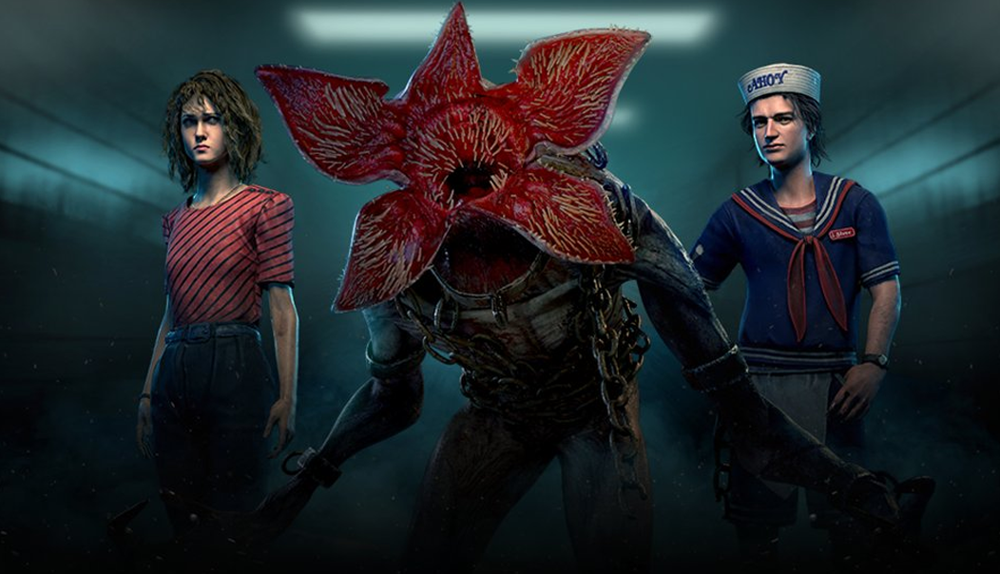

# live · 9.2.3_2869679live

| | |
|---|---|
| Build date | 2025-11-18 15:54 UTC |
| CDN version | `9.2.3_2869679live-1763481254` |
| Key | `9.2.3_live` |
| Compared with | [9.2.3_2869495live](../9.2.3_2869495live/CHANGES.md) (2025-11-18 13:27 UTC) |

## Summary

**1** added · **2** modified · **0** removed · 211 unchanged

## New or updated images

<a href="images/T_UI_SpecialPack_StrangerThings_Collection.png"></a>

## Modified files

### [`collections.json`](collections.json)

[Full line-by-line diff](diffs/collections.json.diff)

```diff
+ $.collections[38].additionalImages[0]
- $.collections[38].collectionId: "HookedOnYou"
+ $.collections[38].collectionId: "StrangerThingsMega"
- $.collections[38].collectionTitle.de: "Hooked on You"
+ $.collections[38].collectionTitle.de: "Stranger Things"
- $.collections[38].collectionTitle.en: "Hooked on You"
+ $.collections[38].collectionTitle.en: "Stranger Things"
- $.collections[38].collectionTitle.es: "Hooked on You"
+ $.collections[38].collectionTitle.es: "Stranger Things"
- $.collections[38].collectionTitle["es-MX"]: "Hooked on You"
+ $.collections[38].collectionTitle["es-MX"]: "Stranger Things"
- $.collections[38].collectionTitle.fr: "Hooked on You"
+ $.collections[38].collectionTitle.fr: "Stranger Things"
- $.collections[38].collectionTitle.it: "Hooked on You"
+ $.collections[38].collectionTitle.it: "Stranger Things"
- $.collections[38].collectionTitle.ja: "Hooked on You"
+ $.collections[38].collectionTitle.ja: "ストレンジャー・シングス"
- $.collections[38].collectionTitle.ko: "Hooked on You"
+ $.collections[38].collectionTitle.ko: "기묘한 이야기"
- $.collections[38].collectionTitle.pl: "Hooked On You"
+ $.collections[38].collectionTitle.pl: "Stranger Things"
- $.collections[38].collectionTitle["pt-BR"]: "Hooked on You"
+ $.collections[38].collectionTitle["pt-BR"]: "Stranger Things"
- $.collections[38].collectionTitle.ru: "На твоем крючке"
+ $.collections[38].collectionTitle.ru: "Очень странные дела"
- $.collections[38].collectionTitle.th: "Hooked on You"
+ $.collections[38].collectionTitle.th: "สเตรนเจอร์ ธิงส์"
- $.collections[38].collectionTitle.tr: "Sana Tutuldum"
+ $.collections[38].collectionTitle.tr: "Stranger Things"
- $.collections[38].collectionTitle["zh-Hans"]: "心醉魂迷"
+ $.collections[38].collectionTitle["zh-Hans"]: "怪奇物语"
- $.collections[38].collectionTitle["zh-Hant"]: "《鉤魂迷戀》"
+ $.collections[38].collectionTitle["zh-Hant"]: "《怪奇物語》"
- $.collections[38].heroImage.path: "/Game/UI/UMGAssets/Icons/Banners/CollectionBanners/T_UI_CollectionBanner_HookedOnYou.T_UI_CollectionBanner_HookedOnYou"
+ $.collections[38].heroImage.path: "/Game/UI/UMGAssets/Icons/Banners/CollectionBanners/T_UI_CollectionBanner_StrangerThings.T_UI_CollectionBanner_StrangerThings"
- $.collections[38].items[]: "BE_outfit_017"
- $.collections[38].items[]: "CM_outfit_021"
- $.collections[38].items[]: "DF_outfit_023"
- $.collections[38].items[]: "HK_outfit_017"
- $.collections[38].items[]: "K23_outfit_014"
+ $.collections[38].items[]: "QF_outfit_006"
+ $.collections[38].items[]: "QF_outfit_008"
+ $.collections[38].items[]: "QF_outfit_009"
+ $.collections[38].items[]: "QF_outfit_010"
+ $.collections[38].items[]: "QF_outfit_02"
+ $.collections[38].items[]: "QK_outfit_006"
+ $.collections[38].items[]: "QK_outfit_007"
+ $.collections[38].items[]: "QK_outfit_02"
+ $.collections[38].items[]: "QM_outfit_006"
+ $.collections[38].items[]: "QM_outfit_008"
+ $.collections[38].items[]: "QM_Outfit_009"
+ $.collections[38].items[]: "QM_Outfit_010"
+ $.collections[38].items[]: "QM_outfit_02"
- $.collections[38].sortOrder: "-19"
+ $.collections[38].sortOrder: "-183"
- $.collections[38].updatedDate: "0001-01-01T00:00:00Z"
+ $.collections[38].updatedDate: "2024-02-01T15:05:44Z"
- $.collections[39].collectionId: "GrimMatsuri"
+ $.collections[39].collectionId: "HookedOnYou"
- $.collections[39].collectionTitle.de: "Düsteres Matsuri-Fest"
+ $.collections[39].collectionTitle.de: "Hooked on You"
- $.collections[39].collectionTitle.en: "Grim Matsuri"
+ $.collections[39].collectionTitle.en: "Hooked on You"
- $.collections[39].collectionTitle.es: "Matsuri tenebrosa"
+ $.collections[39].collectionTitle.es: "Hooked on You"
- $.collections[39].collectionTitle["es-MX"]: "Matsuri tenebrosa"
+ $.collections[39].collectionTitle["es-MX"]: "Hooked on You"
- $.collections[39].collectionTitle.fr: "Matsuri sinistre"
+ $.collections[39].collectionTitle.fr: "Hooked on You"
- $.collections[39].collectionTitle.it: "Matsuri funebre"
+ $.collections[39].collectionTitle.it: "Hooked on You"
- $.collections[39].collectionTitle.ja: "おぞましい祭り"
+ $.collections[39].collectionTitle.ja: "Hooked on You"
- $.collections[39].collectionTitle.ko: "음산한 축제"
+ $.collections[39].collectionTitle.ko: "Hooked on You"
- $.collections[39].collectionTitle.pl: "Ponury Festiwal"
+ $.collections[39].collectionTitle.pl: "Hooked On You"
- $.collections[39].collectionTitle["pt-BR"]: "Festival Japonês Sombrio"
+ $.collections[39].collectionTitle["pt-BR"]: "Hooked on You"
- $.collections[39].collectionTitle.ru: "Мрачный Мацури"
+ $.collections[39].collectionTitle.ru: "На твоем крючке"
- $.collections[39].collectionTitle.th: "เทศกาลสยอง"
+ $.collections[39].collectionTitle.th: "Hooked on You"
- $.collections[39].collectionTitle.tr: "Kasvetli Festival"
+ $.collections[39].collectionTitle.tr: "Sana Tutuldum"
- $.collections[39].collectionTitle["zh-Hans"]: "冷血祭"
+ $.collections[39].collectionTitle["zh-Hans"]: "心醉魂迷"
- $.collections[39].collectionTitle["zh-Hant"]: "冷血祭"
+ $.collections[39].collectionTitle["zh-Hant"]: "《鉤魂迷戀》"
- $.collections[39].heroImage.path: "/Game/UI/UMGAssets/Icons/Banners/CollectionBanners/T_UI_CollectionBanner_GrimMatsuri.T_UI_CollectionBanner_GrimMatsuri"
+ $.collections[39].heroImage.path: "/Game/UI/UMGAssets/Icons/Banners/CollectionBanners/T_UI_CollectionBanner_HookedOnYou.T_UI_CollectionBanner_HookedOnYou"
- $.collections[39].items[]: "Bear_outfit_003"
- $.collections[39].items[]: "Claudette_outfit_018"
- $.collections[39].items[]: "GS_outfit_011"
- $.collections[39].items[]: "Jake_outfit_017"
- $.collections[39].items[]: "Meg_outfit_023"
- $.collections[39].items[]: "Nea_outfit_010"
- $.collections[39].items[]: "SwedenSurvivor_outfit_009"
- $.collections[39].items[]: "TN_outfit_010"
+ $.collections[39].items[]: "BE_outfit_017"
+ $.collections[39].items[]: "CM_outfit_021"
+ $.collections[39].items[]: "DF_outfit_023"
+ $.collections[39].items[]: "HK_outfit_017"
+ $.collections[39].items[]: "K23_outfit_014"
- $.collections[39].sortOrder: "-2"
+ $.collections[39].sortOrder: "-19"
- $.collections[39].updatedDate: "2024-03-06T20:44:22Z"
+ $.collections[39].updatedDate: "0001-01-01T00:00:00Z"
- $.collections[40].collectionId: "AliceInWonderland"
+ $.collections[40].collectionId: "GrimMatsuri"
- $.collections[40].collectionTitle.de: "Alice im Wunderland"
+ $.collections[40].collectionTitle.de: "Düsteres Matsuri-Fest"
- $.collections[40].collectionTitle.en: "Alice in Wonderland"
+ $.collections[40].collectionTitle.en: "Grim Matsuri"
- $.collections[40].collectionTitle.es: "Alicia en el País de las Maravillas"
+ $.collections[40].collectionTitle.es: "Matsuri tenebrosa"
- $.collections[40].collectionTitle["es-MX"]: "Alicia en el País de las Maravillas"
+ $.collections[40].collectionTitle["es-MX"]: "Matsuri tenebrosa"
- $.collections[40].collectionTitle.fr: "Alice au pays des merveilles"
+ $.collections[40].collectionTitle.fr: "Matsuri sinistre"
- $.collections[40].collectionTitle.it: "Alice nel paese delle meraviglie"
+ $.collections[40].collectionTitle.it: "Matsuri funebre"
- $.collections[40].collectionTitle.ja: "不思議の国のアリス"
+ $.collections[40].collectionTitle.ja: "おぞましい祭り"
- $.collections[40].collectionTitle.ko: "이상한 나라의 앨리스"
+ $.collections[40].collectionTitle.ko: "음산한 축제"
- $.collections[40].collectionTitle.pl: "Alicja w Krainie Czarów"
+ $.collections[40].collectionTitle.pl: "Ponury Festiwal"
- $.collections[40].collectionTitle["pt-BR"]: "Alice no País das Maravilhas"
+ $.collections[40].collectionTitle["pt-BR"]: "Festival Japonês Sombrio"
- $.collections[40].collectionTitle.ru: "Алиса в Стране чудес"
+ $.collections[40].collectionTitle.ru: "Мрачный Мацури"
- $.collections[40].collectionTitle.th: "อลิซในแดนมหัศจรรย์"
+ $.collections[40].collectionTitle.th: "เทศกาลสยอง"
- $.collections[40].collectionTitle.tr: "Alice Harikalar Diyarında"
+ $.collections[40].collectionTitle.tr: "Kasvetli Festival"
- $.collections[40].collectionTitle["zh-Hans"]: "爱丽丝梦游仙境收藏"
+ $.collections[40].collectionTitle["zh-Hans"]: "冷血祭"
- $.collections[40].collectionTitle["zh-Hant"]: "《愛麗絲夢遊仙境》"
+ $.collections[40].collectionTitle["zh-Hant"]: "冷血祭"
- $.collections[40].heroImage.path: "/Game/UI/UMGAssets/Icons/Banners/CollectionBanners/T_UI_CollectionBanner_AliceInWonderland.T_UI_CollectionBanner_AliceInWonderland"
+ $.collections[40].heroImage.path: "/Game/UI/UMGAssets/Icons/Banners/CollectionBanners/T_UI_CollectionBanner_GrimMatsuri.T_UI_CollectionBanner_GrimMatsuri"
- $.collections[40].items[]: "AV_outfit_018"
- $.collections[40].items[]: "BE_outfit_020"
- $.collections[40].items[]: "GS_outfit_023"
- $.collections[40].items[]: "K26_outfit_011"
- $.collections[40].items[]: "NK_outfit_023"
+ $.collections[40].items[]: "Bear_outfit_003"
+ $.collections[40].items[]: "Claudette_outfit_018"
+ $.collections[40].items[]: "GS_outfit_011"
+ $.collections[40].items[]: "Jake_outfit_017"
+ $.collections[40].items[]: "Meg_outfit_023"
+ $.collections[40].items[]: "Nea_outfit_010"
+ $.collections[40].items[]: "SwedenSurvivor_outfit_009"
+ $.collections[40].items[]: "TN_outfit_010"
- $.collections[40].sortOrder: "-20"
+ $.collections[40].sortOrder: "-2"
- $.collections[40].updatedDate: "0001-01-01T00:00:00Z"
+ $.collections[40].updatedDate: "2024-03-06T20:44:22Z"
- $.collections[41].collectionId: "Wasteland"
+ $.collections[41].collectionId: "AliceInWonderland"
- $.collections[41].collectionTitle.de: "Ödland"
+ $.collections[41].collectionTitle.de: "Alice im Wunderland"
- $.collections[41].collectionTitle.en: "Wasteland"
+ $.collections[41].collectionTitle.en: "Alice in Wonderland"
- $.collections[41].collectionTitle.es: "Páramo"
+ $.collections[41].collectionTitle.es: "Alicia en el País de las Maravillas"
- $.collections[41].collectionTitle["es-MX"]: "Páramo"
+ $.collections[41].collectionTitle["es-MX"]: "Alicia en el País de las Maravillas"
- $.collections[41].collectionTitle.fr: "Terre dévastée"
+ $.collections[41].collectionTitle.fr: "Alice au pays des merveilles"
- $.collections[41].collectionTitle.it: "Landa desolata"
+ $.collections[41].collectionTitle.it: "Alice nel paese delle meraviglie"
- $.collections[41].collectionTitle.ja: "荒れ地"
+ $.collections[41].collectionTitle.ja: "不思議の国のアリス"
- $.collections[41].collectionTitle.ko: "황무지"
+ $.collections[41].collectionTitle.ko: "이상한 나라의 앨리스"
- $.collections[41].collectionTitle.pl: "Pustkowie"
+ $.collections[41].collectionTitle.pl: "Alicja w Krainie Czarów"
- $.collections[41].collectionTitle["pt-BR"]: "Desolação"
+ $.collections[41].collectionTitle["pt-BR"]: "Alice no País das Maravilhas"
- $.collections[41].collectionTitle.ru: "Пустошь"
+ $.collections[41].collectionTitle.ru: "Алиса в Стране чудес"
- $.collections[41].collectionTitle.th: "แดนรกร้าง"
+ $.collections[41].collectionTitle.th: "อลิซในแดนมหัศจรรย์"
- $.collections[41].collectionTitle.tr: "Çorak"
+ $.collections[41].collectionTitle.tr: "Alice Harikalar Diyarında"
- $.collections[41].collectionTitle["zh-Hans"]: "荒芜之地"
+ $.collections[41].collectionTitle["zh-Hans"]: "爱丽丝梦游仙境收藏"
- $.collections[41].collectionTitle["zh-Hant"]: "荒地"
+ $.collections[41].collectionTitle["zh-Hant"]: "《愛麗絲夢遊仙境》"
- $.collections[41].heroImage.path: "/Game/UI/UMGAssets/Icons/Banners/CollectionBanners/T_UI_CollectionBanner_Wasteland.T_UI_CollectionBanner_Wasteland"
+ $.collections[41].heroImage.path: "/Game/UI/UMGAssets/Icons/Banners/CollectionBanners/T_UI_CollectionBanner_AliceInWonderland.T_UI_CollectionBanner_AliceInWonderland"
- $.collections[41].items[]: "K30_outfit_008"
- $.collections[41].items[]: "S23_outfit_021"
- $.collections[41].items[]: "S31_outfit_009"
+ $.collections[41].items[]: "AV_outfit_018"
+ $.collections[41].items[]: "BE_outfit_020"
+ $.collections[41].items[]: "GS_outfit_023"
+ $.collections[41].items[]: "K26_outfit_011"
… 1423 more change(s) — see the commit diff for everything
```

### [`dynamicContent/DynamicContent.json`](dynamicContent/DynamicContent.json)

[Full line-by-line diff](diffs/dynamicContent/DynamicContent.json.diff)

```diff
- $.entries[8].contentVersion: "c9fc8a859b5ded6b52ab0a4c040be4cc944480a8"
+ $.entries[8].contentVersion: "9fb6a693bfb5b80a098b6637558dc4c5d2f5896a"
- $.entries[8].enableChecksum: true
+ $.entries[8].enableChecksum: false
- $.entries[8].packagedPath: ""
+ $.entries[8].packagedPath: "/Game/UI/UMGAssets/Icons/Banners/BundleBanners/SpecialPack/Maple/T_UI_SpecialPack_StrangerThings_Collection.T_UI_SpecialPack_StrangerThings_Collection"
- $.entries[8].schema: "s3ver://"
+ $.entries[8].schema: "s3verbin://"
- $.entries[8].uri: "catalog.json"
+ $.entries[8].uri: "images/T_UI_SpecialPack_StrangerThings_Collection.png"
- $.entries[9].contentVersion: "fed4f79aedbcaaea876a7910be046136d61319b8"
+ $.entries[9].contentVersion: "c9fc8a859b5ded6b52ab0a4c040be4cc944480a8"
- $.entries[9].uri: "bonusPointEventsContent.json"
+ $.entries[9].uri: "catalog.json"
- $.entries[10].contentVersion: "423f378770698fe8e972daa3bec2f4cbf868e445"
+ $.entries[10].contentVersion: "fed4f79aedbcaaea876a7910be046136d61319b8"
- $.entries[10].uri: "freetoplay/NA/event.json"
+ $.entries[10].uri: "bonusPointEventsContent.json"
- $.entries[11].uri: "freetoplay/EU/event.json"
+ $.entries[11].uri: "freetoplay/NA/event.json"
- $.entries[12].contentVersion: "d5e0e8bd0f90c312e5f704de6ecfeef6f00b83c1"
+ $.entries[12].contentVersion: "423f378770698fe8e972daa3bec2f4cbf868e445"
- $.entries[12].uri: "archiveQuests/Anniversary2022.json"
+ $.entries[12].uri: "freetoplay/EU/event.json"
- $.entries[13].contentVersion: "e2a1096960e5c7a873c611ed47d333a99d24ebdd"
+ $.entries[13].contentVersion: "d5e0e8bd0f90c312e5f704de6ecfeef6f00b83c1"
- $.entries[13].uri: "archiveQuests/Anniversary2023.json"
+ $.entries[13].uri: "archiveQuests/Anniversary2022.json"
- $.entries[14].contentVersion: "05d6d3f58a1345aacd11fc2e75894807eddfeef3"
+ $.entries[14].contentVersion: "e2a1096960e5c7a873c611ed47d333a99d24ebdd"
- $.entries[14].uri: "archiveQuests/Anniversary2024.json"
+ $.entries[14].uri: "archiveQuests/Anniversary2023.json"
- $.entries[15].contentVersion: "eecb76706efe064879d907f01fa9f0afc01ac22a"
+ $.entries[15].contentVersion: "05d6d3f58a1345aacd11fc2e75894807eddfeef3"
- $.entries[15].uri: "archiveQuests/CalamariV1.json"
+ $.entries[15].uri: "archiveQuests/Anniversary2024.json"
- $.entries[16].contentVersion: "357ed733a42915259430ccbd97f96a79378e41b8"
+ $.entries[16].contentVersion: "eecb76706efe064879d907f01fa9f0afc01ac22a"
- $.entries[16].uri: "archiveQuests/CalamariV2.json"
+ $.entries[16].uri: "archiveQuests/CalamariV1.json"
- $.entries[17].contentVersion: "ab8a5bbaf6bab9f6bf2aff6a12f2799e06132a2a"
+ $.entries[17].contentVersion: "357ed733a42915259430ccbd97f96a79378e41b8"
- $.entries[17].uri: "archiveQuests/CalamariV3.json"
+ $.entries[17].uri: "archiveQuests/CalamariV2.json"
- $.entries[18].contentVersion: "92dfd1dd5cf5987e95665b7ac3cb97425910511b"
+ $.entries[18].contentVersion: "ab8a5bbaf6bab9f6bf2aff6a12f2799e06132a2a"
- $.entries[18].uri: "archiveQuests/ChocolateBoxGelato.json"
+ $.entries[18].uri: "archiveQuests/CalamariV3.json"
- $.entries[19].contentVersion: "5ce80b592944bb959f0797f9caef628c398ac6f7"
+ $.entries[19].contentVersion: "92dfd1dd5cf5987e95665b7ac3cb97425910511b"
- $.entries[19].uri: "archiveQuests/ChocolateBoxV1.json"
+ $.entries[19].uri: "archiveQuests/ChocolateBoxGelato.json"
- $.entries[20].contentVersion: "04c11644bf22e3a902dc3227387584e893566976"
+ $.entries[20].contentVersion: "5ce80b592944bb959f0797f9caef628c398ac6f7"
- $.entries[20].uri: "archiveQuests/DreadByDaylightZodiac.json"
+ $.entries[20].uri: "archiveQuests/ChocolateBoxV1.json"
- $.entries[21].contentVersion: "6ae77d38a262a124285d02cbb35fbe8324a92a0f"
+ $.entries[21].contentVersion: "04c11644bf22e3a902dc3227387584e893566976"
- $.entries[21].uri: "archiveQuests/FireflyV1.json"
+ $.entries[21].uri: "archiveQuests/DreadByDaylightZodiac.json"
- $.entries[22].contentVersion: "38259f3c3fd14c6bf9cb29b9fa562afd1986b72c"
+ $.entries[22].contentVersion: "6ae77d38a262a124285d02cbb35fbe8324a92a0f"
- $.entries[22].uri: "archiveQuests/Halloween2021.json"
+ $.entries[22].uri: "archiveQuests/FireflyV1.json"
- $.entries[23].contentVersion: "4d1be4b2b3d9ed21233f91db6c9f975ca27e346e"
+ $.entries[23].contentVersion: "38259f3c3fd14c6bf9cb29b9fa562afd1986b72c"
- $.entries[23].uri: "archiveQuests/Halloween2022.json"
+ $.entries[23].uri: "archiveQuests/Halloween2021.json"
- $.entries[24].contentVersion: "fd502adcfe1014bdf563e46cf548b1d339cdcad8"
+ $.entries[24].contentVersion: "4d1be4b2b3d9ed21233f91db6c9f975ca27e346e"
- $.entries[24].uri: "archiveQuests/Halloween2023.json"
+ $.entries[24].uri: "archiveQuests/Halloween2022.json"
- $.entries[25].contentVersion: "d71a64c0471f3cc6cd6315b9bffedba0d17718bc"
+ $.entries[25].contentVersion: "fd502adcfe1014bdf563e46cf548b1d339cdcad8"
- $.entries[25].uri: "archiveQuests/Halloween2024.json"
+ $.entries[25].uri: "archiveQuests/Halloween2023.json"
- $.entries[26].contentVersion: "7f0486632c765d0319c093737f20a5580a5eb65b"
+ $.entries[26].contentVersion: "d71a64c0471f3cc6cd6315b9bffedba0d17718bc"
- $.entries[26].uri: "archiveQuests/Spring2024.json"
+ $.entries[26].uri: "archiveQuests/Halloween2024.json"
- $.entries[27].contentVersion: "492a01cabead72f8144157bec185062389d5574c"
+ $.entries[27].contentVersion: "7f0486632c765d0319c093737f20a5580a5eb65b"
- $.entries[27].uri: "archiveQuests/Spring2025.json"
+ $.entries[27].uri: "archiveQuests/Spring2024.json"
- $.entries[28].contentVersion: "8eb11e763d31632b64fe72bacb293d7f5325362e"
+ $.entries[28].contentVersion: "492a01cabead72f8144157bec185062389d5574c"
- $.entries[28].uri: "archiveQuests/Summer2023.json"
+ $.entries[28].uri: "archiveQuests/Spring2025.json"
- $.entries[29].contentVersion: "066aedd55fb8e6bed06020170374b50d5cde11b0"
+ $.entries[29].contentVersion: "8eb11e763d31632b64fe72bacb293d7f5325362e"
- $.entries[29].uri: "archiveQuests/Tome01.json"
+ $.entries[29].uri: "archiveQuests/Summer2023.json"
- $.entries[30].contentVersion: "c040ab206fe33879a4873533b125aaf3b8fd546c"
+ $.entries[30].contentVersion: "066aedd55fb8e6bed06020170374b50d5cde11b0"
- $.entries[30].uri: "archiveQuests/Tome02.json"
+ $.entries[30].uri: "archiveQuests/Tome01.json"
- $.entries[31].contentVersion: "9bc10fcdfd767bf5a7fc92ad6048079db177c220"
+ $.entries[31].contentVersion: "c040ab206fe33879a4873533b125aaf3b8fd546c"
- $.entries[31].uri: "archiveQuests/Tome03.json"
+ $.entries[31].uri: "archiveQuests/Tome02.json"
- $.entries[32].contentVersion: "3d792cb0c9344b45f096364edc398c70f421f194"
+ $.entries[32].contentVersion: "9bc10fcdfd767bf5a7fc92ad6048079db177c220"
- $.entries[32].uri: "archiveQuests/Tome04.json"
+ $.entries[32].uri: "archiveQuests/Tome03.json"
- $.entries[33].contentVersion: "f7cb2ad04150da116a1e3e0e4b180f239ba0c4c9"
+ $.entries[33].contentVersion: "3d792cb0c9344b45f096364edc398c70f421f194"
- $.entries[33].uri: "archiveQuests/Tome05.json"
+ $.entries[33].uri: "archiveQuests/Tome04.json"
- $.entries[34].contentVersion: "3898d8a328f2302f55d66295341c77a43400b1ec"
+ $.entries[34].contentVersion: "f7cb2ad04150da116a1e3e0e4b180f239ba0c4c9"
- $.entries[34].uri: "archiveQuests/Tome06.json"
+ $.entries[34].uri: "archiveQuests/Tome05.json"
- $.entries[35].contentVersion: "5cab87e53bbdff63b549faa1b5cdfa25d904f343"
+ $.entries[35].contentVersion: "3898d8a328f2302f55d66295341c77a43400b1ec"
- $.entries[35].uri: "archiveQuests/Tome07.json"
+ $.entries[35].uri: "archiveQuests/Tome06.json"
- $.entries[36].contentVersion: "7a01f8d9241d076148a2116030459b586d05e7b1"
+ $.entries[36].contentVersion: "5cab87e53bbdff63b549faa1b5cdfa25d904f343"
- $.entries[36].uri: "archiveQuests/Tome08.json"
+ $.entries[36].uri: "archiveQuests/Tome07.json"
- $.entries[37].contentVersion: "0a6b10f7e269e13d6adb792a1db1069029f68e85"
+ $.entries[37].contentVersion: "7a01f8d9241d076148a2116030459b586d05e7b1"
- $.entries[37].uri: "archiveQuests/Tome09.json"
+ $.entries[37].uri: "archiveQuests/Tome08.json"
- $.entries[38].contentVersion: "c4f09d48fcff02cc600d7317018da5493ad9c1a3"
+ $.entries[38].contentVersion: "0a6b10f7e269e13d6adb792a1db1069029f68e85"
- $.entries[38].uri: "archiveQuests/Tome10.json"
+ $.entries[38].uri: "archiveQuests/Tome09.json"
- $.entries[39].contentVersion: "fc1a08c3c7733fa15b3f947d50083dd4bb66dc02"
+ $.entries[39].contentVersion: "c4f09d48fcff02cc600d7317018da5493ad9c1a3"
- $.entries[39].uri: "archiveQuests/Tome11.json"
+ $.entries[39].uri: "archiveQuests/Tome10.json"
- $.entries[40].contentVersion: "2f26f7cbaae627eaab895b1674779d15a899e332"
+ $.entries[40].contentVersion: "fc1a08c3c7733fa15b3f947d50083dd4bb66dc02"
- $.entries[40].uri: "archiveQuests/Tome12.json"
+ $.entries[40].uri: "archiveQuests/Tome11.json"
- $.entries[41].contentVersion: "d9304f76d9c5dd4c7c9301786a1df2548499d228"
+ $.entries[41].contentVersion: "2f26f7cbaae627eaab895b1674779d15a899e332"
- $.entries[41].uri: "archiveQuests/Tome13.json"
+ $.entries[41].uri: "archiveQuests/Tome12.json"
- $.entries[42].contentVersion: "8f03d8327d108c20baf98e4d704e4ab318e87fc9"
+ $.entries[42].contentVersion: "d9304f76d9c5dd4c7c9301786a1df2548499d228"
- $.entries[42].uri: "archiveQuests/Tome14.json"
+ $.entries[42].uri: "archiveQuests/Tome13.json"
- $.entries[43].contentVersion: "77901febf477f48b89d7764497e40c892c30bb4a"
+ $.entries[43].contentVersion: "8f03d8327d108c20baf98e4d704e4ab318e87fc9"
- $.entries[43].uri: "archiveQuests/Tome15.json"
+ $.entries[43].uri: "archiveQuests/Tome14.json"
- $.entries[44].contentVersion: "aad5b9730dac47f009f211ef50e2ea0e213dc2d1"
+ $.entries[44].contentVersion: "77901febf477f48b89d7764497e40c892c30bb4a"
- $.entries[44].uri: "archiveQuests/Tome16.json"
+ $.entries[44].uri: "archiveQuests/Tome15.json"
- $.entries[45].contentVersion: "bec0cb83c0027e3bc12e70249d2b70544add3bce"
+ $.entries[45].contentVersion: "aad5b9730dac47f009f211ef50e2ea0e213dc2d1"
- $.entries[45].uri: "archiveQuests/Tome17.json"
+ $.entries[45].uri: "archiveQuests/Tome16.json"
- $.entries[46].contentVersion: "743d1738b802d7669d2ca5a9e9fcadbe7fae677b"
+ $.entries[46].contentVersion: "bec0cb83c0027e3bc12e70249d2b70544add3bce"
- $.entries[46].uri: "archiveQuests/Tome18.json"
+ $.entries[46].uri: "archiveQuests/Tome17.json"
- $.entries[47].contentVersion: "e6468b6de49eaaa479d0a7664d46ae4d422111c2"
+ $.entries[47].contentVersion: "743d1738b802d7669d2ca5a9e9fcadbe7fae677b"
- $.entries[47].uri: "archiveQuests/Tome19.json"
+ $.entries[47].uri: "archiveQuests/Tome18.json"
- $.entries[48].contentVersion: "950cf402a7d1bf8f3a881dbf21ce394d2b90fe52"
+ $.entries[48].contentVersion: "e6468b6de49eaaa479d0a7664d46ae4d422111c2"
- $.entries[48].uri: "archiveQuests/Tome20.json"
+ $.entries[48].uri: "archiveQuests/Tome19.json"
- $.entries[49].contentVersion: "8987e05bcaf69b1a0fd1c54dc418dd50a8800e66"
+ $.entries[49].contentVersion: "950cf402a7d1bf8f3a881dbf21ce394d2b90fe52"
- $.entries[49].uri: "archiveQuests/Tome21.json"
+ $.entries[49].uri: "archiveQuests/Tome20.json"
- $.entries[50].contentVersion: "cccdc4ca8103b0b5919306900be27079c1819e2e"
+ $.entries[50].contentVersion: "8987e05bcaf69b1a0fd1c54dc418dd50a8800e66"
- $.entries[50].uri: "archiveQuests/Tome22.json"
+ $.entries[50].uri: "archiveQuests/Tome21.json"
- $.entries[51].contentVersion: "9a69357dae22368ef4262c5b5e3556b3acc927b1"
+ $.entries[51].contentVersion: "cccdc4ca8103b0b5919306900be27079c1819e2e"
- $.entries[51].uri: "archiveQuests/Winter2022.json"
+ $.entries[51].uri: "archiveQuests/Tome22.json"
- $.entries[52].contentVersion: "2607084e336fae42c8a41e84864e54ae2f99c66f"
+ $.entries[52].contentVersion: "9a69357dae22368ef4262c5b5e3556b3acc927b1"
- $.entries[52].uri: "archiveQuests/Winter2023.json"
+ $.entries[52].uri: "archiveQuests/Winter2022.json"
- $.entries[53].contentVersion: "ae76c40574b12fd570a3bebb6653a4bfbe1d904b"
+ $.entries[53].contentVersion: "2607084e336fae42c8a41e84864e54ae2f99c66f"
- $.entries[53].uri: "archiveQuests/Winter2024.json"
+ $.entries[53].uri: "archiveQuests/Winter2023.json"
- $.entries[54].contentVersion: "28f42a6f69bdc7f2fafb5cca7ee2c5e1ec3d7a0a"
+ $.entries[54].contentVersion: "ae76c40574b12fd570a3bebb6653a4bfbe1d904b"
- $.entries[54].uri: "archiveRewardGrid/Tome01.json"
+ $.entries[54].uri: "archiveQuests/Winter2024.json"
- $.entries[55].contentVersion: "2762fdfed7ec6767edcceb051d3ef2069e1e511c"
+ $.entries[55].contentVersion: "28f42a6f69bdc7f2fafb5cca7ee2c5e1ec3d7a0a"
- $.entries[55].uri: "archiveRewardGrid/Tome02.json"
+ $.entries[55].uri: "archiveRewardGrid/Tome01.json"
- $.entries[56].contentVersion: "05d6ca4acb902934600f6e12e4bf22e7816dbc09"
+ $.entries[56].contentVersion: "2762fdfed7ec6767edcceb051d3ef2069e1e511c"
- $.entries[56].uri: "archiveRewardGrid/Tome03.json"
+ $.entries[56].uri: "archiveRewardGrid/Tome02.json"
… 635 more change(s) — see the commit diff for everything
```

