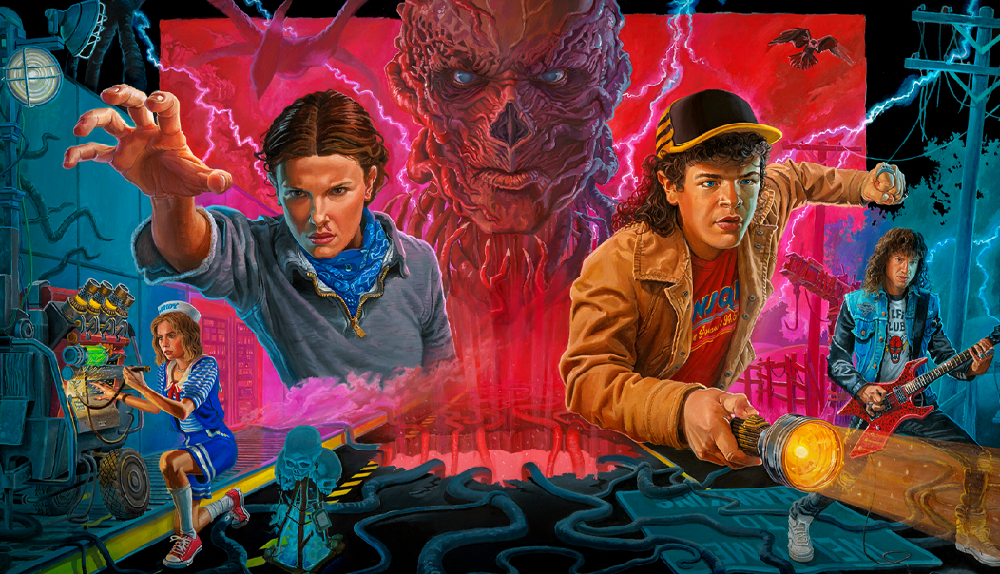
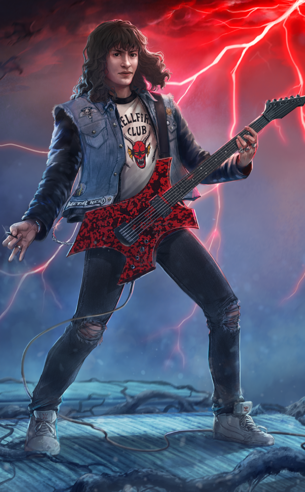
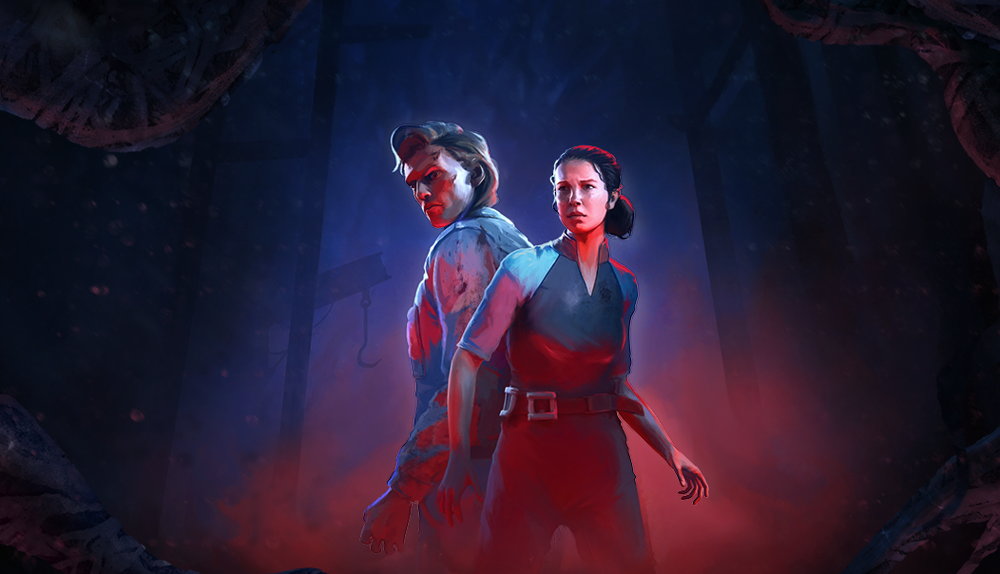
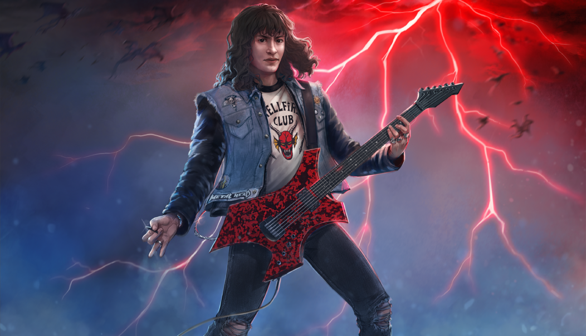
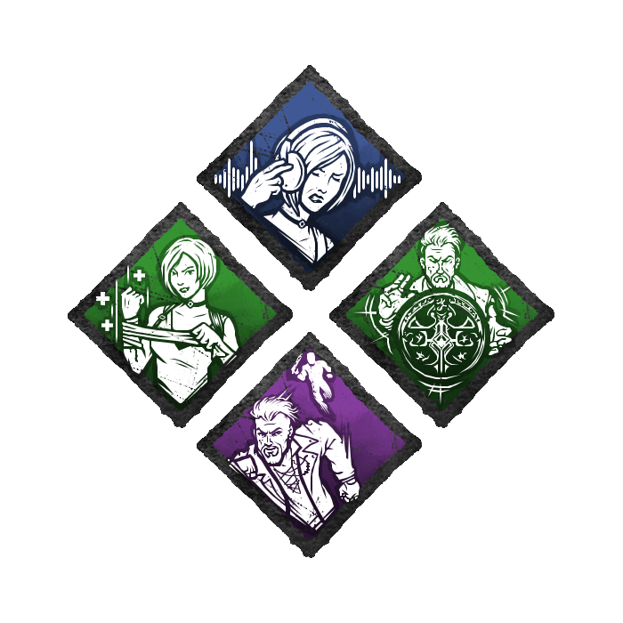
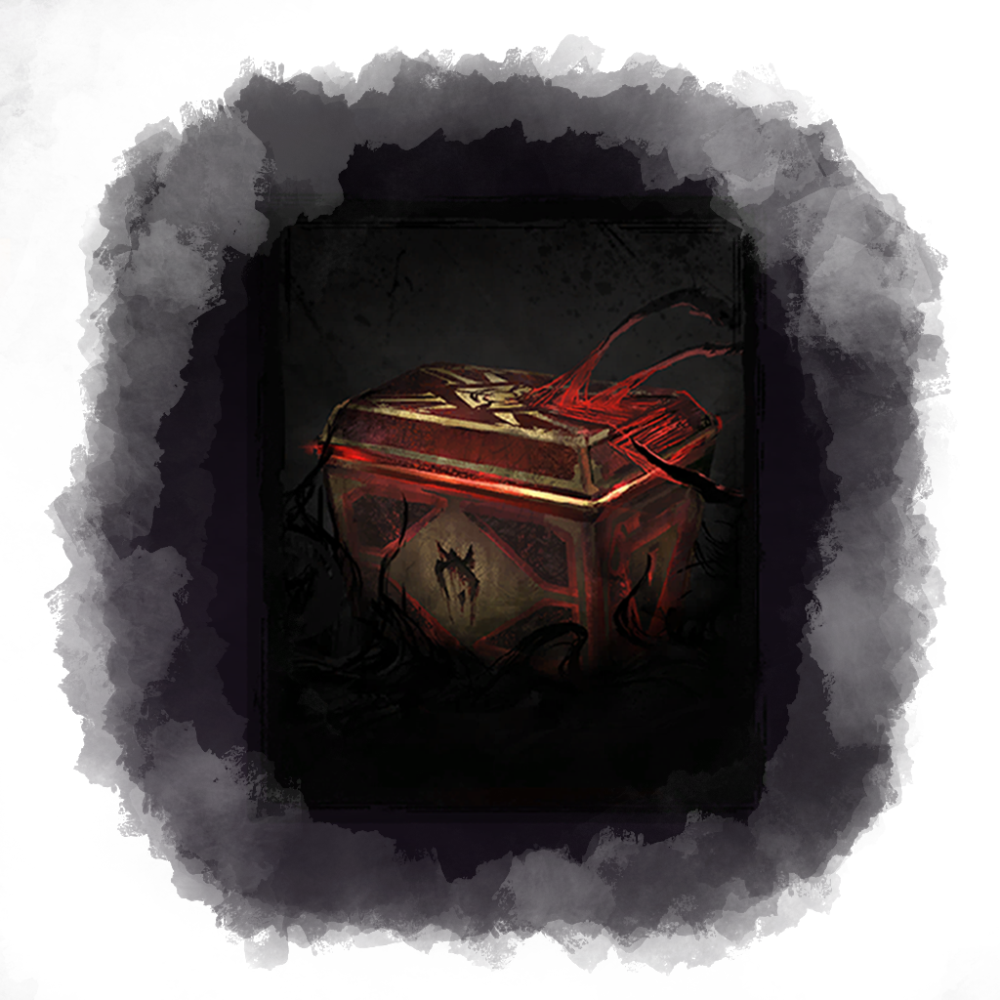

# live · 9.4.0_3042261live

| | |
|---|---|
| Build date | 2026-01-20 21:21 UTC |
| CDN version | `9.4.0_3042261live-1768944084` |
| Key | `9.4.0_live` |
| Compared with | [9.3.2_3041406live](../9.3.2_3041406live/CHANGES.md) (2026-01-20 15:37 UTC) |

## Summary

**9** added · **31** modified · **0** removed · 174 unchanged

## New or updated images

<a href="images/T_UI_ChapterBundle_StrangerThings_Chapter2.png"></a>
<a href="images/T_UI_CollectionBanner_StrangerThings_Chapter2.png"></a>
<a href="images/T_UI_SpecialPack_Rift4.png"></a>
<a href="images/T_UI_SpecialPack_StrangerThings_Chapter2.png"></a>
<a href="images/T_UI_Tutorial_ImageBG_GenQuest1.png"></a>
<a href="images/T_UI_Tutorial_ImageBG_cosmetic.png"></a>
<a href="images/T_UI_Tutorial_ImageBG_gift.png"></a>
<a href="images/T_UI_icon_Event_FogCarnival.png"></a>
<a href="images/T_UI_icon_Event_LunarYear.png"></a>

## Modified files

### [`GameConfigs.json`](GameConfigs.json)

[Full line-by-line diff](diffs/GameConfigs.json.diff)

```diff
- $.analytics.minCountValuesForRules[]: "KA:40"
- $.analytics.minCountValuesForRules[]: "KL:40"
+ $.analytics.minCountValuesForRules[]: "KA:23"
+ $.analytics.minCountValuesForRules[]: "KL:86"
+ $.analyticsRules.BL[]: "CannibalAnalytics"
+ $.analyticsRules.BL[]: "CustomizationLobbyAnalytics"
+ $.analyticsRules.BL[]: "DetailedHitAnalytics"
+ $.analyticsRules.BL[]: "FranklinsDemiseConsumedItemAnalytics"
+ $.analyticsRules.BL[]: "FranklinsHitNearDroppedItemAnalytics"
+ $.analyticsRules.BL[]: "GhostKillerAnalytics"
+ $.analyticsRules.BL[]: "HillbillyAnalytics"
+ $.analyticsRules.BL[]: "KnockoutSurvivorFoundAnalytics"
+ $.analyticsRules.BL[]: "LightbornAuraRevealedAnalytics"
+ $.analyticsRules.BL[]: "LoadOutLobbyAnalytics"
+ $.analyticsRules.BL[]: "LoadingTimeoutAnalytics"
+ $.analyticsRules.BL[]: "MatchIncentivesFetchedAnalytics"
+ $.analyticsRules.BL[]: "PerkAcquisitionAnalytics"
+ $.analyticsRules.BL[]: "PlagueSurvivorAnalytics"
+ $.analyticsRules.BL[]: "ProceduralGenerationAnalytics"
+ $.analyticsRules.BL[]: "StoreMenuFlowAnalytics"
+ $.analyticsRules.BL[]: "TinkererUndetectableHitNearGeneratorAnalytics"
+ $.analyticsRules.BL[]: "TinkererUndetectableInterruptAnalytics"
+ $.analyticsRules.BL[]: "WaitTimeAnalytics"
- $.analyticsRules.KA[]: "CannibalAnalytics"
- $.analyticsRules.KA[]: "CustomizationLobbyAnalytics"
- $.analyticsRules.KA[]: "DetailedHitAnalytics"
- $.analyticsRules.KA[]: "FranklinsDemiseConsumedItemAnalytics"
- $.analyticsRules.KA[]: "FranklinsHitNearDroppedItemAnalytics"
- $.analyticsRules.KA[]: "GhostKillerAnalytics"
- $.analyticsRules.KA[]: "HillbillyAnalytics"
- $.analyticsRules.KA[]: "KnockoutSurvivorFoundAnalytics"
- $.analyticsRules.KA[]: "LightbornAuraRevealedAnalytics"
- $.analyticsRules.KA[]: "LoadOutLobbyAnalytics"
- $.analyticsRules.KA[]: "LoadingTimeoutAnalytics"
- $.analyticsRules.KA[]: "MatchIncentivesFetchedAnalytics"
- $.analyticsRules.KA[]: "PerkAcquisitionAnalytics"
- $.analyticsRules.KA[]: "PlagueSurvivorAnalytics"
- $.analyticsRules.KA[]: "ProceduralGenerationAnalytics"
- $.analyticsRules.KA[]: "StoreMenuFlowAnalytics"
- $.analyticsRules.KA[]: "TinkererUndetectableHitNearGeneratorAnalytics"
- $.analyticsRules.KA[]: "TinkererUndetectableInterruptAnalytics"
- $.analyticsRules.KA[]: "WaitTimeAnalytics"
- $.analyticsRules.KAL[]: "BotReplacementAnalytics"
- $.analyticsRules.KAL[]: "EndpointLatencyAnalytics"
- $.analyticsRules.KAL[]: "FrameHikeAnalytics"
- $.analyticsRules.KAL[]: "InvalidLoadoutAnalytics"
- $.analyticsRules.KAL[]: "LevelLoadingStepAnalytics"
- $.analyticsRules.KAL[]: "LevelLoadingTimeoutAnalytics"
- $.analyticsRules.KAL[]: "OnboardingAnalytics"
- $.analyticsRules.KAL[]: "PlayerCardMenuTabAnalytics"
+ $.analyticsRules.KL[]: "BotReplacementAnalytics"
+ $.analyticsRules.KL[]: "EndpointLatencyAnalytics"
+ $.analyticsRules.KL[]: "FrameHikeAnalytics"
+ $.analyticsRules.KL[]: "InvalidLoadoutAnalytics"
+ $.analyticsRules.KL[]: "LevelLoadingStepAnalytics"
+ $.analyticsRules.KL[]: "LevelLoadingTimeoutAnalytics"
+ $.analyticsRules.KL[]: "OnboardingAnalytics"
+ $.analyticsRules.KL[]: "PlayerCardMenuTabAnalytics"
```

### [`GameConfigsDS.json`](GameConfigsDS.json)

[Full line-by-line diff](diffs/GameConfigsDS.json.diff)

```diff
+ $.analyticsRulesDedicatedServer.BL[]: "DetailedHitAnalytics"
+ $.analyticsRulesDedicatedServer.BL[]: "FranklinsDemiseConsumedItemAnalytics"
+ $.analyticsRulesDedicatedServer.BL[]: "FranklinsHitNearDroppedItemAnalytics"
+ $.analyticsRulesDedicatedServer.BL[]: "KnockoutSurvivorFoundAnalytics"
+ $.analyticsRulesDedicatedServer.BL[]: "LightbornAuraRevealedAnalytics"
+ $.analyticsRulesDedicatedServer.BL[]: "LoadingTimeoutAnalytics"
+ $.analyticsRulesDedicatedServer.BL[]: "MatchIncentivesGrantedAnalytics"
+ $.analyticsRulesDedicatedServer.BL[]: "ProceduralGenerationAnalytics"
+ $.analyticsRulesDedicatedServer.BL[]: "TinkererUndetectableHitNearGeneratorAnalytics"
+ $.analyticsRulesDedicatedServer.BL[]: "TinkererUndetectableInterruptAnalytics"
- $.analyticsRulesDedicatedServer.KA[]: "DetailedHitAnalytics"
- $.analyticsRulesDedicatedServer.KA[]: "FranklinsDemiseConsumedItemAnalytics"
- $.analyticsRulesDedicatedServer.KA[]: "FranklinsHitNearDroppedItemAnalytics"
- $.analyticsRulesDedicatedServer.KA[]: "KnockoutSurvivorFoundAnalytics"
- $.analyticsRulesDedicatedServer.KA[]: "LightbornAuraRevealedAnalytics"
- $.analyticsRulesDedicatedServer.KA[]: "LoadingTimeoutAnalytics"
- $.analyticsRulesDedicatedServer.KA[]: "MatchIncentivesGrantedAnalytics"
- $.analyticsRulesDedicatedServer.KA[]: "ProceduralGenerationAnalytics"
- $.analyticsRulesDedicatedServer.KA[]: "TinkererUndetectableHitNearGeneratorAnalytics"
- $.analyticsRulesDedicatedServer.KA[]: "TinkererUndetectableInterruptAnalytics"
- $.analyticsRulesDedicatedServer.KAL[]: "BotReplacementAnalytics"
- $.analyticsRulesDedicatedServer.KAL[]: "DedicatedServerInvalidLoadoutAnalytics"
- $.analyticsRulesDedicatedServer.KAL[]: "DedicatedServerPlayerEquipDisabledItemAnalytics"
- $.analyticsRulesDedicatedServer.KAL[]: "DedicatedServerStatusAnalytics"
- $.analyticsRulesDedicatedServer.KAL[]: "FrameHikeAnalytics"
- $.analyticsRulesDedicatedServer.KAL[]: "InvalidLoadoutAnalytics"
- $.analyticsRulesDedicatedServer.KAL[]: "LevelLoadingStepAnalytics"
- $.analyticsRulesDedicatedServer.KAL[]: "LevelLoadingTimeoutAnalytics"
+ $.analyticsRulesDedicatedServer.KL[]: "BotReplacementAnalytics"
+ $.analyticsRulesDedicatedServer.KL[]: "DedicatedServerInvalidLoadoutAnalytics"
+ $.analyticsRulesDedicatedServer.KL[]: "DedicatedServerPlayerEquipDisabledItemAnalytics"
+ $.analyticsRulesDedicatedServer.KL[]: "DedicatedServerStatusAnalytics"
+ $.analyticsRulesDedicatedServer.KL[]: "FrameHikeAnalytics"
+ $.analyticsRulesDedicatedServer.KL[]: "InvalidLoadoutAnalytics"
+ $.analyticsRulesDedicatedServer.KL[]: "LevelLoadingStepAnalytics"
+ $.analyticsRulesDedicatedServer.KL[]: "LevelLoadingTimeoutAnalytics"
```

### [`archiveJournals/archiveS3Journals.json`](archiveJournals/archiveS3Journals.json)

[Full line-by-line diff](diffs/archiveJournals/archiveS3Journals.json.diff)

```diff
+ $.TOME23.vignettes[id=TOME23_03]
+ $.TOME23.vignettes[id=TOME23_02].entries[8]
```

### [`archiveJournals/storyJournals.json`](archiveJournals/storyJournals.json)

[Full line-by-line diff](diffs/archiveJournals/storyJournals.json.diff)

```diff
+ $.TOME23.TOME23_03
```

### [`catalog.json`](catalog.json)

[Full line-by-line diff](diffs/catalog.json.diff)

```diff
- $[id=SilentHill_Omelet_Bundle]
- $[id=From_The_Rift_Bundle_260120]
- $[id=Recurring_Charm_Bundle_260120]
- $[id=Recurring_Dev_Bundle_260120]
- $[id=Recurring_Killer_Bundle_260120]
- $[id=Recurring_Survivor_Bundle_260120]
+ $[id=S50]
+ $[id=S51]
+ $[id=K42]
+ $[id=CHALLENGE_REWARD_TIER_Rift_04]
+ $[id=CHALLENGE_BATTLE_PASS_Rift_04]
+ $[id=AV_Torso021_04]
+ $[id=CM_Head034]
+ $[id=CM_Head034_01]
+ $[id=CM_Head034_02]
+ $[id=CM_Head034_03]
+ $[id=CM_Torso027_04]
+ $[id=DF_Torso030_03]
+ $[id=DK_Torso021_03]
+ $[id=FM_Head042]
+ $[id=FM_Head042_01]
+ $[id=FM_Head042_02]
+ $[id=FM_Legs042]
+ $[id=FM_Legs042_01]
+ $[id=FM_Legs042_02]
+ $[id=FM_Torso030_03]
+ $[id=FM_Torso042]
+ $[id=FM_Torso042_01]
+ $[id=FM_Torso042_02]
+ $[id=GS_Head039]
+ $[id=GS_Legs039]
+ $[id=GS_Torso028_04]
+ $[id=GS_Torso039]
+ $[id=HS_Torso022_04]
+ $[id=JP_Torso022_03]
+ $[id=K28_Body022]
+ $[id=K28_Head022]
+ $[id=K28_W022]
+ $[id=K42_Body006]
+ $[id=K42_Body007]
+ $[id=K42_Body01]
+ $[id=K42_Body01_P01]
+ $[id=K42_Head006]
+ $[id=K42_Head007]
+ $[id=K42_Head01]
+ $[id=K42_Head01_P01]
+ $[id=K42_PCharm001]
+ $[id=K42_PCharm002]
+ $[id=K42_PCharm003]
+ $[id=K42_W006]
+ $[id=K42_W007]
+ $[id=K42_W01]
+ $[id=K42_W01_P01]
+ $[id=KS_Head026]
+ $[id=KS_Head026_01]
+ $[id=KS_Head026_02]
+ $[id=KS_Legs026]
+ $[id=KS_Legs026_01]
+ $[id=KS_Legs026_02]
+ $[id=KS_Torso021_04]
+ $[id=KS_Torso026]
+ $[id=KS_Torso026_01]
+ $[id=KS_Torso026_02]
+ $[id=MK_Body020]
+ $[id=MK_Mask020]
+ $[id=MK_W020]
+ $[id=MS_Torso022_03]
+ $[id=MT_Head008_01]
+ $[id=MT_Legs008_01]
+ $[id=MT_Torso012_02]
+ $[id=MT_Torso028_03]
+ $[id=NK_Head037]
+ $[id=NK_Head037_01]
+ $[id=NK_Head037_02]
+ $[id=NK_Legs037]
+ $[id=NK_Legs037_01]
+ $[id=NK_Legs037_02]
+ $[id=NK_Torso028_04]
+ $[id=NK_Torso037]
+ $[id=NK_Torso037_01]
+ $[id=NK_Torso037_02]
+ $[id=OM_BDG_01]
+ $[id=OM_BDG_02]
+ $[id=OM_BDG_03]
+ $[id=OM_BDG_04]
+ $[id=OM_BNR_01]
+ $[id=OM_BNR_02]
+ $[id=OML_001]
+ $[id=POU_BDG_01]
+ $[id=POU_BDG_02]
+ $[id=POU_BDG_03]
+ $[id=POU_BDG_04]
+ $[id=POU_BDG_05]
+ $[id=POU_BDG_06]
+ $[id=POU_BDG_07]
+ $[id=POU_BDG_08]
+ $[id=POU_BDG_09]
+ $[id=POU_BDG_10]
+ $[id=POU_BDG_11]
+ $[id=POU_BDG_12]
+ $[id=POU_BDG_13]
+ $[id=POU_BDG_14]
+ $[id=POU_BDG_19]
+ $[id=POU_BDG_20]
+ $[id=POU_BDG_21]
+ $[id=POU_BDG_22]
+ $[id=POU_BDG_24]
+ $[id=POU_BDG_25]
+ $[id=POU_BDG_26]
+ $[id=POU_BDG_27]
+ $[id=POU_BDG_28]
+ $[id=POU_BDG_29]
+ $[id=POU_BDG_30]
+ $[id=POU_BDG_31]
+ $[id=POU_BDG_32]
+ $[id=POU_BDG_33]
+ $[id=POU_BDG_34]
+ $[id=POU_BDG_35]
+ $[id=POU_BDG_36]
+ $[id=POU_BDG_37]
+ $[id=POU_BDG_38]
+ $[id=POU_BNR_01]
+ $[id=POU_BNR_02]
+ $[id=POU_BNR_03]
+ $[id=POU_BNR_04]
+ $[id=POU_BNR_05]
+ $[id=POU_BNR_06]
+ $[id=POU_BNR_07]
+ $[id=POU_BNR_08]
+ $[id=POU_BNR_09]
+ $[id=POU_BNR_10]
+ $[id=POU_BNR_11]
+ $[id=POU_BNR_12]
+ $[id=POU_BNR_13]
+ $[id=POU_BNR_14]
+ $[id=POU_BNR_15]
+ $[id=POU_BNR_17]
+ $[id=PTN_001]
+ $[id=PTN_002]
+ $[id=PTN_003]
+ $[id=PTN_004]
+ $[id=PTN_005]
+ $[id=PTN_006]
+ $[id=PTN_007]
+ $[id=PTN_008]
+ $[id=PTN_009]
+ $[id=PTN_010]
+ $[id=PTN_011]
+ $[id=PTN_012]
+ $[id=PTN_013]
+ $[id=PTN_014]
+ $[id=PTN_015]
+ $[id=QF_Head011]
+ $[id=QF_Legs011]
+ $[id=QF_Torso011]
+ $[id=QUI_BDG_11]
+ $[id=QUI_BNR_10]
+ $[id=S23_Torso026_03]
+ $[id=S24_Torso020_03]
+ $[id=S25_Torso022_04]
+ $[id=S28_Torso022_03]
+ $[id=S29_Head024]
+ $[id=S29_Legs024]
+ $[id=S29_Torso016_03]
+ $[id=S29_Torso024]
+ $[id=S31_Torso015_03]
+ $[id=S34_Torso016_03]
+ $[id=S35_Head013_01]
+ $[id=S35_Legs013_01]
+ $[id=S35_Torso013_01]
+ $[id=S35_Torso014_03]
+ $[id=S36_Head023_01]
+ $[id=S36_Legs014_01]
+ $[id=S36_Torso014_01]
+ $[id=S36_Torso015_04]
+ $[id=S37_Head025]
+ $[id=S37_Legs025]
+ $[id=S37_Torso014_03]
+ $[id=S37_Torso025]
+ $[id=S41_Torso015_02]
+ $[id=S45_Head014]
+ $[id=S45_Legs014]
+ $[id=S45_Torso009_02]
+ $[id=S45_Torso009_03]
+ $[id=S45_Torso014]
+ $[id=S46_Torso011_01]
+ $[id=S46_Torso011_02]
+ $[id=S46_Torso011_03]
+ $[id=S49_Torso008]
+ $[id=S49_Torso008_01]
+ $[id=S50_Head006]
+ $[id=S50_Head007]
+ $[id=S50_Head01]
+ $[id=S50_Head01_P01]
+ $[id=S50_Legs006]
+ $[id=S50_Legs007]
+ $[id=S50_Legs01]
+ $[id=S50_Legs01_P01]
+ $[id=S50_PCharm001]
+ $[id=S50_PCharm002]
… 350 more change(s) — see the commit diff for everything
```

### [`challengeLocs/challengeText_de.json`](challengeLocs/challengeText_de.json)

[Full line-by-line diff](diffs/challengeLocs/challengeText_de.json.diff)

```diff
+ $.locText[519]
+ $.locText[520]
+ $.locText[521]
+ $.locText[522]
+ $.locText[523]
+ $.locText[524]
+ $.locText[525]
+ $.locText[526]
+ $.locText[527]
+ $.locText[528]
+ $.locText[529]
+ $.locText[530]
+ $.locText[531]
+ $.locText[532]
+ $.locText[533]
+ $.locText[534]
+ $.locText[535]
+ $.locText[536]
+ $.locText[537]
+ $.locText[538]
+ $.locText[539]
+ $.locText[540]
+ $.locText[541]
+ $.locText[542]
+ $.locText[543]
+ $.locText[544]
+ $.locText[545]
+ $.locText[546]
+ $.locText[547]
+ $.locText[548]
+ $.locText[549]
+ $.locText[550]
+ $.locText[551]
+ $.locText[552]
+ $.locText[553]
+ $.locText[554]
+ $.locText[555]
+ $.locText[556]
+ $.locText[557]
+ $.locText[558]
+ $.locText[559]
+ $.locText[560]
+ $.locText[561]
+ $.locText[562]
+ $.locText[563]
+ $.locText[564]
```

### [`challengeLocs/challengeText_en.json`](challengeLocs/challengeText_en.json)

[Full line-by-line diff](diffs/challengeLocs/challengeText_en.json.diff)

```diff
+ $.locText[519]
+ $.locText[520]
+ $.locText[521]
+ $.locText[522]
+ $.locText[523]
+ $.locText[524]
+ $.locText[525]
+ $.locText[526]
+ $.locText[527]
+ $.locText[528]
+ $.locText[529]
+ $.locText[530]
+ $.locText[531]
+ $.locText[532]
+ $.locText[533]
+ $.locText[534]
+ $.locText[535]
+ $.locText[536]
+ $.locText[537]
+ $.locText[538]
+ $.locText[539]
+ $.locText[540]
+ $.locText[541]
+ $.locText[542]
+ $.locText[543]
+ $.locText[544]
+ $.locText[545]
+ $.locText[546]
+ $.locText[547]
+ $.locText[548]
+ $.locText[549]
+ $.locText[550]
+ $.locText[551]
+ $.locText[552]
+ $.locText[553]
+ $.locText[554]
+ $.locText[555]
+ $.locText[556]
+ $.locText[557]
+ $.locText[558]
+ $.locText[559]
+ $.locText[560]
+ $.locText[561]
+ $.locText[562]
+ $.locText[563]
+ $.locText[564]
```

### [`challengeLocs/challengeText_es-MX.json`](challengeLocs/challengeText_es-MX.json)

[Full line-by-line diff](diffs/challengeLocs/challengeText_es-MX.json.diff)

```diff
+ $.locText[519]
+ $.locText[520]
+ $.locText[521]
+ $.locText[522]
+ $.locText[523]
+ $.locText[524]
+ $.locText[525]
+ $.locText[526]
+ $.locText[527]
+ $.locText[528]
+ $.locText[529]
+ $.locText[530]
+ $.locText[531]
+ $.locText[532]
+ $.locText[533]
+ $.locText[534]
+ $.locText[535]
+ $.locText[536]
+ $.locText[537]
+ $.locText[538]
+ $.locText[539]
+ $.locText[540]
+ $.locText[541]
+ $.locText[542]
+ $.locText[543]
+ $.locText[544]
+ $.locText[545]
+ $.locText[546]
+ $.locText[547]
+ $.locText[548]
+ $.locText[549]
+ $.locText[550]
+ $.locText[551]
+ $.locText[552]
+ $.locText[553]
+ $.locText[554]
+ $.locText[555]
+ $.locText[556]
+ $.locText[557]
+ $.locText[558]
+ $.locText[559]
+ $.locText[560]
+ $.locText[561]
+ $.locText[562]
+ $.locText[563]
+ $.locText[564]
```

### [`challengeLocs/challengeText_es.json`](challengeLocs/challengeText_es.json)

[Full line-by-line diff](diffs/challengeLocs/challengeText_es.json.diff)

```diff
+ $.locText[519]
+ $.locText[520]
+ $.locText[521]
+ $.locText[522]
+ $.locText[523]
+ $.locText[524]
+ $.locText[525]
+ $.locText[526]
+ $.locText[527]
+ $.locText[528]
+ $.locText[529]
+ $.locText[530]
+ $.locText[531]
+ $.locText[532]
+ $.locText[533]
+ $.locText[534]
+ $.locText[535]
+ $.locText[536]
+ $.locText[537]
+ $.locText[538]
+ $.locText[539]
+ $.locText[540]
+ $.locText[541]
+ $.locText[542]
+ $.locText[543]
+ $.locText[544]
+ $.locText[545]
+ $.locText[546]
+ $.locText[547]
+ $.locText[548]
+ $.locText[549]
+ $.locText[550]
+ $.locText[551]
+ $.locText[552]
+ $.locText[553]
+ $.locText[554]
+ $.locText[555]
+ $.locText[556]
+ $.locText[557]
+ $.locText[558]
+ $.locText[559]
+ $.locText[560]
+ $.locText[561]
+ $.locText[562]
+ $.locText[563]
+ $.locText[564]
```

### [`challengeLocs/challengeText_fr.json`](challengeLocs/challengeText_fr.json)

[Full line-by-line diff](diffs/challengeLocs/challengeText_fr.json.diff)

```diff
+ $.locText[519]
+ $.locText[520]
+ $.locText[521]
+ $.locText[522]
+ $.locText[523]
+ $.locText[524]
+ $.locText[525]
+ $.locText[526]
+ $.locText[527]
+ $.locText[528]
+ $.locText[529]
+ $.locText[530]
+ $.locText[531]
+ $.locText[532]
+ $.locText[533]
+ $.locText[534]
+ $.locText[535]
+ $.locText[536]
+ $.locText[537]
+ $.locText[538]
+ $.locText[539]
+ $.locText[540]
+ $.locText[541]
+ $.locText[542]
+ $.locText[543]
+ $.locText[544]
+ $.locText[545]
+ $.locText[546]
+ $.locText[547]
+ $.locText[548]
+ $.locText[549]
+ $.locText[550]
+ $.locText[551]
+ $.locText[552]
+ $.locText[553]
+ $.locText[554]
+ $.locText[555]
+ $.locText[556]
+ $.locText[557]
+ $.locText[558]
+ $.locText[559]
+ $.locText[560]
+ $.locText[561]
+ $.locText[562]
+ $.locText[563]
+ $.locText[564]
```

### [`challengeLocs/challengeText_it.json`](challengeLocs/challengeText_it.json)

[Full line-by-line diff](diffs/challengeLocs/challengeText_it.json.diff)

```diff
+ $.locText[519]
+ $.locText[520]
+ $.locText[521]
+ $.locText[522]
+ $.locText[523]
+ $.locText[524]
+ $.locText[525]
+ $.locText[526]
+ $.locText[527]
+ $.locText[528]
+ $.locText[529]
+ $.locText[530]
+ $.locText[531]
+ $.locText[532]
+ $.locText[533]
+ $.locText[534]
+ $.locText[535]
+ $.locText[536]
+ $.locText[537]
+ $.locText[538]
+ $.locText[539]
+ $.locText[540]
+ $.locText[541]
+ $.locText[542]
+ $.locText[543]
+ $.locText[544]
+ $.locText[545]
+ $.locText[546]
+ $.locText[547]
+ $.locText[548]
+ $.locText[549]
+ $.locText[550]
+ $.locText[551]
+ $.locText[552]
+ $.locText[553]
+ $.locText[554]
+ $.locText[555]
+ $.locText[556]
+ $.locText[557]
+ $.locText[558]
+ $.locText[559]
+ $.locText[560]
+ $.locText[561]
+ $.locText[562]
+ $.locText[563]
+ $.locText[564]
```

### [`challengeLocs/challengeText_ja.json`](challengeLocs/challengeText_ja.json)

[Full line-by-line diff](diffs/challengeLocs/challengeText_ja.json.diff)

```diff
+ $.locText[519]
+ $.locText[520]
+ $.locText[521]
+ $.locText[522]
+ $.locText[523]
+ $.locText[524]
+ $.locText[525]
+ $.locText[526]
+ $.locText[527]
+ $.locText[528]
+ $.locText[529]
+ $.locText[530]
+ $.locText[531]
+ $.locText[532]
+ $.locText[533]
+ $.locText[534]
+ $.locText[535]
+ $.locText[536]
+ $.locText[537]
+ $.locText[538]
+ $.locText[539]
+ $.locText[540]
+ $.locText[541]
+ $.locText[542]
+ $.locText[543]
+ $.locText[544]
+ $.locText[545]
+ $.locText[546]
+ $.locText[547]
+ $.locText[548]
+ $.locText[549]
+ $.locText[550]
+ $.locText[551]
+ $.locText[552]
+ $.locText[553]
+ $.locText[554]
+ $.locText[555]
+ $.locText[556]
+ $.locText[557]
+ $.locText[558]
+ $.locText[559]
+ $.locText[560]
+ $.locText[561]
+ $.locText[562]
+ $.locText[563]
+ $.locText[564]
```

### [`challengeLocs/challengeText_ko.json`](challengeLocs/challengeText_ko.json)

[Full line-by-line diff](diffs/challengeLocs/challengeText_ko.json.diff)

```diff
+ $.locText[519]
+ $.locText[520]
+ $.locText[521]
+ $.locText[522]
+ $.locText[523]
+ $.locText[524]
+ $.locText[525]
+ $.locText[526]
+ $.locText[527]
+ $.locText[528]
+ $.locText[529]
+ $.locText[530]
+ $.locText[531]
+ $.locText[532]
+ $.locText[533]
+ $.locText[534]
+ $.locText[535]
+ $.locText[536]
+ $.locText[537]
+ $.locText[538]
+ $.locText[539]
+ $.locText[540]
+ $.locText[541]
+ $.locText[542]
+ $.locText[543]
+ $.locText[544]
+ $.locText[545]
+ $.locText[546]
+ $.locText[547]
+ $.locText[548]
+ $.locText[549]
+ $.locText[550]
+ $.locText[551]
+ $.locText[552]
+ $.locText[553]
+ $.locText[554]
+ $.locText[555]
+ $.locText[556]
+ $.locText[557]
+ $.locText[558]
+ $.locText[559]
+ $.locText[560]
+ $.locText[561]
+ $.locText[562]
+ $.locText[563]
+ $.locText[564]
```

### [`challengeLocs/challengeText_pl.json`](challengeLocs/challengeText_pl.json)

[Full line-by-line diff](diffs/challengeLocs/challengeText_pl.json.diff)

```diff
+ $.locText[519]
+ $.locText[520]
+ $.locText[521]
+ $.locText[522]
+ $.locText[523]
+ $.locText[524]
+ $.locText[525]
+ $.locText[526]
+ $.locText[527]
+ $.locText[528]
+ $.locText[529]
+ $.locText[530]
+ $.locText[531]
+ $.locText[532]
+ $.locText[533]
+ $.locText[534]
+ $.locText[535]
+ $.locText[536]
+ $.locText[537]
+ $.locText[538]
+ $.locText[539]
+ $.locText[540]
+ $.locText[541]
+ $.locText[542]
+ $.locText[543]
+ $.locText[544]
+ $.locText[545]
+ $.locText[546]
+ $.locText[547]
+ $.locText[548]
+ $.locText[549]
+ $.locText[550]
+ $.locText[551]
+ $.locText[552]
+ $.locText[553]
+ $.locText[554]
+ $.locText[555]
+ $.locText[556]
+ $.locText[557]
+ $.locText[558]
+ $.locText[559]
+ $.locText[560]
+ $.locText[561]
+ $.locText[562]
+ $.locText[563]
+ $.locText[564]
```

### [`challengeLocs/challengeText_pt-BR.json`](challengeLocs/challengeText_pt-BR.json)

[Full line-by-line diff](diffs/challengeLocs/challengeText_pt-BR.json.diff)

```diff
+ $.locText[519]
+ $.locText[520]
+ $.locText[521]
+ $.locText[522]
+ $.locText[523]
+ $.locText[524]
+ $.locText[525]
+ $.locText[526]
+ $.locText[527]
+ $.locText[528]
+ $.locText[529]
+ $.locText[530]
+ $.locText[531]
+ $.locText[532]
+ $.locText[533]
+ $.locText[534]
+ $.locText[535]
+ $.locText[536]
+ $.locText[537]
+ $.locText[538]
+ $.locText[539]
+ $.locText[540]
+ $.locText[541]
+ $.locText[542]
+ $.locText[543]
+ $.locText[544]
+ $.locText[545]
+ $.locText[546]
+ $.locText[547]
+ $.locText[548]
+ $.locText[549]
+ $.locText[550]
+ $.locText[551]
+ $.locText[552]
+ $.locText[553]
+ $.locText[554]
+ $.locText[555]
+ $.locText[556]
+ $.locText[557]
+ $.locText[558]
+ $.locText[559]
+ $.locText[560]
+ $.locText[561]
+ $.locText[562]
+ $.locText[563]
+ $.locText[564]
```

### [`challengeLocs/challengeText_ru.json`](challengeLocs/challengeText_ru.json)

[Full line-by-line diff](diffs/challengeLocs/challengeText_ru.json.diff)

```diff
+ $.locText[519]
+ $.locText[520]
+ $.locText[521]
+ $.locText[522]
+ $.locText[523]
+ $.locText[524]
+ $.locText[525]
+ $.locText[526]
+ $.locText[527]
+ $.locText[528]
+ $.locText[529]
+ $.locText[530]
+ $.locText[531]
+ $.locText[532]
+ $.locText[533]
+ $.locText[534]
+ $.locText[535]
+ $.locText[536]
+ $.locText[537]
+ $.locText[538]
+ $.locText[539]
+ $.locText[540]
+ $.locText[541]
+ $.locText[542]
+ $.locText[543]
+ $.locText[544]
+ $.locText[545]
+ $.locText[546]
+ $.locText[547]
+ $.locText[548]
+ $.locText[549]
+ $.locText[550]
+ $.locText[551]
+ $.locText[552]
+ $.locText[553]
+ $.locText[554]
+ $.locText[555]
+ $.locText[556]
+ $.locText[557]
+ $.locText[558]
+ $.locText[559]
+ $.locText[560]
+ $.locText[561]
+ $.locText[562]
+ $.locText[563]
+ $.locText[564]
```

### [`challengeLocs/challengeText_th.json`](challengeLocs/challengeText_th.json)

[Full line-by-line diff](diffs/challengeLocs/challengeText_th.json.diff)

```diff
+ $.locText[519]
+ $.locText[520]
+ $.locText[521]
+ $.locText[522]
+ $.locText[523]
+ $.locText[524]
+ $.locText[525]
+ $.locText[526]
+ $.locText[527]
+ $.locText[528]
+ $.locText[529]
+ $.locText[530]
+ $.locText[531]
+ $.locText[532]
+ $.locText[533]
+ $.locText[534]
+ $.locText[535]
+ $.locText[536]
+ $.locText[537]
+ $.locText[538]
+ $.locText[539]
+ $.locText[540]
+ $.locText[541]
+ $.locText[542]
+ $.locText[543]
+ $.locText[544]
+ $.locText[545]
+ $.locText[546]
+ $.locText[547]
+ $.locText[548]
+ $.locText[549]
+ $.locText[550]
+ $.locText[551]
+ $.locText[552]
+ $.locText[553]
+ $.locText[554]
+ $.locText[555]
+ $.locText[556]
+ $.locText[557]
+ $.locText[558]
+ $.locText[559]
+ $.locText[560]
+ $.locText[561]
+ $.locText[562]
+ $.locText[563]
+ $.locText[564]
```

### [`challengeLocs/challengeText_tr.json`](challengeLocs/challengeText_tr.json)

[Full line-by-line diff](diffs/challengeLocs/challengeText_tr.json.diff)

```diff
+ $.locText[519]
+ $.locText[520]
+ $.locText[521]
+ $.locText[522]
+ $.locText[523]
+ $.locText[524]
+ $.locText[525]
+ $.locText[526]
+ $.locText[527]
+ $.locText[528]
+ $.locText[529]
+ $.locText[530]
+ $.locText[531]
+ $.locText[532]
+ $.locText[533]
+ $.locText[534]
+ $.locText[535]
+ $.locText[536]
+ $.locText[537]
+ $.locText[538]
+ $.locText[539]
+ $.locText[540]
+ $.locText[541]
+ $.locText[542]
+ $.locText[543]
+ $.locText[544]
+ $.locText[545]
+ $.locText[546]
+ $.locText[547]
+ $.locText[548]
+ $.locText[549]
+ $.locText[550]
+ $.locText[551]
+ $.locText[552]
+ $.locText[553]
+ $.locText[554]
+ $.locText[555]
+ $.locText[556]
+ $.locText[557]
+ $.locText[558]
+ $.locText[559]
+ $.locText[560]
+ $.locText[561]
+ $.locText[562]
+ $.locText[563]
+ $.locText[564]
```

### [`challengeLocs/challengeText_zh-Hans.json`](challengeLocs/challengeText_zh-Hans.json)

[Full line-by-line diff](diffs/challengeLocs/challengeText_zh-Hans.json.diff)

```diff
+ $.locText[519]
+ $.locText[520]
+ $.locText[521]
+ $.locText[522]
+ $.locText[523]
+ $.locText[524]
+ $.locText[525]
+ $.locText[526]
+ $.locText[527]
+ $.locText[528]
+ $.locText[529]
+ $.locText[530]
+ $.locText[531]
+ $.locText[532]
+ $.locText[533]
+ $.locText[534]
+ $.locText[535]
+ $.locText[536]
+ $.locText[537]
+ $.locText[538]
+ $.locText[539]
+ $.locText[540]
+ $.locText[541]
+ $.locText[542]
+ $.locText[543]
+ $.locText[544]
+ $.locText[545]
+ $.locText[546]
+ $.locText[547]
+ $.locText[548]
+ $.locText[549]
+ $.locText[550]
+ $.locText[551]
+ $.locText[552]
+ $.locText[553]
+ $.locText[554]
+ $.locText[555]
+ $.locText[556]
+ $.locText[557]
+ $.locText[558]
+ $.locText[559]
+ $.locText[560]
+ $.locText[561]
+ $.locText[562]
+ $.locText[563]
+ $.locText[564]
```

### [`challengeLocs/challengeText_zh-Hant.json`](challengeLocs/challengeText_zh-Hant.json)

[Full line-by-line diff](diffs/challengeLocs/challengeText_zh-Hant.json.diff)

```diff
+ $.locText[519]
+ $.locText[520]
+ $.locText[521]
+ $.locText[522]
+ $.locText[523]
+ $.locText[524]
+ $.locText[525]
+ $.locText[526]
+ $.locText[527]
+ $.locText[528]
+ $.locText[529]
+ $.locText[530]
+ $.locText[531]
+ $.locText[532]
+ $.locText[533]
+ $.locText[534]
+ $.locText[535]
+ $.locText[536]
+ $.locText[537]
+ $.locText[538]
+ $.locText[539]
+ $.locText[540]
+ $.locText[541]
+ $.locText[542]
+ $.locText[543]
+ $.locText[544]
+ $.locText[545]
+ $.locText[546]
+ $.locText[547]
+ $.locText[548]
+ $.locText[549]
+ $.locText[550]
+ $.locText[551]
+ $.locText[552]
+ $.locText[553]
+ $.locText[554]
+ $.locText[555]
+ $.locText[556]
+ $.locText[557]
+ $.locText[558]
+ $.locText[559]
+ $.locText[560]
+ $.locText[561]
+ $.locText[562]
+ $.locText[563]
+ $.locText[564]
```

### [`challengeRewardTrackers.json`](challengeRewardTrackers.json)

[Full line-by-line diff](diffs/challengeRewardTrackers.json.diff)

```diff
+ $.Rift_04
```

### [`challengeSets.json`](challengeSets.json)

[Full line-by-line diff](diffs/challengeSets.json.diff)

```diff
+ $.CalamariPoutine
+ $.FogCarnival
+ $.LNYPoutine
+ $.Milestone_04_Set
+ $.Rift_04_QuestSet
- $.ChocolateBoxOmeletSet.challengeList[0].endDate: "2026-01-27T16:00:00"
+ $.ChocolateBoxOmeletSet.challengeList[0].endDate: "2026-01-27T14:00:00"
- $.ChocolateBoxOmeletSet.challengeList[1].endDate: "2026-01-27T16:00:00"
+ $.ChocolateBoxOmeletSet.challengeList[1].endDate: "2026-01-27T14:00:00"
- $.ChocolateBoxOmeletSet.challengeList[2].endDate: "2026-01-27T16:00:00"
+ $.ChocolateBoxOmeletSet.challengeList[2].endDate: "2026-01-27T14:00:00"
- $.ChocolateBoxOmeletSet.challengeList[3].endDate: "2026-01-27T16:00:00"
+ $.ChocolateBoxOmeletSet.challengeList[3].endDate: "2026-01-27T14:00:00"
- $.ChocolateBoxOmeletSet.endDate: "2026-01-27T16:00:00"
+ $.ChocolateBoxOmeletSet.endDate: "2026-01-27T14:00:00"
```

### [`collections.json`](collections.json)

[Full line-by-line diff](diffs/collections.json.diff)

```diff
+ $.collections[38].additionalImages[0]
- $.collections[38].collectionId: "WinterTales"
+ $.collections[38].collectionId: "UglySweaters"
- $.collections[38].collectionTitle.de: "WINTERMÄRCHEN"
+ $.collections[38].collectionTitle.de: "Hässliche Pullover"
- $.collections[38].collectionTitle.en: "WINTER TALES"
+ $.collections[38].collectionTitle.en: "Ugly Sweaters"
- $.collections[38].collectionTitle.es: "CUENTOS DE INVIERNO"
+ $.collections[38].collectionTitle.es: "Jerséis horribles"
- $.collections[38].collectionTitle["es-MX"]: "HISTORIAS INVERNALES"
+ $.collections[38].collectionTitle["es-MX"]: "Suéteres feos"
- $.collections[38].collectionTitle.fr: "CONTES D’HIVER"
+ $.collections[38].collectionTitle.fr: "Pulls moches"
- $.collections[38].collectionTitle.it: "RACCONTI INVERNALI"
+ $.collections[38].collectionTitle.it: "Maglie orride"
- $.collections[38].collectionTitle.ja: "冬物語"
+ $.collections[38].collectionTitle.ja: "アグリーセーター"
- $.collections[38].collectionTitle.ko: "겨울 이야기"
+ $.collections[38].collectionTitle.ko: "어글리 스웨터"
- $.collections[38].collectionTitle.pl: "ZIMOWE OPOWIEŚCI"
+ $.collections[38].collectionTitle.pl: "Brzydkie swetry"
- $.collections[38].collectionTitle["pt-BR"]: "HISTÓRIAS DE INVERNO"
+ $.collections[38].collectionTitle["pt-BR"]: "Suéteres Horríveis"
- $.collections[38].collectionTitle.ru: "ЗИМНИЕ СКАЗКИ"
+ $.collections[38].collectionTitle.ru: "Ужасные свитеры"
- $.collections[38].collectionTitle.th: "เทพนิยายเหมันต์"
+ $.collections[38].collectionTitle.th: "เสื้อสเวตเตอร์อัปลักษณ์"
- $.collections[38].collectionTitle.tr: "KIŞ HİKÂYELERİ"
+ $.collections[38].collectionTitle.tr: "Çirkin Kazak"
- $.collections[38].collectionTitle["zh-Hans"]: "冬日故事"
+ $.collections[38].collectionTitle["zh-Hans"]: "丑陋毛衣"
- $.collections[38].collectionTitle["zh-Hant"]: "冬季故事"
+ $.collections[38].collectionTitle["zh-Hant"]: "醜陋毛衣"
- $.collections[38].heroImage.path: "/Game/UI/UMGAssets/Icons/Banners/CollectionBanners/Gelato/T_UI_CollectionBanner_WinterTales.T_UI_CollectionBanner_WinterTales"
+ $.collections[38].heroImage.path: "/Game/UI/UMGAssets/Icons/Banners/CollectionBanners/Omelet/T_UI_CollectionBanner_UglySweaters2025.T_UI_CollectionBanner_UglySweaters2025"
- $.collections[38].inclusionVersion: "7.7.0 PTB"
+ $.collections[38].inclusionVersion: "9.3.0"
- $.collections[38].items[]: "BE_outfit_010"
- $.collections[38].items[]: "DF_outfit_011"
- $.collections[38].items[]: "MT_outfit_011"
+ $.collections[38].items[]: "AV_Torso006"
+ $.collections[38].items[]: "BO_Torso006"
+ $.collections[38].items[]: "CM_Torso008"
+ $.collections[38].items[]: "DF_Torso007"
+ $.collections[38].items[]: "DK_Torso006"
+ $.collections[38].items[]: "FM_Torso006"
+ $.collections[38].items[]: "FS_Torso009"
+ $.collections[38].items[]: "GS_Torso008"
+ $.collections[38].items[]: "HS_Torso007"
+ $.collections[38].items[]: "JP_Torso008"
+ $.collections[38].items[]: "K34_Body008"
+ $.collections[38].items[]: "KK_Body012"
+ $.collections[38].items[]: "KK_Body013"
+ $.collections[38].items[]: "KS_Torso006"
+ $.collections[38].items[]: "ML_Torso009"
+ $.collections[38].items[]: "MS_Torso010"
+ $.collections[38].items[]: "MT_Torso007"
+ $.collections[38].items[]: "NK_Torso007"
+ $.collections[38].items[]: "QF_Torso007"
+ $.collections[38].items[]: "QM_Torso007"
+ $.collections[38].items[]: "S22_Torso009"
+ $.collections[38].items[]: "S23_Torso009"
+ $.collections[38].items[]: "S24_Torso007"
+ $.collections[38].items[]: "S25_Torso012"
+ $.collections[38].items[]: "S26_Torso007"
+ $.collections[38].items[]: "S27_Torso007"
+ $.collections[38].items[]: "S28_Torso009"
+ $.collections[38].items[]: "S29_Torso007"
+ $.collections[38].items[]: "S30_Torso007"
+ $.collections[38].items[]: "S31_Torso008"
+ $.collections[38].items[]: "S32_Torso007"
+ $.collections[38].items[]: "S33_Torso007"
+ $.collections[38].items[]: "S34_Torso008"
+ $.collections[38].items[]: "S35_Torso012"
+ $.collections[38].items[]: "S36_Torso012"
+ $.collections[38].items[]: "S37_Torso012"
+ $.collections[38].items[]: "S39_Torso008"
+ $.collections[38].items[]: "S40_Torso011"
+ $.collections[38].items[]: "S41_Torso013"
+ $.collections[38].items[]: "S42_Torso009"
+ $.collections[38].items[]: "S42_Torso010"
+ $.collections[38].items[]: "S45_Torso008"
+ $.collections[38].items[]: "S46_Torso013"
+ $.collections[38].items[]: "S47_Torso009"
+ $.collections[38].items[]: "S48_Torso009"
+ $.collections[38].items[]: "S49_Torso009"
+ $.collections[38].items[]: "SwedenSurvivor_Torso008"
+ $.collections[38].items[]: "US_Torso011"
- $.collections[38].updatedDate: "0001-01-01T00:00:00Z"
+ $.collections[38].updatedDate: "2025-10-23T16:38:49.485Z"
+ $.collections[39].additionalImages[0]
- $.collections[39].collectionId: "DeckTheTrials"
+ $.collections[39].collectionId: "HolidayHorror"
- $.collections[39].collectionTitle.de: "Prüfungsschmuck"
+ $.collections[39].collectionTitle.de: "Fürchterliche Feiertage"
- $.collections[39].collectionTitle.en: "Deck the Trials"
+ $.collections[39].collectionTitle.en: "Holiday Horror"
- $.collections[39].collectionTitle.es: "Decora las partidas"
+ $.collections[39].collectionTitle.es: "Terror navideño"
- $.collections[39].collectionTitle["es-MX"]: "Adorna las partidas"
+ $.collections[39].collectionTitle["es-MX"]: "Terror festivo"
- $.collections[39].collectionTitle.fr: "Ornez les Épreuves"
+ $.collections[39].collectionTitle.fr: "Horreur des fêtes"
- $.collections[39].collectionTitle.it: "Prove addobbate"
+ $.collections[39].collectionTitle.it: "Feste da paura"
- $.collections[39].collectionTitle.ja: "儀式を飾ろう"
+ $.collections[39].collectionTitle.ja: "休日のホラー"
- $.collections[39].collectionTitle.ko: "희생제 장식"
+ $.collections[39].collectionTitle.ko: "공포의 휴일"
- $.collections[39].collectionTitle.pl: "Pokonaj próby"
+ $.collections[39].collectionTitle.pl: "Świąteczna zgroza"
- $.collections[39].collectionTitle["pt-BR"]: "Decore as Partidas"
+ $.collections[39].collectionTitle["pt-BR"]: "Terror das Festas"
- $.collections[39].collectionTitle.ru: "Украшение матчей"
+ $.collections[39].collectionTitle.ru: "Праздничные ужасы"
- $.collections[39].collectionTitle.th: "ตกแต่งเกม"
+ $.collections[39].collectionTitle.th: "วันหยุดสุดสยอง"
- $.collections[39].collectionTitle.tr: "Mücadeleleri Donat"
+ $.collections[39].collectionTitle.tr: "Tatil Dehşeti"
- $.collections[39].collectionTitle["zh-Hans"]: "胜利颂歌"
+ $.collections[39].collectionTitle["zh-Hans"]: "节日恐怖"
- $.collections[39].collectionTitle["zh-Hant"]: "克服挑戰"
+ $.collections[39].collectionTitle["zh-Hant"]: "節慶恐懼"
- $.collections[39].heroImage.path: "/Game/UI/UMGAssets/Icons/Banners/CollectionBanners/Gelato/T_UI_CollectionBanner_DecktheTrials.T_UI_CollectionBanner_DecktheTrials"
+ $.collections[39].heroImage.path: "/Game/UI/UMGAssets/Icons/Banners/CollectionBanners/Omelet/T_UI_CollectionBanner_HolidayHorror_GhostFace.T_UI_CollectionBanner_HolidayHorror_GhostFace"
- $.collections[39].inclusionVersion: "7.7.0 PTB"
+ $.collections[39].inclusionVersion: "9.3.0"
- $.collections[39].items[]: "FM_outfit_036"
- $.collections[39].items[]: "GS_outfit_022"
- $.collections[39].items[]: "K23_outfit_015"
- $.collections[39].items[]: "MT_outfit_021"
- $.collections[39].items[]: "S25_outfit_014"
- $.collections[39].items[]: "S28_outfit_016"
+ $.collections[39].items[]: "AV_outfit_012"
+ $.collections[39].items[]: "Clown_outfit_007"
+ $.collections[39].items[]: "CM_outfit_016"
+ $.collections[39].items[]: "DF_outfit_013"
+ $.collections[39].items[]: "JP_outfit_014"
+ $.collections[39].items[]: "K21_outfit_020"
+ $.collections[39].items[]: "K21_W016"
+ $.collections[39].items[]: "K22_outfit_006"
+ $.collections[39].items[]: "K34_outfit_012"
+ $.collections[39].items[]: "KK_outfit_036"
+ $.collections[39].items[]: "MS_outfit_021"
+ $.collections[39].items[]: "OK_outfit_017"
+ $.collections[39].items[]: "S24_outfit_006"
+ $.collections[39].items[]: "S29_outfit_020"
+ $.collections[39].items[]: "SwedenSurvivor_outfit_022"
+ $.collections[39].items[]: "TN_outfit_018"
+ $.collections[39].items[]: "TR_outfit_012"
+ $.collections[39].items[]: "US_outfit_010"
+ $.collections[39].items[]: "WI_outfit_014"
- $.collections[39].limitedAvailabilityStartDate: "2025-12-01T16:00:00Z"
+ $.collections[39].limitedAvailabilityStartDate: "2025-12-04T16:00:00Z"
- $.collections[39].updatedDate: "2024-12-12T15:11:20.761Z"
+ $.collections[39].updatedDate: "2025-11-24T17:21:58.043Z"
- $.collections[40].collectionId: "BoneChill"
+ $.collections[40].collectionId: "DeckTheTrials"
- $.collections[40].collectionTitle.de: "Kalt bis auf die Knochen"
+ $.collections[40].collectionTitle.de: "Prüfungsschmuck"
- $.collections[40].collectionTitle.en: "Bone Chill"
+ $.collections[40].collectionTitle.en: "Deck the Trials"
- $.collections[40].collectionTitle.es: "Frío en los huesos"
+ $.collections[40].collectionTitle.es: "Decora las partidas"
- $.collections[40].collectionTitle["es-MX"]: "Frío en los huesos"
+ $.collections[40].collectionTitle["es-MX"]: "Adorna las partidas"
- $.collections[40].collectionTitle.fr: "Frisson osseux"
+ $.collections[40].collectionTitle.fr: "Ornez les Épreuves"
- $.collections[40].collectionTitle.it: "Ossa congelate"
+ $.collections[40].collectionTitle.it: "Prove addobbate"
- $.collections[40].collectionTitle.ja: "極寒"
+ $.collections[40].collectionTitle.ja: "儀式を飾ろう"
- $.collections[40].collectionTitle.ko: "매서운 추위"
+ $.collections[40].collectionTitle.ko: "희생제 장식"
- $.collections[40].collectionTitle.pl: "Do szpiku kości"
+ $.collections[40].collectionTitle.pl: "Pokonaj próby"
- $.collections[40].collectionTitle["pt-BR"]: "Frio de Matar"
+ $.collections[40].collectionTitle["pt-BR"]: "Decore as Partidas"
- $.collections[40].collectionTitle.ru: "Пробирающий холод"
+ $.collections[40].collectionTitle.ru: "Украшение матчей"
- $.collections[40].collectionTitle.th: "หนาวเสียดกระดูก"
+ $.collections[40].collectionTitle.th: "ตกแต่งเกม"
- $.collections[40].collectionTitle.tr: "Kemik Donduran"
+ $.collections[40].collectionTitle.tr: "Mücadeleleri Donat"
- $.collections[40].collectionTitle["zh-Hans"]: "刺骨严寒"
+ $.collections[40].collectionTitle["zh-Hans"]: "胜利颂歌"
- $.collections[40].collectionTitle["zh-Hant"]: "刺骨寒慄"
+ $.collections[40].collectionTitle["zh-Hant"]: "克服挑戰"
- $.collections[40].heroImage.path: "/Game/UI/UMGAssets/Icons/Banners/CollectionBanners/Gelato/T_UI_CollectionBanner_BoneChill.T_UI_CollectionBanner_BoneChill"
+ $.collections[40].heroImage.path: "/Game/UI/UMGAssets/Icons/Banners/CollectionBanners/Gelato/T_UI_CollectionBanner_DecktheTrials.T_UI_CollectionBanner_DecktheTrials"
- $.collections[40].inclusionVersion: "9.3.0"
+ $.collections[40].inclusionVersion: "7.7.0 PTB"
- $.collections[40].items[]: "BE_outfit_026"
- $.collections[40].items[]: "BE_W016"
- $.collections[40].items[]: "DK_outfit_017"
- $.collections[40].items[]: "DK_Torso026"
- $.collections[40].items[]: "DO_W025"
- $.collections[40].items[]: "GK_W018"
- $.collections[40].items[]: "HS_Torso027"
- $.collections[40].items[]: "K22_W014"
… 2859 more change(s) — see the commit diff for everything
```

### [`contentSchedule.json`](contentSchedule.json)

[Full line-by-line diff](diffs/contentSchedule.json.diff)

```diff
+ $.schedule[1].MapsWeight.Frm_Cornfield_Calamari: "500"
+ $.schedule[1].MapsWeight.Ind_Storehouse_Calamari: "500"
- $.schedule[5].MapsWeight.Sub_Street: "110"
+ $.schedule[5].MapsWeight.Sub_Street: "0"
- $.schedule[6]
```

### [`crossPromoCampaigns.json`](crossPromoCampaigns.json)

[Full line-by-line diff](diffs/crossPromoCampaigns.json.diff)

```diff
+ $.Campaigns.DBDStats.platformSpecificContent.egs.buttonDisplayURI: "https://stats.deadbydaylight.com"
- $.Campaigns.DBDStats.platformSpecificContent.egs.linkURI: "https://stats.deadbydaylight.com/"
+ $.Campaigns.DBDStats.platformSpecificContent.egs.linkURI: "https://stats.deadbydaylight.com/?utm_source=dbd_game"
- $.Campaigns.DBDStats.platformSpecificContent.grdk.linkURI: "https://stats.deadbydaylight.com/"
+ $.Campaigns.DBDStats.platformSpecificContent.grdk.linkURI: "https://stats.deadbydaylight.com/?utm_source=dbd_game"
+ $.Campaigns.DBDStats.platformSpecificContent.ps4.buttonDisplayURI: "https://stats.deadbydaylight.com"
- $.Campaigns.DBDStats.platformSpecificContent.ps4.buttonLabel: "NSLOCTEXT(\"[3F11D6A8EE02B1F39C1CCB88BA4628AE]\", \"6CB54E17434C20FB2FE796B0B6828160\", \"DBDSTATS_POPUP_INSTRUCTION_LINK_LABEL\")"
+ $.Campaigns.DBDStats.platformSpecificContent.ps4.buttonLabel: "NSLOCTEXT(\"[3F11D6A8EE02B1F39C1CCB88BA4628AE]\", \"6CB54E17434C20FB2FE796B0B6828160\", \"DBDSTATS_POPUP_INSTRUCTION_LINK_LABEL \")"
- $.Campaigns.DBDStats.platformSpecificContent.ps4.buttonLabelTranslations.de: "@#DBDSTATS_POPUP_INSTRUCTION_LINK_LABEL"
+ $.Campaigns.DBDStats.platformSpecificContent.ps4.buttonLabelTranslations.de: "@#DBDSTATS_POPUP_INSTRUCTION_LINK_LABEL "
- $.Campaigns.DBDStats.platformSpecificContent.ps4.buttonLabelTranslations.en: "@#DBDSTATS_POPUP_INSTRUCTION_LINK_LABEL"
+ $.Campaigns.DBDStats.platformSpecificContent.ps4.buttonLabelTranslations.en: "@#DBDSTATS_POPUP_INSTRUCTION_LINK_LABEL "
- $.Campaigns.DBDStats.platformSpecificContent.ps4.buttonLabelTranslations.es: "@#DBDSTATS_POPUP_INSTRUCTION_LINK_LABEL"
+ $.Campaigns.DBDStats.platformSpecificContent.ps4.buttonLabelTranslations.es: "@#DBDSTATS_POPUP_INSTRUCTION_LINK_LABEL "
- $.Campaigns.DBDStats.platformSpecificContent.ps4.buttonLabelTranslations["es-MX"]: "@#DBDSTATS_POPUP_INSTRUCTION_LINK_LABEL"
+ $.Campaigns.DBDStats.platformSpecificContent.ps4.buttonLabelTranslations["es-MX"]: "@#DBDSTATS_POPUP_INSTRUCTION_LINK_LABEL "
- $.Campaigns.DBDStats.platformSpecificContent.ps4.buttonLabelTranslations.fr: "@#DBDSTATS_POPUP_INSTRUCTION_LINK_LABEL"
+ $.Campaigns.DBDStats.platformSpecificContent.ps4.buttonLabelTranslations.fr: "@#DBDSTATS_POPUP_INSTRUCTION_LINK_LABEL "
- $.Campaigns.DBDStats.platformSpecificContent.ps4.buttonLabelTranslations.it: "@#DBDSTATS_POPUP_INSTRUCTION_LINK_LABEL"
+ $.Campaigns.DBDStats.platformSpecificContent.ps4.buttonLabelTranslations.it: "@#DBDSTATS_POPUP_INSTRUCTION_LINK_LABEL "
- $.Campaigns.DBDStats.platformSpecificContent.ps4.buttonLabelTranslations.ja: "@#DBDSTATS_POPUP_INSTRUCTION_LINK_LABEL"
+ $.Campaigns.DBDStats.platformSpecificContent.ps4.buttonLabelTranslations.ja: "@#DBDSTATS_POPUP_INSTRUCTION_LINK_LABEL "
- $.Campaigns.DBDStats.platformSpecificContent.ps4.buttonLabelTranslations.ko: "@#DBDSTATS_POPUP_INSTRUCTION_LINK_LABEL"
+ $.Campaigns.DBDStats.platformSpecificContent.ps4.buttonLabelTranslations.ko: "@#DBDSTATS_POPUP_INSTRUCTION_LINK_LABEL "
- $.Campaigns.DBDStats.platformSpecificContent.ps4.buttonLabelTranslations.pl: "@#DBDSTATS_POPUP_INSTRUCTION_LINK_LABEL"
+ $.Campaigns.DBDStats.platformSpecificContent.ps4.buttonLabelTranslations.pl: "@#DBDSTATS_POPUP_INSTRUCTION_LINK_LABEL "
- $.Campaigns.DBDStats.platformSpecificContent.ps4.buttonLabelTranslations["pt-BR"]: "@#DBDSTATS_POPUP_INSTRUCTION_LINK_LABEL"
+ $.Campaigns.DBDStats.platformSpecificContent.ps4.buttonLabelTranslations["pt-BR"]: "@#DBDSTATS_POPUP_INSTRUCTION_LINK_LABEL "
- $.Campaigns.DBDStats.platformSpecificContent.ps4.buttonLabelTranslations.ru: "@#DBDSTATS_POPUP_INSTRUCTION_LINK_LABEL"
+ $.Campaigns.DBDStats.platformSpecificContent.ps4.buttonLabelTranslations.ru: "@#DBDSTATS_POPUP_INSTRUCTION_LINK_LABEL "
- $.Campaigns.DBDStats.platformSpecificContent.ps4.buttonLabelTranslations.th: "@#DBDSTATS_POPUP_INSTRUCTION_LINK_LABEL"
+ $.Campaigns.DBDStats.platformSpecificContent.ps4.buttonLabelTranslations.th: "@#DBDSTATS_POPUP_INSTRUCTION_LINK_LABEL "
- $.Campaigns.DBDStats.platformSpecificContent.ps4.buttonLabelTranslations.tr: "@#DBDSTATS_POPUP_INSTRUCTION_LINK_LABEL"
+ $.Campaigns.DBDStats.platformSpecificContent.ps4.buttonLabelTranslations.tr: "@#DBDSTATS_POPUP_INSTRUCTION_LINK_LABEL "
- $.Campaigns.DBDStats.platformSpecificContent.ps4.buttonLabelTranslations["zh-Hans"]: "@#DBDSTATS_POPUP_INSTRUCTION_LINK_LABEL"
+ $.Campaigns.DBDStats.platformSpecificContent.ps4.buttonLabelTranslations["zh-Hans"]: "@#DBDSTATS_POPUP_INSTRUCTION_LINK_LABEL "
- $.Campaigns.DBDStats.platformSpecificContent.ps4.buttonLabelTranslations["zh-Hant"]: "@#DBDSTATS_POPUP_INSTRUCTION_LINK_LABEL"
+ $.Campaigns.DBDStats.platformSpecificContent.ps4.buttonLabelTranslations["zh-Hant"]: "@#DBDSTATS_POPUP_INSTRUCTION_LINK_LABEL "
- $.Campaigns.DBDStats.platformSpecificContent.ps4.linkURI: "https://stats.deadbydaylight.com/"
+ $.Campaigns.DBDStats.platformSpecificContent.ps4.linkURI: "https://stats.deadbydaylight.com/?utm_source=dbd_game"
+ $.Campaigns.DBDStats.platformSpecificContent.ps5.buttonDisplayURI: "https://stats.deadbydaylight.com"
- $.Campaigns.DBDStats.platformSpecificContent.ps5.linkURI: "https://stats.deadbydaylight.com/"
+ $.Campaigns.DBDStats.platformSpecificContent.ps5.linkURI: "https://stats.deadbydaylight.com/?utm_source=dbd_game"
+ $.Campaigns.DBDStats.platformSpecificContent.steam.buttonDisplayURI: "https://stats.deadbydaylight.com"
- $.Campaigns.DBDStats.platformSpecificContent.steam.linkURI: "https://stats.deadbydaylight.com/"
+ $.Campaigns.DBDStats.platformSpecificContent.steam.linkURI: "https://stats.deadbydaylight.com/?utm_source=dbd_game"
+ $.Campaigns.DBDStats.platformSpecificContent.switch.buttonDisplayURI: "https://stats.deadbydaylight.com"
- $.Campaigns.DBDStats.platformSpecificContent.switch.buttonLabel: "NSLOCTEXT(\"[3F11D6A8EE02B1F39C1CCB88BA4628AE]\", \"776E36FA4CD67B749D5E3C94D75AA282\", \"DBDSTATS_POPUP_INSTRUCTION_LINK_LABEL\")"
+ $.Campaigns.DBDStats.platformSpecificContent.switch.buttonLabel: "NSLOCTEXT(\"[3F11D6A8EE02B1F39C1CCB88BA4628AE]\", \"776E36FA4CD67B749D5E3C94D75AA282\", \"DBDSTATS_POPUP_INSTRUCTION_LINK_LABEL \")"
- $.Campaigns.DBDStats.platformSpecificContent.switch.buttonLabelTranslations.de: "@#DBDSTATS_POPUP_INSTRUCTION_LINK_LABEL"
+ $.Campaigns.DBDStats.platformSpecificContent.switch.buttonLabelTranslations.de: "@#DBDSTATS_POPUP_INSTRUCTION_LINK_LABEL "
- $.Campaigns.DBDStats.platformSpecificContent.switch.buttonLabelTranslations.en: "@#DBDSTATS_POPUP_INSTRUCTION_LINK_LABEL"
+ $.Campaigns.DBDStats.platformSpecificContent.switch.buttonLabelTranslations.en: "@#DBDSTATS_POPUP_INSTRUCTION_LINK_LABEL "
- $.Campaigns.DBDStats.platformSpecificContent.switch.buttonLabelTranslations.es: "@#DBDSTATS_POPUP_INSTRUCTION_LINK_LABEL"
+ $.Campaigns.DBDStats.platformSpecificContent.switch.buttonLabelTranslations.es: "@#DBDSTATS_POPUP_INSTRUCTION_LINK_LABEL "
- $.Campaigns.DBDStats.platformSpecificContent.switch.buttonLabelTranslations["es-MX"]: "@#DBDSTATS_POPUP_INSTRUCTION_LINK_LABEL"
+ $.Campaigns.DBDStats.platformSpecificContent.switch.buttonLabelTranslations["es-MX"]: "@#DBDSTATS_POPUP_INSTRUCTION_LINK_LABEL "
- $.Campaigns.DBDStats.platformSpecificContent.switch.buttonLabelTranslations.fr: "@#DBDSTATS_POPUP_INSTRUCTION_LINK_LABEL"
+ $.Campaigns.DBDStats.platformSpecificContent.switch.buttonLabelTranslations.fr: "@#DBDSTATS_POPUP_INSTRUCTION_LINK_LABEL "
- $.Campaigns.DBDStats.platformSpecificContent.switch.buttonLabelTranslations.it: "@#DBDSTATS_POPUP_INSTRUCTION_LINK_LABEL"
+ $.Campaigns.DBDStats.platformSpecificContent.switch.buttonLabelTranslations.it: "@#DBDSTATS_POPUP_INSTRUCTION_LINK_LABEL "
- $.Campaigns.DBDStats.platformSpecificContent.switch.buttonLabelTranslations.ja: "@#DBDSTATS_POPUP_INSTRUCTION_LINK_LABEL"
+ $.Campaigns.DBDStats.platformSpecificContent.switch.buttonLabelTranslations.ja: "@#DBDSTATS_POPUP_INSTRUCTION_LINK_LABEL "
- $.Campaigns.DBDStats.platformSpecificContent.switch.buttonLabelTranslations.ko: "@#DBDSTATS_POPUP_INSTRUCTION_LINK_LABEL"
+ $.Campaigns.DBDStats.platformSpecificContent.switch.buttonLabelTranslations.ko: "@#DBDSTATS_POPUP_INSTRUCTION_LINK_LABEL "
- $.Campaigns.DBDStats.platformSpecificContent.switch.buttonLabelTranslations.pl: "@#DBDSTATS_POPUP_INSTRUCTION_LINK_LABEL"
+ $.Campaigns.DBDStats.platformSpecificContent.switch.buttonLabelTranslations.pl: "@#DBDSTATS_POPUP_INSTRUCTION_LINK_LABEL "
- $.Campaigns.DBDStats.platformSpecificContent.switch.buttonLabelTranslations["pt-BR"]: "@#DBDSTATS_POPUP_INSTRUCTION_LINK_LABEL"
+ $.Campaigns.DBDStats.platformSpecificContent.switch.buttonLabelTranslations["pt-BR"]: "@#DBDSTATS_POPUP_INSTRUCTION_LINK_LABEL "
- $.Campaigns.DBDStats.platformSpecificContent.switch.buttonLabelTranslations.ru: "@#DBDSTATS_POPUP_INSTRUCTION_LINK_LABEL"
+ $.Campaigns.DBDStats.platformSpecificContent.switch.buttonLabelTranslations.ru: "@#DBDSTATS_POPUP_INSTRUCTION_LINK_LABEL "
- $.Campaigns.DBDStats.platformSpecificContent.switch.buttonLabelTranslations.th: "@#DBDSTATS_POPUP_INSTRUCTION_LINK_LABEL"
+ $.Campaigns.DBDStats.platformSpecificContent.switch.buttonLabelTranslations.th: "@#DBDSTATS_POPUP_INSTRUCTION_LINK_LABEL "
- $.Campaigns.DBDStats.platformSpecificContent.switch.buttonLabelTranslations.tr: "@#DBDSTATS_POPUP_INSTRUCTION_LINK_LABEL"
+ $.Campaigns.DBDStats.platformSpecificContent.switch.buttonLabelTranslations.tr: "@#DBDSTATS_POPUP_INSTRUCTION_LINK_LABEL "
- $.Campaigns.DBDStats.platformSpecificContent.switch.buttonLabelTranslations["zh-Hans"]: "@#DBDSTATS_POPUP_INSTRUCTION_LINK_LABEL"
+ $.Campaigns.DBDStats.platformSpecificContent.switch.buttonLabelTranslations["zh-Hans"]: "@#DBDSTATS_POPUP_INSTRUCTION_LINK_LABEL "
- $.Campaigns.DBDStats.platformSpecificContent.switch.buttonLabelTranslations["zh-Hant"]: "@#DBDSTATS_POPUP_INSTRUCTION_LINK_LABEL"
+ $.Campaigns.DBDStats.platformSpecificContent.switch.buttonLabelTranslations["zh-Hant"]: "@#DBDSTATS_POPUP_INSTRUCTION_LINK_LABEL "
- $.Campaigns.DBDStats.platformSpecificContent.switch.linkURI: "https://stats.deadbydaylight.com"
+ $.Campaigns.DBDStats.platformSpecificContent.switch.linkURI: "https://stats.deadbydaylight.com/?utm_source=dbd_game"
+ $.Campaigns.DBDStats.platformSpecificContent.xbox.buttonDisplayURI: "https://stats.deadbydaylight.com"
- $.Campaigns.DBDStats.platformSpecificContent.xbox.linkURI: "https://stats.deadbydaylight.com/"
+ $.Campaigns.DBDStats.platformSpecificContent.xbox.linkURI: "https://stats.deadbydaylight.com/?utm_source=dbd_game"
+ $.Campaigns.DBDStats.platformSpecificContent.xsx.buttonDisplayURI: "https://stats.deadbydaylight.com"
- $.Campaigns.DBDStats.platformSpecificContent.xsx.linkURI: "https://stats.deadbydaylight.com/"
+ $.Campaigns.DBDStats.platformSpecificContent.xsx.linkURI: "https://stats.deadbydaylight.com/?utm_source=dbd_game"
```

### [`dlcList.json`](dlcList.json)

[Full line-by-line diff](diffs/dlcList.json.diff)

```diff
+ $.dlcList.Poutine
```

### [`dynamicContent/DynamicContent.json`](dynamicContent/DynamicContent.json)

[Full line-by-line diff](diffs/dynamicContent/DynamicContent.json.diff)

```diff
- $.entries[0].contentVersion: "1f90c86a7812b83089bbb5ca93ab494a410fdd68"
+ $.entries[0].contentVersion: "22f4426df683b6384ac0d61b71e28e3880e1c7ec"
- $.entries[0].packagedPath: "/Game/UI/UMGAssets/Icons/Banners/BundleBanners/SpecialPack/Omelet/T_UI_SpecialPack_TorturedSouls.T_UI_SpecialPack_TorturedSouls"
+ $.entries[0].packagedPath: "/Game/UI/UMGAssets/Icons/Banners/BundleBanners/SpecialPack/Poutine/T_UI_SpecialPack_Rift4.T_UI_SpecialPack_Rift4"
- $.entries[0].uri: "images/T_UI_SpecialPack_TorturedSouls.png"
+ $.entries[0].uri: "images/T_UI_SpecialPack_Rift4.png"
- $.entries[4].contentVersion: "0482fc197a35cc13cbfcbd73b273aff951a3e86d"
+ $.entries[4].contentVersion: "ecea0cbb601208988fb7e266e6339430fbd26066"
- $.entries[4].packagedPath: "/Game/UI/UMGAssets/Icons/Banners/CollectionBanners/Omelet/T_UI_CollectionBanner_HolidayHorror_GhostFace.T_UI_CollectionBanner_HolidayHorror_GhostFace"
+ $.entries[4].packagedPath: "/DBDUICore/Assets/Common/Event/T_UI_icon_Event_FogCarnival.T_UI_icon_Event_FogCarnival"
- $.entries[4].uri: "images/T_UI_CollectionBanner_HolidayHorror_GhostFace.png"
+ $.entries[4].uri: "images/T_UI_icon_Event_FogCarnival.png"
- $.entries[5].contentVersion: "2403e6a96d01b6a837a9ca6dbd4fcc72423ae404"
+ $.entries[5].contentVersion: "ba5908d103a3c970227c15e80f8c1cedd3ed9bec"
- $.entries[5].downloadStrategy: "preferPackaged"
+ $.entries[5].downloadStrategy: "preferRemote"
- $.entries[5].packagedPath: "/Game/UI/UMGAssets/Icons/Banners/BundleBanners/SpecialPack/Omelet/T_UI_SpecialPack_HolidayHorror_GhostFace.T_UI_SpecialPack_HolidayHorror_GhostFace"
+ $.entries[5].packagedPath: "/DBDUICore/Assets/Common/Event/T_UI_icon_Event_LunarYear.T_UI_icon_Event_LunarYear"
- $.entries[5].uri: "images/T_UI_SpecialPack_HolidayHorror_GhostFace.png"
+ $.entries[5].uri: "images/T_UI_icon_Event_LunarYear.png"
- $.entries[6].contentVersion: "d0bae9dc95e1038bedf96178259a76d2653ed51f"
+ $.entries[6].contentVersion: "36c04d7010039e4bbed2a8374fce6f33020d71f9"
- $.entries[6].packagedPath: "/Game/UI/UMGAssets/Icons/Banners/CollectionBanners/Omelet/T_UI_CollectionBanner_TorturedSouls.T_UI_CollectionBanner_TorturedSouls"
+ $.entries[6].packagedPath: "/Game/UI/UMGAssets/Icons/Banners/BundleBanners/ChapterBundles/T_UI_ChapterBundle_StrangerThings_Chapter2.T_UI_ChapterBundle_StrangerThings_Chapter2"
- $.entries[6].uri: "images/T_UI_CollectionBanner_TorturedSouls.png"
+ $.entries[6].uri: "images/T_UI_ChapterBundle_StrangerThings_Chapter2.png"
- $.entries[7].contentVersion: "1f90c86a7812b83089bbb5ca93ab494a410fdd68"
+ $.entries[7].contentVersion: "f8b2414afc2858c35fed794667b3ba6f27a3e7a0"
- $.entries[7].packagedPath: "/Game/UI/UMGAssets/Icons/Banners/BundleBanners/SpecialPack/Omelet/T_UI_SpecialPack_TorturedSouls.T_UI_SpecialPack_TorturedSouls"
+ $.entries[7].packagedPath: "/Game/UI/UMGAssets/Icons/Banners/CollectionBanners/Poutine/T_UI_CollectionBanner_StrangerThings_Chapter2.T_UI_CollectionBanner_StrangerThings_Chapter2"
- $.entries[7].uri: "images/T_UI_SpecialPack_TorturedSouls.png"
+ $.entries[7].uri: "images/T_UI_CollectionBanner_StrangerThings_Chapter2.png"
- $.entries[8].contentVersion: "3dbde971f029d8930b43f43515d8321cbf9ca08f"
+ $.entries[8].contentVersion: "12010aea83ad4e1ee56c50df0da8cd85a85498a2"
- $.entries[8].downloadStrategy: "preferRemote"
+ $.entries[8].downloadStrategy: "preferPackaged"
- $.entries[8].enableChecksum: true
+ $.entries[8].enableChecksum: false
- $.entries[8].packagedPath: ""
+ $.entries[8].packagedPath: "/Game/UI/UMGAssets/Icons/Banners/BundleBanners/SpecialPack/Poutine/Poutine/T_UI_SpecialPack_StrangerThings_Chapter2.T_UI_SpecialPack_StrangerThings_Chapter2"
- $.entries[8].schema: "s3ver://"
+ $.entries[8].schema: "s3verbin://"
- $.entries[8].uri: "catalog.json"
+ $.entries[8].uri: "images/T_UI_SpecialPack_StrangerThings_Chapter2.png"
- $.entries[9].contentVersion: "a9570350b09251633ed30c94e8e0b7ac26158e0e"
+ $.entries[9].contentVersion: "313e783c5eee8ac963fc15cb52098549c7b509c6"
- $.entries[9].uri: "bonusPointEventsContent.json"
+ $.entries[9].uri: "catalog.json"
- $.entries[10].contentVersion: "0bf4ade3635c2b7e2963c904c94378abbc86d3a4"
+ $.entries[10].contentVersion: "0688a6020b52e6bd9500b266ac4b4b6baa60860d"
- $.entries[10].uri: "freetoplay/NA/event.json"
+ $.entries[10].uri: "bonusPointEventsContent.json"
- $.entries[11].contentVersion: "0bf4ade3635c2b7e2963c904c94378abbc86d3a4"
+ $.entries[11].contentVersion: "96087f3be3dde6dff67ed65bd856a3b504dc68de"
- $.entries[11].uri: "freetoplay/EU/event.json"
+ $.entries[11].uri: "freetoplay/NA/event.json"
- $.entries[12].contentVersion: "060829ab50ef0746441d345eba0be945d7cf3153"
+ $.entries[12].contentVersion: "96087f3be3dde6dff67ed65bd856a3b504dc68de"
- $.entries[12].uri: "archiveQuests/Anniversary2022.json"
+ $.entries[12].uri: "freetoplay/EU/event.json"
- $.entries[13].contentVersion: "4fba6589313c492828b84cf0684019ca2801df53"
+ $.entries[13].contentVersion: "dd527570e43d5227bc28afe72fb1f78e53ac6822"
- $.entries[13].uri: "archiveQuests/Anniversary2023.json"
+ $.entries[13].uri: "archiveQuests/Anniversary2022.json"
- $.entries[14].contentVersion: "3bab01f37e3e246b4c6850919b0faedc57af842f"
+ $.entries[14].contentVersion: "52fc655e6b41b211e455230a518f9846c8b5286a"
- $.entries[14].uri: "archiveQuests/Anniversary2024.json"
+ $.entries[14].uri: "archiveQuests/Anniversary2023.json"
- $.entries[15].contentVersion: "f0a8ee660be572c5c1f5189a16a3fc63ef42880d"
+ $.entries[15].contentVersion: "946926ad6e5fc8348d1f1132ac7b59cc676cff14"
- $.entries[15].uri: "archiveQuests/CalamariV1.json"
+ $.entries[15].uri: "archiveQuests/Anniversary2024.json"
- $.entries[16].contentVersion: "afc4666c2c7402d59f3dc6c6dd5c490bc113c042"
+ $.entries[16].contentVersion: "44a5c8ea54340fdfc9b01597243b454a8622e029"
- $.entries[16].uri: "archiveQuests/CalamariV2.json"
+ $.entries[16].uri: "archiveQuests/CalamariV1.json"
- $.entries[17].contentVersion: "be33dc3eabe88389e27ccf8fa0c1d43f45f04d02"
+ $.entries[17].contentVersion: "671675edb2bebab5f35c2e4b6b8e5fa78882ee92"
- $.entries[17].uri: "archiveQuests/CalamariV3.json"
+ $.entries[17].uri: "archiveQuests/CalamariV2.json"
- $.entries[18].contentVersion: "48560b4cb3fdc501cf12a779616152a67a865b65"
+ $.entries[18].contentVersion: "c36008b30af60617d7038322e37ad3f3cd2754e5"
- $.entries[18].uri: "archiveQuests/ChocolateBoxGelato.json"
+ $.entries[18].uri: "archiveQuests/CalamariV3.json"
- $.entries[19].contentVersion: "20099ae62e0a566a48b11766a0c3b3582ff3ade4"
+ $.entries[19].contentVersion: "680a0cf92894220d6b78184aef473d2da4c76013"
- $.entries[19].uri: "archiveQuests/ChocolateBoxV1.json"
+ $.entries[19].uri: "archiveQuests/ChocolateBoxGelato.json"
- $.entries[20].contentVersion: "08d3567110c8ba64c654180e69d2d342000d2db9"
+ $.entries[20].contentVersion: "eae70968d8423a3a0f61227e8b7da194f8856be1"
- $.entries[20].uri: "archiveQuests/DreadByDaylightZodiac.json"
+ $.entries[20].uri: "archiveQuests/ChocolateBoxV1.json"
- $.entries[21].contentVersion: "5822e1fcf9e8db7137476e0c05564f3ad7b78db3"
+ $.entries[21].contentVersion: "5210f96a51547ac1be938e0651440a5c5569ef3a"
- $.entries[21].uri: "archiveQuests/FireflyV1.json"
+ $.entries[21].uri: "archiveQuests/DreadByDaylightZodiac.json"
- $.entries[22].contentVersion: "3ee30bf8395ae04fdf7b5ff0e70fa5278cc3dd94"
+ $.entries[22].contentVersion: "3de6169053b9db24bf1f8464a61002e16a417945"
- $.entries[22].uri: "archiveQuests/Halloween2021.json"
+ $.entries[22].uri: "archiveQuests/FireflyV1.json"
- $.entries[23].contentVersion: "72fb2d1c886c67189254d1892634be9cc78e1ad7"
+ $.entries[23].contentVersion: "69fe782985a5376bac4f588fac10e1f567cbeca4"
- $.entries[23].uri: "archiveQuests/Halloween2022.json"
+ $.entries[23].uri: "archiveQuests/Halloween2021.json"
- $.entries[24].contentVersion: "d446c45163794dba6a1ebf5213c9b07f1a6c1907"
+ $.entries[24].contentVersion: "3b38b442968cdb458f8afd787c8e688df454f3ff"
- $.entries[24].uri: "archiveQuests/Halloween2023.json"
+ $.entries[24].uri: "archiveQuests/Halloween2022.json"
- $.entries[25].contentVersion: "13e2226d01fd4290aa543abb0f9ad1f9331a744e"
+ $.entries[25].contentVersion: "0349ede198538537ff43da647cb4a6f17d238593"
- $.entries[25].uri: "archiveQuests/Halloween2024.json"
+ $.entries[25].uri: "archiveQuests/Halloween2023.json"
- $.entries[26].contentVersion: "0910f5f1ea5b0f52792b4c6b115ae6cc5e03d1ba"
+ $.entries[26].contentVersion: "1e181ef15456cd2d7365430e6a10805da93a4e04"
- $.entries[26].uri: "archiveQuests/Spring2024.json"
+ $.entries[26].uri: "archiveQuests/Halloween2024.json"
- $.entries[27].contentVersion: "9c3dbd07d43b9bf2d68a5052aa7e1b7f9b328e2d"
+ $.entries[27].contentVersion: "a362e2dc91965ba6c44c49cdaebac40ca88214b4"
- $.entries[27].uri: "archiveQuests/Spring2025.json"
+ $.entries[27].uri: "archiveQuests/Spring2024.json"
- $.entries[28].contentVersion: "b8a21a5e417eb4fb58a3fe3f19e51297b148aed8"
+ $.entries[28].contentVersion: "30b252650a511f485554eb5e67b17aea7dbfef26"
- $.entries[28].uri: "archiveQuests/Summer2023.json"
+ $.entries[28].uri: "archiveQuests/Spring2025.json"
- $.entries[29].contentVersion: "76ddf592108f835d0a40fde54f2d32bfd1ec9220"
+ $.entries[29].contentVersion: "adab2d09b46d816bc7e799c9c630c7a5ebfa08ba"
- $.entries[29].uri: "archiveQuests/Tome01.json"
+ $.entries[29].uri: "archiveQuests/Summer2023.json"
- $.entries[30].contentVersion: "faca8eb7e0ea75ef097e9ba639a8937b6855fd89"
+ $.entries[30].contentVersion: "b37423fb4e1b4e8acf9b8fe07224f0c038e96cff"
- $.entries[30].uri: "archiveQuests/Tome02.json"
+ $.entries[30].uri: "archiveQuests/Tome01.json"
- $.entries[31].contentVersion: "a4f7629b334ec029c89e994e71931bb2bdb4e0ac"
+ $.entries[31].contentVersion: "60d7af5b70c58eac3b28cc14dbc25328d2b847b0"
- $.entries[31].uri: "archiveQuests/Tome03.json"
+ $.entries[31].uri: "archiveQuests/Tome02.json"
- $.entries[32].contentVersion: "bbf3b2706c65158c48f7eb2385b161032be044b2"
+ $.entries[32].contentVersion: "3fb24f03ef3244a27f7aa961c96c2b55edd1ec3f"
- $.entries[32].uri: "archiveQuests/Tome04.json"
+ $.entries[32].uri: "archiveQuests/Tome03.json"
- $.entries[33].contentVersion: "b4542d3a9f74f6793dbe6915a893c8fc098c01c8"
+ $.entries[33].contentVersion: "640a22d59c6f914dc04d116de6272409a953b004"
- $.entries[33].uri: "archiveQuests/Tome05.json"
+ $.entries[33].uri: "archiveQuests/Tome04.json"
- $.entries[34].contentVersion: "799459d079f1cae39cde25b9d4b8f0358e4e62d4"
+ $.entries[34].contentVersion: "11f1b9c5ed4aa0bc45ea73ae6ca39a350fd6eacd"
- $.entries[34].uri: "archiveQuests/Tome06.json"
+ $.entries[34].uri: "archiveQuests/Tome05.json"
- $.entries[35].contentVersion: "6b5ccd71f6eea0fe9a7b07371100e6e7f8c65595"
+ $.entries[35].contentVersion: "5b2531dd0791c4dcac0e21db1cb57dbb78cc4f2b"
- $.entries[35].uri: "archiveQuests/Tome07.json"
+ $.entries[35].uri: "archiveQuests/Tome06.json"
- $.entries[36].contentVersion: "97165ee326eaf03b03498c04cfa83510860f8259"
+ $.entries[36].contentVersion: "843f5036329ee37e87906e3091ca04e164663d7d"
- $.entries[36].uri: "archiveQuests/Tome08.json"
+ $.entries[36].uri: "archiveQuests/Tome07.json"
- $.entries[37].contentVersion: "3b3de3a94550e5b3ff68d30f136ebca9c9ad5597"
+ $.entries[37].contentVersion: "b5a1060f76982c8fb38f1e9fd12a0e6480e90293"
- $.entries[37].uri: "archiveQuests/Tome09.json"
+ $.entries[37].uri: "archiveQuests/Tome08.json"
- $.entries[38].contentVersion: "1851ba7b118fc49eb5b6d585141db1447f89a543"
+ $.entries[38].contentVersion: "96e6547f002b0eb543033acac55ff8f7de8af665"
- $.entries[38].uri: "archiveQuests/Tome10.json"
+ $.entries[38].uri: "archiveQuests/Tome09.json"
- $.entries[39].contentVersion: "b73d2378b0c910d7191f4b9269c046d086a46c4c"
+ $.entries[39].contentVersion: "3d56b9463d35cbaa72f78e0c6cad8569f7d9e2f7"
- $.entries[39].uri: "archiveQuests/Tome11.json"
+ $.entries[39].uri: "archiveQuests/Tome10.json"
- $.entries[40].contentVersion: "64f454e26b505ab9f4877892aaec77c180c6de3f"
+ $.entries[40].contentVersion: "7c1ee56726f281483262fce57e468d456bf83a30"
- $.entries[40].uri: "archiveQuests/Tome12.json"
+ $.entries[40].uri: "archiveQuests/Tome11.json"
- $.entries[41].contentVersion: "22cecda2a00721fbe3da30e094e5dbf883cf32f7"
+ $.entries[41].contentVersion: "eb464744a132766bceece555e9ebb6652749c6ad"
- $.entries[41].uri: "archiveQuests/Tome13.json"
+ $.entries[41].uri: "archiveQuests/Tome12.json"
- $.entries[42].contentVersion: "ff1fdbdbacebbb594efdb160935208815cfc1606"
+ $.entries[42].contentVersion: "8ff0de34390bd8310acc3248a438ea50f9df5605"
- $.entries[42].uri: "archiveQuests/Tome14.json"
+ $.entries[42].uri: "archiveQuests/Tome13.json"
- $.entries[43].contentVersion: "7395d846e4e086385cd0503db496417d73e3e523"
+ $.entries[43].contentVersion: "ef80669875acfe08435816b82038c571f26957ce"
- $.entries[43].uri: "archiveQuests/Tome15.json"
+ $.entries[43].uri: "archiveQuests/Tome14.json"
- $.entries[44].contentVersion: "c38bc903299c11c99c2b6412243cbc1138c119c1"
+ $.entries[44].contentVersion: "d3069bd0ce28919e1bb4c3ef6f268ed6cf63879d"
- $.entries[44].uri: "archiveQuests/Tome16.json"
+ $.entries[44].uri: "archiveQuests/Tome15.json"
- $.entries[45].contentVersion: "fa15385ce255bb2d23c25c20ec20e4dc6e6602e2"
+ $.entries[45].contentVersion: "ace36e5eb65872e29a31e1c2f072ea198bf68efd"
- $.entries[45].uri: "archiveQuests/Tome17.json"
+ $.entries[45].uri: "archiveQuests/Tome16.json"
- $.entries[46].contentVersion: "242e51a5981f753972d39659edd1564b01fc3738"
+ $.entries[46].contentVersion: "c370d6afa7aa2760585bab3c5236d473c83defb8"
- $.entries[46].uri: "archiveQuests/Tome18.json"
+ $.entries[46].uri: "archiveQuests/Tome17.json"
- $.entries[47].contentVersion: "92d4cd987f239656efe8318b3f34e82f7edd2ee9"
+ $.entries[47].contentVersion: "b4454ba21da0fb95faed850cd1d1b72a1e664b15"
- $.entries[47].uri: "archiveQuests/Tome19.json"
+ $.entries[47].uri: "archiveQuests/Tome18.json"
… 671 more change(s) — see the commit diff for everything
```

### [`itemsKillswitch.json`](itemsKillswitch.json)

[Full line-by-line diff](diffs/itemsKillswitch.json.diff)

```diff
- $.disabledItems.StrodeRealtyKey
```

### [`prestige/prestige.json`](prestige/prestige.json)

[Full line-by-line diff](diffs/prestige/prestige.json.diff)

```diff
+ $.rewards.K42
+ $.rewards.S50
+ $.rewards.S51
```

### [`recommendations.json`](recommendations.json)

[Full line-by-line diff](diffs/recommendations.json.diff)

```diff
- $.featuredCard[id=Omelet_W6]
+ $.featuredCard[id=PoutinePTB]
+ $.featuredCard[id=PoutineW1]
- $.featuredCard[id=Maple_W7].entries[1].entryId: "LicensorBundle_Halloween"
+ $.featuredCard[id=Maple_W7].entries[1].entryId: "TheWalkingDead"
- $.featuredCard[id=Maple_W7].entries[1].type: "SpecialPack"
+ $.featuredCard[id=Maple_W7].entries[1].type: "Collection"
- $.featuredCard[id=Maple_W7].entries[1].weight: 19
+ $.featuredCard[id=Maple_W7].entries[1].weight: 18
- $.featuredCard[id=Maple_W7].entries[2].entryId: "TheWalkingDead"
+ $.featuredCard[id=Maple_W7].entries[2].entryId: "Rift_3_Bundle"
- $.featuredCard[id=Maple_W7].entries[2].type: "Collection"
+ $.featuredCard[id=Maple_W7].entries[2].type: "SpecialPack"
- $.featuredCard[id=Maple_W7].entries[2].weight: 18
+ $.featuredCard[id=Maple_W7].entries[2].weight: 15
- $.featuredCard[id=Maple_W7].entries[3]
- $.featuredCard[id=Maple_W9].entries[0].entryId: "StrangerThingsMega"
+ $.featuredCard[id=Maple_W9].entries[0].entryId: "StrangerThings"
- $.featuredCard[id=Omelet_W5].activeTo: "2026-01-23T16:00:00"
+ $.featuredCard[id=Omelet_W5].activeTo: "2026-01-27T16:00:00"
+ $.featuredChapterPackRecommendations[id=Poutine]
- $.featuredChapterPackRecommendations[id=Maple].activeTo: "2025-11-18T16:00:00Z"
+ $.featuredChapterPackRecommendations[id=Maple].activeTo: "2030-12-25T15:00:00Z"
- $.featuredChapterPackRecommendations[id=Qatar].activeFrom: "2025-11-18T16:00:00Z"
+ $.featuredChapterPackRecommendations[id=Qatar].activeFrom: "2026-01-30T15:00:00Z"
- $.featuredChapterPackRecommendations[id=Qatar].activeTo: "2030-12-25T15:00:00Z"
+ $.featuredChapterPackRecommendations[id=Qatar].activeTo: "2026-02-25T15:00:00Z"
- $.featuredChapterPackRecommendations[id=Qatar].chapterPacks[0].weight: "1"
+ $.featuredChapterPackRecommendations[id=Qatar].chapterPacks[0].weight: "0"
- $.featuredCharacterRecommendations[id=Featured_Characters_4]
+ $.featuredCharacterRecommendations[id=Featured_Characters]
- $.featuredCustomizationRecommendations[id=OmeletW9]
+ $.featuredCustomizationRecommendations[id=Poutine_W1]
+ $.featuredCustomizationRecommendations[id=OmeletW8].recommendations[id=MM_outfit_02]
+ $.featuredCustomizationRecommendations[id=OmeletW8].recommendations[id=LS_outfit_006]
+ $.featuredCustomizationRecommendations[id=OmeletW8].recommendations[id=MM_W02_02]
+ $.featuredCustomizationRecommendations[id=OmeletW8].recommendations[id=MM_W02_03]
- $.specialsRecommendations[id=SilentHillSale]
```

### [`specialEventsContent.json`](specialEventsContent.json)

[Full line-by-line diff](diffs/specialEventsContent.json.diff)

```diff
- $.specialEvents[61].mainEndTime: "2026-01-27T16:00:00"
+ $.specialEvents[61].mainEndTime: "2026-01-27T14:00:00"
- $.specialEvents[61].postEndTime: "2026-01-27T16:00:00"
+ $.specialEvents[61].postEndTime: "2026-01-27T14:00:00"
- $.specialEvents[62].eventName
- $.specialEvents[62].eventType: "MapShowcase"
- $.specialEvents[62].eventId: "MapShowcase_Omelet_01"
+ $.specialEvents[62].eventId: "CalamariV7"
- $.specialEvents[62].mainEndTime: "2025-12-05T15:59:42"
+ $.specialEvents[62].mainEndTime: "2026-02-24T16:00:00"
- $.specialEvents[62].postEndTime: "2025-12-05T15:59:42"
+ $.specialEvents[62].postEndTime: "2026-02-24T16:00:00"
- $.specialEvents[62].startTime: "2025-12-01T16:00:00"
+ $.specialEvents[62].startTime: "2026-02-10T16:00:00"
- $.specialEvents[62].useCommonData: true
+ $.specialEvents[62].useCommonData: false
- $.specialEvents[63].eventName
- $.specialEvents[63].eventType: "MapShowcase"
- $.specialEvents[63].eventId: "MapShowcase_Omelet_02"
+ $.specialEvents[63].eventId: "FogCarnival"
- $.specialEvents[63].mainEndTime: "2025-12-09T15:59:42"
+ $.specialEvents[63].mainEndTime: "2026-02-17T16:00:00"
- $.specialEvents[63].postEndTime: "2025-12-09T15:59:42"
+ $.specialEvents[63].postEndTime: "2026-02-17T16:00:00"
- $.specialEvents[63].startTime: "2025-12-05T16:00:00"
+ $.specialEvents[63].startTime: "2026-02-03T16:00:00"
- $.specialEvents[63].useCommonData: true
+ $.specialEvents[63].useCommonData: false
+ $.specialEvents[64]
+ $.specialEvents[65]
+ $.specialEvents[66]
- $.specialEventsData[12].eventId: "ChocolateBoxEclair"
+ $.specialEventsData[12].eventId: "CalamariV7"
- $.specialEventsData[12].lteData.incentiveBonus: 0.0
- $.specialEventsData[12].lteData.affectsMMR: true
+ $.specialEventsData[12].lteData.affectsMMR: false
- $.specialEventsData[12].lteData.gameModeQueue: "ChocolateBox"
+ $.specialEventsData[12].lteData.gameModeQueue: "Calamari"
- $.specialEventsData[12].lteData.gameType: "ChocolateBox"
+ $.specialEventsData[12].lteData.gameType: "Calamari"
- $.specialEventsData[13].eventId: "ChocolateBoxGelato"
+ $.specialEventsData[13].eventId: "ChocolateBoxEclair"
- $.specialEventsData[14].eventId: "ChocolateBoxHotdog"
+ $.specialEventsData[14].eventId: "ChocolateBoxGelato"
- $.specialEventsData[15].eventId: "ChocolateBoxIcecream"
+ $.specialEventsData[15].eventId: "ChocolateBoxHotdog"
- $.specialEventsData[16].eventId: "ChocolateBoxJerky"
+ $.specialEventsData[16].eventId: "ChocolateBoxIcecream"
- $.specialEventsData[17].eventId: "ChocolateBoxKetchup"
+ $.specialEventsData[17].eventId: "ChocolateBoxJerky"
- $.specialEventsData[18].eventId: "ChocolateBoxOmelet"
+ $.specialEventsData[18].eventId: "ChocolateBoxKetchup"
+ $.specialEventsData[18].lteData.incentiveBonus: 0.0
- $.specialEventsData[19].eventId: "ChocolateBoxV1"
+ $.specialEventsData[19].eventId: "ChocolateBoxOmelet"
- $.specialEventsData[19].lteData.incentiveBonus: 0.0
- $.specialEventsData[20].eventId: "DreadByDaylightZodiac"
+ $.specialEventsData[20].eventId: "ChocolateBoxV1"
- $.specialEventsData[20].lteData.affectsMMR: false
+ $.specialEventsData[20].lteData.affectsMMR: true
- $.specialEventsData[20].lteData.gameModeQueue: "DreadByDaylight"
+ $.specialEventsData[20].lteData.gameModeQueue: "ChocolateBox"
- $.specialEventsData[20].lteData.gameType: "DreadByDaylight"
+ $.specialEventsData[20].lteData.gameType: "ChocolateBox"
- $.specialEventsData[21].eventId: "FireflyV1"
+ $.specialEventsData[21].eventId: "DreadByDaylightZodiac"
- $.specialEventsData[21].lteData.gameModeQueue: "Firefly"
+ $.specialEventsData[21].lteData.gameModeQueue: "DreadByDaylight"
- $.specialEventsData[21].lteData.gameType: "Firefly"
+ $.specialEventsData[21].lteData.gameType: "DreadByDaylight"
+ $.specialEventsData[22].lteData
- $.specialEventsData[22].eventId: "Halloween2022"
+ $.specialEventsData[22].eventId: "FireflyV1"
- $.specialEventsData[22].ownerRewards[id=Halloween2022Reward]
- $.specialEventsData[23].eventId: "Halloween2023"
+ $.specialEventsData[23].eventId: "Halloween2022"
- $.specialEventsData[23].milestoneRewards[0]
- $.specialEventsData[23].milestoneRewards[1]
- $.specialEventsData[23].milestoneRewards[2]
+ $.specialEventsData[23].ownerRewards[id=Halloween2022Reward]
- $.specialEventsData[24].lteData
- $.specialEventsData[24].eventId: "Halloween2024"
+ $.specialEventsData[24].eventId: "Halloween2023"
- $.specialEventsData[24].eventPeriods[id=Halloween2024]
- $.specialEventsData[24].milestoneRewards[0].rewards[id=FU_012]
+ $.specialEventsData[24].milestoneRewards[0].rewards[id=XR_037]
- $.specialEventsData[24].milestoneRewards[1].rewards[id=FU_BDG_18]
+ $.specialEventsData[24].milestoneRewards[1].rewards[id=MT_Head027]
- $.specialEventsData[24].milestoneRewards[2].pointsCost: 20
+ $.specialEventsData[24].milestoneRewards[2].pointsCost: 21
- $.specialEventsData[24].milestoneRewards[2].rewards[id=FU_BNR_12]
+ $.specialEventsData[24].milestoneRewards[2].rewards[id=K30_Head011]
- $.specialEventsData[25].eventId: "Halloween2025"
+ $.specialEventsData[25].eventId: "Halloween2024"
+ $.specialEventsData[25].eventPeriods[id=Halloween2024]
+ $.specialEventsData[25].lteData.incentiveBonus: 50.0
- $.specialEventsData[25].lteData.gameModeQueue: "Halloween2025"
+ $.specialEventsData[25].lteData.gameModeQueue: "Halloween2024"
+ $.specialEventsData[25].milestoneRewards[0]
+ $.specialEventsData[25].milestoneRewards[1]
+ $.specialEventsData[25].milestoneRewards[2]
+ $.specialEventsData[26].lteData
- $.specialEventsData[26].eventId: "Lunar2022"
+ $.specialEventsData[26].eventId: "Halloween2025"
- $.specialEventsData[26].miscRewards[id=killerStaticReward]
- $.specialEventsData[26].ownerRewards[id=Lunar2022Reward]
- $.specialEventsData[26].scoreEventRewards[0]
- $.specialEventsData[26].scoreEventRewards[1]
- $.specialEventsData[26].scoreEventRewards[2]
- $.specialEventsData[26].scoreEventRewards[3]
- $.specialEventsData[26].scoreEventRewards[4]
- $.specialEventsData[26].scoreEventRewards[5]
- $.specialEventsData[26].scoreEventRewards[6]
- $.specialEventsData[26].scoreEventRewards[7]
- $.specialEventsData[27].eventId: "Lunar2023"
+ $.specialEventsData[27].eventId: "Lunar2022"
- $.specialEventsData[27].miscRewards[id=killerStaticReward].rewards[id=Bloodpoints].amount: 5000
+ $.specialEventsData[27].miscRewards[id=killerStaticReward].rewards[id=Bloodpoints].amount: 4000
- $.specialEventsData[27].ownerRewards[id=Lunar2023Reward]
+ $.specialEventsData[27].ownerRewards[id=Lunar2022Reward]
- $.specialEventsData[27].scoreEventRewards[2].weight: 15
+ $.specialEventsData[27].scoreEventRewards[2].weight: 20
- $.specialEventsData[27].scoreEventRewards[3].weight: 25
+ $.specialEventsData[27].scoreEventRewards[3].weight: 20
- $.specialEventsData[27].scoreEventRewards[5].weight: 20
+ $.specialEventsData[27].scoreEventRewards[5].weight: 15
- $.specialEventsData[27].scoreEventRewards[6].weight: 10
+ $.specialEventsData[27].scoreEventRewards[6].weight: 8
- $.specialEventsData[27].scoreEventRewards[7].weight: 5
+ $.specialEventsData[27].scoreEventRewards[7].weight: 2
- $.specialEventsData[28].lteData
- $.specialEventsData[28].eventId: "MapShowcaseKetchup"
+ $.specialEventsData[28].eventId: "Lunar2023"
+ $.specialEventsData[28].miscRewards[id=killerStaticReward]
+ $.specialEventsData[28].ownerRewards[id=Lunar2023Reward]
+ $.specialEventsData[28].scoreEventRewards[0]
+ $.specialEventsData[28].scoreEventRewards[1]
+ $.specialEventsData[28].scoreEventRewards[2]
+ $.specialEventsData[28].scoreEventRewards[3]
+ $.specialEventsData[28].scoreEventRewards[4]
+ $.specialEventsData[28].scoreEventRewards[5]
+ $.specialEventsData[28].scoreEventRewards[6]
+ $.specialEventsData[28].scoreEventRewards[7]
- $.specialEventsData[29].eventId: "MapShowcase_Omelet_01"
+ $.specialEventsData[29].eventId: "MapShowcaseKetchup"
- $.specialEventsData[30].eventId: "MapShowcase_Omelet_02"
+ $.specialEventsData[30].eventId: "MapShowcase_Omelet_01"
+ $.specialEventsData[31].lteData
- $.specialEventsData[31].eventId: "Spring2024"
+ $.specialEventsData[31].eventId: "MapShowcase_Omelet_02"
- $.specialEventsData[31].eventTrackerObjectives[id=main]
- $.specialEventsData[32].lteData
- $.specialEventsData[32].eventId: "Spring2025"
+ $.specialEventsData[32].eventId: "Spring2024"
- $.specialEventsData[32].eventTrackerObjectives[id=main].additionalEventIdsWithMilestoneBonus
- $.specialEventsData[32].eventTrackerObjectives[id=main].questEventConditions
- $.specialEventsData[32].eventTrackerObjectives[id=main].questEvents
+ $.specialEventsData[32].eventTrackerObjectives[id=main].questEventId: "QuestEvent.SpringEventPlaceZone"
+ $.specialEventsData[32].eventTrackerObjectives[id=main].questEventParams: "instigator:me"
- $.specialEventsData[32].eventTrackerObjectives[id=main].maxProgressionPerMatchPlayer: 16
+ $.specialEventsData[32].eventTrackerObjectives[id=main].maxProgressionPerMatchPlayer: 10
- $.specialEventsData[32].eventTrackerObjectives[id=main].milestones[0].additiveMultiplier: 1.25
+ $.specialEventsData[32].eventTrackerObjectives[id=main].milestones[0].additiveMultiplier: 1.0
- $.specialEventsData[32].eventTrackerObjectives[id=main].milestones[1].additiveMultiplier: 1.5
+ $.specialEventsData[32].eventTrackerObjectives[id=main].milestones[1].additiveMultiplier: 2.0
- $.specialEventsData[32].eventTrackerObjectives[id=main].milestones[1].neededProgression: 2500000
+ $.specialEventsData[32].eventTrackerObjectives[id=main].milestones[1].neededProgression: 7000000
- $.specialEventsData[32].eventTrackerObjectives[id=main].milestones[2].additiveMultiplier: 2.0
+ $.specialEventsData[32].eventTrackerObjectives[id=main].milestones[2].additiveMultiplier: 3.0
- $.specialEventsData[32].eventTrackerObjectives[id=main].milestones[2].neededProgression: 10000000
+ $.specialEventsData[32].eventTrackerObjectives[id=main].milestones[2].neededProgression: 20000000
- $.specialEventsData[32].eventTrackerObjectives[id=main].milestones[3].additiveMultiplier: 2.75
+ $.specialEventsData[32].eventTrackerObjectives[id=main].milestones[3].additiveMultiplier: 4.0
- $.specialEventsData[32].eventTrackerObjectives[id=main].milestones[3].neededProgression: 22500000
+ $.specialEventsData[32].eventTrackerObjectives[id=main].milestones[3].neededProgression: 35000000
- $.specialEventsData[32].eventTrackerObjectives[id=main].milestones[4]
- $.specialEventsData[32].eventTrackerObjectives[id=main].milestones[5]
- $.specialEventsData[32].milestoneRewards[0]
- $.specialEventsData[32].milestoneRewards[1]
- $.specialEventsData[32].milestoneRewards[2]
+ $.specialEventsData[33].lteData
- $.specialEventsData[33].eventId: "Winter2023"
+ $.specialEventsData[33].eventId: "Spring2025"
+ $.specialEventsData[33].eventTrackerObjectives[id=main]
- $.specialEventsData[33].milestoneRewards[0].rewards[id=YE_005]
+ $.specialEventsData[33].milestoneRewards[0].rewards[id=IC_001]
- $.specialEventsData[33].milestoneRewards[1].pointsCost: 6
+ $.specialEventsData[33].milestoneRewards[1].pointsCost: 8
- $.specialEventsData[33].milestoneRewards[1].rewards[id=YE_BDG_01]
+ $.specialEventsData[33].milestoneRewards[1].rewards[id=IC_BDG_03]
- $.specialEventsData[33].milestoneRewards[2].pointsCost: 9
+ $.specialEventsData[33].milestoneRewards[2].pointsCost: 15
- $.specialEventsData[33].milestoneRewards[2].rewards[id=YE_BNR_01]
+ $.specialEventsData[33].milestoneRewards[2].rewards[id=IC_BNR_03]
- $.specialEventsData[33].milestoneRewards[3]
- $.specialEventsData[33].milestoneRewards[4]
- $.specialEventsData[34].lteData
- $.specialEventsData[34].eventId: "Winter2024"
+ $.specialEventsData[34].eventId: "Winter2023"
- $.specialEventsData[34].eventPeriods[id=Winter2024]
… 24 more change(s) — see the commit diff for everything
```

