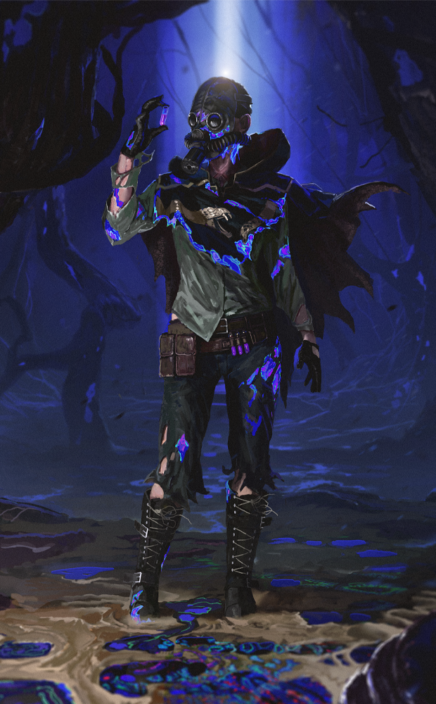

# live · 9.4.2_3149853live

| | |
|---|---|
| Build date | 2026-03-03 14:58 UTC |
| CDN version | `9.4.2_3149853live-1772549903` |
| Key | `9.4.2_live` |
| Compared with | [9.5.0_3149393live](../9.5.0_3149393live/CHANGES.md) (2026-03-03 14:24 UTC) |

## Summary

**3** added · **29** modified · **8** removed · 179 unchanged

## New or updated images

<a href="images/T_UI_CollectionBanner_EldritchNightmares.png"></a>
<a href="images/T_UI_SpecialPack_EldritchNightmares.png"></a>
<a href="images/T_UI_SpecialPack_ModernTales.png"></a>

## Removed files

- `images/T_UI_ChapterBundle_AllKillComeback.png`
- `images/T_UI_CollectionBanner_AllKillComeback.png`
- `images/T_UI_CollectionBanner_Bloodmoon_Quiche.png`
- `images/T_UI_SpecialPack_AllKillComeback.png`
- `images/T_UI_SpecialPack_ArtistsFromTheFog_Haddie.png`
- `images/T_UI_SpecialPack_Bloodmoon_Bundle.png`
- `images/T_UI_SpecialPack_Bloodmoon_Quiche.png`
- `images/T_UI_SpecialPack_EntombedRemains.png`

## Modified files

### [`GameConfigs.json`](GameConfigs.json)

[Full line-by-line diff](diffs/GameConfigs.json.diff)

```diff
- $.BHVRDynamicContent
- $.RTMHandshakeTimeoutThreshold: -1.0
- $.analyticsEndpoints
- $.analyticsPayloadSizeLimit: "102400"
- $.appsflyerCustomerIdEnabled: "false"
- $.assetManagementCdnPath: "https://cdn.live.bhvrdbd.com"
- $.banReasonEnum: "{\"0\":\"Harassment\",\"1\":\"Griefing\",\"2\":\"Exploits\",\"3\":\"Unsportsmanlike\"}"
- $.buttonSequenceEnable
- $.cancelMatchOnDisconnectDuringLoading: "true"
- $.cdnRootFolderPath: "4fabea45-bce0-4461-8950-162659636437"
- $.dbdUsingLootTables: "false"
- $.ddosDetection: "true"
- $.ddosDetectionAnalytics: "true"
- $.disableBloodlust: "false"
- $.displayRankOnTally: "false"
- $.enablePerkDescriptionOverhaul: true
- $.enableRtmValidationOnBoot: "true"
- $.enabledGPUBreadcrumbsHardware
- $.frameHikeAnalyticLogBufferSize: "5"
- $.frameHikeThreshold: "10"
- $.gameClientVersionCheckEnabled: "true"
- $.gameliftEndpoints
- $.gameliftIdleInstanceShutdownTimer: "86400"
- $.gameliftInstanceShutdownTimer: "7200"
- $.krakenRequestAnalyticsLevel: "NetworkError"
- $.krakenRsaPublicKey: "MIIBIjANBgkqhkiG9w0BAQEFAAOCAQ8AMIIBCgKCAQEAuq878RHxy7gwEGnjh/vXcOH+1evTjEA9ygzmKEmG4s2xfNTXgneht6IsCSt5rGgpB3SabgdfUlfZyNNcwx18H7PGdsEwDcbrpZvNsgVt12oSXANjUaW…
- $.matchmakingAllowCrossplay: "true"
- $.matchmakingIncentiveConfig
- $.matchmakingUseQueueApi: "true"
- $.maxMessagesPerSecondConfig: "3"
- $.msEndpoint: "https://xbox1-live2.bhvrdbd.com/restservice.svc"
- $.msEndpointGrdk: "https://wstore-live2.bhvrdbd.com/restservice.svc"
- $.netconnectionClampToAverageFramerate: "true"
- $.networkFenceAnalyticsBufferSize: "30"
- $.penaltySecondsConfig: "10"
- $.prepareToMessageSecondsConfig: "2"
- $.purchaseExtraTimePremiumBundle: "12"
- $.readOnlyConfigs
- $.recommendationRecentReleaseThreshold: "7"
- $.richPresencePlayerTimerRate: "830"
- $.richPresenceServerTimerRate: "0"
- $.segmentationV2Enabled: "true"
- $.socialPlatformFriendlistQueryRate: "10"
- $.DSProviderOnShutdownNotificationDelay: 15.0
+ $.DSProviderOnShutdownNotificationDelay: 90.0
- $.RTMTimeoutThreshold: 30.0
+ $.RTMTimeoutThreshold: -1.0
+ $.dynamicContent.DynamicContentKillswitchPlatforms[]: "switch"
- $.enableAlwaysSendCrashWithUI: false
+ $.enableAlwaysSendCrashWithUI: true
- $.enableMoriPreviewButton: false
+ $.enableMoriPreviewButton: true
- $.enableRealtimeMoriPreview: false
+ $.enableRealtimeMoriPreview: true
```

### [`GameConfigsDS.json`](GameConfigsDS.json)

[Full line-by-line diff](diffs/GameConfigsDS.json.diff)

```diff
- $.ddosCalamari
- $.ddos.EscalateQuotaBadPacketsPerSec[]: 25
- $.ddos.EscalateQuotaBadPacketsPerSec[]: 500
+ $.ddos.EscalateQuotaBadPacketsPerSec[]: 50
+ $.ddos.EscalateQuotaBadPacketsPerSec[]: 1000
- $.ddos.EscalateQuotaDisconnPacketsPerSec[]: 2000
+ $.ddos.EscalateQuotaDisconnPacketsPerSec[]: 4000
- $.ddos.EscalateQuotaPacketsPerSec[]: 300
- $.ddos.EscalateQuotaPacketsPerSec[]: 700
+ $.ddos.EscalateQuotaPacketsPerSec[]: 600
+ $.ddos.EscalateQuotaPacketsPerSec[]: 1400
- $.ddos.EscalateTimeQuotaMSPerFrame[]: 10
- $.ddos.EscalateTimeQuotaMSPerFrame[]: 50
- $.ddos.EscalateTimeQuotaMSPerFrame[]: 66
+ $.ddos.EscalateTimeQuotaMSPerFrame[]: 20
+ $.ddos.EscalateTimeQuotaMSPerFrame[]: 100
+ $.ddos.EscalateTimeQuotaMSPerFrame[]: 132
- $.ddos.NetConnPacketTimeLimitMSPerFrame[]: 50
+ $.ddos.NetConnPacketTimeLimitMSPerFrame[]: 200
- $.ddos.PacketLimitPerFrame[]: 100
+ $.ddos.PacketLimitPerFrame[]: 200
- $.ddos.PacketTimeLimitMSPerFrame[]: 16
- $.ddos.PacketTimeLimitMSPerFrame[]: 2
+ $.ddos.PacketTimeLimitMSPerFrame[]: 32
+ $.ddos.PacketTimeLimitMSPerFrame[]: 4
```

### [`archiveJournals/archiveS3Journals.json`](archiveJournals/archiveS3Journals.json)

[Full line-by-line diff](diffs/archiveJournals/archiveS3Journals.json.diff)

```diff
- $.TOME24
- $.TOME23.vignettes[id=TOME23_03].entries[5]
```

### [`archiveJournals/storyJournals.json`](archiveJournals/storyJournals.json)

[Full line-by-line diff](diffs/archiveJournals/storyJournals.json.diff)

```diff
- $.TOME24
```

### [`bloodwebGenerationRules.json`](bloodwebGenerationRules.json)

[Full line-by-line diff](diffs/bloodwebGenerationRules.json.diff)

```diff
- $.BulkCost[9].CostList[0].Value[]: 13250
- $.BulkCost[9].CostList[0].Value[]: 27500
- $.BulkCost[9].CostList[0].Value[]: 28000
- $.BulkCost[9].CostList[0].Value[]: 32500
- $.BulkCost[9].CostList[0].Value[]: 35750
+ $.BulkCost[9].CostList[0].Value[]: 26750
+ $.BulkCost[9].CostList[0].Value[]: 34500
- $.BulkCost[9].CostList[1].Value[]: 13250
- $.BulkCost[9].CostList[1].Value[]: 29500
- $.BulkCost[9].CostList[1].Value[]: 27500
- $.BulkCost[9].CostList[1].Value[]: 28000
- $.BulkCost[9].CostList[1].Value[]: 35250
+ $.BulkCost[9].CostList[1].Value[]: 30000
+ $.BulkCost[9].CostList[1].Value[]: 26750
+ $.BulkCost[9].CostList[1].Value[]: 34500
- $.BulkCost[9].CostList[2].Value[]: 13250
- $.BulkCost[9].CostList[2].Value[]: 27500
- $.BulkCost[9].CostList[2].Value[]: 28000
+ $.BulkCost[9].CostList[2].Value[]: 26750
- $.BulkCost[9].CostList[3].Value[]: 13250
- $.BulkCost[9].CostList[3].Value[]: 27500
- $.BulkCost[9].CostList[3].Value[]: 28000
+ $.BulkCost[9].CostList[3].Value[]: 26750
- $.BulkCost[9].CostList[4].Value[]: 13250
- $.BulkCost[9].CostList[4].Value[]: 27500
- $.BulkCost[9].CostList[4].Value[]: 28000
+ $.BulkCost[9].CostList[4].Value[]: 26750
- $.BulkCost[9].CostList[5].Value[]: 13250
- $.BulkCost[9].CostList[5].Value[]: 27500
- $.BulkCost[9].CostList[5].Value[]: 28000
+ $.BulkCost[9].CostList[5].Value[]: 26750
- $.BulkCost[13].CostList[0].Value[]: 14000
- $.BulkCost[13].CostList[0].Value[]: 18500
- $.BulkCost[13].CostList[0].Value[]: 13250
- $.BulkCost[13].CostList[0].Value[]: 22250
- $.BulkCost[13].CostList[0].Value[]: 28250
- $.BulkCost[13].CostList[0].Value[]: 28000
- $.BulkCost[13].CostList[0].Value[]: 31500
- $.BulkCost[13].CostList[0].Value[]: 32500
- $.BulkCost[13].CostList[0].Value[]: 36500
+ $.BulkCost[13].CostList[0].Value[]: 12500
+ $.BulkCost[13].CostList[0].Value[]: 26750
+ $.BulkCost[13].CostList[0].Value[]: 34500
- $.BulkCost[13].CostList[1].Value[]: 14000
- $.BulkCost[13].CostList[1].Value[]: 18500
- $.BulkCost[13].CostList[1].Value[]: 13250
- $.BulkCost[13].CostList[1].Value[]: 22250
- $.BulkCost[13].CostList[1].Value[]: 28250
- $.BulkCost[13].CostList[1].Value[]: 28000
- $.BulkCost[13].CostList[1].Value[]: 31500
- $.BulkCost[13].CostList[1].Value[]: 33250
- $.BulkCost[13].CostList[1].Value[]: 37250
+ $.BulkCost[13].CostList[1].Value[]: 26750
+ $.BulkCost[13].CostList[1].Value[]: 35250
- $.BulkCost[13].CostList[2].Value[]: 14000
- $.BulkCost[13].CostList[2].Value[]: 18500
- $.BulkCost[13].CostList[2].Value[]: 13250
- $.BulkCost[13].CostList[2].Value[]: 22250
- $.BulkCost[13].CostList[2].Value[]: 28250
- $.BulkCost[13].CostList[2].Value[]: 28750
- $.BulkCost[13].CostList[2].Value[]: 31500
- $.BulkCost[13].CostList[2].Value[]: 33250
- $.BulkCost[13].CostList[2].Value[]: 37250
+ $.BulkCost[13].CostList[2].Value[]: 12500
+ $.BulkCost[13].CostList[2].Value[]: 23500
+ $.BulkCost[13].CostList[2].Value[]: 26750
+ $.BulkCost[13].CostList[2].Value[]: 27500
+ $.BulkCost[13].CostList[2].Value[]: 30750
- $.BulkCost[13].CostList[3].Value[]: 14000
- $.BulkCost[13].CostList[3].Value[]: 18500
- $.BulkCost[13].CostList[3].Value[]: 13250
- $.BulkCost[13].CostList[3].Value[]: 22250
- $.BulkCost[13].CostList[3].Value[]: 28250
- $.BulkCost[13].CostList[3].Value[]: 28750
- $.BulkCost[13].CostList[3].Value[]: 31500
- $.BulkCost[13].CostList[3].Value[]: 33250
- $.BulkCost[13].CostList[3].Value[]: 37250
+ $.BulkCost[13].CostList[3].Value[]: 12500
+ $.BulkCost[13].CostList[3].Value[]: 23500
+ $.BulkCost[13].CostList[3].Value[]: 26750
+ $.BulkCost[13].CostList[3].Value[]: 27500
+ $.BulkCost[13].CostList[3].Value[]: 30750
- $.BulkCost[13].CostList[4].Value[]: 14000
- $.BulkCost[13].CostList[4].Value[]: 18500
- $.BulkCost[13].CostList[4].Value[]: 13250
- $.BulkCost[13].CostList[4].Value[]: 22250
- $.BulkCost[13].CostList[4].Value[]: 28250
- $.BulkCost[13].CostList[4].Value[]: 28750
- $.BulkCost[13].CostList[4].Value[]: 31500
- $.BulkCost[13].CostList[4].Value[]: 33250
- $.BulkCost[13].CostList[4].Value[]: 37250
+ $.BulkCost[13].CostList[4].Value[]: 12500
+ $.BulkCost[13].CostList[4].Value[]: 26750
+ $.BulkCost[13].CostList[4].Value[]: 27500
+ $.BulkCost[13].CostList[4].Value[]: 30750
- $.BulkCost[13].CostList[5].Value[]: 14000
- $.BulkCost[13].CostList[5].Value[]: 18500
- $.BulkCost[13].CostList[5].Value[]: 13250
- $.BulkCost[13].CostList[5].Value[]: 22250
- $.BulkCost[13].CostList[5].Value[]: 28250
- $.BulkCost[13].CostList[5].Value[]: 28750
- $.BulkCost[13].CostList[5].Value[]: 31500
- $.BulkCost[13].CostList[5].Value[]: 33250
- $.BulkCost[13].CostList[5].Value[]: 37250
+ $.BulkCost[13].CostList[5].Value[]: 12500
+ $.BulkCost[13].CostList[5].Value[]: 23500
+ $.BulkCost[13].CostList[5].Value[]: 26750
+ $.BulkCost[13].CostList[5].Value[]: 27500
+ $.BulkCost[13].CostList[5].Value[]: 30750
- $.BulkCost[17]
- $.EventChestProbability[14]
```

### [`catalog.json`](catalog.json)

[Full line-by-line diff](diffs/catalog.json.diff)

```diff
- $[id=S52]
- $[id=HK_Body027]
- $[id=HK_Head027]
- $[id=HK_W027]
- $[id=JP_Head033]
- $[id=JP_Legs033]
- $[id=JP_Torso033]
- $[id=K01_BDG_P100]
- $[id=K01_BDG_P25]
- $[id=K01_BDG_P50]
- $[id=K01_BDG_P75]
- $[id=K02_BDG_P100]
- $[id=K02_BDG_P25]
- $[id=K02_BDG_P50]
- $[id=K02_BDG_P75]
- $[id=K03_BDG_P100]
- $[id=K03_BDG_P25]
- $[id=K03_BDG_P50]
- $[id=K03_BDG_P75]
- $[id=K04_BDG_P100]
- $[id=K04_BDG_P25]
- $[id=K04_BDG_P50]
- $[id=K04_BDG_P75]
- $[id=K05_BDG_P100]
- $[id=K05_BDG_P25]
- $[id=K05_BDG_P50]
- $[id=K05_BDG_P75]
- $[id=K06_BDG_P100]
- $[id=K06_BDG_P25]
- $[id=K06_BDG_P50]
- $[id=K06_BDG_P75]
- $[id=K07_BDG_P100]
- $[id=K07_BDG_P25]
- $[id=K07_BDG_P50]
- $[id=K07_BDG_P75]
- $[id=K08_BDG_P100]
- $[id=K08_BDG_P25]
- $[id=K08_BDG_P50]
- $[id=K08_BDG_P75]
- $[id=K09_BDG_P100]
- $[id=K09_BDG_P25]
- $[id=K09_BDG_P50]
- $[id=K09_BDG_P75]
- $[id=K10_BDG_P100]
- $[id=K10_BDG_P25]
- $[id=K10_BDG_P50]
- $[id=K10_BDG_P75]
- $[id=K11_BDG_P100]
- $[id=K11_BDG_P25]
- $[id=K11_BDG_P50]
- $[id=K11_BDG_P75]
- $[id=K12_BDG_P100]
- $[id=K12_BDG_P25]
- $[id=K12_BDG_P50]
- $[id=K12_BDG_P75]
- $[id=K13_BDG_P100]
- $[id=K13_BDG_P25]
- $[id=K13_BDG_P50]
- $[id=K13_BDG_P75]
- $[id=K14_BDG_P100]
- $[id=K14_BDG_P25]
- $[id=K14_BDG_P50]
- $[id=K14_BDG_P75]
- $[id=K15_BDG_P100]
- $[id=K15_BDG_P25]
- $[id=K15_BDG_P50]
- $[id=K15_BDG_P75]
- $[id=K16_BDG_P100]
- $[id=K16_BDG_P25]
- $[id=K16_BDG_P50]
- $[id=K16_BDG_P75]
- $[id=K17_BDG_P100]
- $[id=K17_BDG_P25]
- $[id=K17_BDG_P50]
- $[id=K17_BDG_P75]
- $[id=K18_BDG_P100]
- $[id=K18_BDG_P25]
- $[id=K18_BDG_P50]
- $[id=K18_BDG_P75]
- $[id=K19_BDG_P100]
- $[id=K19_BDG_P25]
- $[id=K19_BDG_P50]
- $[id=K19_BDG_P75]
- $[id=K20_BDG_P100]
- $[id=K20_BDG_P25]
- $[id=K20_BDG_P50]
- $[id=K20_BDG_P75]
- $[id=K21_BDG_P100]
- $[id=K21_BDG_P25]
- $[id=K21_BDG_P50]
- $[id=K21_BDG_P75]
- $[id=K21_Body022]
- $[id=K21_Head022]
- $[id=K21_W022]
- $[id=K22_BDG_P100]
- $[id=K22_BDG_P25]
- $[id=K22_BDG_P50]
- $[id=K22_BDG_P75]
- $[id=K23_BDG_P100]
- $[id=K23_BDG_P25]
- $[id=K23_BDG_P50]
- $[id=K23_BDG_P75]
- $[id=K23_Body019]
- $[id=K23_Head019]
- $[id=K23_W019]
- $[id=K24_BDG_P100]
- $[id=K24_BDG_P25]
- $[id=K24_BDG_P50]
- $[id=K24_BDG_P75]
- $[id=K25_BDG_P100]
- $[id=K25_BDG_P25]
- $[id=K25_BDG_P50]
- $[id=K25_BDG_P75]
- $[id=K26_BDG_P100]
- $[id=K26_BDG_P25]
- $[id=K26_BDG_P50]
- $[id=K26_BDG_P75]
- $[id=K27_BDG_P100]
- $[id=K27_BDG_P25]
- $[id=K27_BDG_P50]
- $[id=K27_BDG_P75]
- $[id=K28_BDG_P100]
- $[id=K28_BDG_P25]
- $[id=K28_BDG_P50]
- $[id=K28_BDG_P75]
- $[id=K28_W018]
- $[id=K29_BDG_P100]
- $[id=K29_BDG_P25]
- $[id=K29_BDG_P50]
- $[id=K29_BDG_P75]
- $[id=K30_BDG_P100]
- $[id=K30_BDG_P25]
- $[id=K30_BDG_P50]
- $[id=K30_BDG_P75]
- $[id=K31_BDG_P100]
- $[id=K31_BDG_P25]
- $[id=K31_BDG_P50]
- $[id=K31_BDG_P75]
- $[id=K32_BDG_P100]
- $[id=K32_BDG_P25]
- $[id=K32_BDG_P50]
- $[id=K32_BDG_P75]
- $[id=K33_BDG_P100]
- $[id=K33_BDG_P25]
- $[id=K33_BDG_P50]
- $[id=K33_BDG_P75]
- $[id=K34_BDG_P100]
- $[id=K34_BDG_P25]
- $[id=K34_BDG_P50]
- $[id=K34_BDG_P75]
- $[id=K35_BDG_P100]
- $[id=K35_BDG_P25]
- $[id=K35_BDG_P50]
- $[id=K35_BDG_P75]
- $[id=K36_BDG_P100]
- $[id=K36_BDG_P25]
- $[id=K36_BDG_P50]
- $[id=K36_BDG_P75]
- $[id=K37_BDG_P100]
- $[id=K37_BDG_P25]
- $[id=K37_BDG_P50]
- $[id=K37_BDG_P75]
- $[id=K38_BDG_P100]
- $[id=K38_BDG_P25]
- $[id=K38_BDG_P50]
- $[id=K38_BDG_P75]
- $[id=K39_BDG_P100]
- $[id=K39_BDG_P25]
- $[id=K39_BDG_P50]
- $[id=K39_BDG_P75]
- $[id=K40_BDG_P100]
- $[id=K40_BDG_P25]
- $[id=K40_BDG_P50]
- $[id=K40_BDG_P75]
- $[id=K41_BDG_P100]
- $[id=K41_BDG_P25]
- $[id=K41_BDG_P50]
- $[id=K41_BDG_P75]
- $[id=K42_BDG_P100]
- $[id=K42_BDG_P25]
- $[id=K42_BDG_P50]
- $[id=K42_BDG_P75]
- $[id=KS_Torso024]
- $[id=MK_W019]
- $[id=MT_Torso034]
- $[id=QUI_002]
- $[id=QUI_003]
- $[id=QUI_004]
- $[id=QUI_005]
- $[id=QUI_006]
- $[id=QUI_007]
- $[id=QUI_BDG_01]
- $[id=QUI_BDG_02]
- $[id=QUI_BDG_03]
- $[id=QUI_BDG_04]
- $[id=QUI_BDG_05]
- $[id=QUI_BDG_06]
- $[id=QUI_BDG_07]
- $[id=QUI_BDG_08]
- $[id=QUI_BDG_09]
… 566 more change(s) — see the commit diff for everything
```

### [`challengeLocs/challengeText_de.json`](challengeLocs/challengeText_de.json)

[Full line-by-line diff](diffs/challengeLocs/challengeText_de.json.diff)

```diff
- $.locText[565]
- $.locText[566]
- $.locText[567]
- $.locText[568]
- $.locText[569]
- $.locText[570]
- $.locText[571]
- $.locText[572]
- $.locText[573]
- $.locText[574]
- $.locText[575]
- $.locText[576]
- $.locText[577]
- $.locText[578]
- $.locText[579]
- $.locText[580]
- $.locText[581]
- $.locText[582]
- $.locText[583]
- $.locText[584]
- $.locText[585]
```

### [`challengeLocs/challengeText_en.json`](challengeLocs/challengeText_en.json)

[Full line-by-line diff](diffs/challengeLocs/challengeText_en.json.diff)

```diff
- $.locText[565]
- $.locText[566]
- $.locText[567]
- $.locText[568]
- $.locText[569]
- $.locText[570]
- $.locText[571]
- $.locText[572]
- $.locText[573]
- $.locText[574]
- $.locText[575]
- $.locText[576]
- $.locText[577]
- $.locText[578]
- $.locText[579]
- $.locText[580]
- $.locText[581]
- $.locText[582]
- $.locText[583]
- $.locText[584]
- $.locText[585]
```

### [`challengeLocs/challengeText_es-MX.json`](challengeLocs/challengeText_es-MX.json)

[Full line-by-line diff](diffs/challengeLocs/challengeText_es-MX.json.diff)

```diff
- $.locText[565]
- $.locText[566]
- $.locText[567]
- $.locText[568]
- $.locText[569]
- $.locText[570]
- $.locText[571]
- $.locText[572]
- $.locText[573]
- $.locText[574]
- $.locText[575]
- $.locText[576]
- $.locText[577]
- $.locText[578]
- $.locText[579]
- $.locText[580]
- $.locText[581]
- $.locText[582]
- $.locText[583]
- $.locText[584]
- $.locText[585]
```

### [`challengeLocs/challengeText_es.json`](challengeLocs/challengeText_es.json)

[Full line-by-line diff](diffs/challengeLocs/challengeText_es.json.diff)

```diff
- $.locText[565]
- $.locText[566]
- $.locText[567]
- $.locText[568]
- $.locText[569]
- $.locText[570]
- $.locText[571]
- $.locText[572]
- $.locText[573]
- $.locText[574]
- $.locText[575]
- $.locText[576]
- $.locText[577]
- $.locText[578]
- $.locText[579]
- $.locText[580]
- $.locText[581]
- $.locText[582]
- $.locText[583]
- $.locText[584]
- $.locText[585]
```

### [`challengeLocs/challengeText_fr.json`](challengeLocs/challengeText_fr.json)

[Full line-by-line diff](diffs/challengeLocs/challengeText_fr.json.diff)

```diff
- $.locText[565]
- $.locText[566]
- $.locText[567]
- $.locText[568]
- $.locText[569]
- $.locText[570]
- $.locText[571]
- $.locText[572]
- $.locText[573]
- $.locText[574]
- $.locText[575]
- $.locText[576]
- $.locText[577]
- $.locText[578]
- $.locText[579]
- $.locText[580]
- $.locText[581]
- $.locText[582]
- $.locText[583]
- $.locText[584]
- $.locText[585]
```

### [`challengeLocs/challengeText_it.json`](challengeLocs/challengeText_it.json)

[Full line-by-line diff](diffs/challengeLocs/challengeText_it.json.diff)

```diff
- $.locText[565]
- $.locText[566]
- $.locText[567]
- $.locText[568]
- $.locText[569]
- $.locText[570]
- $.locText[571]
- $.locText[572]
- $.locText[573]
- $.locText[574]
- $.locText[575]
- $.locText[576]
- $.locText[577]
- $.locText[578]
- $.locText[579]
- $.locText[580]
- $.locText[581]
- $.locText[582]
- $.locText[583]
- $.locText[584]
- $.locText[585]
```

### [`challengeLocs/challengeText_ja.json`](challengeLocs/challengeText_ja.json)

[Full line-by-line diff](diffs/challengeLocs/challengeText_ja.json.diff)

```diff
- $.locText[565]
- $.locText[566]
- $.locText[567]
- $.locText[568]
- $.locText[569]
- $.locText[570]
- $.locText[571]
- $.locText[572]
- $.locText[573]
- $.locText[574]
- $.locText[575]
- $.locText[576]
- $.locText[577]
- $.locText[578]
- $.locText[579]
- $.locText[580]
- $.locText[581]
- $.locText[582]
- $.locText[583]
- $.locText[584]
- $.locText[585]
```

### [`challengeLocs/challengeText_ko.json`](challengeLocs/challengeText_ko.json)

[Full line-by-line diff](diffs/challengeLocs/challengeText_ko.json.diff)

```diff
- $.locText[565]
- $.locText[566]
- $.locText[567]
- $.locText[568]
- $.locText[569]
- $.locText[570]
- $.locText[571]
- $.locText[572]
- $.locText[573]
- $.locText[574]
- $.locText[575]
- $.locText[576]
- $.locText[577]
- $.locText[578]
- $.locText[579]
- $.locText[580]
- $.locText[581]
- $.locText[582]
- $.locText[583]
- $.locText[584]
- $.locText[585]
```

### [`challengeLocs/challengeText_pl.json`](challengeLocs/challengeText_pl.json)

[Full line-by-line diff](diffs/challengeLocs/challengeText_pl.json.diff)

```diff
- $.locText[565]
- $.locText[566]
- $.locText[567]
- $.locText[568]
- $.locText[569]
- $.locText[570]
- $.locText[571]
- $.locText[572]
- $.locText[573]
- $.locText[574]
- $.locText[575]
- $.locText[576]
- $.locText[577]
- $.locText[578]
- $.locText[579]
- $.locText[580]
- $.locText[581]
- $.locText[582]
- $.locText[583]
- $.locText[584]
- $.locText[585]
```

### [`challengeLocs/challengeText_pt-BR.json`](challengeLocs/challengeText_pt-BR.json)

[Full line-by-line diff](diffs/challengeLocs/challengeText_pt-BR.json.diff)

```diff
- $.locText[565]
- $.locText[566]
- $.locText[567]
- $.locText[568]
- $.locText[569]
- $.locText[570]
- $.locText[571]
- $.locText[572]
- $.locText[573]
- $.locText[574]
- $.locText[575]
- $.locText[576]
- $.locText[577]
- $.locText[578]
- $.locText[579]
- $.locText[580]
- $.locText[581]
- $.locText[582]
- $.locText[583]
- $.locText[584]
- $.locText[585]
```

### [`challengeLocs/challengeText_ru.json`](challengeLocs/challengeText_ru.json)

[Full line-by-line diff](diffs/challengeLocs/challengeText_ru.json.diff)

```diff
- $.locText[565]
- $.locText[566]
- $.locText[567]
- $.locText[568]
- $.locText[569]
- $.locText[570]
- $.locText[571]
- $.locText[572]
- $.locText[573]
- $.locText[574]
- $.locText[575]
- $.locText[576]
- $.locText[577]
- $.locText[578]
- $.locText[579]
- $.locText[580]
- $.locText[581]
- $.locText[582]
- $.locText[583]
- $.locText[584]
- $.locText[585]
```

### [`challengeLocs/challengeText_th.json`](challengeLocs/challengeText_th.json)

[Full line-by-line diff](diffs/challengeLocs/challengeText_th.json.diff)

```diff
- $.locText[565]
- $.locText[566]
- $.locText[567]
- $.locText[568]
- $.locText[569]
- $.locText[570]
- $.locText[571]
- $.locText[572]
- $.locText[573]
- $.locText[574]
- $.locText[575]
- $.locText[576]
- $.locText[577]
- $.locText[578]
- $.locText[579]
- $.locText[580]
- $.locText[581]
- $.locText[582]
- $.locText[583]
- $.locText[584]
- $.locText[585]
```

### [`challengeLocs/challengeText_tr.json`](challengeLocs/challengeText_tr.json)

[Full line-by-line diff](diffs/challengeLocs/challengeText_tr.json.diff)

```diff
- $.locText[565]
- $.locText[566]
- $.locText[567]
- $.locText[568]
- $.locText[569]
- $.locText[570]
- $.locText[571]
- $.locText[572]
- $.locText[573]
- $.locText[574]
- $.locText[575]
- $.locText[576]
- $.locText[577]
- $.locText[578]
- $.locText[579]
- $.locText[580]
- $.locText[581]
- $.locText[582]
- $.locText[583]
- $.locText[584]
- $.locText[585]
```

### [`challengeLocs/challengeText_zh-Hans.json`](challengeLocs/challengeText_zh-Hans.json)

[Full line-by-line diff](diffs/challengeLocs/challengeText_zh-Hans.json.diff)

```diff
- $.locText[565]
- $.locText[566]
- $.locText[567]
- $.locText[568]
- $.locText[569]
- $.locText[570]
- $.locText[571]
- $.locText[572]
- $.locText[573]
- $.locText[574]
- $.locText[575]
- $.locText[576]
- $.locText[577]
- $.locText[578]
- $.locText[579]
- $.locText[580]
- $.locText[581]
- $.locText[582]
- $.locText[583]
- $.locText[584]
- $.locText[585]
```

### [`challengeLocs/challengeText_zh-Hant.json`](challengeLocs/challengeText_zh-Hant.json)

[Full line-by-line diff](diffs/challengeLocs/challengeText_zh-Hant.json.diff)

```diff
- $.locText[565]
- $.locText[566]
- $.locText[567]
- $.locText[568]
- $.locText[569]
- $.locText[570]
- $.locText[571]
- $.locText[572]
- $.locText[573]
- $.locText[574]
- $.locText[575]
- $.locText[576]
- $.locText[577]
- $.locText[578]
- $.locText[579]
- $.locText[580]
- $.locText[581]
- $.locText[582]
- $.locText[583]
- $.locText[584]
- $.locText[585]
```

### [`challengeSets.json`](challengeSets.json)

[Full line-by-line diff](diffs/challengeSets.json.diff)

```diff
- $.BloodMoon_Quiche
- $.ChapterQuests_Quiche
- $.FogCarnival.uiAssets.iconPath: "/DBDUICore/Assets/Common/Event/Community/T_UI_icon_Event_FogCarnival.T_UI_icon_Event_FogCarnival"
+ $.FogCarnival.uiAssets.iconPath: "/DBDUICore/Assets/Common/Event/T_UI_icon_Event_FogCarnival.T_UI_icon_Event_FogCarnival"
- $.FogCarnival.uiAssets.rewardPopupBannerPath: "/DBDUICore/Assets/Common/Event/Community/T_UI_icon_Event_FogCarnival.T_UI_icon_Event_FogCarnival"
+ $.FogCarnival.uiAssets.rewardPopupBannerPath: "/DBDUICore/Assets/Common/Event/T_UI_icon_Event_FogCarnival.T_UI_icon_Event_FogCarnival"
- $.LNYPoutine.uiAssets.iconPath: "/DBDUICore/Assets/Common/Event/Community/T_UI_icon_Event_LunarYear.T_UI_icon_Event_LunarYear"
+ $.LNYPoutine.uiAssets.iconPath: "/DBDUICore/Assets/Common/Event/T_UI_icon_Event_LunarYear.T_UI_icon_Event_LunarYear"
- $.LNYPoutine.uiAssets.rewardPopupBannerPath: "/DBDUICore/Assets/Common/Event/Community/T_UI_icon_Event_LunarYear.T_UI_icon_Event_LunarYear"
+ $.LNYPoutine.uiAssets.rewardPopupBannerPath: "/DBDUICore/Assets/Common/Event/T_UI_icon_Event_LunarYear.T_UI_icon_Event_LunarYear"
```

### [`collections.json`](collections.json)

[Full line-by-line diff](diffs/collections.json.diff)

```diff
+ $.collections[1].limitedAvailabilityEndDate: "2025-04-10T15:00:00Z"
+ $.collections[1].limitedAvailabilityStartDate: "2025-04-07T15:00:00Z"
+ $.collections[1].visibleAfterEndDate: false
+ $.collections[1].visibleBeforeStartDate: false
- $.collections[1].additionalImages[0].path: "/Game/UI/UMGAssets/Icons/Banners/BundleBanners/SpecialPack/IceCream/T_UI_SpecialPack_Techwear.T_UI_SpecialPack_Techwear"
+ $.collections[1].additionalImages[0].path: "/Game/UI/UMGAssets/Icons/Banners/BundleBanners/SpecialPack/IceCream/T_UI_SpecialPack_Bloodmoon.T_UI_SpecialPack_Bloodmoon"
- $.collections[1].collectionId: "Techwear"
+ $.collections[1].collectionId: "Bloodmoon"
- $.collections[1].collectionTitle.de: "Techbekleidung"
+ $.collections[1].collectionTitle.de: "Blutmond"
- $.collections[1].collectionTitle.en: "Techwear"
+ $.collections[1].collectionTitle.en: "Blood Moon"
- $.collections[1].collectionTitle.es: "Colección de Equipo técnico"
+ $.collections[1].collectionTitle.es: "Luna de sangre"
- $.collections[1].collectionTitle["es-MX"]: "Colección Indumentaria tecnológica"
+ $.collections[1].collectionTitle["es-MX"]: "Luna de sangre"
- $.collections[1].collectionTitle.fr: "Technovêtements"
+ $.collections[1].collectionTitle.fr: "Lune de sang"
- $.collections[1].collectionTitle.it: "Collezione Techwear"
+ $.collections[1].collectionTitle.it: "Luna sanguinosa"
- $.collections[1].collectionTitle.ja: "テックウェア"
+ $.collections[1].collectionTitle.ja: "ブラッドムーン"
- $.collections[1].collectionTitle.ko: "테크웨어 컬렉션"
+ $.collections[1].collectionTitle.ko: "핏빛 달"
- $.collections[1].collectionTitle.pl: "Kolekcja odzieży technicznej"
+ $.collections[1].collectionTitle.pl: "Krwawy księżyc"
- $.collections[1].collectionTitle["pt-BR"]: "Coleção da Roupa Tecnológica"
+ $.collections[1].collectionTitle["pt-BR"]: "Lua de Sangue"
- $.collections[1].collectionTitle.ru: "Коллекция «Техно»"
+ $.collections[1].collectionTitle.ru: "Кровавая луна"
- $.collections[1].collectionTitle.th: "อุปกรณ์เทคโนโลยี"
+ $.collections[1].collectionTitle.th: "จันทราโลหิต"
- $.collections[1].collectionTitle.tr: "Teknolojik Kıyafet Koleksiyonu"
+ $.collections[1].collectionTitle.tr: "Kanlı Ay"
- $.collections[1].collectionTitle["zh-Hans"]: "机能服装系列"
+ $.collections[1].collectionTitle["zh-Hans"]: "血月"
- $.collections[1].collectionTitle["zh-Hant"]: "機能服飾收藏"
+ $.collections[1].collectionTitle["zh-Hant"]: "血月"
- $.collections[1].heroImage.path: "/Game/UI/UMGAssets/Icons/Banners/CollectionBanners/IceCream/T_UI_CollectionBanner_Techwear_2.T_UI_CollectionBanner_Techwear_2"
+ $.collections[1].heroImage.path: "/Game/UI/UMGAssets/Icons/Banners/CollectionBanners/IceCream/T_UI_CollectionBanner_Bloodmoon.T_UI_CollectionBanner_Bloodmoon"
- $.collections[1].inclusionVersion: "7.7.0"
+ $.collections[1].inclusionVersion: "8.6.0"
- $.collections[1].items[]: "AV_outfit_026"
- $.collections[1].items[]: "DK_outfit_022"
- $.collections[1].items[]: "DO_outfit_026"
- $.collections[1].items[]: "FM_outfit_038"
- $.collections[1].items[]: "GS_outfit_029"
- $.collections[1].items[]: "K23_outfit_021"
- $.collections[1].items[]: "K31_outfit_017"
- $.collections[1].items[]: "KK_outfit_025"
- $.collections[1].items[]: "MT_outfit_023"
- $.collections[1].items[]: "NK_outfit_029"
- $.collections[1].items[]: "S23_outfit_031"
- $.collections[1].items[]: "S25_outfit_015"
- $.collections[1].items[]: "S28_outfit_018"
- $.collections[1].items[]: "S29_outfit_017"
- $.collections[1].items[]: "S34_outfit_011"
- $.collections[1].items[]: "US_Outfit_023"
+ $.collections[1].items[]: "AV_outfit_022"
+ $.collections[1].items[]: "CM_outfit_030"
+ $.collections[1].items[]: "DO_outfit_020"
+ $.collections[1].items[]: "K26_outfit_019"
+ $.collections[1].items[]: "K30_outfit_012"
+ $.collections[1].items[]: "K31_outfit_012"
+ $.collections[1].items[]: "K38_outfit_007"
+ $.collections[1].items[]: "S24_outfit_021"
+ $.collections[1].items[]: "S28_outfit_023"
+ $.collections[1].items[]: "S45_outfit_011"
+ $.collections[1].items[]: "SwedenKiller_outfit_021"
- $.collections[1].sortOrder: "-105"
+ $.collections[1].sortOrder: "-104"
- $.collections[1].updatedDate: "2025-04-21T13:25:07.469Z"
+ $.collections[1].updatedDate: "2025-01-08T21:01:45.055Z"
- $.collections[2].additionalImages[0].path: "/Game/UI/UMGAssets/Icons/Banners/BundleBanners/SpecialPack/Jerky/T_UI_SpecialPack_SteadyPulse.T_UI_SpecialPack_SteadyPulse"
+ $.collections[2].additionalImages[0].path: "/Game/UI/UMGAssets/Icons/Banners/BundleBanners/SpecialPack/IceCream/T_UI_SpecialPack_Techwear.T_UI_SpecialPack_Techwear"
- $.collections[2].collectionId: "SteadyPulse"
+ $.collections[2].collectionId: "Techwear"
- $.collections[2].collectionTitle.de: "Steady Pulse"
+ $.collections[2].collectionTitle.de: "Techbekleidung"
- $.collections[2].collectionTitle.en: "Steady Pulse"
+ $.collections[2].collectionTitle.en: "Techwear"
- $.collections[2].collectionTitle.es: "Steady Pulse"
+ $.collections[2].collectionTitle.es: "Colección de Equipo técnico"
- $.collections[2].collectionTitle["es-MX"]: "Steady Pulse"
+ $.collections[2].collectionTitle["es-MX"]: "Colección Indumentaria tecnológica"
- $.collections[2].collectionTitle.fr: "Steady Pulse"
+ $.collections[2].collectionTitle.fr: "Technovêtements"
- $.collections[2].collectionTitle.it: "Steady Pulse"
+ $.collections[2].collectionTitle.it: "Collezione Techwear"
- $.collections[2].collectionTitle.ja: "Steady Pulse"
+ $.collections[2].collectionTitle.ja: "テックウェア"
- $.collections[2].collectionTitle.ko: "Steady Pulse"
+ $.collections[2].collectionTitle.ko: "테크웨어 컬렉션"
- $.collections[2].collectionTitle.pl: "Steady Pulse"
+ $.collections[2].collectionTitle.pl: "Kolekcja odzieży technicznej"
- $.collections[2].collectionTitle["pt-BR"]: "Steady Pulse"
+ $.collections[2].collectionTitle["pt-BR"]: "Coleção da Roupa Tecnológica"
- $.collections[2].collectionTitle.ru: "«Ровный пульс»"
+ $.collections[2].collectionTitle.ru: "Коллекция «Техно»"
- $.collections[2].collectionTitle.th: "Steady Pulse"
+ $.collections[2].collectionTitle.th: "อุปกรณ์เทคโนโลยี"
- $.collections[2].collectionTitle.tr: "Steady Pulse"
+ $.collections[2].collectionTitle.tr: "Teknolojik Kıyafet Koleksiyonu"
- $.collections[2].collectionTitle["zh-Hans"]: "《Steady Pulse》"
+ $.collections[2].collectionTitle["zh-Hans"]: "机能服装系列"
- $.collections[2].collectionTitle["zh-Hant"]: "穩定脈搏"
+ $.collections[2].collectionTitle["zh-Hant"]: "機能服飾收藏"
- $.collections[2].heroImage.path: "/Game/UI/UMGAssets/Icons/Banners/CollectionBanners/Jerky/T_UI_CollectionBanner_SteadyPulse.T_UI_CollectionBanner_SteadyPulse"
+ $.collections[2].heroImage.path: "/Game/UI/UMGAssets/Icons/Banners/CollectionBanners/IceCream/T_UI_CollectionBanner_Techwear_2.T_UI_CollectionBanner_Techwear_2"
- $.collections[2].inclusionVersion: "8.7.0"
+ $.collections[2].inclusionVersion: "7.7.0"
- $.collections[2].items[]: "S46_outfit_006"
- $.collections[2].items[]: "S46_outfit_006_01"
- $.collections[2].items[]: "S46_outfit_01_01"
- $.collections[2].items[]: "S46_outfit_01_02"
- $.collections[2].items[]: "S46_outfit_01_03"
- $.collections[2].items[]: "S46_outfit_01_CV01"
- $.collections[2].items[]: "S46_outfit_01_CV02"
- $.collections[2].items[]: "S46_outfit_01_CV03"
- $.collections[2].items[]: "S46_outfit_01_CV04"
- $.collections[2].items[]: "S46_outfit_02"
- $.collections[2].items[]: "S46_outfit_02_01"
+ $.collections[2].items[]: "AV_outfit_026"
+ $.collections[2].items[]: "DK_outfit_022"
+ $.collections[2].items[]: "DO_outfit_026"
+ $.collections[2].items[]: "FM_outfit_038"
+ $.collections[2].items[]: "GS_outfit_029"
+ $.collections[2].items[]: "K23_outfit_021"
+ $.collections[2].items[]: "K31_outfit_017"
+ $.collections[2].items[]: "KK_outfit_025"
+ $.collections[2].items[]: "MT_outfit_023"
+ $.collections[2].items[]: "NK_outfit_029"
+ $.collections[2].items[]: "S23_outfit_031"
+ $.collections[2].items[]: "S25_outfit_015"
+ $.collections[2].items[]: "S28_outfit_018"
+ $.collections[2].items[]: "S29_outfit_017"
+ $.collections[2].items[]: "S34_outfit_011"
+ $.collections[2].items[]: "US_Outfit_023"
- $.collections[2].sortOrder: "-108"
+ $.collections[2].sortOrder: "-105"
- $.collections[2].updatedDate: "2025-02-28T13:55:18.092Z"
+ $.collections[2].updatedDate: "2025-04-21T13:25:07.469Z"
+ $.collections[3].additionalImages[0]
- $.collections[3].collectionId: "Alien"
+ $.collections[3].collectionId: "SteadyPulse"
- $.collections[3].collectionTitle.de: "Alien"
+ $.collections[3].collectionTitle.de: "Steady Pulse"
- $.collections[3].collectionTitle.en: "Alien"
+ $.collections[3].collectionTitle.en: "Steady Pulse"
- $.collections[3].collectionTitle.es: "Alien"
+ $.collections[3].collectionTitle.es: "Steady Pulse"
- $.collections[3].collectionTitle["es-MX"]: "Alien"
+ $.collections[3].collectionTitle["es-MX"]: "Steady Pulse"
- $.collections[3].collectionTitle.fr: "Alien"
+ $.collections[3].collectionTitle.fr: "Steady Pulse"
- $.collections[3].collectionTitle.it: "Alien"
+ $.collections[3].collectionTitle.it: "Steady Pulse"
- $.collections[3].collectionTitle.ja: "エイリアン"
+ $.collections[3].collectionTitle.ja: "Steady Pulse"
- $.collections[3].collectionTitle.ko: "에이리언"
+ $.collections[3].collectionTitle.ko: "Steady Pulse"
- $.collections[3].collectionTitle.pl: "Obcy"
+ $.collections[3].collectionTitle.pl: "Steady Pulse"
- $.collections[3].collectionTitle["pt-BR"]: "Alien"
+ $.collections[3].collectionTitle["pt-BR"]: "Steady Pulse"
- $.collections[3].collectionTitle.ru: "Чужой"
+ $.collections[3].collectionTitle.ru: "«Ровный пульс»"
- $.collections[3].collectionTitle.th: "เอเลี่ยน"
+ $.collections[3].collectionTitle.th: "Steady Pulse"
- $.collections[3].collectionTitle.tr: "Alien"
+ $.collections[3].collectionTitle.tr: "Steady Pulse"
- $.collections[3].collectionTitle["zh-Hans"]: "异形"
+ $.collections[3].collectionTitle["zh-Hans"]: "《Steady Pulse》"
- $.collections[3].collectionTitle["zh-Hant"]: "《異形》"
+ $.collections[3].collectionTitle["zh-Hant"]: "穩定脈搏"
- $.collections[3].heroImage.path: "/Game/UI/UMGAssets/Icons/Banners/CollectionBanners/Fudge/T_UI_CollectionBanner_AlienReimagined_BC.T_UI_CollectionBanner_AlienReimagined_BC"
+ $.collections[3].heroImage.path: "/Game/UI/UMGAssets/Icons/Banners/CollectionBanners/Jerky/T_UI_CollectionBanner_SteadyPulse.T_UI_CollectionBanner_SteadyPulse"
- $.collections[3].inclusionVersion: "7.7.0 PTB"
+ $.collections[3].inclusionVersion: "8.7.0"
- $.collections[3].items[]: "K33_outfit_006"
- $.collections[3].items[]: "K33_outfit_007"
- $.collections[3].items[]: "K33_outfit_008"
- $.collections[3].items[]: "K33_outfit_010"
- $.collections[3].items[]: "K33_outfit_011"
- $.collections[3].items[]: "K33_outfit_012"
- $.collections[3].items[]: "K33_outfit_02"
- $.collections[3].items[]: "S39_outfit_006"
- $.collections[3].items[]: "S39_outfit_007"
- $.collections[3].items[]: "S39_outfit_009"
- $.collections[3].items[]: "S39_outfit_010"
- $.collections[3].items[]: "S39_outfit_011"
+ $.collections[3].items[]: "S46_outfit_006"
+ $.collections[3].items[]: "S46_outfit_006_01"
+ $.collections[3].items[]: "S46_outfit_01_01"
+ $.collections[3].items[]: "S46_outfit_01_02"
+ $.collections[3].items[]: "S46_outfit_01_03"
+ $.collections[3].items[]: "S46_outfit_01_CV01"
+ $.collections[3].items[]: "S46_outfit_01_CV02"
+ $.collections[3].items[]: "S46_outfit_01_CV03"
+ $.collections[3].items[]: "S46_outfit_01_CV04"
… 5751 more change(s) — see the commit diff for everything
```

### [`contentSchedule.json`](contentSchedule.json)

[Full line-by-line diff](diffs/contentSchedule.json.diff)

```diff
- $.schedule[0].MapsWeight.Qui_Level_01: "200"
- $.schedule[4].MapsWeight.Apl_Level_01: "35"
- $.schedule[4].MapsWeight.Apl_Shack: "35"
- $.schedule[4].MapsWeight.Brl_Temple: "45"
- $.schedule[4].MapsWeight.Ecl_level_01: "0"
- $.schedule[4].MapsWeight.Ecl_level_WestSide: "45"
- $.schedule[4].MapsWeight.End_Street_01: "0"
- $.schedule[4].MapsWeight.Fin_Hideout: "0"
- $.schedule[4].MapsWeight.Hos_Treatment: "0"
- $.schedule[4].MapsWeight.Ukr_Saloon: "45"
+ $.schedule[4].MapsWeight.Eng_Street_01: "100"
- $.schedule[4].MapsWeight.Qat_Lab: "0"
+ $.schedule[4].MapsWeight.Qat_Lab: "100"
- $.schedule[4].MapsWeight.Qtm_Level_02: "0"
+ $.schedule[4].MapsWeight.Qtm_Level_02: "100"
- $.schedule[4].MapsWeight.Wal_Level_01: "0"
+ $.schedule[4].MapsWeight.Wal_Level_01: "100"
- $.schedule[5].LinkedEventId: "MapShowcaseQuiche"
- $.schedule[5].Description: "MapShowcase Map List"
+ $.schedule[5].Description: "Winterevent_adjust"
- $.schedule[5].GameModes[]: "MapShowcase"
+ $.schedule[5].GameModes[]: "SeasonalEvent"
- $.schedule[5].MapsWeight.Qui_Level_01: "1300"
+ $.schedule[5].MapsWeight.Apl_Level_01: "45"
+ $.schedule[5].MapsWeight.Apl_Level_02: "45"
+ $.schedule[5].MapsWeight.Apl_Shack: "70"
+ $.schedule[5].MapsWeight.Asy_Asylum: "90"
+ $.schedule[5].MapsWeight.Asy_Chapel: "110"
+ $.schedule[5].MapsWeight.Brl_MaHouse: "90"
+ $.schedule[5].MapsWeight.Brl_Temple: "0"
+ $.schedule[5].MapsWeight.Ecl_Level_01: "45"
+ $.schedule[5].MapsWeight.Ecl_Level_WestSide: "45"
+ $.schedule[5].MapsWeight.Eng_Street_01: "100"
+ $.schedule[5].MapsWeight.Fin_Hideout: "100"
+ $.schedule[5].MapsWeight.Frm_Barn: "60"
+ $.schedule[5].MapsWeight.Frm_Cornfield: "60"
+ $.schedule[5].MapsWeight.Frm_Farmhouse: "100"
+ $.schedule[5].MapsWeight.Frm_Silo: "60"
+ $.schedule[5].MapsWeight.Frm_Slaughterhouse: "60"
+ $.schedule[5].MapsWeight.Glo_Level_01: "200"
+ $.schedule[5].MapsWeight.Hos_Treatment: "0"
+ $.schedule[5].MapsWeight.Hti_Manor: "100"
+ $.schedule[5].MapsWeight.Hti_Shrine: "100"
+ $.schedule[5].MapsWeight.Ind_CoalTower: "110"
+ $.schedule[5].MapsWeight.Ind_Forest: "100"
+ $.schedule[5].MapsWeight.Ind_Foundry: "60"
+ $.schedule[5].MapsWeight.Ind_Mine: "100"
+ $.schedule[5].MapsWeight.Ind_Storehouse: "100"
+ $.schedule[5].MapsWeight.Ion_Shack: "60"
+ $.schedule[5].MapsWeight.Ion_level_01: "45"
+ $.schedule[5].MapsWeight.Jnk_Garage: "60"
+ $.schedule[5].MapsWeight.Jnk_GasStation: "100"
+ $.schedule[5].MapsWeight.Jnk_Lodge: "60"
+ $.schedule[5].MapsWeight.Jnk_Office: "60"
+ $.schedule[5].MapsWeight.Jnk_Scrapyard: "100"
+ $.schedule[5].MapsWeight.Kny_Cottage: "200"
+ $.schedule[5].MapsWeight.Mtr_Level_1: "70"
+ $.schedule[5].MapsWeight.Qat_Lab: "45"
+ $.schedule[5].MapsWeight.Qtm_Level_01: "90"
+ $.schedule[5].MapsWeight.Qtm_Level_02: "0"
+ $.schedule[5].MapsWeight.Sub_Street: "0"
+ $.schedule[5].MapsWeight.Swp_GrimPantry: "90"
+ $.schedule[5].MapsWeight.Swp_PaleRose: "90"
+ $.schedule[5].MapsWeight.Uba_Level_01: "100"
+ $.schedule[5].MapsWeight.Ukr_Saloon: "200"
+ $.schedule[5].MapsWeight.Wal_Level_01: "0"
+ $.schedule[5].MapsWeight.Wrm_Level_01: "90"
- $.schedule[5].Priority: "6"
+ $.schedule[5].Priority: "7"
```

### [`dlcList.json`](dlcList.json)

[Full line-by-line diff](diffs/dlcList.json.diff)

```diff
- $.dlcList.Quiche
```

### [`dynamicContent/DynamicContent.json`](dynamicContent/DynamicContent.json)

[Full line-by-line diff](diffs/dynamicContent/DynamicContent.json.diff)

```diff
- $.entries[0].contentVersion: "372f56e4ce889f50dc5ac47446d35c1dea0ee9ca"
+ $.entries[0].contentVersion: "f7c93776f522193fdbac58c1416ed2bb8ee190ec"
- $.entries[0].packagedPath: "/Game/UI/UMGAssets/Icons/Banners/BundleBanners/SpecialPack/Quiche/T_UI_SpecialPack_Bloodmoon_Bundle.T_UI_SpecialPack_Bloodmoon_Bundle"
+ $.entries[0].packagedPath: "/DBDUICore/Assets/HUD/Tutorial/T_UI_Tutorial_ImageBG_GenQuest1.T_UI_Tutorial_ImageBG_GenQuest1"
- $.entries[0].uri: "images/T_UI_SpecialPack_Bloodmoon_Bundle.png"
+ $.entries[0].uri: "images/T_UI_Tutorial_ImageBG_GenQuest1.png"
- $.entries[1].contentVersion: "7b6a8c3f1f8a8150a5bfc76ffb1c0308d8d00dae"
+ $.entries[1].contentVersion: "4ae305ae1f966db3228ce77826da57e2ece140b4"
- $.entries[1].packagedPath: "/Game/UI/UMGAssets/Icons/Banners/BundleBanners/ChapterBundles/T_UI_ChapterBundle_AllKillComeback.T_UI_ChapterBundle_AllKillComeback"
+ $.entries[1].packagedPath: "/DBDUICore/Assets/HUD/Tutorial/T_UI_Tutorial_ImageBG_cosmetic.T_UI_Tutorial_ImageBG_cosmetic"
- $.entries[1].uri: "images/T_UI_ChapterBundle_AllKillComeback.png"
+ $.entries[1].uri: "images/T_UI_Tutorial_ImageBG_cosmetic.png"
- $.entries[2].contentVersion: "f7c93776f522193fdbac58c1416ed2bb8ee190ec"
+ $.entries[2].contentVersion: "f8c74b123d0ba3a66d82d9ba6e26486b88797b88"
- $.entries[2].packagedPath: "/DBDUICore/Assets/HUD/Tutorial/T_UI_Tutorial_ImageBG_GenQuest1.T_UI_Tutorial_ImageBG_GenQuest1"
+ $.entries[2].packagedPath: "/DBDUICore/Assets/HUD/Tutorial/T_UI_Tutorial_ImageBG_gift.T_UI_Tutorial_ImageBG_gift"
- $.entries[2].uri: "images/T_UI_Tutorial_ImageBG_GenQuest1.png"
+ $.entries[2].uri: "images/T_UI_Tutorial_ImageBG_gift.png"
- $.entries[3].contentVersion: "4ae305ae1f966db3228ce77826da57e2ece140b4"
+ $.entries[3].contentVersion: "71da739acc05234bcde2dc3f02f5b684af477eba"
- $.entries[3].packagedPath: "/DBDUICore/Assets/HUD/Tutorial/T_UI_Tutorial_ImageBG_cosmetic.T_UI_Tutorial_ImageBG_cosmetic"
+ $.entries[3].packagedPath: "/Game/UI/UMGAssets/Icons/Banners/CollectionBanners/Poutine/T_UI_CollectionBanner_EldritchNightmares.T_UI_CollectionBanner_EldritchNightmares"
- $.entries[3].uri: "images/T_UI_Tutorial_ImageBG_cosmetic.png"
+ $.entries[3].uri: "images/T_UI_CollectionBanner_EldritchNightmares.png"
- $.entries[4].contentVersion: "f8c74b123d0ba3a66d82d9ba6e26486b88797b88"
+ $.entries[4].contentVersion: "9555817f05628fe8332fe67c508a029dce563092"
- $.entries[4].packagedPath: "/DBDUICore/Assets/HUD/Tutorial/T_UI_Tutorial_ImageBG_gift.T_UI_Tutorial_ImageBG_gift"
+ $.entries[4].packagedPath: "/Game/UI/UMGAssets/Icons/Banners/BundleBanners/SpecialPack/Poutine/T_UI_SpecialPack_EldritchNightmares.T_UI_SpecialPack_EldritchNightmares"
- $.entries[4].uri: "images/T_UI_Tutorial_ImageBG_gift.png"
+ $.entries[4].uri: "images/T_UI_SpecialPack_EldritchNightmares.png"
- $.entries[5].contentVersion: "91e8518ba9c09aef7d41865cbd8fbe7f4fdf5fb3"
+ $.entries[5].contentVersion: "84fb38c2c918b402b996ddf9911c599300b41eba"
- $.entries[5].packagedPath: "/Game/UI/UMGAssets/Icons/Banners/BundleBanners/SpecialPack/Quiche/T_UI_SpecialPack_ArtistsFromTheFog_Haddie.T_UI_SpecialPack_ArtistsFromTheFog_Haddie"
+ $.entries[5].packagedPath: "/Game/UI/UMGAssets/Icons/Banners/BundleBanners/SpecialPack/Poutine/T_UI_SpecialPack_ModernTales.T_UI_SpecialPack_ModernTales"
- $.entries[5].uri: "images/T_UI_SpecialPack_ArtistsFromTheFog_Haddie.png"
+ $.entries[5].uri: "images/T_UI_SpecialPack_ModernTales.png"
- $.entries[6].contentVersion: "959fabeeccb034819147e5d0ba2cdd5401766d60"
+ $.entries[6].contentVersion: "2e16dff40e1f6219352fd5d3a3d121c1d131524e"
- $.entries[6].downloadStrategy: "preferPackaged"
+ $.entries[6].downloadStrategy: "preferRemote"
- $.entries[6].enableChecksum: false
+ $.entries[6].enableChecksum: true
- $.entries[6].packagedPath: "/Game/UI/UMGAssets/Icons/Banners/CollectionBanners/Quiche/T_UI_CollectionBanner_Bloodmoon_Quiche.T_UI_CollectionBanner_Bloodmoon_Quiche"
+ $.entries[6].packagedPath: ""
- $.entries[6].schema: "s3verbin://"
+ $.entries[6].schema: "s3ver://"
- $.entries[6].uri: "images/T_UI_CollectionBanner_Bloodmoon_Quiche.png"
+ $.entries[6].uri: "catalog.json"
- $.entries[7].contentVersion: "78209c89723d44a3f77e31b1fedcc4ad9cad795b"
+ $.entries[7].contentVersion: "8901b96443a3bdf0e321f2d21a08066573a8ecfa"
- $.entries[7].downloadStrategy: "preferPackaged"
+ $.entries[7].downloadStrategy: "preferRemote"
- $.entries[7].enableChecksum: false
+ $.entries[7].enableChecksum: true
- $.entries[7].packagedPath: "/Game/UI/UMGAssets/Icons/Banners/BundleBanners/SpecialPack/Quiche/T_UI_SpecialPack_Bloodmoon_Quiche.T_UI_SpecialPack_Bloodmoon_Quiche"
+ $.entries[7].packagedPath: ""
- $.entries[7].schema: "s3verbin://"
+ $.entries[7].schema: "s3ver://"
- $.entries[7].uri: "images/T_UI_SpecialPack_Bloodmoon_Quiche.png"
+ $.entries[7].uri: "bonusPointEventsContent.json"
- $.entries[8].contentVersion: "708c753f60235b611acd71990e30ee888440e536"
+ $.entries[8].contentVersion: "000828fd3685b8f4d440884f8e72171f7a64cc2b"
- $.entries[8].downloadStrategy: "preferPackaged"
+ $.entries[8].downloadStrategy: "preferRemote"
- $.entries[8].enableChecksum: false
+ $.entries[8].enableChecksum: true
- $.entries[8].packagedPath: "/Game/UI/UMGAssets/Icons/Banners/CollectionBanners/Quiche/T_UI_CollectionBanner_AllKillComeback.T_UI_CollectionBanner_AllKillComeback"
+ $.entries[8].packagedPath: ""
- $.entries[8].schema: "s3verbin://"
+ $.entries[8].schema: "s3ver://"
- $.entries[8].uri: "images/T_UI_CollectionBanner_AllKillComeback.png"
+ $.entries[8].uri: "freetoplay/NA/event.json"
- $.entries[9].contentVersion: "f10501984992cfbf10084409d5d0bc4a69117c54"
+ $.entries[9].contentVersion: "000828fd3685b8f4d440884f8e72171f7a64cc2b"
- $.entries[9].downloadStrategy: "preferPackaged"
+ $.entries[9].downloadStrategy: "preferRemote"
- $.entries[9].enableChecksum: false
+ $.entries[9].enableChecksum: true
- $.entries[9].packagedPath: "/Game/UI/UMGAssets/Icons/Banners/BundleBanners/SpecialPack/Quiche/T_UI_SpecialPack_AllKillComeback.T_UI_SpecialPack_AllKillComeback"
+ $.entries[9].packagedPath: ""
- $.entries[9].schema: "s3verbin://"
+ $.entries[9].schema: "s3ver://"
- $.entries[9].uri: "images/T_UI_SpecialPack_AllKillComeback.png"
+ $.entries[9].uri: "freetoplay/EU/event.json"
- $.entries[10].contentVersion: "618875b6f64dbdcbcf0224a32a85a5c84083dc5c"
+ $.entries[10].contentVersion: "f87a3dc721ee2905fb1a62f5c5f5224ed8e9c84f"
- $.entries[10].downloadStrategy: "preferPackaged"
+ $.entries[10].downloadStrategy: "preferRemote"
- $.entries[10].enableChecksum: false
+ $.entries[10].enableChecksum: true
- $.entries[10].packagedPath: "/Game/UI/UMGAssets/Icons/Banners/BundleBanners/SpecialPack/Quiche/T_UI_SpecialPack_EntombedRemains.T_UI_SpecialPack_EntombedRemains"
+ $.entries[10].packagedPath: ""
- $.entries[10].schema: "s3verbin://"
+ $.entries[10].schema: "s3ver://"
- $.entries[10].uri: "images/T_UI_SpecialPack_EntombedRemains.png"
+ $.entries[10].uri: "archiveQuests/Anniversary2022.json"
- $.entries[11].contentVersion: "fb4e8120cef8438d6eb97058db3032c04fe3d9c3"
+ $.entries[11].contentVersion: "a044b16eeddb7462bbf52b3f12fd9d534a30099e"
- $.entries[11].uri: "catalog.json"
+ $.entries[11].uri: "archiveQuests/Anniversary2023.json"
- $.entries[12].contentVersion: "5b039bbeee491d0b93ceda679c4ace6bbf1de269"
+ $.entries[12].contentVersion: "b9f70c97ab53d831800642cbe0aeeb478df08f9d"
- $.entries[12].uri: "bonusPointEventsContent.json"
+ $.entries[12].uri: "archiveQuests/Anniversary2024.json"
- $.entries[13].contentVersion: "24497671b5d28e596507549ba1b390368e004229"
+ $.entries[13].contentVersion: "c8ea5ae4ba156e18d9ca8d1f95afff2c644263ac"
- $.entries[13].uri: "freetoplay/NA/event.json"
+ $.entries[13].uri: "archiveQuests/CalamariV1.json"
- $.entries[14].contentVersion: "24497671b5d28e596507549ba1b390368e004229"
+ $.entries[14].contentVersion: "6d3e99de400d627af158a84c70a045b95eb63a50"
- $.entries[14].uri: "freetoplay/EU/event.json"
+ $.entries[14].uri: "archiveQuests/CalamariV2.json"
- $.entries[15].contentVersion: "a6ab361537fd669c667020c309c139dd9169726a"
+ $.entries[15].contentVersion: "ebbba441e3a67fa9ec1ed272d5e1750f9fea39f8"
- $.entries[15].uri: "archiveQuests/Anniversary2022.json"
+ $.entries[15].uri: "archiveQuests/CalamariV3.json"
- $.entries[16].contentVersion: "7af95658408629d63b385a32df713142dc4daf9a"
+ $.entries[16].contentVersion: "9ba44aa54f415bf770f5b4ac3f616d832704f383"
- $.entries[16].uri: "archiveQuests/Anniversary2023.json"
+ $.entries[16].uri: "archiveQuests/ChocolateBoxGelato.json"
- $.entries[17].contentVersion: "caedd3c30c156efdba80ba2450969344f3f06de8"
+ $.entries[17].contentVersion: "de6d3406c246bca269af9c2be6afcd973b31f9da"
- $.entries[17].uri: "archiveQuests/Anniversary2024.json"
+ $.entries[17].uri: "archiveQuests/ChocolateBoxV1.json"
- $.entries[18].contentVersion: "2c2d8c2f09d5ec34505cd93465105517e954dd1f"
+ $.entries[18].contentVersion: "4db39ffed316b74ee9d4800f55924c0bacad9f6f"
- $.entries[18].uri: "archiveQuests/CalamariV1.json"
+ $.entries[18].uri: "archiveQuests/DreadByDaylightZodiac.json"
- $.entries[19].contentVersion: "fb525c4d73f0614c7a23505500fde5d54327c1a5"
+ $.entries[19].contentVersion: "954dee3e8ecae532dd111f9030e0b3afcdfa0587"
- $.entries[19].uri: "archiveQuests/CalamariV2.json"
+ $.entries[19].uri: "archiveQuests/FireflyV1.json"
- $.entries[20].contentVersion: "e82aae4ae097d3fb68186c0a39dd153ec885130c"
+ $.entries[20].contentVersion: "7619af0d1b514cb1fd78ca51fefa732c97bf8035"
- $.entries[20].uri: "archiveQuests/CalamariV3.json"
+ $.entries[20].uri: "archiveQuests/Halloween2021.json"
- $.entries[21].contentVersion: "5086ad9a1a1a189159c66c03828a2ca5633b45bc"
+ $.entries[21].contentVersion: "5cb6fb0cf267e7a5d345fbdd769f3c5b0c9e021b"
- $.entries[21].uri: "archiveQuests/ChocolateBoxGelato.json"
+ $.entries[21].uri: "archiveQuests/Halloween2022.json"
- $.entries[22].contentVersion: "0a0fb13155fa8131aa1dffec559ed4cea9ee1248"
+ $.entries[22].contentVersion: "26e79dc9ad7f4af431da0d5d1a0b4935a36378c8"
- $.entries[22].uri: "archiveQuests/ChocolateBoxV1.json"
+ $.entries[22].uri: "archiveQuests/Halloween2023.json"
- $.entries[23].contentVersion: "d8a5bf3acb11316221ac613a48ef082d54295cd7"
+ $.entries[23].contentVersion: "c36e3ec548766a169e5d43b1e7b3ea1b0128a7c6"
- $.entries[23].uri: "archiveQuests/DreadByDaylightZodiac.json"
+ $.entries[23].uri: "archiveQuests/Halloween2024.json"
- $.entries[24].contentVersion: "5f9ca96219895f64faf52892740543ff15386289"
+ $.entries[24].contentVersion: "31562906e0b0032a8ba40e278568222c1d0d34e5"
- $.entries[24].uri: "archiveQuests/FireflyV1.json"
+ $.entries[24].uri: "archiveQuests/Spring2024.json"
- $.entries[25].contentVersion: "01097afbbdec37d09ff591dd9bb6ef310e525ba5"
+ $.entries[25].contentVersion: "4a759d4f1e37f51fe8329640978303de76b5d281"
- $.entries[25].uri: "archiveQuests/Halloween2021.json"
+ $.entries[25].uri: "archiveQuests/Spring2025.json"
- $.entries[26].contentVersion: "b185cd1ff0408d8ec7bd78e651adcf2239efa6a1"
+ $.entries[26].contentVersion: "729d463b9c545eb87e5d08d77deba4e1785176d3"
- $.entries[26].uri: "archiveQuests/Halloween2022.json"
+ $.entries[26].uri: "archiveQuests/Summer2023.json"
- $.entries[27].contentVersion: "8f0046ba012d7daa8a3788679ec72153b27d45c5"
+ $.entries[27].contentVersion: "237bd19d84644896dc265340e47814f96f709c7f"
- $.entries[27].uri: "archiveQuests/Halloween2023.json"
+ $.entries[27].uri: "archiveQuests/Tome01.json"
- $.entries[28].contentVersion: "330f90e261b32487bb4580abaa84230ac8bf7b77"
+ $.entries[28].contentVersion: "49defc4d3425120f3a8656e473d3febd64a132c8"
- $.entries[28].uri: "archiveQuests/Halloween2024.json"
+ $.entries[28].uri: "archiveQuests/Tome02.json"
- $.entries[29].contentVersion: "4eb83fa8ed7a4a416f976130cd94eeaee376e8cc"
+ $.entries[29].contentVersion: "f9b205f9c5a693b2675307f620ccdf640ca691ae"
- $.entries[29].uri: "archiveQuests/Spring2024.json"
+ $.entries[29].uri: "archiveQuests/Tome03.json"
- $.entries[30].contentVersion: "dbeedabe9895f8b3749a1d64d34632b37b62363e"
+ $.entries[30].contentVersion: "56dd660b05f7bf26e827d602edbe6d971ddd0a32"
- $.entries[30].uri: "archiveQuests/Spring2025.json"
+ $.entries[30].uri: "archiveQuests/Tome04.json"
- $.entries[31].contentVersion: "812912c39d847143b58a5213124a79536b0d05fb"
+ $.entries[31].contentVersion: "7739fc71c471754daaa2933450a11a48b146fbd0"
- $.entries[31].uri: "archiveQuests/Summer2023.json"
+ $.entries[31].uri: "archiveQuests/Tome05.json"
- $.entries[32].contentVersion: "ce214f39ff186560de95d48fadd6adf831517bc5"
+ $.entries[32].contentVersion: "39d2fc3457eb6c4e487fbdaab4d115a4600d4d2e"
- $.entries[32].uri: "archiveQuests/Tome01.json"
+ $.entries[32].uri: "archiveQuests/Tome06.json"
- $.entries[33].contentVersion: "f78eec7cd065aeb81c3015ddd80b359e19f1215e"
+ $.entries[33].contentVersion: "95af594f7df0cc68930b5e63d4eb8891f2ae4535"
- $.entries[33].uri: "archiveQuests/Tome02.json"
+ $.entries[33].uri: "archiveQuests/Tome07.json"
- $.entries[34].contentVersion: "9b080c6f56c40126ff2db10fe1d0c4313ce74b61"
+ $.entries[34].contentVersion: "02c0b59a91bf9f79cfe178e2a78a2ca48f81f37a"
- $.entries[34].uri: "archiveQuests/Tome03.json"
+ $.entries[34].uri: "archiveQuests/Tome08.json"
- $.entries[35].contentVersion: "99671b4d9113fda56b055376f8569d2965c5d78f"
+ $.entries[35].contentVersion: "a5c2548b1af9f6fc5b03b49591db8d87a093bf35"
- $.entries[35].uri: "archiveQuests/Tome04.json"
+ $.entries[35].uri: "archiveQuests/Tome09.json"
- $.entries[36].contentVersion: "0eba70ae2e4b9ccdc786e13ee2b5e062863e0e2f"
+ $.entries[36].contentVersion: "32b6370f02a3157563720bab448e26b0566bca72"
- $.entries[36].uri: "archiveQuests/Tome05.json"
+ $.entries[36].uri: "archiveQuests/Tome10.json"
… 735 more change(s) — see the commit diff for everything
```

### [`prestige/prestige.json`](prestige/prestige.json)

[Full line-by-line diff](diffs/prestige/prestige.json.diff)

```diff
- $.rewards.S52
- $.rewards.Ace[9]
- $.rewards.Ace[10]
- $.rewards.Ace[11]
- $.rewards.Ace[12]
- $.rewards.Adam[9]
- $.rewards.Adam[10]
- $.rewards.Adam[11]
- $.rewards.Adam[12]
- $.rewards.Ash[9]
- $.rewards.Ash[10]
- $.rewards.Ash[11]
- $.rewards.Ash[12]
- $.rewards.Bear[9]
- $.rewards.Bear[10]
- $.rewards.Bear[11]
- $.rewards.Bear[12]
- $.rewards.Bill[9]
- $.rewards.Bill[10]
- $.rewards.Bill[11]
- $.rewards.Bill[12]
- $.rewards.Bob[9]
- $.rewards.Bob[10]
- $.rewards.Bob[11]
- $.rewards.Bob[12]
- $.rewards.Cannibal[9]
- $.rewards.Cannibal[10]
- $.rewards.Cannibal[11]
- $.rewards.Cannibal[12]
- $.rewards.Chuckles[9]
- $.rewards.Chuckles[10]
- $.rewards.Chuckles[11]
- $.rewards.Chuckles[12]
- $.rewards.Claudette[9]
- $.rewards.Claudette[10]
- $.rewards.Claudette[11]
- $.rewards.Claudette[12]
- $.rewards.Clown[9]
- $.rewards.Clown[10]
- $.rewards.Clown[11]
- $.rewards.Clown[12]
- $.rewards.Demogorgon[9]
- $.rewards.Demogorgon[10]
- $.rewards.Demogorgon[11]
- $.rewards.Demogorgon[12]
- $.rewards.Dwight[9]
- $.rewards.Dwight[10]
- $.rewards.Dwight[11]
- $.rewards.Dwight[12]
- $.rewards.Eric[9]
- $.rewards.Eric[10]
- $.rewards.Eric[11]
- $.rewards.Eric[12]
- $.rewards.Feng[9]
- $.rewards.Feng[10]
- $.rewards.Feng[11]
- $.rewards.Feng[12]
- $.rewards.Ghostface[9]
- $.rewards.Ghostface[10]
- $.rewards.Ghostface[11]
- $.rewards.Ghostface[12]
- $.rewards.Gunslinger[9]
- $.rewards.Gunslinger[10]
- $.rewards.Gunslinger[11]
- $.rewards.Gunslinger[12]
- $.rewards.HillBilly[9]
- $.rewards.HillBilly[10]
- $.rewards.HillBilly[11]
- $.rewards.HillBilly[12]
- $.rewards.Jake[9]
- $.rewards.Jake[10]
- $.rewards.Jake[11]
- $.rewards.Jake[12]
- $.rewards.Jane[9]
- $.rewards.Jane[10]
- $.rewards.Jane[11]
- $.rewards.Jane[12]
- $.rewards.Jeff[9]
- $.rewards.Jeff[10]
- $.rewards.Jeff[11]
- $.rewards.Jeff[12]
- $.rewards.K20[9]
- $.rewards.K20[10]
- $.rewards.K20[11]
- $.rewards.K20[12]
- $.rewards.K21[9]
- $.rewards.K21[10]
- $.rewards.K21[11]
- $.rewards.K21[12]
- $.rewards.K22[9]
- $.rewards.K22[10]
- $.rewards.K22[11]
- $.rewards.K22[12]
- $.rewards.K23[9]
- $.rewards.K23[10]
- $.rewards.K23[11]
- $.rewards.K23[12]
- $.rewards.K24[9]
- $.rewards.K24[10]
- $.rewards.K24[11]
- $.rewards.K24[12]
- $.rewards.K25[9]
- $.rewards.K25[10]
- $.rewards.K25[11]
- $.rewards.K25[12]
- $.rewards.K26[9]
- $.rewards.K26[10]
- $.rewards.K26[11]
- $.rewards.K26[12]
- $.rewards.K27[9]
- $.rewards.K27[10]
- $.rewards.K27[11]
- $.rewards.K27[12]
- $.rewards.K28[9]
- $.rewards.K28[10]
- $.rewards.K28[11]
- $.rewards.K28[12]
- $.rewards.K29[9]
- $.rewards.K29[10]
- $.rewards.K29[11]
- $.rewards.K29[12]
- $.rewards.K30[9]
- $.rewards.K30[10]
- $.rewards.K30[11]
- $.rewards.K30[12]
- $.rewards.K31[9]
- $.rewards.K31[10]
- $.rewards.K31[11]
- $.rewards.K31[12]
- $.rewards.K32[9]
- $.rewards.K32[10]
- $.rewards.K32[11]
- $.rewards.K32[12]
- $.rewards.K33[9]
- $.rewards.K33[10]
- $.rewards.K33[11]
- $.rewards.K33[12]
- $.rewards.K34[9]
- $.rewards.K34[10]
- $.rewards.K34[11]
- $.rewards.K34[12]
- $.rewards.K35[9]
- $.rewards.K35[10]
- $.rewards.K35[11]
- $.rewards.K35[12]
- $.rewards.K36[9]
- $.rewards.K36[10]
- $.rewards.K36[11]
- $.rewards.K36[12]
- $.rewards.K37[9]
- $.rewards.K37[10]
- $.rewards.K37[11]
- $.rewards.K37[12]
- $.rewards.K38[9]
- $.rewards.K38[10]
- $.rewards.K38[11]
- $.rewards.K38[12]
- $.rewards.K39[9]
- $.rewards.K39[10]
- $.rewards.K39[11]
- $.rewards.K39[12]
- $.rewards.K40[9]
- $.rewards.K40[10]
- $.rewards.K40[11]
- $.rewards.K40[12]
- $.rewards.K41[9]
- $.rewards.K41[10]
- $.rewards.K41[11]
- $.rewards.K41[12]
- $.rewards.K42[9]
- $.rewards.K42[10]
- $.rewards.K42[11]
- $.rewards.K42[12]
- $.rewards.Kate[9]
- $.rewards.Kate[10]
- $.rewards.Kate[11]
- $.rewards.Kate[12]
- $.rewards.Killer07[9]
- $.rewards.Killer07[10]
- $.rewards.Killer07[11]
- $.rewards.Killer07[12]
- $.rewards.Laurie[9]
- $.rewards.Laurie[10]
- $.rewards.Laurie[11]
- $.rewards.Laurie[12]
- $.rewards.Legion[9]
- $.rewards.Legion[10]
- $.rewards.Legion[11]
- $.rewards.Legion[12]
- $.rewards.Meg[9]
- $.rewards.Meg[10]
- $.rewards.Meg[11]
- $.rewards.Meg[12]
- $.rewards.Nancy[9]
- $.rewards.Nancy[10]
- $.rewards.Nancy[11]
- $.rewards.Nancy[12]
- $.rewards.Nea[9]
- $.rewards.Nea[10]
- $.rewards.Nea[11]
… 173 more change(s) — see the commit diff for everything
```

### [`recommendations.json`](recommendations.json)

[Full line-by-line diff](diffs/recommendations.json.diff)

```diff
- $.featuredCard[id=QuciheW1]
- $.featuredCard[id=QuciheW2]
- $.featuredCard[id=QuciheW3]
- $.featuredCard[id=QuciheW4]
- $.featuredCard[id=QuciheW5]
- $.featuredCard[id=QuciheW6]
- $.featuredCharacterRecommendations[id=Featured_Characters].characters[0].characterIndex: "51"
+ $.featuredCharacterRecommendations[id=Featured_Characters].characters[0].characterIndex: "50"
- $.featuredCharacterRecommendations[id=Featured_Characters].characters[0].image.path: "/Game/UI/UMGAssets/Icons/CharPortraits/Quiche/T_UI_S52_KwonTaeYoung_Portrait.T_UI_S52_KwonTaeYoung_Portrait"
+ $.featuredCharacterRecommendations[id=Featured_Characters].characters[0].image.path: "/Game/UI/UMGAssets/Icons/CharPortraits/Poutine/T_UI_S51_Eleven_Portrait.T_UI_S51_Eleven_Portrait"
- $.featuredCharacterRecommendations[id=Featured_Characters].characters[1].characterIndex: "50"
+ $.featuredCharacterRecommendations[id=Featured_Characters].characters[1].characterIndex: "49"
- $.featuredCharacterRecommendations[id=Featured_Characters].characters[1].image.path: "/Game/UI/UMGAssets/Icons/CharPortraits/Poutine/T_UI_S51_Eleven_Portrait.T_UI_S51_Eleven_Portrait"
+ $.featuredCharacterRecommendations[id=Featured_Characters].characters[1].image.path: "/Game/UI/UMGAssets/Icons/CharPortraits/Poutine/T_UI_S50_DustinHenderson_Portrait.T_UI_S50_DustinHenderson_Portrait"
- $.featuredCharacterRecommendations[id=Featured_Characters].characters[2].characterIndex: "49"
+ $.featuredCharacterRecommendations[id=Featured_Characters].characters[2].characterIndex: "268435497"
- $.featuredCharacterRecommendations[id=Featured_Characters].characters[2].image.path: "/Game/UI/UMGAssets/Icons/CharPortraits/Poutine/T_UI_S50_DustinHenderson_Portrait.T_UI_S50_DustinHenderson_Portrait"
+ $.featuredCharacterRecommendations[id=Featured_Characters].characters[2].image.path: "/Game/UI/UMGAssets/Icons/CharPortraits/Poutine/T_UI_K42_TheFirst_Portrait.T_UI_K42_TheFirst_Portrait"
- $.featuredCharacterRecommendations[id=Featured_Characters].characters[3].characterIndex: "268435497"
+ $.featuredCharacterRecommendations[id=Featured_Characters].characters[3].characterIndex: "48"
- $.featuredCharacterRecommendations[id=Featured_Characters].characters[3].image.path: "/Game/UI/UMGAssets/Icons/CharPortraits/Poutine/T_UI_K42_TheFirst_Portrait.T_UI_K42_TheFirst_Portrait"
+ $.featuredCharacterRecommendations[id=Featured_Characters].characters[3].image.path: "/Game/UI/UMGAssets/Icons/CharPortraits/Maple/T_UI_S49_VeeBoonyasak_Portrait.T_UI_S49_VeeBoonyasak_Portrait"
- $.featuredCharacterRecommendations[id=Featured_Characters].characters[4].characterIndex: "48"
+ $.featuredCharacterRecommendations[id=Featured_Characters].characters[4].characterIndex: "268435496"
- $.featuredCharacterRecommendations[id=Featured_Characters].characters[4].image.path: "/Game/UI/UMGAssets/Icons/CharPortraits/Maple/T_UI_S49_VeeBoonyasak_Portrait.T_UI_S49_VeeBoonyasak_Portrait"
+ $.featuredCharacterRecommendations[id=Featured_Characters].characters[4].image.path: "/Game/UI/UMGAssets/Icons/CharPortraits/Maple/T_UI_K41_TheKrasue_Portrait.T_UI_K41_TheKrasue_Portrait"
- $.featuredCharacterRecommendations[id=Featured_Characters].characters[5].characterIndex: "268435496"
+ $.featuredCharacterRecommendations[id=Featured_Characters].characters[5].characterIndex: "47"
- $.featuredCharacterRecommendations[id=Featured_Characters].characters[5].image.path: "/Game/UI/UMGAssets/Icons/CharPortraits/Maple/T_UI_K41_TheKrasue_Portrait.T_UI_K41_TheKrasue_Portrait"
+ $.featuredCharacterRecommendations[id=Featured_Characters].characters[5].image.path: "/Game/UI/UMGAssets/Icons/CharPortraits/Lasagna/S48_MichonneGrimes_Portrait.S48_MichonneGrimes_Portrait"
- $.featuredCharacterRecommendations[id=Featured_Characters].characters[6].characterIndex: "47"
+ $.featuredCharacterRecommendations[id=Featured_Characters].characters[6].characterIndex: "46"
- $.featuredCharacterRecommendations[id=Featured_Characters].characters[6].image.path: "/Game/UI/UMGAssets/Icons/CharPortraits/Lasagna/S48_MichonneGrimes_Portrait.S48_MichonneGrimes_Portrait"
+ $.featuredCharacterRecommendations[id=Featured_Characters].characters[6].image.path: "/Game/UI/UMGAssets/Icons/CharPortraits/Lasagna/S47_RickGrimes_Portrait.S47_RickGrimes_Portrait"
- $.featuredCharacterRecommendations[id=Featured_Characters].characters[7].characterIndex: "46"
+ $.featuredCharacterRecommendations[id=Featured_Characters].characters[7].characterIndex: "268435495"
- $.featuredCharacterRecommendations[id=Featured_Characters].characters[7].image.path: "/Game/UI/UMGAssets/Icons/CharPortraits/Lasagna/S47_RickGrimes_Portrait.S47_RickGrimes_Portrait"
+ $.featuredCharacterRecommendations[id=Featured_Characters].characters[7].image.path: "/Game/UI/UMGAssets/Icons/CharPortraits/Ketchup/K40_TheAnimatronic_Portrait.K40_TheAnimatronic_Portrait"
- $.featuredCharacterRecommendations[id=Featured_Characters].characters[8].characterIndex: "268435495"
+ $.featuredCharacterRecommendations[id=Featured_Characters].characters[8].characterIndex: "45"
- $.featuredCharacterRecommendations[id=Featured_Characters].characters[8].image.path: "/Game/UI/UMGAssets/Icons/CharPortraits/Ketchup/K40_TheAnimatronic_Portrait.K40_TheAnimatronic_Portrait"
+ $.featuredCharacterRecommendations[id=Featured_Characters].characters[8].image.path: "/Game/UI/UMGAssets/Icons/CharPortraits/Jerky/S46_OrelaRose_Portrait.S46_OrelaRose_Portrait"
- $.featuredCharacterRecommendations[id=Featured_Characters].characters[9].characterIndex: "45"
+ $.featuredCharacterRecommendations[id=Featured_Characters].characters[9].characterIndex: "268435494"
- $.featuredCharacterRecommendations[id=Featured_Characters].characters[9].image.path: "/Game/UI/UMGAssets/Icons/CharPortraits/Jerky/S46_OrelaRose_Portrait.S46_OrelaRose_Portrait"
+ $.featuredCharacterRecommendations[id=Featured_Characters].characters[9].image.path: "/Game/UI/UMGAssets/Icons/CharPortraits/Icecream/K39_TheGhoul_Portrait.K39_TheGhoul_Portrait"
- $.featuredCharacterRecommendations[id=Featured_Characters].characters[10].characterIndex: "268435494"
+ $.featuredCharacterRecommendations[id=Featured_Characters].characters[10].characterIndex: "268435493"
- $.featuredCharacterRecommendations[id=Featured_Characters].characters[10].image.path: "/Game/UI/UMGAssets/Icons/CharPortraits/Icecream/K39_TheGhoul_Portrait.K39_TheGhoul_Portrait"
+ $.featuredCharacterRecommendations[id=Featured_Characters].characters[10].image.path: "/Game/UI/UMGAssets/Icons/CharPortraits/Gelato/K38_TheHoundmaster_Portrait.K38_TheHoundmaster_Portrait"
- $.featuredCharacterRecommendations[id=Featured_Characters].characters[11].characterIndex: "268435493"
+ $.featuredCharacterRecommendations[id=Featured_Characters].characters[11].characterIndex: "44"
- $.featuredCharacterRecommendations[id=Featured_Characters].characters[11].image.path: "/Game/UI/UMGAssets/Icons/CharPortraits/Gelato/K38_TheHoundmaster_Portrait.K38_TheHoundmaster_Portrait"
+ $.featuredCharacterRecommendations[id=Featured_Characters].characters[11].image.path: "/Game/UI/UMGAssets/Icons/CharPortraits/Gelato/S45_TaurieCain_Portrait.S45_TaurieCain_Portrait"
- $.featuredCharacterRecommendations[id=Featured_Characters].characters[12].characterIndex: "44"
+ $.featuredCharacterRecommendations[id=Featured_Characters].characters[12].characterIndex: "268435492"
- $.featuredCharacterRecommendations[id=Featured_Characters].characters[12].image.path: "/Game/UI/UMGAssets/Icons/CharPortraits/Gelato/S45_TaurieCain_Portrait.S45_TaurieCain_Portrait"
+ $.featuredCharacterRecommendations[id=Featured_Characters].characters[12].image.path: "/Game/UI/UMGAssets/Icons/CharPortraits/Eclair/K37_TheDracula_Portrait.K37_TheDracula_Portrait"
- $.featuredCharacterRecommendations[id=Featured_Characters].characters[13].characterIndex: "268435492"
+ $.featuredCharacterRecommendations[id=Featured_Characters].characters[13].characterIndex: "43"
- $.featuredCharacterRecommendations[id=Featured_Characters].characters[13].image.path: "/Game/UI/UMGAssets/Icons/CharPortraits/Eclair/K37_TheDracula_Portrait.K37_TheDracula_Portrait"
+ $.featuredCharacterRecommendations[id=Featured_Characters].characters[13].image.path: "/Game/UI/UMGAssets/Icons/CharPortraits/Eclair/S44_TrevorBelmont_Portrait.S44_TrevorBelmont_Portrait"
- $.featuredCharacterRecommendations[id=Featured_Characters].characters[14]
- $.featuredCustomizationRecommendations[id=Quiche_W1]
- $.featuredCustomizationRecommendations[id=Quiche_W2]
- $.featuredCustomizationRecommendations[id=Quiche_W3]
+ $.featuredCustomizationRecommendations[id=Poutine_W4].recommendations[id=Poutine]
- $.featuredCustomizationRecommendations[id=Poutine_W5].recommendations[id=S50_Torso02]
- $.featuredCustomizationRecommendations[id=Poutine_W5].recommendations[id=S41_Torso015_02]
- $.featuredCustomizationRecommendations[id=Poutine_W5].recommendations[id=FM_Torso030_03]
- $.featuredCustomizationRecommendations[id=Poutine_W5].recommendations[id=DF_Torso030_03]
- $.featuredCustomizationRecommendations[id=Poutine_W5].recommendations[id=CM_Torso027_04]
- $.featuredCustomizationRecommendations[id=Poutine_W5].recommendations[id=JP_Torso022_03]
- $.featuredCustomizationRecommendations[id=Poutine_W5].recommendations[id=MT_Torso028_03]
- $.featuredCustomizationRecommendations[id=Poutine_W5].recommendations[id=S37_Torso014_03]
- $.featuredCustomizationRecommendations[id=Poutine_W5].recommendations[id=S23_Torso026_03]
+ $.featuredCustomizationRecommendations[id=Poutine_W5].recommendations[id=Poutine]
- $.featuredCustomizationRecommendations[id=Poutine_W5].recommendations[id=MT_outfit_032].weight: 375
+ $.featuredCustomizationRecommendations[id=Poutine_W5].recommendations[id=MT_outfit_032].weight: 374
- $.featuredCustomizationRecommendations[id=Poutine_W5].recommendations[id=CM_outfit_029].weight: 374
+ $.featuredCustomizationRecommendations[id=Poutine_W5].recommendations[id=CM_outfit_029].weight: 373
- $.featuredCustomizationRecommendations[id=Poutine_W5].recommendations[id=KS_outfit_023].weight: 373
+ $.featuredCustomizationRecommendations[id=Poutine_W5].recommendations[id=KS_outfit_023].weight: 372
- $.featuredCustomizationRecommendations[id=Poutine_W5].recommendations[id=K26_outfit_017].weight: 372
+ $.featuredCustomizationRecommendations[id=Poutine_W5].recommendations[id=K26_outfit_017].weight: 376
- $.featuredCustomizationRecommendations[id=Poutine_W5].recommendations[id=K35_outfit_010].weight: 371
+ $.featuredCustomizationRecommendations[id=Poutine_W5].recommendations[id=K35_outfit_010].weight: 375
- $.specialsRecommendations[id=ResidentEvilSale]
```

### [`specialEventsContent.json`](specialEventsContent.json)

[Full line-by-line diff](diffs/specialEventsContent.json.diff)

```diff
+ $.specialEvents[65].eventName
+ $.specialEvents[65].eventType: "MapShowcase"
- $.specialEvents[65].eventId: "Spring2026"
+ $.specialEvents[65].eventId: "MapShowcase_Omelet_01"
- $.specialEvents[65].mainEndTime: "2026-04-16T17:00:00"
+ $.specialEvents[65].mainEndTime: "2025-12-05T15:59:42"
- $.specialEvents[65].postEndTime: "2026-04-16T17:00:00"
+ $.specialEvents[65].postEndTime: "2025-12-05T15:59:42"
- $.specialEvents[65].startTime: "2026-03-26T17:00:00"
+ $.specialEvents[65].startTime: "2025-12-01T16:00:00"
- $.specialEvents[65].useCommonData: false
+ $.specialEvents[65].useCommonData: true
+ $.specialEvents[66].eventName
+ $.specialEvents[66].eventType: "MapShowcase"
- $.specialEvents[66].eventId: "Spring2026Regular"
+ $.specialEvents[66].eventId: "MapShowcase_Omelet_02"
- $.specialEvents[66].mainEndTime: "2026-04-16T17:00:00"
+ $.specialEvents[66].mainEndTime: "2025-12-09T15:59:42"
- $.specialEvents[66].postEndTime: "2026-04-16T17:00:00"
+ $.specialEvents[66].postEndTime: "2025-12-09T15:59:42"
- $.specialEvents[66].startTime: "2026-03-26T17:00:00"
+ $.specialEvents[66].startTime: "2025-12-05T16:00:00"
- $.specialEvents[66].useCommonData: false
+ $.specialEvents[66].useCommonData: true
- $.specialEvents[67]
- $.specialEventsData[30].eventId: "MapShowcaseQuiche"
+ $.specialEventsData[30].eventId: "MapShowcase_Omelet_01"
+ $.specialEventsData[31].lteData
- $.specialEventsData[31].eventId: "Spring2024"
+ $.specialEventsData[31].eventId: "MapShowcase_Omelet_02"
- $.specialEventsData[31].eventTrackerObjectives[id=main]
- $.specialEventsData[32].lteData
- $.specialEventsData[32].eventId: "Spring2025"
+ $.specialEventsData[32].eventId: "Spring2024"
- $.specialEventsData[32].eventTrackerObjectives[id=main].additionalEventIdsWithMilestoneBonus
- $.specialEventsData[32].eventTrackerObjectives[id=main].questEventConditions
- $.specialEventsData[32].eventTrackerObjectives[id=main].questEvents
+ $.specialEventsData[32].eventTrackerObjectives[id=main].questEventId: "QuestEvent.SpringEventPlaceZone"
+ $.specialEventsData[32].eventTrackerObjectives[id=main].questEventParams: "instigator:me"
- $.specialEventsData[32].eventTrackerObjectives[id=main].maxProgressionPerMatchPlayer: 16
+ $.specialEventsData[32].eventTrackerObjectives[id=main].maxProgressionPerMatchPlayer: 10
- $.specialEventsData[32].eventTrackerObjectives[id=main].milestones[0].additiveMultiplier: 1.25
+ $.specialEventsData[32].eventTrackerObjectives[id=main].milestones[0].additiveMultiplier: 1.0
- $.specialEventsData[32].eventTrackerObjectives[id=main].milestones[1].additiveMultiplier: 1.5
+ $.specialEventsData[32].eventTrackerObjectives[id=main].milestones[1].additiveMultiplier: 2.0
- $.specialEventsData[32].eventTrackerObjectives[id=main].milestones[1].neededProgression: 2500000
+ $.specialEventsData[32].eventTrackerObjectives[id=main].milestones[1].neededProgression: 7000000
- $.specialEventsData[32].eventTrackerObjectives[id=main].milestones[2].additiveMultiplier: 2.0
+ $.specialEventsData[32].eventTrackerObjectives[id=main].milestones[2].additiveMultiplier: 3.0
- $.specialEventsData[32].eventTrackerObjectives[id=main].milestones[2].neededProgression: 10000000
+ $.specialEventsData[32].eventTrackerObjectives[id=main].milestones[2].neededProgression: 20000000
- $.specialEventsData[32].eventTrackerObjectives[id=main].milestones[3].additiveMultiplier: 2.75
+ $.specialEventsData[32].eventTrackerObjectives[id=main].milestones[3].additiveMultiplier: 4.0
- $.specialEventsData[32].eventTrackerObjectives[id=main].milestones[3].neededProgression: 22500000
+ $.specialEventsData[32].eventTrackerObjectives[id=main].milestones[3].neededProgression: 35000000
- $.specialEventsData[32].eventTrackerObjectives[id=main].milestones[4]
- $.specialEventsData[32].eventTrackerObjectives[id=main].milestones[5]
- $.specialEventsData[32].milestoneRewards[0]
- $.specialEventsData[32].milestoneRewards[1]
- $.specialEventsData[32].milestoneRewards[2]
- $.specialEventsData[33].eventId: "Spring2026"
+ $.specialEventsData[33].eventId: "Spring2025"
- $.specialEventsData[33].eventPeriods[id=Spring2025]
- $.specialEventsData[33].eventTrackerObjectives[id=main].milestones[0].additiveMultiplier: 1.5
+ $.specialEventsData[33].eventTrackerObjectives[id=main].milestones[0].additiveMultiplier: 1.25
- $.specialEventsData[33].eventTrackerObjectives[id=main].milestones[1].additiveMultiplier: 1.75
+ $.specialEventsData[33].eventTrackerObjectives[id=main].milestones[1].additiveMultiplier: 1.5
- $.specialEventsData[33].eventTrackerObjectives[id=main].milestones[1].neededProgression: 5000000
+ $.specialEventsData[33].eventTrackerObjectives[id=main].milestones[1].neededProgression: 2500000
- $.specialEventsData[33].eventTrackerObjectives[id=main].milestones[2].additiveMultiplier: 2.25
+ $.specialEventsData[33].eventTrackerObjectives[id=main].milestones[2].additiveMultiplier: 2.0
- $.specialEventsData[33].eventTrackerObjectives[id=main].milestones[2].neededProgression: 15000000
+ $.specialEventsData[33].eventTrackerObjectives[id=main].milestones[2].neededProgression: 10000000
- $.specialEventsData[33].eventTrackerObjectives[id=main].milestones[3].additiveMultiplier: 3.0
+ $.specialEventsData[33].eventTrackerObjectives[id=main].milestones[3].additiveMultiplier: 2.75
- $.specialEventsData[33].eventTrackerObjectives[id=main].milestones[3].neededProgression: 25000000
+ $.specialEventsData[33].eventTrackerObjectives[id=main].milestones[3].neededProgression: 22500000
- $.specialEventsData[33].eventTrackerObjectives[id=main].milestones[4].additiveMultiplier: 4.0
+ $.specialEventsData[33].eventTrackerObjectives[id=main].milestones[4].additiveMultiplier: 3.75
- $.specialEventsData[33].eventTrackerObjectives[id=main].milestones[4].neededProgression: 40000000
+ $.specialEventsData[33].eventTrackerObjectives[id=main].milestones[4].neededProgression: 35000000
- $.specialEventsData[33].eventTrackerObjectives[id=main].milestones[5].neededProgression: 55000000
+ $.specialEventsData[33].eventTrackerObjectives[id=main].milestones[5].neededProgression: 50000000
- $.specialEventsData[33].lteData.gameModeQueue: "Spring2026"
+ $.specialEventsData[33].lteData.gameModeQueue: "Spring2025"
+ $.specialEventsData[33].milestoneRewards[0]
+ $.specialEventsData[33].milestoneRewards[1]
+ $.specialEventsData[33].milestoneRewards[2]
```

