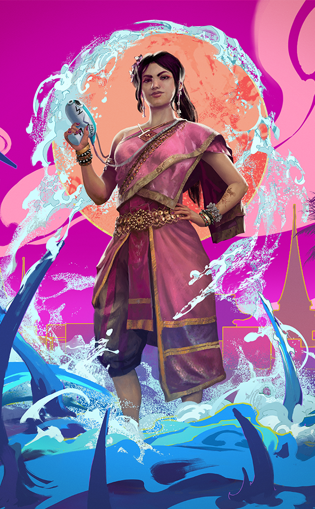
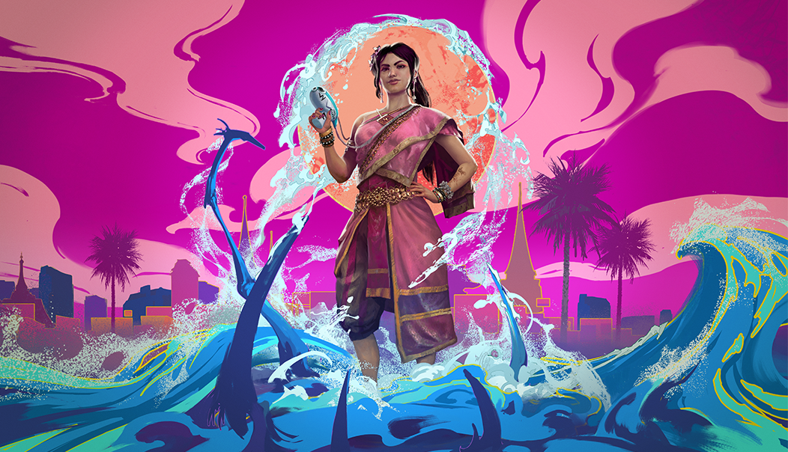

# live · 9.5.2_3219159live

| | |
|---|---|
| Build date | 2026-03-31 15:17 UTC |
| CDN version | `9.5.2_3219159live-1774970263` |
| Key | `9.5.2_live` |
| Compared with | [9.5.0_3218366live](../9.5.0_3218366live/CHANGES.md) (2026-03-31 14:22 UTC) |

## Summary

**2** added · **10** modified · **9** removed · 199 unchanged

## New or updated images

<a href="images/T_UI_CollectionBanner_Songkran.png"></a>
<a href="images/T_UI_SpecialPack_Songkran.png"></a>

## Removed files

- `images/T_UI_ChapterBundle_AllKillComeback.png`
- `images/T_UI_CollectionBanner_AllKillComeback.png`
- `images/T_UI_CollectionBanner_ArtistsFromTheFog_Haddie.png`
- `images/T_UI_CollectionBanner_Bloodmoon_Quiche.png`
- `images/T_UI_SpecialPack_AllKillComeback.png`
- `images/T_UI_SpecialPack_ArtistsFromTheFog_Haddie.png`
- `images/T_UI_SpecialPack_Bloodmoon_Bundle.png`
- `images/T_UI_SpecialPack_Bloodmoon_Quiche.png`
- `images/T_UI_SpecialPack_EntombedRemains.png`

## Modified files

### [`GameConfigs.json`](GameConfigs.json)

[Full line-by-line diff](diffs/GameConfigs.json.diff)

```diff
- $.analytics.detailedScoreTypeBlacklist[]: "GameEvent.Trickster.ThrowKnife"
- $.analytics.detailedScoreTypeBlacklist[]: "GameEvent.Slasher.Trickster.KnifeThrow.Aim.Start"
- $.analytics.detailedScoreTypeBlacklist[]: "GameEvent.Slasher.Trickster.KnifeThrow.Aim.End"
```

### [`GameConfigsDS.json`](GameConfigsDS.json)

[Full line-by-line diff](diffs/GameConfigsDS.json.diff)

```diff
+ $.analyticsRulesDedicatedServer.BL[]: "Gameplay_KillerAnalytics"
+ $.analyticsRulesDedicatedServer.BL[]: "Gameplay_PigKillerAnalytics"
+ $.analyticsRulesDedicatedServer.KA[]: "MMREmblemPointsDetailAnalytics"
+ $.analyticsRulesDedicatedServer.KL[]: "BhvrDynamicContentDownloadedAnalytics"
+ $.analyticsRulesDedicatedServer.KL[]: "BhvrDynamicContentErrorAnalytics"
+ $.analyticsRulesDedicatedServer.KL[]: "BhvrDynamicContentInstalledAnalytics"
```

### [`archiveJournals/archiveS3Journals.json`](archiveJournals/archiveS3Journals.json)

[Full line-by-line diff](diffs/archiveJournals/archiveS3Journals.json.diff)

```diff
+ $.TOME23.vignettes[id=TOME23_03].entries[6]
+ $.TOME23.vignettes[id=TOME23_03].entries[7]
+ $.TOME23.vignettes[id=TOME23_03].entries[8]
+ $.TOME23.vignettes[id=TOME23_03].entries[9]
+ $.TOME24.vignettes[id=TOME24_01]
```

### [`archiveJournals/storyJournals.json`](archiveJournals/storyJournals.json)

[Full line-by-line diff](diffs/archiveJournals/storyJournals.json.diff)

```diff
+ $.TOME24.TOME24_01
```

### [`catalog.json`](catalog.json)

[Full line-by-line diff](diffs/catalog.json.diff)

```diff
+ $[id=QUI_008]
+ $[id=QUI_BNR_11]
+ $[id=QUI_BNR_12]
+ $[id=S49_Head010]
+ $[id=S49_Legs010]
+ $[id=S49_Torso010]
+ $[id=S49_outfit_010]
- $[id=S26].eventCostList
- $[id=S26].metaData.temporaryDiscounts
- $[id=S27].eventCostList
- $[id=S27].metaData.temporaryDiscounts
- $[id=K24].eventCostList
- $[id=K24].metaData.temporaryDiscounts
- $[id=K29].eventCostList
- $[id=K29].metaData.temporaryDiscounts
- $[id=S32].eventCostList
- $[id=S32].metaData.temporaryDiscounts
- $[id=S33].eventCostList
- $[id=S33].metaData.temporaryDiscounts
+ $[id=S52].metaData.defaultCustomization[]: "S52_Torso01_04"
+ $[id=S52_Torso01_04].categories[]: "default"
- $[id=S52_Torso01_04].metaData.entitledByDefault: false
+ $[id=S52_Torso01_04].metaData.entitledByDefault: true
```

### [`challengeSets.json`](challengeSets.json)

[Full line-by-line diff](diffs/challengeSets.json.diff)

```diff
- $.ChapterQuests_Quiche.challengeList[0].challenges[id=ChapterQuests_Quiche-Overarching-O_CompleteRiftQuestsB].objectives.Overarching.objectiveInfo: "CHALLENGE_CompleteRiftQuests_INFO"
+ $.ChapterQuests_Quiche.challengeList[0].challenges[id=ChapterQuests_Quiche-Overarching-O_CompleteRiftQuestsB].objectives.Overarching.objectiveInfo: "CHALLENGE_CompleteChapterQuests_INFO"
```

### [`collections.json`](collections.json)

[Full line-by-line diff](diffs/collections.json.diff)

```diff
+ $.collections[56].limitedAvailabilityStartDate: "2026-04-13T15:00:00Z"
+ $.collections[56].visibleBeforeStartDate: false
+ $.collections[56].additionalImages[0]
- $.collections[56].collectionId: "Brazil"
+ $.collections[56].collectionId: "Songkran"
- $.collections[56].collectionTitle.de: "Brasilien"
+ $.collections[56].collectionTitle.de: "Songkran"
- $.collections[56].collectionTitle.en: "Brazil"
+ $.collections[56].collectionTitle.en: "Songkran"
- $.collections[56].collectionTitle.es: "Brasil"
+ $.collections[56].collectionTitle.es: "Songkran"
- $.collections[56].collectionTitle["es-MX"]: "Brasil"
+ $.collections[56].collectionTitle["es-MX"]: "Songkran"
- $.collections[56].collectionTitle.fr: "Brésil"
+ $.collections[56].collectionTitle.fr: "Songkran"
- $.collections[56].collectionTitle.it: "Brasile"
+ $.collections[56].collectionTitle.it: "Songkran"
- $.collections[56].collectionTitle.ja: "ブラジル"
+ $.collections[56].collectionTitle.ja: "ソンクラーン"
- $.collections[56].collectionTitle.ko: "브라질"
+ $.collections[56].collectionTitle.ko: "송끄란"
- $.collections[56].collectionTitle.pl: "Brazylia"
+ $.collections[56].collectionTitle.pl: "Songkran"
- $.collections[56].collectionTitle["pt-BR"]: "Brasil"
+ $.collections[56].collectionTitle["pt-BR"]: "Songkran"
- $.collections[56].collectionTitle.ru: "Бразилия"
+ $.collections[56].collectionTitle.ru: "Сонгкран"
- $.collections[56].collectionTitle.th: "บราซิล"
+ $.collections[56].collectionTitle.th: "สงกรานต์"
- $.collections[56].collectionTitle.tr: "Brezilya"
+ $.collections[56].collectionTitle.tr: "Songkran"
- $.collections[56].collectionTitle["zh-Hans"]: "巴西"
+ $.collections[56].collectionTitle["zh-Hans"]: "泼水节"
- $.collections[56].collectionTitle["zh-Hant"]: "巴西"
+ $.collections[56].collectionTitle["zh-Hant"]: "潑水節"
- $.collections[56].heroImage.path: "/Game/UI/UMGAssets/Icons/Banners/CollectionBanners/T_UI_CollectionBanner_Brazil.T_UI_CollectionBanner_Brazil"
+ $.collections[56].heroImage.path: "/Game/UI/UMGAssets/Icons/Banners/CollectionBanners/Quiche/T_UI_CollectionBanner_Songkran.T_UI_CollectionBanner_Songkran"
- $.collections[56].inclusionVersion: "7.7.0 PTB"
+ $.collections[56].inclusionVersion: "9.5.2"
- $.collections[56].items[]: "KS_outfit_016"
- $.collections[56].items[]: "S24_outfit_015"
- $.collections[56].items[]: "SwedenSurvivor_outfit_019"
+ $.collections[56].items[]: "S49_outfit_010"
- $.collections[56].sortOrder: "-22"
+ $.collections[56].sortOrder: "-215"
- $.collections[56].updatedDate: "0001-01-01T00:00:00Z"
+ $.collections[56].updatedDate: "2026-01-20T18:36:38.518Z"
- $.collections[57].collectionId: "DaringAdventure"
+ $.collections[57].collectionId: "Brazil"
- $.collections[57].collectionTitle.de: "Waghalsiges Abenteuer"
+ $.collections[57].collectionTitle.de: "Brasilien"
- $.collections[57].collectionTitle.en: "Daring Adventure"
+ $.collections[57].collectionTitle.en: "Brazil"
- $.collections[57].collectionTitle.es: "Aventura intrépida"
+ $.collections[57].collectionTitle.es: "Brasil"
- $.collections[57].collectionTitle["es-MX"]: "Aventura osada"
+ $.collections[57].collectionTitle["es-MX"]: "Brasil"
- $.collections[57].collectionTitle.fr: "Aventure audacieuse"
+ $.collections[57].collectionTitle.fr: "Brésil"
- $.collections[57].collectionTitle.it: "Avventura audace"
+ $.collections[57].collectionTitle.it: "Brasile"
- $.collections[57].collectionTitle.ja: "果敢なる冒険"
+ $.collections[57].collectionTitle.ja: "ブラジル"
- $.collections[57].collectionTitle.ko: "대담한 모험"
+ $.collections[57].collectionTitle.ko: "브라질"
- $.collections[57].collectionTitle.pl: "Odważna przygoda"
+ $.collections[57].collectionTitle.pl: "Brazylia"
- $.collections[57].collectionTitle["pt-BR"]: "Aventura Ousada"
+ $.collections[57].collectionTitle["pt-BR"]: "Brasil"
- $.collections[57].collectionTitle.ru: "Отчаянное приключение"
+ $.collections[57].collectionTitle.ru: "Бразилия"
- $.collections[57].collectionTitle.th: "การผจญภัยสุดท้าทาย"
+ $.collections[57].collectionTitle.th: "บราซิล"
- $.collections[57].collectionTitle.tr: "Cesaret İsteyen Macera"
+ $.collections[57].collectionTitle.tr: "Brezilya"
- $.collections[57].collectionTitle["zh-Hans"]: "大冒险系列"
+ $.collections[57].collectionTitle["zh-Hans"]: "巴西"
- $.collections[57].collectionTitle["zh-Hant"]: "勇敢冒險"
+ $.collections[57].collectionTitle["zh-Hant"]: "巴西"
- $.collections[57].heroImage.path: "/Game/UI/UMGAssets/Icons/Banners/CollectionBanners/T_UI_CollectionBanner_DaringAdventure.T_UI_CollectionBanner_DaringAdventure"
+ $.collections[57].heroImage.path: "/Game/UI/UMGAssets/Icons/Banners/CollectionBanners/T_UI_CollectionBanner_Brazil.T_UI_CollectionBanner_Brazil"
- $.collections[57].items[]: "UK_outfit_013"
- $.collections[57].items[]: "US_outfit_017"
+ $.collections[57].items[]: "KS_outfit_016"
+ $.collections[57].items[]: "S24_outfit_015"
+ $.collections[57].items[]: "SwedenSurvivor_outfit_019"
- $.collections[57].sortOrder: "-23"
+ $.collections[57].sortOrder: "-22"
- $.collections[58].collectionId: "GreekLegends"
+ $.collections[58].collectionId: "DaringAdventure"
- $.collections[58].collectionTitle.de: "Griechische Legenden"
+ $.collections[58].collectionTitle.de: "Waghalsiges Abenteuer"
- $.collections[58].collectionTitle.en: "Greek Legends"
+ $.collections[58].collectionTitle.en: "Daring Adventure"
- $.collections[58].collectionTitle.es: "Leyendas griegas"
+ $.collections[58].collectionTitle.es: "Aventura intrépida"
- $.collections[58].collectionTitle["es-MX"]: "Leyendas griegas"
+ $.collections[58].collectionTitle["es-MX"]: "Aventura osada"
- $.collections[58].collectionTitle.fr: "Légendes grecques"
+ $.collections[58].collectionTitle.fr: "Aventure audacieuse"
- $.collections[58].collectionTitle.it: "Leggende greche"
+ $.collections[58].collectionTitle.it: "Avventura audace"
- $.collections[58].collectionTitle.ja: "ギリシャの伝説"
+ $.collections[58].collectionTitle.ja: "果敢なる冒険"
- $.collections[58].collectionTitle.ko: "그리스 전설"
+ $.collections[58].collectionTitle.ko: "대담한 모험"
- $.collections[58].collectionTitle.pl: "Greckie legendy"
+ $.collections[58].collectionTitle.pl: "Odważna przygoda"
- $.collections[58].collectionTitle["pt-BR"]: "Lendas Gregas"
+ $.collections[58].collectionTitle["pt-BR"]: "Aventura Ousada"
- $.collections[58].collectionTitle.ru: "Легенды Греции"
+ $.collections[58].collectionTitle.ru: "Отчаянное приключение"
- $.collections[58].collectionTitle.th: "ตำนานกรีก"
+ $.collections[58].collectionTitle.th: "การผจญภัยสุดท้าทาย"
- $.collections[58].collectionTitle.tr: "Yunan Efsaneleri"
+ $.collections[58].collectionTitle.tr: "Cesaret İsteyen Macera"
- $.collections[58].collectionTitle["zh-Hans"]: "希腊传说"
+ $.collections[58].collectionTitle["zh-Hans"]: "大冒险系列"
- $.collections[58].collectionTitle["zh-Hant"]: "希臘傳奇"
+ $.collections[58].collectionTitle["zh-Hant"]: "勇敢冒險"
- $.collections[58].heroImage.path: "/Game/UI/UMGAssets/Icons/Banners/CollectionBanners/T_UI_CollectionBanner_GreekLegends.T_UI_CollectionBanner_GreekLegends"
+ $.collections[58].heroImage.path: "/Game/UI/UMGAssets/Icons/Banners/CollectionBanners/T_UI_CollectionBanner_DaringAdventure.T_UI_CollectionBanner_DaringAdventure"
- $.collections[58].items[]: "AV_outfit_014"
- $.collections[58].items[]: "DK_outfit_012"
- $.collections[58].items[]: "FM_outfit_012"
- $.collections[58].items[]: "GK_outfit_011"
- $.collections[58].items[]: "GS_outfit_016"
- $.collections[58].items[]: "HK_outfit_011"
- $.collections[58].items[]: "HS_outfit_010"
- $.collections[58].items[]: "K21_outfit_008"
- $.collections[58].items[]: "K26_outfit_009"
- $.collections[58].items[]: "K28_outfit_010"
- $.collections[58].items[]: "KS_outfit_012"
- $.collections[58].items[]: "MK_outfit_013"
- $.collections[58].items[]: "MS_outfit_013"
- $.collections[58].items[]: "NK_outfit_022"
- $.collections[58].items[]: "S24_outfit_009"
- $.collections[58].items[]: "S28_outfit_014"
- $.collections[58].items[]: "S35_outfit_009"
- $.collections[58].items[]: "S36_outfit_009"
- $.collections[58].items[]: "SwedenKiller_outfit_009"
- $.collections[58].items[]: "SwedenSurvivor_outfit_011"
- $.collections[58].items[]: "TN_outfit_013"
- $.collections[58].items[]: "US_outfit_009"
+ $.collections[58].items[]: "UK_outfit_013"
+ $.collections[58].items[]: "US_outfit_017"
- $.collections[58].sortOrder: "-25"
+ $.collections[58].sortOrder: "-23"
- $.collections[58].updatedDate: "2024-03-18T16:00:01Z"
+ $.collections[58].updatedDate: "0001-01-01T00:00:00Z"
- $.collections[59].collectionId: "MeanStreets"
+ $.collections[59].collectionId: "GreekLegends"
- $.collections[59].collectionTitle.de: "Gefährliche Straßen"
+ $.collections[59].collectionTitle.de: "Griechische Legenden"
- $.collections[59].collectionTitle.en: "Mean Streets"
+ $.collections[59].collectionTitle.en: "Greek Legends"
- $.collections[59].collectionTitle.es: "Calles peligrosas"
+ $.collections[59].collectionTitle.es: "Leyendas griegas"
- $.collections[59].collectionTitle["es-MX"]: "Calles peligrosas"
+ $.collections[59].collectionTitle["es-MX"]: "Leyendas griegas"
- $.collections[59].collectionTitle.fr: "Rues dangereuses"
+ $.collections[59].collectionTitle.fr: "Légendes grecques"
- $.collections[59].collectionTitle.it: "Bassifondi"
+ $.collections[59].collectionTitle.it: "Leggende greche"
- $.collections[59].collectionTitle.ja: "意地悪なストリート"
+ $.collections[59].collectionTitle.ja: "ギリシャの伝説"
- $.collections[59].collectionTitle.ko: "비열한 거리"
+ $.collections[59].collectionTitle.ko: "그리스 전설"
- $.collections[59].collectionTitle.pl: "Podła dzielnica"
+ $.collections[59].collectionTitle.pl: "Greckie legendy"
- $.collections[59].collectionTitle["pt-BR"]: "Ruas Cruéis"
+ $.collections[59].collectionTitle["pt-BR"]: "Lendas Gregas"
- $.collections[59].collectionTitle.ru: "Трущобы"
+ $.collections[59].collectionTitle.ru: "Легенды Греции"
- $.collections[59].collectionTitle.th: "ถนนซอมซ่อ"
+ $.collections[59].collectionTitle.th: "ตำนานกรีก"
- $.collections[59].collectionTitle.tr: "Amansız Sokaklar"
+ $.collections[59].collectionTitle.tr: "Yunan Efsaneleri"
- $.collections[59].collectionTitle["zh-Hans"]: "穷街陋巷"
+ $.collections[59].collectionTitle["zh-Hans"]: "希腊传说"
- $.collections[59].collectionTitle["zh-Hant"]: "窮街陋巷"
+ $.collections[59].collectionTitle["zh-Hant"]: "希臘傳奇"
- $.collections[59].heroImage.path: "/Game/UI/UMGAssets/Icons/Banners/CollectionBanners/T_UI_CollectionBanner_MeanStreets.T_UI_CollectionBanner_MeanStreets"
+ $.collections[59].heroImage.path: "/Game/UI/UMGAssets/Icons/Banners/CollectionBanners/T_UI_CollectionBanner_GreekLegends.T_UI_CollectionBanner_GreekLegends"
- $.collections[59].items[]: "AV_outfit_010"
- $.collections[59].items[]: "Claudette_outfit_009_01"
- $.collections[59].items[]: "DK_outfit_011"
- $.collections[59].items[]: "HS_outfit_009"
- $.collections[59].items[]: "MT_outfit_012"
- $.collections[59].items[]: "Nea_outfit_008_01"
- $.collections[59].items[]: "US_outfit_008"
+ $.collections[59].items[]: "AV_outfit_014"
+ $.collections[59].items[]: "DK_outfit_012"
+ $.collections[59].items[]: "FM_outfit_012"
+ $.collections[59].items[]: "GK_outfit_011"
+ $.collections[59].items[]: "GS_outfit_016"
+ $.collections[59].items[]: "HK_outfit_011"
+ $.collections[59].items[]: "HS_outfit_010"
+ $.collections[59].items[]: "K21_outfit_008"
+ $.collections[59].items[]: "K26_outfit_009"
… 1984 more change(s) — see the commit diff for everything
```

### [`dynamicContent/DynamicContent.json`](dynamicContent/DynamicContent.json)

[Full line-by-line diff](diffs/dynamicContent/DynamicContent.json.diff)

```diff
- $.entries[0].contentVersion: "372f56e4ce889f50dc5ac47446d35c1dea0ee9ca"
+ $.entries[0].contentVersion: "cf7cf00b919d33db2cac5803060754bacc45871e"
- $.entries[0].packagedPath: "/Game/UI/UMGAssets/Icons/Banners/BundleBanners/SpecialPack/Quiche/T_UI_SpecialPack_Bloodmoon_Bundle.T_UI_SpecialPack_Bloodmoon_Bundle"
+ $.entries[0].packagedPath: "/Game/UI/UMGAssets/Icons/Banners/BundleBanners/SpecialPack/Quiche/T_UI_SpecialPack_MiNABundle.T_UI_SpecialPack_MiNABundle"
- $.entries[0].uri: "images/T_UI_SpecialPack_Bloodmoon_Bundle.png"
+ $.entries[0].uri: "images/T_UI_SpecialPack_MiNABundle.png"
- $.entries[1].contentVersion: "cf7cf00b919d33db2cac5803060754bacc45871e"
+ $.entries[1].contentVersion: "f7c93776f522193fdbac58c1416ed2bb8ee190ec"
- $.entries[1].downloadStrategy: "preferRemote"
+ $.entries[1].downloadStrategy: "preferPackaged"
- $.entries[1].packagedPath: "/Game/UI/UMGAssets/Icons/Banners/BundleBanners/SpecialPack/Quiche/T_UI_SpecialPack_MiNABundle.T_UI_SpecialPack_MiNABundle"
+ $.entries[1].packagedPath: "/DBDUICore/Assets/HUD/Tutorial/T_UI_Tutorial_ImageBG_GenQuest1.T_UI_Tutorial_ImageBG_GenQuest1"
- $.entries[1].uri: "images/T_UI_SpecialPack_MiNABundle.png"
+ $.entries[1].uri: "images/T_UI_Tutorial_ImageBG_GenQuest1.png"
- $.entries[2].contentVersion: "7b6a8c3f1f8a8150a5bfc76ffb1c0308d8d00dae"
+ $.entries[2].contentVersion: "4ae305ae1f966db3228ce77826da57e2ece140b4"
- $.entries[2].packagedPath: "/Game/UI/UMGAssets/Icons/Banners/BundleBanners/ChapterBundles/T_UI_ChapterBundle_AllKillComeback.T_UI_ChapterBundle_AllKillComeback"
+ $.entries[2].packagedPath: "/DBDUICore/Assets/HUD/Tutorial/T_UI_Tutorial_ImageBG_cosmetic.T_UI_Tutorial_ImageBG_cosmetic"
- $.entries[2].uri: "images/T_UI_ChapterBundle_AllKillComeback.png"
+ $.entries[2].uri: "images/T_UI_Tutorial_ImageBG_cosmetic.png"
- $.entries[3].contentVersion: "f7c93776f522193fdbac58c1416ed2bb8ee190ec"
+ $.entries[3].contentVersion: "f8c74b123d0ba3a66d82d9ba6e26486b88797b88"
- $.entries[3].packagedPath: "/DBDUICore/Assets/HUD/Tutorial/T_UI_Tutorial_ImageBG_GenQuest1.T_UI_Tutorial_ImageBG_GenQuest1"
+ $.entries[3].packagedPath: "/DBDUICore/Assets/HUD/Tutorial/T_UI_Tutorial_ImageBG_gift.T_UI_Tutorial_ImageBG_gift"
- $.entries[3].uri: "images/T_UI_Tutorial_ImageBG_GenQuest1.png"
+ $.entries[3].uri: "images/T_UI_Tutorial_ImageBG_gift.png"
- $.entries[4].contentVersion: "4ae305ae1f966db3228ce77826da57e2ece140b4"
+ $.entries[4].contentVersion: "019bd9f78117c22e825d54799ad5a34fbca2abfa"
- $.entries[4].packagedPath: "/DBDUICore/Assets/HUD/Tutorial/T_UI_Tutorial_ImageBG_cosmetic.T_UI_Tutorial_ImageBG_cosmetic"
+ $.entries[4].packagedPath: "/Game/UI/UMGAssets/Icons/Banners/CollectionBanners/Quiche/T_UI_CollectionBanner_Songkran.T_UI_CollectionBanner_Songkran"
- $.entries[4].uri: "images/T_UI_Tutorial_ImageBG_cosmetic.png"
+ $.entries[4].uri: "images/T_UI_CollectionBanner_Songkran.png"
- $.entries[5].contentVersion: "f8c74b123d0ba3a66d82d9ba6e26486b88797b88"
+ $.entries[5].contentVersion: "ef596b89f090b384fc3ce9a9ea2157313250f9be"
- $.entries[5].packagedPath: "/DBDUICore/Assets/HUD/Tutorial/T_UI_Tutorial_ImageBG_gift.T_UI_Tutorial_ImageBG_gift"
+ $.entries[5].packagedPath: "/Game/UI/UMGAssets/Icons/Banners/BundleBanners/SpecialPack/Quiche/T_UI_SpecialPack_Songkran.T_UI_SpecialPack_Songkran"
- $.entries[5].uri: "images/T_UI_Tutorial_ImageBG_gift.png"
+ $.entries[5].uri: "images/T_UI_SpecialPack_Songkran.png"
- $.entries[6].contentVersion: "cf341d2c3fc6111dc1e5804479907a0787a6dbe3"
+ $.entries[6].contentVersion: "0684dc0d146063559a67d8bf5d038b84580e62cb"
- $.entries[6].downloadStrategy: "preferPackaged"
+ $.entries[6].downloadStrategy: "preferRemote"
- $.entries[6].enableChecksum: false
+ $.entries[6].enableChecksum: true
- $.entries[6].packagedPath: "/Game/UI/UMGAssets/Icons/Banners/CollectionBanners/Quiche/T_UI_CollectionBanner_ArtistsFromTheFog_Haddie.T_UI_CollectionBanner_ArtistsFromTheFog_Haddie"
+ $.entries[6].packagedPath: ""
- $.entries[6].schema: "s3verbin://"
+ $.entries[6].schema: "s3ver://"
- $.entries[6].uri: "images/T_UI_CollectionBanner_ArtistsFromTheFog_Haddie.png"
+ $.entries[6].uri: "catalog.json"
- $.entries[7].contentVersion: "91e8518ba9c09aef7d41865cbd8fbe7f4fdf5fb3"
+ $.entries[7].contentVersion: "00ccec5c57d21b3084d71e55376d5df80b2b4e44"
- $.entries[7].downloadStrategy: "preferPackaged"
+ $.entries[7].downloadStrategy: "preferRemote"
- $.entries[7].enableChecksum: false
+ $.entries[7].enableChecksum: true
- $.entries[7].packagedPath: "/Game/UI/UMGAssets/Icons/Banners/BundleBanners/SpecialPack/Quiche/T_UI_SpecialPack_ArtistsFromTheFog_Haddie.T_UI_SpecialPack_ArtistsFromTheFog_Haddie"
+ $.entries[7].packagedPath: ""
- $.entries[7].schema: "s3verbin://"
+ $.entries[7].schema: "s3ver://"
- $.entries[7].uri: "images/T_UI_SpecialPack_ArtistsFromTheFog_Haddie.png"
+ $.entries[7].uri: "bonusPointEventsContent.json"
- $.entries[8].contentVersion: "959fabeeccb034819147e5d0ba2cdd5401766d60"
+ $.entries[8].contentVersion: "4660259350d68d784ff362796b810d90249c934e"
- $.entries[8].downloadStrategy: "preferPackaged"
+ $.entries[8].downloadStrategy: "preferRemote"
- $.entries[8].enableChecksum: false
+ $.entries[8].enableChecksum: true
- $.entries[8].packagedPath: "/Game/UI/UMGAssets/Icons/Banners/CollectionBanners/Quiche/T_UI_CollectionBanner_Bloodmoon_Quiche.T_UI_CollectionBanner_Bloodmoon_Quiche"
+ $.entries[8].packagedPath: ""
- $.entries[8].schema: "s3verbin://"
+ $.entries[8].schema: "s3ver://"
- $.entries[8].uri: "images/T_UI_CollectionBanner_Bloodmoon_Quiche.png"
+ $.entries[8].uri: "freetoplay/NA/event.json"
- $.entries[9].contentVersion: "78209c89723d44a3f77e31b1fedcc4ad9cad795b"
+ $.entries[9].contentVersion: "4660259350d68d784ff362796b810d90249c934e"
- $.entries[9].downloadStrategy: "preferPackaged"
+ $.entries[9].downloadStrategy: "preferRemote"
- $.entries[9].enableChecksum: false
+ $.entries[9].enableChecksum: true
- $.entries[9].packagedPath: "/Game/UI/UMGAssets/Icons/Banners/BundleBanners/SpecialPack/Quiche/T_UI_SpecialPack_Bloodmoon_Quiche.T_UI_SpecialPack_Bloodmoon_Quiche"
+ $.entries[9].packagedPath: ""
- $.entries[9].schema: "s3verbin://"
+ $.entries[9].schema: "s3ver://"
- $.entries[9].uri: "images/T_UI_SpecialPack_Bloodmoon_Quiche.png"
+ $.entries[9].uri: "freetoplay/EU/event.json"
- $.entries[10].contentVersion: "708c753f60235b611acd71990e30ee888440e536"
+ $.entries[10].contentVersion: "563ba8863857d87bfce206cca6f3d2bac203f56f"
- $.entries[10].downloadStrategy: "preferPackaged"
+ $.entries[10].downloadStrategy: "preferRemote"
- $.entries[10].enableChecksum: false
+ $.entries[10].enableChecksum: true
- $.entries[10].packagedPath: "/Game/UI/UMGAssets/Icons/Banners/CollectionBanners/Quiche/T_UI_CollectionBanner_AllKillComeback.T_UI_CollectionBanner_AllKillComeback"
+ $.entries[10].packagedPath: ""
- $.entries[10].schema: "s3verbin://"
+ $.entries[10].schema: "s3ver://"
- $.entries[10].uri: "images/T_UI_CollectionBanner_AllKillComeback.png"
+ $.entries[10].uri: "archiveQuests/Anniversary2022.json"
- $.entries[11].contentVersion: "f10501984992cfbf10084409d5d0bc4a69117c54"
+ $.entries[11].contentVersion: "3115f5e7d61a970a71e9a41100a55f046eb9bd48"
- $.entries[11].downloadStrategy: "preferPackaged"
+ $.entries[11].downloadStrategy: "preferRemote"
- $.entries[11].enableChecksum: false
+ $.entries[11].enableChecksum: true
- $.entries[11].packagedPath: "/Game/UI/UMGAssets/Icons/Banners/BundleBanners/SpecialPack/Quiche/T_UI_SpecialPack_AllKillComeback.T_UI_SpecialPack_AllKillComeback"
+ $.entries[11].packagedPath: ""
- $.entries[11].schema: "s3verbin://"
+ $.entries[11].schema: "s3ver://"
- $.entries[11].uri: "images/T_UI_SpecialPack_AllKillComeback.png"
+ $.entries[11].uri: "archiveQuests/Anniversary2023.json"
- $.entries[12].contentVersion: "618875b6f64dbdcbcf0224a32a85a5c84083dc5c"
+ $.entries[12].contentVersion: "e2dcf644f8525a2ae1a9233bf85b0df55370c5bc"
- $.entries[12].downloadStrategy: "preferPackaged"
+ $.entries[12].downloadStrategy: "preferRemote"
- $.entries[12].enableChecksum: false
+ $.entries[12].enableChecksum: true
- $.entries[12].packagedPath: "/Game/UI/UMGAssets/Icons/Banners/BundleBanners/SpecialPack/Quiche/T_UI_SpecialPack_EntombedRemains.T_UI_SpecialPack_EntombedRemains"
+ $.entries[12].packagedPath: ""
- $.entries[12].schema: "s3verbin://"
+ $.entries[12].schema: "s3ver://"
- $.entries[12].uri: "images/T_UI_SpecialPack_EntombedRemains.png"
+ $.entries[12].uri: "archiveQuests/Anniversary2024.json"
- $.entries[13].contentVersion: "cab3f405afcd6209e35e2198f6a27b2cf77bed5a"
+ $.entries[13].contentVersion: "cddf4d17ad3a41bfc299db5d6a90fbced3b21e58"
- $.entries[13].uri: "catalog.json"
+ $.entries[13].uri: "archiveQuests/CalamariV1.json"
- $.entries[14].contentVersion: "5b039bbeee491d0b93ceda679c4ace6bbf1de269"
+ $.entries[14].contentVersion: "7d287907649ba3489aeb1dcf64693d3b7616ebce"
- $.entries[14].uri: "bonusPointEventsContent.json"
+ $.entries[14].uri: "archiveQuests/CalamariV2.json"
- $.entries[15].contentVersion: "24497671b5d28e596507549ba1b390368e004229"
+ $.entries[15].contentVersion: "87c0d35b78cefcb1e3662e2e2c3f75318d3a3548"
- $.entries[15].uri: "freetoplay/NA/event.json"
+ $.entries[15].uri: "archiveQuests/CalamariV3.json"
- $.entries[16].contentVersion: "24497671b5d28e596507549ba1b390368e004229"
+ $.entries[16].contentVersion: "bb3f06a2880e3ff04e3b6238b498422861c71297"
- $.entries[16].uri: "freetoplay/EU/event.json"
+ $.entries[16].uri: "archiveQuests/ChocolateBoxGelato.json"
- $.entries[17].contentVersion: "a6ab361537fd669c667020c309c139dd9169726a"
+ $.entries[17].contentVersion: "4579ad21e48a50b6a3df083acae1bda30b51b927"
- $.entries[17].uri: "archiveQuests/Anniversary2022.json"
+ $.entries[17].uri: "archiveQuests/ChocolateBoxV1.json"
- $.entries[18].contentVersion: "7af95658408629d63b385a32df713142dc4daf9a"
+ $.entries[18].contentVersion: "a5fd0fb1270f3c2acdde21598d487e6982e142f8"
- $.entries[18].uri: "archiveQuests/Anniversary2023.json"
+ $.entries[18].uri: "archiveQuests/DreadByDaylightZodiac.json"
- $.entries[19].contentVersion: "caedd3c30c156efdba80ba2450969344f3f06de8"
+ $.entries[19].contentVersion: "3c418e56e731fa6c0bce50fe214afdcbebed4d97"
- $.entries[19].uri: "archiveQuests/Anniversary2024.json"
+ $.entries[19].uri: "archiveQuests/FireflyV1.json"
- $.entries[20].contentVersion: "2c2d8c2f09d5ec34505cd93465105517e954dd1f"
+ $.entries[20].contentVersion: "ce17656b4f57f9bb4f55a647888e9c131cbffd86"
- $.entries[20].uri: "archiveQuests/CalamariV1.json"
+ $.entries[20].uri: "archiveQuests/Halloween2021.json"
- $.entries[21].contentVersion: "fb525c4d73f0614c7a23505500fde5d54327c1a5"
+ $.entries[21].contentVersion: "31c2ba9e1fc6549a9d87fd8e886cf58a3c6d620b"
- $.entries[21].uri: "archiveQuests/CalamariV2.json"
+ $.entries[21].uri: "archiveQuests/Halloween2022.json"
- $.entries[22].contentVersion: "e82aae4ae097d3fb68186c0a39dd153ec885130c"
+ $.entries[22].contentVersion: "0920c356f45356ae9a1f8194d39076438f3595e3"
- $.entries[22].uri: "archiveQuests/CalamariV3.json"
+ $.entries[22].uri: "archiveQuests/Halloween2023.json"
- $.entries[23].contentVersion: "5086ad9a1a1a189159c66c03828a2ca5633b45bc"
+ $.entries[23].contentVersion: "9298ad2daaa92b1ad66dfc69c159ca51919ab7e9"
- $.entries[23].uri: "archiveQuests/ChocolateBoxGelato.json"
+ $.entries[23].uri: "archiveQuests/Halloween2024.json"
- $.entries[24].contentVersion: "0a0fb13155fa8131aa1dffec559ed4cea9ee1248"
+ $.entries[24].contentVersion: "e9e019462c7bdc7cac1ec0ff6843f2f3d0d3852b"
- $.entries[24].uri: "archiveQuests/ChocolateBoxV1.json"
+ $.entries[24].uri: "archiveQuests/Spring2024.json"
- $.entries[25].contentVersion: "d8a5bf3acb11316221ac613a48ef082d54295cd7"
+ $.entries[25].contentVersion: "bae9534b4da6340edc518860172b367beb402155"
- $.entries[25].uri: "archiveQuests/DreadByDaylightZodiac.json"
+ $.entries[25].uri: "archiveQuests/Spring2025.json"
- $.entries[26].contentVersion: "5f9ca96219895f64faf52892740543ff15386289"
+ $.entries[26].contentVersion: "1a3c1265f105674a7f30254832f60258fc420487"
- $.entries[26].uri: "archiveQuests/FireflyV1.json"
+ $.entries[26].uri: "archiveQuests/Summer2023.json"
- $.entries[27].contentVersion: "01097afbbdec37d09ff591dd9bb6ef310e525ba5"
+ $.entries[27].contentVersion: "c85645524e7d9462e910271ec5d6c54871a80085"
- $.entries[27].uri: "archiveQuests/Halloween2021.json"
+ $.entries[27].uri: "archiveQuests/Tome01.json"
- $.entries[28].contentVersion: "b185cd1ff0408d8ec7bd78e651adcf2239efa6a1"
+ $.entries[28].contentVersion: "c22d11818ccd3e092fa80428aa70dc5f5e531931"
- $.entries[28].uri: "archiveQuests/Halloween2022.json"
+ $.entries[28].uri: "archiveQuests/Tome02.json"
- $.entries[29].contentVersion: "8f0046ba012d7daa8a3788679ec72153b27d45c5"
+ $.entries[29].contentVersion: "8516f40e7e71b533193b4bcf03f6bf4675a1f614"
- $.entries[29].uri: "archiveQuests/Halloween2023.json"
+ $.entries[29].uri: "archiveQuests/Tome03.json"
- $.entries[30].contentVersion: "330f90e261b32487bb4580abaa84230ac8bf7b77"
+ $.entries[30].contentVersion: "da3a16840f040f646d2581527f85728bc77c71a6"
- $.entries[30].uri: "archiveQuests/Halloween2024.json"
+ $.entries[30].uri: "archiveQuests/Tome04.json"
- $.entries[31].contentVersion: "4eb83fa8ed7a4a416f976130cd94eeaee376e8cc"
+ $.entries[31].contentVersion: "c785a3236927daa079873486ebcc9be943275e0d"
- $.entries[31].uri: "archiveQuests/Spring2024.json"
+ $.entries[31].uri: "archiveQuests/Tome05.json"
- $.entries[32].contentVersion: "dbeedabe9895f8b3749a1d64d34632b37b62363e"
+ $.entries[32].contentVersion: "31896fd041142a0281c074a1a620bc082bdb7fcc"
… 767 more change(s) — see the commit diff for everything
```

### [`itemsKillswitch.json`](itemsKillswitch.json)

[Full line-by-line diff](diffs/itemsKillswitch.json.diff)

```diff
- $.disabledItems.WereGonnaLiveForever
```

### [`recommendations.json`](recommendations.json)

[Full line-by-line diff](diffs/recommendations.json.diff)

```diff
+ $.featuredCustomizationRecommendations[id=Quiche_W4]
+ $.featuredCustomizationRecommendations[id=Quiche_W5]
+ $.featuredCustomizationRecommendations[id=Quiche_W6]
+ $.featuredCustomizationRecommendations[id=Quiche_W7]
```

