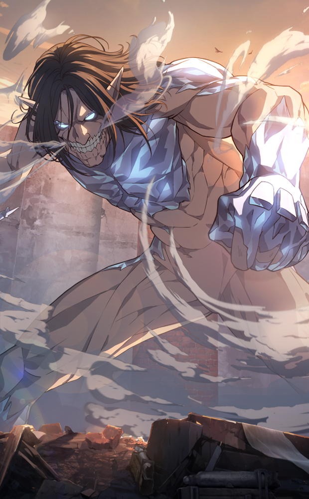
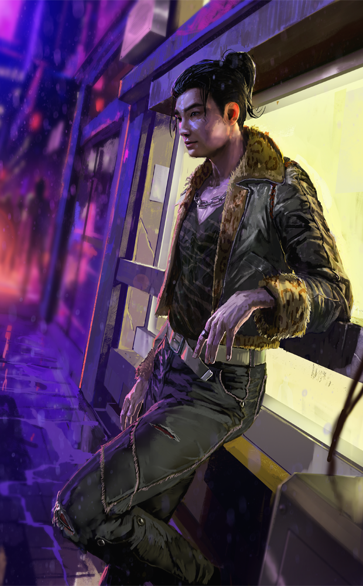
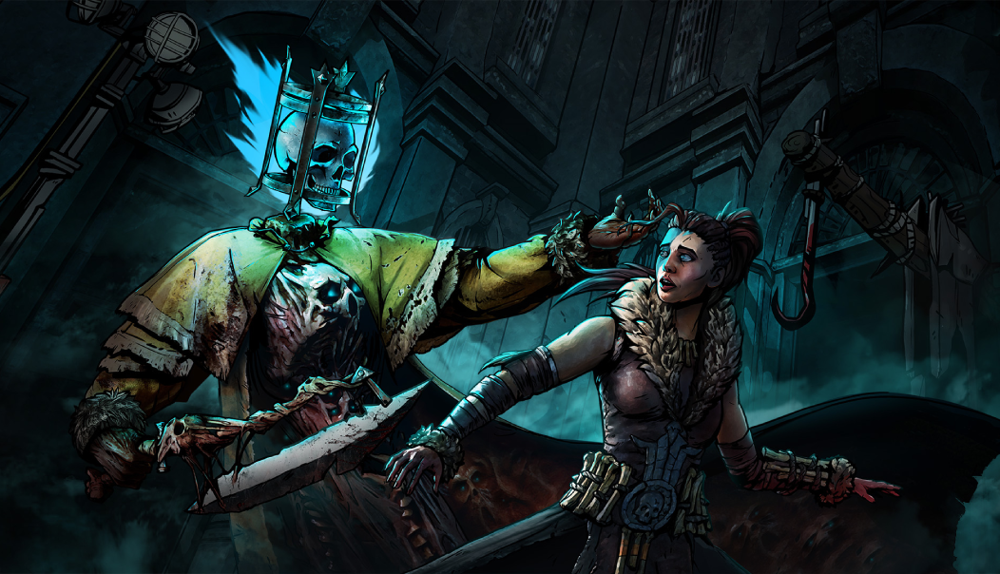
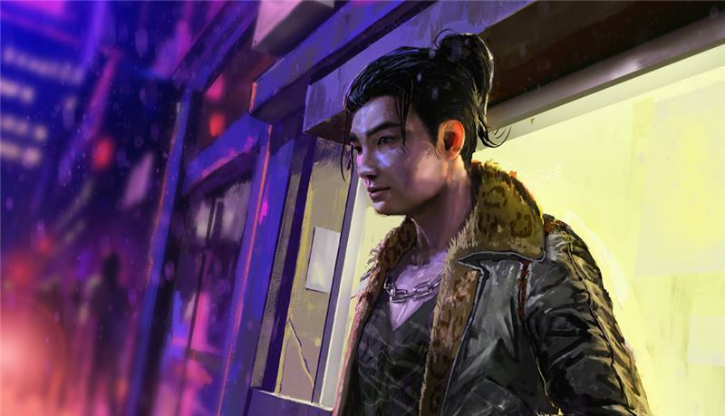

# live · 9.6.0_3328077live

| | |
|---|---|
| Build date | 2026-05-07 14:36 UTC |
| CDN version | `9.6.0_3328077live-1778164604` |
| Key | `9.6.0_live` |
| Compared with | [9.6.1_3326162live](../9.6.1_3326162live/CHANGES.md) (2026-05-06 20:56 UTC) |

## Summary

**7** added · **5** modified · **0** removed · 203 unchanged

## New or updated images

<a href="images/T_UI_CollectionBanner_Aliens_Hudson.png"></a>
<a href="images/T_UI_CollectionBanner_AoT_2.png"></a>
<a href="images/T_UI_CollectionBanner_SeoulSights_Kwon.png"></a>
<a href="images/T_UI_SpecialPack_Aliens_Hudson.png"></a>
<a href="images/T_UI_SpecialPack_AoT_2.png"></a>
<a href="images/T_UI_SpecialPack_Rift5.png"></a>
<a href="images/T_UI_SpecialPack_SeoulSights_Kwon.png"></a>

## Modified files

### [`catalog.json`](catalog.json)

[Full line-by-line diff](diffs/catalog.json.diff)

```diff
+ $[id=K30_Body019].defaultCost[1]
+ $[id=K30_Head019].defaultCost[1]
+ $[id=K30_W019].defaultCost[1]
+ $[id=S28_Head031].defaultCost[1]
+ $[id=S28_Legs031].defaultCost[1]
+ $[id=S28_Torso031].defaultCost[1]
+ $[id=S35_Head023].defaultCost[1]
+ $[id=S35_Legs023].defaultCost[1]
+ $[id=S35_Torso023].defaultCost[1]
- $[id=K41_outfit_009].metaData.releaseDate: "2018-06-12T00:00:00"
+ $[id=K41_outfit_009].metaData.releaseDate: "2026-05-26T15:00:00"
- $[id=K41_outfit_009].metaData.releaseDateInMs: 1528761600000
+ $[id=K41_outfit_009].metaData.releaseDateInMs: 1779807600000
```

### [`challengeSets.json`](challengeSets.json)

[Full line-by-line diff](diffs/challengeSets.json.diff)

```diff
- $.Rift_05_QuestSet.challengeList[10].challenges[id=Rift_05_QuestSet-Week_10-O_CompleteChallenges].objectives.Overarching.conditions[key=challengeListId].value[]: "Rift_05_QuestSet-Week_10"
+ $.Rift_05_QuestSet.challengeList[10].challenges[id=Rift_05_QuestSet-Week_10-O_CompleteChallenges].objectives.Overarching.conditions[key=challengeListId].value[]: "Rift_01_QuestSet-List_1"
```

### [`contentSchedule.json`](contentSchedule.json)

[Full line-by-line diff](diffs/contentSchedule.json.diff)

```diff
- $.schedule[1].MapsWeight.Apl_Square_Calamari: "200"
+ $.schedule[1].MapsWeight.Apl_Square_Calamari: "500"
- $.schedule[1].MapsWeight.Asy_Asylum_Calamari: "200"
+ $.schedule[1].MapsWeight.Asy_Asylum_Calamari: "300"
- $.schedule[1].MapsWeight.Asy_Chapel_Calamari: "200"
+ $.schedule[1].MapsWeight.Asy_Chapel_Calamari: "500"
- $.schedule[1].MapsWeight.Brl_MaHouse_Calamari: "200"
+ $.schedule[1].MapsWeight.Brl_MaHouse_Calamari: "500"
- $.schedule[1].MapsWeight.Brl_Temple_Calamari: "200"
+ $.schedule[1].MapsWeight.Brl_Temple_Calamari: "500"
- $.schedule[1].MapsWeight.Ecl_Level03_Calamari: "200"
+ $.schedule[1].MapsWeight.Ecl_Level03_Calamari: "500"
- $.schedule[1].MapsWeight.Frm_Cornfield_Calamari: "200"
+ $.schedule[1].MapsWeight.Frm_Cornfield_Calamari: "500"
- $.schedule[1].MapsWeight.Frm_Farmhouse_Calamari: "200"
+ $.schedule[1].MapsWeight.Frm_Farmhouse_Calamari: "100"
- $.schedule[1].MapsWeight.Frm_Silo_Calamari: "200"
+ $.schedule[1].MapsWeight.Frm_Silo_Calamari: "500"
- $.schedule[1].MapsWeight.Frm_Slaughterhouse_Calamari: "200"
+ $.schedule[1].MapsWeight.Frm_Slaughterhouse_Calamari: "300"
- $.schedule[1].MapsWeight.Hos_Hospital_Calamari: "200"
+ $.schedule[1].MapsWeight.Hos_Hospital_Calamari: "500"
- $.schedule[1].MapsWeight.Hti_Manor_Calamari: "200"
+ $.schedule[1].MapsWeight.Hti_Manor_Calamari: "500"
- $.schedule[1].MapsWeight.Hti_Temple_Calamari: "200"
+ $.schedule[1].MapsWeight.Hti_Temple_Calamari: "300"
- $.schedule[1].MapsWeight.Ind_CoalTower_Calamari: "200"
+ $.schedule[1].MapsWeight.Ind_CoalTower_Calamari: "500"
- $.schedule[1].MapsWeight.Ind_Forest_Calamari: "200"
+ $.schedule[1].MapsWeight.Ind_Forest_Calamari: "500"
- $.schedule[1].MapsWeight.Ind_Foundry_Calamari: "200"
+ $.schedule[1].MapsWeight.Ind_Foundry_Calamari: "500"
- $.schedule[1].MapsWeight.Ind_Mine_Calamari: "200"
+ $.schedule[1].MapsWeight.Ind_Mine_Calamari: "300"
- $.schedule[1].MapsWeight.Ind_Storehouse_Calamari: "200"
+ $.schedule[1].MapsWeight.Ind_Storehouse_Calamari: "500"
- $.schedule[1].MapsWeight.Jnk_Garage_Calamari: "200"
+ $.schedule[1].MapsWeight.Jnk_Garage_Calamari: "500"
- $.schedule[1].MapsWeight.Jnk_GasStation_Calamari: "200"
+ $.schedule[1].MapsWeight.Jnk_GasStation_Calamari: "300"
- $.schedule[1].MapsWeight.Jnk_Office_Calamari: "200"
+ $.schedule[1].MapsWeight.Jnk_Office_Calamari: "300"
- $.schedule[1].MapsWeight.Jnk_Scrapyard_Calamari: "200"
+ $.schedule[1].MapsWeight.Jnk_Scrapyard_Calamari: "100"
- $.schedule[1].MapsWeight.Kny_Chalet_Calamari: "200"
+ $.schedule[1].MapsWeight.Kny_Chalet_Calamari: "500"
- $.schedule[1].MapsWeight.Qtm_ShatteredSqr_Calamari: "200"
+ $.schedule[1].MapsWeight.Qtm_ShatteredSqr_Calamari: "500"
- $.schedule[1].MapsWeight.Ukr_Saloon_Calamari: "200"
+ $.schedule[1].MapsWeight.Ukr_Saloon_Calamari: "500"
```

### [`dynamicContent/DynamicContent.json`](dynamicContent/DynamicContent.json)

[Full line-by-line diff](diffs/dynamicContent/DynamicContent.json.diff)

```diff
- $.entries[0].contentVersion: "f7c93776f522193fdbac58c1416ed2bb8ee190ec"
+ $.entries[0].contentVersion: "cd78791691749d15bd36957f6370133a990f85a4"
- $.entries[0].packagedPath: "/DBDUICore/Assets/HUD/Tutorial/T_UI_Tutorial_ImageBG_GenQuest1.T_UI_Tutorial_ImageBG_GenQuest1"
+ $.entries[0].packagedPath: "/Game/UI/UMGAssets/Icons/Banners/BundleBanners/SpecialPack/Ramen/T_UI_SpecialPack_AoT_2.T_UI_SpecialPack_AoT_2"
- $.entries[0].uri: "images/T_UI_Tutorial_ImageBG_GenQuest1.png"
+ $.entries[0].uri: "images/T_UI_SpecialPack_AoT_2.png"
- $.entries[1].contentVersion: "4ae305ae1f966db3228ce77826da57e2ece140b4"
+ $.entries[1].contentVersion: "c98f80124bd6f0e7c53d9ea1fa76f2684f1fb782"
- $.entries[1].packagedPath: "/DBDUICore/Assets/HUD/Tutorial/T_UI_Tutorial_ImageBG_cosmetic.T_UI_Tutorial_ImageBG_cosmetic"
+ $.entries[1].packagedPath: "/Game/UI/UMGAssets/Icons/Banners/BundleBanners/SpecialPack/Ramen/T_UI_SpecialPack_Rift5.T_UI_SpecialPack_Rift5"
- $.entries[1].uri: "images/T_UI_Tutorial_ImageBG_cosmetic.png"
+ $.entries[1].uri: "images/T_UI_SpecialPack_Rift5.png"
- $.entries[2].contentVersion: "f8c74b123d0ba3a66d82d9ba6e26486b88797b88"
+ $.entries[2].contentVersion: "1d818ecadd2c08a3866f6e2120623b0d6306c70a"
- $.entries[2].packagedPath: "/DBDUICore/Assets/HUD/Tutorial/T_UI_Tutorial_ImageBG_gift.T_UI_Tutorial_ImageBG_gift"
+ $.entries[2].packagedPath: "/Game/UI/UMGAssets/Icons/Banners/BundleBanners/SpecialPack/Ramen/T_UI_SpecialPack_SeoulSights_Kwon.T_UI_SpecialPack_SeoulSights_Kwon"
- $.entries[2].uri: "images/T_UI_Tutorial_ImageBG_gift.png"
+ $.entries[2].uri: "images/T_UI_SpecialPack_SeoulSights_Kwon.png"
- $.entries[3].contentVersion: "a8a67547f41057e42364f2e254b78c22fe277bbf"
+ $.entries[3].contentVersion: "14139f9b234fdd66cb273cc5fd16228bd75b3258"
- $.entries[3].downloadStrategy: "preferRemote"
+ $.entries[3].downloadStrategy: "preferPackaged"
- $.entries[3].enableChecksum: true
+ $.entries[3].enableChecksum: false
- $.entries[3].packagedPath: ""
+ $.entries[3].packagedPath: "/Game/UI/UMGAssets/Icons/Banners/CollectionBanners/Ramen/T_UI_CollectionBanner_Aliens_Hudson.T_UI_CollectionBanner_Aliens_Hudson"
- $.entries[3].schema: "s3ver://"
+ $.entries[3].schema: "s3verbin://"
- $.entries[3].uri: "catalog.json"
+ $.entries[3].uri: "images/T_UI_CollectionBanner_Aliens_Hudson.png"
- $.entries[4].contentVersion: "9aeba0fa10f0ea310649f4885a1422d53c9e9bec"
+ $.entries[4].contentVersion: "fef3ab3957518899c95abb8a021b8f85e4cb34bf"
- $.entries[4].downloadStrategy: "preferRemote"
+ $.entries[4].downloadStrategy: "preferPackaged"
- $.entries[4].enableChecksum: true
+ $.entries[4].enableChecksum: false
- $.entries[4].packagedPath: ""
+ $.entries[4].packagedPath: "/Game/UI/UMGAssets/Icons/Banners/BundleBanners/SpecialPack/Ramen/T_UI_SpecialPack_Aliens_Hudson.T_UI_SpecialPack_Aliens_Hudson"
- $.entries[4].schema: "s3ver://"
+ $.entries[4].schema: "s3verbin://"
- $.entries[4].uri: "bonusPointEventsContent.json"
+ $.entries[4].uri: "images/T_UI_SpecialPack_Aliens_Hudson.png"
- $.entries[5].contentVersion: "c2d400435ec72ab179fedb1da39f85b455fbc10f"
+ $.entries[5].contentVersion: "53f65dbd74c78bb0f527d27b019825a215ae0a5b"
- $.entries[5].downloadStrategy: "preferRemote"
+ $.entries[5].downloadStrategy: "preferPackaged"
- $.entries[5].enableChecksum: true
+ $.entries[5].enableChecksum: false
- $.entries[5].packagedPath: ""
+ $.entries[5].packagedPath: "/Game/UI/UMGAssets/Icons/Banners/CollectionBanners/Ramen/T_UI_CollectionBanner_AoT_2.T_UI_CollectionBanner_AoT_2"
- $.entries[5].schema: "s3ver://"
+ $.entries[5].schema: "s3verbin://"
- $.entries[5].uri: "freetoplay/NA/event.json"
+ $.entries[5].uri: "images/T_UI_CollectionBanner_AoT_2.png"
- $.entries[6].contentVersion: "c2d400435ec72ab179fedb1da39f85b455fbc10f"
+ $.entries[6].contentVersion: "cd78791691749d15bd36957f6370133a990f85a4"
- $.entries[6].downloadStrategy: "preferRemote"
+ $.entries[6].downloadStrategy: "preferPackaged"
- $.entries[6].enableChecksum: true
+ $.entries[6].enableChecksum: false
- $.entries[6].packagedPath: ""
+ $.entries[6].packagedPath: "/Game/UI/UMGAssets/Icons/Banners/BundleBanners/SpecialPack/Ramen/T_UI_SpecialPack_AoT_2.T_UI_SpecialPack_AoT_2"
- $.entries[6].schema: "s3ver://"
+ $.entries[6].schema: "s3verbin://"
- $.entries[6].uri: "freetoplay/EU/event.json"
+ $.entries[6].uri: "images/T_UI_SpecialPack_AoT_2.png"
- $.entries[7].contentVersion: "9ec943e8d15b28107f23dd192dbbccd18c5294b2"
+ $.entries[7].contentVersion: "aaa60199314354769743f33e2b8bd7e2a7c76f57"
- $.entries[7].downloadStrategy: "preferRemote"
+ $.entries[7].downloadStrategy: "preferPackaged"
- $.entries[7].enableChecksum: true
+ $.entries[7].enableChecksum: false
- $.entries[7].packagedPath: ""
+ $.entries[7].packagedPath: "/Game/UI/UMGAssets/Icons/Banners/CollectionBanners/Ramen/T_UI_CollectionBanner_SeoulSights_Kwon.T_UI_CollectionBanner_SeoulSights_Kwon"
- $.entries[7].schema: "s3ver://"
+ $.entries[7].schema: "s3verbin://"
- $.entries[7].uri: "archiveQuests/Anniversary2022.json"
+ $.entries[7].uri: "images/T_UI_CollectionBanner_SeoulSights_Kwon.png"
- $.entries[8].contentVersion: "12a948652bb45876fd26228cc0e1e84efed806f2"
+ $.entries[8].contentVersion: "1d818ecadd2c08a3866f6e2120623b0d6306c70a"
- $.entries[8].downloadStrategy: "preferRemote"
+ $.entries[8].downloadStrategy: "preferPackaged"
- $.entries[8].enableChecksum: true
+ $.entries[8].enableChecksum: false
- $.entries[8].packagedPath: ""
+ $.entries[8].packagedPath: "/Game/UI/UMGAssets/Icons/Banners/BundleBanners/SpecialPack/Ramen/T_UI_SpecialPack_SeoulSights_Kwon.T_UI_SpecialPack_SeoulSights_Kwon"
- $.entries[8].schema: "s3ver://"
+ $.entries[8].schema: "s3verbin://"
- $.entries[8].uri: "archiveQuests/Anniversary2023.json"
+ $.entries[8].uri: "images/T_UI_SpecialPack_SeoulSights_Kwon.png"
- $.entries[9].contentVersion: "038f8d5d2371fb93ec828cc3f86c64f4d05c4e52"
+ $.entries[9].contentVersion: "f7c93776f522193fdbac58c1416ed2bb8ee190ec"
- $.entries[9].downloadStrategy: "preferRemote"
+ $.entries[9].downloadStrategy: "preferPackaged"
- $.entries[9].enableChecksum: true
+ $.entries[9].enableChecksum: false
- $.entries[9].packagedPath: ""
+ $.entries[9].packagedPath: "/DBDUICore/Assets/HUD/Tutorial/T_UI_Tutorial_ImageBG_GenQuest1.T_UI_Tutorial_ImageBG_GenQuest1"
- $.entries[9].schema: "s3ver://"
+ $.entries[9].schema: "s3verbin://"
- $.entries[9].uri: "archiveQuests/Anniversary2024.json"
+ $.entries[9].uri: "images/T_UI_Tutorial_ImageBG_GenQuest1.png"
- $.entries[10].contentVersion: "7d9ca1df3f95455253177db10f80af090d158338"
+ $.entries[10].contentVersion: "4ae305ae1f966db3228ce77826da57e2ece140b4"
- $.entries[10].downloadStrategy: "preferRemote"
+ $.entries[10].downloadStrategy: "preferPackaged"
- $.entries[10].enableChecksum: true
+ $.entries[10].enableChecksum: false
- $.entries[10].packagedPath: ""
+ $.entries[10].packagedPath: "/DBDUICore/Assets/HUD/Tutorial/T_UI_Tutorial_ImageBG_cosmetic.T_UI_Tutorial_ImageBG_cosmetic"
- $.entries[10].schema: "s3ver://"
+ $.entries[10].schema: "s3verbin://"
- $.entries[10].uri: "archiveQuests/CalamariV1.json"
+ $.entries[10].uri: "images/T_UI_Tutorial_ImageBG_cosmetic.png"
- $.entries[11].contentVersion: "4826b51414594b08cd070375e2b0c9e44d763bcc"
+ $.entries[11].contentVersion: "f8c74b123d0ba3a66d82d9ba6e26486b88797b88"
- $.entries[11].downloadStrategy: "preferRemote"
+ $.entries[11].downloadStrategy: "preferPackaged"
- $.entries[11].enableChecksum: true
+ $.entries[11].enableChecksum: false
- $.entries[11].packagedPath: ""
+ $.entries[11].packagedPath: "/DBDUICore/Assets/HUD/Tutorial/T_UI_Tutorial_ImageBG_gift.T_UI_Tutorial_ImageBG_gift"
- $.entries[11].schema: "s3ver://"
+ $.entries[11].schema: "s3verbin://"
- $.entries[11].uri: "archiveQuests/CalamariV2.json"
+ $.entries[11].uri: "images/T_UI_Tutorial_ImageBG_gift.png"
- $.entries[12].contentVersion: "209d1452764b9bc164835de80c36ae1df8e58c62"
+ $.entries[12].contentVersion: "14139f9b234fdd66cb273cc5fd16228bd75b3258"
- $.entries[12].downloadStrategy: "preferRemote"
+ $.entries[12].downloadStrategy: "preferPackaged"
- $.entries[12].enableChecksum: true
+ $.entries[12].enableChecksum: false
- $.entries[12].packagedPath: ""
+ $.entries[12].packagedPath: "/Game/UI/UMGAssets/Icons/Banners/CollectionBanners/Ramen/T_UI_CollectionBanner_Aliens_Hudson.T_UI_CollectionBanner_Aliens_Hudson"
- $.entries[12].schema: "s3ver://"
+ $.entries[12].schema: "s3verbin://"
- $.entries[12].uri: "archiveQuests/CalamariV3.json"
+ $.entries[12].uri: "images/T_UI_CollectionBanner_Aliens_Hudson.png"
- $.entries[13].contentVersion: "70eccbfe8ddb3b6ac91795068a01fb18fb3c643f"
+ $.entries[13].contentVersion: "fef3ab3957518899c95abb8a021b8f85e4cb34bf"
- $.entries[13].downloadStrategy: "preferRemote"
+ $.entries[13].downloadStrategy: "preferPackaged"
- $.entries[13].enableChecksum: true
+ $.entries[13].enableChecksum: false
- $.entries[13].packagedPath: ""
+ $.entries[13].packagedPath: "/Game/UI/UMGAssets/Icons/Banners/BundleBanners/SpecialPack/Ramen/T_UI_SpecialPack_Aliens_Hudson.T_UI_SpecialPack_Aliens_Hudson"
- $.entries[13].schema: "s3ver://"
+ $.entries[13].schema: "s3verbin://"
- $.entries[13].uri: "archiveQuests/ChocolateBoxGelato.json"
+ $.entries[13].uri: "images/T_UI_SpecialPack_Aliens_Hudson.png"
- $.entries[14].contentVersion: "406dbe46bae2ee406b985b2758d7a4935d131669"
+ $.entries[14].contentVersion: "53f65dbd74c78bb0f527d27b019825a215ae0a5b"
- $.entries[14].downloadStrategy: "preferRemote"
+ $.entries[14].downloadStrategy: "preferPackaged"
- $.entries[14].enableChecksum: true
+ $.entries[14].enableChecksum: false
- $.entries[14].packagedPath: ""
+ $.entries[14].packagedPath: "/Game/UI/UMGAssets/Icons/Banners/CollectionBanners/Ramen/T_UI_CollectionBanner_AoT_2.T_UI_CollectionBanner_AoT_2"
- $.entries[14].schema: "s3ver://"
+ $.entries[14].schema: "s3verbin://"
- $.entries[14].uri: "archiveQuests/ChocolateBoxV1.json"
+ $.entries[14].uri: "images/T_UI_CollectionBanner_AoT_2.png"
- $.entries[15].contentVersion: "455915853b180dbbde899fb095ee276f51337cef"
+ $.entries[15].contentVersion: "cd78791691749d15bd36957f6370133a990f85a4"
- $.entries[15].downloadStrategy: "preferRemote"
+ $.entries[15].downloadStrategy: "preferPackaged"
- $.entries[15].enableChecksum: true
+ $.entries[15].enableChecksum: false
- $.entries[15].packagedPath: ""
+ $.entries[15].packagedPath: "/Game/UI/UMGAssets/Icons/Banners/BundleBanners/SpecialPack/Ramen/T_UI_SpecialPack_AoT_2.T_UI_SpecialPack_AoT_2"
- $.entries[15].schema: "s3ver://"
+ $.entries[15].schema: "s3verbin://"
- $.entries[15].uri: "archiveQuests/DreadByDaylightZodiac.json"
+ $.entries[15].uri: "images/T_UI_SpecialPack_AoT_2.png"
- $.entries[16].contentVersion: "1ac3bf923bca1b45928d6aa2831f8b4c74e0f726"
+ $.entries[16].contentVersion: "aaa60199314354769743f33e2b8bd7e2a7c76f57"
- $.entries[16].downloadStrategy: "preferRemote"
+ $.entries[16].downloadStrategy: "preferPackaged"
- $.entries[16].enableChecksum: true
+ $.entries[16].enableChecksum: false
- $.entries[16].packagedPath: ""
+ $.entries[16].packagedPath: "/Game/UI/UMGAssets/Icons/Banners/CollectionBanners/Ramen/T_UI_CollectionBanner_SeoulSights_Kwon.T_UI_CollectionBanner_SeoulSights_Kwon"
- $.entries[16].schema: "s3ver://"
+ $.entries[16].schema: "s3verbin://"
- $.entries[16].uri: "archiveQuests/FireflyV1.json"
+ $.entries[16].uri: "images/T_UI_CollectionBanner_SeoulSights_Kwon.png"
- $.entries[17].contentVersion: "e31fe57ff91fb7a32943b4f5821f06b1bb52e617"
+ $.entries[17].contentVersion: "1d818ecadd2c08a3866f6e2120623b0d6306c70a"
- $.entries[17].downloadStrategy: "preferRemote"
+ $.entries[17].downloadStrategy: "preferPackaged"
- $.entries[17].enableChecksum: true
+ $.entries[17].enableChecksum: false
- $.entries[17].packagedPath: ""
+ $.entries[17].packagedPath: "/Game/UI/UMGAssets/Icons/Banners/BundleBanners/SpecialPack/Ramen/T_UI_SpecialPack_SeoulSights_Kwon.T_UI_SpecialPack_SeoulSights_Kwon"
- $.entries[17].schema: "s3ver://"
+ $.entries[17].schema: "s3verbin://"
- $.entries[17].uri: "archiveQuests/Halloween2021.json"
+ $.entries[17].uri: "images/T_UI_SpecialPack_SeoulSights_Kwon.png"
- $.entries[18].contentVersion: "b7bf57b5a89066c0dbd6333d33f93e482cef4cb6"
+ $.entries[18].contentVersion: "70933c33b130675621eaac5354b362d40117deb2"
… 855 more change(s) — see the commit diff for everything
```

### [`itemsKillswitch.json`](itemsKillswitch.json)

[Full line-by-line diff](diffs/itemsKillswitch.json.diff)

```diff
+ $.disabledItems.K29
```

