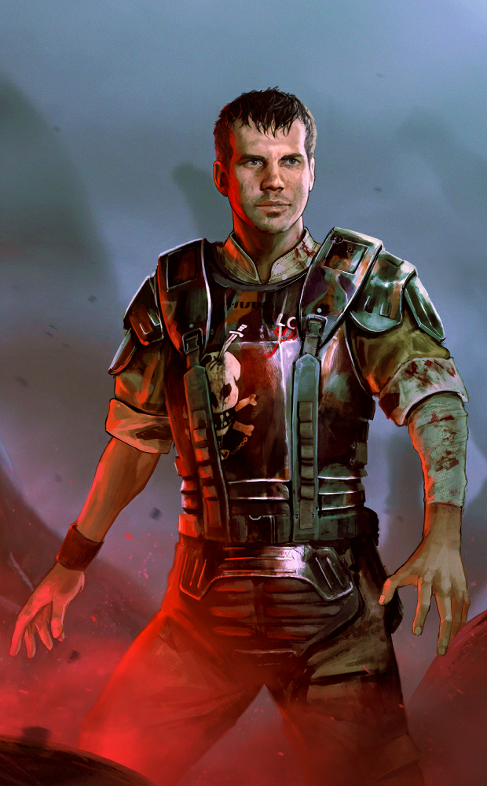
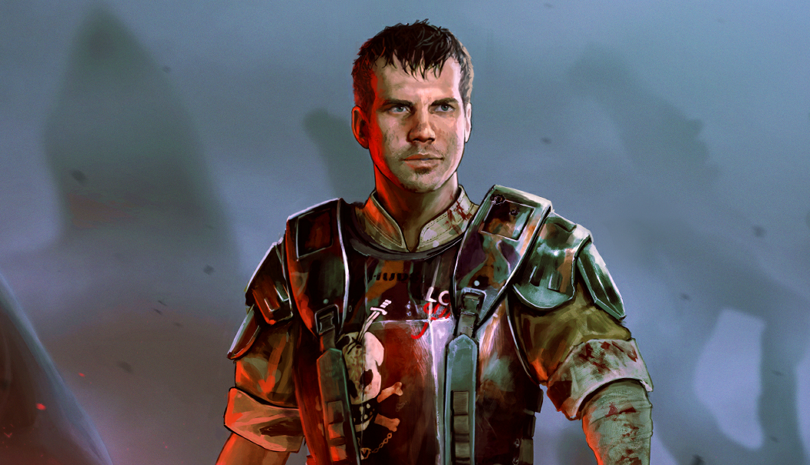
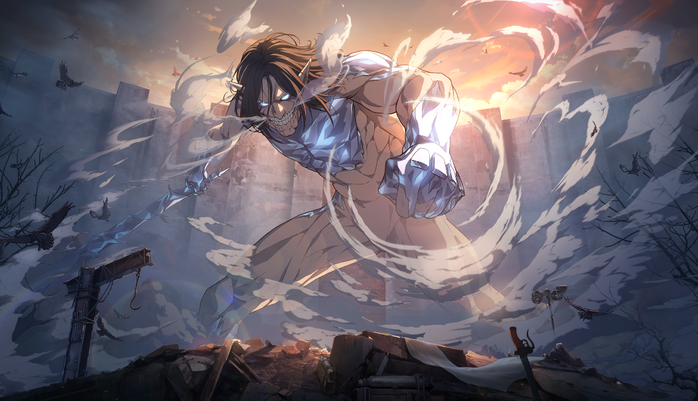

# live · 9.6.0_3339702live

| | |
|---|---|
| Build date | 2026-05-12 14:04 UTC |
| CDN version | `9.6.0_3339702live-1778594649` |
| Key | `9.6.0_live` |
| Compared with | [9.6.2_3336889live](../9.6.2_3336889live/CHANGES.md) (2026-05-12 13:38 UTC) |

## Summary

**7** added · **23** modified · **2** removed · 185 unchanged

## New or updated images

<a href="images/T_UI_CollectionBanner_Aliens_Hudson.png"></a>
<a href="images/T_UI_CollectionBanner_AoT_2.png"></a>
<a href="images/T_UI_CollectionBanner_SeoulSights_Kwon.png"></a>
<a href="images/T_UI_SpecialPack_Aliens_Hudson.png"></a>
<a href="images/T_UI_SpecialPack_AoT_2.png"></a>
<a href="images/T_UI_SpecialPack_Rift5.png"></a>
<a href="images/T_UI_SpecialPack_SeoulSights_Kwon.png"></a>

## Removed files

- `images/T_UI_CollectionBanner_DarkOvergrowth.png`
- `images/T_UI_SpecialPack_DarkOvergrowth.png`

## Modified files

### [`catalog.json`](catalog.json)

[Full line-by-line diff](diffs/catalog.json.diff)

```diff
- $[id=CM_Head035]
- $[id=CM_Legs035]
- $[id=CM_Torso035]
- $[id=DF_Head01_07]
- $[id=DF_Legs01_07]
- $[id=DF_Torso01_07]
- $[id=POU_BDG_23]
- $[id=RAM_012]
- $[id=RAM_013]
- $[id=RAM_014]
- $[id=RAM_015]
- $[id=RAM_023]
- $[id=RAM_024]
- $[id=RAM_BDG_28]
- $[id=RAM_BDG_29]
- $[id=RAM_BDG_30]
- $[id=RAM_BNR_22]
- $[id=RAM_BNR_23]
- $[id=RAM_BNR_24]
- $[id=S45_Head015]
- $[id=S45_Legs015]
- $[id=S45_Torso015]
- $[id=S49_Head011]
- $[id=S49_Legs011]
- $[id=S49_Torso011]
- $[id=TR_Body01_05]
- $[id=TR_Mask01_05]
- $[id=TR_W01_05]
- $[id=CM_outfit_035]
- $[id=DF_outfit_01_07]
- $[id=S45_outfit_015]
- $[id=S49_outfit_011]
- $[id=TR_outfit_01_05]
- $[id=Cats&Dogs_Bundle_Ramen]
- $[id=Dark_Overgrowth_Bundle_Ramen]
- $[id=Cats&Dogs_Ramen_collection_item]
- $[id=DarkOvergrowth_collection_item]
- $[id=SeoulSights_collection_item]
+ $[id=From_The_Rift_Bundle_260512]
+ $[id=Recurring_Charm_Bundle_260512]
+ $[id=Recurring_Dev_Bundle_260512]
- $[id=K41_outfit_009].metaData.releaseDate: "2018-06-12T00:00:00"
+ $[id=K41_outfit_009].metaData.releaseDate: "2026-05-26T15:00:00"
- $[id=K41_outfit_009].metaData.releaseDateInMs: 1528761600000
+ $[id=K41_outfit_009].metaData.releaseDateInMs: 1779807600000
- $[id=Chrysalis_Bundle_Ramen].metaData.sortOrder: 1000
+ $[id=Chrysalis_Bundle_Ramen].metaData.sortOrder: 1001
- $[id=Seoul_Sights_Bundle_Ramen].metaData.sortOrder: 1001
+ $[id=Seoul_Sights_Bundle_Ramen].metaData.sortOrder: 1002
```

### [`challengeLocs/challengeText_de.json`](challengeLocs/challengeText_de.json)

[Full line-by-line diff](diffs/challengeLocs/challengeText_de.json.diff)

```diff
- $.locText[594]
- $.locText[595]
- $.locText[596]
- $.locText[597]
- $.locText[598]
- $.locText[599]
```

### [`challengeLocs/challengeText_en.json`](challengeLocs/challengeText_en.json)

[Full line-by-line diff](diffs/challengeLocs/challengeText_en.json.diff)

```diff
- $.locText[594]
- $.locText[595]
- $.locText[596]
- $.locText[597]
- $.locText[598]
- $.locText[599]
```

### [`challengeLocs/challengeText_es-MX.json`](challengeLocs/challengeText_es-MX.json)

[Full line-by-line diff](diffs/challengeLocs/challengeText_es-MX.json.diff)

```diff
- $.locText[594]
- $.locText[595]
- $.locText[596]
- $.locText[597]
- $.locText[598]
- $.locText[599]
```

### [`challengeLocs/challengeText_es.json`](challengeLocs/challengeText_es.json)

[Full line-by-line diff](diffs/challengeLocs/challengeText_es.json.diff)

```diff
- $.locText[594]
- $.locText[595]
- $.locText[596]
- $.locText[597]
- $.locText[598]
- $.locText[599]
```

### [`challengeLocs/challengeText_fr.json`](challengeLocs/challengeText_fr.json)

[Full line-by-line diff](diffs/challengeLocs/challengeText_fr.json.diff)

```diff
- $.locText[594]
- $.locText[595]
- $.locText[596]
- $.locText[597]
- $.locText[598]
- $.locText[599]
```

### [`challengeLocs/challengeText_it.json`](challengeLocs/challengeText_it.json)

[Full line-by-line diff](diffs/challengeLocs/challengeText_it.json.diff)

```diff
- $.locText[594]
- $.locText[595]
- $.locText[596]
- $.locText[597]
- $.locText[598]
- $.locText[599]
```

### [`challengeLocs/challengeText_ja.json`](challengeLocs/challengeText_ja.json)

[Full line-by-line diff](diffs/challengeLocs/challengeText_ja.json.diff)

```diff
- $.locText[594]
- $.locText[595]
- $.locText[596]
- $.locText[597]
- $.locText[598]
- $.locText[599]
```

### [`challengeLocs/challengeText_ko.json`](challengeLocs/challengeText_ko.json)

[Full line-by-line diff](diffs/challengeLocs/challengeText_ko.json.diff)

```diff
- $.locText[594]
- $.locText[595]
- $.locText[596]
- $.locText[597]
- $.locText[598]
- $.locText[599]
```

### [`challengeLocs/challengeText_pl.json`](challengeLocs/challengeText_pl.json)

[Full line-by-line diff](diffs/challengeLocs/challengeText_pl.json.diff)

```diff
- $.locText[594]
- $.locText[595]
- $.locText[596]
- $.locText[597]
- $.locText[598]
- $.locText[599]
```

### [`challengeLocs/challengeText_pt-BR.json`](challengeLocs/challengeText_pt-BR.json)

[Full line-by-line diff](diffs/challengeLocs/challengeText_pt-BR.json.diff)

```diff
- $.locText[594]
- $.locText[595]
- $.locText[596]
- $.locText[597]
- $.locText[598]
- $.locText[599]
```

### [`challengeLocs/challengeText_ru.json`](challengeLocs/challengeText_ru.json)

[Full line-by-line diff](diffs/challengeLocs/challengeText_ru.json.diff)

```diff
- $.locText[594]
- $.locText[595]
- $.locText[596]
- $.locText[597]
- $.locText[598]
- $.locText[599]
```

### [`challengeLocs/challengeText_th.json`](challengeLocs/challengeText_th.json)

[Full line-by-line diff](diffs/challengeLocs/challengeText_th.json.diff)

```diff
- $.locText[594]
- $.locText[595]
- $.locText[596]
- $.locText[597]
- $.locText[598]
- $.locText[599]
```

### [`challengeLocs/challengeText_tr.json`](challengeLocs/challengeText_tr.json)

[Full line-by-line diff](diffs/challengeLocs/challengeText_tr.json.diff)

```diff
- $.locText[594]
- $.locText[595]
- $.locText[596]
- $.locText[597]
- $.locText[598]
- $.locText[599]
```

### [`challengeLocs/challengeText_zh-Hans.json`](challengeLocs/challengeText_zh-Hans.json)

[Full line-by-line diff](diffs/challengeLocs/challengeText_zh-Hans.json.diff)

```diff
- $.locText[594]
- $.locText[595]
- $.locText[596]
- $.locText[597]
- $.locText[598]
- $.locText[599]
```

### [`challengeLocs/challengeText_zh-Hant.json`](challengeLocs/challengeText_zh-Hant.json)

[Full line-by-line diff](diffs/challengeLocs/challengeText_zh-Hant.json.diff)

```diff
- $.locText[594]
- $.locText[595]
- $.locText[596]
- $.locText[597]
- $.locText[598]
- $.locText[599]
```

### [`challengeSets.json`](challengeSets.json)

[Full line-by-line diff](diffs/challengeSets.json.diff)

```diff
- $.RoadtoAnniversaryRamen
- $.CalamariRamen.challengeList[1].challenges[id=CalamariRamen-List_2-D_CompleteModeTrialOrTrial].challengeOrder: 1
+ $.CalamariRamen.challengeList[1].challenges[id=CalamariRamen-List_2-D_CompleteModeTrialOrTrial].challengeOrder: 0
- $.CalamariRamen.challengeList[1].challenges[id=CalamariRamen-List_2-B_PlayAsKillerOrAnyKiller].challengeOrder: 2
+ $.CalamariRamen.challengeList[1].challenges[id=CalamariRamen-List_2-B_PlayAsKillerOrAnyKiller].challengeOrder: 1
- $.CalamariRamen.challengeList[1].challenges[id=CalamariRamen-List_2-D_HookOrUnhook].challengeOrder: 3
+ $.CalamariRamen.challengeList[1].challenges[id=CalamariRamen-List_2-D_HookOrUnhook].challengeOrder: 1
- $.CalamariRamen.challengeList[1].challenges[id=CalamariRamen-List_2-D_BreakGenOrGenSkillCheck].challengeOrder: 4
+ $.CalamariRamen.challengeList[1].challenges[id=CalamariRamen-List_2-D_BreakGenOrGenSkillCheck].challengeOrder: 3
- $.CalamariRamen.challengeList[2].challenges[id=CalamariRamen-List_3-D_CompleteModeTrialOrTrial].challengeOrder: 1
+ $.CalamariRamen.challengeList[2].challenges[id=CalamariRamen-List_3-D_CompleteModeTrialOrTrial].challengeOrder: 0
- $.CalamariRamen.challengeList[2].challenges[id=CalamariRamen-List_3-B_PlayAsSurvivorOrAnySurvivor].challengeOrder: 2
+ $.CalamariRamen.challengeList[2].challenges[id=CalamariRamen-List_3-B_PlayAsSurvivorOrAnySurvivor].challengeOrder: 0
- $.CalamariRamen.challengeList[2].challenges[id=CalamariRamen-List_3-D_ChaseOrBeChased].challengeOrder: 3
+ $.CalamariRamen.challengeList[2].challenges[id=CalamariRamen-List_3-D_ChaseOrBeChased].challengeOrder: 1
- $.CalamariRamen.challengeList[2].challenges[id=CalamariRamen-List_3-D_HitOrHeal].challengeOrder: 4
+ $.CalamariRamen.challengeList[2].challenges[id=CalamariRamen-List_3-D_HitOrHeal].challengeOrder: 3
- $.CalamariRamen.challengeList[3].challenges[id=CalamariRamen-List_4-D_CompleteModeTrialOrTrial].challengeOrder: 1
+ $.CalamariRamen.challengeList[3].challenges[id=CalamariRamen-List_4-D_CompleteModeTrialOrTrial].challengeOrder: 0
- $.CalamariRamen.challengeList[3].challenges[id=CalamariRamen-List_4-D_PlayAsKillerClassOrSurvivorClass].challengeOrder: 2
+ $.CalamariRamen.challengeList[3].challenges[id=CalamariRamen-List_4-D_PlayAsKillerClassOrSurvivorClass].challengeOrder: 1
- $.CalamariRamen.challengeList[3].challenges[id=CalamariRamen-List_4-D_BreakPalletsOrPalletDropInChase].challengeOrder: 3
+ $.CalamariRamen.challengeList[3].challenges[id=CalamariRamen-List_4-D_BreakPalletsOrPalletDropInChase].challengeOrder: 1
- $.CalamariRamen.challengeList[3].challenges[id=CalamariRamen-List_4-D_KillSurvivorOrRepairGens].challengeOrder: 4
+ $.CalamariRamen.challengeList[3].challenges[id=CalamariRamen-List_4-D_KillSurvivorOrRepairGens].challengeOrder: 3
- $.Rift_05_QuestSet.challengeList[10].challenges[id=Rift_05_QuestSet-Week_10-O_CompleteChallenges].objectives.Overarching.conditions[key=challengeListId].value[]: "Rift_05_QuestSet-Week_10"
+ $.Rift_05_QuestSet.challengeList[10].challenges[id=Rift_05_QuestSet-Week_10-O_CompleteChallenges].objectives.Overarching.conditions[key=challengeListId].value[]: "Rift_01_QuestSet-List_1"
```

### [`collections.json`](collections.json)

[Full line-by-line diff](diffs/collections.json.diff)

```diff
- $.collections[61].limitedAvailabilityStartDate: "2026-05-19T15:00:00Z"
- $.collections[61].visibleBeforeStartDate: false
- $.collections[61].additionalImages[0]
- $.collections[61].collectionId: "Cats&Dogs_Ramen"
+ $.collections[61].collectionId: "DaringAdventure"
- $.collections[61].collectionTitle.de: "Katzen und Hunde "
+ $.collections[61].collectionTitle.de: "Waghalsiges Abenteuer"
- $.collections[61].collectionTitle.en: "Cats & Dogs "
+ $.collections[61].collectionTitle.en: "Daring Adventure"
- $.collections[61].collectionTitle.es: "Como perros y gatos "
+ $.collections[61].collectionTitle.es: "Aventura intrépida"
- $.collections[61].collectionTitle["es-MX"]: "Gatos y perros "
+ $.collections[61].collectionTitle["es-MX"]: "Aventura osada"
- $.collections[61].collectionTitle.fr: "Chiens et chats"
+ $.collections[61].collectionTitle.fr: "Aventure audacieuse"
- $.collections[61].collectionTitle.it: "Cani e gatti "
+ $.collections[61].collectionTitle.it: "Avventura audace"
- $.collections[61].collectionTitle.ja: "犬と猫 "
+ $.collections[61].collectionTitle.ja: "果敢なる冒険"
- $.collections[61].collectionTitle.ko: "개와 고양이"
+ $.collections[61].collectionTitle.ko: "대담한 모험"
- $.collections[61].collectionTitle.pl: "Psy i koty "
+ $.collections[61].collectionTitle.pl: "Odważna przygoda"
- $.collections[61].collectionTitle["pt-BR"]: "Cães e Gatos "
+ $.collections[61].collectionTitle["pt-BR"]: "Aventura Ousada"
- $.collections[61].collectionTitle.ru: "Кошки и собаки "
+ $.collections[61].collectionTitle.ru: "Отчаянное приключение"
- $.collections[61].collectionTitle.th: "แมวกับหมา "
+ $.collections[61].collectionTitle.th: "การผจญภัยสุดท้าทาย"
- $.collections[61].collectionTitle.tr: "Kediler ve Köpekler "
+ $.collections[61].collectionTitle.tr: "Cesaret İsteyen Macera"
- $.collections[61].collectionTitle["zh-Hans"]: "猫猫&狗狗"
+ $.collections[61].collectionTitle["zh-Hans"]: "大冒险系列"
- $.collections[61].collectionTitle["zh-Hant"]: "貓與狗 "
+ $.collections[61].collectionTitle["zh-Hant"]: "勇敢冒險"
- $.collections[61].heroImage.path: "/Game/UI/UMGAssets/Icons/Banners/CollectionBanners/Jerky/T_UI_CollectionBanner_CatsAndDogs_2.T_UI_CollectionBanner_CatsAndDogs_2"
+ $.collections[61].heroImage.path: "/Game/UI/UMGAssets/Icons/Banners/CollectionBanners/T_UI_CollectionBanner_DaringAdventure.T_UI_CollectionBanner_DaringAdventure"
- $.collections[61].inclusionVersion: "9.6.2"
+ $.collections[61].inclusionVersion: "7.7.0 PTB"
- $.collections[61].items[]: "AV_Torso023"
- $.collections[61].items[]: "CM_outfit_019"
- $.collections[61].items[]: "DF_Torso017"
- $.collections[61].items[]: "GS_Torso025"
- $.collections[61].items[]: "JP_Torso020"
- $.collections[61].items[]: "K35_outfit_007"
- $.collections[61].items[]: "KK_Body021"
- $.collections[61].items[]: "KS_Torso013"
- $.collections[61].items[]: "MT_outfit_016"
- $.collections[61].items[]: "NK_Torso019"
- $.collections[61].items[]: "OK_Mask015"
- $.collections[61].items[]: "S23_Torso020"
- $.collections[61].items[]: "S25_Torso018"
- $.collections[61].items[]: "S29_Torso014"
- $.collections[61].items[]: "S31_Torso012"
- $.collections[61].items[]: "S34_Torso013"
- $.collections[61].items[]: "S35_Torso015"
- $.collections[61].items[]: "S36_Torso016"
- $.collections[61].items[]: "S37_Torso015"
- $.collections[61].items[]: "S39_outfit_011"
- $.collections[61].items[]: "S45_outfit_015"
- $.collections[61].items[]: "S49_outfit_011"
+ $.collections[61].items[]: "UK_outfit_013"
+ $.collections[61].items[]: "US_outfit_017"
- $.collections[61].sortOrder: "-224"
+ $.collections[61].sortOrder: "-23"
- $.collections[61].updatedDate: "2026-03-10T17:20:17.263Z"
+ $.collections[61].updatedDate: "0001-01-01T00:00:00Z"
- $.collections[62].limitedAvailabilityStartDate: "2026-05-26T15:00:00Z"
- $.collections[62].visibleBeforeStartDate: false
- $.collections[62].additionalImages[0]
- $.collections[62].collectionId: "DarkOvergrowth"
+ $.collections[62].collectionId: "GreekLegends"
- $.collections[62].collectionTitle.de: "Dunkle Überwucherung"
+ $.collections[62].collectionTitle.de: "Griechische Legenden"
- $.collections[62].collectionTitle.en: "Dark Overgrowth"
+ $.collections[62].collectionTitle.en: "Greek Legends"
- $.collections[62].collectionTitle.es: "Proliferación oscura"
+ $.collections[62].collectionTitle.es: "Leyendas griegas"
- $.collections[62].collectionTitle["es-MX"]: "Crecimiento oscuro"
+ $.collections[62].collectionTitle["es-MX"]: "Leyendas griegas"
- $.collections[62].collectionTitle.fr: "Prolifération ténébreuse"
+ $.collections[62].collectionTitle.fr: "Légendes grecques"
- $.collections[62].collectionTitle.it: "Crescita oscura"
+ $.collections[62].collectionTitle.it: "Leggende greche"
- $.collections[62].collectionTitle.ja: "暗黒の異常増殖"
+ $.collections[62].collectionTitle.ja: "ギリシャの伝説"
- $.collections[62].collectionTitle.ko: "과성장 어둠"
+ $.collections[62].collectionTitle.ko: "그리스 전설"
- $.collections[62].collectionTitle.pl: "Mroczne zarośla"
+ $.collections[62].collectionTitle.pl: "Greckie legendy"
- $.collections[62].collectionTitle["pt-BR"]: "Crescimento Sombrio"
+ $.collections[62].collectionTitle["pt-BR"]: "Lendas Gregas"
- $.collections[62].collectionTitle.ru: "Мрачные заросли"
+ $.collections[62].collectionTitle.ru: "Легенды Греции"
- $.collections[62].collectionTitle.th: "งอกเงยมืดมิดเหลือคณา"
+ $.collections[62].collectionTitle.th: "ตำนานกรีก"
- $.collections[62].collectionTitle.tr: "Koyu Oluşum"
+ $.collections[62].collectionTitle.tr: "Yunan Efsaneleri"
- $.collections[62].collectionTitle["zh-Hans"]: "黑暗丛生"
+ $.collections[62].collectionTitle["zh-Hans"]: "希腊传说"
- $.collections[62].collectionTitle["zh-Hant"]: "黑暗叢生"
+ $.collections[62].collectionTitle["zh-Hant"]: "希臘傳奇"
- $.collections[62].heroImage.path: "/Game/UI/UMGAssets/Icons/Banners/CollectionBanners/Ramen/T_UI_CollectionBanner_DarkOvergrowth.T_UI_CollectionBanner_DarkOvergrowth"
+ $.collections[62].heroImage.path: "/Game/UI/UMGAssets/Icons/Banners/CollectionBanners/T_UI_CollectionBanner_GreekLegends.T_UI_CollectionBanner_GreekLegends"
- $.collections[62].inclusionVersion: "9.6.2"
+ $.collections[62].inclusionVersion: "7.7.0 PTB"
- $.collections[62].items[]: "CM_outfit_035"
- $.collections[62].items[]: "K41_outfit_009"
- $.collections[62].items[]: "S31_outfit_022"
- $.collections[62].items[]: "S46_outfit_007"
- $.collections[62].items[]: "TN_outfit_023"
+ $.collections[62].items[]: "AV_outfit_014"
+ $.collections[62].items[]: "DK_outfit_012"
+ $.collections[62].items[]: "FM_outfit_012"
+ $.collections[62].items[]: "GK_outfit_011"
+ $.collections[62].items[]: "GS_outfit_016"
+ $.collections[62].items[]: "HK_outfit_011"
+ $.collections[62].items[]: "HS_outfit_010"
+ $.collections[62].items[]: "K21_outfit_008"
+ $.collections[62].items[]: "K26_outfit_009"
+ $.collections[62].items[]: "K28_outfit_010"
+ $.collections[62].items[]: "KS_outfit_012"
+ $.collections[62].items[]: "MK_outfit_013"
+ $.collections[62].items[]: "MS_outfit_013"
+ $.collections[62].items[]: "NK_outfit_022"
+ $.collections[62].items[]: "S24_outfit_009"
+ $.collections[62].items[]: "S28_outfit_014"
+ $.collections[62].items[]: "S35_outfit_009"
+ $.collections[62].items[]: "S36_outfit_009"
+ $.collections[62].items[]: "SwedenKiller_outfit_009"
+ $.collections[62].items[]: "SwedenSurvivor_outfit_011"
+ $.collections[62].items[]: "TN_outfit_013"
+ $.collections[62].items[]: "US_outfit_009"
- $.collections[62].sortOrder: "-225"
+ $.collections[62].sortOrder: "-25"
- $.collections[62].updatedDate: "2026-03-10T17:25:07.456Z"
+ $.collections[62].updatedDate: "2024-03-18T16:00:01Z"
- $.collections[63].collectionId: "DaringAdventure"
+ $.collections[63].collectionId: "MeanStreets"
- $.collections[63].collectionTitle.de: "Waghalsiges Abenteuer"
+ $.collections[63].collectionTitle.de: "Gefährliche Straßen"
- $.collections[63].collectionTitle.en: "Daring Adventure"
+ $.collections[63].collectionTitle.en: "Mean Streets"
- $.collections[63].collectionTitle.es: "Aventura intrépida"
+ $.collections[63].collectionTitle.es: "Calles peligrosas"
- $.collections[63].collectionTitle["es-MX"]: "Aventura osada"
+ $.collections[63].collectionTitle["es-MX"]: "Calles peligrosas"
- $.collections[63].collectionTitle.fr: "Aventure audacieuse"
+ $.collections[63].collectionTitle.fr: "Rues dangereuses"
- $.collections[63].collectionTitle.it: "Avventura audace"
+ $.collections[63].collectionTitle.it: "Bassifondi"
- $.collections[63].collectionTitle.ja: "果敢なる冒険"
+ $.collections[63].collectionTitle.ja: "意地悪なストリート"
- $.collections[63].collectionTitle.ko: "대담한 모험"
+ $.collections[63].collectionTitle.ko: "비열한 거리"
- $.collections[63].collectionTitle.pl: "Odważna przygoda"
+ $.collections[63].collectionTitle.pl: "Podła dzielnica"
- $.collections[63].collectionTitle["pt-BR"]: "Aventura Ousada"
+ $.collections[63].collectionTitle["pt-BR"]: "Ruas Cruéis"
- $.collections[63].collectionTitle.ru: "Отчаянное приключение"
+ $.collections[63].collectionTitle.ru: "Трущобы"
- $.collections[63].collectionTitle.th: "การผจญภัยสุดท้าทาย"
+ $.collections[63].collectionTitle.th: "ถนนซอมซ่อ"
- $.collections[63].collectionTitle.tr: "Cesaret İsteyen Macera"
+ $.collections[63].collectionTitle.tr: "Amansız Sokaklar"
- $.collections[63].collectionTitle["zh-Hans"]: "大冒险系列"
+ $.collections[63].collectionTitle["zh-Hans"]: "穷街陋巷"
- $.collections[63].collectionTitle["zh-Hant"]: "勇敢冒險"
+ $.collections[63].collectionTitle["zh-Hant"]: "窮街陋巷"
- $.collections[63].heroImage.path: "/Game/UI/UMGAssets/Icons/Banners/CollectionBanners/T_UI_CollectionBanner_DaringAdventure.T_UI_CollectionBanner_DaringAdventure"
+ $.collections[63].heroImage.path: "/Game/UI/UMGAssets/Icons/Banners/CollectionBanners/T_UI_CollectionBanner_MeanStreets.T_UI_CollectionBanner_MeanStreets"
- $.collections[63].items[]: "UK_outfit_013"
- $.collections[63].items[]: "US_outfit_017"
+ $.collections[63].items[]: "AV_outfit_010"
+ $.collections[63].items[]: "Claudette_outfit_009_01"
+ $.collections[63].items[]: "DK_outfit_011"
+ $.collections[63].items[]: "HS_outfit_009"
+ $.collections[63].items[]: "MT_outfit_012"
+ $.collections[63].items[]: "Nea_outfit_008_01"
+ $.collections[63].items[]: "US_outfit_008"
- $.collections[63].sortOrder: "-23"
+ $.collections[63].sortOrder: "-3"
- $.collections[63].updatedDate: "0001-01-01T00:00:00Z"
+ $.collections[63].updatedDate: "2024-02-20T20:35:22Z"
- $.collections[64].collectionId: "GreekLegends"
+ $.collections[64].collectionId: "CursedCats"
- $.collections[64].collectionTitle.de: "Griechische Legenden"
+ $.collections[64].collectionTitle.de: "Verfluchte Katzen"
- $.collections[64].collectionTitle.en: "Greek Legends"
+ $.collections[64].collectionTitle.en: "Cursed Cats"
- $.collections[64].collectionTitle.es: "Leyendas griegas"
+ $.collections[64].collectionTitle.es: "Gatos malditos"
- $.collections[64].collectionTitle["es-MX"]: "Leyendas griegas"
+ $.collections[64].collectionTitle["es-MX"]: "Gatos malditos"
- $.collections[64].collectionTitle.fr: "Légendes grecques"
+ $.collections[64].collectionTitle.fr: "Chats maudits"
- $.collections[64].collectionTitle.it: "Leggende greche"
+ $.collections[64].collectionTitle.it: "Gatti maledetti"
- $.collections[64].collectionTitle.ja: "ギリシャの伝説"
+ $.collections[64].collectionTitle.ja: "呪われた猫"
… 1873 more change(s) — see the commit diff for everything
```

### [`contentSchedule.json`](contentSchedule.json)

[Full line-by-line diff](diffs/contentSchedule.json.diff)

```diff
- $.schedule[1].MapsWeight.Apl_Square_Calamari: "200"
+ $.schedule[1].MapsWeight.Apl_Square_Calamari: "500"
- $.schedule[1].MapsWeight.Asy_Asylum_Calamari: "200"
+ $.schedule[1].MapsWeight.Asy_Asylum_Calamari: "300"
- $.schedule[1].MapsWeight.Asy_Chapel_Calamari: "200"
+ $.schedule[1].MapsWeight.Asy_Chapel_Calamari: "500"
- $.schedule[1].MapsWeight.Brl_MaHouse_Calamari: "200"
+ $.schedule[1].MapsWeight.Brl_MaHouse_Calamari: "500"
- $.schedule[1].MapsWeight.Brl_Temple_Calamari: "200"
+ $.schedule[1].MapsWeight.Brl_Temple_Calamari: "500"
- $.schedule[1].MapsWeight.Ecl_Level03_Calamari: "200"
+ $.schedule[1].MapsWeight.Ecl_Level03_Calamari: "500"
- $.schedule[1].MapsWeight.Frm_Cornfield_Calamari: "200"
+ $.schedule[1].MapsWeight.Frm_Cornfield_Calamari: "500"
- $.schedule[1].MapsWeight.Frm_Farmhouse_Calamari: "200"
+ $.schedule[1].MapsWeight.Frm_Farmhouse_Calamari: "100"
- $.schedule[1].MapsWeight.Frm_Silo_Calamari: "200"
+ $.schedule[1].MapsWeight.Frm_Silo_Calamari: "500"
- $.schedule[1].MapsWeight.Frm_Slaughterhouse_Calamari: "200"
+ $.schedule[1].MapsWeight.Frm_Slaughterhouse_Calamari: "300"
- $.schedule[1].MapsWeight.Hos_Hospital_Calamari: "200"
+ $.schedule[1].MapsWeight.Hos_Hospital_Calamari: "500"
- $.schedule[1].MapsWeight.Hti_Manor_Calamari: "200"
+ $.schedule[1].MapsWeight.Hti_Manor_Calamari: "500"
- $.schedule[1].MapsWeight.Hti_Temple_Calamari: "200"
+ $.schedule[1].MapsWeight.Hti_Temple_Calamari: "300"
- $.schedule[1].MapsWeight.Ind_CoalTower_Calamari: "200"
+ $.schedule[1].MapsWeight.Ind_CoalTower_Calamari: "500"
- $.schedule[1].MapsWeight.Ind_Forest_Calamari: "200"
+ $.schedule[1].MapsWeight.Ind_Forest_Calamari: "500"
- $.schedule[1].MapsWeight.Ind_Foundry_Calamari: "200"
+ $.schedule[1].MapsWeight.Ind_Foundry_Calamari: "500"
- $.schedule[1].MapsWeight.Ind_Mine_Calamari: "200"
+ $.schedule[1].MapsWeight.Ind_Mine_Calamari: "300"
- $.schedule[1].MapsWeight.Ind_Storehouse_Calamari: "200"
+ $.schedule[1].MapsWeight.Ind_Storehouse_Calamari: "500"
- $.schedule[1].MapsWeight.Jnk_Garage_Calamari: "200"
+ $.schedule[1].MapsWeight.Jnk_Garage_Calamari: "500"
- $.schedule[1].MapsWeight.Jnk_GasStation_Calamari: "200"
+ $.schedule[1].MapsWeight.Jnk_GasStation_Calamari: "300"
- $.schedule[1].MapsWeight.Jnk_Office_Calamari: "200"
+ $.schedule[1].MapsWeight.Jnk_Office_Calamari: "300"
- $.schedule[1].MapsWeight.Jnk_Scrapyard_Calamari: "200"
+ $.schedule[1].MapsWeight.Jnk_Scrapyard_Calamari: "100"
- $.schedule[1].MapsWeight.Kny_Chalet_Calamari: "200"
+ $.schedule[1].MapsWeight.Kny_Chalet_Calamari: "500"
- $.schedule[1].MapsWeight.Qtm_ShatteredSqr_Calamari: "200"
+ $.schedule[1].MapsWeight.Qtm_ShatteredSqr_Calamari: "500"
- $.schedule[1].MapsWeight.Ukr_Saloon_Calamari: "200"
+ $.schedule[1].MapsWeight.Ukr_Saloon_Calamari: "500"
- $.schedule[5]
- $.schedule[6]
- $.schedule[7]
- $.schedule[8]
- $.schedule[9]
- $.schedule[10]
- $.schedule[11]
- $.schedule[12]
- $.schedule[13]
- $.schedule[14]
```

### [`dynamicContent/DynamicContent.json`](dynamicContent/DynamicContent.json)

[Full line-by-line diff](diffs/dynamicContent/DynamicContent.json.diff)

```diff
- $.entries[0].contentVersion: "cb039fd08d57d244f155c3c1c478d8f0094e3c84"
+ $.entries[0].contentVersion: "cd78791691749d15bd36957f6370133a990f85a4"
- $.entries[0].packagedPath: "/Game/UI/UMGAssets/Icons/Banners/BundleBanners/SpecialPack/Ramen/T_UI_SpecialPack_DarkOvergrowth.T_UI_SpecialPack_DarkOvergrowth"
+ $.entries[0].packagedPath: "/Game/UI/UMGAssets/Icons/Banners/BundleBanners/SpecialPack/Ramen/T_UI_SpecialPack_AoT_2.T_UI_SpecialPack_AoT_2"
- $.entries[0].uri: "images/T_UI_SpecialPack_DarkOvergrowth.png"
+ $.entries[0].uri: "images/T_UI_SpecialPack_AoT_2.png"
- $.entries[1].contentVersion: "818fa719bd25778e79e2aca536527bfbf3c27fa5"
+ $.entries[1].contentVersion: "c98f80124bd6f0e7c53d9ea1fa76f2684f1fb782"
- $.entries[1].packagedPath: "/Game/UI/UMGAssets/Icons/Banners/CollectionBanners/Ramen/T_UI_CollectionBanner_DarkOvergrowth.T_UI_CollectionBanner_DarkOvergrowth"
+ $.entries[1].packagedPath: "/Game/UI/UMGAssets/Icons/Banners/BundleBanners/SpecialPack/Ramen/T_UI_SpecialPack_Rift5.T_UI_SpecialPack_Rift5"
- $.entries[1].uri: "images/T_UI_CollectionBanner_DarkOvergrowth.png"
+ $.entries[1].uri: "images/T_UI_SpecialPack_Rift5.png"
- $.entries[2].contentVersion: "cb039fd08d57d244f155c3c1c478d8f0094e3c84"
+ $.entries[2].contentVersion: "1d818ecadd2c08a3866f6e2120623b0d6306c70a"
- $.entries[2].packagedPath: "/Game/UI/UMGAssets/Icons/Banners/BundleBanners/SpecialPack/Ramen/T_UI_SpecialPack_DarkOvergrowth.T_UI_SpecialPack_DarkOvergrowth"
+ $.entries[2].packagedPath: "/Game/UI/UMGAssets/Icons/Banners/BundleBanners/SpecialPack/Ramen/T_UI_SpecialPack_SeoulSights_Kwon.T_UI_SpecialPack_SeoulSights_Kwon"
- $.entries[2].uri: "images/T_UI_SpecialPack_DarkOvergrowth.png"
+ $.entries[2].uri: "images/T_UI_SpecialPack_SeoulSights_Kwon.png"
- $.entries[3].contentVersion: "f7c93776f522193fdbac58c1416ed2bb8ee190ec"
+ $.entries[3].contentVersion: "14139f9b234fdd66cb273cc5fd16228bd75b3258"
- $.entries[3].packagedPath: "/DBDUICore/Assets/HUD/Tutorial/T_UI_Tutorial_ImageBG_GenQuest1.T_UI_Tutorial_ImageBG_GenQuest1"
+ $.entries[3].packagedPath: "/Game/UI/UMGAssets/Icons/Banners/CollectionBanners/Ramen/T_UI_CollectionBanner_Aliens_Hudson.T_UI_CollectionBanner_Aliens_Hudson"
- $.entries[3].uri: "images/T_UI_Tutorial_ImageBG_GenQuest1.png"
+ $.entries[3].uri: "images/T_UI_CollectionBanner_Aliens_Hudson.png"
- $.entries[4].contentVersion: "4ae305ae1f966db3228ce77826da57e2ece140b4"
+ $.entries[4].contentVersion: "fef3ab3957518899c95abb8a021b8f85e4cb34bf"
- $.entries[4].packagedPath: "/DBDUICore/Assets/HUD/Tutorial/T_UI_Tutorial_ImageBG_cosmetic.T_UI_Tutorial_ImageBG_cosmetic"
+ $.entries[4].packagedPath: "/Game/UI/UMGAssets/Icons/Banners/BundleBanners/SpecialPack/Ramen/T_UI_SpecialPack_Aliens_Hudson.T_UI_SpecialPack_Aliens_Hudson"
- $.entries[4].uri: "images/T_UI_Tutorial_ImageBG_cosmetic.png"
+ $.entries[4].uri: "images/T_UI_SpecialPack_Aliens_Hudson.png"
- $.entries[5].contentVersion: "f8c74b123d0ba3a66d82d9ba6e26486b88797b88"
+ $.entries[5].contentVersion: "53f65dbd74c78bb0f527d27b019825a215ae0a5b"
- $.entries[5].packagedPath: "/DBDUICore/Assets/HUD/Tutorial/T_UI_Tutorial_ImageBG_gift.T_UI_Tutorial_ImageBG_gift"
+ $.entries[5].packagedPath: "/Game/UI/UMGAssets/Icons/Banners/CollectionBanners/Ramen/T_UI_CollectionBanner_AoT_2.T_UI_CollectionBanner_AoT_2"
- $.entries[5].uri: "images/T_UI_Tutorial_ImageBG_gift.png"
+ $.entries[5].uri: "images/T_UI_CollectionBanner_AoT_2.png"
- $.entries[6].contentVersion: "818fa719bd25778e79e2aca536527bfbf3c27fa5"
+ $.entries[6].contentVersion: "cd78791691749d15bd36957f6370133a990f85a4"
- $.entries[6].packagedPath: "/Game/UI/UMGAssets/Icons/Banners/CollectionBanners/Ramen/T_UI_CollectionBanner_DarkOvergrowth.T_UI_CollectionBanner_DarkOvergrowth"
+ $.entries[6].packagedPath: "/Game/UI/UMGAssets/Icons/Banners/BundleBanners/SpecialPack/Ramen/T_UI_SpecialPack_AoT_2.T_UI_SpecialPack_AoT_2"
- $.entries[6].uri: "images/T_UI_CollectionBanner_DarkOvergrowth.png"
+ $.entries[6].uri: "images/T_UI_SpecialPack_AoT_2.png"
- $.entries[7].contentVersion: "cb039fd08d57d244f155c3c1c478d8f0094e3c84"
+ $.entries[7].contentVersion: "aaa60199314354769743f33e2b8bd7e2a7c76f57"
- $.entries[7].packagedPath: "/Game/UI/UMGAssets/Icons/Banners/BundleBanners/SpecialPack/Ramen/T_UI_SpecialPack_DarkOvergrowth.T_UI_SpecialPack_DarkOvergrowth"
+ $.entries[7].packagedPath: "/Game/UI/UMGAssets/Icons/Banners/CollectionBanners/Ramen/T_UI_CollectionBanner_SeoulSights_Kwon.T_UI_CollectionBanner_SeoulSights_Kwon"
- $.entries[7].uri: "images/T_UI_SpecialPack_DarkOvergrowth.png"
+ $.entries[7].uri: "images/T_UI_CollectionBanner_SeoulSights_Kwon.png"
- $.entries[8].contentVersion: "c90c3a50fb03dddcedb2e212e26466b7966bf5f3"
+ $.entries[8].contentVersion: "1d818ecadd2c08a3866f6e2120623b0d6306c70a"
- $.entries[8].downloadStrategy: "preferRemote"
+ $.entries[8].downloadStrategy: "preferPackaged"
- $.entries[8].enableChecksum: true
+ $.entries[8].enableChecksum: false
- $.entries[8].packagedPath: ""
+ $.entries[8].packagedPath: "/Game/UI/UMGAssets/Icons/Banners/BundleBanners/SpecialPack/Ramen/T_UI_SpecialPack_SeoulSights_Kwon.T_UI_SpecialPack_SeoulSights_Kwon"
- $.entries[8].schema: "s3ver://"
+ $.entries[8].schema: "s3verbin://"
- $.entries[8].uri: "catalog.json"
+ $.entries[8].uri: "images/T_UI_SpecialPack_SeoulSights_Kwon.png"
- $.entries[9].contentVersion: "28d5b6816067593069e9b1da56ad37c9a87e0353"
+ $.entries[9].contentVersion: "f7c93776f522193fdbac58c1416ed2bb8ee190ec"
- $.entries[9].downloadStrategy: "preferRemote"
+ $.entries[9].downloadStrategy: "preferPackaged"
- $.entries[9].enableChecksum: true
+ $.entries[9].enableChecksum: false
- $.entries[9].packagedPath: ""
+ $.entries[9].packagedPath: "/DBDUICore/Assets/HUD/Tutorial/T_UI_Tutorial_ImageBG_GenQuest1.T_UI_Tutorial_ImageBG_GenQuest1"
- $.entries[9].schema: "s3ver://"
+ $.entries[9].schema: "s3verbin://"
- $.entries[9].uri: "bonusPointEventsContent.json"
+ $.entries[9].uri: "images/T_UI_Tutorial_ImageBG_GenQuest1.png"
- $.entries[10].contentVersion: "03fbbf8ddccd5f5f540d0a8236ff073f0e14f576"
+ $.entries[10].contentVersion: "4ae305ae1f966db3228ce77826da57e2ece140b4"
- $.entries[10].downloadStrategy: "preferRemote"
+ $.entries[10].downloadStrategy: "preferPackaged"
- $.entries[10].enableChecksum: true
+ $.entries[10].enableChecksum: false
- $.entries[10].packagedPath: ""
+ $.entries[10].packagedPath: "/DBDUICore/Assets/HUD/Tutorial/T_UI_Tutorial_ImageBG_cosmetic.T_UI_Tutorial_ImageBG_cosmetic"
- $.entries[10].schema: "s3ver://"
+ $.entries[10].schema: "s3verbin://"
- $.entries[10].uri: "freetoplay/NA/event.json"
+ $.entries[10].uri: "images/T_UI_Tutorial_ImageBG_cosmetic.png"
- $.entries[11].contentVersion: "03fbbf8ddccd5f5f540d0a8236ff073f0e14f576"
+ $.entries[11].contentVersion: "f8c74b123d0ba3a66d82d9ba6e26486b88797b88"
- $.entries[11].downloadStrategy: "preferRemote"
+ $.entries[11].downloadStrategy: "preferPackaged"
- $.entries[11].enableChecksum: true
+ $.entries[11].enableChecksum: false
- $.entries[11].packagedPath: ""
+ $.entries[11].packagedPath: "/DBDUICore/Assets/HUD/Tutorial/T_UI_Tutorial_ImageBG_gift.T_UI_Tutorial_ImageBG_gift"
- $.entries[11].schema: "s3ver://"
+ $.entries[11].schema: "s3verbin://"
- $.entries[11].uri: "freetoplay/EU/event.json"
+ $.entries[11].uri: "images/T_UI_Tutorial_ImageBG_gift.png"
- $.entries[12].contentVersion: "9bfa952c7e35480b5f02d56ca65452226c92a75c"
+ $.entries[12].contentVersion: "14139f9b234fdd66cb273cc5fd16228bd75b3258"
- $.entries[12].downloadStrategy: "preferRemote"
+ $.entries[12].downloadStrategy: "preferPackaged"
- $.entries[12].enableChecksum: true
+ $.entries[12].enableChecksum: false
- $.entries[12].packagedPath: ""
+ $.entries[12].packagedPath: "/Game/UI/UMGAssets/Icons/Banners/CollectionBanners/Ramen/T_UI_CollectionBanner_Aliens_Hudson.T_UI_CollectionBanner_Aliens_Hudson"
- $.entries[12].schema: "s3ver://"
+ $.entries[12].schema: "s3verbin://"
- $.entries[12].uri: "archiveQuests/Anniversary2022.json"
+ $.entries[12].uri: "images/T_UI_CollectionBanner_Aliens_Hudson.png"
- $.entries[13].contentVersion: "8e0abea9372881ce1b473ae2efaf002dd613756a"
+ $.entries[13].contentVersion: "fef3ab3957518899c95abb8a021b8f85e4cb34bf"
- $.entries[13].downloadStrategy: "preferRemote"
+ $.entries[13].downloadStrategy: "preferPackaged"
- $.entries[13].enableChecksum: true
+ $.entries[13].enableChecksum: false
- $.entries[13].packagedPath: ""
+ $.entries[13].packagedPath: "/Game/UI/UMGAssets/Icons/Banners/BundleBanners/SpecialPack/Ramen/T_UI_SpecialPack_Aliens_Hudson.T_UI_SpecialPack_Aliens_Hudson"
- $.entries[13].schema: "s3ver://"
+ $.entries[13].schema: "s3verbin://"
- $.entries[13].uri: "archiveQuests/Anniversary2023.json"
+ $.entries[13].uri: "images/T_UI_SpecialPack_Aliens_Hudson.png"
- $.entries[14].contentVersion: "8fa0e6d83517f24909f0d62b845eeee013677551"
+ $.entries[14].contentVersion: "53f65dbd74c78bb0f527d27b019825a215ae0a5b"
- $.entries[14].downloadStrategy: "preferRemote"
+ $.entries[14].downloadStrategy: "preferPackaged"
- $.entries[14].enableChecksum: true
+ $.entries[14].enableChecksum: false
- $.entries[14].packagedPath: ""
+ $.entries[14].packagedPath: "/Game/UI/UMGAssets/Icons/Banners/CollectionBanners/Ramen/T_UI_CollectionBanner_AoT_2.T_UI_CollectionBanner_AoT_2"
- $.entries[14].schema: "s3ver://"
+ $.entries[14].schema: "s3verbin://"
- $.entries[14].uri: "archiveQuests/Anniversary2024.json"
+ $.entries[14].uri: "images/T_UI_CollectionBanner_AoT_2.png"
- $.entries[15].contentVersion: "1e99de218cf2b0ad3d68d5df9a4abb9acb16cc52"
+ $.entries[15].contentVersion: "cd78791691749d15bd36957f6370133a990f85a4"
- $.entries[15].downloadStrategy: "preferRemote"
+ $.entries[15].downloadStrategy: "preferPackaged"
- $.entries[15].enableChecksum: true
+ $.entries[15].enableChecksum: false
- $.entries[15].packagedPath: ""
+ $.entries[15].packagedPath: "/Game/UI/UMGAssets/Icons/Banners/BundleBanners/SpecialPack/Ramen/T_UI_SpecialPack_AoT_2.T_UI_SpecialPack_AoT_2"
- $.entries[15].schema: "s3ver://"
+ $.entries[15].schema: "s3verbin://"
- $.entries[15].uri: "archiveQuests/CalamariV1.json"
+ $.entries[15].uri: "images/T_UI_SpecialPack_AoT_2.png"
- $.entries[16].contentVersion: "6d1f04a835dc9171228fdcf0bd8f61042857376b"
+ $.entries[16].contentVersion: "aaa60199314354769743f33e2b8bd7e2a7c76f57"
- $.entries[16].downloadStrategy: "preferRemote"
+ $.entries[16].downloadStrategy: "preferPackaged"
- $.entries[16].enableChecksum: true
+ $.entries[16].enableChecksum: false
- $.entries[16].packagedPath: ""
+ $.entries[16].packagedPath: "/Game/UI/UMGAssets/Icons/Banners/CollectionBanners/Ramen/T_UI_CollectionBanner_SeoulSights_Kwon.T_UI_CollectionBanner_SeoulSights_Kwon"
- $.entries[16].schema: "s3ver://"
+ $.entries[16].schema: "s3verbin://"
- $.entries[16].uri: "archiveQuests/CalamariV2.json"
+ $.entries[16].uri: "images/T_UI_CollectionBanner_SeoulSights_Kwon.png"
- $.entries[17].contentVersion: "7ad60900cd1527e4024e6060f1bf87a8a8292caf"
+ $.entries[17].contentVersion: "1d818ecadd2c08a3866f6e2120623b0d6306c70a"
- $.entries[17].downloadStrategy: "preferRemote"
+ $.entries[17].downloadStrategy: "preferPackaged"
- $.entries[17].enableChecksum: true
+ $.entries[17].enableChecksum: false
- $.entries[17].packagedPath: ""
+ $.entries[17].packagedPath: "/Game/UI/UMGAssets/Icons/Banners/BundleBanners/SpecialPack/Ramen/T_UI_SpecialPack_SeoulSights_Kwon.T_UI_SpecialPack_SeoulSights_Kwon"
- $.entries[17].schema: "s3ver://"
+ $.entries[17].schema: "s3verbin://"
- $.entries[17].uri: "archiveQuests/CalamariV3.json"
+ $.entries[17].uri: "images/T_UI_SpecialPack_SeoulSights_Kwon.png"
- $.entries[18].contentVersion: "e548300e17a59d65f9867ce23cb970dd6efae0be"
+ $.entries[18].contentVersion: "fbc39ac906666674f35801b4ca1fee69d6c3312a"
- $.entries[18].uri: "archiveQuests/ChocolateBoxGelato.json"
+ $.entries[18].uri: "catalog.json"
- $.entries[19].contentVersion: "8b7e53a96fc485ed88b6f13645ede1d111ec4e66"
+ $.entries[19].contentVersion: "9bc7504e7a5bcc4398add60d02e147e250a6dd5d"
- $.entries[19].uri: "archiveQuests/ChocolateBoxV1.json"
+ $.entries[19].uri: "bonusPointEventsContent.json"
- $.entries[20].contentVersion: "fde60b375bdef2ae79fb40dce1e5a9b096b8ecff"
+ $.entries[20].contentVersion: "57b2f10b394a5daf365b9b02d33199497ca5a84d"
- $.entries[20].uri: "archiveQuests/DreadByDaylightZodiac.json"
+ $.entries[20].uri: "freetoplay/NA/event.json"
- $.entries[21].contentVersion: "107c508668bf42a4517d9455e6fce91027ff4dc3"
+ $.entries[21].contentVersion: "57b2f10b394a5daf365b9b02d33199497ca5a84d"
- $.entries[21].uri: "archiveQuests/FireflyV1.json"
+ $.entries[21].uri: "freetoplay/EU/event.json"
- $.entries[22].contentVersion: "77f0f7db676a0ea8784dd94f7b2ed5f6282abc87"
+ $.entries[22].contentVersion: "e03eb0640529418d6c014c27920880e9c2c2368d"
- $.entries[22].uri: "archiveQuests/Halloween2021.json"
+ $.entries[22].uri: "archiveQuests/Anniversary2022.json"
- $.entries[23].contentVersion: "9d687ee0d8b196d8b62412bb758490f469c7ce5f"
+ $.entries[23].contentVersion: "6272913243696c9a0ecdb0d2109c12df1bafe4e1"
- $.entries[23].uri: "archiveQuests/Halloween2022.json"
+ $.entries[23].uri: "archiveQuests/Anniversary2023.json"
- $.entries[24].contentVersion: "a95d964c4cbe2c056c949f06d0ed752509425834"
+ $.entries[24].contentVersion: "1d6f779271c12fc1fb9ba0f7fd7d4e1fbb1989f1"
- $.entries[24].uri: "archiveQuests/Halloween2023.json"
+ $.entries[24].uri: "archiveQuests/Anniversary2024.json"
- $.entries[25].contentVersion: "89beed2d3508dc3c4634dd83ded68240a562f277"
+ $.entries[25].contentVersion: "5ea6e71e1dfe2b5a8bb2d334eac66466614d562a"
- $.entries[25].uri: "archiveQuests/Halloween2024.json"
+ $.entries[25].uri: "archiveQuests/CalamariV1.json"
… 822 more change(s) — see the commit diff for everything
```

### [`itemsKillswitch.json`](itemsKillswitch.json)

[Full line-by-line diff](diffs/itemsKillswitch.json.diff)

```diff
+ $.disabledItems.Addon_ReverseBearTrap_AmandasLetter
+ $.disabledItems.K29
```

### [`recommendations.json`](recommendations.json)

[Full line-by-line diff](diffs/recommendations.json.diff)

```diff
- $.featuredCard[id=Ramen_W4]
- $.featuredCard[id=Ramen_W5]
- $.featuredCard[id=Ramen_W6]
- $.featuredCustomizationRecommendations[id=RamenW4]
- $.featuredCustomizationRecommendations[id=RamenW5]
- $.specialsRecommendations[id=RoadToAnniversary2026_W1]
- $.specialsRecommendations[id=RoadToAnniversary2026_W2]
- $.specialsRecommendations[id=RoadToAnniversary2026_W3]
```

### [`specialEventsContent.json`](specialEventsContent.json)

[Full line-by-line diff](diffs/specialEventsContent.json.diff)

```diff
- $.specialEvents[69]
- $.specialEvents[70]
- $.specialEvents[71]
- $.specialEvents[72]
- $.specialEvents[73]
- $.specialEvents[74]
- $.specialEvents[75]
- $.specialEvents[76]
- $.specialEvents[77]
- $.specialEvents[78]
- $.specialEventsData[32].lteData
- $.specialEventsData[32].eventId: "MapShowcaseSushi01"
+ $.specialEventsData[32].eventId: "Spring2024"
+ $.specialEventsData[32].eventTrackerObjectives[id=main]
- $.specialEventsData[33].eventId: "MapShowcaseSushi02"
+ $.specialEventsData[33].eventId: "Spring2025"
+ $.specialEventsData[33].eventTrackerObjectives[id=main]
- $.specialEventsData[33].lteData.gameModeQueue: "MapShowcase"
+ $.specialEventsData[33].lteData.gameModeQueue: "Spring2025"
- $.specialEventsData[33].lteData.gameType: "MapShowcase"
+ $.specialEventsData[33].lteData.gameType: "SeasonalEvent_FuelGenerator"
+ $.specialEventsData[33].milestoneRewards[0]
+ $.specialEventsData[33].milestoneRewards[1]
+ $.specialEventsData[33].milestoneRewards[2]
- $.specialEventsData[34].eventId: "MapShowcaseSushi03"
+ $.specialEventsData[34].eventId: "Spring2026"
+ $.specialEventsData[34].eventPeriods[id=Spring2025]
+ $.specialEventsData[34].eventTrackerObjectives[id=main]
- $.specialEventsData[34].lteData.gameModeQueue: "MapShowcase"
+ $.specialEventsData[34].lteData.gameModeQueue: "Spring2026"
- $.specialEventsData[34].lteData.gameType: "MapShowcase"
+ $.specialEventsData[34].lteData.gameType: "SeasonalEvent_FuelGenerator"
- $.specialEventsData[35].lteData
- $.specialEventsData[35].eventId: "MapShowcaseSushi04"
+ $.specialEventsData[35].eventId: "Winter2023"
+ $.specialEventsData[35].milestoneRewards[0]
+ $.specialEventsData[35].milestoneRewards[1]
+ $.specialEventsData[35].milestoneRewards[2]
+ $.specialEventsData[35].milestoneRewards[3]
+ $.specialEventsData[35].milestoneRewards[4]
- $.specialEventsData[36].eventId: "MapShowcaseSushi05"
+ $.specialEventsData[36].eventId: "Winter2024"
+ $.specialEventsData[36].eventPeriods[id=Winter2024]
- $.specialEventsData[36].lteData.gameModeQueue: "MapShowcase"
+ $.specialEventsData[36].lteData.gameModeQueue: "Winter2024"
- $.specialEventsData[36].lteData.gameType: "MapShowcase"
+ $.specialEventsData[36].lteData.gameType: "SeasonalEvent"
- $.specialEventsData[36].lteData.incentiveBonus: 0.0
+ $.specialEventsData[36].lteData.incentiveBonus: 100.0
+ $.specialEventsData[36].milestoneRewards[0]
+ $.specialEventsData[36].milestoneRewards[1]
+ $.specialEventsData[36].milestoneRewards[2]
- $.specialEventsData[37].eventId: "MapShowcaseSushi06"
+ $.specialEventsData[37].eventId: "Winter2025"
- $.specialEventsData[37].lteData.incentiveBonus: 0.0
- $.specialEventsData[37].lteData.gameModeQueue: "MapShowcase"
+ $.specialEventsData[37].lteData.gameModeQueue: "Winter2025"
- $.specialEventsData[37].lteData.gameType: "MapShowcase"
+ $.specialEventsData[37].lteData.gameType: "SeasonalEvent"
- $.specialEventsData[38]
- $.specialEventsData[39]
- $.specialEventsData[40]
- $.specialEventsData[41]
- $.specialEventsData[42]
- $.specialEventsData[43]
- $.specialEventsData[44]
- $.specialEventsData[45]
- $.specialEventsData[46]
- $.specialEventsData[47]
```

